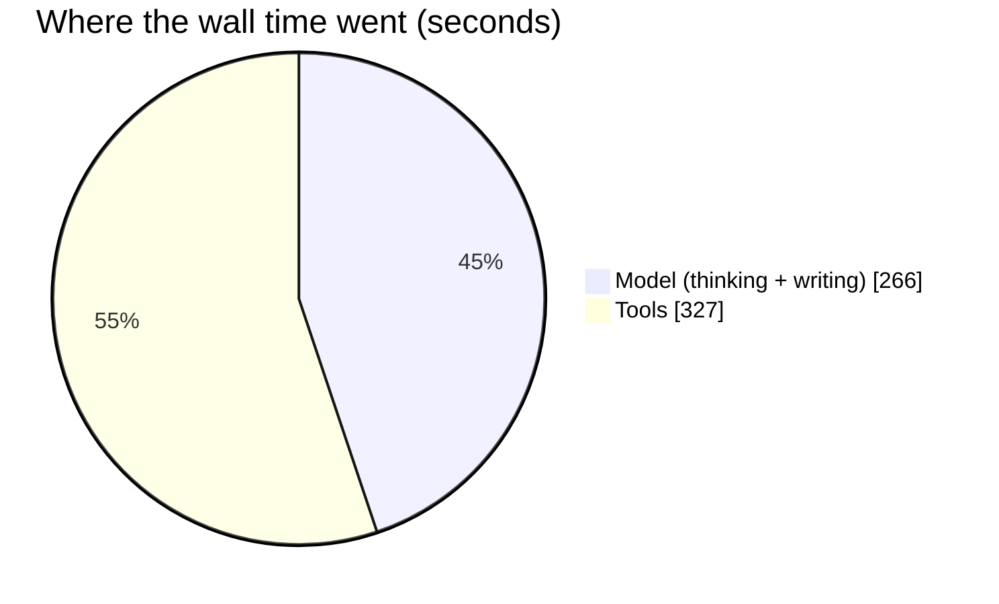

# firm-knowledge/tasks/071 · run2 (`hv-fk250-lunahigh-rep2-20261112T122308Z`)

Result: **fail** 6/7 criteria · 9.9 min · 50 model calls · 95 tool calls (2 errors or timeouts) · ending `completed` · started 11-12 18:15:41 IST

## Overview

One box per stretch of steps that used the same kind of tool (blue: looking/searching/reading, purple: writing or editing files, yellow: a message with no tool call, red border: a tool error or timeout inside the box).

```mermaid
flowchart TD
    T(["Task prompt"])
    P0["<b>Step 1</b> · 0.1 min<br/>todo_write"]
    T --> P0
    class P0 look
    P1["<b>Steps 2-3</b> · 0.2 min<br/>glob x2<br/>grep<br/><i>**/*, **/*{healthcare,life-sciences,life sc…, documents</i>"]
    P0 --> P1
    class P1 look
    P2["<b>Step 4</b> · 0.1 min<br/>read<br/><i>548f5fa91efd-glob-results.txt</i>"]
    P1 --> P2
    class P2 err
    P3["<b>Steps 5-6</b> · 0.3 min<br/>glob x11<br/><i>**/*IRB*, **/*irb*, **/*informed* +8</i>"]
    P2 --> P3
    class P3 look
    P4["<b>Steps 7-8</b> · 0.7 min<br/>bash x2<br/><i>for f in \ 'documents/matters/1018-00…, mkdir -p scratch/parsed && \ parse-do…</i>"]
    P3 --> P4
    class P4 look
    P5["<b>Step 9</b> · 0.0 min<br/>read x5<br/><i>1018-opening.txt, 1018-irb.txt, 1018-hipaa.txt +2</i>"]
    P4 --> P5
    class P5 look
    P6["<b>Step 10</b> · 0.2 min<br/>bash<br/><i>parse-doc docx 'documents/matters/103…</i>"]
    P5 --> P6
    class P6 look
    P7["<b>Step 11</b> · 0.1 min<br/>read x5<br/><i>1037-engagement.txt, 1037-irb.txt, 1037-consentdraft.txt +2</i>"]
    P6 --> P7
    class P7 look
    P8["<b>Step 12</b> · 0.2 min<br/>bash<br/><i>parse-doc docx 'documents/matters/102…</i>"]
    P7 --> P8
    class P8 look
    P9["<b>Step 13</b> · 0.0 min<br/>read x4<br/><i>1029-engagement.txt, 1029-protocol.txt, 1029-cta.txt +1</i>"]
    P8 --> P9
    class P9 look
    P10["<b>Step 14</b> · 1.7 min<br/>bash<br/><i>python - #lt;#lt;'PY' #gt; scratch/docx-keywor…</i>"]
    P9 --> P10
    class P10 look
    P11["<b>Step 15</b> · 0.1 min<br/>grep<br/><i>docx-keyword-scan.txt</i>"]
    P10 --> P11
    class P11 look
    P12["<b>Step 16</b> · 1.5 min<br/>bash<br/><i>python - #lt;#lt;'PY' #gt; scratch/matter-scan…</i>"]
    P11 --> P12
    class P12 look
    P13["<b>Steps 17-18</b> · 0.1 min<br/>read x2<br/><i>matter-scan-summary.txt</i>"]
    P12 --> P13
    class P13 look
    P14["<b>Step 19</b> · 0.4 min<br/>glob x8<br/><i>documents/matters/1013-00004/Engageme…, documents/matters/1018-00003/Engageme…, documents/matters/1018-00005/**/* +5</i>"]
    P13 --> P14
    class P14 look
    P15["<b>Step 20</b> · 0.3 min<br/>bash<br/><i>mkdir -p scratch/candidates && \ pars…</i>"]
    P14 --> P15
    class P15 look
    P16["<b>Step 21</b> · 0.1 min<br/>read x8<br/><i>1013-engagement.txt, 1018-03-engagement.txt, 1018-06-engagement.txt +5</i>"]
    P15 --> P16
    class P16 look
    P17["<b>Step 22</b> · 0.3 min<br/>bash<br/><i>parse-doc docx 'documents/matters/101…</i>"]
    P16 --> P17
    class P17 look
    P18["<b>Step 23</b> · 0.1 min<br/>read x7<br/><i>1018-06-scheduleb.txt, 1018-06-pharmaco.txt, 1018-06-license.txt +4</i>"]
    P17 --> P18
    class P18 look
    P19["<b>Step 24</b> · 0.1 min<br/>glob<br/><i>documents/matters/1018-00003/Due Dili…</i>"]
    P18 --> P19
    class P19 look
    P20["<b>Step 25</b> · 0.2 min<br/>bash<br/><i>parse-doc docx 'documents/matters/101…</i>"]
    P19 --> P20
    class P20 look
    P21["<b>Step 26</b> · 0.0 min<br/>read x3<br/><i>1018-03-regdd.txt, 1018-03-request.txt, 1018-03-merger.txt</i>"]
    P20 --> P21
    class P21 look
    P22["<b>Steps 27-28</b> · 0.2 min<br/>glob x2<br/><i>documents/matters/1013-00004/**/*, documents/matters/1001-00007/**/*</i>"]
    P21 --> P22
    class P22 look
    P23["<b>Steps 29-30</b> · 0.4 min<br/>bash x2<br/><i>parse-doc docx 'documents/matters/100…</i>"]
    P22 --> P23
    class P23 look
    P24["<b>Step 31</b> · 0.1 min<br/>read x2<br/><i>1001-07-healthcare.txt, 1001-07-engagement.txt</i>"]
    P23 --> P24
    class P24 look
    P25["<b>Step 32</b> · 0.1 min<br/>grep<br/><i>1001-07-healthcare.txt</i>"]
    P24 --> P25
    class P25 look
    P26["<b>Step 33</b> · 0.1 min<br/>bash<br/><i>parse-doc docx 'documents/matters/100…</i>"]
    P25 --> P26
    class P26 look
    P27["<b>Step 34</b> · 0.1 min<br/>grep<br/><i>1001-07-disclosure.txt</i>"]
    P26 --> P27
    class P27 look
    P28["<b>Step 35</b> · 0.1 min<br/>bash<br/><i>parse-doc docx 'documents/matters/101…</i>"]
    P27 --> P28
    class P28 look
    P29["<b>Step 36</b> · 0.1 min<br/>grep<br/><i>1018-05-pediatric.txt</i>"]
    P28 --> P29
    class P29 look
    P30["<b>Step 37</b> · 0.2 min<br/>bash<br/><i>parse-doc docx 'documents/matters/101…</i>"]
    P29 --> P30
    class P30 look
    P31["<b>Step 38</b> · 0.2 min<br/>grep x3<br/><i>1013-gap.txt, 1013-dossier.txt, 1013-ncd.txt</i>"]
    P30 --> P31
    class P31 look
    P32["<b>Step 39</b> · 0.2 min<br/>bash<br/><i>parse-doc docx 'documents/matters/103…</i>"]
    P31 --> P32
    class P32 look
    P33["<b>Steps 40-42</b> · 0.3 min<br/>grep x3<br/><i>1037-06-regdd.txt, 1018-08-fdadd.txt, 1018-03-regdd.txt</i>"]
    P32 --> P33
    class P33 look
    P34["<b>Step 43</b> · 0.1 min<br/>read<br/><i>1018-05-pediatric.txt</i>"]
    P33 --> P34
    class P34 look
    P35["<b>Step 44</b> · 0.1 min<br/>todo_write"]
    P34 --> P35
    class P35 look
    P36["<b>Step 45</b> · 0.8 min<br/>write<br/><i>response.md</i>"]
    P35 --> P36
    class P36 write
    P37["<b>Step 46</b> · 0.1 min<br/>todo_write"]
    P36 --> P37
    class P37 look
    P38["<b>Steps 47-48</b> · 0.1 min<br/>read x2<br/><i>response.md</i>"]
    P37 --> P38
    class P38 err
    P39["<b>Step 49</b> · 0.1 min<br/>todo_write"]
    P38 --> P39
    class P39 look
    P40["<b>Step 50</b> · 0.0 min<br/>final message"]
    P39 --> P40
    class P40 ans
    R(["FAIL: 6/7 criteria"])
    P40 --> R
    class R fail
    classDef look fill:#e8f0fe,stroke:#4a6fa5,color:#111
    classDef write fill:#f3e8fd,stroke:#7b1fa2,color:#111
    classDef ans fill:#fff8e1,stroke:#b58900,color:#111
    classDef err fill:#e8f0fe,stroke:#c62828,stroke-width:3px,color:#111
    classDef pass fill:#e6f4ea,stroke:#2e7d32,color:#111
    classDef fail fill:#fce8e6,stroke:#c62828,color:#111
```





One row per model call:

| Step | Started (IST) | Model s | Tools s | Tool calls | Tools | Output chars |
|---|---|---|---|---|---|---|
| 1 | 18:15:41 | 3 | 0 | 1 | todo_write | 57 |
| 2 | 18:15:44 | 1 | 3 | 1 | glob | 8,520 |
| 3 | 18:15:48 | 4 | 1 | 2 | glob, grep | 9,070 |
| 4 | 18:15:53 | 4 | 0 | 1 | read ⚠ | 66 |
| 5 | 18:15:57 | 3 | 10 | 8 | glob x8 | 13,720 |
| 6 | 18:16:11 | 4 | 3 | 3 | glob x3 | 11,394 |
| 7 | 18:16:18 | 6 | 16 | 1 | bash | 49,955 |
| 8 | 18:16:40 | 5 | 17 | 1 | bash | 11 |
| 9 | 18:17:02 | 2 | 0 | 5 | read x5 | 212,436 |
| 10 | 18:17:05 | 4 | 10 | 1 | bash | 11 |
| 11 | 18:17:19 | 3 | 0 | 5 | read x5 | 177,040 |
| 12 | 18:17:22 | 4 | 9 | 1 | bash | 11 |
| 13 | 18:17:35 | 2 | 0 | 4 | read x4 | 132,787 |
| 14 | 18:17:37 | 10 | 91 | 1 | bash | 49,888 |
| 15 | 18:19:18 | 4 | 1 | 1 | grep | 49,874 |
| 16 | 18:19:22 | 7 | 80 | 1 | bash | 14,273 |
| 17 | 18:20:50 | 2 | 0 | 1 | read | 16,334 |
| 18 | 18:20:52 | 2 | 0 | 1 | read | 4,670 |
| 19 | 18:20:55 | 8 | 13 | 8 | glob x8 | 2,909 |
| 20 | 18:21:16 | 4 | 13 | 1 | bash | 11 |
| 21 | 18:21:33 | 3 | 0 | 8 | read x8 | 230,829 |
| 22 | 18:21:37 | 7 | 12 | 1 | bash | 11 |
| 23 | 18:21:56 | 5 | 0 | 7 | read x7 | 291,196 |
| 24 | 18:22:01 | 4 | 1 | 1 | glob | 643 |
| 25 | 18:22:06 | 3 | 6 | 1 | bash | 11 |
| 26 | 18:22:16 | 3 | 0 | 3 | read x3 | 112,796 |
| 27 | 18:22:19 | 5 | 1 | 1 | glob | 2,860 |
| 28 | 18:22:24 | 5 | 1 | 1 | glob | 2,676 |
| 29 | 18:22:29 | 3 | 4 | 1 | bash | 26 |
| 30 | 18:22:36 | 12 | 5 | 1 | bash | 36 |
| 31 | 18:22:54 | 3 | 0 | 2 | read x2 | 70,164 |
| 32 | 18:22:57 | 6 | 1 | 1 | grep | 16 |
| 33 | 18:23:04 | 4 | 3 | 1 | bash | 11 |
| 34 | 18:23:11 | 3 | 1 | 1 | grep | 847 |
| 35 | 18:23:15 | 5 | 3 | 1 | bash | 11 |
| 36 | 18:23:23 | 4 | 1 | 1 | grep | 1,497 |
| 37 | 18:23:28 | 4 | 7 | 1 | bash | 11 |
| 38 | 18:23:40 | 3 | 7 | 3 | grep x3 | 3,639 |
| 39 | 18:23:51 | 7 | 2 | 1 | bash | 11 |
| 40 | 18:24:00 | 3 | 1 | 1 | grep | 634 |
| 41 | 18:24:04 | 3 | 3 | 1 | grep | 5,072 |
| 42 | 18:24:10 | 8 | 1 | 1 | grep | 1,962 |
| 43 | 18:24:18 | 5 | 0 | 1 | read | 25,591 |
| 44 | 18:24:23 | 6 | 0 | 1 | todo_write | 57 |
| 45 | 18:24:29 | 49 | 0 | 1 | write | 205 |
| 46 | 18:25:18 | 4 | 0 | 1 | todo_write | 57 |
| 47 | 18:25:22 | 3 | 0 | 1 | read ⚠ | 165 |
| 48 | 18:25:25 | 5 | 0 | 1 | read | 25,918 |
| 49 | 18:25:30 | 4 | 0 | 1 | todo_write | 57 |
| 50 | 18:25:34 | 3 | 0 | 0 | (message only) | 0 |

## Task prompt

```text
For a CLE session on human-subjects research, I want work-product examples. Pull our Healthcare & Life Sciences matters that involved informed consent or IRB review, along with the relevant documents.

Output: write your complete answer to `response.md` — a single self-contained markdown file with your findings, the matters/documents you relied on, and your reasoning.
```

## Rubric

| # | Criterion | Verdict |
|---|---|---|
| C-001 | Qualifying matter — Penterra Pharmaceuticals 1018-00004 | pass |
| C-002 | Qualifying matter — Thornwick Medical Research Institute 1029-00001 | pass |
| C-003 | Qualifying matter — Solstice Biomedical 1037-00002 | pass |
| C-004 | Proof document — 1018-00004 | pass |
| C-005 | Proof document — 1029-00001 | pass |
| C-006 | Proof document — 1037-00002 | pass |
| C-007 | Qualifying set — precision | **FAIL** |

Judge's reasoning:

**C-001 (pass):** Qualifying matter — Penterra Pharmaceuticals 1018-00004

```text
The output explicitly identifies Matter 1018-00004 involving Penterra Pharmaceuticals as a qualifying informed-consent/IRB matter and provides detailed supporting documents and themes.
```

**C-002 (pass):** Qualifying matter — Thornwick Medical Research Institute 1029-00001

```text
The output explicitly identifies Matter 1029-00001 as Thornwick Medical Research Institute and includes it as a qualifying informed-consent/IRB matter, with supporting discussion of IRB approval and informed-consent obligations.
```

**C-003 (pass):** Qualifying matter — Solstice Biomedical 1037-00002

```text
The output expressly identifies Matter 1037-00002 — Solstice Biomedical — as a qualifying informed-consent/IRB review matter and provides detailed supporting documents and themes.
```

**C-004 (pass):** Proof document — 1018-00004

```text
The output identifies multiple qualifying proof documents from matter 1018-00004, including `irb-reliance-central-irb-memo.docx` and `mcta-execution-version.docx`, and describes their IRB and informed-consent content.
```

**C-005 (pass):** Proof document — 1029-00001

```text
The output identifies all three qualifying documents for Matter 1029-00001: clinical-trial-agreement-execution.docx, exhibit-b-protocol-synopsis.docx, and memo-indemnification-analysis.docx, and explains their informed-consent and IRB content.
```

**C-006 (pass):** Proof document — 1037-00002

```text
The output identifies multiple qualifying documents from Matter 1037-00002, including irb-submission-strategy-memo.docx, ide-exemption-analysis-memo.docx, informed-consent-template-draft.docx, and informed-consent-template-markup.docx, and describes their IRB and informed-consent content.
```

**C-007 (fail):** Qualifying set — precision

```text
The output asserts five additional matters as qualifying beyond the permitted set: 1018-00008, 1018-00003, 1018-00005, 1018-00006, and 1013-00004. Labeling some as adjacent does not cure this because they are expressly included among the eight matters found and treated as responsive examples.
```

## Delivered files (output/)

- `response.md` (24,968 bytes)

`response.md`:

```markdown
# Healthcare & Life Sciences matters involving informed consent or IRB review

## Executive summary

I found **eight Healthcare & Life Sciences matters** with substantive work product addressing informed consent, Institutional Review Board (IRB)/ethics-committee review, or the planning, diligence, or contractual allocation of those requirements in human-subjects research.

The strongest CLE work-product examples are:

1. **Matter 1018-00004 — Penterra / Veridian CLARION Phase III clinical trial:** a full clinical-trial contracting and regulatory workstream, including central-IRB reliance, informed consent, HIPAA research authorization, investigator obligations, safety reporting, and site activation.
2. **Matter 1037-00002 — Solstice LUMINA-US device study:** an IRB submission strategy, NSR/IDE analysis, and informed-consent drafting/markup for a six-site medical-device study.
3. **Matter 1029-00001 — TMRI / HUMC Cadence-3 device study:** a single-site clinical-trial agreement and protocol synopsis with existing HUMC IRB approval and detailed informed-consent obligations.
4. **Matter 1018-00008 — Penterra’s acquisition of Veridian Biosciences:** transaction diligence and post-signing work reviewing IRB/IEC approvals, informed-consent forms, monitoring reports, and a protocol amendment implemented amid an FDA partial clinical hold.
5. **Matter 1018-00003 — Penterra’s Caliston BioSciences acquisition / special-committee diligence:** regulatory diligence confirming IRB/EC approvals and written informed consent across a 48-site Phase 2b trial.

I also found three more adjacent examples—useful for showing how consent/IRB issues arise in lifecycle, pediatric, licensing, and evidence-development work, but not as the primary subject of the engagement: Matters **1018-00005**, **1018-00006**, and **1013-00004**.

The repository contains privileged, confidential, and attorney-work-product documents. They should be treated accordingly in the CLE materials.

## Included matters and documents

### 1. Matter 1018-00004 — Penterra Pharmaceuticals / Veridian Health Research Network — CLARION MCTA and site agreements

**Matter profile.** This is the clearest end-to-end human-subjects-research matter. The matter-opening memorandum describes C&H’s representation of Penterra in negotiating the Master Clinical Trial Agreement (MCTA) and site-network agreements for **Protocol PPC-4871-III (CLARION)**, a Phase III, randomized, double-blind, placebo-controlled trial of penterafenib for advanced hepatocellular carcinoma. The trial contemplated approximately 1,200 subjects across 38 academic medical-center sites.

**Key work-product themes.**

- A proposed **two-track IRB model**: Graystone University IRB for the Pennsylvania lead site and the Veridian Central IRB for the remaining sites under IRB Authorization Agreements.
- IRB approval as a **condition precedent to site activation and enrollment**.
- IRB review of the protocol, informed-consent form, recruitment materials, HIPAA authorization, amendments, safety reports, and unanticipated problems.
- Written informed consent before any study-specific procedure, with re-consent when new safety information or protocol changes could affect a subject’s willingness to continue.
- HIPAA research authorization, including the recommendation to integrate the authorization into the informed-consent form while keeping the two legal functions distinct.
- Operational safety reporting and distribution of IND safety reports to the applicable IRBs.

**Relevant documents relied on.**

- `documents/matters/1018-00004/Engagement/matter-opening-memo.docx` — identifies the matter, parties, CLARION protocol, Phase III trial, 38-site network, and 1,200-subject plan.
- `documents/matters/1018-00004/Regulatory & Compliance/irb-reliance-central-irb-memo.docx` — the principal IRB work product. It recommends the two-track model, explains reliance agreements, allocates reviewing-IRB/relying-institution responsibilities, addresses FDA/Common Rule/ICH requirements, and requires approved informed-consent materials before enrollment.
- `documents/matters/1018-00004/Regulatory & Compliance/hipaa-research-authorization-memo.docx` — analyzes HIPAA authorization for research PHI and explains how it differs from FDA informed consent. It recommends obtaining authorization from every prospective subject and integrating it into the informed-consent document, subject to IRB review.
- `documents/matters/1018-00004/Transaction Documents/Schedules & Exhibits/exhibit-a-protocol-synopsis.docx` — protocol synopsis. It requires written informed consent before study-related procedures and describes the adult oncology population, endpoints, 38-site network, and trial design.
- `documents/matters/1018-00004/Transaction Documents/Schedules & Exhibits/exhibit-h-regulatory-compliance.docx` — MCTA regulatory-compliance exhibit addressing FDA, GCP, IRB, informed-consent, and site obligations.
- `documents/matters/1018-00004/Transaction Documents/Schedules & Exhibits/exhibit-i-form-investigator-undertaking.docx` — practical investigator form. It requires written informed consent before screening or other study procedures, use of the current IRB-approved form, re-consent after material new information, and IRB approval before enrollment.
- `documents/matters/1018-00004/Transaction Documents/Schedules & Exhibits/exhibit-j-safety-reporting-procedures.docx` — shows how safety reporting, IRB reporting, and continuing oversight operate in practice, including the different Graystone and Veridian Central IRB pathways.
- `documents/matters/1018-00004/Transaction Documents/Execution/mcta-execution-version.docx` — executed master agreement tying the regulatory framework to the operative contract.
- `documents/matters/1018-00004/Transaction Documents/Site Joinders/site-agreement-graystone-001.docx` and `.../site-agreement-lakemont-002.docx` — site-level examples showing how the master framework is applied to a local institution and investigator.

**Why it is useful for the CLE.** It supplies a complete example of moving from regulatory analysis to contract language, site activation conditions, investigator undertakings, consent-form control, IRB reliance, and safety-reporting mechanics.

### 2. Matter 1037-00002 — Solstice Biomedical — LUMINA-US CGM device study

**Matter profile.** Solstice engaged C&H for FDA Pre-Submission strategy, 510(k) planning, and related regulatory advice for the Lumina CGM System. The planned **LUMINA-US** study was a prospective, single-arm, multicenter device investigation at six U.S. sites, enrolling approximately 350 adults with Type 1 or Type 2 diabetes.

**Key work-product themes.**

- Use of **Clearwater Institutional Review Board LLC** as a single commercial/central IRB for all six sites.
- Site reliance/authorization agreements and one coordinated IRB submission.
- IRB review of the protocol, informed-consent form, recruitment materials, subject-facing materials, safety-monitoring plan, and sponsor’s NSR determination.
- Application of 21 C.F.R. Parts 50, 56, and 812 to an anticipated non-significant-risk, IDE-exempt device study.
- Drafting and legal markup of informed consent addressing device status, procedures, blood draws, glucose manipulation, risks, benefits, confidentiality, voluntary participation, withdrawal, and FDA inspection rights.

**Relevant documents relied on.**

- `documents/matters/1037-00002/Clinical Strategy/irb-submission-strategy-memo.docx` — principal IRB-submission work product. It identifies Clearwater IRB, sets out the single-IRB strategy, lists the required submission package, explains the IRB’s NSR determination role, and states that the ICF must be finalized and IRB-approved before enrollment.
- `documents/matters/1037-00002/Clinical Strategy/informed-consent-template-draft.docx` — draft ICF for LUMINA-US. It describes the investigational device, sensor insertion and wear, finger-stick and venous-blood procedures, glucose manipulation, risks, benefits, alternatives, confidentiality, voluntary participation, and withdrawal.
- `documents/matters/1037-00002/Clinical Strategy/informed-consent-template-markup.docx` — privileged line-by-line legal markup. It improves risk disclosure, clarifies the investigational/foreign regulatory status of the device, adds pregnancy and device-malfunction language, and makes study procedures and safety risks more explicit.
- `documents/matters/1037-00002/Clinical Strategy/ide-exemption-analysis-memo.docx` — companion analysis of the NSR/IDE-exemption pathway and the importance of Clearwater IRB’s independent risk determination.
- `documents/matters/1037-00002/Pre-Submission/pre-sub-package-clinical-protocol-summary.docx` — clinical protocol summary describing the six-site study, 350-subject enrollment, accuracy and safety endpoints, inclusion criterion requiring written informed consent, and intended FDA pathway.
- `documents/matters/1037-00002/Engagement/engagement-letter-solstice.docx` — confirms the HLS engagement included review of CRO and IRB engagement documents and clinical-study regulatory strategy.

**Why it is useful for the CLE.** This is a strong example of consent-form drafting and review in a device study, including how the consent document must communicate non-therapeutic benefit, device-specific physical risks, operational procedures, and the relationship between IRB approval and IDE/NSR status.

### 3. Matter 1029-00001 — Thornwick Medical Research Institute / Hargrove University Medical Center — Cadence-3 CTA

**Matter profile.** C&H represented Thornwick Medical Research Institute (TMRI) in negotiating and executing the clinical-trial agreement for **Cadence-3**, a prospective, single-arm, open-label feasibility study of the ThornValve MV-200 transcatheter mitral-valve repair device. The trial is a single-site study at HUMC, with a planned 45 evaluable subjects, conducted under IDE G260012.

**Key work-product themes.**

- HUMC IRB approv
… [14,810 more chars]
```

## Trajectory

### Step 1: 1 tool call

_Started 11-12 18:15:41 IST · model 3 s · tools 0 s_

**Reasoning summary:**

```text
**Organizing search tasks**

I need to search documents and inspect files, but I have to avoid task.json. It seems that I might need to use some skills, although the user may not have provided a skills catalog. I'll create a list for better organization and consider using glob for the file search. Since this involves multiple steps, I'll make a to-do list to keep everything on track. Let’s get started!
```

**Call `todo_write`** (0.0 s)

```json
{
 "todos": [
  {
   "content": "Inspect available matter files and identify HLS matters",
   "status": "in_progress"
  },
  {
   "content": "Review candidate documents for informed consent or IRB relevance",
   "status": "pending"
  },
  {
   "content": "Draft and save self-contained response.md with findings and reasoning",
   "status": "pending"
  },
  {
   "content": "Verify response file contents and completeness",
   "status": "pending"
  }
 ]
}
```

Output (57 chars):

```text
Updated todo list: 3 pending, 1 in progress, 0 completed.
```

**Todo list now:**

- [~] Inspect available matter files and identify HLS matters
- [ ] Review candidate documents for informed consent or IRB relevance
- [ ] Draft and save self-contained response.md with findings and reasoning
- [ ] Verify response file contents and completeness

### Step 2: 1 tool call

_Started 11-12 18:15:44 IST · model 1 s · tools 3 s_

**Call `glob`** (2.9 s)

```json
{
 "pattern": "**/*"
}
```

Output (8,520 chars):

```text
documents/matters/1001-00001/Antitrust Analysis/competitor-identification-chart.xlsx
documents/matters/1001-00001/Antitrust Analysis/portfolio-company-overlap-analysis.docx
documents/matters/1001-00001/Antitrust Analysis/hhi-concentration-analysis.xlsx
documents/matters/1001-00001/Antitrust Analysis/market-definition-competitive-analysis-memo.docx
documents/matters/1001-00001/Client Updates/biweekly-status-report-1.docx
documents/matters/1001-00001/Antitrust Analysis/preliminary-antitrust-risk-assessment.docx
documents/matters/1001-00001/Antitrust Analysis/state-regulatory-con-analysis.docx
documents/matters/1001-00001/Antitrust Analysis/vertical-relationships-analysis.docx
documents/matters/1001-00001/Closing/closing-memo-antitrust-workstream.docx
documents/matters/1001-00001/Client Updates/client-update-early-termination-granted.eml
documents/matters/1001-00001/Client Updates/biweekly-status-report-2.docx
documents/matters/1001-00001/Client Updates/client-update-hsr-forms-filed.eml
documents/matters/1001-00001/Closing/final-invoice-matter-closing-letter.docx
documents/matters/1001-00001/Closing/hsr-clearance-certificate.docx
documents/matters/1001-00001/Correspondence/Counterparty Counsel/email-gk-naics-code-consistency.eml
documents/matters/1001-00001/Early Termination/early-termination-request-letter.docx
documents/matters/1001-00001/Correspondence/Counterparty Counsel/letter-bracewell-thornton-regulatory-condition.docx
documents/matters/1001-00001/Correspondence/Counterp
… [7,020 more chars]
```

### Step 3: 2 tool calls

_Started 11-12 18:15:48 IST · model 4 s · tools 1 s_

**Reasoning summary:**

```text
**Exploring file searching methods**

I need to sort through various matters, particularly focusing on HLS and relevant keywords. I’m considering using grep across docx files, but then I remember it can’t search binaries. Maybe I could use bash with parse-doc to enumerate from glob results? I need to focus on metadata in the engagement documents. The instructions say to use glob patterns for filenames that include healthcare, consent, IRB, informed, and research. Let's figure this out!
```

**Call `glob`** (0.5 s)

```json
{
 "pattern": "**/*{healthcare,life-sciences,life sciences,clinical,IRB,irb,consent,informed,research,subject}*"
}
```

Output (9,054 chars):

```text
documents/matters/1001-00002/Amended Governing Documents/gp-member-consent-resolutions.docx
documents/matters/1001-00002/LP Consent & Notification/lpac-notification-and-consent-letter.docx
documents/matters/1001-00002/LP Consent & Notification/lpac-form-of-written-consent.docx
documents/matters/1001-00003/Diligence/healthcare-regulatory-compliance-memo.docx
documents/matters/1001-00003/Diligence/lease-consent-tracker.xlsx
documents/matters/1001-00004/Diligence/change-of-control-consent-tracker.xlsx
documents/matters/1001-00004/Transaction Documents/Merger Agreement/written-consent-board-apex-holdings.docx
documents/matters/1001-00004/Transaction Documents/Merger Agreement/written-consent-board-merger-sub.docx
documents/matters/1001-00004/Transaction Documents/Merger Agreement/written-consent-sole-stockholder-merger-sub.docx
documents/matters/1001-00007/Diligence/healthcare-regulatory-diligence-memo.docx
documents/matters/1002-00002/Closing/board-consent-pre-closing-quillen.docx
documents/matters/1002-00002/Closing/stockholder-consent-quillen.docx
documents/matters/1002-00004/Diligence/lender-consent-analysis-memo.docx
documents/matters/1003-00003/Diligence/change-of-control-consent-tracker.xlsx
documents/matters/1003-00004/Corporate/Governance/merger-sub-sole-stockholder-consent.docx
documents/matters/1003-00005/Correspondence/email-cross-to-mattingly-lender-consent-question.eml
documents/matters/1004-00001/Transaction Documents/Corporate Governance/stockholder-consent.docx
d
… [7,554 more chars]
```

**Call `grep`** (0.5 s)

```json
{
 "pattern": "(?i)(healthcare|life sciences|clinical|IRB|informed consent|human subject|research subject)",
 "path": "documents",
 "include": "*.md"
}
```

Output (16 chars):

```text
No matches found
```

### Step 4: 1 tool call

_Started 11-12 18:15:53 IST · model 4 s · tools 0 s_

**Reasoning summary:**

```text
**Identifying candidate matters**

I need to look into candidate matters like 1018-00004 and 1018-00008, maybe for HLS, and 1013-00004 for clinical evidence. It's important to identify anything related to informed consent or IRB review as well. I think I need to search the filenames more thoroughly and document their content by parsing. The glob output is limited to 204 entries, so I should read the spill to list all the relevant information.
```

**Call `read`** (0.0 s · **error/timeout**)

```json
{
 "file_path": "/tmp/dsh-spill-vFGWSF/session-a638bfe327e9/548f5fa91efd-glob-results.txt",
 "offset": 1,
 "limit": 250
}
```

Output (66 chars):

```text
Error: [sandbox: file access denied under workspace-isolated mode]
```

### Step 5: 8 tool calls

_Started 11-12 18:15:57 IST · model 3 s · tools 10 s_

**Call `glob`** (1.4 s)

```json
{
 "pattern": "**/*IRB*"
}
```

Output (14 chars):

```text
No files found
```

**Call `glob`** (0.9 s)

```json
{
 "pattern": "**/*irb*"
}
```

Output (168 chars):

```text
documents/matters/1018-00004/Regulatory & Compliance/irb-reliance-central-irb-memo.docx
documents/matters/1037-00002/Clinical Strategy/irb-submission-strategy-memo.docx
```

**Call `glob`** (0.8 s)

```json
{
 "pattern": "**/*informed*"
}
```

Output (168 chars):

```text
documents/matters/1037-00002/Clinical Strategy/informed-consent-template-markup.docx
documents/matters/1037-00002/Clinical Strategy/informed-consent-template-draft.docx
```

**Call `glob`** (0.7 s)

```json
{
 "pattern": "**/*subject*"
}
```

Output (391 chars):

```text
documents/matters/1018-00004/Analysis & Strategy/subject-injury-indemnification-memo.docx
documents/matters/1018-00004/Transaction Documents/Schedules & Exhibits/exhibit-d-subject-injury-indemnification.docx
documents/matters/1022-00007/Policies & Governance/data-subject-rights-procedure.docx
documents/matters/1032-00004/Intellectual Property/government-rights-subject-inventions-memo.docx
```

**Call `glob`** (0.7 s)

```json
{
 "pattern": "**/*clinical*"
}
```

Output (443 chars):

```text
documents/matters/1013-00004/Memos & Analyses/clinical-evidence-gap-analysis.docx
documents/matters/1018-00008/Interim Period/fda-clinical-hold-closing-impact-memo.docx
documents/matters/1018-00008/MAE Analysis & Termination/mae-analysis-clinical-data-memo.docx
documents/matters/1029-00001/Transaction Documents/clinical-trial-agreement-execution.docx
documents/matters/1037-00002/Pre-Submission/pre-sub-package-clinical-protocol-summary.docx
```

**Call `glob`** (2.0 s)

```json
{
 "pattern": "**/*HIPAA*"
}
```

Output (14 chars):

```text
No files found
```

**Call `glob`** (1.6 s)

```json
{
 "pattern": "**/*research*"
}
```

Output (3,572 chars):

```text
documents/matters/1005-00005/Legal Analysis/research-memo-il-surcharge-contract-interpretation.docx
documents/matters/1007-00008/Correspondence/Internal/email-liu-to-crawford-rtos-licensing-research.eml
documents/matters/1012-00005/Experts/daubert-motion-research-memo.docx
documents/matters/1015-00005/Tax Memoranda/research-memo-6418-partnership-flip-interaction.docx
documents/matters/1017-00002/documents/email-zhou-to-walsh-blasius-research.eml
documents/matters/1017-00003/Correspondence/email-schultz-to-siddiqui-research-assignments.eml
documents/matters/1018-00004/Regulatory & Compliance/hipaa-research-authorization-memo.docx
documents/matters/1018-00007/Motions Practice/research-memo-declaratory-judgment-standards.docx
documents/matters/1018-00007/Motions Practice/research-memo-written-modification-clauses.docx
documents/matters/1018-00009/Correspondence/Internal/email-simmons-to-nazari-penalty-research-20221028.eml
documents/matters/1018-00009/Strategy/research-memo-rev-proc-2015-41.docx
documents/matters/1018-00009/Strategy/research-memo-idr-enforcement-procedures.docx
documents/matters/1018-00009/Strategy/research-memo-correlative-adjustments.docx
documents/matters/1019-00003/Research/research-memo-tradeoff-documentation.docx
documents/matters/1019-00003/Research/research-memo-unequal-discussions.docx
documents/matters/1021-00005/Correspondence/Internal/email-petrov-to-crawford-research-update.eml
documents/matters/1021-00006/Motions & Briefing/research-memo-liquidated
… [2,072 more chars]
```

**Call `glob`** (2.0 s)

```json
{
 "pattern": "**/*consent*"
}
```

Output (8,950 chars):

```text
documents/matters/1001-00002/Amended Governing Documents/gp-member-consent-resolutions.docx
documents/matters/1001-00002/LP Consent & Notification/lpac-notification-and-consent-letter.docx
documents/matters/1001-00002/LP Consent & Notification/lpac-form-of-written-consent.docx
documents/matters/1001-00003/Diligence/lease-consent-tracker.xlsx
documents/matters/1001-00004/Diligence/change-of-control-consent-tracker.xlsx
documents/matters/1001-00004/Transaction Documents/Merger Agreement/written-consent-board-apex-holdings.docx
documents/matters/1001-00004/Transaction Documents/Merger Agreement/written-consent-board-merger-sub.docx
documents/matters/1001-00004/Transaction Documents/Merger Agreement/written-consent-sole-stockholder-merger-sub.docx
documents/matters/1002-00002/Closing/board-consent-pre-closing-quillen.docx
documents/matters/1002-00002/Closing/stockholder-consent-quillen.docx
documents/matters/1002-00004/Diligence/lender-consent-analysis-memo.docx
documents/matters/1003-00003/Diligence/change-of-control-consent-tracker.xlsx
documents/matters/1003-00004/Corporate/Governance/merger-sub-sole-stockholder-consent.docx
documents/matters/1003-00005/Correspondence/email-cross-to-mattingly-lender-consent-question.eml
documents/matters/1004-00001/Transaction Documents/Corporate Governance/stockholder-consent.docx
documents/matters/1004-00001/Transaction Documents/Corporate Governance/board-consent.docx
documents/matters/1005-00006/Closing/greystone-lender-consent.docx
docume
… [7,450 more chars]
```

### Step 6: 3 tool calls

_Started 11-12 18:16:11 IST · model 4 s · tools 3 s_

**Call `glob`** (0.7 s)

```json
{
 "pattern": "documents/matters/1018-00004/**/*"
}
```

Output (7,036 chars):

```text
documents/matters/1018-00004/Analysis & Strategy/indemnification-benchmarking-memo.docx
documents/matters/1018-00004/Analysis & Strategy/insurance-requirements-analysis-memo.docx
documents/matters/1018-00004/Analysis & Strategy/regulatory-compliance-checklist.xlsx
documents/matters/1018-00004/Analysis & Strategy/ny-governing-law-memo.docx
documents/matters/1018-00004/Analysis & Strategy/preliminary-issues-memo.docx
documents/matters/1018-00004/Analysis & Strategy/subject-injury-indemnification-memo.docx
documents/matters/1018-00004/Closing/closing-binder-index.docx
documents/matters/1018-00004/Closing/closing-certificate-veridian.docx
documents/matters/1018-00004/Closing/closing-certificate-penterra.docx
documents/matters/1018-00004/Closing/secretary-certificate-veridian.docx
documents/matters/1018-00004/Closing/officer-certificate-penterra.docx
documents/matters/1018-00004/Closing/closing-checklist.xlsx
documents/matters/1018-00004/Closing/closing-memorandum.docx
documents/matters/1018-00004/Closing/conditions-precedent-satisfaction-memo.docx
documents/matters/1018-00004/Closing/secretary-certificate-penterra.docx
documents/matters/1018-00004/Correspondence/email-client-update-post-session.eml
documents/matters/1018-00004/Correspondence/email-scheduling-negotiation-session.eml
documents/matters/1018-00004/Correspondence/matter-closing-confirmation-letter.docx
documents/matters/1018-00004/Correspondence/letter-transmitting-second-draft.docx
documents/matters/1018-00004/Corres
… [5,536 more chars]
```

**Call `glob`** (1.3 s)

```json
{
 "pattern": "documents/matters/1037-00002/**/*"
}
```

Output (3,405 chars):

```text
documents/matters/1037-00002/510(k) Submission Drafts/510k-submission-cover-letter-draft.docx
documents/matters/1037-00002/510(k) Submission Drafts/510k-summary-draft.docx
documents/matters/1037-00002/510(k) Submission Drafts/indications-for-use-draft-form-3881.docx
documents/matters/1037-00002/510(k) Submission Drafts/substantial-equivalence-comparison-draft.xlsx
documents/matters/1037-00002/510(k) Submission Drafts/labeling-review-memo.docx
documents/matters/1037-00002/Administrative/client-status-report-template.docx
documents/matters/1037-00002/Clinical Strategy/cro-agreement-review-memo.docx
documents/matters/1037-00002/Administrative/privilege-work-product-guidelines-memo.docx
documents/matters/1037-00002/Clinical Strategy/informed-consent-template-markup.docx
documents/matters/1037-00002/Clinical Strategy/ide-exemption-analysis-memo.docx
documents/matters/1037-00002/Clinical Strategy/irb-submission-strategy-memo.docx
documents/matters/1037-00002/Clinical Strategy/informed-consent-template-draft.docx
documents/matters/1037-00002/Correspondence/coordination-letter-pinnacle.docx
documents/matters/1037-00002/Correspondence/email-calloway-to-tierney-pre-sub-timeline.eml
documents/matters/1037-00002/Correspondence/email-whitfield-to-morrissey-predicate-research.eml
documents/matters/1037-00002/Correspondence/email-calloway-to-hale-revised-timeline.eml
documents/matters/1037-00002/Engagement/conflict-check-memo.docx
documents/matters/1037-00002/Pre-Submission/pre-sub-meeting-
… [1,905 more chars]
```

**Call `glob`** (0.7 s)

```json
{
 "pattern": "documents/matters/1029-00001/**/*"
}
```

Output (953 chars):

```text
documents/matters/1029-00001/Analyses/memo-indemnification-analysis.docx
documents/matters/1029-00001/Closing/closing-checklist.xlsx
documents/matters/1029-00001/Correspondence/email-indemnification-negotiation-update.eml
documents/matters/1029-00001/Analyses/negotiation-comparison-chart.xlsx
documents/matters/1029-00001/Analyses/memo-ip-publication-rights-analysis.docx
documents/matters/1029-00001/Transaction Documents/clinical-trial-agreement-execution.docx
documents/matters/1029-00001/Correspondence/email-internal-signing-status-update.eml
documents/matters/1029-00001/Correspondence/transmittal-letter-execution-version.docx
documents/matters/1029-00001/Correspondence/email-ip-publication-negotiation-update.eml
documents/matters/1029-00001/Engagement/engagement-letter-tmri.docx
documents/matters/1029-00001/Transaction Documents/exhibit-a-study-budget.xlsx
documents/matters/1029-00001/Transaction Documents/exhibit-b-protocol-synopsis.docx
```

### Step 7: 1 tool call

_Started 11-12 18:16:18 IST · model 6 s · tools 16 s_

**Reasoning summary:**

```text
**Looking into clinical trials**

I’m focusing on the clinical trial MCTA, which involves IRB and informed consent—both of which seem relevant. There are other documents to consider, like the 1037 device clinical study, also related to informed consent. For the 1029 CTA, it seems there may not be explicit IRB filenames, but the protocol synopsis could include informed consent. I need to inspect documents, possibly parsing them using bash with loops and delimiters for better organization.
```

**Call `bash`** (16.4 s)

```json
{
 "command": "for f in \\\n'documents/matters/1018-00004/Engagement/matter-opening-memo.docx' \\\n'documents/matters/1018-00004/Engagement/engagement-letter-penterra.docx' \\\n'documents/matters/1018-00004/Regulatory & Compliance/irb-reliance-central-irb-memo.docx' \\\n'documents/matters/1018-00004/Regulatory & Compliance/hipaa-research-authorization-memo.docx' \\\n'documents/matters/1018-00004/Transaction Documents/MCTA Drafts/key-open-issues-memo.docx' \\\n'documents/matters/1018-00004/Transaction Documents/Schedules & Exhibits/exhibit-a-protocol-synopsis.docx' \\\n'documents/matters/1018-00004/Transaction Documents/Schedules & Exhibits/exhibit-h-regulatory-compliance.docx' \\\n'documents/matters/1018-00004/Transaction Documents/Schedules & Exhibits/exhibit-i-form-investigator-undertaking.docx' \\\n'documents/matters/1018-00004/Transaction Documents/Schedules & Exhibits/exhibit-j-safety-reporting-procedures.docx'; do echo \"===== $f =====\"; parse-doc docx \"$f\"; done",
 "timeoutMs": 120000,
 "description": "Parse key clinical-trial matter documents"
}
```

Output (49,955 chars):

```text
rated, causing minimal discomfort), moderate (sufficiently discomforting to interfere with usual activities), or severe (preventing normal daily activities);
>
> \(d\) Relationship to study treatment, assessed by the investigator as: unrelated, unlikely related, possibly related, probably related, or definitely related;
>
> \(e\) Action taken with study drug (none, dose reduced, dose interrupted, drug permanently discontinued, not applicable);
>
> \(f\) Treatment or corrective action taken for the adverse event;
>
> \(g\) Outcome (recovered/resolved, recovering/resolving, not recovered/not resolved, recovered with sequelae, fatal, unknown); and
>
> \(h\) Whether the event meets the criteria for an adverse event of special interest as defined in the Protocol.

**4.2 Serious Adverse Event Reporting --- Initial Report**

**Sites must report all SAEs to the Sponsor (Penterra) and Meridian CRO within twenty-four (24) hours of the site becoming aware of the event.** The twenty-four (24)-hour reporting clock begins at the moment any qualified site personnel (investigator, sub-investigator, clinical research coordinator, or study nurse) first becomes aware that the event meets the criteria for a serious adverse event, regardless of the day of the week or time of day.

The initial SAE report must be submitted via the designated SAE reporting form, using one of the following methods:

> \(a\) **Preferred method:** Electronic submission through the Pinnacle EDC SAE module;
>
> \(b\) **B
… [48,455 more chars]
```

### Step 8: 1 tool call

_Started 11-12 18:16:40 IST · model 5 s · tools 17 s_

**Reasoning summary:**

```text
**Considering output management**

I'm realizing that I should output truncated files individually, maybe parsing them into files under the workspace. I could use bash to redirect the output, which is allowed. It sounds like creating a scratch area in the workspace would be helpful. I need to inspect via read and use a bash loop to save the parsed text to /tmp, avoiding any read spills that could create inaccessible data. I can run parse-doc redirect and then read the tool for key documents.
```

**Call `bash`** (17.2 s)

```json
{
 "command": "mkdir -p scratch/parsed && \\\nparse-doc docx 'documents/matters/1018-00004/Engagement/matter-opening-memo.docx' > scratch/parsed/1018-opening.txt 2>/dev/null && \\\nparse-doc docx 'documents/matters/1018-00004/Engagement/engagement-letter-penterra.docx' > scratch/parsed/1018-engagement.txt 2>/dev/null && \\\nparse-doc docx 'documents/matters/1018-00004/Regulatory & Compliance/irb-reliance-central-irb-memo.docx' > scratch/parsed/1018-irb.txt 2>/dev/null && \\\nparse-doc docx 'documents/matters/1018-00004/Regulatory & Compliance/hipaa-research-authorization-memo.docx' > scratch/parsed/1018-hipaa.txt 2>/dev/null && \\\nparse-doc docx 'documents/matters/1018-00004/Transaction Documents/MCTA Drafts/key-open-issues-memo.docx' > scratch/parsed/1018-openissues.txt 2>/dev/null && \\\nparse-doc docx 'documents/matters/1018-00004/Transaction Documents/Schedules & Exhibits/exhibit-a-protocol-synopsis.docx' > scratch/parsed/1018-protocol.txt 2>/dev/null && \\\nparse-doc docx 'documents/matters/1018-00004/Transaction Documents/Schedules & Exhibits/exhibit-h-regulatory-compliance.docx' > scratch/parsed/1018-regcomp.txt 2>/dev/null && \\\nparse-doc docx 'documents/matters/1018-0000
… [408 more chars]
```

Output (11 chars):

```text
(no output)
```

### Step 9: 5 tool calls

_Started 11-12 18:17:02 IST · model 2 s · tools 0 s_

**Call `read`** (0.1 s)

```json
{
 "file_path": "scratch/parsed/1018-opening.txt",
 "limit": 200
}
```

Output (27,569 chars):

```text
<path>/home/agarwaldi/dsh-bench-harness/runs/hv-fk250-lunahigh-rep2-20261112T122308Z/tasks/firm-knowledge__tasks__071/workspace/scratch/parsed/1018-opening.txt</path>
<type>file</type>
<content>
1: **MEMORANDUM --- CONFIDENTIAL / ATTORNEY WORK PRODUCT**
2: 
3: **CALDERWOOD & HARKNESS LLP** 280 Park Avenue, 34th Floor New York, New York 10017
4: 
5: **Date:** March 20, 2023
6: 
7: **To:** File --- Matter No. 1018-00004
8: 
9: **From:** Miriam Calloway, Partner, Healthcare & Life Sciences Practice Group
10: 
11: **Re:** Matter Opening --- Penterra Pharmaceuticals Corp. / Veridian Health Research Network, Inc. --- Master Clinical Trial Agreement and Site-Network Agreements for Protocol PPC-4871-III (CLARION)
12: 
13: **Classification:** Internal / Privileged and Confidential
14: 
15: This memorandum is protected by the attorney-client privilege and the work product doctrine. It is intended solely for internal use by the attorneys and professional staff of Calderwood & Harkness LLP assigned to Matter No. 1018-00004. This memorandum and its contents should not be disclosed to any person outside the firm without the prior written authorization of the undersigned.
16: 
17: **[I. Purpose]{.underline}**
18: 
19: This memorandum formally opens Matter No. 1018-00004 in the firm\'s matter management system and establishes the foundational record for the engagement described herein. Its purpose is to document the key facts, parties, transaction parameters, legal issues, engagement team co
… [26,069 more chars]
```

**Call `read`** (0.1 s)

```json
{
 "file_path": "scratch/parsed/1018-irb.txt",
 "limit": 300
}
```

Output (52,677 chars):

```text
<path>/home/agarwaldi/dsh-bench-harness/runs/hv-fk250-lunahigh-rep2-20261112T122308Z/tasks/firm-knowledge__tasks__071/workspace/scratch/parsed/1018-irb.txt</path>
<type>file</type>
<content>
1: **MEMORANDUM**
2: 
3: **PRIVILEGED AND CONFIDENTIAL --- ATTORNEY WORK PRODUCT**
4: 
5: **TO:** Miriam Calloway, Partner, Calderwood & Harkness LLP
6: 
7: **CC:** Rebecca Liang, Esq., Associate General Counsel, Clinical Affairs, Penterra Pharmaceuticals Corp.; Jennifer Holt, VP, Clinical Operations, Penterra Pharmaceuticals Corp.
8: 
9: **FROM:** Sean Morrissey, Associate, and Christopher Aiken, Associate, Calderwood & Harkness LLP
10: 
11: **DATE:** April 3, 2023
12: 
13: **RE:** IRB Reliance and Central IRB Structure for Protocol PPC-4871-III (CLARION) --- Multi-Site Trial Across 38 Veridian Health Research Network Sites
14: 
15: **MATTER NO.:** 1018-00004
16: 
17: Right-click to update Table of Contents
18: 
19: **[I. Executive Summary]{.underline}**
20: 
21: This memorandum analyzes the legal framework for Institutional Review Board (\"IRB\") reliance agreements that would permit non-Pennsylvania Veridian Health Research Network (\"Veridian\" or the \"Network\") sites to rely on the Veridian Central IRB rather than maintaining separate institutional IRB review for Protocol PPC-4871-III (the \"CLARION\" trial). The memorandum also addresses the distinct IRB approval pathway for lead sites, with particular attention to Graystone University Medical Center (\"Graystone\"), which operate
… [51,177 more chars]
```

**Call `read`** (0.1 s)

```json
{
 "file_path": "scratch/parsed/1018-hipaa.txt",
 "limit": 300
}
```

Output (52,547 chars):

```text
<path>/home/agarwaldi/dsh-bench-harness/runs/hv-fk250-lunahigh-rep2-20261112T122308Z/tasks/firm-knowledge__tasks__071/workspace/scratch/parsed/1018-hipaa.txt</path>
<type>file</type>
<content>
1: **[MEMORANDUM]{.underline}**
2: 
3: **PRIVILEGED AND CONFIDENTIAL --- ATTORNEY-CLIENT COMMUNICATION / ATTORNEY WORK PRODUCT**
4: 
5: **TO:** Miriam Calloway, Partner, Calderwood & Harkness LLP Rebecca Liang, Esq., Associate General Counsel, Clinical Affairs, Penterra Pharmaceuticals Corp.
6: 
7: **FROM:** Sean Morrissey, Associate, Calderwood & Harkness LLP Christopher Aiken, Associate, Calderwood & Harkness LLP
8: 
9: **DATE:** April 3, 2023
10: 
11: **RE:** HIPAA Research Authorization Framework --- Protocol PPC-4871-III (CLARION Trial); Master Clinical Trial Agreement with Veridian Health Research Network, Inc.
12: 
13: **MATTER NO.:** 1018-00004
14: 
15: Right-click to update Table of Contents
16: 
17: **[I. Executive Summary]{.underline}**
18: 
19: This memorandum analyzes the requirements of the Health Insurance Portability and Accountability Act of 1996 (\"HIPAA\"), as implemented through the regulations set forth at 45 C.F.R. Parts 160 and 164, as they apply to the collection, use, and disclosure of protected health information (\"PHI\") in connection with the CLARION clinical trial (Protocol PPC-4871-III). The analysis is undertaken at the request of Penterra Pharmaceuticals Corp. and is intended to inform the structuring of the Master Clinical Trial Agreement (\"MCTA\") bet
… [51,047 more chars]
```

**Call `read`** (0.1 s)

```json
{
 "file_path": "scratch/parsed/1018-protocol.txt",
 "limit": 300
}
```

Output (35,382 chars):

```text
<path>/home/agarwaldi/dsh-bench-harness/runs/hv-fk250-lunahigh-rep2-20261112T122308Z/tasks/firm-knowledge__tasks__071/workspace/scratch/parsed/1018-protocol.txt</path>
<type>file</type>
<content>
1: **EXHIBIT A**
2: 
3: to the
4: 
5: **MASTER CLINICAL TRIAL AGREEMENT**
6: 
7: dated June 28, 2023
8: 
9: by and between
10: 
11: **PENTERRA PHARMACEUTICALS CORP.**
12: 
13: and
14: 
15: **VERIDIAN HEALTH RESEARCH NETWORK, INC.**
16: 
17: **PROTOCOL SYNOPSIS**
18: 
19: **Protocol Number: PPC-4871-III**
20: 
21: **CLARION --- Clinical Assessment of Response with Longitudinal Investigation in ONcology**
22: 
23: **IND Number: IND 157823**
24: 
25: **ClinicalTrials.gov Identifier: NCT05928174**
26: 
27: **Final Version --- June 23, 2023**
28: 
29: **CONFIDENTIAL AND PROPRIETARY**
30: 
31: This document contains confidential and proprietary information of Penterra Pharmaceuticals Corp. (\"Penterra\" or \"PPC\"). This document is provided solely for the purpose of evaluating and conducting the clinical trial described herein under the Master Clinical Trial Agreement (\"MCTA\") between Penterra Pharmaceuticals Corp. and Veridian Health Research Network, Inc. dated June 28, 2023. No part of this document may be reproduced, transmitted, or disclosed to any third party without the prior written consent of Penterra Pharmaceuticals Corp. Unauthorized disclosure, reproduction, or use of this document or its contents is strictly prohibited and may result in liability under the confidentiality p
… [33,882 more chars]
```

**Call `read`** (0.1 s)

```json
{
 "file_path": "scratch/parsed/1018-undertaking.txt",
 "limit": 250
}
```

Output (44,261 chars):

```text
<path>/home/agarwaldi/dsh-bench-harness/runs/hv-fk250-lunahigh-rep2-20261112T122308Z/tasks/firm-knowledge__tasks__071/workspace/scratch/parsed/1018-undertaking.txt</path>
<type>file</type>
<content>
1: **[EXHIBIT I]{.underline}**
2: 
3: **[FORM OF INVESTIGATOR UNDERTAKING]{.underline}**
4: 
5: Attached to and forming part of the Master Clinical Trial Agreement dated June 28, 2023 (the \"MCTA\") by and between Penterra Pharmaceuticals Corp. (\"Sponsor\") and Veridian Health Research Network, Inc. (\"Site Network\").
6: 
7: **Protocol Reference:** Protocol PPC-4871-III --- CLARION (Clinical Assessment of Response with Longitudinal Investigation in ONcology)
8: 
9: **Investigational Product:** Penterafenib (PPC-4871)
10: 
11: **IND Number:** IND 157823
12: 
13: **ClinicalTrials.gov Identifier:** NCT05928174
14: 
15: **[PREAMBLE AND RECITALS]{.underline}**
16: 
17: This Investigator Undertaking (this \"Undertaking\") is executed by the undersigned investigator (the \"Investigator\") in connection with Investigator\'s participation in the clinical trial conducted under Protocol PPC-4871-III, titled *CLARION --- Clinical Assessment of Response with Longitudinal Investigation in ONcology* (the \"Study\" or the \"CLARION Trial\"). The CLARION Trial is a Phase III, randomized, double-blind, placebo-controlled study evaluating the safety and efficacy of penterafenib (PPC-4871) in adult subjects with advanced hepatocellular carcinoma (HCC) who have received at least one line of prior sy
… [42,761 more chars]
```

### Step 10: 1 tool call

_Started 11-12 18:17:05 IST · model 4 s · tools 10 s_

**Call `bash`** (10.4 s)

```json
{
 "command": "parse-doc docx 'documents/matters/1037-00002/Engagement/engagement-letter-solstice.docx' > scratch/parsed/1037-engagement.txt 2>/dev/null && \\\nparse-doc docx 'documents/matters/1037-00002/Clinical Strategy/irb-submission-strategy-memo.docx' > scratch/parsed/1037-irb.txt 2>/dev/null && \\\nparse-doc docx 'documents/matters/1037-00002/Clinical Strategy/informed-consent-template-draft.docx' > scratch/parsed/1037-consentdraft.txt 2>/dev/null && \\\nparse-doc docx 'documents/matters/1037-00002/Clinical Strategy/informed-consent-template-markup.docx' > scratch/parsed/1037-consentmarkup.txt 2>/dev/null && \\\nparse-doc docx 'documents/matters/1037-00002/Pre-Submission/pre-sub-package-clinical-protocol-summary.docx' > scratch/parsed/1037-protocol.txt 2>/dev/null && \\\nparse-doc docx 'documents/matters/1037-00002/Clinical Strategy/ide-exemption-analysis-memo.docx' > scratch/parsed/1037-ide.txt 2>/dev/null",
 "timeoutMs": 120000,
 "description": "Extract 1037 human-subjects source text"
}
```

Output (11 chars):

```text
(no output)
```

### Step 11: 5 tool calls

_Started 11-12 18:17:19 IST · model 3 s · tools 0 s_

**Call `read`** (0.1 s)

```json
{
 "file_path": "scratch/parsed/1037-engagement.txt",
 "limit": 180
}
```

Output (26,483 chars):

```text
<path>/home/agarwaldi/dsh-bench-harness/runs/hv-fk250-lunahigh-rep2-20261112T122308Z/tasks/firm-knowledge__tasks__071/workspace/scratch/parsed/1037-engagement.txt</path>
<type>file</type>
<content>
1: **CALDERWOOD & HARKNESS LLP** Attorneys at Law
2: 
3: 1401 K Street NW, Suite 900 Washington, D.C. 20005
4: 
5: Telephone: (202) 555-7100 Facsimile: (202) 555-7199 www.calderwoodharkness.com
6: 
7: April 22, 2025
8: 
9: Engagement Reference No.: 1037-00002
10: 
11: Mr. Marcus Hale Vice President of U.S. Operations Solstice Biomedical Inc. 220 Westbrook Drive, Suite 400 Cambridge, MA 02142
12: 
13: **Re: Engagement of Calderwood & Harkness LLP --- FDA Pre-Submission Strategy, 510(k) Planning, and Related Regulatory Filings for the Solstice Lumina™ CGM System** **Engagement Reference No. 1037-00002**
14: 
15: Dear Mr. Hale:
16: 
17: **[1. Introduction and Purpose]{.underline}**
18: 
19: Calderwood & Harkness LLP (\"C&H\" or the \"Firm\") is pleased to confirm its engagement by Solstice Biomedical Inc. (\"SBI\" or the \"Client\"), a corporation organized and existing under the laws of the State of Delaware (Secretary of State File No. 7834291), to serve as outside legal counsel in connection with the matters described in this engagement letter. SBI is a wholly-owned U.S. subsidiary of Solstice Biomedical Devices Ltd., a private limited company incorporated under the laws of Ireland (Companies Registration Office No. 648231), with its registered office at Unit 14, Liffey Innovation 
… [24,983 more chars]
```

**Call `read`** (0.1 s)

```json
{
 "file_path": "scratch/parsed/1037-irb.txt",
 "limit": 320
}
```

Output (49,561 chars):

```text
<path>/home/agarwaldi/dsh-bench-harness/runs/hv-fk250-lunahigh-rep2-20261112T122308Z/tasks/firm-knowledge__tasks__071/workspace/scratch/parsed/1037-irb.txt</path>
<type>file</type>
<content>
1: ATTORNEY-CLIENT PRIVILEGED AND CONFIDENTIAL --- ATTORNEY WORK PRODUCT
2: 
3: **MEMORANDUM**
4: 
5: **FROM:** Amy Whitfield, Lead Associate, Healthcare & Life Sciences Practice Group, Calderwood & Harkness LLP
6: 
7: **TO:** Dr. Niamh Tierney, Vice President of Regulatory Affairs, Solstice Biomedical Devices Ltd. Marcus Hale, Vice President of U.S. Operations, Solstice Biomedical Inc.
8: 
9: **CC:** Miriam Calloway, Responsible Partner, Calderwood & Harkness LLP Dr. Sandra Ellison, Managing Director, Pinnacle Regulatory Consulting Group LLC
10: 
11: **DATE:** May 19, 2025
12: 
13: **RE:** IRB Submission Strategy for Protocol SBD-LUM-CL-001 (\"LUMINA-US\") --- Clearwater Institutional Review Board LLC
14: 
15: **ENGAGEMENT REF. NO.:** 1037-00002
16: 
17: This memorandum is prepared by Calderwood & Harkness LLP for the exclusive use of Solstice Biomedical Devices Ltd. and Solstice Biomedical Inc. in connection with the above-referenced engagement. This document constitutes attorney work product and is protected by the attorney-client privilege. It should not be disclosed to any third party, including to Clearwater Institutional Review Board LLC, the U.S. Food and Drug Administration, or any clinical study site, without the prior written consent of Calderwood & Harkness LLP.
18: 
19: Right
… [48,061 more chars]
```

**Call `read`** (0.1 s)

```json
{
 "file_path": "scratch/parsed/1037-consentdraft.txt",
 "limit": 260
}
```

Output (32,511 chars):

```text
<path>/home/agarwaldi/dsh-bench-harness/runs/hv-fk250-lunahigh-rep2-20261112T122308Z/tasks/firm-knowledge__tasks__071/workspace/scratch/parsed/1037-consentdraft.txt</path>
<type>file</type>
<content>
1: CONFIDENTIAL --- DRAFT 1.0
2: 
3: **[INFORMED CONSENT TO PARTICIPATE IN A CLINICAL RESEARCH STUDY]{.underline}**
4: 
5: **Protocol Title:** *A Prospective, Single-Arm, Multicenter Study to Evaluate the Accuracy, Safety, and User Labeling Comprehension of the Solstice Lumina™ Continuous Glucose Monitoring System*
6: 
7: **Protocol Number:** SBD-LUM-CL-001 **Short Title:** LUMINA-US
8: 
9:   ---------------------------------------------------------------------------------------------------------------------------------------------------------------------------------------------------------------------------------------------------------------------------------
10:   **Sponsor:**                                      **Solstice Biomedical Devices Ltd., Unit 14, Liffey Innovation Park, Chapelizod, Dublin D20 FX72, Ireland; acting through its U.S. subsidiary Solstice Biomedical Inc., 220 Westbrook Drive, Suite 400, Cambridge, MA 02142**
11:   ------------------------------------------------- -------------------------------------------------------------------------------------------------------------------------------------------------------------------------------------------------------------------------------
12:   **Sponsor\'s VP of Regulatory Affairs:**          Dr. Niamh Tierne
… [31,011 more chars]
```

**Call `read`** (0.1 s)

```json
{
 "file_path": "scratch/parsed/1037-consentmarkup.txt",
 "limit": 260
}
```

Output (35,766 chars):

```text
<path>/home/agarwaldi/dsh-bench-harness/runs/hv-fk250-lunahigh-rep2-20261112T122308Z/tasks/firm-knowledge__tasks__071/workspace/scratch/parsed/1037-consentmarkup.txt</path>
<type>file</type>
<content>
1: CONFIDENTIAL --- DRAFT 1.0 ATTORNEY-CLIENT PRIVILEGED AND CONFIDENTIAL --- ATTORNEY WORK PRODUCT Engagement Reference No.: 1037-00002
2: 
3: **[INFORMED CONSENT TO PARTICIPATE IN A CLINICAL RESEARCH STUDY]{.underline}**
4: 
5: **Protocol Title:** *A Prospective, Single-Arm, Multicenter Study to Evaluate the Accuracy, Safety, and User Labeling Comprehension of the Solstice Lumina™ Continuous Glucose Monitoring System*
6: 
7: **Protocol Number:** SBD-LUM-CL-001 **Short Title:** LUMINA-US
8: 
9:   ------------------------------------------------------------------------------------------------------------------------------------------------------------------------------------------------------------------------------------------------------------------------------------------------------------------------------------------------------------
10:   **Sponsor:**                                      **Solstice Biomedical Devices Ltd., Unit 14, Liffey Innovation Park, Chapelizod, Dublin D20 FX72, Ireland; acting through its U.S. subsidiary Solstice Biomedical Inc., 220 Westbrook Drive, Suite 400, Cambridge,** MA 02142 (U.S. authorized representative of the Sponsor and intended 510(k) holder)
11:   ------------------------------------------------- --------------------------------------
… [34,266 more chars]
```

**Call `read`** (0.1 s)

```json
{
 "file_path": "scratch/parsed/1037-protocol.txt",
 "limit": 280
}
```

Output (32,719 chars):

```text
<path>/home/agarwaldi/dsh-bench-harness/runs/hv-fk250-lunahigh-rep2-20261112T122308Z/tasks/firm-knowledge__tasks__071/workspace/scratch/parsed/1037-protocol.txt</path>
<type>file</type>
<content>
1: CONFIDENTIAL --- CONTAINS PROPRIETARY INFORMATION OF SOLSTICE BIOMEDICAL DEVICES LTD. NOT FOR PUBLIC DISCLOSURE
2: 
3: **[PRE-SUBMISSION MEETING PACKAGE]{.underline}**
4: 
5: **[PROPOSED CLINICAL STUDY PROTOCOL SUMMARY]{.underline}**
6: 
7: **Solstice Lumina™ Continuous Glucose Monitoring System** Lumina C14 Implantable Sensor and Lumina R7 Wearable Reader/Transmitter
8: 
9: **Protocol Number:** SBD-LUM-CL-001 **Protocol Title:** \"LUMINA-US\"
10: 
11: **Prepared by:** Calderwood & Harkness LLP 1401 K Street NW, Suite 900 Washington, D.C. 20005
12: 
13: **On behalf of:** Solstice Biomedical Inc. 220 Westbrook Drive, Suite 400 Cambridge, MA 02142
14: 
15: **Date:** June 16, 2025
16: 
17: **Prepared for Submission to:** U.S. Food and Drug Administration Center for Devices and Radiological Health (CDRH) Office of Health Technology 2 (OHT2) Division of Chemistry and Toxicology Devices
18: 
19: **Document Classification:** Pre-Submission (Q-Sub) Meeting Package --- Section 5
20: 
21: *Confidential --- Contains proprietary information of Solstice Biomedical Devices Ltd.*
22: 
23: Right-click to update Table of Contents
24: 
25: **[1. Introduction and Purpose]{.underline}**
26: 
27: This section of the Pre-Submission (Q-Sub) meeting package provides a clinical study protocol synopsis for
… [31,219 more chars]
```

### Step 12: 1 tool call

_Started 11-12 18:17:22 IST · model 4 s · tools 9 s_

**Call `bash`** (9.4 s)

```json
{
 "command": "parse-doc docx 'documents/matters/1029-00001/Engagement/engagement-letter-tmri.docx' > scratch/parsed/1029-engagement.txt 2>/dev/null && \\\nparse-doc docx 'documents/matters/1029-00001/Transaction Documents/exhibit-b-protocol-synopsis.docx' > scratch/parsed/1029-protocol.txt 2>/dev/null && \\\nparse-doc docx 'documents/matters/1029-00001/Transaction Documents/clinical-trial-agreement-execution.docx' > scratch/parsed/1029-cta.txt 2>/dev/null && \\\nparse-doc docx 'documents/matters/1029-00001/Analyses/memo-ip-publication-rights-analysis.docx' > scratch/parsed/1029-ip.txt 2>/dev/null && \\\nparse-doc docx 'documents/matters/1029-00001/Analyses/memo-indemnification-analysis.docx' > scratch/parsed/1029-indemnity.txt 2>/dev/null",
 "timeoutMs": 120000,
 "description": "Extract 1029 clinical-trial source text"
}
```

Output (11 chars):

```text
(no output)
```

### Step 13: 4 tool calls

_Started 11-12 18:17:35 IST · model 2 s · tools 0 s_

**Call `read`** (0.0 s)

```json
{
 "file_path": "scratch/parsed/1029-engagement.txt",
 "limit": 180
}
```

Output (24,513 chars):

```text
<path>/home/agarwaldi/dsh-bench-harness/runs/hv-fk250-lunahigh-rep2-20261112T122308Z/tasks/firm-knowledge__tasks__071/workspace/scratch/parsed/1029-engagement.txt</path>
<type>file</type>
<content>
1: **CALDERWOOD & HARKNESS LLP** **Attorneys at Law**
2: 
3: One Post Office Square, Suite 4100 Boston, Massachusetts 02109
4: 
5: Telephone: (617) 555-4200 Facsimile: (617) 555-4201 www.calderwoodharkness.com
6: 
7: January 15, 2026
8: 
9: Marcus D. Pruitt, J.D. General Counsel Thornwick Medical Research Institute, Inc. 280 Longmeadow Drive Cambridge, Massachusetts 02139
10: 
11: **Re: Engagement of Calderwood & Harkness LLP by Thornwick Medical Research Institute, Inc.** **Matter: Negotiation and Execution of Clinical Trial Agreement with Hargrove University Medical Center, Inc. --- Cadence-3 Trial (ThornValve MV-200 System)** **Matter Number: 1029-00001**
12: 
13: Dear Mr. Pruitt:
14: 
15: **[1. Purpose and Confirmation of Engagement]{.underline}**
16: 
17: Calderwood & Harkness LLP (\"Calderwood & Harkness\" or the \"Firm\") is pleased to confirm its engagement by Thornwick Medical Research Institute, Inc. (\"TMRI\"), a Massachusetts nonprofit corporation, as outside legal counsel in connection with the matter described more fully in Section 2 below. This engagement shall be effective as of January 15, 2026.
18: 
19: This letter (the \"Engagement Letter\") sets forth the terms and conditions governing the attorney-client relationship between Calderwood & Harkness and TMRI in co
… [23,013 more chars]
```

**Call `read`** (0.1 s)

```json
{
 "file_path": "scratch/parsed/1029-protocol.txt",
 "limit": 320
}
```

Output (31,027 chars):

```text
<path>/home/agarwaldi/dsh-bench-harness/runs/hv-fk250-lunahigh-rep2-20261112T122308Z/tasks/firm-knowledge__tasks__071/workspace/scratch/parsed/1029-protocol.txt</path>
<type>file</type>
<content>
1: **[EXHIBIT B]{.underline}**
2: 
3: **[Protocol Synopsis]{.underline}**
4: 
5: Exhibit B to the Clinical Trial Agreement dated March 2, 2026, by and between Thornwick Medical Research Institute, Inc. (\"Sponsor\") and Hargrove University Medical Center, Inc. (\"Institution\")
6: 
7: Right-click to update Table of Contents
8: 
9: **[1. Protocol Title]{.underline}**
10: 
11: **Cadence-3: A Prospective, Single-Arm, Open-Label Feasibility Study of the ThornValve MV-200 System for Transcatheter Mitral Valve Repair in Patients with Moderate-to-Severe Mitral Regurgitation**
12: 
13: The Cadence-3 Trial represents the third in a planned sequence of investigator-initiated feasibility studies designed to evaluate the safety, technical feasibility, and preliminary clinical performance of the ThornValve MV-200 System in patients with clinically significant mitral regurgitation. The study is intended to generate the safety and performance data necessary to inform the design of a future pivotal trial and to support a subsequent premarket approval (PMA) submission to the United States Food and Drug Administration.
14: 
15: **[2. Protocol Identifiers]{.underline}**
16: 
17: The following identifiers have been assigned to the Cadence-3 Trial:
18: 
19:   ---------------------------------------------
… [29,527 more chars]
```

**Call `read`** (0.1 s)

```json
{
 "file_path": "scratch/parsed/1029-cta.txt",
 "limit": 320
}
```

Output (52,639 chars):

```text
<path>/home/agarwaldi/dsh-bench-harness/runs/hv-fk250-lunahigh-rep2-20261112T122308Z/tasks/firm-knowledge__tasks__071/workspace/scratch/parsed/1029-cta.txt</path>
<type>file</type>
<content>
1: **[CLINICAL TRIAL AGREEMENT]{.underline}**
2: 
3: **EXECUTION VERSION**
4: 
5: **Cadence-3**
6: 
7: A Prospective, Single-Arm, Open-Label Feasibility Study of the ThornValve MV-200 System for Transcatheter Mitral Valve Repair in Patients with Moderate-to-Severe Mitral Regurgitation
8: 
9: Between
10: 
11: **THORNWICK MEDICAL RESEARCH INSTITUTE, INC.** (\"Sponsor\")
12: 
13: and
14: 
15: **HARGROVE UNIVERSITY MEDICAL CENTER, INC.** (\"Institution\")
16: 
17: Agreement Date: March 2, 2026
18: 
19: ClinicalTrials.gov Identifier: NCT06198234 IDE Number: G260012
20: 
21: **TABLE OF CONTENTS**
22: 
23: Right-click to update Table of Contents
24: 
25: **[CLINICAL TRIAL AGREEMENT]{.underline}**
26: 
27: This Clinical Trial Agreement (this \"**Agreement**\") is entered into as of March 2, 2026 (the \"**Effective Date**\"), by and between:
28: 
29: **THORNWICK MEDICAL RESEARCH INSTITUTE, INC.**, a Massachusetts nonprofit corporation organized under Section 501(c)(3) of the Internal Revenue Code of 1986, as amended, with its principal office located at 280 Longmeadow Drive, Cambridge, Massachusetts 02139, Employer Identification Number 04-3871256 (\"**TMRI**\" or \"**Sponsor**\");
30: 
31: and
32: 
33: **HARGROVE UNIVERSITY MEDICAL CENTER, INC.**, a Connecticut nonprofit corporation, with its pri
… [51,139 more chars]
```

**Call `read`** (0.1 s)

```json
{
 "file_path": "scratch/parsed/1029-ip.txt",
 "limit": 180
}
```

Output (24,608 chars):

```text
<path>/home/agarwaldi/dsh-bench-harness/runs/hv-fk250-lunahigh-rep2-20261112T122308Z/tasks/firm-knowledge__tasks__071/workspace/scratch/parsed/1029-ip.txt</path>
<type>file</type>
<content>
1: **MEMORANDUM**
2: 
3: **PRIVILEGED AND CONFIDENTIAL** **ATTORNEY WORK PRODUCT**
4: 
5: This memorandum is protected by the attorney-client privilege and/or constitutes attorney work product prepared in anticipation of litigation or in connection with the provision of legal advice. It is intended solely for the use of the addressees identified below and should not be disclosed to any third party without the prior written consent of Calderwood & Harkness LLP.
6: 
7: **FROM:** Christopher Aiken, Lead Associate, and Amy Whitfield, Working Associate, Calderwood & Harkness LLP
8: 
9: **TO:** Joel Strauss, Responsible Partner, Calderwood & Harkness LLP; Marcus D. Pruitt, J.D., General Counsel, Thornwick Medical Research Institute, Inc.
10: 
11: **DATE:** February 18, 2026
12: 
13: **RE:** Analysis of intellectual Property Ownership and Publication Rights --- Clinical Trial Agreement for Cobalt Ridge Health IT-3 Trial (ThornValve MV-200 System) between Thornwick Medical Research Institute, Inc. and Hargrove University Medical Center, Inc.
14: 
15: **MATTER NO.:** 1029-00001
16: 
17: Right-click to update Table of Contents
18: 
19: **[I. Executive Summary]{.underline}**
20: 
21: The purpose of this memorandum is to analyze the contested intellectual property ownership and publication rights prov
… [23,108 more chars]
```

### Step 14: 1 tool call

_Started 11-12 18:17:37 IST · model 10 s · tools 91 s_

**Reasoning summary:**

```text
**Parsing engagement documents**

I'm thinking about using a glob pattern to handle around 100 engagement documents. I wonder if I can extract specific content like "Healthcare & Life Sciences" from them using Python. Maybe I could leverage Python's zipfile and regex to scan through the docx files and output the relevant paths and snippets. I think it’s just a content search, but I need to check if that's allowed according to the guidelines.
```

**Call `bash`** (90.9 s)

```json
{
 "command": "python - <<'PY' > scratch/docx-keyword-scan.txt\nimport os,re,zipfile,html\npat=re.compile(r'(?i)informed\\s+consent|institutional review board|\\bIRB\\b|human subjects? research|clinical trial agreement|clinical investigation')\nfor root,dirs,files in os.walk('documents/matters'):\n    for fn in files:\n        if not fn.lower().endswith('.docx'): continue\n        path=os.path.join(root,fn)\n        try:\n            with zipfile.ZipFile(path) as z:\n                xml=z.read('word/document.xml').decode('utf-8','ignore')\n            text=re.sub(r'<[^>]+>',' ',xml)\n            text=html.unescape(text)\n            text=re.sub(r'\\s+',' ',text)\n            m=pat.search(text)\n            if m:\n                start=max(0,m.start()-160); end=min(len(text),m.end()+260)\n                print(f'{path}\\t{text[start:end]}')\n        except Exception as e:\n            print('ERROR',path,e)\nPY\nwc -l scratch/docx-keyword-scan.txt\nsed -n '1,200p' scratch/docx-keyword-scan.txt",
 "timeoutMs": 120000,
 "description": "Scan all Word files for human-subject terms"
}
```

Output (49,888 chars):

```text
uros, S.A. v. Inepar Invs., S.A. , 20 N.Y.3d 310, 315 (2012). Here, no party disputes that New York law governs the TSA. Vantor is a New York corporation; VTS is a New York limited liability company; the parties selected New York as the governing
documents/matters/1017-00009/Engagement/conflict-check-memorandum.docx	up PLC and Aurelius Media Holdings Inc. in connection with the proposed headquarters lease at Greystone Tower, 787 Seventh Avenue, New York, New York 10019. No informed consent waivers are required from any current or former client. No ethical screens or information barriers are required. The matter may proceed to engagement, subject to the execution of the engagement letter by the Client and the completion of the firm's standard ne
documents/matters/1042-00004/Engagement/engagement-letter-bcs-codelaunch.docx	ce with the applicable Texas Disciplinary Rules of Professional Conduct and any other applicable rules of professional conduct, which may include seeking BCS's informed consent to continued representation or, if consent is not obtainable or appropriate, withdrawal from the engagement. 8. Document Retention Upon the conclusion of this engagement, the Firm will retain engagement files (including electronic files and correspondence) in
documents/matters/1036-00005/Administrative/conflicts-check-memorandum.docx	n the same or a substantially related matter in which the person's interests are materially adverse to those of a former client, unless the former client 
… [48,388 more chars]
```

### Step 15: 1 tool call

_Started 11-12 18:19:18 IST · model 4 s · tools 1 s_

**Reasoning summary:**

```text
**Inspecting scan output**

I see that the scan output is truncated, but luckily I've saved a scratch file. I think I can use the read tool to inspect it further. Perhaps using the grep tool on the scratch file could help me find specific paths, right? I wonder if I should focus on certain keywords to make searching easier. I'll explore these options to get clear and helpful information. It feels like I'm on the right track!
```

**Call `grep`** (0.7 s)

```json
{
 "pattern": "^documents/matters/",
 "path": "scratch/docx-keyword-scan.txt"
}
```

Output (49,874 chars):

```text
Found 250 of 316 matches

scratch/docx-keyword-scan.txt
Line 1: documents/matters/1015-00005/Engagement/engagement-letter-cbr.docx	ecific adverse representation that CBR reasonably believes to be substantially related to this engagement, and the Firm will promptly notify CBR and seek CBR's informed consent in the event that any such conflict arises. In this engagement, C&H represents CBR only, and does not represent any of CBR's affiliates, subsidiaries, parent entities, joint venture partners, officers, directors, shareholders, or employees individually, unles
Line 2: documents/matters/1014-00004/Engagement & Administration/conflict-check-memo.docx	or a substantially related matter in which that person's interests are materially adverse to the interests of the former client, unless the former client gives informed consent, confirmed in writing. Rule 1.9(c) further provides that a lawyer who has formerly represented a client shall not use information relating to the representation to the disadvantage of the former client or reveal information relating to the representation exce
Line 3: documents/matters/1022-00006/Engagement & Internal/engagement-letter-ntp.docx	.2 Elkhorn Capital Markets — Dual Role Disclosure and Waiver The Firm notes and hereby discloses the following circumstance for the Company's consideration and informed consent: Elkhorn Capital Markets, LLC ("Elkhorn") currently serves as Cascadia's existing lender under a term loan facility pursuant to a Term Loan Cr
… [48,374 more chars]
```

### Step 16: 1 tool call

_Started 11-12 18:19:22 IST · model 7 s · tools 80 s_

**Reasoning summary:**

```text
**Improving document analysis**

I'm thinking I should enhance the document scanning process by including more terms and classifying them by content. It might be useful to create a path list and inspect engagement letters for HLS. I could use a shell command to run a Python script that parses all the DOCX files to extract text. Then, I'll count matched terms for each matter and determine the top documents. I want to output a summary of the matter scan, so it’s clear and organized!
```

**Call `bash`** (80.2 s)

```json
{
 "command": "python - <<'PY' > scratch/matter-scan-summary.txt\nimport os,re,zipfile,html,collections\nterms={\n 'consent':re.compile(r'(?i)informed\\s+consent'),\n 'irb':re.compile(r'(?i)institutional review board|\\bIRB\\b'),\n 'human':re.compile(r'(?i)human subjects? research'),\n 'clinical':re.compile(r'(?i)clinical trial agreement|clinical investigation'),\n}\ndata=collections.defaultdict(lambda: collections.Counter())\nexamples=collections.defaultdict(lambda: collections.defaultdict(list))\nfor root,dirs,files in os.walk('documents/matters'):\n for fn in files:\n  if not fn.endswith('.docx'): continue\n  path=os.path.join(root,fn); mid=path.split('/')[2]\n  try:\n   with zipfile.ZipFile(path) as z: xml=z.read('word/document.xml').decode('utf8','ignore')\n   text=html.unescape(re.sub(r'<[^>]+>',' ',xml)); text=re.sub(r'\\s+',' ',text)\n  except: continue\n  for k,p in terms.items():\n   if p.search(text):\n    data[mid][k]+=1\n    examples[mid][k].append(path)\nfor mid in sorted(data):\n print(mid, dict(data[mid]))\n for k in ('consent','irb','human','clinical'):\n  if examples[mid][k]:\n   print(' ',k+':')\n   for p in examples[mid][k][:12]: print('   ',p)\nPY\nsed -n '1,26
… [123 more chars]
```

Output (14,273 chars):

```text
1001-00001 {'consent': 1}
  consent:
    documents/matters/1001-00001/Engagement & Administration/conflicts-check-memorandum.docx
1001-00004 {'consent': 2}
  consent:
    documents/matters/1001-00004/Engagement & Administrative/conflict-waiver-letter-vectis.docx
    documents/matters/1001-00004/Engagement & Administrative/engagement-letter-ardent-capital.docx
1001-00007 {'consent': 1}
  consent:
    documents/matters/1001-00007/Transaction Documents/disclosure-schedules-spa.docx
1002-00001 {'consent': 2}
  consent:
    documents/matters/1002-00001/Internal/new-matter-memo-conflict-check.docx
    documents/matters/1002-00001/Engagement/engagement-letter-pinnacle-vc.docx
1002-00004 {'consent': 1}
  consent:
    documents/matters/1002-00004/Matter Administration/conflict-check-memo.docx
1003-00002 {'consent': 1}
  consent:
    documents/matters/1003-00002/Engagement/conflict-check-memo.docx
1003-00003 {'consent': 1}
  consent:
    documents/matters/1003-00003/Engagement/engagement-letter-hpe-fund-iv.docx
1003-00004 {'consent': 1}
  consent:
    documents/matters/1003-00004/Administrative/engagement-letter-hpe-fund-iv.docx
1004-00001 {'irb': 1}
  irb:
    documents/matters/1004-00001/Diligence/privacy-data-security-diligence-memo.docx
1005-00001 {'consent': 1}
  consent:
    documents/matters/1005-00001/Engagement & Administrative/conflict-check-memorandum.docx
1005-00004 {'consent': 1}
  consent:
    documents/matters/1005-00004/Engagement/engagement-letter-nexford.docx
1005-000
… [12,772 more chars]
```

### Step 17: 1 tool call

_Started 11-12 18:20:50 IST · model 2 s · tools 0 s_

**Call `read`** (0.0 s)

```json
{
 "file_path": "scratch/matter-scan-summary.txt",
 "offset": 260,
 "limit": 260
}
```

Output (16,334 chars):

```text
<path>/home/agarwaldi/dsh-bench-harness/runs/hv-fk250-lunahigh-rep2-20261112T122308Z/tasks/firm-knowledge__tasks__071/workspace/scratch/matter-scan-summary.txt</path>
<type>file</type>
<content>
260: 1018-00007 {'consent': 1}
261:   consent:
262:     documents/matters/1018-00007/Pre-Litigation/conflict-check-memorandum.docx
263: 1018-00008 {'clinical': 11, 'consent': 8, 'irb': 13}
264:   consent:
265:     documents/matters/1018-00008/Post-Termination & Litigation Prep/specific-performance-risk-memo.docx
266:     documents/matters/1018-00008/Transaction Documents/spa-revised-draft-markup-3.docx
267:     documents/matters/1018-00008/Transaction Documents/spa-initial-draft.docx
268:     documents/matters/1018-00008/Interim Period/fda-clinical-hold-closing-impact-memo.docx
269:     documents/matters/1018-00008/Engagement & Preliminary/conflicts-clearance-memo.docx
270:     documents/matters/1018-00008/Engagement & Preliminary/preliminary-dd-request-list.docx
271:     documents/matters/1018-00008/Diligence/regulatory-fda-dd-memo.docx
272:     documents/matters/1018-00008/Diligence/litigation-contingent-liabilities-dd-memo.docx
273:   irb:
274:     documents/matters/1018-00008/MAE Analysis & Termination/delaware-mae-case-law-survey.docx
275:     documents/matters/1018-00008/MAE Analysis & Termination/mae-carveouts-analysis-memo.docx
276:     documents/matters/1018-00008/MAE Analysis & Termination/supplemental-mae-analysis-fda-hold.docx
277:     documents/matters/1018-00008/Transact
… [14,834 more chars]
```

### Step 18: 1 tool call

_Started 11-12 18:20:52 IST · model 2 s · tools 0 s_

**Call `read`** (0.0 s)

```json
{
 "file_path": "scratch/matter-scan-summary.txt",
 "offset": 520,
 "limit": 120
}
```

Output (4,670 chars):

```text
<path>/home/agarwaldi/dsh-bench-harness/runs/hv-fk250-lunahigh-rep2-20261112T122308Z/tasks/firm-knowledge__tasks__071/workspace/scratch/matter-scan-summary.txt</path>
<type>file</type>
<content>
520:   clinical:
521:     documents/matters/1037-00003/Analyses & Memos/fda-promotional-review-memo.docx
522: 1037-00004 {'consent': 1}
523:   consent:
524:     documents/matters/1037-00004/Engagement & Client Administration/conflict-check-memo.docx
525: 1037-00006 {'irb': 1}
526:   irb:
527:     documents/matters/1037-00006/Diligence/regulatory-diligence-memo.docx
528: 1037-00007 {'consent': 1}
529:   consent:
530:     documents/matters/1037-00007/Engagement/engagement-letter-sbd.docx
531: 1038-00001 {'consent': 1}
532:   consent:
533:     documents/matters/1038-00001/Engagement & Administration/conflict-check-memo.docx
534: 1038-00003 {'consent': 1}
535:   consent:
536:     documents/matters/1038-00003/Engagement/engagement-letter-crh-shelf-registration.docx
537: 1038-00004 {'consent': 1}
538:   consent:
539:     documents/matters/1038-00004/Engagement/engagement-letter-crh.docx
540: 1038-00010 {'consent': 2}
541:   consent:
542:     documents/matters/1038-00010/Engagement/engagement-letter-cascade-privacy-program.docx
543:     documents/matters/1038-00010/Policies & Notices/employee-applicant-privacy-notice.docx
544: 1039-00001 {'consent': 1}
545:   consent:
546:     documents/matters/1039-00001/documents/data-collection-protocol-custodian-list.docx
547: 1039-00002 {'consent': 1}
5
… [3,170 more chars]
```

### Step 19: 8 tool calls

_Started 11-12 18:20:55 IST · model 8 s · tools 13 s_

**Call `glob`** (1.3 s)

```json
{
 "pattern": "documents/matters/1013-00004/Engagement/*"
}
```

Output (201 chars):

```text
documents/matters/1013-00004/Engagement/conflict-check-memo.docx
documents/matters/1013-00004/Engagement/engagement-letter-executed.docx
documents/matters/1013-00004/Engagement/engagement-proposal.docx
```

**Call `glob`** (1.6 s)

```json
{
 "pattern": "documents/matters/1018-00003/Engagement*/*"
}
```

Output (752 chars):

```text
documents/matters/1018-00003/Engagement & Independence Protocol/board-resolution-special-committee.docx
documents/matters/1018-00003/Engagement & Independence Protocol/special-committee-charter.docx
documents/matters/1018-00003/Engagement & Independence Protocol/memo-delaware-law-interested-director-transactions.docx
documents/matters/1018-00003/Engagement & Independence Protocol/independence-protocol-information-barrier.docx
documents/matters/1018-00003/Engagement & Independence Protocol/conflicts-clearance-memorandum.docx
documents/matters/1018-00003/Engagement & Independence Protocol/engagement-letter-ch-calderwood-harkness.docx
documents/matters/1018-00003/Engagement & Independence Protocol/director-independence-questionnaire-summary.docx
```

**Call `glob`** (4.1 s)

```json
{
 "pattern": "documents/matters/1018-00005/**/*"
}
```

Output (1,011 chars):

```text
documents/matters/1018-00005/Correspondence/dormancy-confirmation-letter.docx
documents/matters/1018-00005/Correspondence/email-clarion3-results-impact.eml
documents/matters/1018-00005/Correspondence/email-patent-counsel-labeling-coordination.eml
documents/matters/1018-00005/Correspondence/email-client-hold-dormancy-notice.eml
documents/matters/1018-00005/Engagement/engagement-letter-penterra-snda.docx
documents/matters/1018-00005/Labeling Drafts/draft-medication-guide-psoriasis-rev2.docx
documents/matters/1018-00005/Matter Administration/file-preservation-dormancy-memo.docx
documents/matters/1018-00005/Memoranda & Analysis/pediatric-deferral-analysis-memo.docx
documents/matters/1018-00005/Labeling Drafts/draft-uspi-psoriasis-rev3.docx
documents/matters/1018-00005/Memoranda & Analysis/post-clarion3-regulatory-path-memo.docx
documents/matters/1018-00005/Memoranda & Analysis/regulatory-strategy-memo-velonatib-psoriasis.docx
documents/matters/1018-00005/Memoranda & Analysis/rems-assessment-memo.docx
```

**Call `glob`** (1.1 s)

```json
{
 "pattern": "documents/matters/1018-00006/Engagement/*"
}
```

Output (136 chars):

```text
documents/matters/1018-00006/Engagement/conflict-check-memo.docx
documents/matters/1018-00006/Engagement/engagement-letter-penterra.docx
```

**Call `glob`** (1.5 s)

```json
{
 "pattern": "documents/matters/1018-00008/Engagement*/*"
}
```

Output (510 chars):

```text
documents/matters/1018-00008/Engagement & Preliminary/confidentiality-agreement-nda.docx
documents/matters/1018-00008/Engagement & Preliminary/non-binding-ioi-letter.docx
documents/matters/1018-00008/Engagement & Preliminary/conflicts-clearance-memo.docx
documents/matters/1018-00008/Engagement & Preliminary/internal-deal-team-memo.docx
documents/matters/1018-00008/Engagement & Preliminary/preliminary-dd-request-list.docx
documents/matters/1018-00008/Engagement & Preliminary/engagement-letter-penterra.docx
```

**Call `glob`** (0.6 s)

```json
{
 "pattern": "documents/matters/1037-00001/Engagement*/*"
}
```

Output (75 chars):

```text
documents/matters/1037-00001/Engagement/engagement-letter-solstice-ipo.docx
```

**Call `glob`** (2.4 s)

```json
{
 "pattern": "documents/matters/1037-00006/Engagement*/*"
}
```

Output (158 chars):

```text
documents/matters/1037-00006/Engagement/conflict-check-memo-2024-05-03.docx
documents/matters/1037-00006/Engagement/engagement-letter-solstice-2024-05-06.docx
```

**Call `glob`** (0.7 s)

```json
{
 "pattern": "documents/matters/1046-00001/Engagement*/*"
}
```

Output (66 chars):

```text
documents/matters/1046-00001/Engagement/engagement-letter-hbt.docx
```

### Step 20: 1 tool call

_Started 11-12 18:21:16 IST · model 4 s · tools 13 s_

**Call `bash`** (13.0 s)

```json
{
 "command": "mkdir -p scratch/candidates && \\\nparse-doc docx 'documents/matters/1013-00004/Engagement/engagement-letter-executed.docx' > scratch/candidates/1013-engagement.txt 2>/dev/null && \\\nparse-doc docx 'documents/matters/1018-00003/Engagement & Independence Protocol/engagement-letter-ch-calderwood-harkness.docx' > scratch/candidates/1018-03-engagement.txt 2>/dev/null && \\\nparse-doc docx 'documents/matters/1018-00006/Engagement/engagement-letter-penterra.docx' > scratch/candidates/1018-06-engagement.txt 2>/dev/null && \\\nparse-doc docx 'documents/matters/1018-00008/Engagement & Preliminary/engagement-letter-penterra.docx' > scratch/candidates/1018-08-engagement.txt 2>/dev/null && \\\nparse-doc docx 'documents/matters/1018-00005/Engagement/engagement-letter-penterra-snda.docx' > scratch/candidates/1018-05-engagement.txt 2>/dev/null && \\\nparse-doc docx 'documents/matters/1037-00001/Engagement/engagement-letter-solstice-ipo.docx' > scratch/candidates/1037-01-engagement.txt 2>/dev/null && \\\nparse-doc docx 'documents/matters/1037-00006/Engagement/engagement-letter-solstice-2024-05-06.docx' > scratch/candidates/1037-06-engagement.txt 2>/dev/null && \\\nparse-doc docx 'd
… [209 more chars]
```

Output (11 chars):

```text
(no output)
```

### Step 21: 8 tool calls

_Started 11-12 18:21:33 IST · model 3 s · tools 0 s_

**Call `read`** (0.1 s)

```json
{
 "file_path": "scratch/candidates/1013-engagement.txt",
 "limit": 240
}
```

Output (30,544 chars):

```text
<path>/home/agarwaldi/dsh-bench-harness/runs/hv-fk250-lunahigh-rep2-20261112T122308Z/tasks/firm-knowledge__tasks__071/workspace/scratch/candidates/1013-engagement.txt</path>
<type>file</type>
<content>
1: PRIVILEGED & CONFIDENTIAL --- ATTORNEY-CLIENT COMMUNICATION
2: 
3: **CALDERWOOD & HARKNESS LLP** Attorneys at Law
4: 
5: 1700 K Street NW, Suite 900 Washington, DC 20006 Telephone: (202) 554-8200 Facsimile: (202) 554-8201 www.calderwoodharkness.com
6: 
7: February 14, 2024
8: 
9: Theresa Nakamura General Counsel & VP of Regulatory Affairs Genome Dx Therapeutics Inc. 4720 Torrey Pines Road, Suite 300 San Diego, CA 92130
10: 
11: **Re: Engagement of Calderwood & Harkness LLP by Genome Dx Therapeutics Inc. --- Medicare Coverage and Coding Strategy for OncoPrecise GXP-47** **Matter No.: 1043-00002** **Client No.: 47832**
12: 
13: Dear Ms. Nakamura:
14: 
15: We are pleased to confirm that Calderwood & Harkness LLP (\"we,\" \"the Firm,\" or \"C&H\") has been retained to represent Genome Dx Therapeutics Inc. (\"GDT,\" \"you,\" or \"the Company\") in connection with the matters described below. This engagement letter sets forth the terms and conditions governing the attorney-client relationship between the Firm and GDT and should be read carefully.
16: 
17: **[1. Introduction and Purpose]{.underline}**
18: 
19: This engagement letter confirms that Calderwood & Harkness LLP is pleased to represent Genome Dx Therapeutics Inc., a Delaware corporation headquartered in San Diego, Califor
… [29,044 more chars]
```

**Call `read`** (0.1 s)

```json
{
 "file_path": "scratch/candidates/1018-03-engagement.txt",
 "limit": 220
}
```

Output (34,555 chars):

```text
<path>/home/agarwaldi/dsh-bench-harness/runs/hv-fk250-lunahigh-rep2-20261112T122308Z/tasks/firm-knowledge__tasks__071/workspace/scratch/candidates/1018-03-engagement.txt</path>
<type>file</type>
<content>
1: **CALDERWOOD & HARKNESS LLP** *Attorneys at Law*
2: 
3: 1700 Market Street, Suite 3400 Philadelphia, PA 19103
4: 
5: Telephone: (215) 864-7000 Facsimile: (215) 864-7001 www.calderwoodharkness.com
6: 
7: June 2, 2023
8: 
9: **VIA HAND DELIVERY AND ELECTRONIC MAIL**
10: 
11: The Special Committee of the Board of Directors of Penterra Pharmaceuticals Corp. c/o Ms. Diane Prescott, Chair of the Special Committee Penterra Pharmaceuticals Corp. 400 Innovation Drive, Suite 1200 Princeton, NJ 08540
12: 
13: > Re: Engagement of Calderwood & Harkness LLP as Independent Legal Counsel to the Special Committee of the Board of Directors of Penterra Pharmaceuticals Corp.
14: 
15: Dear Ms. Prescott, Mr. Okafor, and Dr. Ng:
16: 
17: **[1. Purpose and Engagement]{.underline}**
18: 
19: We are pleased to confirm the engagement of Calderwood & Harkness LLP (\"C&H\" or the \"Firm\") as independent legal counsel to the Special Committee (the \"Special Committee\") of the Board of Directors (the \"Board\") of Penterra Pharmaceuticals Corp., a Delaware corporation (\"Penterra\" or the \"Company\"; NYSE: PPHR). This letter (this \"Engagement Letter\") sets forth the terms and conditions upon which the Firm will provide legal services to the Special Committee in connection with the matters describe
… [33,055 more chars]
```

**Call `read`** (0.1 s)

```json
{
 "file_path": "scratch/candidates/1018-06-engagement.txt",
 "limit": 220
}
```

Output (34,517 chars):

```text
<path>/home/agarwaldi/dsh-bench-harness/runs/hv-fk250-lunahigh-rep2-20261112T122308Z/tasks/firm-knowledge__tasks__071/workspace/scratch/candidates/1018-06-engagement.txt</path>
<type>file</type>
<content>
1: **CALDERWOOD & HARKNESS LLP** Attorneys at Law 600 Lexington Avenue, 30th Floor New York, NY 10022 Tel: (212) 554-7000 \| Fax: (212) 554-7001 www.calderwoodharkness.com
2: 
3: July 10, 2023
4: 
5: Anita M. Fremont, Esq. General Counsel Penterra Pharmaceuticals Corp. 400 Pharma Drive, Suite 800 Princeton, NJ 08540
6: 
7: **Re: Engagement of Calderwood & Harkness LLP --- Out-License of Compound PPC-4187 (Penteracitinib)**
8: 
9: Dear Ms. Fremont:
10: 
11: **[1. Purpose and Engagement Confirmation]{.underline}**
12: 
13: Calderwood & Harkness LLP (the \"Firm\" or \"Calderwood & Harkness\") is pleased to confirm its engagement by Penterra Pharmaceuticals Corp. (\"Penterra\" or the \"Client\"), a Delaware corporation publicly traded on the Nasdaq Global Select Market (ticker: PNTR), to serve as outside counsel in connection with the proposed out-licensing of Penterra\'s proprietary small-molecule compound PPC-4187 (proposed International Nonproprietary Name: Penteracitinib), a selective Janus kinase 1 (JAK1) inhibitor currently in Phase 3 clinical development for the treatment of moderate-to-severe atopic dermatitis, to a regional pharmaceutical partner with commercialization capabilities in the Asia-Pacific region (the \"Transaction\").
14: 
15: We appreciate the confidence P
… [33,017 more chars]
```

**Call `read`** (0.1 s)

```json
{
 "file_path": "scratch/candidates/1018-08-engagement.txt",
 "limit": 240
}
```

Output (25,732 chars):

```text
<path>/home/agarwaldi/dsh-bench-harness/runs/hv-fk250-lunahigh-rep2-20261112T122308Z/tasks/firm-knowledge__tasks__071/workspace/scratch/candidates/1018-08-engagement.txt</path>
<type>file</type>
<content>
1: PRIVILEGED & CONFIDENTIAL ATTORNEY-CLIENT COMMUNICATION
2: 
3: **CALDERWOOD & HARKNESS LLP** Counselors at Law
4: 
5: 200 Park Avenue, 42nd Floor New York, NY 10166
6: 
7: Telephone: (212) 558-4000 Facsimile: (212) 558-4001 www.calderwoodharkness.com
8: 
9: February 14, 2024
10: 
11: Thomas F. Holbrook, Esq. General Counsel & Secretary Penterra Pharmaceuticals Corp. 1100 Meridian Boulevard, Suite 400 Princeton, NJ 08540
12: 
13: **Re: Engagement of Calderwood & Harkness LLP --- Proposed Acquisition of Veridian Biosciences, Inc.** **Matter Number: 1018-00008**
14: 
15: Dear Tom:
16: 
17: **[1. Purpose and Acceptance of Engagement]{.underline}**
18: 
19: Calderwood & Harkness LLP (\"C&H\" or the \"Firm\") is pleased to confirm its engagement by Penterra Pharmaceuticals Corp. (\"Penterra\" or the \"Company\") to serve as outside legal counsel in connection with the proposed acquisition (the \"Transaction\") of one hundred percent (100%) of the outstanding capital stock of Veridian Biosciences, Inc. (\"Veridian\"), a privately held clinical-stage biotechnology company headquartered in Cambridge, Massachusetts. We appreciate the confidence that you and the Penterra leadership team have placed in our Firm, and we look forward to serving as your counsel throughout this Transacti
… [24,232 more chars]
```

**Call `read`** (0.1 s)

```json
{
 "file_path": "scratch/candidates/1018-05-engagement.txt",
 "limit": 180
}
```

Output (14,453 chars):

```text
<path>/home/agarwaldi/dsh-bench-harness/runs/hv-fk250-lunahigh-rep2-20261112T122308Z/tasks/firm-knowledge__tasks__071/workspace/scratch/candidates/1018-05-engagement.txt</path>
<type>file</type>
<content>
1: **CALDERWOOD & HARKNESS LLP** 1120 Avenue of the Americas, 32nd Floor New York, New York 10036
2: 
3: July 7, 2022
4: 
5: VIA EMAIL AND FIRST-CLASS MAIL
6: 
7: Lisa Moritani, Esq. General Counsel & Corporate Secretary Penterra Pharmaceuticals Corp. 900 Commons Way, Suite 400 Dralvecen, NJ 08807
8: 
9: **Re: Engagement of Calderwood & Harkness LLP --- sNDA Labeling Supplement for Velonatib (NDA No. 215-847)**
10: 
11: Dear Ms. Moritani:
12: 
13: Thank you for selecting Calderwood & Harkness LLP (\"the Firm\" or \"C&H\") to serve as outside regulatory counsel to Penterra Pharmaceuticals Corp. (\"Penterra\" or the \"Company\"), a Delaware corporation publicly traded on the New York Stock Exchange under the ticker symbol PTRC. We are pleased to have the opportunity to assist the Company on this important matter, and we appreciate the confidence that you and your colleagues have placed in the Firm. The purpose of this letter is to set forth the terms and conditions of our engagement and to confirm our mutual understanding of the scope of the legal services we will provide, the fees and billing arrangements applicable to the engagement, and certain other matters. We ask that you review this letter carefully and, if it accurately reflects our agreement, sign and return a copy to
… [12,953 more chars]
```

**Call `read`** (0.1 s)

```json
{
 "file_path": "scratch/candidates/1037-01-engagement.txt",
 "limit": 180
}
```

Output (27,883 chars):

```text
<path>/home/agarwaldi/dsh-bench-harness/runs/hv-fk250-lunahigh-rep2-20261112T122308Z/tasks/firm-knowledge__tasks__071/workspace/scratch/candidates/1037-01-engagement.txt</path>
<type>file</type>
<content>
1: **CALDERWOOD & HARKNESS LLP** *Attorneys at Law*
2: 
3: 425 Lexington Avenue New York, NY 10174
4: 
5: Telephone: (212) 506-7000 Facsimile: (212) 506-7001 www.calderwoodharkness.com
6: 
7: September 19, 2022
8: 
9: **VIA EMAIL AND INTERNATIONAL COURIER**
10: 
11: Ms. Fiona Drennan General Counsel Solstice Biomedical Devices Limited Unit 7, Lakeview Technology Campus Parkmore East, Galway H91 XK72, Ireland
12: 
13: > **Re: Engagement of Calderwood & Harkness LLP as Issuer\'s Counsel --- Proposed Initial Public Offering of American Depositary Shares of Solstice Biomedical Devices Limited (Nasdaq Global Market)**
14: 
15: Dear Ms. Drennan:
16: 
17: **[1. Introduction and Purpose]{.underline}**
18: 
19: Calderwood & Harkness LLP (\"we,\" \"the Firm,\" or \"C&H\") is pleased to confirm our engagement by Solstice Biomedical Devices Limited (\"Solstice,\" \"SBD,\" or the \"Company\"), a private company limited by shares incorporated in Ireland under the Irish Companies Act 2014 (Companies Registration Office No. 587412), as issuer\'s counsel in connection with the Company\'s proposed initial public offering (the \"IPO\" or the \"Offering\"). We greatly appreciate the confidence you and the Company\'s Board of Directors have placed in the Firm, and we look forward to working with
… [26,383 more chars]
```

**Call `read`** (0.1 s)

```json
{
 "file_path": "scratch/candidates/1037-06-engagement.txt",
 "limit": 180
}
```

Output (28,227 chars):

```text
<path>/home/agarwaldi/dsh-bench-harness/runs/hv-fk250-lunahigh-rep2-20261112T122308Z/tasks/firm-knowledge__tasks__071/workspace/scratch/candidates/1037-06-engagement.txt</path>
<type>file</type>
<content>
1: **CALDERWOOD & HARKNESS LLP** *Attorneys at Law*
2: 
3: 590 Lexington Avenue, 35th Floor New York, New York 10022
4: 
5: Telephone: (212) 754-8800 Facsimile: (212) 754-8801 www.calderwoodharkness.com
6: 
7: May 6, 2024
8: 
9: Patrick Lennox, Esq. General Counsel & Company Secretary Solstice Biomedical Devices Ltd. Solstice House, 14 Fitzwilliam Place Dublin 2, D02 YF82 Ireland
10: 
11: cc: Helena Byrne, Executive Vice President, Corporate Development & Strategy (same address)
12: 
13: **Re: Proposed Acquisition of Meridian Surgical Technologies, Inc.** **Firm Matter Number: 1037-00006**
14: 
15: Dear Mr. Lennox:
16: 
17: **[1. Introduction and Engagement]{.underline}**
18: 
19: Calderwood & Harkness LLP (\"C&H,\" the \"Firm,\" \"we,\" or \"us\") is pleased to confirm its engagement by Solstice Biomedical Devices Ltd. (\"Solstice\" or \"SBD\"), an Irish private limited company registered under the Companies Act 2014 (CRO Number 648217), to serve as United States legal counsel to Solstice in connection with the proposed acquisition described below. We are grateful for the confidence that Solstice has placed in the Firm, and we look forward to working with you and your team on this important transaction.
20: 
21: Specifically, C&H will represent Solstice in connection with t
… [26,727 more chars]
```

**Call `read`** (0.1 s)

```json
{
 "file_path": "scratch/candidates/1046-engagement.txt",
 "limit": 180
}
```

Output (34,918 chars):

```text
<path>/home/agarwaldi/dsh-bench-harness/runs/hv-fk250-lunahigh-rep2-20261112T122308Z/tasks/firm-knowledge__tasks__071/workspace/scratch/candidates/1046-engagement.txt</path>
<type>file</type>
<content>
1: CONFIDENTIAL --- ATTORNEY-CLIENT PRIVILEGED
2: 
3: **CALDERWOOD & HARKNESS LLP** **Attorneys at Law** **One Federal Street, 42nd Floor** **Boston, Massachusetts 02110**
4: 
5: Telephone: (617) 555-8200 Facsimile: (617) 555-8201 www.calderwoodharkness.com
6: 
7: January 30, 2023
8: 
9: Dr. Priya Nandakumar Founder, Chair & Chief Executive Officer Helix Bio Therapeutics Inc. 450 Kendall Street, Suite 800 Cambridge, MA 02142
10: 
11: Dear Dr. Nandakumar:
12: 
13: We are writing to confirm the terms and conditions upon which Calderwood & Harkness LLP (the \"Firm,\" \"we,\" \"us,\" or \"our\") has been engaged by Helix Bio Therapeutics Inc. (\"HBT,\" the \"Company,\" or \"you\") to serve as outside legal counsel to HBT in connection with the matters described herein. We appreciate the confidence you and your team have placed in our Firm, and we look forward to the opportunity to work with you on this significant transaction.
14: 
15: **[1. Purpose and Engagement Overview]{.underline}**
16: 
17: Calderwood & Harkness LLP is pleased to confirm the engagement of the Firm by Helix Bio Therapeutics Inc. to serve as outside legal counsel in connection with a proposed de-SPAC business combination (the \"Transaction\") between HBT and Pinnacle Venture Acquisition Corp., a Cayman Islands 
… [33,418 more chars]
```

### Step 22: 1 tool call

_Started 11-12 18:21:37 IST · model 7 s · tools 12 s_

**Reasoning summary:**

```text
**Examining HLS Matters**

I want to identify substantive content related to HLS matters. It seems I could do this through a broad scan and looking into engagement letter practice groups. I'll also need to inspect relevant document texts to see what I can find. Specifically, it looks like I need to focus on things like the 1018-00006 schedule-b, pharmacovigilance, and licensing. There's a lot to consider here!
```

**Call `bash`** (12.4 s)

```json
{
 "command": "parse-doc docx 'documents/matters/1018-00006/Transaction Documents/schedule-b-licensed-know-how.docx' > scratch/candidates/1018-06-scheduleb.txt 2>/dev/null && \\\nparse-doc docx 'documents/matters/1018-00006/Transaction Documents/pharmacovigilance-agreement.docx' > scratch/candidates/1018-06-pharmaco.txt 2>/dev/null && \\\nparse-doc docx 'documents/matters/1018-00006/Transaction Documents/license-agreement-execution.docx' > scratch/candidates/1018-06-license.txt 2>/dev/null && \\\nparse-doc docx 'documents/matters/1018-00008/Diligence/regulatory-fda-dd-memo.docx' > scratch/candidates/1018-08-fdadd.txt 2>/dev/null && \\\nparse-doc docx 'documents/matters/1018-00008/Interim Period/fda-clinical-hold-closing-impact-memo.docx' > scratch/candidates/1018-08-hold.txt 2>/dev/null && \\\nparse-doc docx 'documents/matters/1018-00008/Interim Period/consent-request-protocol-amendment.docx' > scratch/candidates/1018-08-consentprotocol.txt 2>/dev/null && \\\nparse-doc docx 'documents/matters/1018-00008/MAE Analysis & Termination/mae-analysis-clinical-data-memo.docx' > scratch/candidates/1018-08-maeclinical.txt 2>/dev/null",
 "timeoutMs": 120000,
 "description": "Parse additional c
… [32 more chars]
```

Output (11 chars):

```text
(no output)
```

### Step 23: 7 tool calls

_Started 11-12 18:21:56 IST · model 5 s · tools 0 s_

**Call `read`** (0.0 s)

```json
{
 "file_path": "scratch/candidates/1018-06-scheduleb.txt",
 "limit": 240
}
```

Output (35,526 chars):

```text
<path>/home/agarwaldi/dsh-bench-harness/runs/hv-fk250-lunahigh-rep2-20261112T122308Z/tasks/firm-knowledge__tasks__071/workspace/scratch/candidates/1018-06-scheduleb.txt</path>
<type>file</type>
<content>
1: **SCHEDULE B**
2: 
3: **LICENSED KNOW-HOW**
4: 
5: Schedule B to the Exclusive License Agreement (the \"**Agreement**\") dated October 2, 2023, effective October 20, 2023 (the \"**Effective Date**\"), by and between Penterra Pharmaceuticals Corp., a corporation organized and existing under the laws of the State of Delaware, having its principal place of business at 900 Innovation Drive, Suite 400, Cambridge, Massachusetts 02142 (\"**Licensor**\"), and Meridian Bio Therapeutics Limited, a company incorporated under the laws of Hong Kong, having its registered office at 18/F, Blossom Tower, 88 Queen\'s Road Central, Hong Kong SAR (\"**Licensee**\").
6: 
7: This Schedule B sets forth the Licensed Know-How as defined in Section 1.47 of the Agreement. All capitalized terms used but not defined herein shall have the meanings ascribed to them in the Agreement. The Licensed Know-How described in this Schedule B is licensed to Licensee on an exclusive basis within the Territory (as defined in Schedule D to the Agreement) for the development, manufacture, and commercialization of Licensed Products containing compound PPC-4187 (Penteracitinib), a selective Janus kinase 1 (JAK1) inhibitor, in accordance with and subject to the terms and conditions of the Agreement. For the avoidance o
… [34,026 more chars]
```

**Call `read`** (0.1 s)

```json
{
 "file_path": "scratch/candidates/1018-06-pharmaco.txt",
 "limit": 260
}
```

Output (52,482 chars):

```text
<path>/home/agarwaldi/dsh-bench-harness/runs/hv-fk250-lunahigh-rep2-20261112T122308Z/tasks/firm-knowledge__tasks__071/workspace/scratch/candidates/1018-06-pharmaco.txt</path>
<type>file</type>
<content>
1: **[PHARMACOVIGILANCE AGREEMENT]{.underline}**
2: 
3: **Relating to Compound PPC-4187 (Penteracitinib)**
4: 
5: by and between
6: 
7: **PENTERRA PHARMACEUTICALS CORP.**
8: 
9: and
10: 
11: **MERIDIAN BIO THERAPEUTICS LIMITED**
12: 
13: Executed: October 2, 2023
14: 
15: Effective Date: October 20, 2023
16: 
17: CONFIDENTIAL TREATMENT REQUESTED --- This document and the information contained herein are confidential and proprietary. Unauthorized reproduction, distribution, or disclosure is strictly prohibited.
18: 
19: Right-click to update Table of Contents
20: 
21: **[RECITALS]{.underline}**
22: 
23: **WHEREAS**, Penterra Pharmaceuticals Corp., a corporation organized and existing under the laws of the State of Delaware, United States of America, with its principal place of business and headquarters located at 400 Pharma Drive, Suite 800, Princeton, New Jersey 08540 (\"**Penterra**\" or \"**Licensor**\"), and Meridian Bio Therapeutics Limited, a limited company organized and existing under the laws of the Hong Kong Special Administrative Region of the People\'s Republic of China (Company Registration No. 2847631), with its principal place of business and headquarters located at 18/F, Blossom Tower, 88 Queen\'s Road Central, Hong Kong SAR (\"**Meridian**\" or \"**Licensee**\"
… [50,982 more chars]
```

**Call `read`** (0.1 s)

```json
{
 "file_path": "scratch/candidates/1018-06-license.txt",
 "limit": 200
}
```

Output (28,269 chars):

```text
<path>/home/agarwaldi/dsh-bench-harness/runs/hv-fk250-lunahigh-rep2-20261112T122308Z/tasks/firm-knowledge__tasks__071/workspace/scratch/candidates/1018-06-license.txt</path>
<type>file</type>
<content>
1: **[EXCLUSIVE LICENSE AGREEMENT]{.underline}**
2: 
3: **EXECUTION VERSION**
4: 
5: Dated as of October 2, 2023
6: 
7: by and between
8: 
9: **PENTERRA PHARMACEUTICALS CORP.** a Delaware corporation
10: 
11: and
12: 
13: **MERIDIAN BIO THERAPEUTICS LIMITED** a Hong Kong limited company
14: 
15: Effective Date: October 20, 2023
16: 
17: CONFIDENTIAL --- This document constitutes confidential information of the Parties and is subject to the confidentiality provisions set forth herein. Unauthorized reproduction or distribution is strictly prohibited.
18: 
19: Right-click to update Table of Contents
20: 
21: **[RECITALS]{.underline}**
22: 
23: **WHEREAS**, Penterra Pharmaceuticals Corp. (\"**Licensor**\") is a specialty pharmaceutical company duly organized and existing under the laws of the State of Delaware, publicly traded on the Nasdaq Stock Market (ticker symbol: PNTR), with its principal executive offices located at 400 Pharma Drive, Suite 800, Princeton, New Jersey 08540, and is the sole owner of certain proprietary intellectual property rights relating to the compound designated as PPC-4187 (proposed International Nonproprietary Name: Penteracitinib), a selective Janus kinase 1 (JAK1) inhibitor being developed for the treatment of moderate-to-severe atopic dermatitis in ad
… [26,769 more chars]
```

**Call `read`** (0.1 s)

```json
{
 "file_path": "scratch/candidates/1018-08-fdadd.txt",
 "limit": 260
}
```

Output (41,968 chars):

```text
<path>/home/agarwaldi/dsh-bench-harness/runs/hv-fk250-lunahigh-rep2-20261112T122308Z/tasks/firm-knowledge__tasks__071/workspace/scratch/candidates/1018-08-fdadd.txt</path>
<type>file</type>
<content>
1: **MEMORANDUM**
2: 
3: **PRIVILEGED AND CONFIDENTIAL** **ATTORNEY-CLIENT PRIVILEGE** **ATTORNEY WORK PRODUCT**
4: 
5: This memorandum has been prepared by Calderwood & Harkness LLP at the request of and for the sole use of its client, Penterra Pharmaceuticals Corp. This memorandum is protected by the attorney-client privilege and the work product doctrine. Any disclosure, copying, or distribution of this memorandum or its contents without the prior written consent of Calderwood & Harkness LLP is strictly prohibited.
6: 
7: **TO:** Oliver Mackenzie, Partner, Calderwood & Harkness LLP Harrison Wexford, Partner, Calderwood & Harkness LLP
8: 
9: **CC:** Thomas F. Holbrook, General Counsel, Penterra Pharmaceuticals Corp. Natalie Reiner, SVP Corporate Development, Penterra Pharmaceuticals Corp.
10: 
11: **FROM:** Megan Chu, Associate, Calderwood & Harkness LLP Derek Okonkwo, Associate, Calderwood & Harkness LLP
12: 
13: **DATE:** May 20, 2024
14: 
15: **RE:** Regulatory and FDA Compliance Due Diligence --- Veridian Biosciences, Inc.
16: 
17: **MATTER NO.:** 1018-00008
18: 
19: Right-click to update Table of Contents
20: 
21: **[I. Executive Summary]{.underline}**
22: 
23: This memorandum summarizes the results of our regulatory and FDA compliance due diligence review of Veridian Bios
… [40,468 more chars]
```

**Call `read`** (0.1 s)

```json
{
 "file_path": "scratch/candidates/1018-08-hold.txt",
 "limit": 280
}
```

Output (51,925 chars):

```text
<path>/home/agarwaldi/dsh-bench-harness/runs/hv-fk250-lunahigh-rep2-20261112T122308Z/tasks/firm-knowledge__tasks__071/workspace/scratch/candidates/1018-08-hold.txt</path>
<type>file</type>
<content>
1: PRIVILEGED AND CONFIDENTIAL ATTORNEY-CLIENT PRIVILEGE / ATTORNEY WORK PRODUCT DOCTRINE
2: 
3: **CALDERWOOD & HARKNESS LLP** 200 Park Avenue, 42nd Floor New York, New York 10166
4: 
5: **MEMORANDUM**
6: 
7: August 23, 2024
8: 
9: **Matter No.:** 1018-00008
10: 
11: **To:** Oliver Mackenzie, Partner, Mergers & Acquisitions
12: 
13: **From:** Megan Chu, Associate, Mergers & Acquisitions
14: 
15: **Re:** Impact of FDA Partial Clinical Hold on VRD-4187 (IND 154832) on Satisfaction of Buyer\'s Closing Conditions Under the Stock Purchase Agreement Dated June 10, 2024
16: 
17: **Client:** Penterra Pharmaceuticals Corp.
18: 
19: This memorandum is a privileged and confidential attorney-client communication and attorney work product. It is intended solely for the use of the addressee and those persons identified in the distribution list below. This memorandum contains legal analysis prepared in anticipation of litigation and for the purpose of rendering legal advice. It should not be disclosed to any third party without the prior written consent of Calderwood & Harkness LLP and the client.
20: 
21: **[I. Executive Summary]{.underline}**
22: 
23: On August 22, 2024, the United States Food and Drug Administration (\"FDA\") imposed a partial clinical hold on VRD-4187 under Investigational N
… [50,425 more chars]
```

**Call `read`** (0.1 s)

```json
{
 "file_path": "scratch/candidates/1018-08-consentprotocol.txt",
 "limit": 220
}
```

Output (33,188 chars):

```text
<path>/home/agarwaldi/dsh-bench-harness/runs/hv-fk250-lunahigh-rep2-20261112T122308Z/tasks/firm-knowledge__tasks__071/workspace/scratch/candidates/1018-08-consentprotocol.txt</path>
<type>file</type>
<content>
1: PRIVILEGED AND CONFIDENTIAL
2: 
3: **CALDERWOOD & HARKNESS LLP** 200 Park Avenue, 42nd Floor New York, New York 10166
4: 
5: Telephone: (212) 558-4000 Facsimile: (212) 558-3588
6: 
7: www.calderwoodharkness.com
8: 
9: **Oliver Mackenzie** Partner Direct Dial: (212) 558-4127
10: 
11: Email: omackenzie@calderwoodharkness.com
12: 
13: August 30, 2024
14: 
15: *Via Email (rwhitmore@lathamarcher.com) and Overnight Courier*
16: 
17: Rebecca Whitmore, Esq. Partner Zalcourt Archer & Cole LLP One Federal Street, 30th Floor Boston, Massachusetts 02110
18: 
19: > **Re:** Stock Purchase Agreement dated June 10, 2024 among Penterra Pharmaceuticals Corp., Veridian Biosciences, Inc., the Sellers named therein, and David Ng as Stockholder Representative --- Veridian Protocol Amendment (VRD-4187 / Protocol v4.0) and Compliance with Interim Operating Covenants
20: 
21: Dear Ms. Whitmore:
22: 
23: **[I. Identification of Representation and Purpose]{.underline}**
24: 
25: We represent Penterra Pharmaceuticals Corp. (\"**Penterra**\" or the \"**Buyer**\") in connection with that certain Stock Purchase Agreement dated as of June 10, 2024 (as may be amended, supplemented, or otherwise modified from time to time, the \"**Agreement**\" or \"**SPA**\"), by and among Penterra, Veridian Bioscie
… [31,688 more chars]
```

**Call `read`** (0.1 s)

```json
{
 "file_path": "scratch/candidates/1018-08-maeclinical.txt",
 "limit": 220
}
```

Output (47,838 chars):

```text
<path>/home/agarwaldi/dsh-bench-harness/runs/hv-fk250-lunahigh-rep2-20261112T122308Z/tasks/firm-knowledge__tasks__071/workspace/scratch/candidates/1018-08-maeclinical.txt</path>
<type>file</type>
<content>
1: **CALDERWOOD & HARKNESS LLP** 200 Park Avenue, 42nd Floor New York, New York 10166
2: 
3: **PRIVILEGED AND CONFIDENTIAL** **ATTORNEY-CLIENT COMMUNICATION / ATTORNEY WORK PRODUCT**
4: 
5: **MEMORANDUM**
6: 
7: **Date:** August 25, 2024
8: 
9: **To:**
10: 
11: > Dr. Anand Rajagopal, Chief Executive Officer, Penterra Pharmaceuticals Corp.
12: >
13: > Thomas F. Holbrook, General Counsel & Secretary, Penterra Pharmaceuticals Corp.
14: >
15: > Natalie Reiner, SVP, Corporate Development, Penterra Pharmaceuticals Corp.
16: 
17: **From:**
18: 
19: > Oliver Mackenzie, Partner
20: >
21: > Megan Chu, Associate
22: >
23: > Derek Okonkwo, Associate
24: 
25: **Re:** Material Adverse Effect Analysis --- Marlowe Asset Management-2 Phase II Interim Clinical Data for VRD-4187
26: 
27: **Matter No.:** 1018-00008
28: 
29: **CONFIDENTIALITY NOTICE:** This memorandum is a privileged and confidential attorney-client communication and attorney work product prepared by Calderwood & Harkness LLP in connection with the proposed acquisition of Veridian Biosciences, Inc. by Penterra Pharmaceuticals Corp. under the Stock Purchase Agreement dated June 10, 2024. This memorandum contains legal analysis and advice protected by the attorney-client privilege and the work product doctrine. It is intended sol
… [46,338 more chars]
```

### Step 24: 1 tool call

_Started 11-12 18:22:01 IST · model 4 s · tools 1 s_

**Call `glob`** (0.6 s)

```json
{
 "pattern": "documents/matters/1018-00003/Due Diligence & Evaluation/*"
}
```

Output (643 chars):

```text
documents/matters/1018-00003/Due Diligence & Evaluation/due-diligence-request-list.docx
documents/matters/1018-00003/Due Diligence & Evaluation/related-party-relationships-summary.docx
documents/matters/1018-00003/Due Diligence & Evaluation/memo-tax-structure-considerations.docx
documents/matters/1018-00003/Due Diligence & Evaluation/memo-antitrust-hsr-analysis.docx
documents/matters/1018-00003/Due Diligence & Evaluation/legal-due-diligence-report-caliston.docx
documents/matters/1018-00003/Due Diligence & Evaluation/regulatory-diligence-memorandum.docx
documents/matters/1018-00003/Due Diligence & Evaluation/ip-diligence-memorandum.docx
```

### Step 25: 1 tool call

_Started 11-12 18:22:06 IST · model 3 s · tools 6 s_

**Call `bash`** (6.4 s)

```json
{
 "command": "parse-doc docx 'documents/matters/1018-00003/Due Diligence & Evaluation/regulatory-diligence-memorandum.docx' > scratch/candidates/1018-03-regdd.txt 2>/dev/null && \\\nparse-doc docx 'documents/matters/1018-00003/Due Diligence & Evaluation/due-diligence-request-list.docx' > scratch/candidates/1018-03-request.txt 2>/dev/null && \\\nparse-doc docx 'documents/matters/1018-00003/Negotiation & Transaction Documents/merger-agreement-execution-version.docx' > scratch/candidates/1018-03-merger.txt 2>/dev/null",
 "timeoutMs": 120000,
 "description": "Parse Caliston clinical diligence documents"
}
```

Output (11 chars):

```text
(no output)
```

### Step 26: 3 tool calls

_Started 11-12 18:22:16 IST · model 3 s · tools 0 s_

**Call `read`** (0.0 s)

```json
{
 "file_path": "scratch/candidates/1018-03-regdd.txt",
 "limit": 300
}
```

Output (52,743 chars):

```text
<path>/home/agarwaldi/dsh-bench-harness/runs/hv-fk250-lunahigh-rep2-20261112T122308Z/tasks/firm-knowledge__tasks__071/workspace/scratch/candidates/1018-03-regdd.txt</path>
<type>file</type>
<content>
1: **PRIVILEGED & CONFIDENTIAL --- ATTORNEY-CLIENT PRIVILEGE / ATTORNEY WORK PRODUCT**
2: 
3: **[MEMORANDUM]{.underline}**
4: 
5: **To:** Special Committee of the Board of Directors of Penterra Pharmaceuticals Corp.
6: 
7: > Diane Prescott, Chair James Okafor Dr. Helen Ng
8: 
9: **From:** Sophie Tremblay and Daniel Obi, Calderwood & Harkness LLP
10: 
11: **Date:** July 25, 2023
12: 
13: **Re:** Regulatory Due Diligence --- Caliston BioSciences, Inc. (Project Coriander)
14: 
15: **C&H Matter No.:** 1025-00006
16: 
17: **Classification:** For the exclusive use of the Special Committee and its advisors; not to be shared with Dr. Marcus Hale, Angela Whitmore, Raymond Tusk, or any other recused individual pursuant to the Independence Protocol dated June 2, 2023.
18: 
19: Right-click to update Table of Contents
20: 
21: **[I. Executive Summary]{.underline}**
22: 
23: This memorandum summarizes the findings of Calderwood & Harkness LLP (\"C&H\") from its regulatory due diligence review of Caliston BioSciences, Inc. (\"Caliston\" or the \"Company\"), a privately held, Delaware-incorporated, clinical-stage biopharmaceutical company with principal offices at 88 Harbor Point Road, Cambridge, MA 02142. This memorandum has been prepared at the request of, and is addressed to, the Special Comm
… [51,243 more chars]
```

**Call `read`** (0.1 s)

```json
{
 "file_path": "scratch/candidates/1018-03-request.txt",
 "limit": 220
}
```

Output (35,858 chars):

```text
<path>/home/agarwaldi/dsh-bench-harness/runs/hv-fk250-lunahigh-rep2-20261112T122308Z/tasks/firm-knowledge__tasks__071/workspace/scratch/candidates/1018-03-request.txt</path>
<type>file</type>
<content>
1: **CALDERWOOD & HARKNESS LLP** 1700 Market Street, Suite 3400 Philadelphia, PA 19103 Tel: (215) 555-8200
2: 
3: Fax: (215) 555-8201
4: 
5: June 9, 2023
6: 
7: VIA ELECTRONIC TRANSMISSION AND SECURE FILE TRANSFER
8: 
9: Kenneth Pratt, Esq. Whitfield Graves LLP One Federal Street, Suite 2600 Boston, MA 02110
10: 
11: > **Re: Due Diligence Request List --- Caliston BioSciences, Inc. / Project Coriander** C&H Matter No. 1025-00006
12: 
13: Dear Mr. Pratt:
14: 
15: Calderwood & Harkness LLP serves as independent counsel to the Special Committee of the Board of Directors of Penterra Pharmaceuticals Corp. (NYSE: PPHR) in connection with the proposed acquisition of one hundred percent (100%) of the outstanding equity interests of Caliston BioSciences, Inc., a Delaware corporation (\"Caliston\" or the \"Company\"). This engagement is identified internally as C&H Matter Number 1025-00006 and referenced externally under the code name \"Project Coriander.\"
16: 
17: The enclosed Due Diligence Request List is being transmitted on behalf of the Special Committee of the Board of Directors of Penterra Pharmaceuticals Corp. (the \"Special Committee\"), which is comprised of Diane Prescott (Chair), James Okafor, and Dr. Helen Ng. The Special Committee has been vested with sole and exclusive au
… [34,358 more chars]
```

**Call `read`** (0.1 s)

```json
{
 "file_path": "scratch/candidates/1018-03-merger.txt",
 "limit": 180
}
```

Output (24,195 chars):

```text
<path>/home/agarwaldi/dsh-bench-harness/runs/hv-fk250-lunahigh-rep2-20261112T122308Z/tasks/firm-knowledge__tasks__071/workspace/scratch/candidates/1018-03-merger.txt</path>
<type>file</type>
<content>
1: C&H Matter Number: 1025-00006
2: 
3: **EXECUTION VERSION**
4: 
5: **[AGREEMENT AND PLAN OF MERGER]{.underline}**
6: 
7: **by and between**
8: 
9: **PENTERRA PHARMACEUTICALS CORP.**
10: 
11: **and**
12: 
13: **CALISTON BIOSCIENCES, INC.**
14: 
15: **Dated as of November 27, 2023**
16: 
17: C&H Draft v.7.3 (Execution Version) C&H Matter Number: 1025-00006
18: 
19: **[AGREEMENT AND PLAN OF MERGER]{.underline}**
20: 
21: This **AGREEMENT AND PLAN OF MERGER** (this \"**Agreement**\"), dated as of November 27, 2023, is entered into by and between **PENTERRA PHARMACEUTICALS CORP.**, a Delaware corporation (\"**Parent**\"), and **CALISTON BIOSCIENCES, INC.**, a Delaware corporation (the \"**Company**\").
22: 
23: **[RECITALS]{.underline}**
24: 
25: **WHEREAS**, Parent is a corporation duly organized, validly existing, and in good standing under the laws of the State of Delaware, with its principal executive offices located at 400 Innovation Drive, Suite 1200, Princeton, New Jersey 08540, whose shares of common stock are listed on the New York Stock Exchange under the ticker symbol \"PPHR\" (CIK No. 0001587342; EIN 22-3847195);
26: 
27: **WHEREAS**, the Company is a corporation duly organized, validly existing, and in good standing under the laws of the State of Delaware, with its pri
… [22,695 more chars]
```

### Step 27: 1 tool call

_Started 11-12 18:22:19 IST · model 5 s · tools 1 s_

**Call `glob`** (0.6 s)

```json
{
 "pattern": "documents/matters/1013-00004/**/*"
}
```

Output (2,860 chars):

```text
documents/matters/1013-00004/Billing/invoice-1-feb-mar-2024.docx
documents/matters/1013-00004/Billing/invoice-3-final-apr-jun-2024.docx
documents/matters/1013-00004/Billing/invoice-2-mar-apr-2024.docx
documents/matters/1013-00004/Closing/letter-calloway-to-nakamura-matter-closure.docx
documents/matters/1013-00004/Closing/matter-wind-down-memo.docx
documents/matters/1013-00004/Closing/work-product-index.xlsx
documents/matters/1013-00004/Correspondence/email-aiken-to-carraway-pla-application-draft.eml
documents/matters/1013-00004/Correspondence/email-calloway-to-whitford-coordination.eml
documents/matters/1013-00004/Correspondence/email-calloway-to-nakamura-board-request-response.eml
documents/matters/1013-00004/Correspondence/email-morrissey-to-driscoll-crosswalk-analysis.eml
documents/matters/1013-00004/Correspondence/email-calloway-to-nakamura-wind-down-memo-transmittal.eml
documents/matters/1013-00004/Correspondence/email-nakamura-to-calloway-wind-down-instruction.eml
documents/matters/1013-00004/Correspondence/email-calloway-to-nakamura-ncd-memo-transmittal.eml
documents/matters/1013-00004/Correspondence/email-calloway-to-nakamura-interim-data-impact.eml
documents/matters/1013-00004/Correspondence/kickoff-meeting-agenda.docx
documents/matters/1013-00004/Correspondence/kickoff-meeting-minutes.docx
documents/matters/1013-00004/Engagement/conflict-check-memo.docx
documents/matters/1013-00004/Engagement/engagement-letter-executed.docx
documents/matters/1013-00004/Engagement/en
… [1,360 more chars]
```

### Step 28: 1 tool call

_Started 11-12 18:22:24 IST · model 5 s · tools 1 s_

**Call `glob`** (0.6 s)

```json
{
 "pattern": "documents/matters/1001-00007/**/*"
}
```

Output (2,676 chars):

```text
documents/matters/1001-00007/Closing/closing-certificate-buyer.docx
documents/matters/1001-00007/Closing/closing-certificate-sellers.docx
documents/matters/1001-00007/Closing/firpta-certificates.docx
documents/matters/1001-00007/Closing/closing-checklist.xlsx
documents/matters/1001-00007/Closing/closing-funds-flow-memorandum.xlsx
documents/matters/1001-00007/Closing/secretarys-certificate-medvance.docx
documents/matters/1001-00007/Closing/secretarys-certificate-ahh.docx
documents/matters/1001-00007/Closing/sellers-counsel-legal-opinion.docx
documents/matters/1001-00007/Correspondence/engagement-letter.docx
documents/matters/1001-00007/Diligence/environmental-diligence-summary.docx
documents/matters/1001-00007/Diligence/comprehensive-legal-due-diligence-report.docx
documents/matters/1001-00007/Diligence/Tax/tax-structure-memorandum.docx
documents/matters/1001-00007/Diligence/employee-benefits-erisa-diligence-memo.docx
documents/matters/1001-00007/Financing/debt-commitment-letter.docx
documents/matters/1001-00007/Diligence/healthcare-regulatory-diligence-memo.docx
documents/matters/1001-00007/Diligence/ip-data-privacy-diligence-summary.docx
documents/matters/1001-00007/Financing/financing-fee-letter.docx
documents/matters/1001-00007/Financing/senior-secured-credit-agreement.docx
documents/matters/1001-00007/Financing/granton-payoff-letter.docx
documents/matters/1001-00007/Financing/guarantee-and-collateral-agreement.docx
documents/matters/1001-00007/Insurance/do-tail-insurance-
… [1,176 more chars]
```

### Step 29: 1 tool call

_Started 11-12 18:22:29 IST · model 3 s · tools 4 s_

**Call `bash`** (3.9 s)

```json
{
 "command": "parse-doc docx 'documents/matters/1001-00007/Diligence/healthcare-regulatory-diligence-memo.docx' > scratch/candidates/1001-07-healthcare.txt 2>/dev/null && parse-doc docx 'documents/matters/1001-00007/Engagement/engagement-letter.docx' > scratch/candidates/1001-07-engagement.txt 2>/dev/null",
 "timeoutMs": 120000,
 "description": "Parse healthcare diligence candidate"
}
```

Output (26 chars):

```text
(no output)
[exit code: 1]
```

### Step 30: 1 tool call

_Started 11-12 18:22:36 IST · model 12 s · tools 5 s_

**Reasoning summary:**

```text
**Investigating failure**

I need to investigate the failure based on the instructions. It seems likely that an engagement path is not found? There's a mention of a Document called "Correspondence/engagement-letter.docx" that I need to look into. I should probably parse it separately to see what's causing the issue. This should help me understand what’s going wrong and how to potentially fix it. Let's dive into this!
```

**Call `bash`** (5.5 s)

```json
{
 "command": "parse-doc docx 'documents/matters/1001-00007/Diligence/healthcare-regulatory-diligence-memo.docx' > scratch/candidates/1001-07-healthcare.txt 2>/dev/null; echo healthcare_exit:$?; parse-doc docx 'documents/matters/1001-00007/Correspondence/engagement-letter.docx' > scratch/candidates/1001-07-engagement.txt 2>/dev/null; echo engagement_exit:$?",
 "timeoutMs": 120000,
 "description": "Retry healthcare diligence parsing"
}
```

Output (36 chars):

```text
healthcare_exit:0
engagement_exit:0
```

### Step 31: 2 tool calls

_Started 11-12 18:22:54 IST · model 3 s · tools 0 s_

**Call `read`** (0.0 s)

```json
{
 "file_path": "scratch/candidates/1001-07-healthcare.txt",
 "limit": 260
}
```

Output (44,262 chars):

```text
<path>/home/agarwaldi/dsh-bench-harness/runs/hv-fk250-lunahigh-rep2-20261112T122308Z/tasks/firm-knowledge__tasks__071/workspace/scratch/candidates/1001-07-healthcare.txt</path>
<type>file</type>
<content>
1: **[LANGFORD MOSS & CRANE LLP]{.underline}**
2: 
3: **Attorneys at Law** **1717 Pennsylvania Avenue NW, Suite 850** **Washington, DC 20006**
4: 
5: **[Healthcare Regulatory Due Diligence Memorandum]{.underline}**
6: 
7: PRIVILEGED AND CONFIDENTIAL --- ATTORNEY-CLIENT COMMUNICATION --- ATTORNEY WORK PRODUCT
8: 
9: **MEMORANDUM**
10: 
11: **TO:** Beatrice Holloway, Esq., Calderwood & Harkness LLP Graham Whitfield, Ardent Capital Management III LLC Priya Ranganathan, Ardent Capital Management III LLC
12: 
13: **FROM:** Dr. Patricia Langford, Of Counsel, Langford Moss & Crane LLP
14: 
15: **DATE:** January 28, 2025
16: 
17: **RE:** Healthcare Regulatory Due Diligence --- Proposed Acquisition of MedVance Health Systems, Inc. (EIN 62-7083149) by Ardent Healthcare Holdings Inc. (EIN 93-2047861)
18: 
19: This memorandum constitutes a privileged and confidential attorney-client communication and attorney work product. It is intended solely for the use of the addressees and their authorized representatives in connection with the above-referenced matter. This memorandum should not be disclosed to any third party without the prior written consent of Langford Moss & Crane LLP and Calderwood & Harkness LLP. Any disclosure may constitute a waiver of applicable privileges.
20: 
21: Right-
… [42,762 more chars]
```

**Call `read`** (0.1 s)

```json
{
 "file_path": "scratch/candidates/1001-07-engagement.txt",
 "limit": 180
}
```

Output (25,902 chars):

```text
<path>/home/agarwaldi/dsh-bench-harness/runs/hv-fk250-lunahigh-rep2-20261112T122308Z/tasks/firm-knowledge__tasks__071/workspace/scratch/candidates/1001-07-engagement.txt</path>
<type>file</type>
<content>
1: CONFIDENTIAL --- ATTORNEY-CLIENT PRIVILEGED
2: 
3: **CALDERWOOD & HARKNESS LLP** 1221 Avenue of the Americas, 40th Floor New York, NY 10020
4: 
5: Tel: (212) 455-7000
6: 
7: Fax: (212) 455-7100
8: 
9: www.calderwoodharkness.com
10: 
11: September 15, 2024
12: 
13: Mr. Graham Whitfield Managing Partner & Co-Founder Ardent Capital Partners III LP 599 Lexington Avenue, 34th Floor New York, NY 10022
14: 
15: > **Re: Engagement of Calderwood & Harkness LLP --- Proposed Acquisition of MedVance Health Systems, Inc.** **Firm Matter No. 0478231.0001**
16: 
17: Dear Mr. Whitfield:
18: 
19: We are pleased to confirm the terms upon which Calderwood & Harkness LLP (\"C&H\" or the \"Firm\") has been engaged to serve as legal counsel to Ardent Capital Partners III LP (\"Ardent Capital\" or the \"Client\") in connection with the matters described below. This engagement letter (this \"Letter\") sets forth the terms and conditions governing our representation. We ask that you review this Letter carefully and, if the terms are acceptable, execute and return the enclosed copy as indicated in Section 16.
20: 
21: **[1. Purpose and Scope of Engagement]{.underline}**
22: 
23: Ardent Capital is engaging C&H to serve as its primary outside legal counsel in connection with the proposed acquisition
… [24,402 more chars]
```

### Step 32: 1 tool call

_Started 11-12 18:22:57 IST · model 6 s · tools 1 s_

**Reasoning summary:**

```text
**Evaluating informed consent**

I’m thinking about the mention of informed consent in the context of disclosure schedules. It seems like there's a reference to "documentation of patient informed consent procedures," which could be important for healthcare regulatory due diligence. I wonder if this ties into regulations concerning human subjects. To clarify, I might check the healthcare document for specific mentions of consent with a search or grep function. It seems vital to ensure compliance in these areas.
```

**Call `grep`** (0.6 s)

```json
{
 "pattern": "(?i)(informed consent|IRB|institutional review board|human subject|clinical research)",
 "path": "scratch/candidates/1001-07-healthcare.txt"
}
```

Output (16 chars):

```text
No matches found
```

### Step 33: 1 tool call

_Started 11-12 18:23:04 IST · model 4 s · tools 3 s_

**Reasoning summary:**

```text
**Parsing disclosure schedule**

I think the disclosure schedule line might be significant, so I should analyze it closely. It could contain important information that needs to be parsed for relevance. I need to determine what specifically stands out and how it fits into the broader context. Being thorough here is essential, as it may help clarify any details that require attention or further investigation. Let me get started on that parsing task!
```

**Call `bash`** (2.6 s)

```json
{
 "command": "parse-doc docx 'documents/matters/1001-00007/Transaction Documents/disclosure-schedules-spa.docx' > scratch/candidates/1001-07-disclosure.txt 2>/dev/null",
 "timeoutMs": 120000,
 "description": "Parse MedVance disclosure schedules"
}
```

Output (11 chars):

```text
(no output)
```

### Step 34: 1 tool call

_Started 11-12 18:23:11 IST · model 3 s · tools 1 s_

**Call `grep`** (0.6 s)

```json
{
 "pattern": "(?i)(informed consent|IRB|institutional review board|human subject|clinical research)",
 "path": "scratch/candidates/1001-07-disclosure.txt"
}
```

Output (847 chars):

```text
Found 1 match

scratch/candidates/1001-07-disclosure.txt
Line 888: > 3\. **State of Tennessee ex rel. Knox County Health Department --- Administrative Citation.** Tennessee Department of Health Administrative Proceeding; Docket No. TDH-ADM-2024-0892; issued September 10, 2024. Arising from a routine state survey of the Company\'s Knoxville facility (900 Clinch Avenue), which identified certain deficiencies relating to documentation of patient informed consent procedures and maintenance of sterilization logs. The Company submitted a plan of correction on October 15, 2024, which was accepted by the Tennessee Department of Health on November 8, 2024. All corrective actions have been implemented. No monetary fine or penalty was imposed. The matter is considered resolved; however, a follow-up survey is expected in the first quarter of 2025.
```

### Step 35: 1 tool call

_Started 11-12 18:23:15 IST · model 5 s · tools 3 s_

**Call `bash`** (2.6 s)

```json
{
 "command": "parse-doc docx 'documents/matters/1018-00005/Memoranda & Analysis/pediatric-deferral-analysis-memo.docx' > scratch/candidates/1018-05-pediatric.txt 2>/dev/null",
 "timeoutMs": 120000,
 "description": "Parse pediatric regulatory analysis"
}
```

Output (11 chars):

```text
(no output)
```

### Step 36: 1 tool call

_Started 11-12 18:23:23 IST · model 4 s · tools 1 s_

**Call `grep`** (1.4 s)

```json
{
 "pattern": "(?i)(informed consent|IRB|institutional review board|human subject|clinical research)",
 "path": "scratch/candidates/1018-05-pediatric.txt"
}
```

Output (1,497 chars):

```text
Found 4 matches

scratch/candidates/1018-05-pediatric.txt
Line 183: > • The planned timeline for initiating pediatric study protocol development, including any pre-study activities such as site identification, formulation assessment, or engagement with clinical research organizations;
Line 213: > • Preparing and submitting Institutional Review Board (\"IRB\") and ethics committee applications for all participating sites; and
Line 215: > • Engaging a clinical research organization (\"CRO\"), if needed, to support study operations.
Line 277: **5. Initiate Pediatric Protocol Development in Advance.** If CLARION-3R (or any redesigned confirmatory trial) yields positive results and the sNDA is submitted and approved, the 18-month clock for submission of pediatric study results will begin running on the date of approval. To avoid being behind on this timeline, Penterra should begin pre-study activities --- including clinical trial site identification, protocol drafting and finalization, IRB submissions, CRO selection, population PK modeling, and formulation assessment --- sufficiently in advance of the anticipated adult approval date. We recommend that Penterra begin protocol development no later than six months before the anticipated date of adult sNDA submission. This will provide adequate lead time for protocol development and regulatory review, so that the pediatric IND amendment can be submitted to FDA within the six-month window expected by the Agency after adult approval.
```

### Step 37: 1 tool call

_Started 11-12 18:23:28 IST · model 4 s · tools 7 s_

**Call `bash`** (7.1 s)

```json
{
 "command": "parse-doc docx 'documents/matters/1013-00004/Memos & Analyses/clinical-evidence-gap-analysis.docx' > scratch/candidates/1013-gap.txt 2>/dev/null && parse-doc docx 'documents/matters/1013-00004/Regulatory Submissions/draft-moldx-technical-assessment-dossier-v1.docx' > scratch/candidates/1013-dossier.txt 2>/dev/null && parse-doc docx 'documents/matters/1013-00004/Memos & Analyses/ncd-feasibility-assessment-memo.docx' > scratch/candidates/1013-ncd.txt 2>/dev/null",
 "timeoutMs": 120000,
 "description": "Parse diagnostic evidence work products"
}
```

Output (11 chars):

```text
(no output)
```

### Step 38: 3 tool calls

_Started 11-12 18:23:40 IST · model 3 s · tools 7 s_

**Call `grep`** (3.9 s)

```json
{
 "pattern": "(?i)(informed consent|IRB|institutional review board|human subject|clinical research)",
 "path": "scratch/candidates/1013-gap.txt"
}
```

Output (360 chars):

```text
Found 1 match

scratch/candidates/1013-gap.txt
Line 311: Additionally, the logistics of a retrospective sub-study --- including institutional review board (\"IRB\") approvals at participating sites, specimen retrieval and quality assessment, outcomes data extraction, and biostatistical analysis --- would add time and cost to the evidence development program.
```

**Call `grep`** (1.5 s)

```json
{
 "pattern": "(?i)(informed consent|IRB|institutional review board|human subject|clinical research)",
 "path": "scratch/candidates/1013-dossier.txt"
}
```

Output (602 chars):

```text
Found 3 matches

scratch/candidates/1013-dossier.txt
Line 399: > \(viii\) Ability to provide written informed consent.
Line 1251: > • Adults ≥ 18 years; histologically/cytologically confirmed Stage IIIB/IV NSCLC; no prior systemic therapy for advanced disease; FFPE tumor tissue available; planned first-line systemic therapy within 30 days; ECOG PS 0--2; adequate organ function; written informed consent.
Line 1287: **Regulatory:** IRB approval obtained at all 14 sites. Study conducted in accordance with ICH-GCP guidelines, the Declaration of Helsinki, and applicable federal and state regulations.
```

**Call `grep`** (2.0 s)

```json
{
 "pattern": "(?i)(informed consent|IRB|institutional review board|human subject|clinical research)",
 "path": "scratch/candidates/1013-ncd.txt"
}
```

Output (2,677 chars):

```text
Found 4 matches

scratch/candidates/1013-ncd.txt
Line 155: CED imposes several procedural and operational requirements. The technology sponsor (in this case, GDT) must propose a CMS-approved study protocol that addresses the specific evidentiary questions identified by CMS. The study protocol must receive Institutional Review Board (\"IRB\") approval. The sponsor must establish and maintain the infrastructure for data collection, including patient enrollment, follow-up, outcomes measurement, and data quality assurance. The sponsor must report data to CMS on a periodic basis and in accordance with specified endpoints and timelines. CMS retains authority to modify or terminate the CED coverage if the study does not proceed as planned or if interim data raises safety concerns.
Line 161: First, CED imposes substantial operational burden on GDT\'s laboratory and clinical operations team. Under a CSP framework, GDT would be responsible for establishing and managing a patient registry or clinical study, including enrollment processes, informed consent, data collection, follow-up, adverse event reporting, and periodic reporting to CMS. These responsibilities require dedicated personnel, information technology infrastructure, and ongoing operational expenditure.
Line 167: Fourth, CED studies have ongoing monitoring and reporting obligations that generate sustained operational cost throughout the study duration. CED study durations typically range from 2 to 5 years, during which GDT wo
… [1,177 more chars]
```

### Step 39: 1 tool call

_Started 11-12 18:23:51 IST · model 7 s · tools 2 s_

**Call `bash`** (2.1 s)

```json
{
 "command": "parse-doc docx 'documents/matters/1037-00006/Diligence/regulatory-diligence-memo.docx' > scratch/candidates/1037-06-regdd.txt 2>/dev/null",
 "timeoutMs": 120000,
 "description": "Parse Meridian Surgical regulatory diligence"
}
```

Output (11 chars):

```text
(no output)
```

### Step 40: 1 tool call

_Started 11-12 18:24:00 IST · model 3 s · tools 1 s_

**Call `grep`** (0.7 s)

```json
{
 "pattern": "(?i)(informed consent|IRB|institutional review board|human subject|clinical research)",
 "path": "scratch/candidates/1037-06-regdd.txt"
}
```

Output (634 chars):

```text
Found 1 match

scratch/candidates/1037-06-regdd.txt
Line 315: > 2\. **FDA Request for Clinical Data.** Although FDA indicated during the Q-Sub meeting that clinical data would likely not be required for the Generation 1.0 submission, FDA expressly reserved the right to request clinical data during formal review. If FDA determines that the bench testing data does not adequately demonstrate substantial equivalence and requests clinical data, this would significantly delay the timeline --- potentially by 12 to 18 months or more, depending on the scope of the clinical study required, IRB approval timelines, and patient enrollment.
```

### Step 41: 1 tool call

_Started 11-12 18:24:04 IST · model 3 s · tools 3 s_

**Call `grep`** (2.8 s)

```json
{
 "pattern": "(?i)(informed consent|IRB|institutional review board|human subject)",
 "path": "scratch/candidates/1018-08-fdadd.txt"
}
```

Output (5,072 chars):

```text
Found 12 matches

scratch/candidates/1018-08-fdadd.txt
Line 67: > • **Clinical Operations Regulatory Support (3 professionals):** Responsible for providing regulatory guidance to the clinical operations team, including protocol development support, informed consent form review, site regulatory document management, and ClinicalTrials.gov registration and reporting compliance.
Line 205: 7\. **Protocol Amendment 7** (January 2024): VRD-4187-002, Version 3.2 --- Minor modifications to the informed consent form to reflect updated safety information from the investigator\'s brochure; addition of a patient-reported outcome questionnaire.
Line 367: **Standard Operating Procedures.** Veridian has established a set of SOPs governing the conduct of clinical trials, including SOPs for: protocol development and amendment; informed consent; investigator selection and qualification; site monitoring; data management; adverse event reporting; essential document management; and clinical trial close-out. We reviewed the relevant SOPs identified in the data room and found them to be consistent with GCP requirements and industry standards for a company of Veridian\'s size and development stage.
Line 379: **Site Monitoring.** Syneos Health conducts regular on-site and remote monitoring visits at each of the 42 Marlowe Asset Management-2 clinical trial sites in accordance with a monitoring plan approved by Veridian. We reviewed a sample of monitoring visit reports from the data room (covering appro
… [3,572 more chars]
```

### Step 42: 1 tool call

_Started 11-12 18:24:10 IST · model 8 s · tools 1 s_

**Call `grep`** (0.5 s)

```json
{
 "pattern": "(?i)(informed consent|IRB|institutional review board|human subject)",
 "path": "scratch/candidates/1018-03-regdd.txt"
}
```

Output (1,962 chars):

```text
Found 5 matches

scratch/candidates/1018-03-regdd.txt
Line 71: The FDA\'s 30-day review period for IND 158429 expired without the imposition of a clinical hold, and the IND became effective in April 2020. Caliston was thus permitted to initiate clinical studies of CLT-4019 in human subjects.
Line 143: **IRB / Ethics Committee Approvals.** Our review confirmed that Institutional Review Board (\"IRB\") or independent Ethics Committee (\"EC\") approvals have been obtained for all 48 clinical sites participating in the Phase 2b trial. For U.S. sites, the trial is conducted under the oversight of a central IRB, Crestline & Co. (formerly Western Institutional Review Board), with initial approval granted in January 2022 and continuing review approvals obtained annually thereafter. For ex-U.S. sites, approvals were obtained from the relevant national and local ethics committees in each jurisdiction. All IRB/EC approval documentation was available for review in the data room.
Line 145: **Informed Consent Procedures.** The informed consent form (\"ICF\") used in the Phase 2b trial was reviewed and appears to comply with the requirements of 21 C.F.R. Part 50 (for U.S. sites) and applicable local regulations for ex-U.S. sites. The Harborline Management Consulting disclosures regarding the investigational nature of CLT-4019, known risks and potential benefits, alternative treatments, and the voluntary nature of participation. Caliston has represented that all enrolled patients have provid
… [462 more chars]
```

### Step 43: 1 tool call

_Started 11-12 18:24:18 IST · model 5 s · tools 0 s_

**Call `read`** (0.0 s)

```json
{
 "file_path": "scratch/candidates/1018-05-pediatric.txt",
 "offset": 150,
 "limit": 150
}
```

Output (25,591 chars):

```text
<path>/home/agarwaldi/dsh-bench-harness/runs/hv-fk250-lunahigh-rep2-20261112T122308Z/tasks/firm-knowledge__tasks__071/workspace/scratch/candidates/1018-05-pediatric.txt</path>
<type>file</type>
<content>
150: 
151: **B. FDA\'s Deferral Grant**
152: 
153: By letter dated July 28, 2022, FDA granted Penterra\'s deferral request in full. The deferral grant letter sets forth the following terms and conditions:
154: 
155: **Submission Deadline.** The results of the deferred pediatric study must be submitted to FDA no later than **eighteen (18) months after the date of approval** of the adult psoriasis indication --- that is, eighteen months after FDA\'s approval of the sNDA for velonatib in moderate-to-severe chronic plaque psoriasis in adults. The 18-month clock does not begin to run until the adult indication is approved by FDA. Accordingly, if the adult sNDA approval is delayed for any reason, the deadline for pediatric study submission is correspondingly delayed.
156: 
157: **Annual Reporting.** Penterra must submit annual progress reports on the status of the deferred pediatric study to FDA. These reports are due within 60 days of the anniversary of the deferral grant date. Because the deferral was granted on July 28, 2022, the anniversary date falls on July 28 of each subsequent year, and the 60-day reporting window means that reports are due by **September 26** of each year during the deferral period. This obligation begins in 2023 and continues until the pediatric study res
… [24,091 more chars]
```

### Step 44: 1 tool call

_Started 11-12 18:24:23 IST · model 6 s · tools 0 s_

**Reasoning summary:**

```text
**Planning document updates**

I need to work on the matter 1018-00006 and focus specifically on the schedule B source documents. It’s good that I’m feeling prepared to draft this. Before I write the response in a markdown format, I should remember to update my to-do list: I'll mark the discovery as complete and note that the review is currently in progress. That way, things stay organized!
```

**Call `todo_write`** (0.0 s)

```json
{
 "todos": [
  {
   "content": "Inspect available matter files and identify HLS matters",
   "status": "completed"
  },
  {
   "content": "Review candidate documents for informed consent or IRB relevance",
   "status": "completed"
  },
  {
   "content": "Draft and save self-contained response.md with findings and reasoning",
   "status": "in_progress"
  },
  {
   "content": "Verify response file contents and completeness",
   "status": "pending"
  }
 ]
}
```

Output (57 chars):

```text
Updated todo list: 1 pending, 1 in progress, 2 completed.
```

**Todo list now:**

- [x] Inspect available matter files and identify HLS matters
- [x] Review candidate documents for informed consent or IRB relevance
- [~] Draft and save self-contained response.md with findings and reasoning
- [ ] Verify response file contents and completeness

### Step 45: 1 tool call

_Started 11-12 18:24:29 IST · model 49 s · tools 0 s_

**Reasoning summary:**

```text
**Creating documentation structure**

I think it could be helpful to include a "Document type and work-product example" table that lays out the matter, relevance, and the actual documents. It's all about providing clear examples, right? This approach might help others understand better. Let's get started on drafting this table to make sure it's comprehensive and user-friendly! I want to ensure that anyone looking at it finds it useful and easy to navigate.
```

**Call `write`** (0.1 s)

```json
{
 "file_path": "response.md",
 "content": "# Healthcare & Life Sciences matters involving informed consent or IRB review\n\n## Executive summary\n\nI found **eight Healthcare & Life Sciences matters** with substantive work product addressing informed consent, Institutional Review Board (IRB)/ethics-committee review, or the planning, diligence, or contractual allocation of those requirements in human-subjects research.\n\nThe strongest CLE work-product examples are:\n\n1. **Matter 1018-00004 — Penterra / Veridian CLARION Phase III clinical trial:** a full clinical-trial contracting and regulatory workstream, including central-IRB reliance, informed consent, HIPAA research authorization, investigator obligations, safety reporting, and site activation.\n2. **Matter 1037-00002 — Solstice LUMINA-US device study:** an IRB submission strategy, NSR/IDE analysis, and informed-consent drafting/markup for a six-site medical-device study.\n3. **Matter 1029-00001 — TMRI / HUMC Cadence-3 device study:** a single-site clinical-trial agreement and protocol synopsis with existing HUMC IRB approval and detailed informed-consent obligations.\n4. **Matter 1018-00008 — Penterra’s acquisition of Veridi
… [23,856 more chars]
```

Output (205 chars):

```text
<path>/home/agarwaldi/dsh-bench-harness/runs/hv-fk250-lunahigh-rep2-20261112T122308Z/tasks/firm-knowledge__tasks__071/workspace/output/response.md</path>
<type>file</type>
<content>
Created file
</content>
```

### Step 46: 1 tool call

_Started 11-12 18:25:18 IST · model 4 s · tools 0 s_

**Call `todo_write`** (0.0 s)

```json
{
 "todos": [
  {
   "content": "Inspect available matter files and identify HLS matters",
   "status": "completed"
  },
  {
   "content": "Review candidate documents for informed consent or IRB relevance",
   "status": "completed"
  },
  {
   "content": "Draft and save self-contained response.md with findings and reasoning",
   "status": "completed"
  },
  {
   "content": "Verify response file contents and completeness",
   "status": "in_progress"
  }
 ]
}
```

Output (57 chars):

```text
Updated todo list: 0 pending, 1 in progress, 3 completed.
```

**Todo list now:**

- [x] Inspect available matter files and identify HLS matters
- [x] Review candidate documents for informed consent or IRB relevance
- [x] Draft and save self-contained response.md with findings and reasoning
- [~] Verify response file contents and completeness

### Step 47: 1 tool call

_Started 11-12 18:25:22 IST · model 3 s · tools 0 s_

**Call `read`** (0.0 s · **error/timeout**)

```json
{
 "file_path": "response.md",
 "offset": 1,
 "limit": 260
}
```

Output (165 chars):

```text
Error: cannot read "/home/agarwaldi/dsh-bench-harness/runs/hv-fk250-lunahigh-rep2-20261112T122308Z/tasks/firm-knowledge__tasks__071/workspace/response.md": not found
```

### Step 48: 1 tool call

_Started 11-12 18:25:25 IST · model 5 s · tools 0 s_

**Call `read`** (0.0 s)

```json
{
 "file_path": "output/response.md",
 "offset": 1,
 "limit": 260
}
```

Output (25,918 chars):

```text
<path>/home/agarwaldi/dsh-bench-harness/runs/hv-fk250-lunahigh-rep2-20261112T122308Z/tasks/firm-knowledge__tasks__071/workspace/output/response.md</path>
<type>file</type>
<content>
1: # Healthcare & Life Sciences matters involving informed consent or IRB review
2: 
3: ## Executive summary
4: 
5: I found **eight Healthcare & Life Sciences matters** with substantive work product addressing informed consent, Institutional Review Board (IRB)/ethics-committee review, or the planning, diligence, or contractual allocation of those requirements in human-subjects research.
6: 
7: The strongest CLE work-product examples are:
8: 
9: 1. **Matter 1018-00004 — Penterra / Veridian CLARION Phase III clinical trial:** a full clinical-trial contracting and regulatory workstream, including central-IRB reliance, informed consent, HIPAA research authorization, investigator obligations, safety reporting, and site activation.
10: 2. **Matter 1037-00002 — Solstice LUMINA-US device study:** an IRB submission strategy, NSR/IDE analysis, and informed-consent drafting/markup for a six-site medical-device study.
11: 3. **Matter 1029-00001 — TMRI / HUMC Cadence-3 device study:** a single-site clinical-trial agreement and protocol synopsis with existing HUMC IRB approval and detailed informed-consent obligations.
12: 4. **Matter 1018-00008 — Penterra’s acquisition of Veridian Biosciences:** transaction diligence and post-signing work reviewing IRB/IEC approvals, informed-consent forms, monitoring reports,
… [24,418 more chars]
```

### Step 49: 1 tool call

_Started 11-12 18:25:30 IST · model 4 s · tools 0 s_

**Call `todo_write`** (0.0 s)

```json
{
 "todos": [
  {
   "content": "Inspect available matter files and identify HLS matters",
   "status": "completed"
  },
  {
   "content": "Review candidate documents for informed consent or IRB relevance",
   "status": "completed"
  },
  {
   "content": "Draft and save self-contained response.md with findings and reasoning",
   "status": "completed"
  },
  {
   "content": "Verify response file contents and completeness",
   "status": "completed"
  }
 ]
}
```

Output (57 chars):

```text
Updated todo list: 0 pending, 0 in progress, 4 completed.
```

**Todo list now:**

- [x] Inspect available matter files and identify HLS matters
- [x] Review candidate documents for informed consent or IRB relevance
- [x] Draft and save self-contained response.md with findings and reasoning
- [x] Verify response file contents and completeness

### Step 50: 0 tool calls

_Started 11-12 18:25:34 IST · model 3 s · tools 0 s_

**Text:**

```markdown
Completed and saved the self-contained findings to:

`output/response.md`
```

