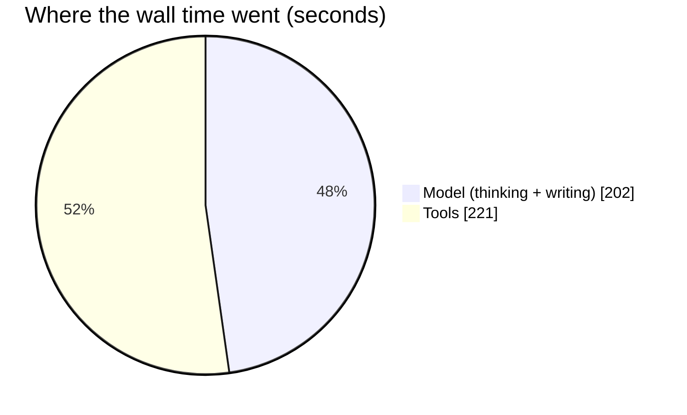

# firm-knowledge/tasks/088 · run1 (`hv-fk250-lunahigh-20261110T175632Z`)

Result: **fail** 3/4 criteria · 7.1 min · 36 model calls · 91 tool calls (1 errors or timeouts) · ending `completed` · started 11-10 23:57:09 IST

## Overview

One box per stretch of steps that used the same kind of tool (blue: looking/searching/reading, purple: writing or editing files, yellow: a message with no tool call, red border: a tool error or timeout inside the box).

```mermaid
flowchart TD
    T(["Task prompt"])
    P0["<b>Step 1</b> · 0.1 min<br/>todo_write"]
    T --> P0
    class P0 look
    P1["<b>Steps 2-3</b> · 0.3 min<br/>glob x6<br/><i>*, **/*licen*, **/*ip* +3</i>"]
    P0 --> P1
    class P1 look
    P2["<b>Step 4</b> · 0.6 min<br/>bash x3<br/><i>for f in #quot;documents/matters/1018-0000…, for f in #quot;documents/matters/1010-0000…, for f in #quot;documents/matters/1007-0000…</i>"]
    P1 --> P2
    class P2 look
    P3["<b>Step 5</b> · 0.1 min<br/>read<br/><i>34977e2abbe7-glob-results.txt</i>"]
    P2 --> P3
    class P3 err
    P4["<b>Step 6</b> · 0.3 min<br/>glob x6<br/><i>**/*exclusive*, **/*license-agreement*, **/*license*execution* +3</i>"]
    P3 --> P4
    class P4 look
    P5["<b>Step 7</b> · 0.3 min<br/>bash x4<br/><i>parse-doc docx #quot;documents/matters/101…, parse-doc docx #quot;documents/matters/103…</i>"]
    P4 --> P5
    class P5 look
    P6["<b>Steps 8-10</b> · 0.7 min<br/>glob x7<br/>grep x4<br/><i>scratch-1010.txt, scratch-1018.txt, scratch-1017.txt +8</i>"]
    P5 --> P6
    class P6 look
    P7["<b>Step 11</b> · 0.6 min<br/>bash x2<br/><i>for spec in #quot;technology-transfer-agre…, parse-doc docx #quot;documents/matters/101…</i>"]
    P6 --> P7
    class P7 look
    P8["<b>Steps 12-13</b> · 0.6 min<br/>grep x12<br/><i>scratch-1018-technology-transfer-agre…, scratch-1018-trademark-license-agreem…, scratch-1018-supply-agreement-api.txt +9</i>"]
    P7 --> P8
    class P8 look
    P9["<b>Steps 14-15</b> · 0.2 min<br/>read x7<br/><i>scratch-1018.txt, scratch-1018-technology-transfer-agre…, scratch-1018-trademark-license-agreem… +4</i>"]
    P8 --> P9
    class P9 look
    P10["<b>Step 16</b> · 0.1 min<br/>grep<br/><i>scratch-1018-closing-memo.txt</i>"]
    P9 --> P10
    class P10 look
    P11["<b>Steps 17-19</b> · 0.3 min<br/>read x5<br/><i>scratch-1018-closing-memo.txt, email-signing-confirmation.eml, scratch-1010.txt +2</i>"]
    P10 --> P11
    class P11 look
    P12["<b>Step 20</b> · 0.4 min<br/>glob x5<br/><i>**/*out-license*, **/*outlicen*, **/*license*grant* +2</i>"]
    P11 --> P12
    class P12 look
    P13["<b>Step 21</b> · 0.3 min<br/>bash x3<br/><i>parse-doc docx #quot;documents/matters/101…, parse-doc docx #quot;documents/matters/104…</i>"]
    P12 --> P13
    class P13 look
    P14["<b>Steps 22-24</b> · 0.4 min<br/>glob x5<br/>grep x3<br/><i>scratch-1018-00009.txt, scratch-1044.txt, scratch-1014-cross-license.txt +1</i>"]
    P13 --> P14
    class P14 look
    P15["<b>Step 25</b> · 0.2 min<br/>bash<br/><i>parse-doc xlsx #quot;documents/matters/101…</i>"]
    P14 --> P15
    class P15 look
    P16["<b>Step 26</b> · 0.0 min<br/>read<br/><i>scratch-1018-00009-matrix.txt</i>"]
    P15 --> P16
    class P16 look
    P17["<b>Step 27</b> · 0.3 min<br/>bash<br/>glob<br/><i>for spec in #quot;documents/matters/1007-0…, 1018-00009</i>"]
    P16 --> P17
    class P17 look
    P18["<b>Steps 28-29</b> · 0.3 min<br/>grep x5<br/>glob<br/><i>scratch-candidate-meslsa-exhibit-a-li…, scratch-candidate-data-ownership-lice…, scratch-candidate-amended-ip-license-… +2</i>"]
    P17 --> P18
    class P18 look
    P19["<b>Step 30</b> · 0.1 min<br/>bash<br/><i>parse-doc docx #quot;documents/matters/100…</i>"]
    P18 --> P19
    class P19 look
    P20["<b>Step 31</b> · 0.1 min<br/>grep<br/><i>scratch-1007-meslsa.txt</i>"]
    P19 --> P20
    class P20 look
    P21["<b>Step 32</b> · 0.2 min<br/>todo_write"]
    P20 --> P21
    class P21 look
    P22["<b>Steps 33-34</b> · 0.5 min<br/>write<br/>read<br/><i>response.md</i>"]
    P21 --> P22
    class P22 write
    P23["<b>Step 35</b> · 0.1 min<br/>todo_write"]
    P22 --> P23
    class P23 look
    P24["<b>Step 36</b> · 0.1 min<br/>final message"]
    P23 --> P24
    class P24 ans
    R(["FAIL: 3/4 criteria"])
    P24 --> R
    class R fail
    classDef look fill:#e8f0fe,stroke:#4a6fa5,color:#111
    classDef write fill:#f3e8fd,stroke:#7b1fa2,color:#111
    classDef ans fill:#fff8e1,stroke:#b58900,color:#111
    classDef err fill:#e8f0fe,stroke:#c62828,stroke-width:3px,color:#111
    classDef pass fill:#e6f4ea,stroke:#2e7d32,color:#111
    classDef fail fill:#fce8e6,stroke:#c62828,color:#111
```





One row per model call:

| Step | Started (IST) | Model s | Tools s | Tool calls | Tools | Output chars |
|---|---|---|---|---|---|---|
| 1 | 23:57:09 | 3 | 0 | 1 | todo_write | 57 |
| 2 | 23:57:12 | 1 | 2 | 1 | glob | 8,520 |
| 3 | 23:57:15 | 3 | 10 | 5 | glob x5 | 16,124 |
| 4 | 23:57:28 | 8 | 31 | 3 | bash x3 | 149,798 |
| 5 | 23:58:07 | 6 | 0 | 1 | read ⚠ | 66 |
| 6 | 23:58:13 | 5 | 10 | 6 | glob x6 | 1,739 |
| 7 | 23:58:29 | 6 | 11 | 4 | bash x4 | 28 |
| 8 | 23:58:46 | 3 | 8 | 4 | grep x4 | 104,566 |
| 9 | 23:58:57 | 10 | 14 | 6 | glob x6 | 2,205 |
| 10 | 23:59:22 | 4 | 1 | 1 | glob | 3,084 |
| 11 | 23:59:28 | 5 | 31 | 2 | bash x2 | 37 |
| 12 | 00:00:04 | 5 | 15 | 6 | grep x6 | 198,525 |
| 13 | 00:00:24 | 4 | 14 | 6 | grep x6 | 3,010 |
| 14 | 00:00:42 | 5 | 0 | 6 | read x6 | 18,308 |
| 15 | 00:00:47 | 4 | 0 | 1 | read | 23,923 |
| 16 | 00:00:51 | 4 | 2 | 1 | grep | 20,092 |
| 17 | 00:00:57 | 2 | 0 | 1 | read | 9,504 |
| 18 | 00:00:59 | 2 | 0 | 1 | read | 8,782 |
| 19 | 00:01:01 | 16 | 0 | 3 | read x3 | 38,095 |
| 20 | 00:01:17 | 4 | 17 | 5 | glob x5 | 750 |
| 21 | 00:01:38 | 6 | 12 | 3 | bash x3 | 33 |
| 22 | 00:01:56 | 3 | 6 | 3 | grep x3 | 89,203 |
| 23 | 00:02:05 | 4 | 2 | 1 | glob | 9,125 |
| 24 | 00:02:11 | 4 | 7 | 4 | glob x4 | 938 |
| 25 | 00:02:23 | 7 | 5 | 1 | bash | 11 |
| 26 | 00:02:34 | 2 | 0 | 1 | read | 51,479 |
| 27 | 00:02:36 | 10 | 11 | 2 | bash, glob | 98 |
| 28 | 00:02:57 | 4 | 8 | 5 | grep x5 | 190,205 |
| 29 | 00:03:09 | 4 | 1 | 1 | glob | 3,079 |
| 30 | 00:03:15 | 3 | 3 | 1 | bash | 11 |
| 31 | 00:03:21 | 2 | 1 | 1 | grep | 28,333 |
| 32 | 00:03:24 | 12 | 0 | 1 | todo_write | 57 |
| 33 | 00:03:37 | 26 | 0 | 1 | write | 200 |
| 34 | 00:04:03 | 3 | 0 | 1 | read | 11,361 |
| 35 | 00:04:06 | 4 | 0 | 1 | todo_write | 57 |
| 36 | 00:04:10 | 3 | 0 | 0 | (message only) | 0 |

## Task prompt

```text
I'm building out an exclusive-license clause bank for the IP group — do we have any matters where we granted an exclusive license, and if so, can you pull the executed agreements?

Output: write your complete answer to `response.md` — a single self-contained markdown file with your findings, the matters/documents you relied on, and your reasoning.
```

## Rubric

| # | Criterion | Verdict |
|---|---|---|
| C-001 | Qualifying matter — Penterra Pharmaceuticals 1018-00006 | pass |
| C-002 | Proof document — executed Exclusive License Agreement | pass |
| C-003 | Related executed agreements — any one suffices | pass |
| C-004 | Qualifying set — precision | **FAIL** |

Judge's reasoning:

**C-001 (pass):** Qualifying matter — Penterra Pharmaceuticals 1018-00006

```text
The output expressly identifies Matter 1018-00006 involving Penterra Pharmaceuticals Corp. as a qualifying exclusive-license matter and describes the executed exclusive license.
```

**C-002 (pass):** Proof document — executed Exclusive License Agreement

```text
The output explicitly identifies `documents/matters/1018-00006/Transaction Documents/license-agreement-execution.docx` as the executed Exclusive License Agreement and states that it is the agreement to pull.
```

**C-003 (pass):** Related executed agreements — any one suffices

```text
The output identifies multiple related executed agreements from matter 1018-00006 beyond the Exclusive License Agreement, including the trademark license, technology transfer, API supply, pharmacovigilance, and escrow agreements, with filenames and descriptions.
```

**C-004 (fail):** Qualifying set — precision

```text
The output asserts Matter 1018-00009 as a second qualifying exclusive-license matter. The criterion permits no qualifying matter outside 1018-00006, so this is overinclusive.
```

## Delivered files (output/)

- `response.md` (10,835 bytes)

`response.md`:

```markdown
# Exclusive-license matters and executed agreements

## Bottom line

Yes. I found **two matters in which a client/licensor granted an exclusive license**:

1. **Matter 1018-00006 — Penterra Pharmaceuticals Corp. → Meridian Bio Therapeutics Limited (PPC-4187 / Penteracitinib).** This is a fully documented, closed exclusive out-license. The executed agreement and executed ancillary transaction documents are present in the workspace.
2. **Matter 1018-00009 — Penterra Pharmaceuticals Corp. → Penterra Biopharma International DAC (legacy pharmaceutical compounds).** The available records confirm an exclusive non-Americas license effective July 1, 2012, but the executed license agreement itself is **not present in the supplied workspace**. The matter contains an analysis memo with an excerpt of the grant clause and an intercompany-agreement matrix; the memo says the complete agreement is maintained in the client files.

## Matter 1018-00006 — executed exclusive out-license available

### Grant and scope

The executed **Exclusive License Agreement** is between **Penterra Pharmaceuticals Corp.** as licensor and **Meridian Bio Therapeutics Limited** as licensee. Section 2.1 grants Meridian an **“exclusive (even as to Licensor)”** royalty-bearing license under the Licensed IP to develop, manufacture, have manufactured, use, import, export, offer for sale, sell, distribute, promote, market, and otherwise commercialize Licensed Products in the Territory during the Term. The Licensed IP includes the Licensed Patents, Licensed Know-How, and Licensed Trademarks.

The license is exclusive only in the defined Territory, which covers: the PRC (including Hong Kong and Macau), Japan, South Korea, Australia, New Zealand, Singapore, Thailand, Malaysia, Indonesia, the Philippines, Vietnam, and Taiwan. Penterra retains rights in the rest of the world. The initial field is dermatology, with the initial indication being moderate-to-severe atopic dermatitis in adults.

The closing memorandum records that the transaction was signed on **October 2, 2023** and became effective/closed on **October 20, 2023**, after the closing conditions were satisfied and the $18 million upfront payment was released from escrow. The October 2 signing-confirmation email states that the License Agreement was fully executed by both parties and that the listed ancillary agreements were also fully executed that day.

### Executed agreement to pull

- `documents/matters/1018-00006/Transaction Documents/license-agreement-execution.docx`  
  **Exclusive License Agreement**, dated October 2, 2023; effective October 20, 2023. The agreement includes the signature page, an acknowledgment of the October 20 effective date, and incorporated Schedules A–F.

### Executed ancillary agreements in the same closing package

These are related to the exclusive license transaction, but they do not themselves replace the core license grant:

- `documents/matters/1018-00006/Transaction Documents/trademark-license-agreement.docx`  
  **Trademark License Agreement — PENTECLAR.** Section 2.1 separately grants Meridian an exclusive license, even as to Penterra and its Affiliates, to use the Licensed Marks in the Licensed Territory in connection with Licensed Products. The agreement’s signature page is dated October 20, 2023, although the closing memorandum and signing email describe the ancillary agreements as signed on October 2, 2023; the operative effective date is October 20, 2023.

- `documents/matters/1018-00006/Transaction Documents/technology-transfer-agreement.docx`  
  **Technology Transfer Agreement**, executed October 2, 2023 and effective October 20, 2023. It transfers manufacturing know-how, analytical methods, and CMC documentation so Meridian can exercise the manufacturing rights granted under the License Agreement; it does not independently create a separate territorial exclusivity grant.

- `documents/matters/1018-00006/Transaction Documents/supply-agreement-api.docx`  
  **Active Pharmaceutical Ingredient Supply Agreement**, executed October 2, 2023 and effective October 20, 2023. It supports initial API supply. It expressly does not grant API-source exclusivity.

- `documents/matters/1018-00006/Transaction Documents/pharmacovigilance-agreement.docx`  
  **Pharmacovigilance Agreement**, executed October 2, 2023 and effective October 20, 2023. It governs safety-data exchange and reporting; it is ancillary and contains no separate exclusive license grant.

- `documents/matters/1018-00006/Transaction Documents/escrow-agreement-execution.docx`  
  **Escrow Agreement**, executed October 2, 2023, among Penterra, Meridian, and Velthorn National Bank, N.A. It implements the $18 million upfront-payment escrow and is not itself a license grant.

### Incorporated schedules

The closing memorandum lists the following as executed/integrated transaction documents, and the License Agreement incorporates them:

- `documents/matters/1018-00006/Transaction Documents/schedule-a-licensed-patents.docx`
- `documents/matters/1018-00006/Transaction Documents/schedule-b-licensed-know-how.docx`
- `documents/matters/1018-00006/Transaction Documents/schedule-c-licensed-trademarks.docx`
- `documents/matters/1018-00006/Transaction Documents/schedule-d-territory.docx`
- `documents/matters/1018-00006/Transaction Documents/schedule-e-development-plan.docx`
- `documents/matters/1018-00006/Transaction Documents/schedule-f-mfn-pricing-methodology.docx`

The separate `quality-agreement-form.docx` is **not** an executed agreement in the closing record. The closing memorandum and the form itself state that it was to be finalized and executed after closing, by December 19, 2023.

## Matter 1018-00009 — exclusive legacy-IP license confirmed, executed agreement not supplied

The matter’s **Legacy IP License Analysis Memo** identifies an intercompany License Agreement between **Penterra Pharmaceuticals Corp.** as licensor and **Penterra Biopharma International DAC** as licensee. It states that the agreement was executed contemporaneously with, or shortly after, PBI’s incorporation and was effective **July 1, 2012**. The licensed territory is the **non-Americas territory** (EMEA and APAC, excluding North America, Central America, South America, and the Caribbean), and the license covers pre-2012 legacy pharmaceutical compounds excluded from the group’s qualified cost-sharing arrangement.

The memo’s excerpted Section 2.1 states that PPC granted PBI an **exclusive license, with the right to sublicense**, under the Licensed IP to develop, manufacture, have manufactured, use, offer for sale, sell, import, and otherwise exploit the Legacy Compounds in the Licensed Territory during the Term. The memo also describes the 4.5% running royalty on non-Americas net sales and the agreement’s coterminous product-by-product term.

The intercompany agreement matrix independently identifies this as **ICA-002 — Legacy IP License Agreement**, an intangible-property license effective July 1, 2012, with PPC as licensor and PBI as licensee. It also identifies a related **ICA-008 — Intercompany Trademark License Agreement**, effective July 1, 2012, for PPC trademarks and trade names used with the legacy products. The available matrix does not provide enough operative language to independently characterize ICA-008 as exclusive.

### Executed-document availability

I did **not** find the executed ICA-002 license agreement or its executed amendments in the supplied workspace. The available matter record instead says that the complete License Agreement and amendments are maintained in the client files. Accordingly:

- `documents/matters/1018-00009/Transaction Documents/legacy-ip-license-analysis-memo.docx` — confirms and excerpts the exclusive grant, but is an analysis memo, not the executed agreement.
- `documents/matters/1018-00009/Transaction Documents/intercompany-agreement-matrix.xlsx` — identifies ICA-002, its parties, July 1, 2012 effective date, territory, and royalty structure; it is not the executed agreement.

**Action needed to pull the actual executed document:** obtain the original 2012 Legacy IP License Agreement (and any amendments) from the client-file repository referenced in the memo. The same retrieval should include the related ICA-008 trademark license if the IP group wants the trademark rights in the clause bank.

## Documents screened out as not responsive

I did not count documents that were expressly non-exclusive, drafts, proposals, or documents that only discussed ownership rather than granting an exclusive license. Examples include:

- Matter 1010-00006 — `data-license-agreement-execution.docx`: Section 2.1 expressly grants a **non-exclusive** data license and reserves Licensor’s right to license the data to others.
- Matter 1007-00008 — `meslsa-execution-version.docx`: Section 2.1 grants a **non-exclusive** embedded-software license and Section 2.3 reserves the right to license competitors.
- Matter 1017-00006 — `trademark-license-agreement.docx`: the grant is expressly **non-exclusive** and worldwide.
- Matter 1037-00004 — `exhibit-a-patent-license-agreement.docx`: titled and drafted as a **non-exclusive** patent license; Section 2.1 permits the patent owner to practice and license the patents to others.
- Matter 1044-00005 — `technology-license-agreement-analysis-memo.docx`: the analyzed technology license is described as **non-exclusive**.
- Matter 1014-00003 — `ows-cross-license-proposal-term-sheet.docx`: a **non-binding proposal**, not an executed definitive agreement; its proposed grants are non-exclusive.
- Matter 1042-00003 — `license-agreement-draft-1.docx` and `license-agreement-draft-3.docx`: drafts, not executed agreements, even though the proposed grant language is exclusive.

## Conclusion

For immediate use in the exclusive-license clause bank, the cleanest executed precedent is **Matter 1018-00006**, particularly the core Exclusive License Agreement and the separate PENTECLAR Trademark Lice
… [774 more chars]
```

## Trajectory

### Step 1: 1 tool call

_Started 11-10 23:57:09 IST · model 3 s · tools 0 s_

**Reasoning summary:**

```text
**Inspecting workspace docs**

I need to inspect the workspace documents and create a response.md file. It's important to understand whether I need to conduct any legal research, but I shouldn't read task.json. I'll list the files using glob, focusing on formats like docx or eml. This seems like a multi-step task, so I definitely need to check the skills available. However, there isn't a named skill catalog supplied, so I'll start with the glob process.
```

**Call `todo_write`** (0.0 s)

```json
{
 "todos": [
  {
   "content": "Inventory the provided matter and agreement documents",
   "status": "in_progress"
  },
  {
   "content": "Review source documents for exclusive-license grants and execution status",
   "status": "pending"
  },
  {
   "content": "Draft and save a self-contained findings memo in response.md",
   "status": "pending"
  },
  {
   "content": "Verify the final response file and supporting citations",
   "status": "pending"
  }
 ]
}
```

Output (57 chars):

```text
Updated todo list: 3 pending, 1 in progress, 0 completed.
```

**Todo list now:**

- [~] Inventory the provided matter and agreement documents
- [ ] Review source documents for exclusive-license grants and execution status
- [ ] Draft and save a self-contained findings memo in response.md
- [ ] Verify the final response file and supporting citations

### Step 2: 1 tool call

_Started 11-10 23:57:12 IST · model 1 s · tools 2 s_

**Call `glob`** (1.5 s)

```json
{
 "pattern": "*"
}
```

Output (8,520 chars):

```text
documents/matters/1001-00001/Antitrust Analysis/competitor-identification-chart.xlsx
documents/matters/1001-00001/Antitrust Analysis/portfolio-company-overlap-analysis.docx
documents/matters/1001-00001/Antitrust Analysis/hhi-concentration-analysis.xlsx
documents/matters/1001-00001/Antitrust Analysis/market-definition-competitive-analysis-memo.docx
documents/matters/1001-00001/Client Updates/biweekly-status-report-1.docx
documents/matters/1001-00001/Antitrust Analysis/preliminary-antitrust-risk-assessment.docx
documents/matters/1001-00001/Antitrust Analysis/state-regulatory-con-analysis.docx
documents/matters/1001-00001/Antitrust Analysis/vertical-relationships-analysis.docx
documents/matters/1001-00001/Closing/closing-memo-antitrust-workstream.docx
documents/matters/1001-00001/Client Updates/client-update-early-termination-granted.eml
documents/matters/1001-00001/Client Updates/biweekly-status-report-2.docx
documents/matters/1001-00001/Client Updates/client-update-hsr-forms-filed.eml
documents/matters/1001-00001/Closing/final-invoice-matter-closing-letter.docx
documents/matters/1001-00001/Closing/hsr-clearance-certificate.docx
documents/matters/1001-00001/Correspondence/Counterparty Counsel/email-gk-naics-code-consistency.eml
documents/matters/1001-00001/Early Termination/early-termination-request-letter.docx
documents/matters/1001-00001/Correspondence/Counterparty Counsel/letter-bracewell-thornton-regulatory-condition.docx
documents/matters/1001-00001/Correspondence/Counterp
… [7,020 more chars]
```

### Step 3: 5 tool calls

_Started 11-10 23:57:15 IST · model 3 s · tools 10 s_

**Reasoning summary:**

```text
**Identifying license agreements**

I've got 9288 files to sift through, and my focus is on identifying exclusive license matters and executed agreements. My first step is to search through the contents and filenames for anything that contains keywords like "license," "IP," or "agreement." I think using glob patterns might help narrow things down efficiently. I’m just making sure I can tackle this task systematically so I don’t miss anything important!
```

**Call `glob`** (1.0 s)

```json
{
 "pattern": "**/*licen*"
}
```

Output (3,112 chars):

```text
documents/matters/1001-00007/Regulatory/state-licensure-transfer-cover-memo.docx
documents/matters/1003-00003/Diligence/regulatory-licensing-dd-memo.docx
documents/matters/1007-00008/Correspondence/Internal/email-liu-to-crawford-rtos-licensing-research.eml
documents/matters/1007-00008/Transaction Documents/meslsa-exhibit-a-licensed-software-specs.docx
documents/matters/1008-00010/Transaction Documents/Exhibits/exhibit-a-licensed-products-pricing.xlsx
documents/matters/1008-00010/Transaction Documents/Exhibits/exhibit-d-trademark-license-brand-guidelines.docx
documents/matters/1009-00003/Diligence/regulatory-licensing-memo.docx
documents/matters/1010-00006/Transaction Documents/data-license-agreement-execution.docx
documents/matters/1010-00006/Transaction Documents/data-license-agreement-redline-pca-markup.docx
documents/matters/1013-00005/Damages/veridian-license-comparability-memo.docx
documents/matters/1014-00003/Settlement & Dismissal/ows-cross-license-proposal-term-sheet.docx
documents/matters/1014-00004/Damages Analysis/comparable-license-analysis.docx
documents/matters/1016-00003/Diligence/dd-memo-regulatory-licensing.docx
documents/matters/1017-00003/Factual Investigation/fast-channel-sublicensee-memo.docx
documents/matters/1017-00006/Transaction Documents/trademark-license-agreement.docx
documents/matters/1018-00004/Transaction Documents/IP & Data/data-ownership-licensing-memo.docx
documents/matters/1018-00006/Transaction Documents/Drafts/license-agreement-initial-dra
… [1,612 more chars]
```

**Call `glob`** (4.8 s)

```json
{
 "pattern": "**/*ip*"
}
```

Output (8,569 chars):

```text
documents/matters/1001-00001/Antitrust Analysis/vertical-relationships-analysis.docx
documents/matters/1001-00001/FTC/DOJ Correspondence/ftc-pno-filing-receipt-annotated.docx
documents/matters/1001-00003/Transaction Documents/ip-assignment-agreement.docx
documents/matters/1001-00004/Diligence/ip-technology-diligence-memo.docx
documents/matters/1001-00007/Diligence/ip-data-privacy-diligence-summary.docx
documents/matters/1001-00007/Transaction Documents/management-rollover-subscription-agreements.docx
documents/matters/1002-00002/Diligence/IP/ip-due-diligence-memo.docx
documents/matters/1002-00004/Diligence/ip-technology-diligence-memo.docx
documents/matters/1002-00004/Diligence/valuation-ownership-memo.docx
documents/matters/1003-00002/Offering Documents/subscription-agreement-main-fund.docx
documents/matters/1003-00002/Offering Documents/subscription-agreement-parallel-fund.docx
documents/matters/1003-00002/Offering Documents/subscription-agreement-offshore-feeder.docx
documents/matters/1003-00003/Diligence/ip-dd-memo.docx
documents/matters/1003-00004/Diligence/ip-diligence-memo.docx
documents/matters/1004-00002/Transaction Documents/subscription-agreement-form.docx
documents/matters/1005-00001/Closing/signature-pages-security-pledge-ip.docx
documents/matters/1005-00001/Diligence/memo-ip-lien-search-results.docx
documents/matters/1005-00001/Transaction Documents/Security & Guarantee/ip-security-agreement-execution-version.docx
documents/matters/1005-00005/Pleadings/stipulati
… [7,069 more chars]
```

**Call `glob`** (1.4 s)

```json
{
 "pattern": "**/*intellectual*"
}
```

Output (377 chars):

```text
documents/matters/1011-00005/Diligence/dd-memo-intellectual-property.docx
documents/matters/1015-00001/Diligence/dd-memo-intellectual-property.docx
documents/matters/1015-00001/Diligence/dd-request-list-intellectual-property.docx
documents/matters/1023-00001/Diligence/dd-memo-intellectual-property.docx
documents/matters/1032-00003/Diligence/dd-memo-intellectual-property.docx
```

**Call `glob`** (1.3 s)

```json
{
 "pattern": "**/*technology*"
}
```

Output (891 chars):

```text
documents/matters/1001-00004/Diligence/ip-technology-diligence-memo.docx
documents/matters/1002-00004/Diligence/ip-technology-diligence-memo.docx
documents/matters/1018-00006/Transaction Documents/technology-transfer-agreement.docx
documents/matters/1025-00009/Transaction Documents/technology-escrow-agreement.docx
documents/matters/1032-00004/NSA Annexes & Implementation/nsa-annex-b-technology-control-plan.docx
documents/matters/1038-00005/Transaction Documents/Committee Charters/technology-cybersecurity-committee-charter-new.docx
documents/matters/1038-00010/Policies & Notices/cookie-tracking-technology-notice.docx
documents/matters/1041-00003/Diligence/supplemental-dd-request-ip-technology.docx
documents/matters/1044-00005/Strategy & Analysis/technology-license-agreement-analysis-memo.docx
documents/matters/1045-00002/documents/technology-implementation-timeline-risk-memo.docx
```

**Call `glob`** (1.0 s)

```json
{
 "pattern": "**/*patent*"
}
```

Output (3,175 chars):

```text
documents/matters/1013-00005/Pleadings/complaint-patent-infringement.docx
documents/matters/1013-00005/Pre-Filing/claim-chart-271-patent.xlsx
documents/matters/1013-00005/Pre-Filing/claim-chart-647-patent.xlsx
documents/matters/1013-00005/Pre-Filing/claim-chart-893-patent.xlsx
documents/matters/1014-00003/Pleadings/complaint-patent-infringement.docx
documents/matters/1014-00003/Post-Markman Assessment/post-markman-viability-234-patent.docx
documents/matters/1014-00003/Post-Markman Assessment/post-markman-viability-890-patent.docx
documents/matters/1014-00003/Post-Markman Assessment/post-markman-viability-678-patent.docx
documents/matters/1014-00003/Post-Markman Assessment/post-markman-viability-567-patent.docx
documents/matters/1014-00003/Pre-Suit Investigation & Strategy/pre-suit-infringement-analysis-890-patent.docx
documents/matters/1014-00003/Pre-Suit Investigation & Strategy/pre-suit-infringement-analysis-234-patent.docx
documents/matters/1014-00003/Pre-Suit Investigation & Strategy/pre-suit-infringement-analysis-678-patent.docx
documents/matters/1014-00003/Pre-Suit Investigation & Strategy/pre-suit-infringement-analysis-567-patent.docx
documents/matters/1014-00004/Claim Construction/phe-analysis-015-patent.docx
documents/matters/1014-00004/Claim Construction/phe-analysis-193-patent.docx
documents/matters/1014-00004/Infringement Contentions & Claim Charts/claim-chart-193-patent.docx
documents/matters/1014-00004/Infringement Contentions & Claim Charts/claim-chart-015-pate
… [1,675 more chars]
```

### Step 4: 3 tool calls

_Started 11-10 23:57:28 IST · model 8 s · tools 31 s_

**Call `bash`** (12.1 s)

```json
{
 "command": "for f in \"documents/matters/1018-00006/Transaction Documents/license-agreement-execution.docx\" \"documents/matters/1018-00006/Transaction Documents/trademark-license-agreement.docx\" \"documents/matters/1018-00006/Transaction Documents/technology-transfer-agreement.docx\" \"documents/matters/1018-00006/Transaction Documents/schedule-a-licensed-patents.docx\" \"documents/matters/1018-00006/Transaction Documents/schedule-b-licensed-know-how.docx\" \"documents/matters/1018-00006/Transaction Documents/schedule-c-licensed-trademarks.docx\"; do echo \"===== $f =====\"; parse-doc docx \"$f\"; done",
 "description": "Parse likely executed license documents",
 "timeoutMs": 120000
}
```

Output (49,970 chars):

```text
state characterization data and crystalline form information for PPC-4187:

> \(a\) Polymorphic form characterization data for PPC-4187, including identification, characterization, and physicochemical properties of the designated crystalline forms: Form A (the thermodynamically stable form selected for commercial development), Form B (a metastable polymorph), Form C (a hydrate form), and any other polymorphic, solvated, hydrated, or amorphous forms identified during polymorph screening studies;
>
> \(b\) Solid-state characterization data for each identified form, including: (i) X-ray powder diffraction (XRPD) patterns and peak position tables; (ii) differential scanning calorimetry (DSC) thermograms, including melting points, enthalpies of fusion, and glass transition temperatures (for amorphous material); (iii) thermogravimetric analysis (TGA) data, including weight loss profiles; (iv) dynamic vapor sorption (DVS) isotherms; (v) Fourier transform infrared (FTIR) spectroscopy data; (vi) Raman spectroscopy data; and (vii) solid-state nuclear magnetic resonance (ssNMR) data, as available;
>
> \(c\) Polymorph screening and selection reports, including the rationale for selection of Form A as the preferred crystalline form for commercial development, competitive slurry experiments, interconversion studies, and thermodynamic stability assessments;
>
> \(d\) Documentation of the relationship between the crystalline Form A data and claims of U.S. Patent No. 11,345,678 (entitled \"Cr
… [48,470 more chars]
```

**Call `bash`** (9.0 s)

```json
{
 "command": "for f in \"documents/matters/1010-00006/Transaction Documents/data-license-agreement-execution.docx\" \"documents/matters/1017-00006/Transaction Documents/trademark-license-agreement.docx\" \"documents/matters/1037-00004/Settlement Documentation/exhibit-a-patent-license-agreement.docx\" \"documents/matters/1037-00004/Settlement Documentation/exhibit-c-licensed-patents-list.xlsx\" \"documents/matters/1044-00005/Strategy & Analysis/technology-license-agreement-analysis-memo.docx\"; do echo \"===== $f =====\"; case \"$f\" in *.xlsx) parse-doc xlsx \"$f\";; *) parse-doc docx \"$f\";; esac; done",
 "description": "Parse other license agreements and analyses",
 "timeoutMs": 120000
}
```

Output (49,907 chars):

```text
iPredict module to its wholly-owned terminal operating subsidiaries (specifically identified in Exhibit B to the TLA), provided that such subsidiaries are direct operators of the equipment purchased under the associated purchase contracts and that TSL remains primarily liable for all obligations under the TLA.

**[E. Fee Basis and Payment Schedule]{.underline}**

The license fee under the TLA is calculated as five percent (5%) of the aggregate purchase price of all equipment purchased by TSL from Hailong under the master purchase contracts referenced in Exhibit A. Based on a total aggregate equipment purchase price of €98,000,000, the license fee equals **€4,900,000**.

The TLA provides for payment of the license fee in three installments, as follows:

  -------------------------------------------------------------------------------------------------------
  **Installment**   **Amount (€)**    **Payment Trigger**                               **Date Paid**
  ----------------- ----------------- ------------------------------------------------- -----------------
  Installment 1     1,960,000         Within 30 days of TLA execution                   March 2019

  Installment 2     1,470,000         Upon first commercial operation of ASC systems    July 2020

  Installment 3     1,470,000         Upon completion of all commissioning activities   March 2022

  **Total**         **4,900,000**                                                       
  ---------------------------------
… [48,407 more chars]
```

**Call `bash`** (9.6 s)

```json
{
 "command": "for f in \"documents/matters/1007-00008/Transaction Documents/meslsa-exhibit-a-licensed-software-specs.docx\" \"documents/matters/1008-00010/Transaction Documents/Exhibits/exhibit-d-trademark-license-brand-guidelines.docx\" \"documents/matters/1018-00006/Transaction Documents/Drafts/license-agreement-revised-draft.docx\" \"documents/matters/1018-00006/Transaction Documents/Drafts/license-agreement-redline-lcf.docx\"; do echo \"===== $f =====\"; parse-doc docx \"$f\"; done",
 "description": "Parse drafts and related license exhibits",
 "timeoutMs": 120000
}
```

Output (49,921 chars):

```text
tings shall not be subject to prior JSC approval, provided that Meridian complies with the most favored nation pricing obligation in Section 5.8.
>
> **(b)** Meridian shall use Commercially Reasonable Efforts to obtain favorable reimbursement, formulary listing, and market access for the Licensed Product in each Major Market Country, including inclusion in the National Reimbursement Drug List (NRDL) in China and the NHI Drug Price Standard in Japan.

**8.4 Reporting.**

Meridian shall provide the JSC with quarterly commercialization reports within thirty (30) days following the end of each Calendar Quarter, including without limitation: (a) Net Sales data broken down by country, dosage strength, and distribution channel; (b) market share information relative to competitive products (to the extent available from syndicated data sources); (c) a summary of key commercial activities conducted during the Calendar Quarter (including product launches, marketing campaigns, and medical affairs activities); and (d) an updated forecast of Net Sales for the current and subsequent Calendar Year.

**[ARTICLE 9 --- REPRESENTATIONS AND WARRANTIES]{.underline}**

**9.1 Mutual Representations and Warranties.**

Each Party hereby represents and warrants to the other Party, as of the Effective Date, that:

> **(a)** *Organization and Standing.* It is duly organized, validly existing, and in good standing (or the equivalent thereof) under the laws of its jurisdiction of organization, and has all 
… [48,421 more chars]
```

### Step 5: 1 tool call

_Started 11-10 23:58:07 IST · model 6 s · tools 0 s_

**Reasoning summary:**

```text
**Improving document processing**

I need to develop a more systematic approach to handle my outputs, especially when dealing with a large dataset. I’m considering using a `parse-doc` method to find all instances of "exclusive license" in DOCX files. Given there are about 9,000 entries, I could use globbing tools. However, since using shell `find` is prohibited, I’ll focus on globbing to discover files. I’m thinking I should extract relevant licenses and executed agreements for better analysis.
```

**Call `read`** (0.0 s · **error/timeout**)

```json
{
 "file_path": "/tmp/dsh-spill-ZDHRAR/session-422cd42c652a/34977e2abbe7-glob-results.txt",
 "offset": 1,
 "limit": 400
}
```

Output (66 chars):

```text
Error: [sandbox: file access denied under workspace-isolated mode]
```

### Step 6: 6 tool calls

_Started 11-10 23:58:13 IST · model 5 s · tools 10 s_

**Reasoning summary:**

```text
**Exploring patterns for licenses**

I noticed that the first 100 results in mod time might not have shown everything I need. I could leverage pattern matching with basename variants, like `*license*`, `*licensing*`, `*exclusive*`, `*agreement-execution*`, and `*patent-license*`. There seems to be a lot of options here to sift through, so I’ll aim to gather more comprehensive results that fit those patterns. Let’s dive deeper into this!
```

**Call `glob`** (0.8 s)

```json
{
 "pattern": "**/*exclusive*"
}
```

Output (14 chars):

```text
No files found
```

**Call `glob`** (0.9 s)

```json
{
 "pattern": "**/*license-agreement*"
}
```

Output (1,169 chars):

```text
documents/matters/1010-00006/Transaction Documents/data-license-agreement-execution.docx
documents/matters/1010-00006/Transaction Documents/data-license-agreement-redline-pca-markup.docx
documents/matters/1017-00006/Transaction Documents/trademark-license-agreement.docx
documents/matters/1018-00006/Transaction Documents/Drafts/license-agreement-initial-draft.docx
documents/matters/1018-00006/Transaction Documents/Drafts/license-agreement-revised-draft.docx
documents/matters/1018-00006/Transaction Documents/Drafts/license-agreement-redline-lcf.docx
documents/matters/1018-00006/Transaction Documents/license-agreement-execution.docx
documents/matters/1018-00006/Transaction Documents/trademark-license-agreement.docx
documents/matters/1032-00006/Intercompany Agreements/amended-ip-license-agreement-draft.docx
documents/matters/1037-00004/Settlement Documentation/exhibit-a-patent-license-agreement.docx
documents/matters/1042-00003/Transaction Documents/license-agreement-draft-1.docx
documents/matters/1042-00003/Transaction Documents/license-agreement-draft-3.docx
documents/matters/1044-00005/Strategy & Analysis/technology-license-agreement-analysis-memo.docx
```

**Call `glob`** (3.7 s)

```json
{
 "pattern": "**/*license*execution*"
}
```

Output (172 chars):

```text
documents/matters/1010-00006/Transaction Documents/data-license-agreement-execution.docx
documents/matters/1018-00006/Transaction Documents/license-agreement-execution.docx
```

**Call `glob`** (2.0 s)

```json
{
 "pattern": "**/*patent-license*"
}
```

Output (93 chars):

```text
documents/matters/1037-00004/Settlement Documentation/exhibit-a-patent-license-agreement.docx
```

**Call `glob`** (1.6 s)

```json
{
 "pattern": "**/*trademark-license*"
}
```

Output (277 chars):

```text
documents/matters/1008-00010/Transaction Documents/Exhibits/exhibit-d-trademark-license-brand-guidelines.docx
documents/matters/1017-00006/Transaction Documents/trademark-license-agreement.docx
documents/matters/1018-00006/Transaction Documents/trademark-license-agreement.docx
```

**Call `glob`** (1.5 s)

```json
{
 "pattern": "**/*software-license*"
}
```

Output (14 chars):

```text
No files found
```

### Step 7: 4 tool calls

_Started 11-10 23:58:29 IST · model 6 s · tools 11 s_

**Call `bash`** (3.3 s)

```json
{
 "command": "parse-doc docx \"documents/matters/1010-00006/Transaction Documents/data-license-agreement-execution.docx\" > /tmp/1010.txt 2>/tmp/1010.err; cp /tmp/1010.txt scratch-1010.txt; printf 'exit=%s\\n' $?",
 "description": "Convert data license execution document",
 "timeoutMs": 120000
}
```

Output (7 chars):

```text
exit=0
```

**Call `bash`** (2.5 s)

```json
{
 "command": "parse-doc docx \"documents/matters/1018-00006/Transaction Documents/license-agreement-execution.docx\" > /tmp/1018.txt 2>/tmp/1018.err; cp /tmp/1018.txt scratch-1018.txt; printf 'exit=%s\\n' $?",
 "description": "Convert exclusive license execution document",
 "timeoutMs": 120000
}
```

Output (7 chars):

```text
exit=0
```

**Call `bash`** (2.5 s)

```json
{
 "command": "parse-doc docx \"documents/matters/1017-00006/Transaction Documents/trademark-license-agreement.docx\" > /tmp/1017.txt 2>/tmp/1017.err; cp /tmp/1017.txt scratch-1017.txt; printf 'exit=%s\\n' $?",
 "description": "Convert trademark license agreement",
 "timeoutMs": 120000
}
```

Output (7 chars):

```text
exit=0
```

**Call `bash`** (2.8 s)

```json
{
 "command": "parse-doc docx \"documents/matters/1037-00004/Settlement Documentation/exhibit-a-patent-license-agreement.docx\" > /tmp/1037.txt 2>/tmp/1037.err; cp /tmp/1037.txt scratch-1037.txt; printf 'exit=%s\\n' $?",
 "description": "Convert settlement patent license agreement",
 "timeoutMs": 120000
}
```

Output (7 chars):

```text
exit=0
```

### Step 8: 4 tool calls

_Started 11-10 23:58:46 IST · model 3 s · tools 8 s_

**Call `grep`** (1.2 s)

```json
{
 "pattern": "(?i)exclusive|non-exclusive|executed|effective|signature|grant",
 "path": "scratch-1010.txt"
}
```

Output (18,503 chars):

```text
Found 47 matches

scratch-1010.txt
Line 7: **Effective Date: July 1, 2024**
Line 9: This DATA LICENSE AGREEMENT (this \"**Agreement**\") is entered into as of July 1, 2024 (the \"**Effective Date**\"), by and between:
Line 31: **WHEREAS**, the Parties desire to set forth the terms and conditions governing Licensor\'s grant of a license to Licensee to use such de-identified data as more fully described herein; and
Line 65: \"**Effective Date**\" means July 1, 2024.
Line 71: \"**Initial Data Delivery**\" means the first Data Delivery of the full Licensed Data set, which shall be delivered by Licensor to Licensee within thirty (30) calendar days of the Effective Date (i.e., no later than July 31, 2024) in accordance with Section 3.1.
Line 73: \"**Initial Term**\" means the period commencing on the Effective Date and ending on June 30, 2029, a period of five (5) years, unless this Agreement is earlier terminated in accordance with Article VIII.
Line 91: \"**Quarterly Refresh Period**\" means the thirty-six (36) month period commencing on the Effective Date (July 1, 2024) and ending on June 30, 2027.
Line 125: **[ARTICLE II --- GRANT OF LICENSE]{.underline}**
Line 127: **Section 2.1 --- License Grant**
Line 129: Subject to the terms and conditions of this Agreement, including Licensee\'s timely payment of the License Fee in accordance with Article IV, Licensor hereby grants to Licensee a non-exclusive, non-transferable (except as permitted in Section 14.5), limited license to acce
… [17,003 more chars]
```

**Call `grep`** (1.3 s)

```json
{
 "pattern": "(?i)exclusive|non-exclusive|executed|effective|signature|grant",
 "path": "scratch-1018.txt"
}
```

Output (40,874 chars):

```text
Found 88 matches

scratch-1018.txt
Line 1: **[EXCLUSIVE LICENSE AGREEMENT]{.underline}**
Line 15: Effective Date: October 20, 2023
Line 29: **WHEREAS**, Licensor desires to grant to Licensee, and Licensee desires to obtain from Licensor, an exclusive license to develop, manufacture, and commercialize Licensed Products (as defined herein) in the Territory (as defined herein), subject to and in accordance with the terms and conditions set forth in this Agreement;
Line 41: \"**Affiliate**\" means, with respect to any Person, any other Person that directly or indirectly controls, is controlled by, or is under common control with such Person, where \"control\" means ownership, directly or indirectly, of fifty percent (50%) or more of the outstanding voting securities of such Person, or the equivalent power to direct the management and policies of such Person, whether through ownership of securities, by contract, or otherwise. Without limiting the generality of the foregoing, the following entities are, as of the Effective Date, Affiliates of Licensee: Meridian Pharma (Shanghai) Co., Ltd., a company organized under the laws of the People\'s Republic of China; Meridian Japan K.K., a company organized under the laws of Japan; Meridian Korea Inc., a company organized under the laws of the Republic of Korea; and Meridian Bio Australia Pty Ltd, a company organized under the laws of the Commonwealth of Australia.
Line 51: \"**Calendar Quarter**\" means each successive period of three (3)
… [39,374 more chars]
```

**Call `grep`** (3.5 s)

```json
{
 "pattern": "(?i)exclusive|non-exclusive|executed|effective|signature|grant",
 "path": "scratch-1017.txt"
}
```

Output (19,161 chars):

```text
Found 33 matches

scratch-1017.txt
Line 23: This TRADEMARK LICENSE AGREEMENT (this \"**Agreement**\") is entered into as of November 15, 2024 (the \"**Effective Date**\"), by and between:
Line 43: **WHEREAS**, Licensee desires to continue to use the \"Meridian\" name and certain associated marks solely in connection with such legacy digital content, and Licensor is willing to grant a limited license for such purpose, subject to the terms and conditions set forth herein; and
Line 61: \"**Effective Date**\" has the meaning set forth in the preamble to this Agreement.
Line 67: \"**Licensed Territory**\" means worldwide, on a non-exclusive basis.
Line 85: Unless the context of this Agreement otherwise requires: (a) words of any gender include each other gender; (b) words using the singular or plural number also include the plural or singular number, respectively; (c) the terms \"hereof,\" \"herein,\" \"hereby,\" \"hereto,\" and derivative or similar words refer to this entire Agreement; (d) the terms \"Article,\" \"Section,\" \"Exhibit,\" and \"Schedule\" refer to the specified Article, Section, Exhibit, or Schedule of or to this Agreement, unless otherwise specified; (e) the word \"including\" means \"including, without limitation\"; (f) the word \"or\" is disjunctive but not necessarily exclusive; (g) references to any agreement or contract are to that agreement or contract as amended, modified, supplemented, or restated from time to time in accordance with the terms thereof; (
… [17,661 more chars]
```

**Call `grep`** (2.0 s)

```json
{
 "pattern": "(?i)exclusive|non-exclusive|executed|effective|signature|grant",
 "path": "scratch-1037.txt"
}
```

Output (26,028 chars):

```text
Found 61 matches

scratch-1037.txt
Line 7: **PATENT LICENSE AGREEMENT (NON-EXCLUSIVE)**
Line 9: **PATENT LICENSE AGREEMENT (NON-EXCLUSIVE)**
Line 11: This Patent License Agreement (Non-Exclusive) (this \"**Agreement**\") is entered into as of June 16, 2025 (the \"**Effective Date**\"), by and among:
Line 33: **WHEREAS**, pursuant to the Settlement Agreement, Apex has agreed to grant Solstice and Solstice US a non-exclusive license under the Licensed Patents (as defined below) on the terms and conditions set forth in this Agreement; and
Line 45: **Section 1.2 --- \"Affiliate.\"** \"Affiliate\" means, with respect to any Party, any entity that directly or indirectly controls, is controlled by, or is under common control with such Party. For purposes of this definition, \"control\" means the direct or indirect ownership of fifty percent (50%) or more of the outstanding voting securities of an entity, or the possession of the power to direct or cause the direction of the management and policies of such entity, whether through ownership of voting securities, by contract, or otherwise. For the avoidance of doubt, as of the Effective Date, Solstice US is an Affiliate of Solstice.
Line 47: **Section 1.3 --- \"Change of Control.\"** \"Change of Control\" means, with respect to Solstice or Solstice US, the occurrence of any of the following events: (a) a merger, consolidation, reorganization, or other business combination transaction in which the equity holders of Solstice or Solstice 
… [24,528 more chars]
```

### Step 9: 6 tool calls

_Started 11-10 23:58:57 IST · model 10 s · tools 14 s_

**Reasoning summary:**

```text
**Exploring document conversion options**

I’m considering how to convert docx files with a tool like parse-doc. Automating this process for all documents might take 1-2 hours, which is a bit expensive. I should focus on targeted documents instead, especially since there are about 45 matters with many related docs. I can search for filename patterns, like `*agreement*`, but it seems exclusive IP agreements might not yield results since the title could be inside the document.
```

**Call `glob`** (1.4 s)

```json
{
 "pattern": "documents/matters/*/Transaction Documents/**/*license*"
}
```

Output (1,537 chars):

```text
documents/matters/1007-00008/Transaction Documents/meslsa-exhibit-a-licensed-software-specs.docx
documents/matters/1008-00010/Transaction Documents/Exhibits/exhibit-a-licensed-products-pricing.xlsx
documents/matters/1008-00010/Transaction Documents/Exhibits/exhibit-d-trademark-license-brand-guidelines.docx
documents/matters/1010-00006/Transaction Documents/data-license-agreement-execution.docx
documents/matters/1010-00006/Transaction Documents/data-license-agreement-redline-pca-markup.docx
documents/matters/1017-00006/Transaction Documents/trademark-license-agreement.docx
documents/matters/1018-00006/Transaction Documents/Drafts/license-agreement-initial-draft.docx
documents/matters/1018-00006/Transaction Documents/Drafts/license-agreement-revised-draft.docx
documents/matters/1018-00006/Transaction Documents/Drafts/license-agreement-redline-lcf.docx
documents/matters/1018-00006/Transaction Documents/license-agreement-execution.docx
documents/matters/1018-00006/Transaction Documents/schedule-a-licensed-patents.docx
documents/matters/1018-00006/Transaction Documents/schedule-b-licensed-know-how.docx
documents/matters/1018-00006/Transaction Documents/schedule-c-licensed-trademarks.docx
documents/matters/1018-00006/Transaction Documents/trademark-license-agreement.docx
documents/matters/1018-00009/Transaction Documents/legacy-ip-license-analysis-memo.docx
documents/matters/1042-00003/Transaction Documents/license-agreement-draft-1.docx
documents/matters/1042-00003/Transaction Doc
… [37 more chars]
```

**Call `glob`** (2.1 s)

```json
{
 "pattern": "documents/matters/*/Settlement*/**/*license*"
}
```

Output (279 chars):

```text
documents/matters/1014-00003/Settlement & Dismissal/ows-cross-license-proposal-term-sheet.docx
documents/matters/1037-00004/Settlement Documentation/exhibit-c-licensed-patents-list.xlsx
documents/matters/1037-00004/Settlement Documentation/exhibit-a-patent-license-agreement.docx
```

**Call `glob`** (3.8 s)

```json
{
 "pattern": "documents/matters/*/**/*technology*license*"
}
```

Output (96 chars):

```text
documents/matters/1044-00005/Strategy & Analysis/technology-license-agreement-analysis-memo.docx
```

**Call `glob`** (3.5 s)

```json
{
 "pattern": "documents/matters/*/**/*software*agreement*"
}
```

Output (14 chars):

```text
No files found
```

**Call `glob`** (1.2 s)

```json
{
 "pattern": "documents/matters/*/**/*data*license*"
}
```

Output (186 chars):

```text
documents/matters/1010-00006/Transaction Documents/data-license-agreement-execution.docx
documents/matters/1010-00006/Transaction Documents/data-license-agreement-redline-pca-markup.docx
```

**Call `glob`** (2.5 s)

```json
{
 "pattern": "documents/matters/*/**/*patent*agreement*"
}
```

Output (93 chars):

```text
documents/matters/1037-00004/Settlement Documentation/exhibit-a-patent-license-agreement.docx
```

### Step 10: 1 tool call

_Started 11-10 23:59:22 IST · model 4 s · tools 1 s_

**Call `glob`** (1.4 s)

```json
{
 "pattern": "**/*",
 "path": "documents/matters/1018-00006"
}
```

Output (3,084 chars):

```text
documents/matters/1018-00006/Closing/closing-checklist.xlsx
documents/matters/1018-00006/Closing/secretarys-certificate-meridian.docx
documents/matters/1018-00006/Closing/officers-certificate-meridian.docx
documents/matters/1018-00006/Closing/officers-certificate-penterra.docx
documents/matters/1018-00006/Closing/post-closing-obligations-tracker.xlsx
documents/matters/1018-00006/Closing/legal-opinion-calderwood-harkness.docx
documents/matters/1018-00006/Closing/secretarys-certificate-penterra.docx
documents/matters/1018-00006/Closing/closing-memorandum.docx
documents/matters/1018-00006/Closing/escrow-funding-confirmation.docx
documents/matters/1018-00006/Correspondence/client-letter-closing-confirmation.docx
documents/matters/1018-00006/Correspondence/email-mfn-pricing-analysis.eml
documents/matters/1018-00006/Correspondence/email-lcf-initial-draft-transmittal.eml
documents/matters/1018-00006/Correspondence/email-signing-confirmation.eml
documents/matters/1018-00006/Engagement/conflict-check-memo.docx
documents/matters/1018-00006/Diligence/fto-summary-memo.docx
documents/matters/1018-00006/Diligence/ip-due-diligence-report.docx
documents/matters/1018-00006/Diligence/indemnification-analysis-memo.docx
documents/matters/1018-00006/Diligence/Tax/tax-structuring-memo.docx
documents/matters/1018-00006/Diligence/preliminary-ip-diligence-memo.docx
documents/matters/1018-00006/Engagement/engagement-letter-penterra.docx
documents/matters/1018-00006/Transaction Documents/Drafts/license
… [1,584 more chars]
```

### Step 11: 2 tool calls

_Started 11-10 23:59:28 IST · model 5 s · tools 31 s_

**Reasoning summary:**

```text
**Considering executed documents**

I’m thinking I should pull only the documents that have been executed, since many mention "form" or "execution." I need to check the metadata and signatures. I should enumerate the executed agreements linked to the exclusive license, including the main license agreement and possibly others like the trademark and technology transfer agreements. I'll confirm the status of 1018 and parse signature lines for specific details. It’s important to ensure we identify which documents are executed.
```

**Call `bash`** (25.8 s)

```json
{
 "command": "for spec in \"technology-transfer-agreement.docx\" \"trademark-license-agreement.docx\" \"supply-agreement-api.docx\" \"pharmacovigilance-agreement.docx\" \"escrow-agreement-execution.docx\" \"quality-agreement-form.docx\" \"schedule-a-licensed-patents.docx\" \"schedule-b-licensed-know-how.docx\" \"schedule-c-licensed-trademarks.docx\" \"schedule-d-territory.docx\" \"schedule-e-development-plan.docx\" \"schedule-f-mfn-pricing-methodology.docx\"; do out=\"scratch-1018-${spec%.docx}.txt\"; parse-doc docx \"documents/matters/1018-00006/Transaction Documents/$spec\" > \"$out\" 2>/dev/null; done",
 "description": "Convert exclusive-license ancillary documents",
 "timeoutMs": 120000
}
```

Output (11 chars):

```text
(no output)
```

**Call `bash`** (5.2 s)

```json
{
 "command": "parse-doc docx \"documents/matters/1018-00006/Closing/closing-memorandum.docx\" > scratch-1018-closing-memo.txt 2>/dev/null; parse-doc eml \"documents/matters/1018-00006/Correspondence/email-signing-confirmation.eml\" > scratch-1018-signing-email.txt 2>/dev/null",
 "description": "Convert closing and signing confirmation records",
 "timeoutMs": 120000
}
```

Output (26 chars):

```text
(no output)
[exit code: 2]
```

### Step 12: 6 tool calls

_Started 11-11 00:00:04 IST · model 5 s · tools 15 s_

**Reasoning summary:**

```text
**Inspecting email syntax**

It seems like I've hit a snag because the command to parse the email failed, possibly due to syntax issues. I'll need to check the signing of the email directly by reading it in plain text later. For now, I’ve created a basic scratch file. I should also look into using grep to search for any relevant patterns associated with this issue. There's definitely a methodical approach needed here!
```

**Call `grep`** (3.8 s)

```json
{
 "pattern": "(?i)executed|effective|signature|signed|exclusive|grant|date",
 "path": "scratch-1018-technology-transfer-agreement.txt"
}
```

Output (43,476 chars):

```text
Found 89 matches

scratch-1018-technology-transfer-agreement.txt
Line 15: Dated: October 2, 2023
Line 17: Effective Date: October 20, 2023
Line 19: *Executed concurrently with the Exclusive License Agreement dated October 2, 2023*
Line 21: Right-click to update Table of Contents
Line 29: **WHEREAS**, Penterra and Meridian have entered into that certain Exclusive License Agreement dated October 2, 2023, with an effective date of October 20, 2023 (the \"License Agreement\"), pursuant to which Penterra has granted Meridian an exclusive license to develop, manufacture, and commercialize PPC-4187 (Penteracitinib) in the Licensed Territory (as defined in the License Agreement);
Line 31: **WHEREAS**, the License Agreement contemplates that Penterra will supply active pharmaceutical ingredient (\"API\") and reference standards to Meridian for the initial three (3) year period following the Closing Date under a separate Supply Agreement at a price equal to Penterra\'s cost plus a fifteen percent (15%) markup, and Penterra\'s current contract manufacturing organization for the manufacture of PPC-4187 API and finished dosage form is Alkerra Manufacturing Inc., located at 5200 Meridian Parkway, Research Triangle Park, North Carolina 27713;
Line 35: **WHEREAS**, the parties intend that such technology transfer shall be completed within twenty-four (24) months of the Effective Date (i.e., by October 20, 2025), in order to enable Meridian to achieve self-sufficiency in the manufacture of Li
… [41,976 more chars]
```

**Call `grep`** (2.2 s)

```json
{
 "pattern": "(?i)executed|effective|signature|signed|exclusive|grant|date",
 "path": "scratch-1018-trademark-license-agreement.txt"
}
```

Output (24,865 chars):

```text
Found 58 matches

scratch-1018-trademark-license-agreement.txt
Line 11: Effective as of October 20, 2023
Line 13: Entered into in connection with that certain Exclusive License Agreement dated October 2, 2023 (effective October 20, 2023) between Penterra Pharmaceuticals Corp. and Meridian Bio Therapeutics Limited for compound PPC-4187 (Penteracitinib)
Line 15: Right-click to update Table of Contents
Line 17: This **TRADEMARK LICENSE AGREEMENT** (this \"**Agreement**\") is entered into as of October 20, 2023 (the \"**Effective Date**\"), by and between:
Line 33: **B.** Penterra is the sole and exclusive owner of the trademark PENTECLAR, including United States Trademark Registration No. 6,789,012, and corresponding trademark registrations and applications in Hong Kong SAR, the People\'s Republic of China, Japan, the Republic of Korea, Australia, and additional jurisdictions within the Licensed Territory (as defined below), used in connection with PPC-4187 (Penteracitinib), a selective Janus Kinase 1 (JAK1) inhibitor indicated for the treatment of moderate-to-severe atopic dermatitis in adult and adolescent patients;
Line 37: **D.** Pursuant to the Exclusive License Agreement dated October 2, 2023, with an effective date of October 20, 2023 (as defined below, the \"**License Agreement**\"), Penterra has granted Meridian an exclusive license to develop and commercialize PPC-4187 (Penteracitinib) in the Licensed Territory, and in furtherance of the commercialization rights grante
… [23,365 more chars]
```

**Call `grep`** (2.4 s)

```json
{
 "pattern": "(?i)executed|effective|signature|signed|exclusive|grant|date",
 "path": "scratch-1018-supply-agreement-api.txt"
}
```

Output (36,315 chars):

```text
Found 81 matches

scratch-1018-supply-agreement-api.txt
Line 15: Dated as of October 2, 2023
Line 17: Effective as of October 20, 2023
Line 23: Right-click to update Table of Contents
Line 27: This Active Pharmaceutical Ingredient Supply Agreement (this \"**Agreement**\") is entered into as of October 2, 2023 (the \"**Execution Date**\"), by and between:
Line 39: **WHEREAS**, Supplier and Purchaser have entered into that certain Exclusive License Agreement dated as of October 2, 2023 (the \"**License Agreement**\"), pursuant to which Supplier granted Purchaser an exclusive license to develop, manufacture, and commercialize the compound known as PPC-4187 (proposed International Nonproprietary Name: Penteracitinib) in the Licensed Territory (as defined in the License Agreement);
Line 47: **WHEREAS**, the Parties have agreed to enter into a separate Technology Transfer Agreement of even date herewith (the \"**Technology Transfer Agreement**\"), providing for the transfer of the PPC-4187 API manufacturing process, associated know-how, and analytical methods to Purchaser\'s designated manufacturer within twenty-four (24) months of the Effective Date (i.e., by October 20, 2025);
Line 61: \"**Alkerra**\" or \"**CMO**\" means Alkerra Manufacturing Inc., a corporation organized under the laws of the State of North Carolina, with its principal manufacturing facility located at 5200 Meridian Parkway, Research Triangle Park, North Carolina 27713, which is Penterra\'s contract manufacture
… [34,815 more chars]
```

**Call `grep`** (1.4 s)

```json
{
 "pattern": "(?i)executed|effective|signature|signed|exclusive|grant|date",
 "path": "scratch-1018-pharmacovigilance-agreement.txt"
}
```

Output (33,594 chars):

```text
Found 72 matches

scratch-1018-pharmacovigilance-agreement.txt
Line 13: Executed: October 2, 2023
Line 15: Effective Date: October 20, 2023
Line 19: Right-click to update Table of Contents
Line 23: **WHEREAS**, Penterra Pharmaceuticals Corp., a corporation organized and existing under the laws of the State of Delaware, United States of America, with its principal place of business and headquarters located at 400 Pharma Drive, Suite 800, Princeton, New Jersey 08540 (\"**Penterra**\" or \"**Licensor**\"), and Meridian Bio Therapeutics Limited, a limited company organized and existing under the laws of the Hong Kong Special Administrative Region of the People\'s Republic of China (Company Registration No. 2847631), with its principal place of business and headquarters located at 18/F, Blossom Tower, 88 Queen\'s Road Central, Hong Kong SAR (\"**Meridian**\" or \"**Licensee**\"), have entered into that certain Exclusive License Agreement dated October 2, 2023 (the \"**License Agreement**\") relating to the development, manufacture, and commercialization of the proprietary small-molecule compound designated PPC-4187 (proposed International Nonproprietary Name: Penteracitinib), a selective Janus kinase 1 (JAK1) inhibitor for the treatment of moderate-to-severe atopic dermatitis and such other indications as may be approved under the License Agreement;
Line 25: **WHEREAS**, under the License Agreement, Penterra has granted to Meridian an exclusive license to develop and commercialize
… [32,094 more chars]
```

**Call `grep`** (1.8 s)

```json
{
 "pattern": "(?i)executed|effective|signature|signed|exclusive|grant|date",
 "path": "scratch-1018-escrow-agreement-execution.txt"
}
```

Output (25,644 chars):

```text
Found 68 matches

scratch-1018-escrow-agreement-execution.txt
Line 5: Dated as of October 2, 2023
Line 7: **THIS ESCROW AGREEMENT** (this \"Agreement\") is made and entered into as of October 2, 2023 (the \"Agreement Date\"), by and among:
Line 19: **WHEREAS**, Licensor and Licensee have entered into that certain Exclusive License Agreement, dated as of October 2, 2023 (the \"License Agreement\"), pursuant to which Licensor has granted Licensee an exclusive license to develop, manufacture, and commercialize the proprietary small-molecule compound designated PPC-4187 (Penteracitinib), a selective Janus kinase 1 (JAK1) inhibitor for the treatment of moderate-to-severe atopic dermatitis, in the Asia-Pacific Territory (as such term is defined in the License Agreement);
Line 35: **Section 1.1** *\"Closing\"* shall mean the closing of the transactions contemplated by the License Agreement, which is scheduled to occur on October 9, 2023, or such later date as Depositary and Depositor may mutually agree in writing (such scheduled date, the \"Scheduled Closing Date\"). The Closing shall be deemed to have occurred upon the satisfaction or waiver of all Closing Conditions in accordance with the License Agreement.
Line 37: **Section 1.2** *\"Closing Conditions\"* shall mean the conditions precedent to the Closing as set forth in the License Agreement, including, without limitation: (a) the delivery of duly executed officer\'s certificates by authorized officers of each of Depositary and 
… [24,144 more chars]
```

**Call `grep`** (2.9 s)

```json
{
 "pattern": "(?i)executed|effective|signature|signed|exclusive|grant|date",
 "path": "scratch-1018-quality-agreement-form.txt"
}
```

Output (34,631 chars):

```text
Found 82 matches

scratch-1018-quality-agreement-form.txt
Line 11: Entered into pursuant to that certain Exclusive License Agreement dated October 2, 2023 (Effective Date: October 20, 2023) between Penterra Pharmaceuticals Corp. and Meridian Bio Therapeutics Limited (the \"License Agreement\")
Line 15: To be executed within sixty (60) days of the Effective Date (on or before December 19, 2023)
Line 21: Right-click to update Table of Contents
Line 35: **1.5 \"cGMP\"** shall mean current Good Manufacturing Practice as defined under applicable regulatory frameworks, including without limitation Title 21 of the United States Code of Federal Regulations, Parts 210 and 211 (21 CFR Parts 210 and 211), ICH Q7 (Good Manufacturing Practice Guide for Active Pharmaceutical Ingredients), the European Union Guidelines to Good Manufacturing Practice (EU GMP), and comparable regulations, guidelines, and standards applicable in the Territory, as each may be amended, updated, or superseded from time to time.
Line 41: **1.8 \"Effective Date\"** shall mean October 20, 2023, being the Effective Date of the License Agreement.
Line 45: **1.10 \"License Agreement\"** shall mean the Exclusive License Agreement dated October 2, 2023, effective October 20, 2023, between Penterra Pharmaceuticals Corp. and Meridian Bio Therapeutics Limited, as the same may be amended, restated, supplemented, or otherwise modified from time to time in accordance with its terms.
Line 53: **1.14 \"Recall\"** shall mean any 
… [33,131 more chars]
```

### Step 13: 6 tool calls

_Started 11-11 00:00:24 IST · model 4 s · tools 14 s_

**Reasoning summary:**

```text
**Evaluating contract quality**

I’m thinking about the quality of the contract and how it’s all about the execution of its form. I need to ensure I exclude any irrelevant parts. I’ve noted specific signed dates and agreements related to technology transfer, trademark, supply, pharma, and escrow. The main agreement is signed, but I wonder if agreements could include "executed concurrently" and their signature pages. It might also be important to check if schedules need to be signed too.
```

**Call `grep`** (5.0 s)

```json
{
 "pattern": "(?i)signature page|IN WITNESS|Date:",
 "path": "scratch-1018-schedule-a-licensed-patents.txt"
}
```

Output (1,029 chars):

```text
Found 4 matches

scratch-1018-schedule-a-licensed-patents.txt
Line 51: **PCT Application:** PCT/US2019/045123, International Filing Date: July 15, 2019, Applicant: Penterra Pharmaceuticals Corp. National phase entries have been completed in each of the jurisdictions listed below.
Line 331: National phase entries from the corresponding PCT application (PCT/US2020/058901, International Filing Date: November 3, 2020) have been filed in each of the Territory jurisdictions listed below. As of the Effective Date, all Territory national phase applications for Patent Family 2 remain pending unless otherwise noted.
Line 817: Each of the foregoing Schedules is attached to and incorporated by reference into the Agreement between Penterra Pharmaceuticals Corp. and Meridian Bio Therapeutics Limited, dated October 2, 2023 (Effective Date: October 20, 2023).
Line 819: As of the Effective Date: October 20, 2023. This Schedule A is confidential and subject to the confidentiality provisions set forth in Article 13 of the Agreement.
```

**Call `grep`** (1.5 s)

```json
{
 "pattern": "(?i)signature page|IN WITNESS|Date:",
 "path": "scratch-1018-schedule-b-licensed-know-how.txt"
}
```

Output (269 chars):

```text
Found 4 matches

scratch-1018-schedule-b-licensed-know-how.txt
Line 349: *\[Remainder of this page intentionally left blank. Signature page follows.\]*
Line 351: **SCHEDULE B --- SIGNATURE PAGE**
Line 365: Date: **\_\_\_\_\_\_\_\_**
Line 377: Date: **\_\_\_\_\_\_\_\_**
```

**Call `grep`** (1.8 s)

```json
{
 "pattern": "(?i)signature page|IN WITNESS|Date:",
 "path": "scratch-1018-schedule-c-licensed-trademarks.txt"
}
```

Output (418 chars):

```text
Found 5 matches

scratch-1018-schedule-c-licensed-trademarks.txt
Line 629: *\[Remainder of this page intentionally left blank. Signature page follows.\]*
Line 633: **SIGNATURE PAGE**
Line 635: IN WITNESS WHEREOF, the undersigned authorized representatives of the parties have acknowledged and agreed to this Schedule C as of the Effective Date.
Line 647: Date: **\_\_\_\_\_\_\_\_**
Line 659: Date: **\_\_\_\_\_\_\_\_**
```

**Call `grep`** (1.2 s)

```json
{
 "pattern": "(?i)signature page|IN WITNESS|Date:",
 "path": "scratch-1018-schedule-d-territory.txt"
}
```

Output (373 chars):

```text
Found 1 match

scratch-1018-schedule-d-territory.txt
Line 5: Schedule D to the Exclusive License Agreement (the \"**Agreement**\") dated October 2, 2023 (Effective Date: October 20, 2023), by and between **Penterra Pharmaceuticals Corp.**, a Delaware corporation (\"**Licensor**\"), and **Meridian Bio Therapeutics Limited**, a Hong Kong limited company (\"**Licensee**\").
```

**Call `grep`** (2.2 s)

```json
{
 "pattern": "(?i)signature page|IN WITNESS|Date:",
 "path": "scratch-1018-schedule-e-development-plan.txt"
}
```

Output (489 chars):

```text
Found 6 matches

scratch-1018-schedule-e-development-plan.txt
Line 9: **Effective Date: October 20, 2023**
Line 522: *Remainder of page intentionally left blank. Signature page follows.*
Line 526: **SIGNATURE PAGE**
Line 528: IN WITNESS WHEREOF, the parties hereto have caused this Schedule E --- Development Plan to be executed by their duly authorized representatives as of the Effective Date first written above.
Line 538: Date: **\_\_\_\_\_\_\_\_**
Line 548: Date: **\_\_\_\_\_\_\_\_**
```

**Call `grep`** (2.3 s)

```json
{
 "pattern": "(?i)signature page|IN WITNESS|Date:",
 "path": "scratch-1018-schedule-f-mfn-pricing-methodology.txt"
}
```

Output (432 chars):

```text
Found 2 matches

scratch-1018-schedule-f-mfn-pricing-methodology.txt
Line 15: **Effective Date:** October 20, 2023
Line 435: *This Schedule F consists of fourteen (14) sections plus this incorporation clause and is effective as of October 20, 2023. No separate signature page is required; this Schedule F is deemed executed and delivered by virtue of its incorporation into the Agreement executed by the parties on October 2, 2023.*
```

### Step 14: 6 tool calls

_Started 11-11 00:00:42 IST · model 5 s · tools 0 s_

**Reasoning summary:**

```text
**Reading document signatures**

It looks like the documents have blank signature placeholders. I should check around those signatures for more context. It seems like the main execution lines may include these placeholders, but my grep search only showed lines without identifiable names or dates. I’ll focus on reading from around line 1043 onward and look for anything around the signature lines to confirm if they contain actual names and details. I need to mention the "executed agreement" based on the title.
```

**Call `read`** (0.0 s)

```json
{
 "file_path": "scratch-1018.txt",
 "offset": 1039,
 "limit": 85
}
```

Output (3,987 chars):

```text
<path>/home/agarwaldi/dsh-bench-harness/runs/hv-fk250-lunahigh-20261110T175632Z/tasks/firm-knowledge__tasks__088/workspace/scratch-1018.txt</path>
<type>file</type>
<content>
1039: Exhibit B contains the agreed form of the initial press release to be issued by the Parties upon execution of this Agreement, as approved by both Parties.
1040: 
1041: *The complete Exhibit B is maintained as a separate document and incorporated herein by reference.*
1042: 
1043: **\[SIGNATURE PAGE FOLLOWS\]**
1044: 
1045: **SIGNATURE PAGE TO EXCLUSIVE LICENSE AGREEMENT**
1046: 
1047: **IN WITNESS WHEREOF**, the Parties have caused this Exclusive License Agreement to be executed by their duly authorized representatives as of the date first written above.
1048: 
1049: **PENTERRA PHARMACEUTICALS CORP.**
1050: 
1051: By: **\_\_\_\_\_\_\_\_**
1052: 
1053: Name: Dr. Raymond K. Ostrowski
1054: 
1055: Title: Chief Executive Officer
1056: 
1057: Date: October 2, 2023
1058: 
1059: Address: 400 Pharma Drive, Suite 800
1060: 
1061: Princeton, New Jersey 08540
1062: 
1063: **MERIDIAN BIO THERAPEUTICS LIMITED**
1064: 
1065: By: **\_\_\_\_\_\_\_\_**
1066: 
1067: Name: Angela C.Y. Fong
1068: 
1069: Title: Chief Executive Officer
1070: 
1071: Date : October 2, 2023
1072: 
1073: Address: 18/F, Blossom Tower
1074: 
1075: 88 Queen\'s Road Central Hong Kong SAR
1076: 
1077: **ACKNOWLEDGMENT OF EFFECTIVE DATE**
1078: 
1079: The undersigned, being the duly authorized representatives of Penterra Pharmaceuticals Corp. and
… [2,487 more chars]
```

**Call `read`** (0.0 s)

```json
{
 "file_path": "scratch-1018-technology-transfer-agreement.txt",
 "offset": 465,
 "limit": 35
}
```

Output (2,627 chars):

```text
<path>/home/agarwaldi/dsh-bench-harness/runs/hv-fk250-lunahigh-20261110T175632Z/tasks/firm-knowledge__tasks__088/workspace/scratch-1018-technology-transfer-agreement.txt</path>
<type>file</type>
<content>
465: **17.10 Counterparts.** This Agreement may be executed in two (2) or more counterparts, each of which shall be deemed an original, and all of which together shall constitute one and the same instrument. Counterparts may be executed and delivered by facsimile transmission, PDF/email transmission, or other form of electronic signature (including Brightwater Software or similar electronic signature platform), and any such signature shall be deemed an original signature for all purposes.
466: 
467: **17.11 Third-Party Beneficiaries.** Except as expressly provided in Article 15 with respect to the Meridian Indemnitees and Penterra Indemnitees, nothing in this Agreement, express or implied, is intended to or shall confer upon any person other than the parties hereto and their respective permitted successors and assigns any legal or equitable right, benefit, or remedy under or by reason of this Agreement. For the avoidance of doubt, Alkerra Manufacturing Inc. is not a party to this Agreement and assumes no obligations hereunder, notwithstanding references to Alkerra in this Agreement as the Transferring Facility and the current contract manufacturer of PPC-4187.
468: 
469: *\[Remainder of page intentionally left blank. Signature page follows.\]*
470: 
471: **SIGNATURE PAGE**
4
… [1,127 more chars]
```

**Call `read`** (0.0 s)

```json
{
 "file_path": "scratch-1018-trademark-license-agreement.txt",
 "offset": 383,
 "limit": 48
}
```

Output (3,573 chars):

```text
<path>/home/agarwaldi/dsh-bench-harness/runs/hv-fk250-lunahigh-20261110T175632Z/tasks/firm-knowledge__tasks__088/workspace/scratch-1018-trademark-license-agreement.txt</path>
<type>file</type>
<content>
383: **14.8 Relationship of Parties.** The Parties are and shall at all times remain independent contractors. Nothing in this Agreement shall be deemed or construed to create a partnership, joint venture, agency, employment, or fiduciary relationship between the Parties or between either Party and the other Party\'s employees, agents, or representatives. Neither Party shall have the power or authority to bind the other Party or to create any obligation or liability on behalf of the other Party, except as expressly provided in this Agreement.
384: 
385: **14.9 Force Majeure.** Neither Party shall be liable for any delay in or failure of performance of its obligations under this Agreement (other than payment obligations) to the extent that such delay or failure results from causes beyond such Party\'s reasonable control, including without limitation acts of God, fire, flood, earthquake, epidemic, pandemic, war, terrorism, riot, civil disturbance, embargo, government action or regulation, labor disputes, strikes, or failures of transportation, telecommunications, or utility services (\"**Force Majeure Events**\"). The affected Party shall promptly notify the other Party in writing of the occurrence and expected duration of the Force Majeure Event and shall use commercially reason
… [2,073 more chars]
```

**Call `read`** (0.0 s)

```json
{
 "file_path": "scratch-1018-supply-agreement-api.txt",
 "offset": 575,
 "limit": 40
}
```

Output (3,010 chars):

```text
<path>/home/agarwaldi/dsh-bench-harness/runs/hv-fk250-lunahigh-20261110T175632Z/tasks/firm-knowledge__tasks__088/workspace/scratch-1018-supply-agreement-api.txt</path>
<type>file</type>
<content>
575: **[Section 16.9 --- Independent Contractors]{.underline}**
576: 
577: The relationship between the Parties is that of independent contractors. Nothing in this Agreement shall be construed to create any agency, partnership, joint venture, employer-employee, or franchisor-franchisee relationship between the Parties. Neither Party shall have any authority to bind the other Party or to create any obligation on behalf of the other Party without such other Party\'s prior written consent.
578: 
579: **[Section 16.10 --- Third-Party Beneficiaries]{.underline}**
580: 
581: This Agreement is for the sole benefit of the Parties and their respective successors and permitted assigns, and nothing in this Agreement, express or implied, is intended to or shall confer upon any other person or entity any legal or equitable right, benefit, or remedy of any nature whatsoever under or by reason of this Agreement; provided, however, that the Purchaser Indemnified Parties and the Supplier Indemnified Parties identified in Article 10 are express third-party beneficiaries of the indemnification provisions of this Agreement to the extent set forth therein.
582: 
583: **IN WITNESS WHEREOF**, the Parties have caused this Active Pharmaceutical Ingredient Supply Agreement to be executed by their duly authori
… [1,510 more chars]
```

**Call `read`** (0.0 s)

```json
{
 "file_path": "scratch-1018-pharmacovigilance-agreement.txt",
 "offset": 513,
 "limit": 60
}
```

Output (3,006 chars):

```text
<path>/home/agarwaldi/dsh-bench-harness/runs/hv-fk250-lunahigh-20261110T175632Z/tasks/firm-knowledge__tasks__088/workspace/scratch-1018-pharmacovigilance-agreement.txt</path>
<type>file</type>
<content>
513: **22.9 Force Majeure.** Notwithstanding any force majeure provisions in the License Agreement or otherwise, force majeure events shall not excuse or relieve either Party from compliance with its safety reporting obligations under this Agreement to the extent that such reporting timelines are mandated by Applicable Laws or are necessary for the protection of patient safety. In the event of a force majeure event that affects a Party\'s ability to comply with its obligations under this Agreement, the affected Party shall use its best efforts to comply with such obligations notwithstanding the force majeure event, including by implementing alternative procedures, backup systems, or workaround processes. The affected Party shall notify the other Party promptly of the force majeure event and its impact on pharmacovigilance operations, and shall keep the other Party informed of its efforts to restore full compliance.
514: 
515: **22.10 Relationship of the Parties.** The Parties are independent contractors. Nothing in this Agreement shall be construed to create any relationship of partnership, joint venture, agency, franchise, or employment between the Parties. Neither Party shall have the authority to bind the other Party or to incur any obligation or liability on behalf of the 
… [1,506 more chars]
```

**Call `read`** (0.0 s)

```json
{
 "file_path": "scratch-1018-escrow-agreement-execution.txt",
 "offset": 319,
 "limit": 45
}
```

Output (2,105 chars):

```text
<path>/home/agarwaldi/dsh-bench-harness/runs/hv-fk250-lunahigh-20261110T175632Z/tasks/firm-knowledge__tasks__088/workspace/scratch-1018-escrow-agreement-execution.txt</path>
<type>file</type>
<content>
319: **Section 15.2** *Survival.* The provisions of Article VIII (Escrow Agent Fees and Expenses), Article IX (Indemnification of Escrow Agent), Article X (Limitation of Liability of Escrow Agent), Article XII (Notices), and Article XIII (Governing Law; Jurisdiction) shall survive the termination of this Agreement and shall continue in full force and effect in accordance with their terms.
320: 
321: *\[Remainder of page intentionally left blank; signature pages follow.\]*
322: 
323: **IN WITNESS WHEREOF**, each of the Parties hereto has caused this Escrow Agreement to be executed and delivered by its duly authorized representative as of the date first written above.
324: 
325: **PENTERRA PHARMACEUTICALS CORP.** (Depositary / Licensor)
326: 
327: By: **\_\_\_\_\_\_\_\_**
328: 
329: Name: Anita M. Fremont, Esq.
330: 
331: Title: General Counsel
332: 
333: Date: October 2, 2023
334: 
335: **MERIDIAN BIO THERAPEUTICS LIMITED** (Depositor / Licensee)
336: 
337: By: **\_\_\_\_\_\_\_\_**
338: 
339: Name: David R. Cheung, Esq.
340: 
341: Title: General Counsel
342: 
343: Date: October 2, 2023
344: 
345: **VELTHORN NATIONAL BANK, N.A.** (Escrow Agent)
346: 
347: By: **\_\_\_\_\_\_\_\_**
348: 
349: Name: Teresa M. D\'Angelo
350: 
351: Title: Escrow Officer
352: 
353: Date: October 2, 202
… [605 more chars]
```

### Step 15: 1 tool call

_Started 11-11 00:00:47 IST · model 4 s · tools 0 s_

**Reasoning summary:**

```text
**Evaluating execution details**

I'm looking at the quality form, which has placeholders but isn't fully executed yet. The main signature has blanks, particularly with dates and acknowledgments, and some images are omitted. It seems we could define this as an execution version supported by closing documents. I need to check the closing memo and the signing email to confirm everything. Also, I should read the closing memo to ensure it's in a plain format.
```

**Call `read`** (0.0 s)

```json
{
 "file_path": "scratch-1018-closing-memo.txt",
 "offset": 1,
 "limit": 240
}
```

Output (23,923 chars):

```text
<path>/home/agarwaldi/dsh-bench-harness/runs/hv-fk250-lunahigh-20261110T175632Z/tasks/firm-knowledge__tasks__088/workspace/scratch-1018-closing-memo.txt</path>
<type>file</type>
<content>
1: **CALDERWOOD & HARKNESS LLP --- CONFIDENTIAL / ATTORNEY WORK PRODUCT / PRIVILEGED**
2: 
3: **[MEMORANDUM]{.underline}**
4: 
5: **TO:** File --- Matter No. 1018-00006
6: 
7: **FROM:** Peter Vassiliev, Lead Associate, intellectual Property
8: 
9: **DATE:** October 20, 2023
10: 
11: **RE:** Closing Memorandum --- Out-License of PPC-4187 (Penteracitinib) by Penterra Pharmaceuticals Corp. to Meridian Bio Therapeutics Limited
12: 
13: **CC:** Marcus Delgado (Responsible Partner); Catherine Bloom (Billing Partner); Wendy Schultz (Working Associate); Sylvia Hartwell (Specialist Partner, Tax)
14: 
15: Right-click to update Table of Contents
16: 
17: **[I. Purpose and Executive Summary]{.underline}**
18: 
19: This memorandum documents the closing of the exclusive out-license of compound PPC-4187 (proposed International Nonproprietary Name (\"INN\"): Penteracitinib; proposed trade name: PENTECLAR) by Penterra Pharmaceuticals Corp. (\"Penterra\" or the \"Licensor\"), a Delaware corporation publicly traded on the Nasdaq Global Select Market under the ticker symbol PNTR, to Meridian Bio Therapeutics Limited (\"Meridian\" or the \"Licensee\"), a Hong Kong limited company (Company Reg. No. 2847631). The purpose of this memorandum is to provide a comprehensive record of the transaction structure, key comm
… [22,423 more chars]
```

### Step 16: 1 tool call

_Started 11-11 00:00:51 IST · model 4 s · tools 2 s_

**Call `grep`** (1.6 s)

```json
{
 "pattern": "(?i)closing deliverables|executed|ancillary|Quality Agreement|not executed|form",
 "path": "scratch-1018-closing-memo.txt"
}
```

Output (20,092 chars):

```text
Found 49 matches

scratch-1018-closing-memo.txt
Line 19: This memorandum documents the closing of the exclusive out-license of compound PPC-4187 (proposed International Nonproprietary Name (\"INN\"): Penteracitinib; proposed trade name: PENTECLAR) by Penterra Pharmaceuticals Corp. (\"Penterra\" or the \"Licensor\"), a Delaware corporation publicly traded on the Nasdaq Global Select Market under the ticker symbol PNTR, to Meridian Bio Therapeutics Limited (\"Meridian\" or the \"Licensee\"), a Hong Kong limited company (Company Reg. No. 2847631). The purpose of this memorandum is to provide a comprehensive record of the transaction structure, key commercial terms, closing deliverables, and post-closing obligations for the firm\'s file and the benefit of all team members who may be involved in ongoing post-closing work.
Line 21: The transaction closed on October 20, 2023 (the \"Effective Date\"), following execution of the Exclusive License Agreement (the \"License Agreement\") and certain ancillary agreements on October 2, 2023 (the \"Signing Date\"). The eleven-day gap between the originally scheduled closing date and the actual closing date is addressed in the Transaction Timeline section below.
Line 25: Calderwood & Harkness LLP (\"Calderwood & Harkness\" or the \"Firm\") represented Penterra as licensor in all aspects of the transaction, including the negotiation and drafting of the License Agreement and all ancillary documents, intellectual property due diligence, and coor
… [18,592 more chars]
```

### Step 17: 1 tool call

_Started 11-11 00:00:57 IST · model 2 s · tools 0 s_

**Call `read`** (0.0 s)

```json
{
 "file_path": "scratch-1018-closing-memo.txt",
 "offset": 497,
 "limit": 75
}
```

Output (9,504 chars):

```text
<path>/home/agarwaldi/dsh-bench-harness/runs/hv-fk250-lunahigh-20261110T175632Z/tasks/firm-knowledge__tasks__088/workspace/scratch-1018-closing-memo.txt</path>
<type>file</type>
<content>
497: > • Underwriter: Christine A. Lo
498: >
499: > • Provides clinical trial insurance and product liability coverage for Meridian\'s development and commercialization activities under the License Agreement in the Territory
500: 
501: **[XI. Closing Deliverables Completed]{.underline}**
502: 
503: The following is a comprehensive list of all closing deliverables that were executed, delivered, or confirmed in connection with the closing of the transaction on October 20, 2023. All executed originals and counterparts have been filed in the matter closing binder, and electronic copies have been uploaded to the firm\'s document management system.
504: 
505: **A. Transaction Agreements (Executed)**
506: 
507: > 1\. **Exclusive License Agreement** --- dated October 2, 2023; effective October 20, 2023 --- among Penterra Pharmaceuticals Corp. and Meridian Bio Therapeutics Limited.
508: >
509: > 2\. **Schedule A --- Licensed Patents** --- attached to and incorporated by reference in the License Agreement, setting forth the complete list of patent families, patent numbers, jurisdictions, filing dates, grant dates, and expiration dates for all Licensed Patents.
510: >
511: > 3\. **Schedule B --- Licensed Know-How** --- attached to and incorporated by reference in the License Agreement, describing the p
… [8,004 more chars]
```

### Step 18: 1 tool call

_Started 11-11 00:00:59 IST · model 2 s · tools 0 s_

**Call `read`** (0.0 s)

```json
{
 "file_path": "documents/matters/1018-00006/Correspondence/email-signing-confirmation.eml",
 "offset": 1,
 "limit": 200
}
```

Output (8,782 chars):

```text
<path>/home/agarwaldi/dsh-bench-harness/runs/hv-fk250-lunahigh-20261110T175632Z/tasks/firm-knowledge__tasks__088/workspace/documents/matters/1018-00006/Correspondence/email-signing-confirmation.eml</path>
<type>file</type>
<content>
1: From: Peter Vassiliev <pvassiliev@calderwoodharkness.com>
2: To: Marcus Delgado <mdelgado@calderwoodharkness.com>; Catherine Bloom <cbloom@calderwoodharkness.com>;
3:  Wendy Schultz <wschultz@calderwoodharkness.com>; Sylvia Hartwell <shartwell@calderwoodharkness.com>
4: Date: Mon, 02 Oct 2023 06:47:00 -0000
5: Subject:
6:  PPC-4187 Out-License to Meridian — Signing Confirmed; Next Steps to Closing
7: Content-Type: text/plain; charset="utf-8"
8: Content-Transfer-Encoding: quoted-printable
9: MIME-Version: 1.0
10: 
11: Team,
12: 
13: Wanted to confirm that the Exclusive License Agreement between Penterra Pharm=
14: aceuticals Corp. (as Licensor) and Meridian Bio Therapeutics Limited (as Lice=
15: nsee) for compound PPC-4187 (Penteracitinib) was fully executed by both parti=
16: es today, October 2, 2023. In addition to the License Agreement, the followin=
17: g ancillary agreements were also fully executed today:
18: 
19: - **Escrow Agreement** (among Penterra, Meridian, and Velthorn National Bank,=
20:  N.A.)
21: - **API Supply Agreement** (Penterra and Meridian; cost plus 15% markup, 3-ye=
22: ar initial term)
23: - **Technology Transfer Agreement** (24-month completion deadline =E2=80=94 b=
24: y October 20, 2025)
25: - **Trademark License Agr
… [7,282 more chars]
```

### Step 19: 3 tool calls

_Started 11-11 00:01:01 IST · model 16 s · tools 0 s_

**Reasoning summary:**

```text
**Addressing document discrepancies**

I need to point out that there's a date discrepancy in the closing memo. It lists the date as October 2, but the document itself mentions it was entered into on October 20 and executed as of that date. The signing email states that the trademark agreement was fully executed on October 2. I might need to clarify that the document header indicates the effective date as October 20, along with the signature page also showing October 20.

**Analyzing executed agreements**

I’m navigating through various agreements executed on October 2 but taking effect on October 20, which is a key detail. There are several files, like the technology-transfer and supply agreements, that are executed but are ancillary rather than license grants. It seems like the request for "executed agreements" might refer to those involving exclusive licenses, so I want to clarify which documents to include or exclude for a complete response. I'll ensure clarity in which agreements maintain relevance to the license transaction.

**Reviewing executed schedules**

I’m looking at the schedules A, B, C, D, E, and F. Schedule A doesn't have a signature page, but it’s attached. Schedules B, C, and E have signature blanks, and the closing memo indicates they're executed as part of integrated agreements, not as standalone documents. I should list these incorporated schedules and might include file paths for easy retrieval. Citing exact sections from the original documents is essential, even if the line numbers are not required in the final deliverable. I'll make sure all this is clear and accessible!

**Citing original documents**

I need to make sure I accurately cite the original document names, clauses, and dates. It's also a good idea to mention related documents by their file paths. For instance, in the 1010 data license execution, Section 2.1 specifies it's expressly non-exclusive and allows the licensor to retain the right to license to others. Also, the 1017 trademark license is noted as worldwide non-exclusive. I want to clarify all these points for a comprehensive understanding!
```

**Call `read`** (0.1 s)

```json
{
 "file_path": "scratch-1010.txt",
 "offset": 119,
 "limit": 55
}
```

Output (8,289 chars):

```text
<path>/home/agarwaldi/dsh-bench-harness/runs/hv-fk250-lunahigh-20261110T175632Z/tasks/firm-knowledge__tasks__088/workspace/scratch-1010.txt</path>
<type>file</type>
<content>
119: \(g\) References to \"**days**\" mean calendar days unless expressly stated as \"business days.\" \"**Business days**\" means days other than Saturdays, Sundays, and federal holidays observed in the United States.
120: 
121: \(h\) The words \"**herein**,\" \"**hereof**,\" \"**hereunder**,\" and words of similar import refer to this Agreement as a whole (including all Exhibits) and not to any particular provision of this Agreement.
122: 
123: \(i\) This Agreement shall be construed without regard to any presumption or rule requiring construction or interpretation against the Party drafting or causing any instrument to be drafted.
124: 
125: **[ARTICLE II --- GRANT OF LICENSE]{.underline}**
126: 
127: **Section 2.1 --- License Grant**
128: 
129: Subject to the terms and conditions of this Agreement, including Licensee\'s timely payment of the License Fee in accordance with Article IV, Licensor hereby grants to Licensee a non-exclusive, non-transferable (except as permitted in Section 14.5), limited license to access, use, copy, store, process, and create Derived Works from the Licensed Data during the Term solely for the Permitted Uses set forth in Section 2.2. The license granted hereunder extends to Licensee and its Affiliates; provided, however, that Licensee shall remain fully responsible for the 
… [6,789 more chars]
```

**Call `read`** (0.1 s)

```json
{
 "file_path": "scratch-1017.txt",
 "offset": 19,
 "limit": 85
}
```

Output (12,938 chars):

```text
<path>/home/agarwaldi/dsh-bench-harness/runs/hv-fk250-lunahigh-20261110T175632Z/tasks/firm-knowledge__tasks__088/workspace/scratch-1017.txt</path>
<type>file</type>
<content>
19: Right-click to update Table of Contents
20: 
21: **TRADEMARK LICENSE AGREEMENT**
22: 
23: This TRADEMARK LICENSE AGREEMENT (this \"**Agreement**\") is entered into as of November 15, 2024 (the \"**Effective Date**\"), by and between:
24: 
25: **RIDGELINE PUBLISHING ACQUISITION CORP.**, a Delaware corporation (file no. 6501982), with its registered agent at Crowne Albany Corporation, 1209 Orange Street, Wilmington, Delaware 19801 (\"**Licensor**\");
26: 
27: and
28: 
29: **AURELIUS MEDIA HOLDINGS INC.**, a Delaware corporation (file no. 5987324), with its registered agent at Crowne Albany Corporation, 1209 Orange Street, Wilmington, Delaware 19801 (\"**Licensee**\").
30: 
31: Licensor and Licensee are each referred to herein individually as a \"**Party**\" and collectively as the \"**Parties**.\"
32: 
33: **[RECITALS]{.underline}**
34: 
35: **WHEREAS**, this Agreement is entered into in connection with that certain Membership Interest Purchase Agreement, dated as of July 19, 2024 (the \"**MIPA**\"), among Aurelius Media Holdings Inc. (as Seller), Ridgeline Publishing Acquisition Corp. (as Buyer), and, solely for purposes of certain provisions thereof, Aurelius Global Media Group PLC and Pinnacle Ridge Capital Partners Fund IV, L.P., pursuant to which Licensor acquired one hundred percent (100%) of the
… [11,438 more chars]
```

**Call `read`** (0.1 s)

```json
{
 "file_path": "scratch-1037.txt",
 "offset": 1,
 "limit": 125
}
```

Output (16,868 chars):

```text
<path>/home/agarwaldi/dsh-bench-harness/runs/hv-fk250-lunahigh-20261110T175632Z/tasks/firm-knowledge__tasks__088/workspace/scratch-1037.txt</path>
<type>file</type>
<content>
1: **EXHIBIT A**
2: 
3: to the Settlement Agreement and Mutual Release dated June 16, 2025
4: 
5: *Apex Surgical Innovations, Inc. v. Solstice Biomedical, Inc.* Case No. 1:24-cv-00587-RGA United States District Court for the District of Delaware
6: 
7: **PATENT LICENSE AGREEMENT (NON-EXCLUSIVE)**
8: 
9: **PATENT LICENSE AGREEMENT (NON-EXCLUSIVE)**
10: 
11: This Patent License Agreement (Non-Exclusive) (this \"**Agreement**\") is entered into as of June 16, 2025 (the \"**Effective Date**\"), by and among:
12: 
13: **APEX SURGICAL INNOVATIONS, INC.**, a corporation organized and existing under the laws of the State of Delaware, with its principal offices located at 1220 North Market Street, Suite 550, Wilmington, Delaware 19801 (Employer Identification Number: 51-0483762) (hereinafter referred to as \"**Licensor**\" or \"**Apex**\");
14: 
15: and
16: 
17: **SOLSTICE BIOMEDICAL DEVICES LTD.**, a private limited company organized under the laws of Ireland (Companies Registration Office Number: 648217), with its registered office located at Unit 14, Clonskeagh Business Park, Clonskeagh Road, Dublin 14, D14 YF28, Ireland (hereinafter referred to as \"**Licensee**\" or \"**Solstice**\");
18: 
19: and
20: 
21: **SOLSTICE BIOMEDICAL, INC.**, a corporation organized and existing under the laws of the State of Dela
… [15,368 more chars]
```

### Step 20: 5 tool calls

_Started 11-11 00:01:17 IST · model 4 s · tools 17 s_

**Call `glob`** (1.5 s)

```json
{
 "pattern": "**/*out-license*"
}
```

Output (14 chars):

```text
No files found
```

**Call `glob`** (4.3 s)

```json
{
 "pattern": "**/*outlicen*"
}
```

Output (14 chars):

```text
No files found
```

**Call `glob`** (2.2 s)

```json
{
 "pattern": "**/*license*grant*"
}
```

Output (14 chars):

```text
No files found
```

**Call `glob`** (2.8 s)

```json
{
 "pattern": "**/*royalt*"
}
```

Output (623 chars):

```text
documents/matters/1014-00003/Expert Engagement/reasonable-royalty-georgia-pacific-draft.docx
documents/matters/1014-00004/Expert Reports & Materials/keating-appendix-c-royalty-benchmarking.docx
documents/matters/1018-00009/Economic Analysis/cut-analysis-royalty-report.docx
documents/matters/1018-00009/Economic Analysis/legacy-ip-royalty-financial-model.xlsx
documents/matters/1018-00009/Strategy/royalty-rate-analysis-memo.docx
documents/matters/1032-00006/Functional & Economic Analysis/benchmarking-study-royalty-cut-analysis.docx
documents/matters/1037-00004/Settlement Documentation/exhibit-d-form-royalty-report.xlsx
```

**Call `glob`** (6.0 s)

```json
{
 "pattern": "**/*sublicens*"
}
```

Output (85 chars):

```text
documents/matters/1017-00003/Factual Investigation/fast-channel-sublicensee-memo.docx
```

### Step 21: 3 tool calls

_Started 11-11 00:01:38 IST · model 6 s · tools 12 s_

**Reasoning summary:**

```text
**Evaluating IP License Analysis**

I’m considering the analysis of the legacy IP license for matter 1018-00009. This might involve an existing exclusive license. I need to inspect it closely! The user asked about cases where we granted exclusive licenses, so I should focus on 1018-00009, and this won’t be about agreements. I also need to look at the 1044 technology license agreement analysis. I'll review the candidate documents to check for any exclusive agreements executed elsewhere.
```

**Call `bash`** (6.5 s)

```json
{
 "command": "parse-doc docx \"documents/matters/1018-00009/Transaction Documents/legacy-ip-license-analysis-memo.docx\" > scratch-1018-00009.txt 2>/dev/null",
 "description": "Convert legacy license analysis memo",
 "timeoutMs": 120000
}
```

Output (11 chars):

```text
(no output)
```

**Call `bash`** (2.9 s)

```json
{
 "command": "parse-doc docx \"documents/matters/1044-00005/Strategy & Analysis/technology-license-agreement-analysis-memo.docx\" > scratch-1044.txt 2>/dev/null",
 "description": "Convert technology license analysis memo",
 "timeoutMs": 120000
}
```

Output (11 chars):

```text
(no output)
```

**Call `bash`** (2.4 s)

```json
{
 "command": "parse-doc docx \"documents/matters/1014-00003/Settlement & Dismissal/ows-cross-license-proposal-term-sheet.docx\" > scratch-1014-cross-license.txt 2>/dev/null",
 "description": "Convert cross-license proposal term sheet",
 "timeoutMs": 120000
}
```

Output (11 chars):

```text
(no output)
```

### Step 22: 3 tool calls

_Started 11-11 00:01:56 IST · model 3 s · tools 6 s_

**Call `grep`** (1.4 s)

```json
{
 "pattern": "(?i)exclusive|non-exclusive|executed|grant|agreement|licensee|licensor",
 "path": "scratch-1018-00009.txt"
}
```

Output (46,718 chars):

```text
Found 98 matches

scratch-1018-00009.txt
Line 11: **RE:** Analysis of Intercompany License Agreement for Legacy Compounds --- Penterra Pharmaceuticals Corp. / Penterra Biopharma International DAC --- Royalty Rate and Arm\'s-Length Compliance
Line 21: The purpose of this memorandum is to analyze the intercompany license agreement (the \"License Agreement\") between Penterra Pharmaceuticals Corp. (\"PPC\") and Penterra Biopharma International DAC (\"PBI\") covering legacy pharmaceutical compounds --- specifically, pre-2012 vintage intellectual property that was not included in the qualified cost-sharing arrangement (\"CSA\") between PPC and PBI --- for compliance with the arm\'s-length standard under Section 482 of the Internal Revenue Code (\"IRC\") and the regulations promulgated thereunder, principally Treasury Regulation (\"Treas. Reg.\") § 1.482-4.
Line 23: The License Agreement establishes a royalty rate of 4.5% of net sales for PBI\'s exploitation of the legacy compound portfolio in the non-Americas territory, defined to include the Europe, Middle East, and Africa (\"EMEA\") and Asia-Pacific (\"APAC\") regions. These legacy compounds are mature pharmaceutical products that predate the CSA effective July 1, 2012, and were neither contributed to the CSA nor covered by the platform contribution transaction (\"PCT\") payment made by PBI in connection with the CSA. They remain wholly owned by PPC and are licensed to PBI under the separate License Agreement at issue here.
Line
… [45,218 more chars]
```

**Call `grep`** (1.7 s)

```json
{
 "pattern": "(?i)exclusive|non-exclusive|executed|grant|agreement|licensee|licensor",
 "path": "scratch-1044.txt"
}
```

Output (17,138 chars):

```text
Found 33 matches

scratch-1044.txt
Line 13: **RE:** Analysis of Technology License Agreement --- Inclusion of Royalties in Customs Value Under Article 71(1)(c) UCC
Line 17: Whether the €4,900,000 in technology license fees paid by Thalassa Shipping & Logistics SA (\"TSL\") to Hailong Heavy Industries Co., Ltd. (\"Hailong\") under the Technology License Agreement dated January 10, 2019 (the \"TLA\") must be added to the customs value of the imported marine cargo-handling equipment under Article 71(1)(c) of the Union Customs Code (Regulation (EU) No. 952/2013, the \"UCC\") as royalties or license fees \"related to the goods being valued\" and paid \"as a condition of sale.\" The resolution of this issue turns on whether the license fees satisfy two cumulative conditions established by the UCC and its implementing regulations, and, if they do, whether an apportionment of the fee between pre-importation elements and post-importation service components is appropriate to reduce the amount includable in customs value.
Line 27: **Second**, the question of whether the license fees are paid \"as a condition of sale\" is more contested. Several factors strongly support the Greek Independent Authority for Public Revenue (\"AADE\") position that the license was, in economic substance, a condition of the equipment sale: the cross-default provision in TLA Article 8.1 (which permitted Hailong to terminate the TLA if TSL did not execute a purchase agreement within ninety days), the five-day g
… [15,638 more chars]
```

**Call `grep`** (2.8 s)

```json
{
 "pattern": "(?i)exclusive|non-exclusive|executed|grant|agreement|licensee|licensor",
 "path": "scratch-1014-cross-license.txt"
}
```

Output (25,347 chars):

```text
Found 49 matches

scratch-1014-cross-license.txt
Line 3: **[NON-BINDING TERM SHEET FOR PROPOSED CROSS-LICENSE AND SETTLEMENT AGREEMENT]{.underline}**
Line 25: This Non-Binding Term Sheet for Proposed Cross-License and Settlement Agreement (this \"Term Sheet\") sets forth the principal terms that are proposed by Optiwave Semiconductor Corp., a Delaware corporation with its principal place of business at 2775 Augustine Drive, Suite 400, San Jose, California 95054 (\"OWS\" or \"Licensor/Cross-Licensee\"), to serve as the framework for a negotiated settlement and cross-license agreement with Lumos Photonics, Inc., a Delaware corporation with its principal place of business at 9400 McNeil Drive, Building 7, Austin, Texas 78758 (\"Lumos\" or \"Licensee/Cross-Licensor\"). OWS and Lumos are each referred to herein individually as a \"Party\" and collectively as the \"Parties.\"
Line 43: As used in this Term Sheet, the following terms shall have the meanings set forth below. All defined terms used but not defined herein shall have the meanings ascribed to them in the definitive Cross-License and Settlement Agreement (the \"Definitive Agreement\"), once negotiated and executed.
Line 45: **1.1 \"OWS Patent Portfolio\"** means all United States utility patents currently owned or controlled by OWS, including eighty-seven (87) issued U.S. utility patents and fourteen (14) pending U.S. patent applications as of the date of this Term Sheet, together with all continuations, continuations-in-p
… [23,847 more chars]
```

### Step 23: 1 tool call

_Started 11-11 00:02:05 IST · model 4 s · tools 2 s_

**Reasoning summary:**

```text
**Inspecting license agreement**

I realize that the 1018-00009 legacy intercompany license is an exclusive one, and there might be an executed agreement in place. I'm wondering if it's properly documented or if it might not be globally accessible. The filename might not clearly indicate it's a license, which complicates things a bit. I need to inspect all files related to 1018-00009 to get a clearer picture. Let's figure this out!
```

**Call `glob`** (2.0 s)

```json
{
 "pattern": "**/*",
 "path": "documents/matters/1018-00009"
}
```

Output (9,125 chars):

```text
documents/matters/1018-00009/Administration/billing-summary-2022.xlsx
documents/matters/1018-00009/Administration/matter-status-report-q1-2024.docx
documents/matters/1018-00009/Administration/document-preservation-notice.docx
documents/matters/1018-00009/Administration/billing-summary-2024-final.xlsx
documents/matters/1018-00009/Administration/matter-status-report-q3-2022.docx
documents/matters/1018-00009/Administration/matter-status-report-q1-2023.docx
documents/matters/1018-00009/Administration/matter-closing-memo.docx
documents/matters/1018-00009/Administration/billing-summary-2023.xlsx
documents/matters/1018-00009/Administration/matter-status-report-q2-2023.docx
documents/matters/1018-00009/Appeals/appeals-brief-document-binder-index.docx
documents/matters/1018-00009/Administration/matter-status-report-q3-2023.docx
documents/matters/1018-00009/Administration/timeline-key-events.xlsx
documents/matters/1018-00009/Administration/matter-status-report-q4-2023.docx
documents/matters/1018-00009/Administration/privilege-protocol-memo.docx
documents/matters/1018-00009/Administration/matter-status-report-q4-2022.docx
documents/matters/1018-00009/Appeals/appeals-conference-summary.docx
documents/matters/1018-00009/Appeals/appeals-conference-attendee-list.docx
documents/matters/1018-00009/Appeals/appeals-pre-conference-memo.docx
documents/matters/1018-00009/Appeals/appeals-supplemental-submission.docx
documents/matters/1018-00009/Appeals/appeals-conference-talking-points.docx
documen
… [7,625 more chars]
```

### Step 24: 4 tool calls

_Started 11-11 00:02:11 IST · model 4 s · tools 7 s_

**Reasoning summary:**

```text
**Determining License Agreement Status**

I need to find the executed license agreement for 1018-00009, which might not be in the files since there’s a memo noting it's in the client files. The user asked about pulling executed agreements for both 1018-00006 and 1018-00009. I’ll check the status and closing memos to see where the executed agreement might be located or if it's missing. The current search pattern '**/*license*' only returns an analysis memo, which isn't what I need.
```

**Call `glob`** (2.4 s)

```json
{
 "pattern": "**/*license*",
 "path": "documents/matters/1018-00009"
}
```

Output (87 chars):

```text
documents/matters/1018-00009/Transaction Documents/legacy-ip-license-analysis-memo.docx
```

**Call `glob`** (1.5 s)

```json
{
 "pattern": "**/*agreement*",
 "path": "documents/matters/1018-00009"
}
```

Output (531 chars):

```text
documents/matters/1018-00009/Appeals/form-906-closing-agreement-executed.docx
documents/matters/1018-00009/Appeals/form-906-closing-agreement-draft.docx
documents/matters/1018-00009/Correspondence/Client/email-cross-to-whitfield-closing-agreement-executed-20240329.eml
documents/matters/1018-00009/Transaction Documents/csa-agreement-analysis-memo.docx
documents/matters/1018-00009/Transaction Documents/intercompany-agreement-matrix.xlsx
documents/matters/1018-00009/Transaction Documents/pmi-manufacturing-agreement-analysis.docx
```

**Call `glob`** (1.8 s)

```json
{
 "pattern": "**/*intercompany*",
 "path": "documents/matters/1018-00009"
}
```

Output (85 chars):

```text
documents/matters/1018-00009/Transaction Documents/intercompany-agreement-matrix.xlsx
```

**Call `glob`** (1.2 s)

```json
{
 "pattern": "**/*royalty*",
 "path": "documents/matters/1018-00009"
}
```

Output (235 chars):

```text
documents/matters/1018-00009/Economic Analysis/cut-analysis-royalty-report.docx
documents/matters/1018-00009/Economic Analysis/legacy-ip-royalty-financial-model.xlsx
documents/matters/1018-00009/Strategy/royalty-rate-analysis-memo.docx
```

### Step 25: 1 tool call

_Started 11-11 00:02:23 IST · model 7 s · tools 5 s_

**Call `bash`** (4.7 s)

```json
{
 "command": "parse-doc xlsx \"documents/matters/1018-00009/Transaction Documents/intercompany-agreement-matrix.xlsx\" > scratch-1018-00009-matrix.txt 2>/dev/null",
 "description": "Convert intercompany agreement matrix",
 "timeoutMs": 120000
}
```

Output (11 chars):

```text
(no output)
```

### Step 26: 1 tool call

_Started 11-11 00:02:34 IST · model 2 s · tools 0 s_

**Call `read`** (0.0 s)

```json
{
 "file_path": "scratch-1018-00009-matrix.txt",
 "offset": 1,
 "limit": 240
}
```

Output (51,479 chars):

```text
<path>/home/agarwaldi/dsh-bench-harness/runs/hv-fk250-lunahigh-20261110T175632Z/tasks/firm-knowledge__tasks__088/workspace/scratch-1018-00009-matrix.txt</path>
<type>file</type>
<content>
1: === Sheet: Agreement Matrix ===
2: Agreement ID                                                             Agreement Name              Agreement Type  Effective Date                                                                                                Parties — Licensor / Service Provider                                                                                                               Parties — Licensee / Service Recipient                                                                                                                                                              Territory / Scope                                                                                                                                                                                                                                                                                                                                    Key Terms Summary                                                                                                                                                                                                                                                                        Pricing Mechanism / Rate    Annual Value — 2017 (USD)    Annual Value — 2018 (USD
… [49,979 more chars]
```

### Step 27: 2 tool calls

_Started 11-11 00:02:36 IST · model 10 s · tools 11 s_

**Reasoning summary:**

```text
**Assessing document availability**

I noticed that the matrix confirms the execution of ICA-002 and ICA-008 simultaneously, but the actual documents are missing. If the user is asking to pull executed agreements, I might need to identify which specific documents are available in the workspace. I can confirm that matter 1018-00009 pertains to an exclusive out-license, but the executed license agreement isn't in the file set. I feel like I should check all relevant directories for any omitted files.

**Examining license details**

I’m considering that there might be a historic license related to ICA-008 that's not explicitly labeled as exclusive in the analysis. The matrix mentions an intercompany trademark license, but the full agreement is absent. I see that the legacy IP license likely covers trademarks as well, according to a specific analysis line. It also seems there’s a separate trademark license mentioned in the matrix, but we don’t have the executed documents. I should clarify that the matrix doesn’t state exclusivity, which makes it tricky to assert exclusive trademark rights.

**Searching for trademark license terms**

I need to note that the related intercompany trademark license (ICA-008) is mentioned, but its specific terms aren’t available. The matrix states that it’s bundled or nominal, which makes it hard to confirm exclusivity. I’m considering searching through other analysis memos for any references to "exclusive licenses," focusing on matter 1018-00009. I could look into other specific filename candidates, like various exhibits and licensing memos, to identify potential exclusivity. This feels like a good place to batch my searches!
```

**Call `bash`** (10.1 s)

```json
{
 "command": "for spec in \"documents/matters/1007-00008/Transaction Documents/meslsa-exhibit-a-licensed-software-specs.docx\" \"documents/matters/1018-00004/Transaction Documents/IP & Data/data-ownership-licensing-memo.docx\" \"documents/matters/1032-00006/Intercompany Agreements/amended-ip-license-agreement-draft.docx\" \"documents/matters/1042-00003/Transaction Documents/license-agreement-draft-1.docx\" \"documents/matters/1042-00003/Transaction Documents/license-agreement-draft-3.docx\"; do out=\"scratch-candidate-$(basename \"$spec\" .docx).txt\"; parse-doc docx \"$spec\" > \"$out\" 2>/dev/null; done",
 "description": "Convert other potentially relevant license documents",
 "timeoutMs": 120000
}
```

Output (11 chars):

```text
(no output)
```

**Call `glob`** (0.9 s)

```json
{
 "pattern": "**/*licens*",
 "path": "documents/matters/1018-00009"
}
```

Output (87 chars):

```text
documents/matters/1018-00009/Transaction Documents/legacy-ip-license-analysis-memo.docx
```

### Step 28: 5 tool calls

_Started 11-11 00:02:57 IST · model 4 s · tools 8 s_

**Call `grep`** (0.8 s)

```json
{
 "pattern": "(?i)exclusive|non-exclusive|executed|grant|license",
 "path": "scratch-candidate-meslsa-exhibit-a-licensed-software-specs.txt"
}
```

Output (44,191 chars):

```text
Found 129 matches

scratch-candidate-meslsa-exhibit-a-licensed-software-specs.txt
Line 3: **[LICENSED SOFTWARE SPECIFICATIONS]{.underline}**
Line 7: **MASTER EMBEDDED SOFTWARE LICENSE AND SERVICES AGREEMENT**
Line 21: **EXHIBIT A: LICENSED SOFTWARE SPECIFICATIONS**
Line 23: This Exhibit A: Licensed Software Specifications (this \"**Exhibit**\") is entered into as of June 21, 2022 (the \"**Exhibit Effective Date**\"), and is attached to and incorporated by reference into that certain Master Embedded Software License and Services Agreement, dated June 21, 2022 (the \"**MESLSA**\" or \"**Agreement**\"), by and between:
Line 25: **Vantage Mobility Systems Corp.**, a corporation organized and existing under the laws of the State of Delaware, with its principal offices and headquarters located at 4100 Industrial Parkway, Sterling Heights, MI 48312 (\"**Licensee**\" or \"**VMS**\");
Line 31: Licensee and Licensor are each referred to herein individually as a \"**Party**\" and collectively as the \"**Parties**.\"
Line 37: **[SECTION 1: IDENTIFICATION OF LICENSED SOFTWARE]{.underline}**
Line 41: The Licensed Software that is the subject of the MESLSA and this Exhibit A is the **ATLAS-RT™** embedded real-time operating system, developed, owned, and maintained by Licensor.
Line 43: The initial licensed version of the Licensed Software is **ATLAS-RT™ Version 4.2** (General Availability release), designated by Licensor under its internal product catalog as follows:
Line 55: The Licensed S
… [42,691 more chars]
```

**Call `grep`** (1.0 s)

```json
{
 "pattern": "(?i)exclusive|non-exclusive|executed|grant|license",
 "path": "scratch-candidate-data-ownership-licensing-memo.txt"
}
```

Output (17,947 chars):

```text
Found 31 matches

scratch-candidate-data-ownership-licensing-memo.txt
Line 27: > 1\. **Exclusive Sponsor Ownership.** Penterra retains exclusive ownership of all clinical trial data generated under the MCTA in connection with Protocol PPC-4871-III. This ownership is comprehensive, covering case report form data, laboratory data, safety data, biomarker and pharmacokinetic/pharmacodynamic data, imaging data, patient-reported outcomes, statistical analyses, and regulatory submissions. The ownership provision is enforceable under governing New York law and is consistent with established industry practice for sponsor-funded clinical trials.
Line 31: > 3\. **Data Sharing Through Penterra.** Any post-study licensing, sharing, or transfer of clinical trial data to third parties must flow through Penterra as the sole data owner. Veridian, its participating sites, and individual investigators do not have independent authority to license or share study data with third parties outside of the narrowly defined exceptions set forth in the MCTA.
Line 37: The total deal value of the MCTA is approximately \$80,000,000, covering clinical trial conduct across 38 Veridian Network sites located in 14 states over the projected 60-month study duration, consisting of a 42-month enrollment period followed by an 18-month follow-up period. The per-patient fee structure is \$52,000 per enrolled subject based on targeted enrollment of 1,200 subjects, with the balance allocated to site activation, investig
… [16,447 more chars]
```

**Call `grep`** (0.9 s)

```json
{
 "pattern": "(?i)exclusive|non-exclusive|executed|grant|license",
 "path": "scratch-candidate-amended-ip-license-agreement-draft.txt"
}
```

Output (33,029 chars):

```text
Found 109 matches

scratch-candidate-amended-ip-license-agreement-draft.txt
Line 11: This draft has been prepared for discussion purposes and is intended to be executed upon the conclusion of the bilateral Advance Pricing Agreement between the Internal Revenue Service of the United States of America and the Bundeszentralamt für Steuern of the Federal Republic of Germany. This document is subject to attorney-client privilege and work product protection. Distribution is limited to authorized recipients.
Line 13: **[AMENDED AND RESTATED INTELLECTUAL PROPERTY LICENSE AGREEMENT]{.underline}**
Line 15: This **AMENDED AND RESTATED INTELLECTUAL PROPERTY LICENSE AGREEMENT** (this \"Agreement\") is entered into by and between:
Line 21: **(2) HALCYON SEMICONDUCTOR INC.** (\"HSI\" or the \"Licensee\"), a corporation organized and existing under the laws of the State of Delaware, United States of America (Employer Identification Number (EIN): 84-2917630; Delaware File Number: 7341825), with its principal office at 8700 Parmer Lane, Building 4, Austin, Texas 78729, and its registered agent at c/o Capitol Registered Agents LLC, 1209 Orange Street, Wilmington, Delaware 19801.
Line 25: This Agreement amends and restates in its entirety the intellectual Property License Agreement originally effective as of January 1, 2019, between HSAG and HSI (the \"Original License Agreement\"). The Original License Agreement is hereby superseded and replaced in all respects by the terms and conditions set f
… [31,529 more chars]
```

**Call `grep`** (2.6 s)

```json
{
 "pattern": "(?i)exclusive|non-exclusive|executed|grant|license",
 "path": "scratch-candidate-license-agreement-draft-1.txt"
}
```

Output (49,636 chars):

```text
Found 139 matches

scratch-candidate-license-agreement-draft-1.txt
Line 1: **[TECHNOLOGY LICENSE AGREEMENT]{.underline}**
Line 11: CONFIDENTIAL --- Subject to further negotiation. This draft does not constitute a binding agreement until fully executed by both parties.
Line 17: **[TECHNOLOGY LICENSE AGREEMENT]{.underline}**
Line 19: This TECHNOLOGY LICENSE AGREEMENT (this \"**Agreement**\") is entered into as of \[●\], 2023 (the \"**Effective Date**\"),
Line 27: **Brightfield Cloud Services Inc.**, a Delaware corporation, with principal offices at 4200 Bluebonnet Parkway, Suite 1100, Austin, TX 78745 (\"**Licensee**\" or \"**Brightfield**\").
Line 29: Licensor and Licensee are each referred to herein individually as a \"**Party**\" and collectively as the \"**Parties**.\"
Line 33: **WHEREAS**, Licensor is the sole and exclusive owner of certain patented and proprietary distributed-cache orchestration technology known as the \"DeltaSync Platform,\" including fourteen (14) issued U.S. utility patents (U.S. Patent Nos. 11,234,567 through 11,234,580) and six (6) pending U.S. patent applications (App. Nos. 17/901,201 through 17/901,206), together with related technical know-how, trade secrets, software, algorithms, protocols, architectures, specifications, and documentation;
Line 37: **WHEREAS**, Licensee develops and markets the \"Stratos\" enterprise cloud-management platform, a comprehensive suite of cloud-management and hybrid-cloud infrastructure tools, to mid-market and enter
… [48,136 more chars]
```

**Call `grep`** (2.8 s)

```json
{
 "pattern": "(?i)exclusive|non-exclusive|executed|grant|license",
 "path": "scratch-candidate-license-agreement-draft-3.txt"
}
```

Output (45,402 chars):

```text
Found 117 matches

scratch-candidate-license-agreement-draft-3.txt
Line 3: **[TECHNOLOGY LICENSE AGREEMENT]{.underline}**
Line 19: **TECHNOLOGY LICENSE AGREEMENT**
Line 21: This Technology License Agreement (this \"**Agreement**\") is entered into as of **\_\_***\_*, 2023 (the \"**Effective Date**\"), by and between:
Line 27: **BRIGHTFIELD CLOUD SERVICES INC.**, a corporation organized and existing under the laws of the State of Delaware, with its principal offices located at 4200 Bluebonnet Parkway, Suite 1100, Austin, TX 78745 (hereinafter referred to as \"**Licensee**\" or \"**Brightfield**\").
Line 29: Each of Licensor and Licensee is sometimes referred to herein individually as a \"**Party**\" and collectively as the \"**Parties**.\"
Line 35: **WHEREAS**, Licensee develops and markets the \"Stratos\" enterprise cloud-management platform and hybrid-cloud hardware appliances to mid-market and enterprise customers across multiple industry verticals throughout the United States and internationally;
Line 37: **WHEREAS**, Licensee desires to obtain an exclusive license to the DeltaSync Platform technology and patents for integration into the Stratos platform for the purpose of enabling real-time cache coherence for multi-region customer deployments, thereby enhancing the performance, scalability, and reliability of Licensee\'s cloud-management offerings;
Line 41: **WHEREAS**, Licensor desires to grant, and Licensee desires to obtain, such license on the terms and conditions se
… [43,902 more chars]
```

### Step 29: 1 tool call

_Started 11-11 00:03:09 IST · model 4 s · tools 1 s_

**Reasoning summary:**

```text
**Investigating licensing documents**

I’ve found something potentially relevant! There's an exhibit 1007 attached to the Master Embedded Software License and Services Agreement (MESLSA). It’s likely part of a master agreement, even if the filename didn’t surface due to the glob pattern `*license*`. Now, I need to inspect the matter and look closely at the 1007-00008 file list to understand better what’s going on with this document! Let's see what those files contain.
```

**Call `glob`** (1.4 s)

```json
{
 "pattern": "**/*",
 "path": "documents/matters/1007-00008"
}
```

Output (3,079 chars):

```text
documents/matters/1007-00008/Administrative/matter-status-tracker.xlsx
documents/matters/1007-00008/Administrative/privileged-matter-summary-key-date-calendar.docx
documents/matters/1007-00008/Correspondence/Client/email-crawford-to-cross-status-update.eml
documents/matters/1007-00008/Correspondence/Lender/letter-sc-to-pinnacle-dormancy-notification.docx
documents/matters/1007-00008/Correspondence/Opposing Counsel/letter-sc-to-rw-derivative-works-position.docx
documents/matters/1007-00008/Correspondence/Internal/email-liu-to-crawford-rtos-licensing-research.eml
documents/matters/1007-00008/Correspondence/MeridianCode/dormancy-notice-letter-vms-to-mct.docx
documents/matters/1007-00008/Correspondence/Client/email-moss-to-huang-document-preservation.eml
documents/matters/1007-00008/Correspondence/Opposing Counsel/letter-sc-to-rw-maintenance-fee-response.docx
documents/matters/1007-00008/Correspondence/Opposing Counsel/letter-sc-to-rw-initial-position-dormancy.docx
documents/matters/1007-00008/Correspondence/Sponsor/email-ashby-to-drummond-sponsor-update.eml
documents/matters/1007-00008/Engagement/conflict-check-memo.docx
documents/matters/1007-00008/Engagement/engagement-letter-vms.docx
documents/matters/1007-00008/Memoranda/antitrust-considerations-memo.docx
documents/matters/1007-00008/Memoranda/preliminary-contract-review-memo.docx
documents/matters/1007-00008/Memoranda/arbitration-strategy-memo.docx
documents/matters/1007-00008/Memoranda/reactivation-vs-termination-strategy-
… [1,579 more chars]
```

### Step 30: 1 tool call

_Started 11-11 00:03:15 IST · model 3 s · tools 3 s_

**Reasoning summary:**

```text
**Parsing license agreement**

I see that Matter 1007-00008 has executed the Master Embedded Software License and Services Agreement. I need to take a closer look at this to understand the exclusive status and any implications that might come with it. It's crucial to parse this information accurately so that I can assess any obligations or rights involved. I'll make sure to pay attention to all the details while inspecting the agreement.
```

**Call `bash`** (2.7 s)

```json
{
 "command": "parse-doc docx \"documents/matters/1007-00008/Transaction Documents/meslsa-execution-version.docx\" > scratch-1007-meslsa.txt 2>/dev/null",
 "description": "Convert executed embedded software license agreement",
 "timeoutMs": 120000
}
```

Output (11 chars):

```text
(no output)
```

### Step 31: 1 tool call

_Started 11-11 00:03:21 IST · model 2 s · tools 1 s_

**Call `grep`** (1.0 s)

```json
{
 "pattern": "(?i)exclusive|non-exclusive|executed|effective|grant|signature|license grant",
 "path": "scratch-1007-meslsa.txt"
}
```

Output (28,333 chars):

```text
Found 49 matches

scratch-1007-meslsa.txt
Line 7: This Master Embedded Software License and Services Agreement (this \"**Agreement**\") is entered into as of June 21, 2022 (the \"**Effective Date**\"), by and between:
Line 25: **WHEREAS**, Licensee desires to obtain, and Licensor desires to grant, a license to use the Licensed Software (as defined herein) in connection with the development, manufacture, and deployment of up to five (5) designated vehicle platform configurations under Project Argonaut, encompassing a range of adaptive mobility vehicle configurations targeting both consumer and commercial fleet markets;
Line 51: **1.8** \"**Effective Date**\" means June 21, 2022, the date first written above.
Line 53: **1.9** \"**Integration Services**\" means the professional services to be provided by Licensor to Licensee pursuant to one or more Statements of Work executed under this Agreement, as more fully described in Article 3 hereof, including without limitation software porting, driver development, board support package customization, hardware abstraction layer adaptation, integration testing support, and related engineering services.
Line 65: **1.15** \"**Statement of Work**\" or \"**SOW**\" means each statement of work executed by authorized representatives of both Parties under this Agreement, describing the scope, deliverables, milestones, timelines, personnel requirements, acceptance criteria, and fees for Integration Services to be performed by Licensor.
Line 73: 
… [26,833 more chars]
```

### Step 32: 1 tool call

_Started 11-11 00:03:24 IST · model 12 s · tools 0 s_

**Reasoning summary:**

```text
**Planning document execution**

I’m focusing on quality forms that need to be executed later. I have schedules A-F incorporated and might need to include “pull agreements” with relevant paths. Markdown can help code these paths. It seems useful to produce a response.md using the writing tool, but before I do that, I'll need to update my todos. I’ve already done the inventory and review, so I’ll use the todo_write progress to track my work.
```

**Call `todo_write`** (0.0 s)

```json
{
 "todos": [
  {
   "content": "Inventory the provided matter and agreement documents",
   "status": "completed"
  },
  {
   "content": "Review source documents for exclusive-license grants and execution status",
   "status": "completed"
  },
  {
   "content": "Draft and save a self-contained findings memo in response.md",
   "status": "in_progress"
  },
  {
   "content": "Verify the final response file and supporting citations",
   "status": "pending"
  }
 ]
}
```

Output (57 chars):

```text
Updated todo list: 1 pending, 1 in progress, 2 completed.
```

**Todo list now:**

- [x] Inventory the provided matter and agreement documents
- [x] Review source documents for exclusive-license grants and execution status
- [~] Draft and save a self-contained findings memo in response.md
- [ ] Verify the final response file and supporting citations

### Step 33: 1 tool call

_Started 11-11 00:03:37 IST · model 26 s · tools 0 s_

**Call `write`** (0.0 s)

```json
{
 "file_path": "response.md",
 "content": "# Exclusive-license matters and executed agreements\n\n## Bottom line\n\nYes. I found **two matters in which a client/licensor granted an exclusive license**:\n\n1. **Matter 1018-00006 — Penterra Pharmaceuticals Corp. → Meridian Bio Therapeutics Limited (PPC-4187 / Penteracitinib).** This is a fully documented, closed exclusive out-license. The executed agreement and executed ancillary transaction documents are present in the workspace.\n2. **Matter 1018-00009 — Penterra Pharmaceuticals Corp. → Penterra Biopharma International DAC (legacy pharmaceutical compounds).** The available records confirm an exclusive non-Americas license effective July 1, 2012, but the executed license agreement itself is **not present in the supplied workspace**. The matter contains an analysis memo with an excerpt of the grant clause and an intercompany-agreement matrix; the memo says the complete agreement is maintained in the client files.\n\n## Matter 1018-00006 — executed exclusive out-license available\n\n### Grant and scope\n\nThe executed **Exclusive License Agreement** is between **Penterra Pharmaceuticals Corp.** as licensor and **Meridian Bio Therapeu
… [9,716 more chars]
```

Output (200 chars):

```text
<path>/home/agarwaldi/dsh-bench-harness/runs/hv-fk250-lunahigh-20261110T175632Z/tasks/firm-knowledge__tasks__088/workspace/output/response.md</path>
<type>file</type>
<content>
Created file
</content>
```

### Step 34: 1 tool call

_Started 11-11 00:04:03 IST · model 3 s · tools 0 s_

**Call `read`** (0.0 s)

```json
{
 "file_path": "output/response.md",
 "offset": 1,
 "limit": 260
}
```

Output (11,361 chars):

```text
<path>/home/agarwaldi/dsh-bench-harness/runs/hv-fk250-lunahigh-20261110T175632Z/tasks/firm-knowledge__tasks__088/workspace/output/response.md</path>
<type>file</type>
<content>
1: # Exclusive-license matters and executed agreements
2: 
3: ## Bottom line
4: 
5: Yes. I found **two matters in which a client/licensor granted an exclusive license**:
6: 
7: 1. **Matter 1018-00006 — Penterra Pharmaceuticals Corp. → Meridian Bio Therapeutics Limited (PPC-4187 / Penteracitinib).** This is a fully documented, closed exclusive out-license. The executed agreement and executed ancillary transaction documents are present in the workspace.
8: 2. **Matter 1018-00009 — Penterra Pharmaceuticals Corp. → Penterra Biopharma International DAC (legacy pharmaceutical compounds).** The available records confirm an exclusive non-Americas license effective July 1, 2012, but the executed license agreement itself is **not present in the supplied workspace**. The matter contains an analysis memo with an excerpt of the grant clause and an intercompany-agreement matrix; the memo says the complete agreement is maintained in the client files.
9: 
10: ## Matter 1018-00006 — executed exclusive out-license available
11: 
12: ### Grant and scope
13: 
14: The executed **Exclusive License Agreement** is between **Penterra Pharmaceuticals Corp.** as licensor and **Meridian Bio Therapeutics Limited** as licensee. Section 2.1 grants Meridian an **“exclusive (even as to Licensor)”** royalty-bearing license under the Li
… [9,861 more chars]
```

### Step 35: 1 tool call

_Started 11-11 00:04:06 IST · model 4 s · tools 0 s_

**Call `todo_write`** (0.0 s)

```json
{
 "todos": [
  {
   "content": "Inventory the provided matter and agreement documents",
   "status": "completed"
  },
  {
   "content": "Review source documents for exclusive-license grants and execution status",
   "status": "completed"
  },
  {
   "content": "Draft and save a self-contained findings memo in response.md",
   "status": "completed"
  },
  {
   "content": "Verify the final response file and supporting citations",
   "status": "completed"
  }
 ]
}
```

Output (57 chars):

```text
Updated todo list: 0 pending, 0 in progress, 4 completed.
```

**Todo list now:**

- [x] Inventory the provided matter and agreement documents
- [x] Review source documents for exclusive-license grants and execution status
- [x] Draft and save a self-contained findings memo in response.md
- [x] Verify the final response file and supporting citations

### Step 36: 0 tool calls

_Started 11-11 00:04:10 IST · model 3 s · tools 0 s_

**Text:**

```markdown
Created `output/response.md` with:

- Two identified exclusive-license matters.
- The executed agreements and ancillary documents available for Matter 1018-00006.
- The confirmed but unavailable executed agreement for Matter 1018-00009.
- Scope, dates, execution status, document paths, reasoning, and screened-out non-exclusive/draft documents.
```

