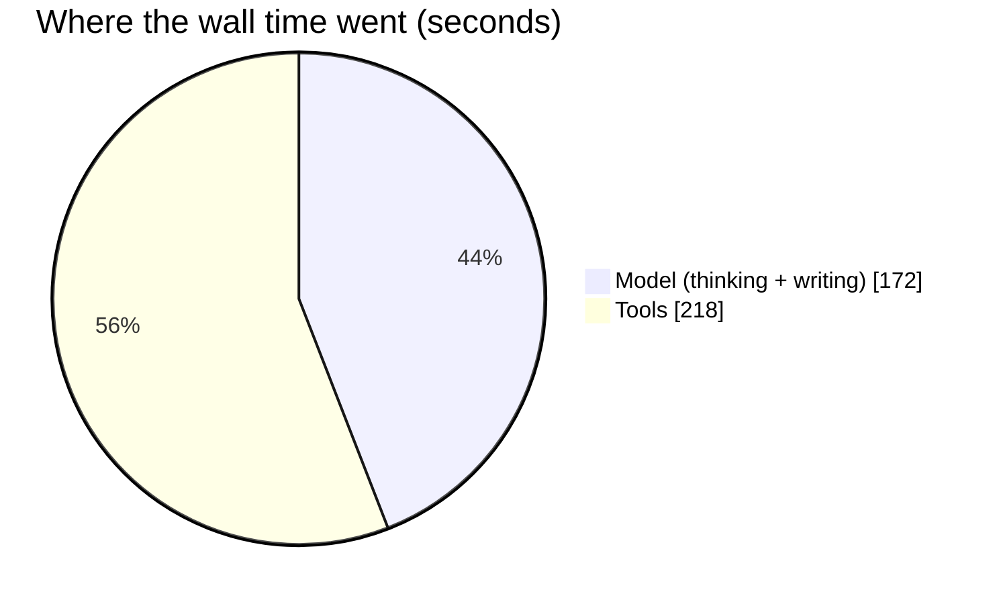

# firm-knowledge/tasks/088 · run2 (`hv-fk250-lunahigh-rep2-20261112T122308Z`)

Result: **all-pass** 4/4 criteria · 6.5 min · 27 model calls · 60 tool calls (2 errors or timeouts) · ending `completed` · started 11-12 18:21:19 IST

## Overview

One box per stretch of steps that used the same kind of tool (blue: looking/searching/reading, purple: writing or editing files, yellow: a message with no tool call, red border: a tool error or timeout inside the box).

```mermaid
flowchart TD
    T(["Task prompt"])
    P0["<b>Step 1</b> · 0.1 min<br/>todo_write"]
    T --> P0
    class P0 look
    P1["<b>Steps 2-3</b> · 0.3 min<br/>glob x8<br/><i>*, **/*, documents/**/* +5</i>"]
    P0 --> P1
    class P1 look
    P2["<b>Step 4</b> · 0.1 min<br/>todo_write"]
    P1 --> P2
    class P2 look
    P3["<b>Step 5</b> · 0.3 min<br/>bash x6<br/><i>parse-doc docx #quot;documents/matters/101…, parse-doc docx #quot;documents/matters/103…, parse-doc docx #quot;documents/matters/100…</i>"]
    P2 --> P3
    class P3 look
    P4["<b>Step 6</b> · 0.3 min<br/>glob x7<br/><i>**/*exclusive*, documents/matters/1007-00008/**/*, documents/matters/1010-00006/**/* +4</i>"]
    P3 --> P4
    class P4 look
    P5["<b>Step 7</b> · 0.6 min<br/>bash x6<br/><i>parse-doc docx #quot;documents/matters/100…, parse-doc docx #quot;documents/matters/101…, parse-doc docx #quot;documents/matters/103…</i>"]
    P4 --> P5
    class P5 look
    P6["<b>Step 8</b> · 0.1 min<br/>grep x6<br/><i>meslsa-execution.txt, data-license-execution.txt, exclusive-license-execution.txt +3</i>"]
    P5 --> P6
    class P6 look
    P7["<b>Step 9</b> · 1.5 min<br/>bash<br/><i>python - #lt;#lt;'PY' from pathlib import P…</i>"]
    P6 --> P7
    class P7 look
    P8["<b>Step 10</b> · 0.1 min<br/>grep<br/><i>exclusive-search.txt</i>"]
    P7 --> P8
    class P8 look
    P9["<b>Step 11</b> · 1.2 min<br/>bash<br/><i>python - #lt;#lt;'PY' from pathlib import P…</i>"]
    P8 --> P9
    class P9 look
    P10["<b>Steps 12-15</b> · 0.3 min<br/>read x9<br/><i>exclusive-phrase-files.txt, exclusive-license-execution.txt, penterra-trademark-license.txt +2</i>"]
    P9 --> P10
    class P10 err
    P11["<b>Step 16</b> · 0.2 min<br/>bash x2<br/><i>parse-doc docx #quot;documents/matters/101…</i>"]
    P10 --> P11
    class P11 look
    P12["<b>Step 17</b> · 0.0 min<br/>read x2<br/><i>closing-memo-1018.txt, client-closing-letter-1018.txt</i>"]
    P11 --> P12
    class P12 look
    P13["<b>Step 18</b> · 0.1 min<br/>grep<br/><i>client-closing-letter-1018.txt</i>"]
    P12 --> P13
    class P13 look
    P14["<b>Steps 19-20</b> · 0.3 min<br/>read x2<br/><i>client-closing-letter-1018.txt, penterra-trademark-license.txt</i>"]
    P13 --> P14
    class P14 look
    P15["<b>Step 21</b> · 0.1 min<br/>todo_write"]
    P14 --> P15
    class P15 look
    P16["<b>Steps 22-24</b> · 0.8 min<br/>write<br/>read<br/>edit<br/><i>response.md</i>"]
    P15 --> P16
    class P16 write
    P17["<b>Step 25</b> · 0.1 min<br/>bash<br/><i>python - #lt;#lt;'PY' from pathlib import P…</i>"]
    P16 --> P17
    class P17 look
    P18["<b>Step 26</b> · 0.1 min<br/>todo_write"]
    P17 --> P18
    class P18 look
    P19["<b>Step 27</b> · 0.0 min<br/>final message"]
    P18 --> P19
    class P19 ans
    R(["ALL PASS: 4/4 criteria"])
    P19 --> R
    class R pass
    classDef look fill:#e8f0fe,stroke:#4a6fa5,color:#111
    classDef write fill:#f3e8fd,stroke:#7b1fa2,color:#111
    classDef ans fill:#fff8e1,stroke:#b58900,color:#111
    classDef err fill:#e8f0fe,stroke:#c62828,stroke-width:3px,color:#111
    classDef pass fill:#e6f4ea,stroke:#2e7d32,color:#111
    classDef fail fill:#fce8e6,stroke:#c62828,color:#111
```





One row per model call:

| Step | Started (IST) | Model s | Tools s | Tool calls | Tools | Output chars |
|---|---|---|---|---|---|---|
| 1 | 18:21:19 | 3 | 0 | 1 | todo_write | 57 |
| 2 | 18:21:22 | 2 | 5 | 3 | glob x3 | 25,560 |
| 3 | 18:21:29 | 4 | 6 | 5 | glob x5 | 14,863 |
| 4 | 18:21:39 | 4 | 0 | 1 | todo_write | 57 |
| 5 | 18:21:43 | 4 | 15 | 6 | bash x6 | 299,876 |
| 6 | 18:22:03 | 8 | 10 | 7 | glob x7 | 17,599 |
| 7 | 18:22:20 | 8 | 26 | 6 | bash x6 | 42 |
| 8 | 18:22:55 | 4 | 4 | 6 | grep x6 | 160,471 |
| 9 | 18:23:03 | 15 | 74 | 1 | bash | 30 |
| 10 | 18:24:32 | 4 | 2 | 1 | grep | 49,858 |
| 11 | 18:24:38 | 7 | 63 | 1 | bash | 4 |
| 12 | 18:25:48 | 3 | 0 | 1 | read | 52,439 |
| 13 | 18:25:51 | 2 | 0 | 1 | read | 52,654 |
| 14 | 18:25:53 | 4 | 0 | 1 | read | 32,402 |
| 15 | 18:25:57 | 6 | 0 | 6 | read x6 ⚠ | 54,993 |
| 16 | 18:26:04 | 4 | 9 | 2 | bash x2 | 14 |
| 17 | 18:26:16 | 3 | 0 | 2 | read x2 | 23,460 |
| 18 | 18:26:19 | 4 | 1 | 1 | grep | 16,873 |
| 19 | 18:26:24 | 2 | 0 | 1 | read | 4,613 |
| 20 | 18:26:26 | 15 | 0 | 1 | read | 1,866 |
| 21 | 18:26:42 | 5 | 0 | 1 | todo_write | 57 |
| 22 | 18:26:46 | 39 | 0 | 1 | write | 205 |
| 23 | 18:27:25 | 5 | 0 | 1 | read | 10,317 |
| 24 | 18:27:30 | 6 | 0 | 1 | edit | 180 |
| 25 | 18:27:36 | 6 | 2 | 1 | bash | 37 |
| 26 | 18:27:44 | 3 | 0 | 1 | todo_write | 57 |
| 27 | 18:27:47 | 2 | 0 | 0 | (message only) | 0 |

## Task prompt

```text
I'm building out an exclusive-license clause bank for the IP group — do we have any matters where we granted an exclusive license, and if so, can you pull the executed agreements?

Output: write your complete answer to `response.md` — a single self-contained markdown file with your findings, the matters/documents you relied on, and your reasoning.
```

## Rubric

| # | Criterion | Verdict |
|---|---|---|
| C-001 | Qualifying matter — Penterra Pharmaceuticals 1018-00006 | pass |
| C-002 | Proof document — executed Exclusive License Agreement | pass |
| C-003 | Related executed agreements — any one suffices | pass |
| C-004 | Qualifying set — precision | pass |

Judge's reasoning:

**C-001 (pass):** Qualifying matter — Penterra Pharmaceuticals 1018-00006

```text
The output explicitly identifies Matter 1018-00006 for Penterra Pharmaceuticals as a qualifying exclusive-license matter.
```

**C-002 (pass):** Proof document — executed Exclusive License Agreement

```text
The output explicitly identifies and links `documents/matters/1018-00006/Transaction Documents/license-agreement-execution.docx` as the operative executed Exclusive License Agreement to pull, satisfying the criterion.
```

**C-003 (pass):** Related executed agreements — any one suffices

```text
The output identifies multiple related executed agreements from Matter 1018-00006 beyond the Exclusive License Agreement, including trademark-license-agreement.docx, technology-transfer-agreement.docx, supply-agreement-api.docx, pharmacovigilance-agreement.docx, and escrow-agreement-execution.docx.
```

**C-004 (pass):** Qualifying set — precision

```text
The output identifies only Matter 1018-00006 (Penterra Pharmaceuticals) as a qualifying exclusive-license matter. Other matters are expressly discussed only as non-qualifying exclusions, not asserted as qualifying matters.
```

## Delivered files (output/)

- `response.md` (9,935 bytes)

`response.md`:

```markdown
# Exclusive-license matters and executed agreements

## Bottom line

Yes. I located **one clear matter in which the firm’s client granted an exclusive IP license**: **Matter 1018-00006 — Penterra Pharmaceuticals Corp. — Out-License of PPC-4187 (Penteracitinib) to Meridian Bio Therapeutics Limited**.

The transaction closed on **October 20, 2023**. The main Exclusive License Agreement is dated and signed **October 2, 2023**; the separate trademark license is effective and signed **October 20, 2023**. Calderwood & Harkness represented Penterra as licensor. The closing memorandum expressly describes the transaction as an “exclusive out-license,” and the client closing letter confirms the closing and identifies the fully executed transaction documents.

## Executed agreements to pull

### 1. Operative exclusive license agreement

**Document:** [documents/matters/1018-00006/Transaction Documents/license-agreement-execution.docx](documents/matters/1018-00006/Transaction%20Documents/license-agreement-execution.docx)

- **Title:** Exclusive License Agreement — Execution Version.
- **Parties:** Penterra Pharmaceuticals Corp. (Licensor) and Meridian Bio Therapeutics Limited (Licensee).
- **Dated:** October 2, 2023.
- **Effective date:** October 20, 2023.
- **Execution evidence:** The agreement contains the signature page for both parties, dated October 2, 2023, followed by an acknowledgment signed by both parties confirming satisfaction or waiver of the closing conditions and effectiveness as of October 20, 2023. It also states that the agreement was executed in two counterparts.
- **Core grant:** Section 2.1 grants Meridian an **“exclusive (even as to Licensor), royalty-bearing license”** under the Licensed IP, with a right to sublicense subject to Section 2.3, to develop, manufacture, have manufactured, use, import, export, offer for sale, sell, distribute, promote, market, and otherwise commercialize Licensed Products in the Territory during the Term.
- **Licensed IP:** Licensed patents, licensed know-how, and licensed trademarks relating to PPC-4187/Penteracitinib, including the PENTECLAR mark.
- **Field:** Pharmaceutical products containing the compound for dermatology indications, initially moderate-to-severe atopic dermatitis in adults.
- **Territory:** China (including Hong Kong and Macau), Japan, South Korea, Australia, New Zealand, Singapore, Thailand, Malaysia, Indonesia, the Philippines, Vietnam, and Taiwan.
- **Exclusivity mechanics:** Section 2.1 makes the grant exclusive in the Territory; Section 2.5 separately provides that, during the Term, Penterra will not grant third-party rights under the Licensed IP in the Territory and will not itself develop, manufacture, or commercialize Licensed Products there except as expressly permitted by the agreement. Penterra retains rights in the separately defined Retained Territory outside the Territory.
- **Commercial terms noted in the closing file:** $18 million upfront consideration; total potential deal value up to $120 million; tiered royalties of 8%, 11%, and 14% on annual net sales in the Territory.

### 2. Separate exclusive trademark license for PENTECLAR

**Document:** [documents/matters/1018-00006/Transaction Documents/trademark-license-agreement.docx](documents/matters/1018-00006/Transaction%20Documents/trademark-license-agreement.docx)

- **Title:** Trademark License Agreement.
- **Parties:** Penterra Pharmaceuticals Corp. and Meridian Bio Therapeutics Limited.
- **Effective date:** October 20, 2023.
- **Execution evidence:** The signature pages show Penterra’s CEO and General Counsel and Meridian’s CEO and General Counsel signing on October 20, 2023; the agreement states that it was executed as of the Effective Date.
- **Core grant:** Section 2.1 grants Meridian an **“exclusive (even as to Penterra and its Affiliates), royalty-bearing license”** to use the Licensed Marks in the Licensed Territory in connection with the development, marketing, promotion, advertising, distribution, sale, offer for sale, importation, and commercialization of Licensed Products.
- **Licensed mark:** PENTECLAR and the listed registrations/applications, including U.S. Registration No. 6,789,012, together with the Territory filings listed in Schedule 1.
- **Exclusivity mechanics:** During the Term, Penterra may not itself use or grant a third party a license to use the Licensed Marks in the Territory in connection with Licensed Products without Meridian’s prior written consent. Penterra retains rights outside the Territory and retains worldwide ownership of the marks.
- **Economics:** The trademark license is compensated through the royalty provisions of the main Exclusive License Agreement; it does not impose a separate royalty.

These are the **two operative executed license agreements** I would pull for an exclusive-license clause bank. They are separate documents supporting the same outbound license transaction, not two separate matters.

## Incorporated schedules and scope documents

The main license agreement and closing letter also identify the following incorporated scope documents in the same matter. They are useful if the clause bank needs the licensed-asset and territorial details, but they are not additional standalone license grants:

- [Schedule A — Licensed Patents](documents/matters/1018-00006/Transaction%20Documents/schedule-a-licensed-patents.docx)
- [Schedule B — Licensed Know-How](documents/matters/1018-00006/Transaction%20Documents/schedule-b-licensed-know-how.docx)
- [Schedule C — Licensed Trademarks](documents/matters/1018-00006/Transaction%20Documents/schedule-c-licensed-trademarks.docx)
- [Schedule D — Territory](documents/matters/1018-00006/Transaction%20Documents/schedule-d-territory.docx)
- [Schedule E — Development Plan](documents/matters/1018-00006/Transaction%20Documents/schedule-e-development-plan.docx)
- [Schedule F — MFN Pricing Methodology](documents/matters/1018-00006/Transaction%20Documents/schedule-f-mfn-pricing-methodology.docx)

## Other executed closing agreements in the same matter

The closing file identifies these additional executed transaction agreements. They support implementation of the exclusive license but do **not** create separate exclusive license grants:

- [Escrow Agreement — Execution](documents/matters/1018-00006/Transaction%20Documents/escrow-agreement-execution.docx)
- [API Supply Agreement](documents/matters/1018-00006/Transaction%20Documents/supply-agreement-api.docx)
- [Technology Transfer Agreement](documents/matters/1018-00006/Transaction%20Documents/technology-transfer-agreement.docx)
- [Pharmacovigilance Agreement](documents/matters/1018-00006/Transaction%20Documents/pharmacovigilance-agreement.docx)

The closing letter lists the **Quality Agreement** as a form to be executed after closing, so I have not treated [quality-agreement-form.docx](documents/matters/1018-00006/Transaction%20Documents/quality-agreement-form.docx) as an executed agreement.

## Closing and execution corroboration

- [Closing memorandum](documents/matters/1018-00006/Closing/closing-memorandum.docx) — Matter 1018-00006; describes the matter as the exclusive out-license of PPC-4187 by Penterra to Meridian, confirms the October 20, 2023 closing, identifies Penterra as the firm’s client/licensor, and records the $18 million escrow release.
- [Client closing confirmation letter](documents/matters/1018-00006/Correspondence/client-letter-closing-confirmation.docx) — confirms the closing, identifies the fully executed transaction documents, and states that originals were delivered under separate cover where applicable.

## Scope of the search and exclusions

I treated “granted an exclusive license” as requiring an operative agreement that expressly makes the license exclusive—not merely a document using “exclusive” in connection with venue, remedies, ownership, a purchase option, a change-of-control provision, or a proposed transaction. I also distinguished executed agreements from drafts, term sheets, and pre-signing exclusivity arrangements.

Several other license documents in the workspace are expressly **non-exclusive** and therefore are not responsive:

- [Matter 1007-00008 — MESLSA execution version](documents/matters/1007-00008/Transaction%20Documents/meslsa-execution-version.docx), Section 2.1: non-exclusive; Section 2.3 expressly reserves the licensor’s right to license competitors.
- [Matter 1010-00006 — Data License Agreement execution](documents/matters/1010-00006/Transaction%20Documents/data-license-agreement-execution.docx), Section 2.1: non-exclusive; Section 2.2/2.3 reserves the licensor’s right to license other parties and use the data itself.
- [Matter 1017-00006 — Trademark License Agreement](documents/matters/1017-00006/Transaction%20Documents/trademark-license-agreement.docx), Sections 1.1 and 2.1: non-exclusive, with the licensor retaining unrestricted rights to use and license the marks.
- [Matter 1037-00004 — Patent License Agreement](documents/matters/1037-00004/Settlement%20Documentation/exhibit-a-patent-license-agreement.docx), title and Section 2.1: expressly non-exclusive; Apex may practice and license the patents to others.
- [Matter 1042-00003 — Technology License Agreement drafts](documents/matters/1042-00003/Transaction%20Documents/license-agreement-draft-1.docx) and [draft 3](documents/matters/1042-00003/Transaction%20Documents/license-agreement-draft-3.docx): drafts only; I found no executed license agreement in that matter.

The pre-signing [Exclusivity Agreement](documents/matters/1018-00006/Transaction%20Documents/Pre-Signing/exclusivity-agreement.docx) and term sheet in Matter 1018-00006 were not treated as the operative license grant. The executed Exclusive License Agreement supersedes the earlier negotiation documents and is the document that establishes the license rights.
```

## Trajectory

### Step 1: 1 tool call

_Started 11-12 18:21:19 IST · model 3 s · tools 0 s_

**Reasoning summary:**

```text
**Inspecting documents**

I need to inspect some documents, which might involve searching through them. I think I'll need to list files using a method like glob to check for all the relevant documents. Also, I must ensure that my final output goes into a response.md file. It’s important to verify whether these documents contain any exclusive licenses or executed agreements. So, let’s go ahead and list the documents I need to review!
```

**Call `todo_write`** (0.0 s)

```json
{
 "todos": [
  {
   "content": "Inventory the workspace documents and identify likely IP/license materials",
   "status": "in_progress"
  },
  {
   "content": "Review source documents for exclusive-license grants and execution status",
   "status": "pending"
  },
  {
   "content": "Cross-check matter names and document metadata, then draft findings",
   "status": "pending"
  },
  {
   "content": "Write and verify the complete self-contained response.md",
   "status": "pending"
  }
 ]
}
```

Output (57 chars):

```text
Updated todo list: 3 pending, 1 in progress, 0 completed.
```

**Todo list now:**

- [~] Inventory the workspace documents and identify likely IP/license materials
- [ ] Review source documents for exclusive-license grants and execution status
- [ ] Cross-check matter names and document metadata, then draft findings
- [ ] Write and verify the complete self-contained response.md

### Step 2: 3 tool calls

_Started 11-12 18:21:22 IST · model 2 s · tools 5 s_

**Call `glob`** (0.8 s)

```json
{
 "pattern": "*"
}
```

Output (8,520 chars):

```text
documents/matters/1001-00001/Antitrust Analysis/competitor-identification-chart.xlsx
documents/matters/1001-00001/Antitrust Analysis/portfolio-company-overlap-analysis.docx
documents/matters/1001-00001/Antitrust Analysis/hhi-concentration-analysis.xlsx
documents/matters/1001-00001/Antitrust Analysis/market-definition-competitive-analysis-memo.docx
documents/matters/1001-00001/Client Updates/biweekly-status-report-1.docx
documents/matters/1001-00001/Antitrust Analysis/preliminary-antitrust-risk-assessment.docx
documents/matters/1001-00001/Antitrust Analysis/state-regulatory-con-analysis.docx
documents/matters/1001-00001/Antitrust Analysis/vertical-relationships-analysis.docx
documents/matters/1001-00001/Closing/closing-memo-antitrust-workstream.docx
documents/matters/1001-00001/Client Updates/client-update-early-termination-granted.eml
documents/matters/1001-00001/Client Updates/biweekly-status-report-2.docx
documents/matters/1001-00001/Client Updates/client-update-hsr-forms-filed.eml
documents/matters/1001-00001/Closing/final-invoice-matter-closing-letter.docx
documents/matters/1001-00001/Closing/hsr-clearance-certificate.docx
documents/matters/1001-00001/Correspondence/Counterparty Counsel/email-gk-naics-code-consistency.eml
documents/matters/1001-00001/Early Termination/early-termination-request-letter.docx
documents/matters/1001-00001/Correspondence/Counterparty Counsel/letter-bracewell-thornton-regulatory-condition.docx
documents/matters/1001-00001/Correspondence/Counterp
… [7,020 more chars]
```

**Call `glob`** (0.9 s)

```json
{
 "pattern": "**/*"
}
```

Output (8,520 chars):

```text
documents/matters/1001-00001/Antitrust Analysis/competitor-identification-chart.xlsx
documents/matters/1001-00001/Antitrust Analysis/portfolio-company-overlap-analysis.docx
documents/matters/1001-00001/Antitrust Analysis/hhi-concentration-analysis.xlsx
documents/matters/1001-00001/Antitrust Analysis/market-definition-competitive-analysis-memo.docx
documents/matters/1001-00001/Client Updates/biweekly-status-report-1.docx
documents/matters/1001-00001/Antitrust Analysis/preliminary-antitrust-risk-assessment.docx
documents/matters/1001-00001/Antitrust Analysis/state-regulatory-con-analysis.docx
documents/matters/1001-00001/Antitrust Analysis/vertical-relationships-analysis.docx
documents/matters/1001-00001/Closing/closing-memo-antitrust-workstream.docx
documents/matters/1001-00001/Client Updates/client-update-early-termination-granted.eml
documents/matters/1001-00001/Client Updates/biweekly-status-report-2.docx
documents/matters/1001-00001/Client Updates/client-update-hsr-forms-filed.eml
documents/matters/1001-00001/Closing/final-invoice-matter-closing-letter.docx
documents/matters/1001-00001/Closing/hsr-clearance-certificate.docx
documents/matters/1001-00001/Correspondence/Counterparty Counsel/email-gk-naics-code-consistency.eml
documents/matters/1001-00001/Early Termination/early-termination-request-letter.docx
documents/matters/1001-00001/Correspondence/Counterparty Counsel/letter-bracewell-thornton-regulatory-condition.docx
documents/matters/1001-00001/Correspondence/Counterp
… [7,020 more chars]
```

**Call `glob`** (3.0 s)

```json
{
 "pattern": "documents/**/*"
}
```

Output (8,520 chars):

```text
documents/matters/1001-00001/Antitrust Analysis/competitor-identification-chart.xlsx
documents/matters/1001-00001/Antitrust Analysis/portfolio-company-overlap-analysis.docx
documents/matters/1001-00001/Antitrust Analysis/hhi-concentration-analysis.xlsx
documents/matters/1001-00001/Antitrust Analysis/market-definition-competitive-analysis-memo.docx
documents/matters/1001-00001/Client Updates/biweekly-status-report-1.docx
documents/matters/1001-00001/Antitrust Analysis/preliminary-antitrust-risk-assessment.docx
documents/matters/1001-00001/Antitrust Analysis/state-regulatory-con-analysis.docx
documents/matters/1001-00001/Antitrust Analysis/vertical-relationships-analysis.docx
documents/matters/1001-00001/Closing/closing-memo-antitrust-workstream.docx
documents/matters/1001-00001/Client Updates/client-update-early-termination-granted.eml
documents/matters/1001-00001/Client Updates/biweekly-status-report-2.docx
documents/matters/1001-00001/Client Updates/client-update-hsr-forms-filed.eml
documents/matters/1001-00001/Closing/final-invoice-matter-closing-letter.docx
documents/matters/1001-00001/Closing/hsr-clearance-certificate.docx
documents/matters/1001-00001/Correspondence/Counterparty Counsel/email-gk-naics-code-consistency.eml
documents/matters/1001-00001/Early Termination/early-termination-request-letter.docx
documents/matters/1001-00001/Correspondence/Counterparty Counsel/letter-bracewell-thornton-regulatory-condition.docx
documents/matters/1001-00001/Correspondence/Counterp
… [7,020 more chars]
```

### Step 3: 5 tool calls

_Started 11-12 18:21:29 IST · model 4 s · tools 6 s_

**Reasoning summary:**

```text
**Searching for documents**

I’m noticing I have a large number of documents to go through, probably around 9288, and there are likely many synthetic matters. I need to search for specific content related to licenses, like exclusivity and license grants. I wonder if I can use the grep tool to check the contents of docx files, but grep usually reads binary format, which might not work. Instead, maybe I can use a bash script to parse them and find names containing license agreements. Let's use glob patterns!
```

**Call `glob`** (0.8 s)

```json
{
 "pattern": "**/*license*"
}
```

Output (2,447 chars):

```text
documents/matters/1007-00008/Transaction Documents/meslsa-exhibit-a-licensed-software-specs.docx
documents/matters/1008-00010/Transaction Documents/Exhibits/exhibit-a-licensed-products-pricing.xlsx
documents/matters/1008-00010/Transaction Documents/Exhibits/exhibit-d-trademark-license-brand-guidelines.docx
documents/matters/1010-00006/Transaction Documents/data-license-agreement-execution.docx
documents/matters/1010-00006/Transaction Documents/data-license-agreement-redline-pca-markup.docx
documents/matters/1013-00005/Damages/veridian-license-comparability-memo.docx
documents/matters/1014-00003/Settlement & Dismissal/ows-cross-license-proposal-term-sheet.docx
documents/matters/1014-00004/Damages Analysis/comparable-license-analysis.docx
documents/matters/1017-00003/Factual Investigation/fast-channel-sublicensee-memo.docx
documents/matters/1017-00006/Transaction Documents/trademark-license-agreement.docx
documents/matters/1018-00006/Transaction Documents/Drafts/license-agreement-initial-draft.docx
documents/matters/1018-00006/Transaction Documents/Drafts/license-agreement-revised-draft.docx
documents/matters/1018-00006/Transaction Documents/Drafts/license-agreement-redline-lcf.docx
documents/matters/1018-00006/Transaction Documents/license-agreement-execution.docx
documents/matters/1018-00006/Transaction Documents/schedule-a-licensed-patents.docx
documents/matters/1018-00006/Transaction Documents/schedule-b-licensed-know-how.docx
documents/matters/1018-00006/Transaction Docume
… [947 more chars]
```

**Call `glob`** (1.2 s)

```json
{
 "pattern": "**/*licen*"
}
```

Output (3,112 chars):

```text
documents/matters/1001-00007/Regulatory/state-licensure-transfer-cover-memo.docx
documents/matters/1003-00003/Diligence/regulatory-licensing-dd-memo.docx
documents/matters/1007-00008/Correspondence/Internal/email-liu-to-crawford-rtos-licensing-research.eml
documents/matters/1007-00008/Transaction Documents/meslsa-exhibit-a-licensed-software-specs.docx
documents/matters/1008-00010/Transaction Documents/Exhibits/exhibit-a-licensed-products-pricing.xlsx
documents/matters/1008-00010/Transaction Documents/Exhibits/exhibit-d-trademark-license-brand-guidelines.docx
documents/matters/1009-00003/Diligence/regulatory-licensing-memo.docx
documents/matters/1010-00006/Transaction Documents/data-license-agreement-execution.docx
documents/matters/1010-00006/Transaction Documents/data-license-agreement-redline-pca-markup.docx
documents/matters/1013-00005/Damages/veridian-license-comparability-memo.docx
documents/matters/1014-00003/Settlement & Dismissal/ows-cross-license-proposal-term-sheet.docx
documents/matters/1014-00004/Damages Analysis/comparable-license-analysis.docx
documents/matters/1016-00003/Diligence/dd-memo-regulatory-licensing.docx
documents/matters/1017-00003/Factual Investigation/fast-channel-sublicensee-memo.docx
documents/matters/1017-00006/Transaction Documents/trademark-license-agreement.docx
documents/matters/1018-00004/Transaction Documents/IP & Data/data-ownership-licensing-memo.docx
documents/matters/1018-00006/Transaction Documents/Drafts/license-agreement-initial-dra
… [1,612 more chars]
```

**Call `glob`** (2.2 s)

```json
{
 "pattern": "**/*agreement*"
}
```

Output (8,913 chars):

```text
documents/matters/1001-00002/Carry & Economics/carried-interest-allocation-agreement.docx
documents/matters/1001-00002/Amended Governing Documents/gp-second-amended-llc-agreement.docx
documents/matters/1001-00002/Amended Governing Documents/manco-second-amended-llc-agreement.docx
documents/matters/1001-00002/Carry & Economics/management-fee-sharing-agreement.docx
documents/matters/1001-00002/Departing Principals/kellner-senior-advisor-agreement.docx
documents/matters/1001-00002/Departing Principals/trask-separation-agreement.docx
documents/matters/1001-00002/Departing Principals/trask-separation-agreement-redline.docx
documents/matters/1001-00002/Departing Principals/kellner-separation-agreement.docx
documents/matters/1001-00002/Entity Formation/gp-intermediate-llc-agreement.docx
documents/matters/1001-00002/Entity Formation/holdco-llc-agreement.docx
documents/matters/1001-00003/Transaction Documents/APA Drafts/asset-purchase-agreement-first-draft.docx
documents/matters/1001-00003/Transaction Documents/Employment/employment-agreement-whitfield-torres.docx
documents/matters/1001-00003/Transaction Documents/APA Drafts/asset-purchase-agreement-redline-seller-markup.docx
documents/matters/1001-00003/Transaction Documents/Employment/employment-agreement-whitfield.docx
documents/matters/1001-00003/Transaction Documents/assignment-and-assumption-agreement.docx
documents/matters/1001-00003/Transaction Documents/asset-purchase-agreement-execution.docx
documents/matters/1001-00003/Tran
… [7,413 more chars]
```

**Call `glob`** (1.4 s)

```json
{
 "pattern": "**/*IP*"
}
```

Output (14 chars):

```text
No files found
```

**Call `glob`** (0.7 s)

```json
{
 "pattern": "**/*intellectual*"
}
```

Output (377 chars):

```text
documents/matters/1011-00005/Diligence/dd-memo-intellectual-property.docx
documents/matters/1015-00001/Diligence/dd-memo-intellectual-property.docx
documents/matters/1015-00001/Diligence/dd-request-list-intellectual-property.docx
documents/matters/1023-00001/Diligence/dd-memo-intellectual-property.docx
documents/matters/1032-00003/Diligence/dd-memo-intellectual-property.docx
```

### Step 4: 1 tool call

_Started 11-12 18:21:39 IST · model 4 s · tools 0 s_

**Call `todo_write`** (0.0 s)

```json
{
 "todos": [
  {
   "content": "Inventory the workspace documents and identify likely IP/license materials",
   "status": "completed"
  },
  {
   "content": "Review source documents for exclusive-license grants and execution status",
   "status": "in_progress"
  },
  {
   "content": "Cross-check matter names and document metadata, then draft findings",
   "status": "pending"
  },
  {
   "content": "Write and verify the complete self-contained response.md",
   "status": "pending"
  }
 ]
}
```

Output (57 chars):

```text
Updated todo list: 2 pending, 1 in progress, 1 completed.
```

**Todo list now:**

- [x] Inventory the workspace documents and identify likely IP/license materials
- [~] Review source documents for exclusive-license grants and execution status
- [ ] Cross-check matter names and document metadata, then draft findings
- [ ] Write and verify the complete self-contained response.md

### Step 5: 6 tool calls

_Started 11-12 18:21:43 IST · model 4 s · tools 15 s_

**Call `bash`** (2.2 s)

```json
{
 "command": "parse-doc docx \"documents/matters/1010-00006/Transaction Documents/data-license-agreement-execution.docx\"",
 "description": "Parse executed data license agreement",
 "timeoutMs": 120000
}
```

Output (49,991 chars):

```text
ations set forth in Exhibit A and Exhibit B.

\(d\) The acceptance procedures set forth in Section 3.2 shall apply to each Quarterly Refresh, mutatis mutandis.

**Section 3.4 --- Post-Term Quarterly Refreshes**

Following the expiration of the Quarterly Refresh Period on June 30, 2027, Licensee may elect to continue receiving Quarterly Refreshes during the remainder of the Initial Term and during any Renewal Term by providing Licensor with written notice of such election no fewer than sixty (60) days prior to the commencement of the first calendar quarter for which such Quarterly Refreshes are desired. If Licensee elects to continue receiving Quarterly Refreshes, Licensee shall pay the Renewal Refresh Fee of Three Hundred Seventy-Five Thousand Dollars (\$375,000) per calendar quarter (annualized: One Million Five Hundred Thousand Dollars (\$1,500,000) per year), payable within thirty (30) days after the end of each calendar quarter in which a Quarterly Refresh is delivered. The acceptance and delivery procedures set forth in Sections 3.2 and 3.3 shall apply to all post-Quarterly Refresh Period deliveries.

**Section 3.5 --- Data Format and Specifications**

All Data Deliveries, whether the Initial Data Delivery, Quarterly Refreshes, or post-Quarterly Refresh Period deliveries, shall conform to the specifications set forth in Exhibit A (Data Description & Specifications) and Exhibit B (Data Dictionary). The Licensed Data shall include the two hundred forty-seven (247) standard
… [48,491 more chars]
```

**Call `bash`** (2.2 s)

```json
{
 "command": "parse-doc docx \"documents/matters/1017-00006/Transaction Documents/trademark-license-agreement.docx\"",
 "description": "Parse trademark license agreement",
 "timeoutMs": 120000
}
```

Output (49,999 chars):

```text
**[TRADEMARK LICENSE AGREEMENT]{.underline}**

by and between

**RIDGELINE PUBLISHING ACQUISITION CORP.**

as Licensor

and

**AURELIUS MEDIA HOLDINGS INC.**

as Licensee

Dated as of November 15, 2024

**TABLE OF CONTENTS**

Right-click to update Table of Contents

**TRADEMARK LICENSE AGREEMENT**

This TRADEMARK LICENSE AGREEMENT (this \"**Agreement**\") is entered into as of November 15, 2024 (the \"**Effective Date**\"), by and between:

**RIDGELINE PUBLISHING ACQUISITION CORP.**, a Delaware corporation (file no. 6501982), with its registered agent at Crowne Albany Corporation, 1209 Orange Street, Wilmington, Delaware 19801 (\"**Licensor**\");

and

**AURELIUS MEDIA HOLDINGS INC.**, a Delaware corporation (file no. 5987324), with its registered agent at Crowne Albany Corporation, 1209 Orange Street, Wilmington, Delaware 19801 (\"**Licensee**\").

Licensor and Licensee are each referred to herein individually as a \"**Party**\" and collectively as the \"**Parties**.\"

**[RECITALS]{.underline}**

**WHEREAS**, this Agreement is entered into in connection with that certain Membership Interest Purchase Agreement, dated as of July 19, 2024 (the \"**MIPA**\"), among Aurelius Media Holdings Inc. (as Seller), Ridgeline Publishing Acquisition Corp. (as Buyer), and, solely for purposes of certain provisions thereof, Aurelius Global Media Group PLC and Pinnacle Ridge Capital Partners Fund IV, L.P., pursuant to which Licensor acquired one hundred percent (100%) of the membership inter
… [48,499 more chars]
```

**Call `bash`** (3.1 s)

```json
{
 "command": "parse-doc docx \"documents/matters/1018-00006/Transaction Documents/license-agreement-execution.docx\"",
 "description": "Parse executed license agreement",
 "timeoutMs": 120000
}
```

Output (49,936 chars):

```text
ion of Matter*: U.S. Patent No. 11,234,567 (entitled \"Selective JAK1 Inhibitor Compounds and Pharmaceutical Compositions Thereof\"), issued February 1, 2022, with an expiration date of August 12, 2037;
>
> \(b\) *Crystalline Form*: U.S. Patent No. 11,345,678 (entitled \"Crystalline Form A of Penteracitinib and Methods of Preparation Thereof\"), issued June 15, 2022, with an expiration date of November 3, 2038;
>
> \(c\) *PCT Application*: International Application No. PCT/US2019/045123, and national phase entries thereof in the Territory jurisdictions;
>
> \(d\) *China*: CN Patent No. ZL 2020 1 0456789.0, issued by the China National intellectual Property Administration;
>
> \(e\) *Japan*: JP Patent No. 7,012,345, issued by the Japan Patent Office;
>
> \(f\) *South Korea*: KR Patent No. 10-2345678, issued by the Korean intellectual Property Office;
>
> \(g\) *Australia*: AU Patent No. 2020234567, issued by IP Australia;

together with pending patent applications in Singapore, Thailand, Malaysia, Indonesia, the Philippines, Vietnam, and Taiwan, all as more particularly described in Schedule A.

**[ARTICLE 8 --- COMMERCIALIZATION]{.underline}**

**Section 8.1 Commercialization Obligations**

Licensee shall use Commercially Reasonable Efforts to Commercialize Licensed Products in each Major Market Country in the Territory (China, Japan, South Korea, and Australia) following receipt of Regulatory Approval in each such country. Without limiting the generality of the foregoing, Li
… [48,436 more chars]
```

**Call `bash`** (3.2 s)

```json
{
 "command": "parse-doc docx \"documents/matters/1018-00006/Transaction Documents/trademark-license-agreement.docx\"",
 "description": "Parse executed trademark license",
 "timeoutMs": 120000
}
```

Output (50,000 chars):

```text
n, Meridian shall promptly transfer all domain names incorporating the Licensed Marks to Penterra or its designee, at no cost to Penterra, in accordance with Section 8.6(d) hereof.
>
> \(d\) Meridian shall not register any domain name incorporating the Licensed Marks in any generic top-level domain (gTLD) (e.g., .com, .net, .org, .pharma) or in any country-code top-level domain outside the Licensed Territory without Penterra\'s express written consent.

**4.6 Co-Branding.** Any co-branding of the Licensed Marks with Meridian\'s corporate name, trademarks, logos, or other marks requires Penterra\'s prior written approval. In all cases where Meridian\'s corporate name or marks appear alongside the Licensed Marks, the PENTECLAR mark must be displayed as the primary and predominant brand name, with equal or greater prominence in terms of size, placement, and visual emphasis relative to any Meridian marks. The approved co-branding formats are set forth in Section 2.6 of **Schedule 2**, and Meridian shall not deviate from such approved formats without Penterra\'s prior written consent.

**4.7 Prohibition on Use Outside Territory.** Meridian shall not use, display, promote, advertise, or otherwise exploit the Licensed Marks outside the Licensed Territory, whether directly or indirectly, and whether through physical or digital channels. Without limiting the generality of the foregoing:

> \(a\) Meridian shall not place the Licensed Marks on any product, packaging, advertising, or pro
… [48,500 more chars]
```

**Call `bash`** (2.4 s)

```json
{
 "command": "parse-doc docx \"documents/matters/1037-00004/Settlement Documentation/exhibit-a-patent-license-agreement.docx\"",
 "description": "Parse patent license agreement",
 "timeoutMs": 120000
}
```

Output (49,993 chars):

```text
tinue for the Term specified in Section 11.1, unless earlier terminated in accordance with Article XI. For the avoidance of doubt, the license granted hereunder is non-exclusive, and nothing in this Agreement shall prevent Apex from practicing the Licensed Patents itself, licensing the Licensed Patents to any other person or entity, or granting any other rights in the Licensed Patents to third parties. The Parties acknowledge and agree that the royalty obligations applicable to this license are set forth in Article III of this Agreement.

**Section 2.2 --- Sublicense Rights.**

\(a\) Solstice and Solstice US may grant sublicenses under the Licensed Patents solely to Contract Manufacturers, and solely for the purpose of manufacturing Licensed Products on behalf of and for subsequent sale by Solstice, Solstice US, or their Affiliates. Solstice and Solstice US shall not grant sublicenses for any other purpose or to any other person or entity without the prior written consent of Apex.

\(b\) Each sublicense granted pursuant to this Section 2.2 shall:

> \(i\) be in writing and executed by authorized representatives of Solstice or Solstice US (as applicable) and the Contract Manufacturer;
>
> \(ii\) be consistent with and subordinate to the terms and conditions of this Agreement in all respects, and shall expressly provide that the Contract Manufacturer\'s rights under the sublicense are derived from and limited by this Agreement;
>
> \(iii\) require the Contract Manufacturer to c
… [48,493 more chars]
```

**Call `bash`** (2.1 s)

```json
{
 "command": "parse-doc docx \"documents/matters/1007-00008/Transaction Documents/meslsa-exhibit-a-licensed-software-specs.docx\"",
 "description": "Parse licensed software exhibit",
 "timeoutMs": 120000
}
```

Output (49,957 chars):

```text
ication Package.** A collection of documentation artifacts specifically developed and maintained to support compliance with ISO 26262 (Road Vehicles --- Functional Safety) at Automotive Safety Integrity Levels up to and including ASIL-D, and IEC 61508 (Functional Safety of Electrical/Electronic/Programmable Electronic Safety-Related Systems) at Safety Integrity Level SIL-3. The Safety Certification Package includes safety plans, hazard analyses, design verification reports, traceability matrices, test coverage reports, and other artifacts as further described in Section 6.1 of this Exhibit A.

**1.3 Deliverables.** Licensor shall deliver the following items to Licensee as part of the initial delivery of the Licensed Software, subject to the delivery timeline and acceptance criteria set forth in Section 8 of this Exhibit A:

> **(a) Source Code.** Complete, compilable source code for all software components listed in Section 1.2(a) through (j) above, delivered in a format suitable for compilation using the toolchains identified in Section 3.4 of this Exhibit A. The source code shall be accompanied by all necessary header files, configuration files, linker scripts, makefiles, and build configuration files required for successful compilation.
>
> **(b) Object Code and Pre-Compiled Binary Libraries.** Pre-compiled object code and binary libraries for each of the reference hardware platforms identified in Section 3.2 of this Exhibit A, compiled using the default toolchain configur
… [48,457 more chars]
```

### Step 6: 7 tool calls

_Started 11-12 18:22:03 IST · model 8 s · tools 10 s_

**Reasoning summary:**

```text
**Inspecting matter documentation**

I need to check the matter index info from the opening documents to pinpoint the names of the matters. I'll gather the relevant matter documents using the glob for 1007, 1010, 1017, 1018, 1037, and maybe even 1042. I should also consider searching all document filenames for anything matching "exclusive." I want to ensure I have all the necessary information to provide the right insights.
```

**Call `glob`** (0.7 s)

```json
{
 "pattern": "**/*exclusive*"
}
```

Output (14 chars):

```text
No files found
```

**Call `glob`** (1.2 s)

```json
{
 "pattern": "documents/matters/1007-00008/**/*"
}
```

Output (3,079 chars):

```text
documents/matters/1007-00008/Administrative/matter-status-tracker.xlsx
documents/matters/1007-00008/Administrative/privileged-matter-summary-key-date-calendar.docx
documents/matters/1007-00008/Correspondence/Client/email-crawford-to-cross-status-update.eml
documents/matters/1007-00008/Correspondence/Lender/letter-sc-to-pinnacle-dormancy-notification.docx
documents/matters/1007-00008/Correspondence/Opposing Counsel/letter-sc-to-rw-derivative-works-position.docx
documents/matters/1007-00008/Correspondence/Internal/email-liu-to-crawford-rtos-licensing-research.eml
documents/matters/1007-00008/Correspondence/MeridianCode/dormancy-notice-letter-vms-to-mct.docx
documents/matters/1007-00008/Correspondence/Client/email-moss-to-huang-document-preservation.eml
documents/matters/1007-00008/Correspondence/Opposing Counsel/letter-sc-to-rw-maintenance-fee-response.docx
documents/matters/1007-00008/Correspondence/Opposing Counsel/letter-sc-to-rw-initial-position-dormancy.docx
documents/matters/1007-00008/Correspondence/Sponsor/email-ashby-to-drummond-sponsor-update.eml
documents/matters/1007-00008/Engagement/conflict-check-memo.docx
documents/matters/1007-00008/Engagement/engagement-letter-vms.docx
documents/matters/1007-00008/Memoranda/antitrust-considerations-memo.docx
documents/matters/1007-00008/Memoranda/preliminary-contract-review-memo.docx
documents/matters/1007-00008/Memoranda/arbitration-strategy-memo.docx
documents/matters/1007-00008/Memoranda/reactivation-vs-termination-strategy-
… [1,579 more chars]
```

**Call `glob`** (3.2 s)

```json
{
 "pattern": "documents/matters/1010-00006/**/*"
}
```

Output (934 chars):

```text
documents/matters/1010-00006/Closing/aht-board-resolution.docx
documents/matters/1010-00006/Closing/lender-notice-lakeshore.docx
documents/matters/1010-00006/Closing/closing-checklist.xlsx
documents/matters/1010-00006/Closing/officer-certificate-aht.docx
documents/matters/1010-00006/Diligence/hipaa-privacy-compliance-memo.docx
documents/matters/1010-00006/Transaction Documents/data-license-agreement-execution.docx
documents/matters/1010-00006/Engagement/engagement-letter-calderwood-harkness.docx
documents/matters/1010-00006/Diligence/ip-ownership-derived-works-memo.docx
documents/matters/1010-00006/Transaction Documents/exhibit-a-data-description.docx
documents/matters/1010-00006/Transaction Documents/exhibit-c-data-security-requirements.docx
documents/matters/1010-00006/Transaction Documents/data-license-agreement-redline-pca-markup.docx
documents/matters/1010-00006/Transaction Documents/mutual-nda-aht-pca-executed.docx
```

**Call `glob`** (0.9 s)

```json
{
 "pattern": "documents/matters/1017-00006/**/*"
}
```

Output (3,092 chars):

```text
documents/matters/1017-00006/Closing/Resolutions/aurelius-plc-board-resolution.docx
documents/matters/1017-00006/Closing/funds-flow-memo.xlsx
documents/matters/1017-00006/Closing/Resolutions/aurelius-us-board-resolution.docx
documents/matters/1017-00006/Closing/firpta-certificate.docx
documents/matters/1017-00006/Closing/secretarys-certificate-seller.docx
documents/matters/1017-00006/Closing/assignment-of-membership-interests.docx
documents/matters/1017-00006/Closing/payoff-letter-intercompany-note.docx
documents/matters/1017-00006/Closing/closing-certificate-seller-bringdown.docx
documents/matters/1017-00006/Closing/closing-checklist.xlsx
documents/matters/1017-00006/Closing/estimated-closing-statement.xlsx
documents/matters/1017-00006/Closing/officers-certificate-seller.docx
documents/matters/1017-00006/Correspondence/email-closing-confirmation.eml
documents/matters/1017-00006/Correspondence/email-spa-circulation-to-buyer-counsel.eml
documents/matters/1017-00006/Correspondence/email-signing-confirmation.eml
documents/matters/1017-00006/Diligence/Tax/preliminary-tax-structure-memo.docx
documents/matters/1017-00006/Engagement/conflict-check-memo.docx
documents/matters/1017-00006/Diligence/seller-diligence-summary-memo.docx
documents/matters/1017-00006/Diligence/due-diligence-request-list.docx
documents/matters/1017-00006/Diligence/Tax/section-338h10-tax-memo.docx
documents/matters/1017-00006/Post-Closing/closing-memo-transaction-summary.docx
documents/matters/1017-00006/Engag
… [1,592 more chars]
```

**Call `glob`** (2.4 s)

```json
{
 "pattern": "documents/matters/1018-00006/**/*"
}
```

Output (3,084 chars):

```text
documents/matters/1018-00006/Closing/closing-checklist.xlsx
documents/matters/1018-00006/Closing/secretarys-certificate-meridian.docx
documents/matters/1018-00006/Closing/officers-certificate-meridian.docx
documents/matters/1018-00006/Closing/officers-certificate-penterra.docx
documents/matters/1018-00006/Closing/post-closing-obligations-tracker.xlsx
documents/matters/1018-00006/Closing/legal-opinion-calderwood-harkness.docx
documents/matters/1018-00006/Closing/secretarys-certificate-penterra.docx
documents/matters/1018-00006/Closing/closing-memorandum.docx
documents/matters/1018-00006/Closing/escrow-funding-confirmation.docx
documents/matters/1018-00006/Correspondence/client-letter-closing-confirmation.docx
documents/matters/1018-00006/Correspondence/email-mfn-pricing-analysis.eml
documents/matters/1018-00006/Correspondence/email-lcf-initial-draft-transmittal.eml
documents/matters/1018-00006/Correspondence/email-signing-confirmation.eml
documents/matters/1018-00006/Engagement/conflict-check-memo.docx
documents/matters/1018-00006/Diligence/fto-summary-memo.docx
documents/matters/1018-00006/Diligence/ip-due-diligence-report.docx
documents/matters/1018-00006/Diligence/indemnification-analysis-memo.docx
documents/matters/1018-00006/Diligence/Tax/tax-structuring-memo.docx
documents/matters/1018-00006/Diligence/preliminary-ip-diligence-memo.docx
documents/matters/1018-00006/Engagement/engagement-letter-penterra.docx
documents/matters/1018-00006/Transaction Documents/Drafts/license
… [1,584 more chars]
```

**Call `glob`** (0.8 s)

```json
{
 "pattern": "documents/matters/1037-00004/**/*"
}
```

Output (6,515 chars):

```text
documents/matters/1037-00004/Claim Construction & Invalidity/claim-chart-105-patent.docx
documents/matters/1037-00004/Claim Construction & Invalidity/claim-chart-237-patent.docx
documents/matters/1037-00004/Claim Construction & Invalidity/claim-construction-analysis-memo.docx
documents/matters/1037-00004/Claim Construction & Invalidity/invalidity-prior-art-analysis-memo.docx
documents/matters/1037-00004/Claim Construction & Invalidity/claim-chart-884-patent.docx
documents/matters/1037-00004/Closing/client-closing-letter.docx
documents/matters/1037-00004/Claim Construction & Invalidity/post-markman-strategy-memo.docx
documents/matters/1037-00004/Closing/stipulation-dismissal-filed-version.docx
documents/matters/1037-00004/Closing/escrow-deposit-confirmation-tranche-1.docx
documents/matters/1037-00004/Closing/insurance-settlement-reporting-letter.docx
documents/matters/1037-00004/Closing/closing-checklist.xlsx
documents/matters/1037-00004/Closing/final-invoice-fee-summary.xlsx
documents/matters/1037-00004/Closing/wire-transfer-instructions-letter.docx
documents/matters/1037-00004/Closing/notice-settlement-vacate-trial.docx
documents/matters/1037-00004/Discovery/Internal Analysis/discovery-dispute-strategy-email.eml
documents/matters/1037-00004/Discovery/Internal Analysis/tar-protocol-memo.docx
documents/matters/1037-00004/Discovery/Internal Analysis/key-document-analysis-apex-production.docx
documents/matters/1037-00004/Discovery/Internal Analysis/prosecution-history-analysis-m
… [5,015 more chars]
```

**Call `glob`** (0.6 s)

```json
{
 "pattern": "documents/matters/1042-00003/**/*"
}
```

Output (881 chars):

```text
documents/matters/1042-00003/Analysis/board-update-memo.docx
documents/matters/1042-00003/Closing/final-invoice-fee-summary.xlsx
documents/matters/1042-00003/Analysis/field-of-use-issues-memo.docx
documents/matters/1042-00003/Closing/matter-closing-letter.docx
documents/matters/1042-00003/Correspondence/email-rejection-response-next-steps.eml
documents/matters/1042-00003/Transaction Documents/license-agreement-draft-1.docx
documents/matters/1042-00003/Correspondence/tiered-unlock-proposal-letter.docx
documents/matters/1042-00003/Engagement/engagement-letter-bcs.docx
documents/matters/1042-00003/Diligence/ip-diligence-memo.docx
documents/matters/1042-00003/Transaction Documents/mutual-nda-bcs-nexilis.docx
documents/matters/1042-00003/Transaction Documents/license-agreement-draft-3.docx
documents/matters/1042-00003/Transaction Documents/redline-analysis-memo-draft-2.docx
```

### Step 7: 6 tool calls

_Started 11-12 18:22:20 IST · model 8 s · tools 26 s_

**Call `bash`** (2.3 s)

```json
{
 "command": "parse-doc docx \"documents/matters/1007-00008/Transaction Documents/meslsa-execution-version.docx\" > meslsa-execution.txt 2> meslsa-execution.err; printf 'exit=%s\\n' \"$?\"",
 "description": "Extract executed software license text",
 "timeoutMs": 120000
}
```

Output (7 chars):

```text
exit=0
```

**Call `bash`** (2.2 s)

```json
{
 "command": "parse-doc docx \"documents/matters/1010-00006/Transaction Documents/data-license-agreement-execution.docx\" > data-license-execution.txt 2> data-license-execution.err; printf 'exit=%s\\n' \"$?\"",
 "description": "Extract executed data license text",
 "timeoutMs": 120000
}
```

Output (7 chars):

```text
exit=0
```

**Call `bash`** (3.1 s)

```json
{
 "command": "parse-doc docx \"documents/matters/1018-00006/Transaction Documents/license-agreement-execution.docx\" > exclusive-license-execution.txt 2> exclusive-license-execution.err; printf 'exit=%s\\n' \"$?\"",
 "description": "Extract executed exclusive license text",
 "timeoutMs": 120000
}
```

Output (7 chars):

```text
exit=0
```

**Call `bash`** (2.9 s)

```json
{
 "command": "parse-doc docx \"documents/matters/1018-00006/Transaction Documents/trademark-license-agreement.docx\" > penterra-trademark-license.txt 2> penterra-trademark-license.err; printf 'exit=%s\\n' \"$?\"",
 "description": "Extract executed trademark license text",
 "timeoutMs": 120000
}
```

Output (7 chars):

```text
exit=0
```

**Call `bash`** (11.8 s)

```json
{
 "command": "parse-doc docx \"documents/matters/1017-00006/Transaction Documents/trademark-license-agreement.docx\" > meridian-trademark-license.txt 2> meridian-trademark-license.err; printf 'exit=%s\\n' \"$?\"",
 "description": "Extract executed trademark license text",
 "timeoutMs": 120000
}
```

Output (7 chars):

```text
exit=0
```

**Call `bash`** (3.8 s)

```json
{
 "command": "parse-doc docx \"documents/matters/1037-00004/Settlement Documentation/exhibit-a-patent-license-agreement.docx\" > patent-license.txt 2> patent-license.err; printf 'exit=%s\\n' \"$?\"",
 "description": "Extract executed patent license text",
 "timeoutMs": 120000
}
```

Output (7 chars):

```text
exit=0
```

### Step 8: 6 tool calls

_Started 11-12 18:22:55 IST · model 4 s · tools 4 s_

**Call `grep`** (0.7 s)

```json
{
 "pattern": "(?i)exclusive|non-exclusive|grant.*license|license grant|executed|effective date|signature page|matter|client",
 "path": "meslsa-execution.txt"
}
```

Output (30,924 chars):

```text
Found 50 matches

meslsa-execution.txt
Line 7: This Master Embedded Software License and Services Agreement (this \"**Agreement**\") is entered into as of June 21, 2022 (the \"**Effective Date**\"), by and between:
Line 25: **WHEREAS**, Licensee desires to obtain, and Licensor desires to grant, a license to use the Licensed Software (as defined herein) in connection with the development, manufacture, and deployment of up to five (5) designated vehicle platform configurations under Project Argonaut, encompassing a range of adaptive mobility vehicle configurations targeting both consumer and commercial fleet markets;
Line 29: **WHEREAS**, the Parties desire to set forth the terms and conditions governing the license, services, fees, intellectual property rights, confidentiality, indemnification, limitation of liability, and related matters in a comprehensive agreement reflecting the Parties\' mutual intentions and the commercial significance of the transactions contemplated herein;
Line 51: **1.8** \"**Effective Date**\" means June 21, 2022, the date first written above.
Line 53: **1.9** \"**Integration Services**\" means the professional services to be provided by Licensor to Licensee pursuant to one or more Statements of Work executed under this Agreement, as more fully described in Article 3 hereof, including without limitation software porting, driver development, board support package customization, hardware abstraction layer adaptation, integration testing support, and re
… [29,424 more chars]
```

**Call `grep`** (0.6 s)

```json
{
 "pattern": "(?i)exclusive|non-exclusive|grant.*license|license grant|executed|effective date|signature page|matter|client",
 "path": "data-license-execution.txt"
}
```

Output (18,373 chars):

```text
Found 47 matches

data-license-execution.txt
Line 7: **Effective Date: July 1, 2024**
Line 9: This DATA LICENSE AGREEMENT (this \"**Agreement**\") is entered into as of July 1, 2024 (the \"**Effective Date**\"), by and between:
Line 31: **WHEREAS**, the Parties desire to set forth the terms and conditions governing Licensor\'s grant of a license to Licensee to use such de-identified data as more fully described herein; and
Line 65: \"**Effective Date**\" means July 1, 2024.
Line 71: \"**Initial Data Delivery**\" means the first Data Delivery of the full Licensed Data set, which shall be delivered by Licensor to Licensee within thirty (30) calendar days of the Effective Date (i.e., no later than July 31, 2024) in accordance with Section 3.1.
Line 73: \"**Initial Term**\" means the period commencing on the Effective Date and ending on June 30, 2029, a period of five (5) years, unless this Agreement is earlier terminated in accordance with Article VIII.
Line 91: \"**Quarterly Refresh Period**\" means the thirty-six (36) month period commencing on the Effective Date (July 1, 2024) and ending on June 30, 2027.
Line 111: \(c\) The word \"**including**\" (and its grammatical variations, such as \"include\" and \"includes\") means \"including without limitation\" and shall not be construed to limit any general statement that it follows to the specific or similar items or matters immediately following it.
Line 125: **[ARTICLE II --- GRANT OF LICENSE]{.underline}**
Line 127: **Section 
… [16,873 more chars]
```

**Call `grep`** (0.7 s)

```json
{
 "pattern": "(?i)exclusive|non-exclusive|grant.*license|license grant|executed|effective date|signature page|matter|client",
 "path": "exclusive-license-execution.txt"
}
```

Output (45,980 chars):

```text
Found 94 matches

exclusive-license-execution.txt
Line 1: **[EXCLUSIVE LICENSE AGREEMENT]{.underline}**
Line 15: Effective Date: October 20, 2023
Line 29: **WHEREAS**, Licensor desires to grant to Licensee, and Licensee desires to obtain from Licensor, an exclusive license to develop, manufacture, and commercialize Licensed Products (as defined herein) in the Territory (as defined herein), subject to and in accordance with the terms and conditions set forth in this Agreement;
Line 41: \"**Affiliate**\" means, with respect to any Person, any other Person that directly or indirectly controls, is controlled by, or is under common control with such Person, where \"control\" means ownership, directly or indirectly, of fifty percent (50%) or more of the outstanding voting securities of such Person, or the equivalent power to direct the management and policies of such Person, whether through ownership of securities, by contract, or otherwise. Without limiting the generality of the foregoing, the following entities are, as of the Effective Date, Affiliates of Licensee: Meridian Pharma (Shanghai) Co., Ltd., a company organized under the laws of the People\'s Republic of China; Meridian Japan K.K., a company organized under the laws of Japan; Meridian Korea Inc., a company organized under the laws of the Republic of Korea; and Meridian Bio Australia Pty Ltd, a company organized under the laws of the Commonwealth of Australia.
Line 51: \"**Calendar Quarter**\" means each successive peri
… [44,480 more chars]
```

**Call `grep`** (0.7 s)

```json
{
 "pattern": "(?i)exclusive|non-exclusive|grant.*license|license grant|executed|effective date|signature page|matter|client",
 "path": "penterra-trademark-license.txt"
}
```

Output (19,742 chars):

```text
Found 40 matches

penterra-trademark-license.txt
Line 13: Entered into in connection with that certain Exclusive License Agreement dated October 2, 2023 (effective October 20, 2023) between Penterra Pharmaceuticals Corp. and Meridian Bio Therapeutics Limited for compound PPC-4187 (Penteracitinib)
Line 17: This **TRADEMARK LICENSE AGREEMENT** (this \"**Agreement**\") is entered into as of October 20, 2023 (the \"**Effective Date**\"), by and between:
Line 33: **B.** Penterra is the sole and exclusive owner of the trademark PENTECLAR, including United States Trademark Registration No. 6,789,012, and corresponding trademark registrations and applications in Hong Kong SAR, the People\'s Republic of China, Japan, the Republic of Korea, Australia, and additional jurisdictions within the Licensed Territory (as defined below), used in connection with PPC-4187 (Penteracitinib), a selective Janus Kinase 1 (JAK1) inhibitor indicated for the treatment of moderate-to-severe atopic dermatitis in adult and adolescent patients;
Line 37: **D.** Pursuant to the Exclusive License Agreement dated October 2, 2023, with an effective date of October 20, 2023 (as defined below, the \"**License Agreement**\"), Penterra has granted Meridian an exclusive license to develop and commercialize PPC-4187 (Penteracitinib) in the Licensed Territory, and in furtherance of the commercialization rights granted thereunder, the Parties desire to enter into this Trademark License Agreement to grant Meridian an excl
… [18,242 more chars]
```

**Call `grep`** (0.6 s)

```json
{
 "pattern": "(?i)exclusive|non-exclusive|grant.*license|license grant|executed|effective date|signature page|matter|client",
 "path": "meridian-trademark-license.txt"
}
```

Output (19,473 chars):

```text
Found 33 matches

meridian-trademark-license.txt
Line 23: This TRADEMARK LICENSE AGREEMENT (this \"**Agreement**\") is entered into as of November 15, 2024 (the \"**Effective Date**\"), by and between:
Line 43: **WHEREAS**, Licensee desires to continue to use the \"Meridian\" name and certain associated marks solely in connection with such legacy digital content, and Licensor is willing to grant a limited license for such purpose, subject to the terms and conditions set forth herein; and
Line 61: \"**Effective Date**\" has the meaning set forth in the preamble to this Agreement.
Line 67: \"**Licensed Territory**\" means worldwide, on a non-exclusive basis.
Line 85: Unless the context of this Agreement otherwise requires: (a) words of any gender include each other gender; (b) words using the singular or plural number also include the plural or singular number, respectively; (c) the terms \"hereof,\" \"herein,\" \"hereby,\" \"hereto,\" and derivative or similar words refer to this entire Agreement; (d) the terms \"Article,\" \"Section,\" \"Exhibit,\" and \"Schedule\" refer to the specified Article, Section, Exhibit, or Schedule of or to this Agreement, unless otherwise specified; (e) the word \"including\" means \"including, without limitation\"; (f) the word \"or\" is disjunctive but not necessarily exclusive; (g) references to any agreement or contract are to that agreement or contract as amended, modified, supplemented, or restated from time to time in accordance with the te
… [17,973 more chars]
```

**Call `grep`** (0.6 s)

```json
{
 "pattern": "(?i)exclusive|non-exclusive|grant.*license|license grant|executed|effective date|signature page|matter|client",
 "path": "patent-license.txt"
}
```

Output (25,979 chars):

```text
Found 59 matches

patent-license.txt
Line 7: **PATENT LICENSE AGREEMENT (NON-EXCLUSIVE)**
Line 9: **PATENT LICENSE AGREEMENT (NON-EXCLUSIVE)**
Line 11: This Patent License Agreement (Non-Exclusive) (this \"**Agreement**\") is entered into as of June 16, 2025 (the \"**Effective Date**\"), by and among:
Line 33: **WHEREAS**, pursuant to the Settlement Agreement, Apex has agreed to grant Solstice and Solstice US a non-exclusive license under the Licensed Patents (as defined below) on the terms and conditions set forth in this Agreement; and
Line 45: **Section 1.2 --- \"Affiliate.\"** \"Affiliate\" means, with respect to any Party, any entity that directly or indirectly controls, is controlled by, or is under common control with such Party. For purposes of this definition, \"control\" means the direct or indirect ownership of fifty percent (50%) or more of the outstanding voting securities of an entity, or the possession of the power to direct or cause the direction of the management and policies of such entity, whether through ownership of voting securities, by contract, or otherwise. For the avoidance of doubt, as of the Effective Date, Solstice US is an Affiliate of Solstice.
Line 47: **Section 1.3 --- \"Change of Control.\"** \"Change of Control\" means, with respect to Solstice or Solstice US, the occurrence of any of the following events: (a) a merger, consolidation, reorganization, or other business combination transaction in which the equity holders of Solstice or Solstic
… [24,479 more chars]
```

### Step 9: 1 tool call

_Started 11-12 18:23:03 IST · model 15 s · tools 74 s_

**Reasoning summary:**

```text
**Searching for licenses**

I need to focus on the matter of the 1018 exclusive license and trademark exclusive license. It’s important to make sure there aren’t any hidden licenses in the files. I might search globally for any licenses in documents that don't have titles indicating a license.  

I could consider using Python for zip XML extraction to handle the .docx files and extract text efficiently. Since there are around 9,000 documents, scripting the process to identify any occurrences of "exclusive license" or similar terms seems like a solid plan.

**Script for document search**

I’m planning to use a Python script to navigate through the documents and read the .docx XML. The goal is to search for case-insensitive patterns and create a file list with snippets in the workspace. It's important to remember that I shouldn't use shell grep here.  

The instructions emphasize using the glob tool to find all .docx files. While I can use Python to handle the directory walking, I need to be aware of the limit on how many results I can handle. I might need to ensure the results are readable and consider how tools access temporary paths.

**Planning content search**

I can use Python to search a known directory with os.walk. The instruction emphasizes using the glob tool instead of shell find, but it doesn't strictly rule out os.walk for content search. To comply with the guidelines while keeping things safe, I could use a bash command with Python that utilizes `Path.rglob` for discovery, especially given the 9,000 documents I have.  

By applying the glob pattern `documents/**/*.docx`, I can gather results and focus on searching for phrases like "exclusive license" and "non-exclusive." I need to ensure that my output includes candidate file paths and snippets from each document, including .docx, .eml, and .txt files.

**Searching for exclusive licenses**

I'm thinking about files with XML text and how to approach xlsx formats, possibly using zip XML with sharedStrings. I'm also wondering about the license agreements, likely related to docx files. I want to search specifically for "exclusive license," being cautious of false positives that might include "non-exclusive." My plan is to generate a candidate report with counts and contextual examples. I'll use Python to navigate and write the results into `exclusive-search.txt`. Let's get started!
```

**Call `bash`** (74.4 s)

```json
{
 "command": "python - <<'PY'\nfrom pathlib import Path\nimport zipfile, re, html\nfrom xml.etree import ElementTree as ET\nroot=Path('documents')\npatterns=[re.compile(r'(?i)exclusive\\s+(?:license|licence|right|rights)'), re.compile(r'(?i)license\\s+(?:is|shall be|hereby)\\s+exclusive'), re.compile(r'(?i)exclusive\\s+license\\s+grant')]\n\ndef docx_text(p):\n    try:\n        with zipfile.ZipFile(p) as z:\n            data=z.read('word/document.xml')\n        root=ET.fromstring(data)\n        ns={'w':'http://schemas.openxmlformats.org/wordprocessingml/2006/main'}\n        parts=[]\n        for para in root.findall('.//w:p',ns):\n            txt=''.join((t.text or '') for t in para.findall('.//w:t',ns))\n            if txt: parts.append(txt)\n        return '\\n'.join(parts)\n    except Exception:\n        return ''\n\nhits=[]\nfor p in root.rglob('*.docx'):\n    text=docx_text(p)\n    if not text: continue\n    matches=[]\n    for pat in patterns:\n        for m in pat.finditer(text):\n            s=max(0,m.start()-120); e=min(len(text),m.end()+180)\n            matches.append(' '.join(text[s:e].split()))\n            if len(matches)>=5: break\n        if len(matches)>=5: break\
… [464 more chars]
```

Output (30 chars):

```text
Found 603 candidate documents
```

### Step 10: 1 tool call

_Started 11-12 18:24:32 IST · model 4 s · tools 2 s_

**Reasoning summary:**

```text
**Filtering exclusive rights terms**

I need to focus on filtering for the phrase "exclusive license" to find the relevant documents. I'll use the grep tool on the report with terms like "EXCLUSIVE LICENSE AGREEMENT," "exclusive license," and "exclusive.*license." It seems I'll also need to read through chunks of the report to make sure I’m capturing everything important. This could take some time, but it’s essential for getting accurate results!
```

**Call `grep`** (2.1 s)

```json
{
 "pattern": "(?i)(exclusive license|license grant|grants? .*exclusive|exclusive.*license)",
 "path": "exclusive-search.txt"
}
```

Output (49,858 chars):

```text
Found 250 of 867 matches

exclusive-search.txt
Line 1: Found 603 docx files with exclusive-license/right language.
Line 8:   - ding." ARTICLE II — GRANT OF PURCHASE OPTION Section 2.1 — Grant Ridgeline hereby irrevocably grants to CBR Manager the exclusive right and option to purchase one hundred percent (100%) of Ridgeline's Post-Flip Interest in the Partnership, subject to and in accordance with the terms and conditions set forth in thi
Line 11:   - customer-specific formulation libraries - Identification of any shared formulation know-how subject to the retained non-exclusive license set forth in Section 2.1(c) [To be completed by Seller] Schedule 2.1(e) — Assumed Contracts To include a complete listing of all twenty-three (23) active customer supply agreement
Line 20:   - shed royalty, which she argues weighs against OWS. Factor 3 (nature and scope of the license) — she argues a broad, non-exclusive license would command a lower rate. Factor 4 (licensor's policy) — she argues OWS's history of licensing weighs against an exclusionary premium. Factor 6 (convoyed sales) — she finds no s
Line 23:   - proposal. For example:] • [Date] — Lumicore proposed a lump-sum payment of $[amount] in exchange for a worldwide, non-exclusive license to the asserted patents and mutual releases. OWS rejected this proposal as materially below the expected value of the litigation. • [Date] — OWS counter-proposed a lump-sum payme
Line 24:   - to which it is a party, and that the Licensed Patents 
… [48,358 more chars]
```

### Step 11: 1 tool call

_Started 11-12 18:24:38 IST · model 7 s · tools 63 s_

**Reasoning summary:**

```text
**Identifying exclusive licenses**

I need to identify matters where we granted an exclusive license, likely concerning client side firm matters, such as 1018. It seems there could be executed agreements in other matters that include the right to commercialize. I want to extract cases with the phrase "exclusive license" and "executed." My plan is to programmatically generate files where this specific phrase appears, using Python to create `exclusive-phrase-files.txt` with the first two contexts and detect "executed." Let's get started on this!
```

**Call `bash`** (63.0 s)

```json
{
 "command": "python - <<'PY'\nfrom pathlib import Path\nimport zipfile,re\nfrom xml.etree import ElementTree as ET\n\ndef text(p):\n    try:\n        with zipfile.ZipFile(p) as z: data=z.read('word/document.xml')\n        root=ET.fromstring(data); ns={'w':'http://schemas.openxmlformats.org/wordprocessingml/2006/main'}\n        return '\\n'.join(''.join((t.text or '') for t in para.findall('.//w:t',ns)) for para in root.findall('.//w:p',ns))\n    except: return ''\nrows=[]\nfor p in Path('documents').rglob('*.docx'):\n    tx=text(p)\n    low=tx.lower()\n    if 'exclusive license' in low or 'exclusive licensing' in low:\n        # count exact, whether signature/execution language appears\n        rows.append((str(p), low.count('exclusive license'), bool(re.search(r'(?i)executed|execution version|signature page|in witness whereof',tx)), tx[:250].replace('\\n',' ')))\nrows.sort()\nwith open('exclusive-phrase-files.txt','w') as f:\n    f.write(f'{len(rows)} files contain exact phrase exclusive license/licensing\\n\\n')\n    for p,c,ex,head in rows:\n        f.write(f'{p}\\tcount={c}\\texecutionish={ex}\\n  {head}\\n')\nprint(len(rows))\nPY",
 "description": "List documents containing 
… [56 more chars]
```

Output (4 chars):

```text
366
```

### Step 12: 1 tool call

_Started 11-12 18:25:48 IST · model 3 s · tools 0 s_

**Call `read`** (0.0 s)

```json
{
 "file_path": "exclusive-phrase-files.txt",
 "offset": 1,
 "limit": 1200
}
```

Output (52,439 chars):

```text
<path>/home/agarwaldi/dsh-bench-harness/runs/hv-fk250-lunahigh-rep2-20261112T122308Z/tasks/firm-knowledge__tasks__088/workspace/exclusive-phrase-files.txt</path>
<type>file</type>
<content>
1: 366 files contain exact phrase exclusive license/licensing
2: 
3: documents/matters/1001-00003/Transaction Documents/earnout-agreement.docx	count=1	executionish=True
4:   EARNOUT AGREEMENT Dated as of June 30, 2024 by and among ARDENT HEALTHCARE ACQUISITION CORP., CARDINAL PEAK INDUSTRIES, INC., and THE SHAREHOLDERS OF CARDINAL PEAK INDUSTRIES, INC. TABLE OF CONTENTS Right-click to update Table of Contents EARNOUT AGR
5: documents/matters/1001-00004/Diligence/ip-technology-diligence-memo.docx	count=4	executionish=True
6:   PRIVILEGED & CONFIDENTIAL — ATTORNEY-CLIENT PRIVILEGE / ATTORNEY WORK PRODUCT This memorandum was prepared by Calderwood & Harkness LLP at the direction of Ardent Capital Partners III LP and its affiliates and is protected by the attorney-client priv
7: documents/matters/1001-00004/Diligence/material-contracts-review-memo.docx	count=1	executionish=True
8:   PRIVILEGED AND CONFIDENTIAL — ATTORNEY-CLIENT PRIVILEGED / ATTORNEY WORK PRODUCT MEMORANDUM TO: James Prentice, Partner; Sandra Tung, Partner FROM: Ryan Kowalski, Lead Associate; Megan Chu, Working Associate DATE: April 14, 2025 RE: Material Contract
9: documents/matters/1001-00004/Financing/credit-agreement-draft.docx	count=1	executionish=True
10:   CREDIT AGREEMENT dated as of [●], 2025 among LUMINEX SYSTEMS HOLD
… [50,939 more chars]
```

### Step 13: 1 tool call

_Started 11-12 18:25:51 IST · model 2 s · tools 0 s_

**Call `read`** (0.0 s)

```json
{
 "file_path": "exclusive-phrase-files.txt",
 "offset": 281,
 "limit": 500
}
```

Output (52,654 chars):

```text
<path>/home/agarwaldi/dsh-bench-harness/runs/hv-fk250-lunahigh-rep2-20261112T122308Z/tasks/firm-knowledge__tasks__088/workspace/exclusive-phrase-files.txt</path>
<type>file</type>
<content>
281: documents/matters/1014-00004/Dispositive Motions & Daubert/draft-daubert-volkov.docx	count=1	executionish=False
282:   UNITED STATES DISTRICT COURT EASTERN DISTRICT OF TEXAS MARSHALL DIVISION OPTIWAVE SEMICONDUCTOR CORP., Plaintiff, v. LUMICORE TECHNOLOGIES, INC., Defendant. Case No. 2:24-cv-00319-JRG Judge James R. Gilstrap PLAINTIFF OPTIWAVE SEMICONDUCTOR CORP.'S M
283: documents/matters/1014-00004/Engagement & Administration/insurance-coverage-notification.docx	count=0	executionish=False
284:   CALDERWOOD & HARKNESS LLP Attorneys at Law 350 South Grand Avenue, 48th Floor Los Angeles, California 90071 1201 F Street NW, Suite 700 Washington, DC 20004 Telephone: (213) 555-4800 Facsimile: (213) 555-4801 www.calderwoodharkness.com April 24, 2024
285: documents/matters/1014-00004/Expert Reports & Materials/draft-ashford-validity-report.docx	count=3	executionish=False
286:   EXPERT REPORT OF DR. CAROLINE ASHFORD, PH.D. REGARDING THE VALIDITY OF U.S. PATENT NOS. 10,234,847; 10,891,193; 9,678,562; AND 11,402,015 Optiwave Semiconductor Corp. v. Lumicore Technologies, Inc. Case No. 2:24-cv-00319-JRG United States District Co
287: documents/matters/1014-00004/Expert Reports & Materials/draft-keating-damages-report.docx	count=5	executionish=False
288:   HIGHLY CONFIDENTIAL — ATTORNEYS' EYES ONL
… [51,154 more chars]
```

### Step 14: 1 tool call

_Started 11-12 18:25:53 IST · model 4 s · tools 0 s_

**Reasoning summary:**

```text
**Evaluating file reading**

I see that I've read 561 lines so far, but I'm realizing that line 561 might not be complete. So, it might make sense to consider starting from line 562 when I look for candidates. This way, I can ensure that I have all the necessary information without missing anything important. It’s interesting how these details matter in file handling, right? Let's keep going and make sure I don't overlook anything as I proceed!
```

**Call `read`** (0.1 s)

```json
{
 "file_path": "exclusive-phrase-files.txt",
 "offset": 562,
 "limit": 500
}
```

Output (32,402 chars):

```text
<path>/home/agarwaldi/dsh-bench-harness/runs/hv-fk250-lunahigh-rep2-20261112T122308Z/tasks/firm-knowledge__tasks__088/workspace/exclusive-phrase-files.txt</path>
<type>file</type>
<content>
562:   BENCHMARKING STUDY Comparable Uncontrolled Transaction Analysis: Intercompany Royalty for Licensed Semiconductor intellectual Property Halcyon Semiconductor AG — Halcyon Semiconductor Inc. Intercompany IP License Prepared by: Meridian Economics GmbH 
563: documents/matters/1032-00006/Functional & Economic Analysis/functional-analysis-memo-hsag.docx	count=1	executionish=False
564:   PRIVILEGED AND CONFIDENTIAL — ATTORNEY WORK PRODUCT This memorandum was prepared by Calderwood & Harkness LLP at the direction of counsel and is protected by the attorney-client privilege, the work product doctrine, and any other applicable protectio
565: documents/matters/1032-00006/Intercompany Agreements/amended-ip-license-agreement-draft.docx	count=1	executionish=True
566:   DRAFT — Subject to Finalization Upon Conclusion of Bilateral APA Prepared by Calderwood & Harkness LLP 599 Lexington Avenue, 38th Floor New York, New York 10022 C&H Matter Number: 1032-00006 Billing Code: HSAG-TP-2025 Draft Date: July 2025 This draft
567: documents/matters/1032-00006/TP Documentation/master-file-oecd-beps-action-13.docx	count=3	executionish=True
568:   TRANSFER PRICING MASTER FILE HALCYON SEMICONDUCTOR AG GROUP Prepared in Accordance with OECD BEPS Action 13 and German Gewinnabgrenzungsaufzeichnungsverordnung (GAu
… [30,902 more chars]
```

### Step 15: 6 tool calls

_Started 11-12 18:25:57 IST · model 6 s · tools 0 s_

**Call `read`** (0.1 s)

```json
{
 "file_path": "exclusive-license-execution.txt",
 "offset": 1,
 "limit": 230
}
```

Output (33,726 chars):

```text
<path>/home/agarwaldi/dsh-bench-harness/runs/hv-fk250-lunahigh-rep2-20261112T122308Z/tasks/firm-knowledge__tasks__088/workspace/exclusive-license-execution.txt</path>
<type>file</type>
<content>
1: **[EXCLUSIVE LICENSE AGREEMENT]{.underline}**
2: 
3: **EXECUTION VERSION**
4: 
5: Dated as of October 2, 2023
6: 
7: by and between
8: 
9: **PENTERRA PHARMACEUTICALS CORP.** a Delaware corporation
10: 
11: and
12: 
13: **MERIDIAN BIO THERAPEUTICS LIMITED** a Hong Kong limited company
14: 
15: Effective Date: October 20, 2023
16: 
17: CONFIDENTIAL --- This document constitutes confidential information of the Parties and is subject to the confidentiality provisions set forth herein. Unauthorized reproduction or distribution is strictly prohibited.
18: 
19: Right-click to update Table of Contents
20: 
21: **[RECITALS]{.underline}**
22: 
23: **WHEREAS**, Penterra Pharmaceuticals Corp. (\"**Licensor**\") is a specialty pharmaceutical company duly organized and existing under the laws of the State of Delaware, publicly traded on the Nasdaq Stock Market (ticker symbol: PNTR), with its principal executive offices located at 400 Pharma Drive, Suite 800, Princeton, New Jersey 08540, and is the sole owner of certain proprietary intellectual property rights relating to the compound designated as PPC-4187 (proposed International Nonproprietary Name: Penteracitinib), a selective Janus kinase 1 (JAK1) inhibitor being developed for the treatment of moderate-to-severe atopic dermatitis in adults;
2
… [32,226 more chars]
```

**Call `read`** (0.1 s)

```json
{
 "file_path": "exclusive-license-execution.txt",
 "offset": 1038,
 "limit": 80
}
```

Output (4,014 chars):

```text
<path>/home/agarwaldi/dsh-bench-harness/runs/hv-fk250-lunahigh-rep2-20261112T122308Z/tasks/firm-knowledge__tasks__088/workspace/exclusive-license-execution.txt</path>
<type>file</type>
<content>
1038: 
1039: Exhibit B contains the agreed form of the initial press release to be issued by the Parties upon execution of this Agreement, as approved by both Parties.
1040: 
1041: *The complete Exhibit B is maintained as a separate document and incorporated herein by reference.*
1042: 
1043: **\[SIGNATURE PAGE FOLLOWS\]**
1044: 
1045: **SIGNATURE PAGE TO EXCLUSIVE LICENSE AGREEMENT**
1046: 
1047: **IN WITNESS WHEREOF**, the Parties have caused this Exclusive License Agreement to be executed by their duly authorized representatives as of the date first written above.
1048: 
1049: **PENTERRA PHARMACEUTICALS CORP.**
1050: 
1051: By: **\_\_\_\_\_\_\_\_**
1052: 
1053: Name: Dr. Raymond K. Ostrowski
1054: 
1055: Title: Chief Executive Officer
1056: 
1057: Date: October 2, 2023
1058: 
1059: Address: 400 Pharma Drive, Suite 800
1060: 
1061: Princeton, New Jersey 08540
1062: 
1063: **MERIDIAN BIO THERAPEUTICS LIMITED**
1064: 
1065: By: **\_\_\_\_\_\_\_\_**
1066: 
1067: Name: Angela C.Y. Fong
1068: 
1069: Title: Chief Executive Officer
1070: 
1071: Date : October 2, 2023
1072: 
1073: Address: 18/F, Blossom Tower
1074: 
1075: 88 Queen\'s Road Central Hong Kong SAR
1076: 
1077: **ACKNOWLEDGMENT OF EFFECTIVE DATE**
1078: 
1079: The undersigned, being the duly authorized representatives of Penterr
… [2,514 more chars]
```

**Call `read`** (0.1 s)

```json
{
 "file_path": "penterra-trademark-license.txt",
 "offset": 1,
 "limit": 115
}
```

Output (14,366 chars):

```text
<path>/home/agarwaldi/dsh-bench-harness/runs/hv-fk250-lunahigh-rep2-20261112T122308Z/tasks/firm-knowledge__tasks__088/workspace/penterra-trademark-license.txt</path>
<type>file</type>
<content>
1: **[TRADEMARK LICENSE AGREEMENT]{.underline}**
2: 
3: by and between
4: 
5: **PENTERRA PHARMACEUTICALS CORP.**
6: 
7: and
8: 
9: **MERIDIAN BIO THERAPEUTICS LIMITED**
10: 
11: Effective as of October 20, 2023
12: 
13: Entered into in connection with that certain Exclusive License Agreement dated October 2, 2023 (effective October 20, 2023) between Penterra Pharmaceuticals Corp. and Meridian Bio Therapeutics Limited for compound PPC-4187 (Penteracitinib)
14: 
15: Right-click to update Table of Contents
16: 
17: This **TRADEMARK LICENSE AGREEMENT** (this \"**Agreement**\") is entered into as of October 20, 2023 (the \"**Effective Date**\"), by and between:
18: 
19: **PENTERRA PHARMACEUTICALS CORP.**, a corporation organized and existing under the laws of the State of Delaware, with its principal offices at 400 Pharma Drive, Suite 800, Princeton, New Jersey 08540 (\"**Penterra**\" or \"**Licensor**\");
20: 
21: and
22: 
23: **MERIDIAN BIO THERAPEUTICS LIMITED**, a company incorporated and existing under the laws of Hong Kong SAR, with Company Registration No. 2847631, and with its principal offices at 18/F, Blossom Tower, 88 Queen\'s Road Central, Hong Kong SAR (\"**Meridian**\" or \"**Licensee**\").
24: 
25: Penterra and Meridian are each referred to herein individually as a \"**Party*
… [12,866 more chars]
```

**Call `read`** (0.1 s)

```json
{
 "file_path": "penterra-trademark-license.txt",
 "offset": 385,
 "limit": 30
}
```

Output (2,432 chars):

```text
<path>/home/agarwaldi/dsh-bench-harness/runs/hv-fk250-lunahigh-rep2-20261112T122308Z/tasks/firm-knowledge__tasks__088/workspace/penterra-trademark-license.txt</path>
<type>file</type>
<content>
385: **14.9 Force Majeure.** Neither Party shall be liable for any delay in or failure of performance of its obligations under this Agreement (other than payment obligations) to the extent that such delay or failure results from causes beyond such Party\'s reasonable control, including without limitation acts of God, fire, flood, earthquake, epidemic, pandemic, war, terrorism, riot, civil disturbance, embargo, government action or regulation, labor disputes, strikes, or failures of transportation, telecommunications, or utility services (\"**Force Majeure Events**\"). The affected Party shall promptly notify the other Party in writing of the occurrence and expected duration of the Force Majeure Event and shall use commercially reasonable efforts to mitigate the effects of such event and to resume performance as soon as reasonably practicable. If a Force Majeure Event continues for a period exceeding one hundred eighty (180) consecutive days, the unaffected Party may terminate this Agreement upon thirty (30) days\' prior written notice to the affected Party.
386: 
387: **14.10 Construction.** This Agreement has been negotiated by the Parties and their respective counsel, and each Party has had a full and fair opportunity to review and comment on the terms and conditions hereof. Accordin
… [932 more chars]
```

**Call `read`** (0.1 s · **error/timeout**)

```json
{
 "file_path": "documents/matters/1018-00006/Closing/closing-memorandum.docx",
 "offset": 1,
 "limit": 20
}
```

Output (216 chars):

```text
Error: cannot read "/home/agarwaldi/dsh-bench-harness/runs/hv-fk250-lunahigh-rep2-20261112T122308Z/tasks/firm-knowledge__tasks__088/workspace/documents/matters/1018-00006/Closing/closing-memorandum.docx": binary file
```

**Call `read`** (0.1 s · **error/timeout**)

```json
{
 "file_path": "documents/matters/1018-00006/Correspondence/client-letter-closing-confirmation.docx",
 "offset": 1,
 "limit": 20
}
```

Output (239 chars):

```text
Error: cannot read "/home/agarwaldi/dsh-bench-harness/runs/hv-fk250-lunahigh-rep2-20261112T122308Z/tasks/firm-knowledge__tasks__088/workspace/documents/matters/1018-00006/Correspondence/client-letter-closing-confirmation.docx": binary file
```

### Step 16: 2 tool calls

_Started 11-12 18:26:04 IST · model 4 s · tools 9 s_

**Reasoning summary:**

```text
**Finding a solution for file reading**

I'm realizing I've encountered an error with reading binary data. So, it looks like I need to convert those files to text using a bash command to make them readable. This should help me access the information I need. I'll focus on the necessary steps to parse the binaries effectively and get the text output. Let's get this sorted out!
```

**Call `bash`** (4.8 s)

```json
{
 "command": "parse-doc docx \"documents/matters/1018-00006/Closing/closing-memorandum.docx\" > closing-memo-1018.txt 2> /dev/null; printf 'exit=%s\\n' \"$?\"",
 "description": "Extract closing memorandum text",
 "timeoutMs": 120000
}
```

Output (7 chars):

```text
exit=0
```

**Call `bash`** (3.7 s)

```json
{
 "command": "parse-doc docx \"documents/matters/1018-00006/Correspondence/client-letter-closing-confirmation.docx\" > client-closing-letter-1018.txt 2> /dev/null; printf 'exit=%s\\n' \"$?\"",
 "description": "Extract closing confirmation letter",
 "timeoutMs": 120000
}
```

Output (7 chars):

```text
exit=0
```

### Step 17: 2 tool calls

_Started 11-12 18:26:16 IST · model 3 s · tools 0 s_

**Call `read`** (0.0 s)

```json
{
 "file_path": "closing-memo-1018.txt",
 "offset": 1,
 "limit": 100
}
```

Output (11,355 chars):

```text
<path>/home/agarwaldi/dsh-bench-harness/runs/hv-fk250-lunahigh-rep2-20261112T122308Z/tasks/firm-knowledge__tasks__088/workspace/closing-memo-1018.txt</path>
<type>file</type>
<content>
1: **CALDERWOOD & HARKNESS LLP --- CONFIDENTIAL / ATTORNEY WORK PRODUCT / PRIVILEGED**
2: 
3: **[MEMORANDUM]{.underline}**
4: 
5: **TO:** File --- Matter No. 1018-00006
6: 
7: **FROM:** Peter Vassiliev, Lead Associate, intellectual Property
8: 
9: **DATE:** October 20, 2023
10: 
11: **RE:** Closing Memorandum --- Out-License of PPC-4187 (Penteracitinib) by Penterra Pharmaceuticals Corp. to Meridian Bio Therapeutics Limited
12: 
13: **CC:** Marcus Delgado (Responsible Partner); Catherine Bloom (Billing Partner); Wendy Schultz (Working Associate); Sylvia Hartwell (Specialist Partner, Tax)
14: 
15: Right-click to update Table of Contents
16: 
17: **[I. Purpose and Executive Summary]{.underline}**
18: 
19: This memorandum documents the closing of the exclusive out-license of compound PPC-4187 (proposed International Nonproprietary Name (\"INN\"): Penteracitinib; proposed trade name: PENTECLAR) by Penterra Pharmaceuticals Corp. (\"Penterra\" or the \"Licensor\"), a Delaware corporation publicly traded on the Nasdaq Global Select Market under the ticker symbol PNTR, to Meridian Bio Therapeutics Limited (\"Meridian\" or the \"Licensee\"), a Hong Kong limited company (Company Reg. No. 2847631). The purpose of this memorandum is to provide a comprehensive record of the transaction structure, key commerc
… [9,855 more chars]
```

**Call `read`** (0.0 s)

```json
{
 "file_path": "client-closing-letter-1018.txt",
 "offset": 1,
 "limit": 120
}
```

Output (12,105 chars):

```text
<path>/home/agarwaldi/dsh-bench-harness/runs/hv-fk250-lunahigh-rep2-20261112T122308Z/tasks/firm-knowledge__tasks__088/workspace/client-closing-letter-1018.txt</path>
<type>file</type>
<content>
1: PRIVILEGED & CONFIDENTIAL ATTORNEY-CLIENT COMMUNICATION
2: 
3: **CALDERWOOD & HARKNESS LLP** **Attorneys at Law** 600 Lexington Avenue, 30th Floor New York, NY 10022 Telephone: (212) 554-7000 Facsimile: (212) 554-7001 www.calderwoodharkness.com
4: 
5: October 20, 2023
6: 
7: Anita M. Fremont, Esq. General Counsel Penterra Pharmaceuticals Corp. 400 Pharma Drive, Suite 800 Princeton, NJ 08540
8: 
9: **Re: Closing Confirmation --- Out-License of PPC-4187 (Penteracitinib) to Meridian Bio Therapeutics Limited**
10: 
11: Dear Anita:
12: 
13: **[I. Confirmation of Closing]{.underline}**
14: 
15: Calderwood & Harkness LLP is pleased to confirm that the closing (the \"**Closing**\") of the out-license of compound PPC-4187 (proposed International Nonproprietary Name: Penteracitinib; proposed trade name: PENTECLAR) by Penterra Pharmaceuticals Corp., a Delaware corporation (\"**Penterra**\"), to Meridian Bio Therapeutics Limited, a Hong Kong limited company (\"**Meridian**\"), occurred today, October 20, 2023 (the \"**Effective Date**\"), in accordance with the terms and conditions of that certain Exclusive License Agreement, dated as of October 2, 2023, by and between Penterra and Meridian (the \"**License Agreement**\"), together with all schedules, exhibits, annexes, and ancillary transactio
… [10,605 more chars]
```

### Step 18: 1 tool call

_Started 11-12 18:26:19 IST · model 4 s · tools 1 s_

**Call `grep`** (0.9 s)

```json
{
 "pattern": "(?i)(fully executed|executed Transaction Documents|License Agreement|Trademark License Agreement|Supply Agreement|Technology Transfer Agreement|Pharmacovigilance Agreement|Escrow Agreement)",
 "path": "client-closing-letter-1018.txt"
}
```

Output (16,873 chars):

```text
Found 42 matches

client-closing-letter-1018.txt
Line 15: Calderwood & Harkness LLP is pleased to confirm that the closing (the \"**Closing**\") of the out-license of compound PPC-4187 (proposed International Nonproprietary Name: Penteracitinib; proposed trade name: PENTECLAR) by Penterra Pharmaceuticals Corp., a Delaware corporation (\"**Penterra**\"), to Meridian Bio Therapeutics Limited, a Hong Kong limited company (\"**Meridian**\"), occurred today, October 20, 2023 (the \"**Effective Date**\"), in accordance with the terms and conditions of that certain Exclusive License Agreement, dated as of October 2, 2023, by and between Penterra and Meridian (the \"**License Agreement**\"), together with all schedules, exhibits, annexes, and ancillary transaction documents executed in connection therewith (collectively, the \"**Transaction Documents**\").
Line 17: We note that the Closing occurred subsequent to the originally scheduled closing date of October 9, 2023. The delay was attributable to the completion of intellectual property assignment recordation in the last applicable jurisdiction, which was finalized on October 18, 2023, thereby satisfying the final outstanding closing condition under Section 8.1(e) of the License Agreement. As you are aware, the Board of Directors of Penterra authorized the entry into the License Agreement and the consummation of the transactions contemplated thereby by unanimous written consent dated July 18, 2023, and all requisite corporate approv
… [15,373 more chars]
```

### Step 19: 1 tool call

_Started 11-12 18:26:24 IST · model 2 s · tools 0 s_

**Call `read`** (0.0 s)

```json
{
 "file_path": "client-closing-letter-1018.txt",
 "offset": 137,
 "limit": 50
}
```

Output (4,613 chars):

```text
<path>/home/agarwaldi/dsh-bench-harness/runs/hv-fk250-lunahigh-rep2-20261112T122308Z/tasks/firm-knowledge__tasks__088/workspace/client-closing-letter-1018.txt</path>
<type>file</type>
<content>
137: **[IV. Enclosed Fully Executed Transaction Documents]{.underline}**
138: 
139: Set forth below is a list of all fully executed Transaction Documents being delivered to you in connection with the Closing. Unless otherwise indicated, each document listed below is enclosed in its execution version. Copies of all documents are being retained in the firm\'s files, and originals are being delivered under separate cover, where applicable, by overnight courier.
140: 
141: > 1\. **Exclusive License Agreement**, dated as of October 2, 2023 (effective October 20, 2023), by and between Penterra Pharmaceuticals Corp. and Meridian Bio Therapeutics Limited.
142: >
143: > 2\. **Schedule A --- Licensed Patents**, listing seven (7) patent families, including:
144: >
145: > • U.S. Patent Nos. 11,234,567 and 11,345,678;
146: >
147: > • PCT/US2019/045123 national phase entries;
148: >
149: > • CN Patent No. ZL 2020 1 0456789.0;
150: >
151: > • JP Patent No. 7,012,345;
152: >
153: > • KR Patent No. 10-2345678; and
154: >
155: > • AU Patent No. 2020234567.
156: >
157: > 3\. **Schedule B --- Licensed Know-How**, describing the proprietary know-how, trade secrets, technical data, and regulatory documentation licensed to Meridian under the License Agreement.
158: >
159: > 4\. **Schedule C --- Licensed Trad
… [3,113 more chars]
```

### Step 20: 1 tool call

_Started 11-12 18:26:26 IST · model 15 s · tools 0 s_

**Call `read`** (0.0 s)

```json
{
 "file_path": "penterra-trademark-license.txt",
 "offset": 389,
 "limit": 45
}
```

Output (1,866 chars):

```text
<path>/home/agarwaldi/dsh-bench-harness/runs/hv-fk250-lunahigh-rep2-20261112T122308Z/tasks/firm-knowledge__tasks__088/workspace/penterra-trademark-license.txt</path>
<type>file</type>
<content>
389: **IN WITNESS WHEREOF**, the Parties have caused this Trademark License Agreement to be executed by their duly authorized representatives as of the Effective Date.
390: 
391: **PENTERRA PHARMACEUTICALS CORP.**
392: 
393: By: **\_\_\_\_\_\_\_\_**
394: 
395: Name: Dr. Raymond K. Ostrowski
396: 
397: Title: Chief Executive Officer
398: 
399: Date: October 20, 2023
400: 
401: By: **\_\_\_\_\_\_\_\_**
402: 
403: Name: Anita M. Fremont
404: 
405: Title: General Counsel
406: 
407: Date: October 20, 2023
408: 
409: **MERIDIAN BIO THERAPEUTICS LIMITED**
410: 
411: By: **\_\_\_\_\_\_\_\_**
412: 
413: Name: Angela C.Y. Fong
414: 
415: Title: Chief Executive Officer
416: 
417: Date: October 20, 2023
418: 
419: By: **\_\_\_\_\_\_\_\_**
420: 
421: Name: David R. Cheung
422: 
423: Title: General Counsel
424: 
425: Date: October 20, 2023
426: 
427: **[SCHEDULE 1 --- LICENSED MARKS]{.underline}**
428: 
429: The following table sets forth all trademark registrations and applications for the PENTECLAR mark that constitute the Licensed Marks as of the Effective Date. This Schedule 1 shall be updated from time to time by Penterra to reflect new filings, registrations, renewals, and changes in status.
430: 
431: All marks listed below are registered or pending in International Class 5 --- Pharmaceutical
… [366 more chars]
```

### Step 21: 1 tool call

_Started 11-12 18:26:42 IST · model 5 s · tools 0 s_

**Call `todo_write`** (0.0 s)

```json
{
 "todos": [
  {
   "content": "Inventory the workspace documents and identify likely IP/license materials",
   "status": "completed"
  },
  {
   "content": "Review source documents for exclusive-license grants and execution status",
   "status": "completed"
  },
  {
   "content": "Cross-check matter names and document metadata, then draft findings",
   "status": "in_progress"
  },
  {
   "content": "Write and verify the complete self-contained response.md",
   "status": "pending"
  }
 ]
}
```

Output (57 chars):

```text
Updated todo list: 1 pending, 1 in progress, 2 completed.
```

**Todo list now:**

- [x] Inventory the workspace documents and identify likely IP/license materials
- [x] Review source documents for exclusive-license grants and execution status
- [~] Cross-check matter names and document metadata, then draft findings
- [ ] Write and verify the complete self-contained response.md

### Step 22: 1 tool call

_Started 11-12 18:26:46 IST · model 39 s · tools 0 s_

**Reasoning summary:**

```text
**Drafting a response**

I need some specific names from the closing memo for drafting my response. I’m considering whether to cite line numbers or just use extracted references instead for binary documents. I could also include specific section references from agreements and trademark sections. Since I have to use markdown, I’ll write the response as a self-contained document, ensuring no unsupported claims. After searching through a lot of files, one clear exclusive-license matter stood out based on the documents reviewed.

**Drafting an agreement summary**

I could say, “I located one matter that meets the requested criterion,” to avoid overstating anything absolute. I won’t mention any other executed agreements aside from the one connected to matter 1018, which is represented by the firm as the licensor in the closing memo. The user asked where we granted an exclusive license, which seems to be client-side. 

I need to pull executed agreements, but the paths may not be clickable, so I’ll list the executed license-bearing agreements: 

1. Main Exclusive License Agreement, dated Oct 2.
2. Trademark License Agreement for PENTECLAR, effective Oct 20.

**Clarifying executed agreements**

I think I should refer to "executed agreements" in plural because it could include several types, like the API supply agreement, technology transfer agreement, pharmacovigilance, and escrow. I’ll add a section titled “Other Executed Closing Agreements,” noting that these aren’t exclusive license grants to be thorough. 

I’ll exclude `quality-agreement-form.docx` since it isn't executed. The schedules in the main agreement aren't standalone, but I'll include a list of sources under "Incorporated Schedules," mentioning that schedules A-F are available at specified paths.

**Evaluating a license grant**

I’m considering the license grant and noting that it’s not pulled because it’s a pre-signing exclusivity or negotiation document, not an operative license grant. I think I need to look for executed evidence of the main agreement, such as an execution version label, signatures, dates, acknowledgment of the effective date, and it should state that it’s executed in two counterparts. For the trademark, I’ll want to focus on the execution page with four signatures and the date noted as October 20.
```

**Call `write`** (0.1 s)

```json
{
 "file_path": "response.md",
 "content": "# Exclusive-license matters and executed agreements\n\n## Bottom line\n\nYes. I located **one clear matter in which the firm’s client granted an exclusive IP license**: **Matter 1018-00006 — Penterra Pharmaceuticals Corp. — Out-License of PPC-4187 (Penteracitinib) to Meridian Bio Therapeutics Limited**.\n\nThe transaction closed on **October 20, 2023**, after the operative agreements were signed on **October 2, 2023**. Calderwood & Harkness represented Penterra as licensor. The closing memorandum expressly describes the transaction as an “exclusive out-license,” and the client closing letter confirms the closing and identifies the fully executed transaction documents.\n\n## Executed agreements to pull\n\n### 1. Operative exclusive license agreement\n\n**Document:** [documents/matters/1018-00006/Transaction Documents/license-agreement-execution.docx](documents/matters/1018-00006/Transaction%20Documents/license-agreement-execution.docx)\n\n- **Title:** Exclusive License Agreement — Execution Version.\n- **Parties:** Penterra Pharmaceuticals Corp. (Licensor) and Meridian Bio Therapeutics Limited (Licensee).\n- **Dated:** October 2, 2023.\n- 
… [8,704 more chars]
```

Output (205 chars):

```text
<path>/home/agarwaldi/dsh-bench-harness/runs/hv-fk250-lunahigh-rep2-20261112T122308Z/tasks/firm-knowledge__tasks__088/workspace/output/response.md</path>
<type>file</type>
<content>
Created file
</content>
```

### Step 23: 1 tool call

_Started 11-12 18:27:25 IST · model 5 s · tools 0 s_

**Reasoning summary:**

```text
**Verifying response details**

I need to verify if the response correctly links paths that include spaces. There might be an issue regarding the Schedule F path used, which is `schedule-f-mfn-pricing-methodology.docx`. I need to ensure that the "client closing letter states originals delivered under separate cover" is accurate. Additionally, I should probably read the response file according to the default instructions. It's all about making sure everything checks out properly!
```

**Call `read`** (0.0 s)

```json
{
 "file_path": "output/response.md",
 "offset": 1,
 "limit": 260
}
```

Output (10,317 chars):

```text
<path>/home/agarwaldi/dsh-bench-harness/runs/hv-fk250-lunahigh-rep2-20261112T122308Z/tasks/firm-knowledge__tasks__088/workspace/output/response.md</path>
<type>file</type>
<content>
1: # Exclusive-license matters and executed agreements
2: 
3: ## Bottom line
4: 
5: Yes. I located **one clear matter in which the firm’s client granted an exclusive IP license**: **Matter 1018-00006 — Penterra Pharmaceuticals Corp. — Out-License of PPC-4187 (Penteracitinib) to Meridian Bio Therapeutics Limited**.
6: 
7: The transaction closed on **October 20, 2023**, after the operative agreements were signed on **October 2, 2023**. Calderwood & Harkness represented Penterra as licensor. The closing memorandum expressly describes the transaction as an “exclusive out-license,” and the client closing letter confirms the closing and identifies the fully executed transaction documents.
8: 
9: ## Executed agreements to pull
10: 
11: ### 1. Operative exclusive license agreement
12: 
13: **Document:** [documents/matters/1018-00006/Transaction Documents/license-agreement-execution.docx](documents/matters/1018-00006/Transaction%20Documents/license-agreement-execution.docx)
14: 
15: - **Title:** Exclusive License Agreement — Execution Version.
16: - **Parties:** Penterra Pharmaceuticals Corp. (Licensor) and Meridian Bio Therapeutics Limited (Licensee).
17: - **Dated:** October 2, 2023.
18: - **Effective date:** October 20, 2023.
19: - **Execution evidence:** The agreement contains the signature page for bo
… [8,817 more chars]
```

### Step 24: 1 tool call

_Started 11-12 18:27:30 IST · model 6 s · tools 0 s_

**Reasoning summary:**

```text
**Clarifying trademark dates**

I need to address an issue regarding the agreement dated Oct 2, effective Oct 20. The closing letter states it's dated Oct 2, but the actual file notes Oct 20. The bottom line mentions that the "operative agreements" were signed on Oct 2, which I think isn't accurate. I’ll fix it to state that the main agreement was signed on Oct 2, the trademark license was signed Oct 20, and clarify the closing letter. I want to ensure everything is consistent!
```

**Call `edit`** (0.0 s)

```json
{
 "file_path": "output/response.md",
 "old_string": "The transaction closed on **October 20, 2023**, after the operative agreements were signed on **October 2, 2023**. Calderwood & Harkness represented Penterra as licensor. The closing memorandum expressly describes the transaction as an “exclusive out-license,” and the client closing letter confirms the closing and identifies the fully executed transaction documents.",
 "new_string": "The transaction closed on **October 20, 2023**. The main Exclusive License Agreement is dated and signed **October 2, 2023**; the separate trademark license is effective and signed **October 20, 2023**. Calderwood & Harkness represented Penterra as licensor. The closing memorandum expressly describes the transaction as an “exclusive out-license,” and the client closing letter confirms the closing and identifies the fully executed transaction documents."
}
```

Output (180 chars):

```text
The file /home/agarwaldi/dsh-bench-harness/runs/hv-fk250-lunahigh-rep2-20261112T122308Z/tasks/firm-knowledge__tasks__088/workspace/output/response.md has been updated successfully.
```

### Step 25: 1 tool call

_Started 11-12 18:27:36 IST · model 6 s · tools 2 s_

**Reasoning summary:**

```text
**Validating transaction documents**

I need to ensure we have all fully executed transaction documents, as the closing letter suggests that we'll execute a quality form later. The section title states "all fully executed," yet there's an item 11 form to check. I might run a simple validation to confirm that the links work. I could use bash to test the paths, but maybe using Python would be easier to avoid complications. I'll check that all source documents exist and reference the links extracted.
```

**Call `bash`** (2.2 s)

```json
{
 "command": "python - <<'PY'\nfrom pathlib import Path\nimport re\np=Path('output/response.md')\ntext=p.read_text()\nlinks=re.findall(r'\\]\\((documents/[^)]+)\\)',text)\nmissing=[]\nfor link in links:\n    # markdown links use URL-encoded spaces\n    fs=Path(link.replace('%20',' '))\n    if not fs.exists(): missing.append(str(fs))\nprint(f'checked {len(links)} document links; missing={len(missing)}')\nfor x in missing: print(x)\nPY",
 "description": "Validate response document links",
 "timeoutMs": 120000
}
```

Output (37 chars):

```text
checked 22 document links; missing=0
```

### Step 26: 1 tool call

_Started 11-12 18:27:44 IST · model 3 s · tools 0 s_

**Reasoning summary:**

```text
**Finalizing modifications**

I think I need to do a final check on the modified line to see if everything looks good. It might be enough with just that. I also want to make sure that the update to my to-do list shows all the completed tasks. It’s great to see progress! I’ll just double-check everything so I’m confident that I’ve tied up all the loose ends before moving on.
```

**Call `todo_write`** (0.0 s)

```json
{
 "todos": [
  {
   "content": "Inventory the workspace documents and identify likely IP/license materials",
   "status": "completed"
  },
  {
   "content": "Review source documents for exclusive-license grants and execution status",
   "status": "completed"
  },
  {
   "content": "Cross-check matter names and document metadata, then draft findings",
   "status": "completed"
  },
  {
   "content": "Write and verify the complete self-contained response.md",
   "status": "completed"
  }
 ]
}
```

Output (57 chars):

```text
Updated todo list: 0 pending, 0 in progress, 4 completed.
```

**Todo list now:**

- [x] Inventory the workspace documents and identify likely IP/license materials
- [x] Review source documents for exclusive-license grants and execution status
- [x] Cross-check matter names and document metadata, then draft findings
- [x] Write and verify the complete self-contained response.md

### Step 27: 0 tool calls

_Started 11-12 18:27:47 IST · model 2 s · tools 0 s_

**Text:**

```markdown
Completed the requested research and wrote the self-contained findings to:

`output/response.md`
```

