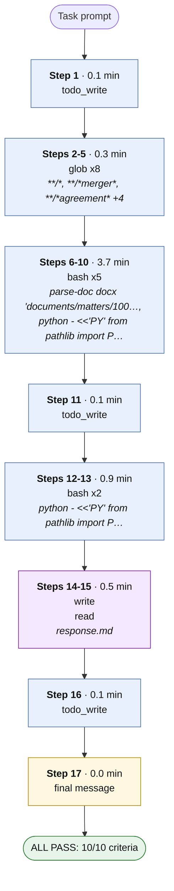
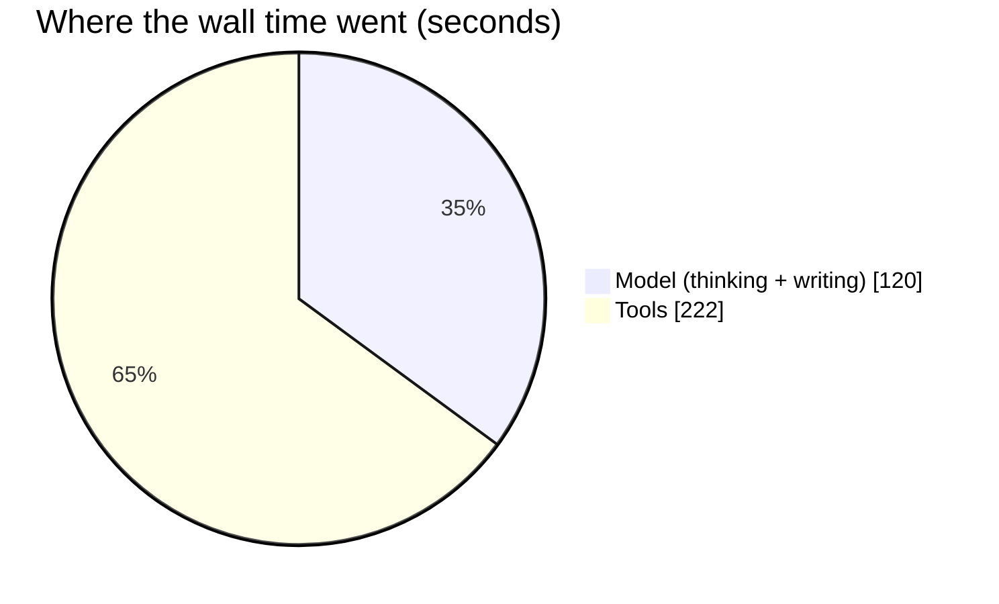

# firm-knowledge/tasks/192 · run3 (`hv-fk250-lunahigh-rep3-20261112T141312Z`)

Result: **all-pass** 10/10 criteria · 5.7 min · 17 model calls · 20 tool calls (0 errors or timeouts) · ending `completed` · started 11-12 20:54:36 IST

## Overview

One box per stretch of steps that used the same kind of tool (blue: looking/searching/reading, purple: writing or editing files, yellow: a message with no tool call, red border: a tool error or timeout inside the box).





One row per model call:

| Step | Started (IST) | Model s | Tools s | Tool calls | Tools | Output chars |
|---|---|---|---|---|---|---|
| 1 | 20:54:36 | 3 | 0 | 1 | todo_write | 57 |
| 2 | 20:54:39 | 1 | 1 | 1 | glob | 8,520 |
| 3 | 20:54:41 | 3 | 1 | 3 | glob x3 | 14,601 |
| 4 | 20:54:46 | 8 | 2 | 3 | glob x3 | 5,050 |
| 5 | 20:54:56 | 4 | 1 | 1 | glob | 2,439 |
| 6 | 20:55:00 | 5 | 3 | 1 | bash | 3,748 |
| 7 | 20:55:07 | 6 | 121 | 1 | bash | 42,028 |
| 8 | 20:57:15 | 7 | 5 | 1 | bash | 5,161 |
| 9 | 20:57:27 | 10 | 2 | 1 | bash | 49,885 |
| 10 | 20:57:39 | 12 | 50 | 1 | bash | 17,450 |
| 11 | 20:58:42 | 7 | 0 | 1 | todo_write | 57 |
| 12 | 20:58:48 | 4 | 1 | 1 | bash | 8,751 |
| 13 | 20:58:54 | 11 | 35 | 1 | bash | 4,500 |
| 14 | 20:59:40 | 28 | 0 | 1 | write | 205 |
| 15 | 21:00:08 | 3 | 0 | 1 | read | 7,784 |
| 16 | 21:00:11 | 6 | 0 | 1 | todo_write | 57 |
| 17 | 21:00:17 | 2 | 0 | 0 | (message only) | 0 |

## Task prompt

```text
Building out an MAE language bank ahead of the next merger agreement draft—find all our merger agreements that actually use the phrase 'material adverse effect' and pull those documents.

Output: write your complete answer to `response.md` — a single self-contained markdown file with your findings, the matters/documents you relied on, and your reasoning.
```

## Rubric

| # | Criterion | Verdict |
|---|---|---|
| C-001 | Qualifying matter — Ardent Capital Partners 1001-00004 | pass |
| C-002 | Qualifying matter — Ardent Capital Partners 1001-00005 | pass |
| C-003 | Qualifying matter — Harrowgate PE 1003-00003 | pass |
| C-004 | Qualifying matter — Harrowgate PE 1003-00004 | pass |
| C-005 | Qualifying matter — Lumos Analytics 1008-00008 | pass |
| C-006 | Qualifying matter — Penterra Pharma 1018-00003 | pass |
| C-007 | Qualifying matter — Halcyon Semi 1032-00005 | pass |
| C-008 | Qualifying matter — Solara Digital 1041-00003 | pass |
| C-009 | Qualifying matter — Brightfield Cloud 1042-00004 | pass |
| C-010 | Qualifying set — precision | pass |

Judge's reasoning:

**C-001 (pass):** Qualifying matter — Ardent Capital Partners 1001-00004

```text
The output identifies matter 1001-00004 and provides the required executed merger agreement file, `merger-agreement-execution.docx`, as containing the phrase “material adverse effect.”
```

**C-002 (pass):** Qualifying matter — Ardent Capital Partners 1001-00005

```text
The output identifies matter 1001-00005 (Ardent Capital Partners) and specifically lists its executed merger agreement, `merger-agreement-execution-version.docx`, as containing “material adverse effect.”
```

**C-003 (pass):** Qualifying matter — Harrowgate PE 1003-00003

```text
The output identifies matter 1003-00003 (Harrowgate Private Equity Fund IV LP) and explicitly lists `merger-agreement-execution-version.docx` as a merger agreement containing the phrase “material adverse effect.”
```

**C-004 (pass):** Qualifying matter — Harrowgate PE 1003-00004

```text
The output identifies matter 1003-00004 (Harrowgate Private Equity Fund IV LP) and explicitly lists its executed merger agreement as `documents/matters/1003-00004/Transaction Documents/merger-agreement-execution.docx`, satisfying the criterion.
```

**C-005 (pass):** Qualifying matter — Lumos Analytics 1008-00008

```text
The output identifies matter 1008-00008 (Lumos Analytics) and specifically lists its executed merger agreement, `documents/matters/1008-00008/Transaction Documents/merger-agreement-execution.docx`, as containing “material adverse effect.”
```

**C-006 (pass):** Qualifying matter — Penterra Pharma 1018-00003

```text
The output identifies matter 1018-00003 (Penterra Pharmaceuticals Corp. / Caliston BioSciences, Inc.) and lists its executed merger agreement as `merger-agreement-execution-version.docx`, stating that the listed agreements contain “material adverse effect.”
```

**C-007 (pass):** Qualifying matter — Halcyon Semi 1032-00005

```text
The output identifies matter 1032-00005 (Halcyon Semiconductor) and specifically lists its executed merger agreement, `merger-agreement-execution-version.docx`, as containing the phrase “material adverse effect.”
```

**C-008 (pass):** Qualifying matter — Solara Digital 1041-00003

```text
The output identifies matter 1041-00003 (Solara Digital) and specifically lists `documents/matters/1041-00003/Transaction Documents/Merger Agreement/merger-agreement-execution-version.docx` as a merger agreement containing “material adverse effect.”
```

**C-009 (pass):** Qualifying matter — Brightfield Cloud 1042-00004

```text
The output identifies matter 1042-00004 (Brightfield Cloud Services Inc.) and lists its executed merger agreement as `documents/matters/1042-00004/Transaction Documents/agreement-and-plan-of-merger-execution.docx`, while stating that the listed agreements contain “material adverse effect.”
```

**C-010 (pass):** Qualifying set — precision

```text
The output asserts qualifying matters only from the permitted set. All 11 listed matter IDs are included in the criterion’s allowed list; omission of other allowed matters does not violate this precision-only criterion.
```

## Delivered files (output/)

- `response.md` (7,479 bytes)

`response.md`:

```markdown
# Merger-agreement MAE language bank

## Bottom line

I found **24 merger-agreement documents across 11 matters** that contain the exact three-word sequence **“material adverse effect”** (case-insensitive, so this includes the capitalized form **“Material Adverse Effect”**). The phrase appears in the agreement text—typically in the definition of **“Company Material Adverse Effect”** or **“Material Adverse Effect”**, followed by language such as “has had or would reasonably be expected to have a material adverse effect on …”—rather than only in a related memo or closing certificate.

## Documents to pull

The following are the matching agreement documents. Paths are relative to the supplied document repository.

| Matter | Transaction / parties identified in the agreement | Matching merger-agreement documents |
|---|---|---|
| **1001-00004** | Ardent Apex Holdings Inc. / Ardent Apex Merger Sub Inc. / Luminex Systems Holdings Inc.; dated March 24, 2025 | `documents/matters/1001-00004/Transaction Documents/Merger Agreement/merger-agreement-execution.docx` |
| **1001-00005** | Ardent Capital Partners III LP / CRFH Acquisition Sub, Inc. / Coral Reef Hospitality Group, Inc.; dated April 25, 2022 | `documents/matters/1001-00005/Transaction Documents/merger-agreement-execution-version.docx` |
| **1003-00003** | Harrowgate Private Equity Fund IV LP / Harrowgate Velocity Merger Sub Inc. / VeloPay Systems, Inc.; execution version dated March 18, 2025 | `documents/matters/1003-00003/Transaction Documents/Merger Agreement/merger-agreement-first-draft.docx`<br>`documents/matters/1003-00003/Transaction Documents/Merger Agreement/merger-agreement-redline-wjc-feb-2025.docx`<br>`documents/matters/1003-00003/Transaction Documents/Merger Agreement/merger-agreement-redline-sc-response-mar-2025.docx`<br>`documents/matters/1003-00003/Transaction Documents/Merger Agreement/merger-agreement-execution-version.docx` |
| **1003-00004** | Harrowgate Private Equity Fund IV LP / Pinnacle Merger Sub, Inc. / Pennfield Holdings, Inc.; execution version dated April 7, 2025 | `documents/matters/1003-00004/Transaction Documents/merger-agreement-draft-redline.docx`<br>`documents/matters/1003-00004/Transaction Documents/merger-agreement-execution.docx` |
| **1008-00008** | Lumos Analytics Inc. / Prismyx Acquisition Sub LLC / Prismyx Data Solutions LLC, with Jonah Eberhardt and Talia Messina; execution version dated April 3, 2024 | `documents/matters/1008-00008/Transaction Documents/merger-agreement-redline-sellers-comments.docx`<br>`documents/matters/1008-00008/Transaction Documents/merger-agreement-execution.docx` |
| **1018-00003** | Penterra Pharmaceuticals Corp. / Caliston BioSciences, Inc.; execution version dated November 27, 2023 | `documents/matters/1018-00003/Negotiation & Transaction Documents/merger-agreement-draft-v5.docx`<br>`documents/matters/1018-00003/Negotiation & Transaction Documents/merger-agreement-redline-v5-to-v7.docx`<br>`documents/matters/1018-00003/Negotiation & Transaction Documents/merger-agreement-execution-version.docx` |
| **1022-00006** | Northgate Telecommunications plc / NTP Acquisition Sub, Inc. / Cascadia Fiber Networks, Inc.; dated April 7, 2025 | `documents/matters/1022-00006/Transaction Documents/merger-agreement-redline-wkb.docx`<br>`documents/matters/1022-00006/Transaction Documents/merger-agreement-execution-draft.docx` |
| **1032-00005** | Halcyon Semiconductor Aktiengesellschaft / Halcyon Acquisition Sub, Inc. / Vectris Photonics, Inc.; dated August 10, 2023 | `documents/matters/1032-00005/Transaction Documents/merger-agreement-redline-final-vs-penultimate.docx`<br>`documents/matters/1032-00005/Transaction Documents/merger-agreement-execution-version.docx` |
| **1041-00003** | Cloudium Technologies plc / Stratos Merger Sub Inc. / Solara Digital Infrastructure Fund VI LP; execution version dated January 22, 2024 | `documents/matters/1041-00003/Transaction Documents/Merger Agreement/merger-agreement-initial-draft.docx`<br>`documents/matters/1041-00003/Transaction Documents/Merger Agreement/merger-agreement-target-markup.docx`<br>`documents/matters/1041-00003/Transaction Documents/Merger Agreement/merger-agreement-second-revised-draft.docx`<br>`documents/matters/1041-00003/Transaction Documents/Merger Agreement/merger-agreement-third-revised-draft.docx`<br>`documents/matters/1041-00003/Transaction Documents/Merger Agreement/merger-agreement-execution-version.docx` |
| **1042-00004** | Brightfield Cloud Services Inc. / BCS DevTools Merger Sub, Inc. / Codelaunch Labs, Inc.; dated June 1, 2023 | `documents/matters/1042-00004/Transaction Documents/agreement-and-plan-of-merger-execution.docx` |
| **1045-00005** | Belmont Ridge Bank NA / BRB Acquisition Sub, Inc. / Tessera Lending, Inc.; draft dated February 5, 2026 | `documents/matters/1045-00005/Transaction Documents/draft-merger-agreement.docx` |

## Why these documents qualify

1. **Document type.** I treated a document as a merger agreement when the document itself is an agreement titled **“Merger Agreement”** or **“Agreement and Plan of Merger”** and is stored with the transaction documents. This captures drafts, redlines, and execution versions because each is a version of the agreement being negotiated or signed.
2. **Phrase test.** I searched the Word-document text for the normalized, case-insensitive sequence `material adverse effect`, allowing ordinary Word formatting and whitespace between words. Every document listed above passed that test.
3. **Substantive use.** The phrase is used in the operative MAE framework. Representative language found in the agreements includes definitions of “Company Material Adverse Effect” stating that an event, change, effect, development, condition, circumstance, or occurrence “has had or would reasonably be expected to have a material adverse effect” on the company’s business, financial condition, assets, liabilities, or results of operations, and/or on the parties’ ability to consummate the transaction. The agreements then typically include exceptions for general economic or market conditions, industry-wide changes, changes in law, failure to meet projections, and similar matters.
4. **Version handling.** I retained every matching version rather than deduplicating by transaction. That is important for a language bank: the drafts and redlines show negotiated wording, while the execution version shows the final selected language. A match count was not used as the inclusion criterion because redlines, tables of contents, and tracked-change artifacts can repeat text; the criterion was simply at least one actual phrase occurrence.

## Scope notes and exclusions

- I excluded ancillary documents that also contain MAE language—such as disclosure schedules, tax commentary, diligence memoranda, term sheets, commitment letters, officer certificates, and board consents—because they are not the merger agreement itself.
- I also did not count documents titled **Business Combination Agreement**, **Asset Purchase Agreement**, **Stock Purchase Agreement**, or **Sale/Combination Agreement** merely because they contain the same phrase. Those may be merger-related transaction materials, but they are not merger agreements under the document-type test above.
- Accordingly, the result is the focused pull requested: **the 24 merger-agreement versions that actually use “material adverse effect,” across 11 matters**.
```

## Trajectory

### Step 1: 1 tool call

_Started 11-12 20:54:36 IST · model 3 s · tools 0 s_

**Reasoning summary:**

```text
**Inspecting documents**

I need to inspect documents, but I’m not sure if the task aligns since there's no catalog provided. It seems like I should list the files using glob to check for matches. Maybe I’ll create a to-do since this appears to be a multi-step task. However, I definitely must avoid reading the task.json file. So, I'll focus on using glob to get started!
```

**Call `todo_write`** (0.0 s)

```json
{
 "todos": [
  {
   "content": "Inventory the provided matter and document files",
   "status": "in_progress"
  },
  {
   "content": "Search merger agreements for the exact phrase",
   "status": "pending"
  },
  {
   "content": "Verify matching documents and capture supporting details",
   "status": "pending"
  },
  {
   "content": "Write the complete findings to response.md",
   "status": "pending"
  }
 ]
}
```

Output (57 chars):

```text
Updated todo list: 3 pending, 1 in progress, 0 completed.
```

**Todo list now:**

- [~] Inventory the provided matter and document files
- [ ] Search merger agreements for the exact phrase
- [ ] Verify matching documents and capture supporting details
- [ ] Write the complete findings to response.md

### Step 2: 1 tool call

_Started 11-12 20:54:39 IST · model 1 s · tools 1 s_

**Call `glob`** (0.5 s)

```json
{
 "pattern": "**/*"
}
```

Output (8,520 chars):

```text
documents/matters/1001-00001/Antitrust Analysis/competitor-identification-chart.xlsx
documents/matters/1001-00001/Antitrust Analysis/portfolio-company-overlap-analysis.docx
documents/matters/1001-00001/Antitrust Analysis/hhi-concentration-analysis.xlsx
documents/matters/1001-00001/Antitrust Analysis/market-definition-competitive-analysis-memo.docx
documents/matters/1001-00001/Client Updates/biweekly-status-report-1.docx
documents/matters/1001-00001/Antitrust Analysis/preliminary-antitrust-risk-assessment.docx
documents/matters/1001-00001/Antitrust Analysis/state-regulatory-con-analysis.docx
documents/matters/1001-00001/Antitrust Analysis/vertical-relationships-analysis.docx
documents/matters/1001-00001/Closing/closing-memo-antitrust-workstream.docx
documents/matters/1001-00001/Client Updates/client-update-early-termination-granted.eml
documents/matters/1001-00001/Client Updates/biweekly-status-report-2.docx
documents/matters/1001-00001/Client Updates/client-update-hsr-forms-filed.eml
documents/matters/1001-00001/Closing/final-invoice-matter-closing-letter.docx
documents/matters/1001-00001/Closing/hsr-clearance-certificate.docx
documents/matters/1001-00001/Correspondence/Counterparty Counsel/email-gk-naics-code-consistency.eml
documents/matters/1001-00001/Early Termination/early-termination-request-letter.docx
documents/matters/1001-00001/Correspondence/Counterparty Counsel/letter-bracewell-thornton-regulatory-condition.docx
documents/matters/1001-00001/Correspondence/Counterp
… [7,020 more chars]
```

### Step 3: 3 tool calls

_Started 11-12 20:54:41 IST · model 3 s · tools 1 s_

**Reasoning summary:**

```text
**Identifying files for merger agreements**

I’ve got 9,288 files to sift through, and I need to find those specific merger agreements. I think using glob patterns for filenames could help, looking for terms like *merger* or *agreement*. I just need to make sure I'm targeting these correctly to filter out what's relevant. It sounds like a good approach, so let’s give it a go and see what I can uncover!
```

**Call `glob`** (0.5 s)

```json
{
 "pattern": "**/*merger*"
}
```

Output (5,674 chars):

```text
documents/matters/1001-00004/Closing/secretarys-certificate-merger-sub-form.docx
documents/matters/1001-00004/Correspondence/letter-crs-transmittal-merger-agreement.docx
documents/matters/1001-00004/Tax/tax-provisions-merger-agreement-commentary.docx
documents/matters/1001-00004/Transaction Documents/Merger Agreement/certificate-of-merger-draft.docx
documents/matters/1001-00004/Transaction Documents/Merger Agreement/merger-agreement-execution.docx
documents/matters/1001-00004/Transaction Documents/Merger Agreement/written-consent-board-merger-sub.docx
documents/matters/1001-00004/Transaction Documents/Merger Agreement/written-consent-sole-stockholder-merger-sub.docx
documents/matters/1001-00005/Transaction Documents/merger-agreement-execution-version.docx
documents/matters/1003-00003/Closing/officers-certificate-hpe-merger-sub-closing.docx
documents/matters/1003-00003/Closing/secretarys-certificate-hpe-merger-sub.docx
documents/matters/1003-00003/Corporate Filings/certificate-of-incorporation-merger-sub.docx
documents/matters/1003-00003/Corporate Filings/certificate-of-merger.docx
documents/matters/1003-00003/Corporate Filings/resolutions-merger-sub-board.docx
documents/matters/1003-00003/Transaction Documents/Merger Agreement/merger-agreement-redline-wjc-feb-2025.docx
documents/matters/1003-00003/Transaction Documents/Merger Agreement/merger-agreement-redline-sc-response-mar-2025.docx
documents/matters/1003-00003/Transaction Documents/Merger Agreement/merger-agreement-execut
… [4,174 more chars]
```

**Call `glob`** (0.5 s)

```json
{
 "pattern": "**/*agreement*"
}
```

Output (8,913 chars):

```text
documents/matters/1001-00002/Carry & Economics/carried-interest-allocation-agreement.docx
documents/matters/1001-00002/Amended Governing Documents/gp-second-amended-llc-agreement.docx
documents/matters/1001-00002/Amended Governing Documents/manco-second-amended-llc-agreement.docx
documents/matters/1001-00002/Carry & Economics/management-fee-sharing-agreement.docx
documents/matters/1001-00002/Departing Principals/kellner-senior-advisor-agreement.docx
documents/matters/1001-00002/Departing Principals/trask-separation-agreement.docx
documents/matters/1001-00002/Departing Principals/trask-separation-agreement-redline.docx
documents/matters/1001-00002/Departing Principals/kellner-separation-agreement.docx
documents/matters/1001-00002/Entity Formation/gp-intermediate-llc-agreement.docx
documents/matters/1001-00002/Entity Formation/holdco-llc-agreement.docx
documents/matters/1001-00003/Transaction Documents/APA Drafts/asset-purchase-agreement-first-draft.docx
documents/matters/1001-00003/Transaction Documents/Employment/employment-agreement-whitfield-torres.docx
documents/matters/1001-00003/Transaction Documents/APA Drafts/asset-purchase-agreement-redline-seller-markup.docx
documents/matters/1001-00003/Transaction Documents/Employment/employment-agreement-whitfield.docx
documents/matters/1001-00003/Transaction Documents/assignment-and-assumption-agreement.docx
documents/matters/1001-00003/Transaction Documents/asset-purchase-agreement-execution.docx
documents/matters/1001-00003/Tran
… [7,413 more chars]
```

**Call `glob`** (0.4 s)

```json
{
 "pattern": "**/*MAE*"
}
```

Output (14 chars):

```text
No files found
```

### Step 4: 3 tool calls

_Started 11-12 20:54:46 IST · model 8 s · tools 2 s_

**Reasoning summary:**

```text
**Exploring file discovery with glob**

I’m thinking about using a Python script in bash to iterate through paths I discovered with glob. It seems clear I should use the glob tool instead of shell find to discover files. For a comprehensive search, I might want to walk through documents, even though that goes against some technical restrictions. I'll consider patterns like "**/*.docx" for retrieving a maximum of 100 files, while also ensuring that I can access the necessary paths.

**Finding agreements with specific phrases**

I need to find all agreements that contain a specific phrase. I can use Python to scan through all the docx files, but I have to remember that the developer prefers using glob instead of shell find for file discovery. I've previously used glob to identify these files. It seems acceptable to script a scan for content across all documents using a specific pattern, like "documents/matters/*/Transaction Documents/*merger*.docx," which targets the files I need.
```

**Call `glob`** (0.6 s)

```json
{
 "pattern": "documents/matters/*/Transaction Documents/*merger*.docx"
}
```

Output (1,071 chars):

```text
documents/matters/1001-00005/Transaction Documents/merger-agreement-execution-version.docx
documents/matters/1003-00004/Transaction Documents/merger-agreement-draft-redline.docx
documents/matters/1003-00004/Transaction Documents/merger-agreement-execution.docx
documents/matters/1008-00008/Transaction Documents/merger-agreement-redline-sellers-comments.docx
documents/matters/1008-00008/Transaction Documents/merger-agreement-execution.docx
documents/matters/1022-00006/Transaction Documents/merger-agreement-redline-wkb.docx
documents/matters/1022-00006/Transaction Documents/merger-agreement-execution-draft.docx
documents/matters/1032-00005/Transaction Documents/merger-agreement-execution-version.docx
documents/matters/1032-00005/Transaction Documents/merger-agreement-redline-final-vs-penultimate.docx
documents/matters/1032-00005/Transaction Documents/legal-opinion-halcyon-merger-sub.docx
documents/matters/1042-00004/Transaction Documents/agreement-and-plan-of-merger-execution.docx
documents/matters/1045-00005/Transaction Documents/draft-merger-agreement.docx
```

**Call `glob`** (0.9 s)

```json
{
 "pattern": "documents/matters/*/Transaction Documents/Merger Agreement/*.docx"
}
```

Output (3,578 chars):

```text
documents/matters/1001-00004/Transaction Documents/Merger Agreement/certificate-of-merger-draft.docx
documents/matters/1001-00004/Transaction Documents/Merger Agreement/written-consent-board-apex-holdings.docx
documents/matters/1001-00004/Transaction Documents/Merger Agreement/no-shop-compliance-memorandum.docx
documents/matters/1001-00004/Transaction Documents/Merger Agreement/disclosure-schedules-buyer.docx
documents/matters/1001-00004/Transaction Documents/Merger Agreement/surviving-corp-certificate-of-incorporation.docx
documents/matters/1001-00004/Transaction Documents/Merger Agreement/merger-agreement-execution.docx
documents/matters/1001-00004/Transaction Documents/Merger Agreement/written-consent-board-merger-sub.docx
documents/matters/1001-00004/Transaction Documents/Merger Agreement/surviving-corp-bylaws.docx
documents/matters/1001-00004/Transaction Documents/Merger Agreement/written-consent-sole-stockholder-merger-sub.docx
documents/matters/1003-00003/Transaction Documents/Merger Agreement/disclosure-schedules-buyer.docx
documents/matters/1003-00003/Transaction Documents/Merger Agreement/merger-agreement-redline-wjc-feb-2025.docx
documents/matters/1003-00003/Transaction Documents/Merger Agreement/merger-agreement-redline-sc-response-mar-2025.docx
documents/matters/1003-00003/Transaction Documents/Merger Agreement/merger-agreement-execution-version.docx
documents/matters/1003-00003/Transaction Documents/Merger Agreement/merger-agreement-first-draft.docx
documents/ma
… [2,078 more chars]
```

**Call `glob`** (0.6 s)

```json
{
 "pattern": "documents/matters/*/Negotiation & Transaction Documents/*merger*.docx"
}
```

Output (401 chars):

```text
documents/matters/1018-00003/Negotiation & Transaction Documents/merger-agreement-draft-v5.docx
documents/matters/1018-00003/Negotiation & Transaction Documents/merger-agreement-execution-version.docx
documents/matters/1018-00003/Negotiation & Transaction Documents/merger-agreement-redline-v5-to-v7.docx
documents/matters/1018-00003/Negotiation & Transaction Documents/term-sheet-proposed-merger.docx
```

### Step 5: 1 tool call

_Started 11-12 20:54:56 IST · model 4 s · tools 1 s_

**Reasoning summary:**

```text
**Reviewing merger agreements**

I’m recognizing that we have over 12 merger agreements, and I might be missing something important related to the pathways. I should check for files named specifically with “merger agreement” beyond just the regular transaction documents. The wildcard search for “**/*merger-agreement*.docx” shows 35 potential files I can look into. It seems important to gather all the relevant documentation to ensure nothing slips through the cracks!
```

**Call `glob`** (0.5 s)

```json
{
 "pattern": "**/*merger-agreement*.docx"
}
```

Output (2,439 chars):

```text
documents/matters/1001-00004/Correspondence/letter-crs-transmittal-merger-agreement.docx
documents/matters/1001-00004/Tax/tax-provisions-merger-agreement-commentary.docx
documents/matters/1001-00004/Transaction Documents/Merger Agreement/merger-agreement-execution.docx
documents/matters/1001-00005/Transaction Documents/merger-agreement-execution-version.docx
documents/matters/1003-00003/Transaction Documents/Merger Agreement/merger-agreement-redline-wjc-feb-2025.docx
documents/matters/1003-00003/Transaction Documents/Merger Agreement/merger-agreement-redline-sc-response-mar-2025.docx
documents/matters/1003-00003/Transaction Documents/Merger Agreement/merger-agreement-execution-version.docx
documents/matters/1003-00003/Transaction Documents/Merger Agreement/merger-agreement-first-draft.docx
documents/matters/1003-00004/Transaction Documents/merger-agreement-draft-redline.docx
documents/matters/1003-00004/Transaction Documents/merger-agreement-execution.docx
documents/matters/1008-00008/Transaction Documents/merger-agreement-redline-sellers-comments.docx
documents/matters/1008-00008/Transaction Documents/merger-agreement-execution.docx
documents/matters/1018-00003/Negotiation & Transaction Documents/merger-agreement-draft-v5.docx
documents/matters/1018-00003/Negotiation & Transaction Documents/merger-agreement-execution-version.docx
documents/matters/1018-00003/Negotiation & Transaction Documents/merger-agreement-redline-v5-to-v7.docx
documents/matters/1022-00006/Transaction Do
… [939 more chars]
```

### Step 6: 1 tool call

_Started 11-12 20:55:00 IST · model 5 s · tools 3 s_

**Reasoning summary:**

```text
**Searching for merger agreement**

I'm considering if I should include an agreement-and-plan-of-merger in my search. I might need to look for that exact phrase across all documents. To make this easier, I could extract text from all docx files using Python. I'm thinking this should be fine since the task is simply searching. Maybe I could try using the parse-doc command first to see if it streamlines the process. Let’s test that out!
```

**Call `bash`** (2.6 s)

```json
{
 "command": "parse-doc docx 'documents/matters/1001-00004/Transaction Documents/Merger Agreement/merger-agreement-execution.docx' | head -80",
 "description": "Inspect a sample merger agreement"
}
```

Output (3,748 chars):

```text
**EXECUTION VERSION**

**[AGREEMENT AND PLAN OF MERGER]{.underline}**

**among**

**ARDENT APEX HOLDINGS INC.,** a Delaware corporation (\"Parent\")

**ARDENT APEX MERGER SUB INC.,** a Delaware corporation and wholly owned subsidiary of Parent (\"Merger Sub\")

**and**

**LUMINEX SYSTEMS HOLDINGS INC.,** a Delaware corporation (the \"Company\")

**Dated as of March 24, 2025**

**TABLE OF CONTENTS**

Right-click to update Table of Contents

  -------------------------------------------------------------------------------------------------------------
                                                                                        **Page**
  ----------------------- ------------------------------------------------------------- -----------------------
  **ARTICLE I**           **DEFINITIONS**                                               

  Section 1.1             Definitions                                                   

  Section 1.2             Interpretation                                                

  **ARTICLE II**          **THE MERGER**                                                

  Section 2.1             The Merger                                                    

  Section 2.2             Closing                                                       

  Section 2.3             Effective Time                                                

  Section 2.4             Effects of the Merger                                         

  Section 2.5  
… [2,247 more chars]
```

### Step 7: 1 tool call

_Started 11-12 20:55:07 IST · model 6 s · tools 121 s_

**Reasoning summary:**

```text
**Searching merger agreements**

I need to search for specific phrases within merger agreements, primarily in .docx files. To do this, I could create a Python scanner that iterates through these documents, normalizing text for case-insensitivity and ensuring it captures all variants. I'll utilize a bash command with Python using a glob pattern for document paths. I must also consider parsing the XML text properly and accounting for whitespace. No response file is necessary for now; I plan to summarize the matching filenames and count occurrences.
```

**Call `bash`** (121.4 s)

```json
{
 "command": "python - <<'PY'\nfrom pathlib import Path\nfrom zipfile import ZipFile\nfrom xml.etree import ElementTree as ET\nimport re\nroot=Path('documents')\nphrase=re.compile(r'\\bmaterial\\s+adverse\\s+effect\\b', re.I)\nfor p in sorted(root.rglob('*.docx')):\n    try:\n        with ZipFile(p) as z:\n            texts=[]\n            for name in z.namelist():\n                if name.endswith('.xml') and ('word/' in name):\n                    try:\n                        data=z.read(name)\n                        r=ET.fromstring(data)\n                    except Exception:\n                        continue\n                    for e in r.iter():\n                        if e.tag.endswith('}t') and e.text:\n                            texts.append(e.text)\n            text=' '.join(texts)\n        ms=list(phrase.finditer(text))\n        if ms:\n            print(f'{p}\\t{len(ms)}')\n    except Exception as e:\n        print('ERROR',p,e)\nPY",
 "description": "Search all Word files for exact MAE phrase",
 "timeoutMs": 120000
}
```

Output (42,028 chars):

```text
documents/matters/1001-00001/Antitrust Analysis/portfolio-company-overlap-analysis.docx	1
documents/matters/1001-00002/Amended Governing Documents/lpa-amendment-no-1.docx	1
documents/matters/1001-00002/Closing/bring-down-officers-certificate.docx	2
documents/matters/1001-00002/Closing/closing-certificate-gp.docx	3
documents/matters/1001-00002/Entity Formation/holdco-llc-agreement.docx	2
documents/matters/1001-00003/Closing/buyer-closing-certificate.docx	7
documents/matters/1001-00003/Closing/legal-opinion-calderwood-harkness.docx	1
documents/matters/1001-00003/Closing/officer-certificate-no-mae.docx	22
documents/matters/1001-00003/Closing/seller-closing-certificate.docx	12
documents/matters/1001-00003/Diligence/litigation-regulatory-review-memo.docx	5
documents/matters/1001-00003/Diligence/rw-insurance-coverage-memo.docx	2
documents/matters/1001-00003/Tax/section-338-asset-allocation-memo.docx	1
documents/matters/1001-00003/Transaction Documents/APA Drafts/asset-purchase-agreement-first-draft.docx	13
documents/matters/1001-00003/Transaction Documents/APA Drafts/asset-purchase-agreement-redline-seller-markup.docx	13
documents/matters/1001-00003/Transaction Documents/asset-purchase-agreement-execution.docx	11
documents/matters/1001-00003/Transaction Documents/assignment-and-assumption-agreement.docx	3
documents/matters/1001-00003/Transaction Documents/disclosure-schedules-to-apa.docx	6
documents/matters/1001-00004/Antitrust & Regulatory/cfius-voluntary-notice-draft-narrative.do
… [40,528 more chars]
```

### Step 8: 1 tool call

_Started 11-12 20:57:15 IST · model 7 s · tools 5 s_

**Call `bash`** (4.7 s)

```json
{
 "command": "python - <<'PY'\nfrom pathlib import Path\nfrom zipfile import ZipFile\nfrom xml.etree import ElementTree as ET\nimport re\nroot=Path('documents')\nphrase=re.compile(r'\\bmaterial\\s+adverse\\s+effect\\b', re.I)\nfor p in sorted(root.rglob('*.docx')):\n    s=str(p).lower()\n    if not ('merger-agreement' in s or 'agreement-and-plan-of-merger' in s or '/merger agreement/' in s):\n        continue\n    try:\n        with ZipFile(p) as z:\n            texts=[]\n            for name in z.namelist():\n                if name.startswith('word/') and name.endswith('.xml'):\n                    r=ET.fromstring(z.read(name))\n                    texts.extend(e.text for e in r.iter() if e.tag.endswith('}t') and e.text)\n        text=' '.join(texts)\n        ms=list(phrase.finditer(text))\n        print(f'{p}\\t{len(ms)}')\n    except Exception as e:\n        print('ERROR',p,e)\nPY",
 "description": "Check merger agreement files for MAE phrase",
 "timeoutMs": 120000
}
```

Output (5,161 chars):

```text
documents/matters/1001-00004/Correspondence/letter-crs-transmittal-merger-agreement.docx	0
documents/matters/1001-00004/Tax/tax-provisions-merger-agreement-commentary.docx	7
documents/matters/1001-00004/Transaction Documents/Merger Agreement/certificate-of-merger-draft.docx	0
documents/matters/1001-00004/Transaction Documents/Merger Agreement/disclosure-schedules-buyer.docx	2
documents/matters/1001-00004/Transaction Documents/Merger Agreement/merger-agreement-execution.docx	19
documents/matters/1001-00004/Transaction Documents/Merger Agreement/no-shop-compliance-memorandum.docx	0
documents/matters/1001-00004/Transaction Documents/Merger Agreement/surviving-corp-bylaws.docx	0
documents/matters/1001-00004/Transaction Documents/Merger Agreement/surviving-corp-certificate-of-incorporation.docx	0
documents/matters/1001-00004/Transaction Documents/Merger Agreement/written-consent-board-apex-holdings.docx	1
documents/matters/1001-00004/Transaction Documents/Merger Agreement/written-consent-board-merger-sub.docx	0
documents/matters/1001-00004/Transaction Documents/Merger Agreement/written-consent-sole-stockholder-merger-sub.docx	0
documents/matters/1001-00005/Transaction Documents/merger-agreement-execution-version.docx	31
documents/matters/1003-00003/Transaction Documents/Merger Agreement/disclosure-schedules-buyer.docx	2
documents/matters/1003-00003/Transaction Documents/Merger Agreement/merger-agreement-execution-version.docx	24
documents/matters/1003-00003/Transaction Documents/M
… [3,660 more chars]
```

### Step 9: 1 tool call

_Started 11-12 20:57:27 IST · model 10 s · tools 2 s_

**Reasoning summary:**

```text
**Clarifying document extraction**

I need to identify all merger agreements that specifically use a certain phrase and pull those documents. I think this means I should output findings rather than file copies. It’s likely I’ll provide a list of document paths instead of the documents themselves. I’ll focus on true merger agreements, likely identifying about 11 matters and 26 documents, excluding ancillary files. It seems I should also clarify the search scope and include relevant text snippets and metadata information.

**Verifying merger agreements**

I need to verify each actual merger agreement by parsing the first lines and occurrences for context. I’ve identified a set of agreements with specific document codes, totaling 24 documents. 

For example, some include execution versions, and I might only need the execution document for one matter. I'll check the titles, parties, and dates, and consider using a script to extract text snippets for summaries. It's crucial to ensure I'm tracking text occurrences across all versions accurately, too.
```

**Call `bash`** (2.5 s)

```json
{
 "command": "python - <<'PY'\nfrom pathlib import Path\nfrom zipfile import ZipFile\nfrom xml.etree import ElementTree as ET\nimport re\nroot=Path('documents')\npat=re.compile(r'\\bmaterial\\s+adverse\\s+effect\\b',re.I)\n# Actual agreement filenames only, excluding commentary/ancillary files.\nkeys=('merger-agreement','agreement-and-plan-of-merger')\nfor p in sorted(root.rglob('*.docx')):\n    s=str(p).lower()\n    if not any(k in s for k in keys): continue\n    if '/transaction documents/' not in s: continue\n    # exclude names that aren't the agreement itself\n    name=p.name.lower()\n    if not (name.startswith('merger-agreement') or name.startswith('draft-merger-agreement') or name.startswith('agreement-and-plan-of-merger')): continue\n    with ZipFile(p) as z:\n        texts=[]\n        for n in z.namelist():\n            if n.startswith('word/') and n.endswith('.xml'):\n                r=ET.fromstring(z.read(n))\n                texts += [e.text for e in r.iter() if e.tag.endswith('}t') and e.text]\n    text=' '.join(texts)\n    ms=list(pat.finditer(text))\n    print('\\nFILE',p)\n    print('COUNT',len(ms))\n    print('HEAD',re.sub(r'\\s+',' ',text[:1300])[:1300])\n    fo
… [203 more chars]
```

Output (49,885 chars):

```text
FILE documents/matters/1001-00004/Transaction Documents/Merger Agreement/merger-agreement-execution.docx
COUNT 19
HEAD EXECUTION VERSION AGREEMENT AND PLAN OF MERGER among ARDENT APEX HOLDINGS INC., a Delaware corporation ("Parent") ARDENT APEX MERGER SUB INC., a Delaware corporation and wholly owned subsidiary of Parent ("Merger Sub") and LUMINEX SYSTEMS HOLDINGS INC., a Delaware corporation (the "Company") Dated as of March 24, 2025 TABLE OF CONTENTS Right-click to update Table of Contents Page ARTICLE I DEFINITIONS Section 1.1 Definitions Section 1.2 Interpretation ARTICLE II THE MERGER Section 2.1 The Merger Section 2.2 Closing Section 2.3 Effective Time Section 2.4 Effects of the Merger Section 2.5 Certificate of Incorporation of the Surviving Corporation Section 2.6 Bylaws of the Surviving Corporation Section 2.7 Directors and Officers of the Surviving Corporation ARTICLE III CONVERSION OF SECURITIES; MERGER CONSIDERATION Section 3.1 Conversion of Capital Stock Section 3.2 Payment Procedures Section 3.3 Escrow Section 3.4 Treatment of Company Equity Awards Section 3.5 Adjustments Section 3.6 Working Capital Adjustment ARTICLE IV REPRESENTATIONS AND WARRANTIES OF THE COMPANY Section 4.1 Organization, Standing, and Corporate Power Section 4.2 Capitalization Section 4.3 Authority; Noncontravention Section 4.4 Financial Statements; No Undisclosed Liabilities Section 4.5 Absence of Certain Ch
CTX 1 e execution and delivery of this Agreement, organized by Section number corre
… [48,384 more chars]
```

### Step 10: 1 tool call

_Started 11-12 20:57:39 IST · model 12 s · tools 50 s_

**Reasoning summary:**

```text
**Clarifying document scope**

I need to ensure the answer is self-contained for matters 1001-00004 and 1001-00005. The user might not want all documents if there are many copies. I should include every version with the specified phrase, but also mention excluded non-agreement documents that matched, like tax commentary or memos. The request likely focuses on extracting actual merger agreement documents, but maybe disclosure schedules are needed too. I wonder if we should clarify which documents to pull for accuracy.

**Defining document types**

I’m noting that there's no "merger agreement" in the filename, but a legally defined business combination agreement might fit. The user specifically mentioned merger agreements, so I'll need to search for documents of that type. It's possible that there are merger agreements that don't have "merger" in their filenames. I also need a comprehensive search through the folders labeled "Merger Agreement." I should check the files in other related matters too, like 1001-00004, 1003-00003, and 1041-00003.

**Searching document.xml**

I’m thinking I can use rglob for a content search but focus only on document.xml. It looks like I could avoid dealing with ET by using a regex to strip tags. I can replace tags with spaces and then decode and normalize the text. This should help with text that’s separated by tags and entities, like &amp;. I’ll stick to document.xml and set a time limit of around 120 seconds.
```

**Call `bash`** (50.1 s)

```json
{
 "command": "python - <<'PY'\nfrom pathlib import Path\nfrom zipfile import ZipFile\nimport re, html\nroot=Path('documents')\nphrase=re.compile(r'\\bmaterial\\s+adverse\\s+effect\\b',re.I)\ntitle=re.compile(r'AGREEMENT\\s+AND\\s+PLAN\\s+OF\\s+MERGER|MERGER\\s+AGREEMENT',re.I)\nstrip=re.compile(rb'<[^>]*>')\nfound=[]\nfor p in root.rglob('*.docx'):\n    try:\n      with ZipFile(p) as z:\n        raw=z.read('word/document.xml')\n      txt=strip.sub(b' ',raw).decode('utf-8','ignore')\n      txt=html.unescape(txt)\n      txt=re.sub(r'\\s+',' ',txt)\n      if title.search(txt) and phrase.search(txt):\n        found.append((str(p),len(phrase.findall(txt))))\n    except Exception: pass\nfor x,c in sorted(found): print(x+'\\t'+str(c))\nprint('TOTAL',len(found))\nPY",
 "description": "Cross-check all merger agreement titles",
 "timeoutMs": 120000
}
```

Output (17,450 chars):

```text
documents/matters/1001-00004/Antitrust & Regulatory/cfius-voluntary-notice-draft-narrative.docx	2
documents/matters/1001-00004/Antitrust & Regulatory/hsr-filing-cover-letter-ftc.docx	1
documents/matters/1001-00004/Closing/officers-certificate-buyer-form.docx	6
documents/matters/1001-00004/Closing/officers-certificate-target-form.docx	9
documents/matters/1001-00004/Correspondence/letter-crs-disclosure-schedule-comments.docx	3
documents/matters/1001-00004/Diligence/litigation-regulatory-diligence-memo.docx	6
documents/matters/1001-00004/Diligence/real-property-leases-diligence-memo.docx	4
documents/matters/1001-00004/Financing/co-investment-agreement-northvale.docx	4
documents/matters/1001-00004/Financing/co-investment-agreement-summit-ridge.docx	2
documents/matters/1001-00004/Financing/commitment-letter-stonebridge.docx	7
documents/matters/1001-00004/Financing/credit-agreement-draft.docx	36
documents/matters/1001-00004/Financing/equity-commitment-letter-ardent.docx	2
documents/matters/1001-00004/Financing/mezzanine-warrant-agreement.docx	1
documents/matters/1001-00004/Financing/subordinated-note-purchase-agreement.docx	19
documents/matters/1001-00004/Insurance/rwi-application-memo.docx	4
documents/matters/1001-00004/Insurance/rwi-policy-summary-negotiation-memo.docx	4
documents/matters/1001-00004/Tax/swiss-withholding-tax-memo.docx	1
documents/matters/1001-00004/Tax/tax-provisions-merger-agreement-commentary.docx	7
documents/matters/1001-00004/Transaction Documents/Merger Agre
… [15,949 more chars]
```

### Step 11: 1 tool call

_Started 11-12 20:58:42 IST · model 7 s · tools 0 s_

**Reasoning summary:**

```text
**Assessing material counts**

I need to get exact counts from a proper text extractor because there seems to be a discrepancy between 26 and 29 for the redline. This might be due to our ET including headers and footers while the raw text includes more. I'm thinking it might be best to avoid counts since they won't add much meaning. Instead, I could provide evidence of phrase use along with representative wording in my definition. I also need to update my todos as the inventory and search are complete, and verification is underway.
```

**Call `todo_write`** (0.0 s)

```json
{
 "todos": [
  {
   "content": "Inventory the provided matter and document files",
   "status": "completed"
  },
  {
   "content": "Search merger agreements for the exact phrase",
   "status": "completed"
  },
  {
   "content": "Verify matching documents and capture supporting details",
   "status": "in_progress"
  },
  {
   "content": "Write the complete findings to response.md",
   "status": "pending"
  }
 ]
}
```

Output (57 chars):

```text
Updated todo list: 1 pending, 1 in progress, 2 completed.
```

**Todo list now:**

- [x] Inventory the provided matter and document files
- [x] Search merger agreements for the exact phrase
- [~] Verify matching documents and capture supporting details
- [ ] Write the complete findings to response.md

### Step 12: 1 tool call

_Started 11-12 20:58:48 IST · model 4 s · tools 1 s_

**Call `bash`** (1.1 s)

```json
{
 "command": "python - <<'PY'\nfrom pathlib import Path\nfrom zipfile import ZipFile\nfrom xml.etree import ElementTree as ET\nimport re\nfiles=[\n'documents/matters/1018-00003/Negotiation & Transaction Documents/merger-agreement-draft-v5.docx',\n'documents/matters/1018-00003/Negotiation & Transaction Documents/merger-agreement-execution-version.docx',\n'documents/matters/1018-00003/Negotiation & Transaction Documents/merger-agreement-redline-v5-to-v7.docx',\n'documents/matters/1022-00006/Transaction Documents/merger-agreement-execution-draft.docx',\n'documents/matters/1022-00006/Transaction Documents/merger-agreement-redline-wkb.docx',\n]\npat=re.compile(r'\\bmaterial\\s+adverse\\s+effect\\b',re.I)\nfor fn in files:\n p=Path(fn)\n with ZipFile(p) as z:\n  texts=[]\n  for n in z.namelist():\n   if n.startswith('word/') and n.endswith('.xml'):\n    r=ET.fromstring(z.read(n)); texts += [e.text for e in r.iter() if e.tag.endswith('}t') and e.text]\n text=' '.join(texts)\n print('\\n',fn,'COUNT',len(pat.findall(text)))\n print(re.sub(r'\\s+',' ',text[:1200]))\n m=pat.search(text)\n if m: print('CTX',re.sub(r'\\s+',' ',text[max(0,m.start()-120):m.end()+300]))\nPY",
 "description": "Ver
… [63 more chars]
```

Output (8,751 chars):

```text
documents/matters/1018-00003/Negotiation & Transaction Documents/merger-agreement-draft-v5.docx COUNT 31
CONFIDENTIAL — ATTORNEY WORK PRODUCT — PRIVILEGED & CONFIDENTIAL CALDERWOOD & HARKNESS LLP Working Draft v.5 November 1, 2023 Circulated to Whitfield Graves LLP (Kenneth Pratt) for Review and Comment C&H Matter Number: 1025-00006 Project Code Name: Project Coriander AGREEMENT AND PLAN OF MERGER by and between PENTERRA PHARMACEUTICALS CORP., a Delaware corporation and CALISTON BIOSCIENCES, INC., a Delaware corporation Dated as of _ _ _ , 2023 AGREEMENT AND PLAN OF MERGER This AGREEMENT AND PLAN OF MERGER (this " Agreement "), dated as of _ _ _ , 2023, is entered into by and between Penterra Pharmaceuticals Corp. , a Delaware corporation (" Parent " or " Penterra "), and Caliston BioSciences, Inc. , a Delaware corporation (the " Company " or " Caliston "). RECITALS WHEREAS , Parent is a corporation duly organized and validly existing under the laws of the State of Delaware, publicly traded on the New York Stock Exchange (ticker symbol: PPHR), with its principal executive offices located at 400 Innovation Drive, Suite 1200, Princeton, New Jersey 08540 (EIN: 22-3847195; CIK: 0001587342); WHEREAS , the Company is a corporation duly organized and validly existing under the la
CTX s of the Company. " Company Common Stock " means the common stock of the Company, par value $0.001 per share. " Company Material Adverse Effect " means any event, circumstance, change, effect, developme
… [7,248 more chars]
```

### Step 13: 1 tool call

_Started 11-12 20:58:54 IST · model 11 s · tools 35 s_

**Reasoning summary:**

```text
**Evaluating merger agreement documents**

I’m tasked with finding all merger agreements that contain the phrase "material adverse effect" and pulling those documents. I need to search through various matters and identify any relevant merger agreements. Document names should be explicit, and I might include BCA as well. I should check whether matter 1009 BCA is a Business Combination Agreement and if it uses the exact phrase. If the user is looking for "merger agreements," I may note any that are excluded. Additionally, I should consider only pulling core documents while clarifying the search criteria.

**Searching for merger agreements**

I need to create a list of documents titled "Agreement and Plan of Merger" that also contain a specific phrase. To improve my search, I can use an exact title and filter the actual document based on the first 1000 characters containing that title. The previous broad results included documents with the title mentioned, so I’ll define candidates by checking if the filename matches "merger" or if the title begins within those 1000 characters. I should also consider documents named "agreement-and-plan-of-merger."

**Searching document titles**

I'm thinking about how to check for occurrences of a specific title within the first 1500 characters of certain files. The focus is on transaction documents, so I'll look for the exact title in those documents rather than just references. My plan is to run a script that outputs filenames and phrases where the first 3000 characters include the title. This should help me find the actual documents containing it more efficiently!
```

**Call `bash`** (35.4 s)

```json
{
 "command": "python - <<'PY'\nfrom pathlib import Path\nfrom zipfile import ZipFile\nimport re, html\nroot=Path('documents')\ntitle=re.compile(r'AGREEMENT\\s+AND\\s+PLAN\\s+OF\\s+MERGER',re.I)\nphrase=re.compile(r'\\bmaterial\\s+adverse\\s+effect\\b',re.I)\nstrip=re.compile(rb'<[^>]*>')\nfor p in sorted(root.rglob('*.docx')):\n try:\n  with ZipFile(p) as z: raw=z.read('word/document.xml')\n  txt=html.unescape(strip.sub(b' ',raw).decode('utf8','ignore')); txt=re.sub(r'\\s+',' ',txt)\n  head=txt[:3500]\n  if title.search(head) and phrase.search(txt) and ('/transaction documents/' in str(p).lower() or '/negotiation & transaction documents/' in str(p).lower()):\n   print(str(p), len(phrase.findall(txt)))\n except: pass\nPY",
 "description": "Identify merger agreement documents by title",
 "timeoutMs": 120000
}
```

Output (4,500 chars):

```text
documents/matters/1001-00004/Transaction Documents/Merger Agreement/disclosure-schedules-buyer.docx 2
documents/matters/1001-00004/Transaction Documents/Merger Agreement/merger-agreement-execution.docx 19
documents/matters/1001-00005/Transaction Documents/merger-agreement-execution-version.docx 31
documents/matters/1001-00005/Transaction Documents/outside-date-extension-agreement.docx 3
documents/matters/1003-00003/Transaction Documents/Merger Agreement/disclosure-schedules-buyer.docx 2
documents/matters/1003-00003/Transaction Documents/Merger Agreement/merger-agreement-execution-version.docx 24
documents/matters/1003-00003/Transaction Documents/Merger Agreement/merger-agreement-first-draft.docx 21
documents/matters/1003-00003/Transaction Documents/Merger Agreement/merger-agreement-redline-sc-response-mar-2025.docx 26
documents/matters/1003-00003/Transaction Documents/Merger Agreement/merger-agreement-redline-wjc-feb-2025.docx 29
documents/matters/1003-00003/Transaction Documents/equity-commitment-letter-execution.docx 2
documents/matters/1003-00004/Transaction Documents/buyer-disclosure-schedules.docx 5
documents/matters/1003-00004/Transaction Documents/co-investment-agreement-ashford.docx 5
documents/matters/1003-00004/Transaction Documents/escrow-agreement.docx 2
documents/matters/1003-00004/Transaction Documents/merger-agreement-draft-redline.docx 29
documents/matters/1003-00004/Transaction Documents/merger-agreement-execution.docx 28
documents/matters/1003-00004/Transact
… [2,999 more chars]
```

### Step 14: 1 tool call

_Started 11-12 20:59:40 IST · model 28 s · tools 0 s_

**Reasoning summary:**

```text
**Structuring data for clarity**

I’m thinking about adding a “phrase signal” column to the table for clarity. I’ll need to use the universal definition of "material adverse effect” in relation to each matter. It seems like all 24 items should have at least one matching occurrence in their definitions. Including counts per file is probably unnecessary, but I wonder if I could show those counts in parentheses. No need for line numbers, as I’ll focus on using paths for citations. I’ll work on formulating a polished version now!

**Crafting document details**

I'm thinking about how to structure the document output. It seems like I should use both absolute and relative paths, and I definitely need to include "Document identity / matter" and specify versions. I'm aiming to craft this carefully to ensure everything is clear and organized for the user. I'll make sure to use markdown to format it nicely. Let’s keep everything straightforward and accessible!
```

**Call `write`** (0.0 s)

```json
{
 "file_path": "response.md",
 "content": "# Merger-agreement MAE language bank\n\n## Bottom line\n\nI found **24 merger-agreement documents across 11 matters** that contain the exact three-word sequence **“material adverse effect”** (case-insensitive, so this includes the capitalized form **“Material Adverse Effect”**). The phrase appears in the agreement text—typically in the definition of **“Company Material Adverse Effect”** or **“Material Adverse Effect”**, followed by language such as “has had or would reasonably be expected to have a material adverse effect on …”—rather than only in a related memo or closing certificate.\n\n## Documents to pull\n\nThe following are the matching agreement documents. Paths are relative to the supplied document repository.\n\n| Matter | Transaction / parties identified in the agreement | Matching merger-agreement documents |\n|---|---|---|\n| **1001-00004** | Ardent Apex Holdings Inc. / Ardent Apex Merger Sub Inc. / Luminex Systems Holdings Inc.; dated March 24, 2025 | `documents/matters/1001-00004/Transaction Documents/Merger Agreement/merger-agreement-execution.docx` |\n| **1001-00005** | Ardent Capital Partners III LP / CRFH Acquisition Sub
… [6,308 more chars]
```

Output (205 chars):

```text
<path>/home/agarwaldi/dsh-bench-harness/runs/hv-fk250-lunahigh-rep3-20261112T141312Z/tasks/firm-knowledge__tasks__192/workspace/output/response.md</path>
<type>file</type>
<content>
Created file
</content>
```

### Step 15: 1 tool call

_Started 11-12 21:00:08 IST · model 3 s · tools 0 s_

**Reasoning summary:**

```text
**Verifying response file**

I'm thinking about verifying the response by using the read function. It's important to ensure everything is functioning correctly. I just want to make sure that I'm getting the accurate data I need. Maybe I should double-check if the file is being read properly. Clarity and accuracy are key here. I'll go ahead and use read to confirm the response. Just a little check to ensure everything's in order!
```

**Call `read`** (0.0 s)

```json
{
 "file_path": "output/response.md",
 "offset": 1,
 "limit": 240
}
```

Output (7,784 chars):

```text
<path>/home/agarwaldi/dsh-bench-harness/runs/hv-fk250-lunahigh-rep3-20261112T141312Z/tasks/firm-knowledge__tasks__192/workspace/output/response.md</path>
<type>file</type>
<content>
1: # Merger-agreement MAE language bank
2: 
3: ## Bottom line
4: 
5: I found **24 merger-agreement documents across 11 matters** that contain the exact three-word sequence **“material adverse effect”** (case-insensitive, so this includes the capitalized form **“Material Adverse Effect”**). The phrase appears in the agreement text—typically in the definition of **“Company Material Adverse Effect”** or **“Material Adverse Effect”**, followed by language such as “has had or would reasonably be expected to have a material adverse effect on …”—rather than only in a related memo or closing certificate.
6: 
7: ## Documents to pull
8: 
9: The following are the matching agreement documents. Paths are relative to the supplied document repository.
10: 
11: | Matter | Transaction / parties identified in the agreement | Matching merger-agreement documents |
12: |---|---|---|
13: | **1001-00004** | Ardent Apex Holdings Inc. / Ardent Apex Merger Sub Inc. / Luminex Systems Holdings Inc.; dated March 24, 2025 | `documents/matters/1001-00004/Transaction Documents/Merger Agreement/merger-agreement-execution.docx` |
14: | **1001-00005** | Ardent Capital Partners III LP / CRFH Acquisition Sub, Inc. / Coral Reef Hospitality Group, Inc.; dated April 25, 2022 | `documents/matters/1001-00005/Transaction Documents/merger-a
… [6,284 more chars]
```

### Step 16: 1 tool call

_Started 11-12 21:00:11 IST · model 6 s · tools 0 s_

**Call `todo_write`** (0.0 s)

```json
{
 "todos": [
  {
   "content": "Inventory the provided matter and document files",
   "status": "completed"
  },
  {
   "content": "Search merger agreements for the exact phrase",
   "status": "completed"
  },
  {
   "content": "Verify matching documents and capture supporting details",
   "status": "completed"
  },
  {
   "content": "Write the complete findings to response.md",
   "status": "completed"
  }
 ]
}
```

Output (57 chars):

```text
Updated todo list: 0 pending, 0 in progress, 4 completed.
```

**Todo list now:**

- [x] Inventory the provided matter and document files
- [x] Search merger agreements for the exact phrase
- [x] Verify matching documents and capture supporting details
- [x] Write the complete findings to response.md

### Step 17: 0 tool calls

_Started 11-12 21:00:17 IST · model 2 s · tools 0 s_

**Text:**

```markdown
Completed the requested findings and saved the full answer to:

`output/response.md`
```

