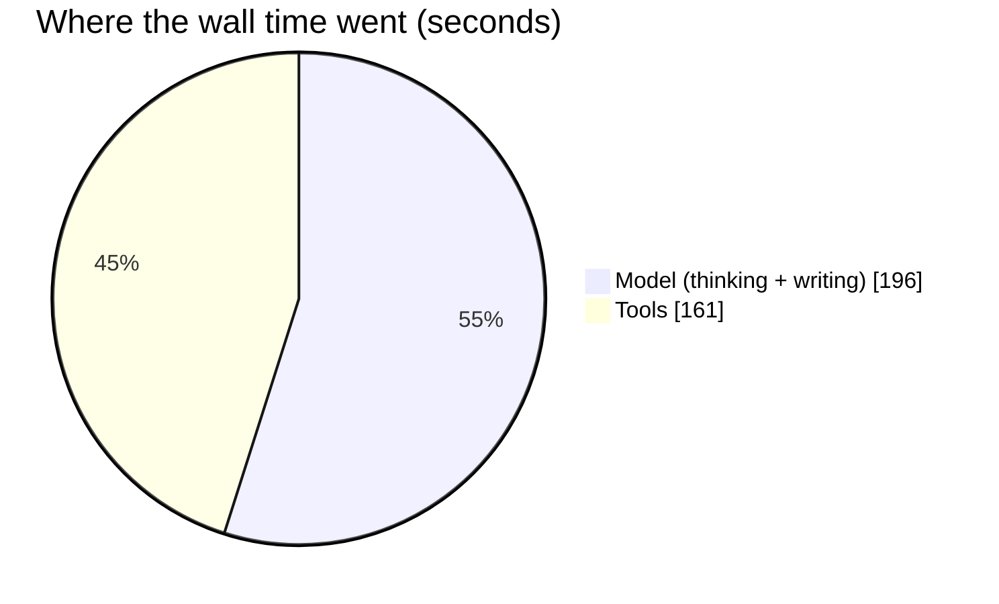

# firm-knowledge/tasks/198 · run1 (`hv-fk250-lunahigh-20261110T175632Z`)

Result: **fail** 3/4 criteria · 6.0 min · 31 model calls · 69 tool calls (1 errors or timeouts) · ending `completed` · started 11-11 00:43:53 IST

## Overview

One box per stretch of steps that used the same kind of tool (blue: looking/searching/reading, purple: writing or editing files, yellow: a message with no tool call, red border: a tool error or timeout inside the box).

```mermaid
flowchart TD
    T(["Task prompt"])
    P0["<b>Step 1</b> · 0.1 min<br/>todo_write"]
    T --> P0
    class P0 look
    P1["<b>Steps 2-3</b> · 0.2 min<br/>glob x6<br/><i>*, **/*credit*, **/*loan* +3</i>"]
    P0 --> P1
    class P1 look
    P2["<b>Step 4</b> · 0.2 min<br/>bash<br/><i>ls documents/matters | head -80</i>"]
    P1 --> P2
    class P2 look
    P3["<b>Steps 5-6</b> · 0.5 min<br/>glob x14<br/><i>**/*transaction*summary*, **/*transaction*overview*, **/*purchase*price* +11</i>"]
    P2 --> P3
    class P3 look
    P4["<b>Steps 7-8</b> · 1.0 min<br/>bash x2<br/><i>mkdir -p scratch/parsed && parse-doc …, mkdir -p scratch/parsed && for f in \…</i>"]
    P3 --> P4
    class P4 look
    P5["<b>Step 9</b> · 0.1 min<br/>grep x3<br/><i>parsed</i>"]
    P4 --> P5
    class P5 look
    P6["<b>Step 10</b> · 0.1 min<br/>bash<br/><i>for f in scratch/parsed/*.txt; do ech…</i>"]
    P5 --> P6
    class P6 look
    P7["<b>Step 11</b> · 0.3 min<br/>glob x8<br/><i>documents/matters/1003-00003/**, documents/matters/1005-00001/**, documents/matters/1019-00002/** +5</i>"]
    P6 --> P7
    class P7 look
    P8["<b>Steps 12-13</b> · 0.4 min<br/>bash x2<br/><i>sed -n '1,80p' scratch/parsed/1003-00…, parse-doc docx 'documents/matters/100…</i>"]
    P7 --> P8
    class P8 look
    P9["<b>Step 14</b> · 0.1 min<br/>read<br/><i>db63fd817d32-glob-results.txt</i>"]
    P8 --> P9
    class P9 err
    P10["<b>Step 15</b> · 0.2 min<br/>glob x6<br/><i>**/credit-agreement.docx, **/senior-secured-credit-agreement.do…, **/term-loan-agreement.docx +3</i>"]
    P9 --> P10
    class P10 look
    P11["<b>Steps 16-17</b> · 0.5 min<br/>bash x2<br/><i>parse-doc docx 'documents/matters/102…, for spec in \ '1019-00002/Memos & Ana…</i>"]
    P10 --> P11
    class P11 look
    P12["<b>Steps 18-19</b> · 0.5 min<br/>grep x8<br/><i>1003-00003_Financing_credit-agreement…, 1041-00003_Financing_credit-agreement…, 1005-00001_Transaction Documents_Cred… +1</i>"]
    P11 --> P12
    class P12 look
    P13["<b>Steps 20-21</b> · 0.1 min<br/>read x2<br/><i>1003-00003_Financing_credit-agreement…, 1043-00001_Transaction Documents_cred…</i>"]
    P12 --> P13
    class P13 look
    P14["<b>Step 22</b> · 0.1 min<br/>glob x4<br/><i>documents/matters/1041-00003/**/*merg…, documents/matters/1043-00001/**/*merg…, documents/matters/1003-00003/**/*merg… +1</i>"]
    P13 --> P14
    class P14 look
    P15["<b>Steps 23-24</b> · 0.2 min<br/>bash x2<br/><i>parse-doc docx 'documents/matters/104…</i>"]
    P14 --> P15
    class P15 look
    P16["<b>Step 25</b> · 0.3 min<br/>todo_write"]
    P15 --> P16
    class P16 look
    P17["<b>Steps 26-29</b> · 1.0 min<br/>read x2<br/>write<br/>edit<br/><i>response.md</i>"]
    P16 --> P17
    class P17 write
    P18["<b>Step 30</b> · 0.1 min<br/>todo_write"]
    P17 --> P18
    class P18 look
    P19["<b>Step 31</b> · 0.0 min<br/>final message"]
    P18 --> P19
    class P19 ans
    R(["FAIL: 3/4 criteria"])
    P19 --> R
    class R fail
    classDef look fill:#e8f0fe,stroke:#4a6fa5,color:#111
    classDef write fill:#f3e8fd,stroke:#7b1fa2,color:#111
    classDef ans fill:#fff8e1,stroke:#b58900,color:#111
    classDef err fill:#e8f0fe,stroke:#c62828,stroke-width:3px,color:#111
    classDef pass fill:#e6f4ea,stroke:#2e7d32,color:#111
    classDef fail fill:#fce8e6,stroke:#c62828,color:#111
```





One row per model call:

| Step | Started (IST) | Model s | Tools s | Tool calls | Tools | Output chars |
|---|---|---|---|---|---|---|
| 1 | 00:43:53 | 4 | 0 | 1 | todo_write | 57 |
| 2 | 00:43:57 | 1 | 2 | 1 | glob | 8,520 |
| 3 | 00:44:01 | 3 | 7 | 5 | glob x5 | 28,078 |
| 4 | 00:44:11 | 7 | 3 | 1 | bash | 880 |
| 5 | 00:44:21 | 2 | 15 | 7 | glob x7 | 16,084 |
| 6 | 00:44:38 | 3 | 13 | 7 | glob x7 | 3,201 |
| 7 | 00:44:54 | 3 | 4 | 1 | bash | 13,642 |
| 8 | 00:45:01 | 7 | 43 | 1 | bash | 5,487 |
| 9 | 00:45:51 | 3 | 6 | 3 | grep x3 | 149,980 |
| 10 | 00:46:00 | 4 | 1 | 1 | bash | 34,932 |
| 11 | 00:46:05 | 7 | 12 | 8 | glob x8 | 44,621 |
| 12 | 00:46:24 | 4 | 5 | 1 | bash | 38,333 |
| 13 | 00:46:34 | 9 | 3 | 1 | bash | 10,197 |
| 14 | 00:46:46 | 3 | 0 | 1 | read ⚠ | 66 |
| 15 | 00:46:50 | 3 | 9 | 6 | glob x6 | 207 |
| 16 | 00:47:02 | 4 | 3 | 1 | bash | 12,369 |
| 17 | 00:47:09 | 5 | 16 | 1 | bash | 49,924 |
| 18 | 00:47:30 | 8 | 5 | 4 | grep x4 | 180,377 |
| 19 | 00:47:43 | 10 | 4 | 4 | grep x4 | 31,969 |
| 20 | 00:47:58 | 4 | 0 | 1 | read | 3,318 |
| 21 | 00:48:02 | 4 | 0 | 1 | read | 2,856 |
| 22 | 00:48:05 | 3 | 3 | 4 | glob x4 | 2,611 |
| 23 | 00:48:12 | 3 | 3 | 1 | bash | 14,958 |
| 24 | 00:48:19 | 4 | 3 | 1 | bash | 21,926 |
| 25 | 00:48:26 | 19 | 0 | 1 | todo_write | 57 |
| 26 | 00:48:45 | 47 | 0 | 1 | write | 200 |
| 27 | 00:49:32 | 5 | 0 | 1 | read | 21,310 |
| 28 | 00:49:36 | 6 | 0 | 1 | edit | 175 |
| 29 | 00:49:42 | 3 | 0 | 1 | read | 3,562 |
| 30 | 00:49:46 | 3 | 0 | 1 | todo_write | 57 |
| 31 | 00:49:49 | 2 | 0 | 0 | (message only) | 0 |

## Task prompt

```text
I need a set of comparables for a large financing we're papering. Pull the executed credit agreements from our deals valued over a billion dollars.

Output: write your complete answer to `response.md` — a single self-contained markdown file with your findings, the matters/documents you relied on, and your reasoning.
```

## Rubric

| # | Criterion | Verdict |
|---|---|---|
| C-001 | Qualifying matter — Harrowgate PE 1003-00003 | pass |
| C-002 | Qualifying matter — Nexford Industrial 1005-00001 | pass |
| C-003 | Qualifying matter — Solara Digital 1041-00003 | pass |
| C-004 | Qualifying set — precision | **FAIL** |

Judge's reasoning:

**C-001 (pass):** Qualifying matter — Harrowgate PE 1003-00003

```text
The output expressly identifies matter 1003-00003 (Harrowgate PE) as qualifying and provides the executed credit agreement path: documents/matters/1003-00003/Financing/credit-agreement-execution.docx.
```

**C-002 (pass):** Qualifying matter — Nexford Industrial 1005-00001

```text
The output expressly identifies matter 1005-00001 (Nexford Industrial) as qualifying and provides the executed credit agreement path: documents/matters/1005-00001/Transaction Documents/Credit Agreement/credit-agreement-execution-version.docx.
```

**C-003 (pass):** Qualifying matter — Solara Digital 1041-00003

```text
The output expressly identifies matter 1041-00003 (Cloudium Technologies / Solara Digital Infrastructure Fund VI LP) and provides the executed credit agreement file path: documents/matters/1041-00003/Financing/credit-agreement-execution-version.docx.
```

**C-004 (fail):** Qualifying set — precision

```text
The output asserts Matter 1043-00001 (Ironhaven Data Centers) as a fourth qualifying matter, but the permitted qualifying set is limited to 1003-00003, 1005-00001, and 1041-00003. Therefore, it includes a qualifying matter outside the allowed set.
```

## Delivered files (output/)

- `response.md` (20,512 bytes)

`response.md`:

```markdown
# Executed Credit-Agreement Comparables for Billion-Dollar Deals

## Executive conclusion

I identified **four matters with an executed credit agreement tied to a transaction or financing documented at more than $1 billion**. The resulting comparable set is:

1. **Matter 1003-00003 — VeloPay Systems / Harrowgate acquisition**: approximately **$1.9 billion** aggregate merger consideration; executed **$500 million term loan plus $260 million revolver**.
2. **Matter 1005-00001 — Nexford Industrial Holdings refinancing and dividend recapitalization**: **$1.4 billion** executed Term Loan B financing; the matter also records the sponsor's approximately **$1.65 billion** acquisition enterprise value.
3. **Matter 1041-00003 — Cloudium Technologies / Solara acquisition**: approximately **$6.8 billion** aggregate equity/deal value; executed **$3.74 billion Term Loan B plus $500 million revolver**.
4. **Matter 1043-00001 — Ironhaven Data Centers financing supporting a merger**: approximately **$1.9 billion** merger consideration stated in the executed credit agreement; executed **$950 million multi-currency Term Loan B**, alongside an existing $100 million super-senior revolver.

The agreements below are the executed versions, not drafts or redlines. I treated a matter as qualifying where the documents expressly establish either (i) a transaction consideration/value over $1 billion or (ii) a financing transaction over $1 billion. I did **not** treat portfolio asset value, revenue, or aggregate pre-existing debt alone as the deal value.

## Comparable set

### 1. Matter 1003-00003 — VeloPay Systems, Inc. / Harrowgate Private Equity Fund IV LP

**Transaction/value evidence.** The executed Agreement and Plan of Merger defines aggregate merger consideration as **$1.9 billion**, representing **$20.00 per share** on a fully diluted basis. The executed credit agreement independently states that its proceeds fund a portion of that approximately $1.9 billion merger consideration.

**Executed credit agreement.**

- **Document:** `documents/matters/1003-00003/Financing/credit-agreement-execution.docx`
- **Title/date:** Senior Secured Credit Agreement, dated **July 22, 2025**; closing date is July 22, 2025.
- **Parties/agents:** VeloPay Systems, Inc. as borrower; Harrowgate Private Equity Fund IV LP as Holdings; Tralvendo National Bank as Term Loan Administrative Agent and lead arranger/sole bookrunner; Prairie State Bank, N.A. as Revolving Administrative Agent and co-arranger.
- **Facilities:**
  - **$500 million** senior secured term loan, funded in one draw.
  - **$260 million** senior secured revolving facility.
  - **$254.7 million** initial revolving draw at closing, for total initial debt funding of approximately **$754.7 million** against total commitments of $760 million.
  - $25 million letter-of-credit sublimit and $15 million swingline sublimit.
- **Use of proceeds:** Approximately $1.9 billion merger consideration, approximately $113.23 million payoff of the existing Meridian facility, transaction expenses, and general corporate purposes. The funds-flow conditions also record a **$1.14 billion equity contribution** from HPE Fund IV.
- **Pricing:** Term loan at **Term SOFR + 3.75%** (or Base Rate + 2.75%). Revolver pricing grids at Term SOFR + **3.25% / 3.00% / 2.75%**, depending on Total Net Leverage Ratio.
- **Maturity/amortization:** Term loan matures **July 22, 2032**; revolver matures **July 22, 2030**. Term loan amortizes at **0.25% of original principal per quarter**, or **$1.25 million per quarter**, with a maturity balloon.
- **Financial tests:** Total Net Leverage Ratio maximum steps down from **6.50x through Q4 2025**, to 6.00x in 2026, 5.50x in 2027, and 5.00x thereafter. Minimum Interest Coverage Ratio is **2.00x through Q4 2026** and **2.25x thereafter**. The agreement records pro forma closing leverage of approximately **6.48x** after permitted add-backs.
- **Collateral/guarantees:** Senior secured first-lien package supported by the Guarantee and Collateral Agreement and an intercreditor arrangement between the Term Loan Agent and Revolver Agent; domestic operating subsidiaries are guarantors.
- **Useful drafting points:** Separate administrative agents for term and revolving facilities; leverage-based revolver pricing; quarterly amortization; scheduled leverage step-downs; equity cure provisions; and a defined initial revolving draw used to balance acquisition sources and uses.

### 2. Matter 1005-00001 — Nexford Industrial Holdings Inc. refinancing and dividend recapitalization

**Transaction/value evidence.** This is a financing transaction rather than a new acquisition. The final transaction summary describes a **$1.4 billion** senior secured Term Loan B refinancing and dividend recapitalization. It also records that Granite Peak originally acquired Nexford for approximately **$1.65 billion enterprise value** in 2019. The current transaction distributed approximately $335 million to the sponsor while refinancing the first-lien capital structure.

**Executed credit agreement.**

- **Document:** `documents/matters/1005-00001/Transaction Documents/Credit Agreement/credit-agreement-execution-version.docx`
- **Execution confirmation:** `documents/matters/1005-00001/Closing/signature-pages-credit-agreement.docx`
- **Title/date:** Credit Agreement, dated **March 28, 2025**; closing date is March 28, 2025.
- **Parties/agents:** Nexford Industrial Holdings Inc. as borrower; Granite Peak NIH Holdings, LLC as Holdings; Crescent Harbor Bank, N.A. as Administrative Agent and Collateral Agent and sole lead left arranger/bookrunner; Ironwood Capital Markets, LLC and Northvane Securities, Inc. as joint lead arrangers.
- **Facility:** **$1.4 billion** senior secured first-lien Term Loan B, funded in a single draw. There is no new revolver under the executed agreement; the existing $190 million revolver was terminated at closing.
- **Use of proceeds/sources:** Approximately $879.375 million payoff of existing first-lien debt; approximately $335 million dividend recapitalization; approximately $38.625 million transaction costs; and approximately $147 million to the borrower's balance sheet. The agreement also leaves the existing $250 million senior unsecured notes outstanding.
- **Pricing/fees:** Term loan at **Term SOFR + 4.00%**. The loan is issued at **99.50**, producing **$7 million of OID**. Arrangement fee is **50 bps / $7 million**; the closing conditions also require a 1.00% upfront fee to participating lenders.
- **Maturity/amortization:** Matures **March 28, 2032**. Scheduled amortization is **$3.5 million per quarter**, equal to 1.00% per annum of original principal. A **1.00% soft-call premium** applies to repricing transactions during the first six months.
- **Leverage/covenants:** Pro forma First Lien Net Leverage Ratio is approximately **3.38x** and Total Net Leverage Ratio approximately **4.03x** at closing. The agreement includes a **5.00x springing First Lien Net Leverage Ratio** covenant, tested only if a future incremental revolver is drawn above its 40% trigger; there is no closing-date revolver in this credit agreement. Excess-cash-flow sweep is 50% / 25% / 0% based on leverage.
- **Collateral/guarantees:** Holdings and 11 domestic subsidiary guarantors provide guarantees; the agreement includes a first-lien security package and a First Lien/Unsecured Intercreditor Agreement with the senior unsecured notes trustee.
- **Useful drafting points:** Large single-tranche refinancing with dividend recap proceeds; explicit OID and upfront-fee economics; 1.00% scheduled amortization; MFN protection for incremental debt; springing rather than full maintenance covenant treatment; and a broad domestic subsidiary guarantee package.

### 3. Matter 1041-00003 — Cloudium Technologies plc / Solara Digital Infrastructure Fund VI LP

**Transaction/value evidence.** The executed merger agreement states an aggregate deal value of approximately **$6.8 billion**, based on approximately 184.2 million shares at **$36.92 per share**. It also records $2.832888096 billion of equity commitment, approximately $616.056 million of rollover equity, and a $4.24 billion debt commitment.

**Executed credit agreement.**

- **Document:** `documents/matters/1041-00003/Financing/credit-agreement-execution-version.docx`
- **Title/date:** Credit Agreement, dated **July 9, 2024**; closing date is July 9, 2024.
- **Parties/agents:** Cloudium Technologies plc as borrower; Meridian Atlantic Bank, N.A. as Administrative Agent, Collateral Agent, Swingline Lender, Issuing Bank, lead arranger, sole bookrunner; Ironclad Capital Markets LLC as co-arranger/joint bookrunner.
- **Facilities:**
  - **$3.74 billion** senior secured Term Loan B, funded in full at closing.
  - **$500 million** senior secured revolving facility, undrawn at closing.
  - **$50 million** swingline commitment and **$75 million** letter-of-credit sublimit.
  - Total debt commitment: **$4.24 billion**.
- **Use of proceeds:** Finance the acquisition, repay approximately **$820 million** of existing term and revolving debt, fund a **$544 million escrow amount**, and pay approximately **$185 million** of transaction costs. The debt is paired with the $2.832888096 billion equity contribution and rollover equity.
- **Pricing/fees:** Term loan at **Term SOFR + 3.25%** (or ABR + 2.25%); revolver at **Term SOFR + 2.75%** (or ABR + 1.75%). Initial revolver commitment fee is **0.375%**, with a step-down at the contractual leverage level. A 1.00% soft-call premium applies to repricing during the first six months.
- **Maturity/amortization:** Term loan matures **July 9, 2031**; revolver matures **July 9, 2029**. Term loan amortizes at **0.25% per quarter**, or **$9.35 million per quarter** on the initial $3.74 billion principal amount.
- **Financial tests:** There is no maintenance financial covenant for the Term Loan B. A **springing 5.00x First Lien Net Leverage Ratio** applies for the be
… [10,483 more chars]
```

## Trajectory

### Step 1: 1 tool call

_Started 11-11 00:43:53 IST · model 4 s · tools 0 s_

**Reasoning summary:**

```text
**Planning document retrieval**

I need to retrieve knowledge from documents, but first, I should inspect my workspace. I’m considering whether I need to use a specific skill, especially if the task matches well. There’s no explicit catalog of skills available, so I might inspect files via glob. 

The user’s request seems to involve multiple steps, but I wonder if it's manageable in one turn. I think I should list files using glob or bash ls; the developer says bash ls is fine, so I'll go with that.
```

**Call `todo_write`** (0.0 s)

```json
{
 "todos": [
  {
   "content": "Inventory the deal documents and identify transactions valued over $1 billion",
   "status": "in_progress"
  },
  {
   "content": "Review candidate matters and confirm executed credit agreements",
   "status": "pending"
  },
  {
   "content": "Prepare a self-contained comparables summary with source documents and reasoning",
   "status": "pending"
  },
  {
   "content": "Write the complete answer to response.md and verify contents",
   "status": "pending"
  }
 ]
}
```

Output (57 chars):

```text
Updated todo list: 3 pending, 1 in progress, 0 completed.
```

**Todo list now:**

- [~] Inventory the deal documents and identify transactions valued over $1 billion
- [ ] Review candidate matters and confirm executed credit agreements
- [ ] Prepare a self-contained comparables summary with source documents and reasoning
- [ ] Write the complete answer to response.md and verify contents

### Step 2: 1 tool call

_Started 11-11 00:43:57 IST · model 1 s · tools 2 s_

**Call `glob`** (1.9 s)

```json
{
 "pattern": "*"
}
```

Output (8,520 chars):

```text
documents/matters/1001-00001/Antitrust Analysis/competitor-identification-chart.xlsx
documents/matters/1001-00001/Antitrust Analysis/portfolio-company-overlap-analysis.docx
documents/matters/1001-00001/Antitrust Analysis/hhi-concentration-analysis.xlsx
documents/matters/1001-00001/Antitrust Analysis/market-definition-competitive-analysis-memo.docx
documents/matters/1001-00001/Client Updates/biweekly-status-report-1.docx
documents/matters/1001-00001/Antitrust Analysis/preliminary-antitrust-risk-assessment.docx
documents/matters/1001-00001/Antitrust Analysis/state-regulatory-con-analysis.docx
documents/matters/1001-00001/Antitrust Analysis/vertical-relationships-analysis.docx
documents/matters/1001-00001/Closing/closing-memo-antitrust-workstream.docx
documents/matters/1001-00001/Client Updates/client-update-early-termination-granted.eml
documents/matters/1001-00001/Client Updates/biweekly-status-report-2.docx
documents/matters/1001-00001/Client Updates/client-update-hsr-forms-filed.eml
documents/matters/1001-00001/Closing/final-invoice-matter-closing-letter.docx
documents/matters/1001-00001/Closing/hsr-clearance-certificate.docx
documents/matters/1001-00001/Correspondence/Counterparty Counsel/email-gk-naics-code-consistency.eml
documents/matters/1001-00001/Early Termination/early-termination-request-letter.docx
documents/matters/1001-00001/Correspondence/Counterparty Counsel/letter-bracewell-thornton-regulatory-condition.docx
documents/matters/1001-00001/Correspondence/Counterp
… [7,020 more chars]
```

### Step 3: 5 tool calls

_Started 11-11 00:44:01 IST · model 3 s · tools 7 s_

**Reasoning summary:**

```text
**Searching for agreements**

I'm focused on identifying significant matters related to deals valued over a billion dollars and executed credit agreements. I think I'll search through filenames specifically for terms like credit, loan, or financing. For this, I'll use glob patterns to help narrow down the results effectively. It’s important to ensure I’m capturing all relevant documents in my search. Let's see what I can find!
```

**Call `glob`** (1.6 s)

```json
{
 "pattern": "**/*credit*"
}
```

Output (9,714 chars):

```text
documents/matters/1001-00004/Financing/credit-agreement-draft.docx
documents/matters/1001-00004/Financing/intercreditor-agreement.docx
documents/matters/1001-00007/Financing/senior-secured-credit-agreement.docx
documents/matters/1002-00004/Diligence/credit-facility-review-memo.docx
documents/matters/1003-00003/Financing/credit-agreement-execution.docx
documents/matters/1003-00003/Financing/intercreditor-agreement-execution.docx
documents/matters/1003-00005/Debt/Capital Structure/credit-agreement-spin-covenant-analysis.docx
documents/matters/1005-00001/Closing/signature-pages-intercreditor-agreement.docx
documents/matters/1005-00001/Closing/signature-pages-credit-agreement.docx
documents/matters/1005-00001/Diligence/memo-review-existing-credit-agreement.docx
documents/matters/1005-00001/Transaction Documents/Credit Agreement/credit-agreement-execution-version.docx
documents/matters/1005-00001/Transaction Documents/Credit Agreement/credit-agreement-issues-list-v1.xlsx
documents/matters/1005-00001/Transaction Documents/Credit Agreement/credit-agreement-issues-list-v3.xlsx
documents/matters/1005-00001/Transaction Documents/Credit Agreement/credit-agreement-issues-list-v2.xlsx
documents/matters/1005-00001/Transaction Documents/Credit Agreement/credit-agreement-sc-marked-draft-2.docx
documents/matters/1005-00001/Transaction Documents/Credit Agreement/credit-agreement-near-final-draft.docx
documents/matters/1005-00001/Transaction Documents/Credit Agreement/credit-agreement-sc-marked
… [8,214 more chars]
```

**Call `glob`** (1.2 s)

```json
{
 "pattern": "**/*loan*"
}
```

Output (3,604 chars):

```text
documents/matters/1005-00001/Closing/certified-organizational-documents-all-loan-parties.docx
documents/matters/1005-00001/Closing/good-standing-certificates-all-loan-parties.docx
documents/matters/1006-00006/Financing/incremental-term-loan-amendment.docx
documents/matters/1006-00008/Financing/incremental-term-loan-amendment.docx
documents/matters/1010-00001/Engagement/engagement-letter-aht-bridge-loan.docx
documents/matters/1010-00001/Transaction Documents/bridge-loan-agreement-execution.docx
documents/matters/1013-00001/Transaction Documents/bridge-loan-agreement-execution.docx
documents/matters/1021-00001/Transaction Documents/form-of-term-loan-note.docx
documents/matters/1021-00007/Correspondence/email-nakamura-to-yee-loan-doc-markup.eml
documents/matters/1021-00007/Loan Documents/loan-agreement-borrower-markup.docx
documents/matters/1021-00007/Loan Documents/loan-agreement-wbd-initial-draft.docx
documents/matters/1021-00007/Loan Documents/loan-document-issues-memo.docx
documents/matters/1021-00007/Transaction Overview/existing-loan-review-memo.docx
documents/matters/1026-00004/Financing/loan-document-review-memorandum.docx
documents/matters/1027-00004/Financing/loan-term-sheet-review-memo.docx
documents/matters/1031-00004/Transaction Documents/Mezzanine/mezzanine-loan-agreement.docx
documents/matters/1031-00004/Transaction Documents/Mezzanine/mezzanine-loan-agreement-redline-v2.docx
documents/matters/1031-00004/Transaction Documents/Senior Mortgage/building-loan-agreemen
… [2,104 more chars]
```

**Call `glob`** (1.0 s)

```json
{
 "pattern": "**/*financ*"
}
```

Output (3,896 chars):

```text
documents/matters/1001-00007/Financing/financing-fee-letter.docx
documents/matters/1005-00001/Correspondence/email-merritt-to-kaplan-re-financial-covenants.eml
documents/matters/1006-00002/DIP Financing/motion-dip-financing.docx
documents/matters/1011-00002/Court Filings & Demands/dip-financing-limited-objection.docx
documents/matters/1012-00001/UCC/Perfection/ucc-1-financing-statement-delaware-mezzanine.docx
documents/matters/1012-00001/UCC/Perfection/ucc-1-financing-statement-texas-mezzanine.docx
documents/matters/1014-00004/Damages Analysis/lumicore-financial-data-summary.xlsx
documents/matters/1015-00001/Diligence/dd-memo-debt-financing.docx
documents/matters/1015-00001/Diligence/dd-request-list-debt-financing.docx
documents/matters/1015-00001/NYSE & FINRA/finra-corporate-financing-application.docx
documents/matters/1015-00001/Registration Statement/selected-financial-data.docx
documents/matters/1015-00003/Closing/officers-certificate-financial-close.docx
documents/matters/1016-00003/Closing/ucc-1-financing-statements.docx
documents/matters/1017-00009/Diligence/landlord-financial-diligence-memo.docx
documents/matters/1018-00004/Transaction Documents/Investigator Agreements/financial-disclosure-certification-template.docx
documents/matters/1018-00008/Financing/financing-conditions-checklist.xlsx
documents/matters/1018-00008/Transaction Documents/side-letter-financing-cooperation.docx
documents/matters/1018-00009/Appeals/settlement-financial-impact-analysis.xlsx
documents/m
… [2,396 more chars]
```

**Call `glob`** (1.7 s)

```json
{
 "pattern": "**/*facility*"
}
```

Output (1,951 chars):

```text
documents/matters/1002-00004/Diligence/credit-facility-review-memo.docx
documents/matters/1003-00002/Financing/sub-facility-term-sheet-review-memo.docx
documents/matters/1005-00001/Transaction Documents/Credit Agreement/internal-memo-incremental-facility-provisions.docx
documents/matters/1007-00008/Memoranda/credit-facility-covenant-compliance-memo.docx
documents/matters/1010-00002/Tax/tax-memo-use-of-proceeds-credit-facility.docx
documents/matters/1010-00003/Contract Template Remediation/meridian-restructured-facility-access-agreement-draft.docx
documents/matters/1014-00001/documents/limited-consent-waiver-credit-facility.docx
documents/matters/1015-00001/Debt & Lender Consents/lender-consent-analysis-corporate-facility.docx
documents/matters/1015-00002/Transaction Documents/Exhibits/exhibit-a-facility-description.docx
documents/matters/1015-00004/Financing/letter-trident-credit-facility-review.docx
documents/matters/1016-00005/Lender Communications/memo-credit-facility-regulatory-covenants.docx
documents/matters/1019-00002/Transaction Documents/payoff-letter-existing-facility.docx
documents/matters/1021-00001/Transaction Documents/Analysis/incremental-facility-mfn-interaction-memo.docx
documents/matters/1021-00002/Payoff/Refinancing/existing-facility-termination-notice.docx
documents/matters/1025-00007/Transaction Documents/liquidity-facility-agreement-execution-draft-v2.docx
documents/matters/1032-00004/NSA Annexes & Implementation/nsa-annex-f-facility-access-procedures.do
… [451 more chars]
```

**Call `glob`** (1.5 s)

```json
{
 "pattern": "**/*agreement*",
 "path": "documents/matters"
}
```

Output (8,913 chars):

```text
documents/matters/1001-00002/Carry & Economics/carried-interest-allocation-agreement.docx
documents/matters/1001-00002/Amended Governing Documents/gp-second-amended-llc-agreement.docx
documents/matters/1001-00002/Amended Governing Documents/manco-second-amended-llc-agreement.docx
documents/matters/1001-00002/Carry & Economics/management-fee-sharing-agreement.docx
documents/matters/1001-00002/Departing Principals/kellner-senior-advisor-agreement.docx
documents/matters/1001-00002/Departing Principals/trask-separation-agreement.docx
documents/matters/1001-00002/Departing Principals/trask-separation-agreement-redline.docx
documents/matters/1001-00002/Departing Principals/kellner-separation-agreement.docx
documents/matters/1001-00002/Entity Formation/gp-intermediate-llc-agreement.docx
documents/matters/1001-00002/Entity Formation/holdco-llc-agreement.docx
documents/matters/1001-00003/Transaction Documents/APA Drafts/asset-purchase-agreement-first-draft.docx
documents/matters/1001-00003/Transaction Documents/Employment/employment-agreement-whitfield-torres.docx
documents/matters/1001-00003/Transaction Documents/APA Drafts/asset-purchase-agreement-redline-seller-markup.docx
documents/matters/1001-00003/Transaction Documents/Employment/employment-agreement-whitfield.docx
documents/matters/1001-00003/Transaction Documents/assignment-and-assumption-agreement.docx
documents/matters/1001-00003/Transaction Documents/asset-purchase-agreement-execution.docx
documents/matters/1001-00003/Tran
… [7,413 more chars]
```

### Step 4: 1 tool call

_Started 11-11 00:44:11 IST · model 7 s · tools 3 s_

**Reasoning summary:**

```text
**Identifying transaction details**

I need to gather all relevant information for deals exceeding $1 billion, including descriptions in engagement letters and transaction summaries. I can use filenames of executed credit agreements as guides to find context. The agreements include various identifiers like 1003-00003 and 1012-00001 DIP. The user mentioned “deals valued over a billion dollars,” indicating I should focus on acquisition deal values. I’ll search the documents for terms like “$1 billion” and “transaction value” using proper tools to get accurate results.

**Converting documents to text**

I need to convert documents to text using the parse-doc tool, but I have to be cautious because the grep tool doesn’t work on docx files directly. A better approach might be to convert multiple documents to text files first and then use grep to search through them. I could run the parse-doc command in a loop to write outputs to a workspace scratch directory where I can then perform the grep searches. I also want to inspect the top-level matter list, possibly using glob paths to access the relevant files.
```

**Call `bash`** (3.2 s)

```json
{
 "command": "ls documents/matters | head -80",
 "description": "List matter directories"
}
```

Output (880 chars):

```text
1001-00001
1001-00002
1001-00003
1001-00004
1001-00005
1001-00006
1001-00007
1002-00001
1002-00002
1002-00003
1002-00004
1002-00005
1003-00001
1003-00002
1003-00003
1003-00004
1003-00005
1004-00001
1004-00002
1004-00003
1005-00001
1005-00002
1005-00003
1005-00004
1005-00005
1005-00006
1006-00001
1006-00002
1006-00003
1006-00004
1006-00005
1006-00006
1006-00007
1006-00008
1007-00001
1007-00002
1007-00003
1007-00004
1007-00005
1007-00006
1007-00007
1007-00008
1008-00001
1008-00002
1008-00003
1008-00004
1008-00005
1008-00006
1008-00007
1008-00008
1008-00009
1008-00010
1009-00001
1009-00002
1009-00003
1009-00004
1009-00005
1009-00006
1009-00007
1010-00001
1010-00002
1010-00003
1010-00004
1010-00005
1010-00006
1011-00001
1011-00002
1011-00003
1011-00004
1011-00005
1011-00006
1011-00007
1011-00008
1012-00001
1012-00002
1012-00003
1012-00004
1012-00005
1012-00006
1013-00001
```

### Step 5: 7 tool calls

_Started 11-11 00:44:21 IST · model 2 s · tools 15 s_

**Call `glob`** (1.4 s)

```json
{
 "pattern": "**/*transaction*summary*"
}
```

Output (868 chars):

```text
documents/matters/1005-00001/Post-Closing/final-transaction-summary-memorandum.docx
documents/matters/1009-00001/Board & Stockholder Approvals/board-presentation-transaction-summary.pptx
documents/matters/1013-00003/Memos & Analysis/transaction-summary-memo.docx
documents/matters/1016-00009/Internal Investigation/transaction-summary-schedule.xlsx
documents/matters/1017-00001/Firm Internal/sc-transaction-summary-memo.docx
documents/matters/1017-00006/Post-Closing/closing-memo-transaction-summary.docx
documents/matters/1018-00008/Board Materials & Corporate Approvals/board-presentation-transaction-summary.pptx
documents/matters/1021-00007/Transaction Overview/transaction-summary-memorandum.docx
documents/matters/1034-00001/Legal Analysis/memo-transaction-summary-timeline.docx
documents/matters/1045-00001/Internal Memoranda/transaction-summary-memorandum.docx
```

**Call `glob`** (1.5 s)

```json
{
 "pattern": "**/*transaction*overview*"
}
```

Output (82 chars):

```text
documents/matters/1021-00002/Engagement/preliminary-transaction-overview-memo.docx
```

**Call `glob`** (1.4 s)

```json
{
 "pattern": "**/*purchase*price*"
}
```

Output (831 chars):

```text
documents/matters/1001-00006/Purchase Price Allocation & TRA/purchase-price-allocation-memorandum.docx
documents/matters/1001-00006/Purchase Price Allocation & TRA/purchase-price-allocation-schedule.xlsx
documents/matters/1006-00008/Transaction Documents/Ancillary Agreements/purchase-price-adjustment-escrow-agreement.docx
documents/matters/1011-00006/Diligence/Tax/purchase-price-allocation-memo.docx
documents/matters/1013-00006/Internal Memoranda/Tax/purchase-price-allocation-memo.docx
documents/matters/1015-00005/Correspondence/email-credit-purchase-price-negotiation.eml
documents/matters/1036-00004/Tax/purchase-price-allocation-memorandum.docx
documents/matters/1036-00004/Transaction Documents/Exhibits/psa-exhibit-k-purchase-price-allocation.xlsx
documents/matters/1041-00003/Tax/tax-memo-purchase-price-allocation.docx
```

**Call `glob`** (4.2 s)

```json
{
 "pattern": "**/*value*"
}
```

Output (184 chars):

```text
documents/matters/1018-00003/Negotiation & Transaction Documents/contingent-value-rights-agreement.docx
documents/matters/1018-00004/Regulatory & Compliance/fair-market-value-memo.docx
```

**Call `glob`** (2.3 s)

```json
{
 "pattern": "**/*closing*memorandum*"
}
```

Output (3,696 chars):

```text
documents/matters/1001-00006/Closing/closing-tax-memorandum.docx
documents/matters/1001-00006/Post-Closing/post-closing-tax-integration-memorandum.docx
documents/matters/1001-00007/Closing/closing-funds-flow-memorandum.xlsx
documents/matters/1002-00002/Closing/closing-memorandum.docx
documents/matters/1003-00001/Administrative/matter-closing-memorandum.docx
documents/matters/1005-00005/Administrative/matter-closing-memorandum.docx
documents/matters/1006-00006/Closing/closing-funds-flow-memorandum.xlsx
documents/matters/1007-00005/Closing/closing-memorandum-matter-summary.docx
documents/matters/1008-00003/Closing/closing-memorandum-termination.docx
documents/matters/1008-00007/Internal Memoranda/matter-closing-memorandum.docx
documents/matters/1009-00003/Closing/closing-memorandum.docx
documents/matters/1009-00007/Closing/closing-memorandum.docx
documents/matters/1010-00001/Closing/closing-checklist-memorandum.xlsx
documents/matters/1012-00001/Closing/closing-funds-flow-memorandum.xlsx
documents/matters/1012-00001/Memoranda/closing-conditions-memorandum.docx
documents/matters/1012-00006/Closing/matter-closing-memorandum.docx
documents/matters/1013-00006/Closing/closing-funds-flow-memorandum.xlsx
documents/matters/1015-00003/Closing/closing-memorandum.docx
documents/matters/1016-00003/Closing/closing-memorandum.docx
documents/matters/1016-00004/Matter Closure/matter-closing-memorandum.docx
documents/matters/1016-00007/Closing/closing-memorandum.docx
documents/matters/1017-00002
… [2,196 more chars]
```

**Call `glob`** (1.9 s)

```json
{
 "pattern": "**/*deal*"
}
```

Output (2,468 chars):

```text
documents/matters/1005-00002/Internal/internal-deal-memorandum.docx
documents/matters/1005-00006/Diligence/deal-summary-memorandum.docx
documents/matters/1006-00003/Correspondence/email-deal-pause-status-update.eml
documents/matters/1006-00006/Memos & Analyses/deal-summary-memorandum.docx
documents/matters/1007-00001/Internal/deal-summary-memorandum.docx
documents/matters/1008-00001/Firm Memos/deal-summary-memorandum.docx
documents/matters/1008-00010/Memos & Analyses/deal-summary-memo.docx
documents/matters/1009-00001/Analysis & Strategy/preliminary-deal-structure-memo.docx
documents/matters/1009-00006/Analyses & Advice/deal-issues-memo.docx
documents/matters/1009-00007/Memos & Analysis/deal-summary-negotiation-strategy-memo.docx
documents/matters/1010-00001/Internal Memos/internal-deal-summary-memo.docx
documents/matters/1011-00001/Memoranda/deal-summary-memo.docx
documents/matters/1011-00005/Internal/deal-status-memo-internal.docx
documents/matters/1011-00006/Internal Memos/deal-summary-memorandum.docx
documents/matters/1012-00001/Memoranda/deal-summary-memorandum.docx
documents/matters/1013-00001/Diligence/internal-memo-deal-summary-key-issues.docx
documents/matters/1013-00002/Internal/internal-deal-memorandum.docx
documents/matters/1013-00006/Internal Memoranda/deal-summary-memorandum.docx
documents/matters/1014-00001/documents/deal-summary-memo.docx
documents/matters/1018-00001/Engagement & Internal/internal-deal-memo.docx
documents/matters/1018-00008/Administrative/matt
… [968 more chars]
```

**Call `glob`** (2.2 s)

```json
{
 "pattern": "**/*engagement*letter*"
}
```

Output (7,955 chars):

```text
documents/matters/1001-00001/Engagement & Administration/engagement-letter-ardent-capital.docx
documents/matters/1001-00002/Engagement & Administration/engagement-letter.docx
documents/matters/1001-00003/Engagement/engagement-letter-ardent-capital.docx
documents/matters/1001-00004/Engagement & Administrative/engagement-letter-ardent-capital.docx
documents/matters/1001-00005/Engagement/engagement-letter-ardent-cp-iii.docx
documents/matters/1001-00006/Engagement & Administrative/engagement-letter.docx
documents/matters/1001-00007/Correspondence/engagement-letter.docx
documents/matters/1002-00001/Engagement/engagement-letter-pinnacle-vc.docx
documents/matters/1002-00002/Engagement/engagement-letter-pinnacle-vc.docx
documents/matters/1002-00003/Engagement/engagement-letter-pinnacle-vc.docx
documents/matters/1002-00004/Matter Administration/engagement-letter-pinnacle.docx
documents/matters/1002-00005/Engagement/engagement-letter-pinnacle-cv-tax-structuring.docx
documents/matters/1003-00001/Engagement/engagement-letter-harrowgate-hsr.docx
documents/matters/1003-00002/Engagement/engagement-letter-hcp.docx
documents/matters/1003-00003/Engagement/engagement-letter-hpe-fund-iv.docx
documents/matters/1003-00004/Administrative/engagement-letter-hpe-fund-iv.docx
documents/matters/1003-00005/Engagement & Administrative/engagement-letter-hpe-fund-iv.docx
documents/matters/1004-00001/Engagement/engagement-letter-cobalt.docx
documents/matters/1004-00002/Engagement/engagement-letter-cobalt-ven
… [6,455 more chars]
```

### Step 6: 7 tool calls

_Started 11-11 00:44:38 IST · model 3 s · tools 13 s_

**Reasoning summary:**

```text
**Exploring document metadata**

I need to look for potentially useful metadata hidden within specific documents. I'll focus on identifying executed credit agreement documents across various paths. For this, it seems I should use a glob pattern like `**/*credit*execution*` to help me find those files efficiently. This approach should help narrow down the search. I'm curious about what insights I might uncover through this process!
```

**Call `glob`** (1.5 s)

```json
{
 "pattern": "**/*credit*execution*"
}
```

Output (1,752 chars):

```text
documents/matters/1003-00003/Financing/credit-agreement-execution.docx
documents/matters/1003-00003/Financing/intercreditor-agreement-execution.docx
documents/matters/1005-00001/Transaction Documents/Credit Agreement/credit-agreement-execution-version.docx
documents/matters/1005-00001/Transaction Documents/Intercreditor/intercreditor-agreement-execution-version.docx
documents/matters/1006-00001/Transaction Documents/mezzanine-credit-agreement-execution.docx
documents/matters/1008-00001/Transaction Documents/credit-agreement-execution.docx
documents/matters/1012-00001/Transaction Documents/amendment-no-3-senior-credit-agreement-execution.docx
documents/matters/1012-00001/Transaction Documents/mezzanine-credit-agreement-execution.docx
documents/matters/1012-00001/Transaction Documents/intercreditor-agreement-execution.docx
documents/matters/1013-00001/Transaction Documents/intercreditor-agreement-execution.docx
documents/matters/1015-00005/Transaction Documents/tax-credit-purchase-agreement-execution.docx
documents/matters/1019-00002/Transaction Documents/Credit Agreement/credit-agreement-execution.docx
documents/matters/1020-00002/Transaction Documents/DIP Credit Agreement/dip-credit-agreement-execution.docx
documents/matters/1021-00001/Transaction Documents/Credit Agreement/credit-agreement-execution-version.docx
documents/matters/1021-00001/Transaction Documents/Security/intercreditor-agreement-execution.docx
documents/matters/1038-00002/documents/credit-agreement-execution-
… [252 more chars]
```

**Call `glob`** (1.8 s)

```json
{
 "pattern": "**/*credit*executed*"
}
```

Output (14 chars):

```text
No files found
```

**Call `glob`** (2.7 s)

```json
{
 "pattern": "**/*credit*execution*version*"
}
```

Output (485 chars):

```text
documents/matters/1005-00001/Transaction Documents/Credit Agreement/credit-agreement-execution-version.docx
documents/matters/1005-00001/Transaction Documents/Intercreditor/intercreditor-agreement-execution-version.docx
documents/matters/1021-00001/Transaction Documents/Credit Agreement/credit-agreement-execution-version.docx
documents/matters/1038-00002/documents/credit-agreement-execution-version.docx
documents/matters/1041-00003/Financing/credit-agreement-execution-version.docx
```

**Call `glob`** (3.3 s)

```json
{
 "pattern": "**/*credit*final*"
}
```

Output (512 chars):

```text
documents/matters/1005-00001/Transaction Documents/Credit Agreement/credit-agreement-near-final-draft.docx
documents/matters/1005-00001/Transaction Documents/Intercreditor/intercreditor-agreement-near-final-draft.docx
documents/matters/1043-00001/Transaction Documents/Drafts/credit-agreement-final-circulated-draft.docx
documents/matters/1044-00002/Transaction Documents/Credit Agreement/credit-agreement-near-final.docx
documents/matters/1044-00004/Transaction Documents/intercreditor-agreement-near-final.docx
```

**Call `glob`** (1.3 s)

```json
{
 "pattern": "**/signature-pages-credit-agreement*"
}
```

Output (74 chars):

```text
documents/matters/1005-00001/Closing/signature-pages-credit-agreement.docx
```

**Call `glob`** (1.1 s)

```json
{
 "pattern": "**/*loan*execution*"
}
```

Output (261 chars):

```text
documents/matters/1010-00001/Transaction Documents/bridge-loan-agreement-execution.docx
documents/matters/1013-00001/Transaction Documents/bridge-loan-agreement-execution.docx
documents/matters/1042-00001/Transaction Documents/term-loan-agreement-execution.docx
```

**Call `glob`** (1.0 s)

```json
{
 "pattern": "**/*facility*execution*"
}
```

Output (103 chars):

```text
documents/matters/1025-00007/Transaction Documents/liquidity-facility-agreement-execution-draft-v2.docx
```

### Step 7: 1 tool call

_Started 11-11 00:44:54 IST · model 3 s · tools 4 s_

**Call `bash`** (4.0 s)

```json
{
 "command": "mkdir -p scratch/parsed && parse-doc docx 'documents/matters/1005-00001/Transaction Documents/Credit Agreement/credit-agreement-execution-version.docx' > scratch/parsed/1005-credit.txt && sed -n '1,120p' scratch/parsed/1005-credit.txt",
 "description": "Parse a candidate executed credit agreement",
 "timeoutMs": 120000
}
```

Output (13,642 chars):

```text
**[CREDIT AGREEMENT]{.underline}**

**[dated as of March 28, 2025]{.underline}**

among

**NEXFORD INDUSTRIAL HOLDINGS INC.,** a Delaware corporation, as Borrower

**THE GUARANTORS PARTY HERETO**

**THE LENDERS PARTY HERETO**

and

**CRESCENT HARBOR BANK, N.A.,** as Administrative Agent and Collateral Agent

with

**CRESCENT HARBOR BANK, N.A.,** as Sole Lead Left Arranger and Bookrunner

**IRONWOOD CAPITAL MARKETS, LLC,** as Joint Lead Arranger and Bookrunner

**NORTHVANE SECURITIES, INC.,** as Joint Lead Arranger

for a

**\$1,400,000,000 Senior Secured Term Loan B Facility**

Anticipated CUSIP: 65432X AA1 Anticipated LoanX ID: LX-234567

**[CREDIT AGREEMENT]{.underline}**

This CREDIT AGREEMENT, dated as of March 28, 2025, is entered into by and among NEXFORD INDUSTRIAL HOLDINGS INC., a Delaware corporation (the "Borrower"), GRANITE PEAK NIH HOLDINGS, LLC, a Delaware limited liability company ("Holdings"), the Subsidiary Guarantors party hereto from time to time, the several banks, financial institutions and other entities from time to time party hereto as lenders (collectively, the "Lenders"), and CRESCENT HARBOR BANK, N.A., as administrative agent (in such capacity, the "Administrative Agent") and as collateral agent (in such capacity, the "Collateral Agent").

The Borrower has requested that the Lenders provide a senior secured first lien term loan B facility in an aggregate principal amount of \$1,400,000,000 on the Closing Date. The proceeds of such facility shall be u
… [12,141 more chars]
```

### Step 8: 1 tool call

_Started 11-11 00:45:01 IST · model 7 s · tools 43 s_

**Reasoning summary:**

```text
**Parsing execution docs**

I see we can use glob to list up to 100 docx files and manage the paths, but full access might require reading via a tool. I wonder if I need to read the spill path, although it may not be necessary right now. My focus is on understanding matter mapping. I think about parsing candidate execution documents in parallel using bash, perhaps with a loop for something like `parse-doc` to handle 16 docs at once.
```

**Call `bash`** (42.8 s)

```json
{
 "command": "mkdir -p scratch/parsed && for f in \\\n'documents/matters/1003-00003/Financing/credit-agreement-execution.docx' \\\n'documents/matters/1005-00001/Transaction Documents/Credit Agreement/credit-agreement-execution-version.docx' \\\n'documents/matters/1006-00001/Transaction Documents/mezzanine-credit-agreement-execution.docx' \\\n'documents/matters/1008-00001/Transaction Documents/credit-agreement-execution.docx' \\\n'documents/matters/1012-00001/Transaction Documents/amendment-no-3-senior-credit-agreement-execution.docx' \\\n'documents/matters/1012-00001/Transaction Documents/mezzanine-credit-agreement-execution.docx' \\\n'documents/matters/1019-00002/Transaction Documents/Credit Agreement/credit-agreement-execution.docx' \\\n'documents/matters/1020-00002/Transaction Documents/DIP Credit Agreement/dip-credit-agreement-execution.docx' \\\n'documents/matters/1021-00001/Transaction Documents/Credit Agreement/credit-agreement-execution-version.docx' \\\n'documents/matters/1038-00002/documents/credit-agreement-execution-version.docx' \\\n'documents/matters/1041-00003/Financing/credit-agreement-execution-version.docx' \\\n'documents/matters/1043-00001/Transaction Documents/
… [574 more chars]
```

Output (5,487 chars):

```text
16
[stderr]
2026-11-10 19:15:10.665089770 [W:onnxruntime:Default, device_discovery.cc:95 GetPciBusId] Skipping pci_bus_id for PCI path at "/sys/devices/LNXSYSTM:00/LNXSYBUS:00/ACPI0004:00/VMBUS:00/5620e0c7-8062-4dce-aeb7-520c7ef76171" because filename "5620e0c7-8062-4dce-aeb7-520c7ef76171" did not match expected pattern of [0-9a-f]+:[0-9a-f]+:[0-9a-f]+[.][0-9a-f]+
2026-11-10 19:15:13.122908906 [W:onnxruntime:Default, device_discovery.cc:95 GetPciBusId] Skipping pci_bus_id for PCI path at "/sys/devices/LNXSYSTM:00/LNXSYBUS:00/ACPI0004:00/VMBUS:00/5620e0c7-8062-4dce-aeb7-520c7ef76171" because filename "5620e0c7-8062-4dce-aeb7-520c7ef76171" did not match expected pattern of [0-9a-f]+:[0-9a-f]+:[0-9a-f]+[.][0-9a-f]+
2026-11-10 19:15:15.600767076 [W:onnxruntime:Default, device_discovery.cc:95 GetPciBusId] Skipping pci_bus_id for PCI path at "/sys/devices/LNXSYSTM:00/LNXSYBUS:00/ACPI0004:00/VMBUS:00/5620e0c7-8062-4dce-aeb7-520c7ef76171" because filename "5620e0c7-8062-4dce-aeb7-520c7ef76171" did not match expected pattern of [0-9a-f]+:[0-9a-f]+:[0-9a-f]+[.][0-9a-f]+
2026-11-10 19:15:17.907074222 [W:onnxruntime:Default, device_discovery.cc:95 GetPciBusId] Skipping pci_bus_id for PCI path at "/sys/devices/LNXSYSTM:00/LNXSYBUS:00/ACPI0004:00/VMBUS:00/5620e0c7-8062-4dce-aeb7-520c7ef76171" because filename "5620e0c7-8062-4dce-aeb7-520c7ef76171" did not match expected pattern of [0-9a-f]+:[0-9a-f]+:[0-9a-f]+[.][0-9a-f]+
2026-11-10 19:15:20.3
… [3,986 more chars]
```

### Step 9: 3 tool calls

_Started 11-11 00:45:51 IST · model 3 s · tools 6 s_

**Reasoning summary:**

```text
**Searching for deal details**

I need to search through the parsed texts for several key pieces of information: dollar amounts, titles, closing dates, and maybe the overall deal value. I'm planning to use the grep tool on the scratch/parsed data and set up specific patterns to pull out the relevant information effectively. I wonder if I might have to adjust the patterns a bit to get the best results. Let's see how this goes!
```

**Call `grep`** (1.1 s)

```json
{
 "pattern": "\\$[0-9][0-9,]+,000,000|billion|Transaction Value|Purchase Price|enterprise value|aggregate principal amount|facility in an aggregate",
 "path": "scratch/parsed"
}
```

Output (49,984 chars):

```text
Found 250 of 839 matches

scratch/parsed/1013-00001_Transaction Documents_bridge-loan-agreement-execution.txt
Line 15: **\$15,000,000 BRIDGE TERM LOAN FACILITY**
Line 27: **WHEREAS**, the Borrower completed a \$42,000,000 Series B preferred stock financing round in August 2024, led by Verdana Health Ventures Fund II, L.P., at a price per share of \$2.18 (the \"Series B Financing\");
Line 29: **WHEREAS**, the Borrower requires a bridge loan in the aggregate principal amount of \$15,000,000 to fund its operations, including ongoing clinical development and general working capital needs, through the anticipated close of a Series C equity financing round targeted for the third quarter of 2026 (August--September 2026);
Line 53: **\"Aggregate Commitments\"** means the aggregate principal amount of the Commitments of all Lenders, which amount equals \$15,000,000 as of the Signing Date.
Line 57: **\"Anticipated Series C Financing\"** means the equity financing of the Borrower\'s Series C preferred stock that the Borrower is currently pursuing, targeted at a capital raise of \$60,000,000 to \$75,000,000 at an indicative pre-money valuation of approximately \$140,000,000.
Line 109: **\"Equity Financing Trigger Amount\"** means \$20,000,000 in gross proceeds from any single equity financing or series of related equity financings.
Line 149: **\"Loan\"** or **\"Term Loan\"** means the \$15,000,000 single-draw term loan made by the Lenders to the Borrower under this Agreement.
Line 177: **
… [48,484 more chars]
```

**Call `grep`** (2.7 s)

```json
{
 "pattern": "Closing Date|dated as of|Borrower|Lead Arranger|Administrative Agent|Commitment|Term Loan|Revolving",
 "path": "scratch/parsed"
}
```

Output (49,997 chars):

```text
Found 250 of 4520 matches

scratch/parsed/1013-00001_Transaction Documents_bridge-loan-agreement-execution.txt
Line 7: **GENOME DX THERAPEUTICS INC.** a Delaware corporation *as Borrower*
Line 9: **PINNACLE VENTURE LENDING CORP.** a Delaware corporation *as Administrative Agent and a Lender*
Line 17: Borrower\'s Counsel: **Calderwood & Harkness LLP** 555 California Street, 40th Floor San Francisco, CA 94104
Line 23: **WHEREAS**, Genome Dx Therapeutics Inc. (the \"Borrower\" or \"GenomeDx\"), a corporation duly organized and validly existing under the laws of the State of Delaware and qualified to do business in the State of California, with its principal executive offices located at 450 Genome Way, Suite 300, South San Francisco, California 94080, is a clinical-stage biotechnology company engaged in the development of proprietary RNA-based diagnostic and therapeutic platforms targeting rare neurodegenerative diseases;
Line 25: **WHEREAS**, the Borrower\'s lead product candidate, GDT-2701, is currently in Phase 2 clinical trials for the treatment of frontotemporal dementia, and the Borrower continues to advance its pipeline of RNA-based diagnostic and therapeutic technologies;
Line 27: **WHEREAS**, the Borrower completed a \$42,000,000 Series B preferred stock financing round in August 2024, led by Verdana Health Ventures Fund II, L.P., at a price per share of \$2.18 (the \"Series B Financing\");
Line 29: **WHEREAS**, the Borrower requires a bridge loan in the aggregate princi
… [48,497 more chars]
```

**Call `grep`** (2.0 s)

```json
{
 "pattern": "executed|execution|effective|consummate|acquisition|merger|refinanc",
 "path": "scratch/parsed"
}
```

Output (49,999 chars):

```text
Found 250 of 720 matches

scratch/parsed/1013-00001_Transaction Documents_bridge-loan-agreement-execution.txt
Line 77: **\"Change of Control\"** means the occurrence of any of the following events: (a) any Person or group of Persons (within the meaning of Section 13(d)(3) of the Securities Exchange Act of 1934, as amended) acquires beneficial ownership, directly or indirectly, of equity securities of the Borrower representing more than 50% of the combined voting power of all equity securities of the Borrower; (b) the Borrower merges with or into, or consolidates with, any other Person, or any other Person merges with or into the Borrower, and as a result of such merger or consolidation the holders of equity securities of the Borrower immediately prior thereto cease to hold at least 50% of the combined voting power of the surviving or resulting entity; or (c) the Borrower sells, transfers, or otherwise disposes of all or substantially all of its assets to any Person.
Line 93: **\"Compliance Certificate\"** means a certificate substantially in the form of Exhibit B, executed by the Chief Financial Officer of the Borrower.
Line 145: **\"Lenders\' Counsel Fee Cap\"** means \$175,000 in the aggregate for all fees and expenses of Lenders\' Counsel incurred in connection with the negotiation, preparation, and execution of this Agreement and the other Loan Documents for the initial Closing.
Line 205: **\"Signing Date\"** means March 6, 2026, the date on which this Agreement has been 
… [48,499 more chars]
```

### Step 10: 1 tool call

_Started 11-11 00:46:00 IST · model 4 s · tools 1 s_

**Reasoning summary:**

```text
**Targeting grep output**

I’ve got a lot of grep output, but it’s a bit overwhelming. I need to focus on the relevant details from each file. So, I’ll use the grep tool to look for first lines and key patterns across specific files. Maybe I’ll also parse the companion deal documents for potential candidates. I should take a closer look at the list of file names to see what I’m working with.
```

**Call `bash`** (1.3 s)

```json
{
 "command": "for f in scratch/parsed/*.txt; do echo \"=== $f\"; sed -n '1,45p' \"$f\" | grep -E '^\\*\\*|^among|^and|^for a|^This |^WHEREAS|^\\*\\*\\$|^\\$'; done",
 "description": "Summarize executed agreement headers"
}
```

Output (34,932 chars):

```text
=== scratch/parsed/1003-00003_Financing_credit-agreement-execution.txt
**[SENIOR SECURED CREDIT AGREEMENT]{.underline}**
**Dated as of July 22, 2025**
among
**VELOPAY SYSTEMS, INC.**, a Delaware corporation, as Borrower,
**HARROWGATE PRIVATE EQUITY FUND IV LP**, a Delaware limited partnership, as Holdings,
**TRALVENDO NATIONAL BANK**, as Administrative Agent for the Term Loan Facility and as a Lender,
**PRAIRIE STATE BANK, N.A.**, as Administrative Agent for the Revolving Credit Facility and as a Lender,
and
**THE SEVERAL LENDERS FROM TIME TO TIME PARTIES HERETO**
**[ARTICLE I --- DEFINITIONS AND ACCOUNTING TERMS]{.underline}**
**Section 1.01 --- Defined Terms**
**\"Additional Guarantor\"** means any Subsidiary of the Borrower that becomes a Guarantor after the Closing Date by executing and delivering a Joinder Agreement in accordance with Section 5.11.
**\"Administrative Agent\"** means (a) with respect to the Term Loan Facility, Tralvendo National Bank, in its capacity as administrative agent for the Term Loan Lenders under this Agreement and the other Loan Documents, and (b) with respect to the Revolving Credit Facility, Prairie State Bank, N.A., in its capacity as administrative agent for the Revolving Lenders under this Agreement and the other Loan Documents, and, in each case, any successor thereto appointed in accordance with Section 9.06. Unless the context otherwise requires, references to \"Administrative Agent\" or \"Administrative Agents\" shall refer to either or
… [33,431 more chars]
```

### Step 11: 8 tool calls

_Started 11-11 00:46:05 IST · model 7 s · tools 12 s_

**Reasoning summary:**

```text
**Identifying deal values**

I'm sorting through matters to find those with a deal value over $1 billion, noting that the user likely means deal value, not just financing amounts. I should look at all executed credit agreements for these high-value deals, ensuring to examine each document for their respective values. I can parse engagement summaries and closing memos for the candidate matters. Looks like I'll also check specific mergers like the HPE acquisition and the Nexford and Cloudium deals to pull the relevant data.

**Reviewing merger and acquisition values**

I’m examining various mergers and acquisitions to identify those valued over $1 billion. For example, there’s the Ironhaven merger, which is around $1.9 billion with $950 million in credit. I also see potential values in the Verimark transaction and Whitmore Aerospace acquisition. Additionally, I need to confirm any company values, possibly including a bankruptcy DIP. I plan to search through engagement summaries and credit documents for the necessary details, using file patterns to find the relevant documents efficiently.
```

**Call `glob`** (1.1 s)

```json
{
 "pattern": "documents/matters/1003-00003/**"
}
```

Output (6,209 chars):

```text
documents/matters/1003-00003/Antitrust & Regulatory/hsr-filing-buyer-form.docx
documents/matters/1003-00003/Antitrust & Regulatory/regulatory-approvals-status-tracker.xlsx
documents/matters/1003-00003/Antitrust & Regulatory/second-request-compliance-cover-letter.docx
documents/matters/1003-00003/Antitrust & Regulatory/second-request-response-strategy-memo.docx
documents/matters/1003-00003/Antitrust & Regulatory/investment-canada-act-notification.docx
documents/matters/1003-00003/Antitrust & Regulatory/hsr-filing-strategy-memo.docx
documents/matters/1003-00003/Closing/bring-down-dd-certificate.docx
documents/matters/1003-00003/Antitrust & Regulatory/state-money-transmitter-coc-template.docx
documents/matters/1003-00003/Closing/officers-certificate-velopay-closing.docx
documents/matters/1003-00003/Closing/firpta-certificate.docx
documents/matters/1003-00003/Closing/officers-certificate-hpe-merger-sub-closing.docx
documents/matters/1003-00003/Closing/post-closing-obligations-tracker.xlsx
documents/matters/1003-00003/Closing/closing-checklist-master.xlsx
documents/matters/1003-00003/Closing/closing-signature-pages-package.docx
documents/matters/1003-00003/Closing/secretarys-certificate-hpe-merger-sub.docx
documents/matters/1003-00003/Closing/irs-form-w9-collection-memo.docx
documents/matters/1003-00003/Corporate Filings/certificate-of-incorporation-merger-sub.docx
documents/matters/1003-00003/Closing/secretarys-certificate-velopay.docx
documents/matters/1003-00003/Corporate Filin
… [4,709 more chars]
```

**Call `glob`** (1.2 s)

```json
{
 "pattern": "documents/matters/1005-00001/**"
}
```

Output (8,761 chars):

```text
documents/matters/1005-00001/Closing/board-resolutions-borrower.docx
documents/matters/1005-00001/Closing/closing-certificate-borrower.docx
documents/matters/1005-00001/Closing/closing-agenda-draft.docx
documents/matters/1005-00001/Closing/certified-organizational-documents-all-loan-parties.docx
documents/matters/1005-00001/Closing/closing-agenda-final.docx
documents/matters/1005-00001/Closing/closing-checklist-conditions-precedent-tracker.xlsx
documents/matters/1005-00001/Closing/bring-down-good-standing-lien-search-confirmation.docx
documents/matters/1005-00001/Closing/funds-flow-memorandum-draft.xlsx
documents/matters/1005-00001/Closing/lien-release-authorization-letter.docx
documents/matters/1005-00001/Closing/officers-certificate-borrower.docx
documents/matters/1005-00001/Closing/good-standing-certificates-all-loan-parties.docx
documents/matters/1005-00001/Closing/member-resolutions-holdings.docx
documents/matters/1005-00001/Closing/funds-flow-memorandum-execution.xlsx
documents/matters/1005-00001/Closing/pro-forma-compliance-certificate.docx
documents/matters/1005-00001/Closing/resolutions-subsidiary-guarantors.docx
documents/matters/1005-00001/Closing/secretarys-certificate-borrower.docx
documents/matters/1005-00001/Closing/secretarys-certificate-holdings.docx
documents/matters/1005-00001/Closing/payoff-letter-atlas-meridian-review.docx
documents/matters/1005-00001/Closing/signature-pages-security-pledge-ip.docx
documents/matters/1005-00001/Closing/signature-pages-guar
… [7,261 more chars]
```

**Call `glob`** (1.0 s)

```json
{
 "pattern": "documents/matters/1019-00002/**"
}
```

Output (2,908 chars):

```text
documents/matters/1019-00002/Closing/Certificates/officers-certificate-wah.docx
documents/matters/1019-00002/Closing/Certificates/officers-certificate-wal.docx
documents/matters/1019-00002/Closing/Certificates/officers-certificate-wpm.docx
documents/matters/1019-00002/Closing/Certificates/officers-certificate-wps.docx
documents/matters/1019-00002/Closing/Certificates/officers-certificate-wds.docx
documents/matters/1019-00002/Closing/Opinions/borrowers-counsel-opinion.docx
documents/matters/1019-00002/Closing/UCC Filings/ucc-filings-schedule.xlsx
documents/matters/1019-00002/Closing/solvency-certificate-execution.docx
documents/matters/1019-00002/Closing/closing-checklist.xlsx
documents/matters/1019-00002/Closing/Opinions/local-counsel-opinion-alabama.docx
documents/matters/1019-00002/Closing/Opinions/local-counsel-opinion-virginia.docx
documents/matters/1019-00002/Closing/Opinions/local-counsel-opinion-kansas.docx
documents/matters/1019-00002/Closing/closing-funds-flow-memo.docx
documents/matters/1019-00002/Correspondence/email-initial-draft-circulation.eml
documents/matters/1019-00002/Correspondence/email-post-closing-status-update.eml
documents/matters/1019-00002/Correspondence/email-signing-confirmation.eml
documents/matters/1019-00002/Engagement/engagement-letter.docx
documents/matters/1019-00002/Memos & Analyses/collateral-perfection-memo.docx
documents/matters/1019-00002/Memos & Analyses/deal-summary-structure-memo.docx
documents/matters/1019-00002/Memos & Analyses/cove
… [1,408 more chars]
```

**Call `glob`** (1.0 s)

```json
{
 "pattern": "documents/matters/1020-00002/**"
}
```

Output (3,239 chars):

```text
documents/matters/1020-00002/Closing/borrowing-request-initial-draw.docx
documents/matters/1020-00002/Closing/solvency-certificate.docx
documents/matters/1020-00002/Closing/officers-certificate-interim-draw.docx
documents/matters/1020-00002/Closing/perfection-certificate.docx
documents/matters/1020-00002/Closing/closing-checklist-dip.xlsx
documents/matters/1020-00002/Correspondence/email-court-chambers-scheduling.eml
documents/matters/1020-00002/Correspondence/letter-markup-transmittal-dip-ca.docx
documents/matters/1020-00002/Court Filings/DIP Financing Motion/13-week-dip-budget.xlsx
documents/matters/1020-00002/Court Filings/Cash Collateral/motion-cash-collateral.docx
documents/matters/1020-00002/Engagement/engagement-letter-greenfield.docx
documents/matters/1020-00002/Court Filings/DIP Financing Motion/declaration-langford-dip.docx
documents/matters/1020-00002/Court Filings/DIP Financing Motion/declaration-ashworth-dip.docx
documents/matters/1020-00002/Court Filings/DIP Financing Motion/proposed-interim-order-dip.docx
documents/matters/1020-00002/Court Filings/DIP Financing Motion/emergency-motion-dip-financing.docx
documents/matters/1020-00002/Court Filings/DIP Financing Motion/proposed-final-order-dip.docx
documents/matters/1020-00002/Court Filings/Retention Applications/motion-retention-calderwood-harkness.docx
documents/matters/1020-00002/Court Filings/First Day Motions/motion-critical-vendors.docx
documents/matters/1020-00002/Internal Memoranda/memo-budget-variance-met
… [1,739 more chars]
```

**Call `glob`** (1.5 s)

```json
{
 "pattern": "documents/matters/1021-00001/**"
}
```

Output (6,633 chars):

```text
documents/matters/1021-00001/Board & Corporate Authorization/good-standing-request-letters.docx
documents/matters/1021-00001/Closing/closing-agenda-signature-pages.docx
documents/matters/1021-00001/Board & Corporate Authorization/solvency-certificate.docx
documents/matters/1021-00001/Board & Corporate Authorization/vhg-board-resolutions.docx
documents/matters/1021-00001/Board & Corporate Authorization/incumbency-certificate-vhg.docx
documents/matters/1021-00001/Board & Corporate Authorization/omnibus-secretarys-certificate.docx
documents/matters/1021-00001/Closing/closing-binder-index.docx
documents/matters/1021-00001/Closing/insurance-certificate-review-memo.docx
documents/matters/1021-00001/Closing/post-closing-letter-agreement.docx
documents/matters/1021-00001/Closing/closing-checklist-master.xlsx
documents/matters/1021-00001/Closing/officers-closing-certificate-vhg.docx
documents/matters/1021-00001/Correspondence/email-chain-mfn-repricing-negotiations.eml
documents/matters/1021-00001/Engagement & Preliminary/conflict-check-memo.docx
documents/matters/1021-00001/Engagement & Preliminary/existing-tlb-provisions-analysis.docx
documents/matters/1021-00001/Engagement & Preliminary/engagement-letter-vhg.docx
documents/matters/1021-00001/Engagement & Preliminary/tax-considerations-memo.docx
documents/matters/1021-00001/Engagement & Preliminary/preliminary-assessment-memo.docx
documents/matters/1021-00001/Engagement & Preliminary/existing-credit-facilities-summary.docx
documents/
… [5,133 more chars]
```

**Call `glob`** (1.2 s)

```json
{
 "pattern": "documents/matters/1038-00002/**"
}
```

Output (2,486 chars):

```text
documents/matters/1038-00002/documents/abl-negotiation-issues-memo.docx
documents/matters/1038-00002/documents/compliance-certificate-form.docx
documents/matters/1038-00002/documents/credit-agreement-execution-version.docx
documents/matters/1038-00002/documents/collateral-perfection-memo.docx
documents/matters/1038-00002/documents/borrowers-counsel-legal-opinion.docx
documents/matters/1038-00002/documents/closing-checklist.xlsx
documents/matters/1038-00002/documents/closing-memorandum.docx
documents/matters/1038-00002/documents/borrowing-base-certificate-closing.xlsx
documents/matters/1038-00002/documents/credit-agreement-second-draft-redline.docx
documents/matters/1038-00002/documents/daca-meridian-trust.docx
documents/matters/1038-00002/documents/credit-agreement-initial-draft.docx
documents/matters/1038-00002/documents/daca-chb-concentration.docx
documents/matters/1038-00002/documents/daca-chb-operating.docx
documents/matters/1038-00002/documents/daca-ncb.docx
documents/matters/1038-00002/documents/email-closing-confirmation.eml
documents/matters/1038-00002/documents/guaranty-agreement.docx
documents/matters/1038-00002/documents/engagement-letter.docx
documents/matters/1038-00002/documents/perfection-certificate.docx
documents/matters/1038-00002/documents/payoff-letter-harborview.docx
documents/matters/1038-00002/documents/email-execution-version-circulation.eml
documents/matters/1038-00002/documents/email-initial-draft-comments.eml
documents/matters/1038-00002/documents/e
… [986 more chars]
```

**Call `glob`** (3.5 s)

```json
{
 "pattern": "documents/matters/1041-00003/**"
}
```

Output (8,236 chars):

```text
documents/matters/1041-00003/Antitrust & Regulatory/cma-information-request-response.docx
documents/matters/1041-00003/Antitrust & Regulatory/hsr-notification-form-draft.docx
documents/matters/1041-00003/Antitrust & Regulatory/cma-phase-1-clearance-summary.docx
documents/matters/1041-00003/Antitrust & Regulatory/hsr-expiration-confirmation-letter.docx
documents/matters/1041-00003/Antitrust & Regulatory/cma-merger-notice-final.docx
documents/matters/1041-00003/Antitrust & Regulatory/cma-merger-notice-draft.docx
documents/matters/1041-00003/Antitrust & Regulatory/letter-ftc-voluntary-market-data.docx
documents/matters/1041-00003/Antitrust & Regulatory/hsr-filing-final-submission.docx
documents/matters/1041-00003/Antitrust & Regulatory/hsr-pre-filing-memorandum.docx
documents/matters/1041-00003/Antitrust & Regulatory/memo-fsr-analysis.docx
documents/matters/1041-00003/Antitrust & Regulatory/memo-german-fdi-screening.docx
documents/matters/1041-00003/Antitrust & Regulatory/memo-eu-merger-regulation-analysis.docx
documents/matters/1041-00003/Antitrust & Regulatory/regulatory-conditions-tracker.xlsx
documents/matters/1041-00003/Antitrust & Regulatory/memo-indian-fdi-cci-analysis.docx
documents/matters/1041-00003/Antitrust & Regulatory/memo-cfius-assessment.docx
documents/matters/1041-00003/Closing/appraisal-rights-notice.docx
documents/matters/1041-00003/Closing/letter-of-transmittal-final.docx
documents/matters/1041-00003/Closing/certificate-of-merger-execution.docx
documents/matt
… [6,736 more chars]
```

**Call `glob`** (1.7 s)

```json
{
 "pattern": "documents/matters/1043-00001/**"
}
```

Output (6,149 chars):

```text
documents/matters/1043-00001/Closing/closing-agenda.docx
documents/matters/1043-00001/Administrative/internal-staffing-budget-memo.docx
documents/matters/1043-00001/Closing/escrow-agreement-virginia.docx
documents/matters/1043-00001/Closing/greystone-payoff-letter.docx
documents/matters/1043-00001/Closing/closing-memorandum.docx
documents/matters/1043-00001/Closing/funds-flow-memorandum.xlsx
documents/matters/1043-00001/Closing/greystone-lien-release.docx
documents/matters/1043-00001/Closing/escrow-agreement-frankfurt.docx
documents/matters/1043-00001/Closing/officers-closing-certificate.docx
documents/matters/1043-00001/Closing/solvency-certificate.docx
documents/matters/1043-00001/Closing/signature-pages-compilation.docx
documents/matters/1043-00001/Closing/post-closing-letter.docx
documents/matters/1043-00001/Correspondence/client-alert-tlb-market-update.docx
documents/matters/1043-00001/Correspondence/email-sanctions-screening-status.eml
documents/matters/1043-00001/Correspondence/engagement-letter.docx
documents/matters/1043-00001/Correspondence/letter-lien-search-results.docx
documents/matters/1043-00001/Correspondence/email-closing-conditions-update.eml
documents/matters/1043-00001/Correspondence/email-german-security-coordination.eml
documents/matters/1043-00001/Correspondence/letter-cim-transmittal-negative-assurance.docx
documents/matters/1043-00001/Correspondence/issues-list-negotiation-memo.docx
documents/matters/1043-00001/Correspondence/markup-transmittal-letter
… [4,649 more chars]
```

### Step 12: 1 tool call

_Started 11-11 00:46:24 IST · model 4 s · tools 5 s_

**Call `bash`** (5.4 s)

```json
{
 "command": "sed -n '1,80p' scratch/parsed/1003-00003_Financing_credit-agreement-execution.txt; echo '--- 1041 ---'; sed -n '1,70p' scratch/parsed/1041-00003_Financing_credit-agreement-execution-version.txt; echo '--- 1005 summary ---'; parse-doc docx 'documents/matters/1005-00001/Post-Closing/final-transaction-summary-memorandum.docx' | sed -n '1,120p'; echo '--- 1003 merger ---'; parse-doc docx 'documents/matters/1003-00003/Transaction Documents/Merger Agreement/merger-agreement-execution-version.docx' | sed -n '1,100p'",
 "description": "Review key transaction facts",
 "timeoutMs": 120000
}
```

Output (38,333 chars):

```text
**[SENIOR SECURED CREDIT AGREEMENT]{.underline}**

**Dated as of July 22, 2025**

among

**VELOPAY SYSTEMS, INC.**, a Delaware corporation, as Borrower,

**HARROWGATE PRIVATE EQUITY FUND IV LP**, a Delaware limited partnership, as Holdings,

**TRALVENDO NATIONAL BANK**, as Administrative Agent for the Term Loan Facility and as a Lender,

**PRAIRIE STATE BANK, N.A.**, as Administrative Agent for the Revolving Credit Facility and as a Lender,

and

**THE SEVERAL LENDERS FROM TIME TO TIME PARTIES HERETO**

Tralvendo National Bank, as Lead Arranger and Sole Bookrunner for the Term Loan Facility

Prairie State Bank, N.A., as Co-Arranger for the Revolving Credit Facility

Reference: Commitment Letter CRE-2025-SPF-0441

Prepared by Maplewood & Strauss LLP, counsel to the Administrative Agents and Lenders, One International Place, Suite 3600, Boston, MA 02110 (lead partner: Gordon Strauss). Calderwood & Harkness LLP, counsel to Holdings and Borrower, 787 Seventh Avenue, 38th Floor, New York, NY 10019.

**[ARTICLE I --- DEFINITIONS AND ACCOUNTING TERMS]{.underline}**

**Section 1.01 --- Defined Terms**

As used in this Agreement, the following terms shall have the meanings set forth below:

**\"Additional Guarantor\"** means any Subsidiary of the Borrower that becomes a Guarantor after the Closing Date by executing and delivering a Joinder Agreement in accordance with Section 5.11.

**\"Administrative Agent\"** means (a) with respect to the Term Loan Facility, Tralvendo National Bank,
… [36,832 more chars]
```

### Step 13: 1 tool call

_Started 11-11 00:46:34 IST · model 9 s · tools 3 s_

**Reasoning summary:**

```text
**Examining credit agreements**

I see the user's looking into executed credit agreements, and the filenames may have execution markers for the documents. A probable final version without a marker could be named `senior-secured-credit-agreement.docx`. I think it would be helpful to check the matter 1001-00007 documents next. Let’s see what we can find in those files to clarify the situation! I'm curious about what I might uncover there.
```

**Call `bash`** (3.1 s)

```json
{
 "command": "parse-doc docx 'documents/matters/1001-00007/Financing/senior-secured-credit-agreement.docx' | sed -n '1,80p'; echo '--- matter 1001-00007 files ---'; ls 'documents/matters/1001-00007/Financing'",
 "description": "Inspect another final credit agreement",
 "timeoutMs": 120000
}
```

Output (10,197 chars):

```text
**SENIOR SECURED CREDIT AGREEMENT**

**Reference No. RNB-HC-2025-0418**

**Execution Version**

dated as of April 18, 2025

among

**ARDENT HEALTHCARE HOLDINGS INC.,** as Borrower,

**THE GUARANTORS PARTY HERETO,**

**RIDGELINE NATIONAL BANK, N.A.,** as Administrative Agent, Collateral Agent, Swing Line Lender, and an Issuing Bank,

and

**THE LENDERS FROM TIME TO TIME PARTY HERETO**

**RIDGELINE NATIONAL BANK, N.A.,** as Sole Lead Arranger and Sole Bookrunner

**TABLE OF CONTENTS**

Right-click to update Table of Contents

**[RECITALS]{.underline}**

**WHEREAS**, Ardent Healthcare Holdings Inc., a Delaware corporation (the \"Borrower\"), is a newly formed acquisition vehicle organized on January 8, 2025, under the laws of the State of Delaware (DE File No. 7201548; EIN 93-2047861), and an indirect wholly owned subsidiary of Ardent Capital Partners III LP, a Delaware limited partnership (the \"Sponsor\");

**WHEREAS**, the Sponsor has agreed to acquire (the \"Acquisition\") all of the outstanding equity interests of MedVance Health Systems, Inc., a Delaware corporation (the \"Target\"; DE File No. 4938217; EIN 62-7083149), pursuant to that certain Stock Purchase Agreement dated as of February 10, 2025 (the \"Acquisition Agreement\"), among the Borrower, Crestline Growth Equity Fund II LP, Ryland Family Holdings LLC, and the other sellers party thereto, for an aggregate purchase price of \$620,000,000 (the \"Purchase Price\");

**WHEREAS**, in connection with the Acquisition, 
… [8,696 more chars]
```

### Step 14: 1 tool call

_Started 11-11 00:46:46 IST · model 3 s · tools 0 s_

**Call `read`** (0.0 s · **error/timeout**)

```json
{
 "file_path": "/tmp/dsh-spill-bg4XsS/session-d582a353aaff/db63fd817d32-glob-results.txt",
 "offset": 1,
 "limit": 200
}
```

Output (66 chars):

```text
Error: [sandbox: file access denied under workspace-isolated mode]
```

### Step 15: 6 tool calls

_Started 11-11 00:46:50 IST · model 3 s · tools 9 s_

**Call `glob`** (2.2 s)

```json
{
 "pattern": "**/credit-agreement.docx"
}
```

Output (14 chars):

```text
No files found
```

**Call `glob`** (1.4 s)

```json
{
 "pattern": "**/senior-secured-credit-agreement.docx"
}
```

Output (75 chars):

```text
documents/matters/1001-00007/Financing/senior-secured-credit-agreement.docx
```

**Call `glob`** (1.2 s)

```json
{
 "pattern": "**/term-loan-agreement.docx"
}
```

Output (14 chars):

```text
No files found
```

**Call `glob`** (1.0 s)

```json
{
 "pattern": "**/mezzanine-credit-agreement.docx"
}
```

Output (14 chars):

```text
No files found
```

**Call `glob`** (1.0 s)

```json
{
 "pattern": "**/dip-credit-agreement.docx"
}
```

Output (76 chars):

```text
documents/matters/1024-00001/Transaction Documents/dip-credit-agreement.docx
```

**Call `glob`** (2.2 s)

```json
{
 "pattern": "**/loan-agreement.docx"
}
```

Output (14 chars):

```text
No files found
```

### Step 16: 1 tool call

_Started 11-11 00:47:02 IST · model 4 s · tools 3 s_

**Reasoning summary:**

```text
**Inspecting bankruptcy value**

I'm thinking about how generic names with suffixes might not be exact. So, I need to look at `1024-00001` DIP. It’s likely related to bankruptcy, possibly with a value greater than $1 billion. I should parse this and see what I can uncover. It seems like there’s some complexity here, so digging deeper would be necessary to get a clearer picture of that bankruptcy situation.
```

**Call `bash`** (3.3 s)

```json
{
 "command": "parse-doc docx 'documents/matters/1024-00001/Transaction Documents/dip-credit-agreement.docx' | sed -n '1,100p'; echo '--- files ---'; ls 'documents/matters/1024-00001/Transaction Documents'",
 "description": "Inspect another DIP credit agreement",
 "timeoutMs": 120000
}
```

Output (12,369 chars):

```text
CONFIDENTIAL

**EXECUTION VERSION**

**[SENIOR SECURED SUPERPRIORITY DEBTOR-IN-POSSESSION CREDIT AGREEMENT]{.underline}**

dated as of October 13, 2023

among

**CASCABEL FINANCIAL HOLDINGS, INC.**, a Delaware corporation, as Holdings and a Borrower,

**CASCABEL ASSET MANAGEMENT LLC**, a Delaware limited liability company, as a Borrower,

and

**DRIFTWOOD ABSOLUTE RETURN FUND LTD.**, an exempted company incorporated in the Cayman Islands, as DIP Lender

*In re Cascabel Financial Holdings, Inc., et al.* Case No. 23-11487 (KFM) United States Bankruptcy Court for the District of Delaware

**RECITALS**

This SENIOR SECURED SUPERPRIORITY DEBTOR-IN-POSSESSION CREDIT AGREEMENT (this \"Agreement\") is entered into as of October 13, 2023, among CASCABEL FINANCIAL HOLDINGS, INC., a Delaware corporation (\"Holdings\" or \"Borrower\"), CASCABEL ASSET MANAGEMENT LLC, a Delaware limited liability company (\"CAM\" and, together with Holdings, the \"Borrowers\"), and DRIFTWOOD ABSOLUTE RETURN FUND LTD., an exempted company incorporated in the Cayman Islands (the \"DIP Lender\").

**WHEREAS**, Cascabel Financial Holdings, Inc. is a Delaware corporation with its principal office at 1200 Market Street, Suite 900, Wilmington, DE 19801 (EIN: 84-3291057), and Cascabel Asset Management LLC is a Delaware limited liability company and SEC-registered investment adviser and a wholly-owned subsidiary of Holdings;

**WHEREAS**, each of the Borrowers filed voluntary petitions for relief under Chapter 11 o
… [10,868 more chars]
```

### Step 17: 1 tool call

_Started 11-11 00:47:09 IST · model 5 s · tools 16 s_

**Reasoning summary:**

```text
**Reviewing deal value and assets**

I see the company has assets under management (AUM) of 1.2 billion, but I'm not certain about the deal value — it might be less than a billion, with assets around 620 million. I need to exclude certain figures and inspect the reference `1020-00002` for total assets. There might be a bankruptcy aspect if the deal value exceeds 1 billion. I'll search through the companion documents for mentions of "$1,000" to clarify.
```

**Call `bash`** (15.6 s)

```json
{
 "command": "for spec in \\\n'1019-00002/Memos & Analyses/deal-summary-structure-memo.docx' \\\n'1020-00002/Court Filings/DIP Financing Motion/emergency-motion-dip-financing.docx' \\\n'1020-00002/Internal Memoranda/memo-dip-term-sheet-analysis.docx' \\\n'1021-00001/Engagement & Preliminary/preliminary-assessment-memo.docx' \\\n'1021-00001/Engagement & Preliminary/existing-credit-facilities-summary.docx' \\\n'1038-00002/documents/closing-memorandum.docx' \\\n'1041-00003/Closing/estimated-closing-statement-review.xlsx' \\\n'1043-00001/Closing/closing-memorandum.docx'; do \\\n  case \"$spec\" in *.xlsx) echo \"=== $spec\"; parse-doc xlsx \"documents/matters/$spec\" | grep -Ei 'billion|\\$[0-9][0-9,]+,000,000|transaction value|purchase price|enterprise value|merger consideration|assets' | head -40;; *) echo \"=== $spec\"; parse-doc docx \"documents/matters/$spec\" | grep -Ei 'billion|\\$[0-9][0-9,]+,000,000|transaction value|purchase price|enterprise value|merger consideration|total assets' | head -40;; esac; done",
 "description": "Screen candidate matters for billion-dollar values",
 "timeoutMs": 120000
}
```

Output (49,924 chars):

```text
its entirety provides substantial new value to the estate: \$175,000,000 in total commitments, of which \$155,000,000 represents new money (after accounting for the \$20,000,000 roll-up). The ratio of new money to roll-up amount (approximately 7.75:1) is well within the range that courts have approved in comparable cases.
111\. The Debtor respectfully requests that the Court authorize the Debtor to borrow up to \$80,000,000 under the DIP Facility on an interim basis, upon entry of the Interim Order. Interim relief is necessary and appropriate for the following reasons:
> \(b\) The interim draw of \$80,000,000 is calibrated to the Debtor\'s projected cash needs during the interim period. As shown in the DIP Budget, the Debtor projects net cash outflow of approximately \$27,100,000 during Weeks 1--8 (the anticipated interim period before the Final Hearing). The \$80,000,000 interim draw provides a reasonable cushion to account for timing differences, seasonal variability in receipts, and the minimum liquidity covenant of \$15,000,000.
114\. At the Final Hearing, the Debtor will seek entry of the Final Order, substantially in the form attached hereto as Exhibit 2, granting final approval of all terms of the DIP Facility, including the full \$175,000,000 in commitments, the DIP liens, superpriority administrative expense claims, adequate protection, milestones, and all other provisions of the DIP Credit Agreement and the DIP Orders. Upon entry of the Final Order, the remaining \$
… [48,423 more chars]
```

### Step 18: 4 tool calls

_Started 11-11 00:47:30 IST · model 8 s · tools 5 s_

**Reasoning summary:**

```text
**Clarifying refinancing details**

I see that Important 1021 has total commitments of about $1.27 billion, but the transaction in question is a refinancing of $700 million. The user suggests including deals valued over a billion because commitments exceed that amount. However, 1041 is definitely a $6.8 billion deal confirmed by the executed agreement. I need to verify the transaction values and clearly interpret the “over $1 billion” requirement while ensuring to avoid including 1021 since it's just a refinancing situation.

**Analyzing acquisition and financing details**

I’m examining matters 1003 and 1041, noting that the acquisition for 1001-00007 is valued at $620 million, and 1003-00003 and 1041-00003 could be relevant too. Matter 1043 lacks a merger agreement, but financing ties to the merger with a consideration of $1.9 billion. I should investigate the 1041 executed agreement to pull key terms like facility amounts, margin, and deal structure. Additionally, I’ll use targeted grep patterns to parse through both 1003 and 1041 files for details.
```

**Call `grep`** (0.8 s)

```json
{
 "pattern": "Aggregate (Term Loan|Revolving) Commitments|Closing Date|Maturity Date|Original Issue Discount|OID|Applicable Rate|Term Loan Facility|Revolving Credit Facility|Merger Consideration|Use of Proceeds|Total Net Leverage|Financial Covenant|Amortization|Mandatory Prepayment|Equity Contribution|Rollover",
 "path": "scratch/parsed/1003-00003_Financing_credit-agreement-execution.txt"
}
```

Output (49,995 chars):

```text
Found 127 matches

scratch/parsed/1003-00003_Financing_credit-agreement-execution.txt
Line 11: **TRALVENDO NATIONAL BANK**, as Administrative Agent for the Term Loan Facility and as a Lender,
Line 13: **PRAIRIE STATE BANK, N.A.**, as Administrative Agent for the Revolving Credit Facility and as a Lender,
Line 19: Tralvendo National Bank, as Lead Arranger and Sole Bookrunner for the Term Loan Facility
Line 21: Prairie State Bank, N.A., as Co-Arranger for the Revolving Credit Facility
Line 33: **\"Additional Guarantor\"** means any Subsidiary of the Borrower that becomes a Guarantor after the Closing Date by executing and delivering a Joinder Agreement in accordance with Section 5.11.
Line 35: **\"Administrative Agent\"** means (a) with respect to the Term Loan Facility, Tralvendo National Bank, in its capacity as administrative agent for the Term Loan Lenders under this Agreement and the other Loan Documents, and (b) with respect to the Revolving Credit Facility, Prairie State Bank, N.A., in its capacity as administrative agent for the Revolving Lenders under this Agreement and the other Loan Documents, and, in each case, any successor thereto appointed in accordance with Section 9.06. Unless the context otherwise requires, references to \"Administrative Agent\" or \"Administrative Agents\" shall refer to either or both of Tralvendo National Bank and Prairie State Bank, N.A. in their respective capacities as administrative agents hereunder.
Line 39: **\"Aggregate Revolving Com
… [48,495 more chars]
```

**Call `grep`** (1.9 s)

```json
{
 "pattern": "Aggregate (Term Loan|Revolving) Commitments|Closing Date|Maturity Date|Original Issue Discount|OID|Applicable Rate|Term Loan B Facility|Revolving Facility|Merger Consideration|Use of Proceeds|Total Net Leverage|Financial Covenant|Amortization|Mandatory Prepayment|Equity Contribution|Rollover|Acquisition",
 "path": "scratch/parsed/1041-00003_Financing_credit-agreement-execution-version.txt"
}
```

Output (49,997 chars):

```text
Found 118 matches

scratch/parsed/1041-00003_Financing_credit-agreement-execution-version.txt
Line 23: **\$3,740,000,000 Senior Secured Term Loan B Facility** **\$500,000,000 Senior Secured Revolving Credit Facility**
Line 37: WHEREAS, pursuant to that certain Agreement and Plan of Merger dated as of January 22, 2024 (the \"**Merger Agreement**\"), among the Borrower, Stratos Merger Sub Inc., a Delaware corporation (\"**Merger Sub**\"), and Solara Digital Infrastructure Fund VI LP, a Delaware limited partnership (\"**Parent**\" or \"**Sponsor**\"), Merger Sub is merging with and into the Borrower on the Closing Date, with the Borrower surviving as a wholly owned subsidiary of Parent (the \"**Acquisition**\");
Line 39: WHEREAS, in connection with the Acquisition, Parent has requested that the Lenders provide (a) a senior secured term loan B facility in an aggregate principal amount of \$3,740,000,000 (the \"**Term Loan B Facility**\") and (b) a senior secured revolving credit facility in an aggregate principal amount of \$500,000,000 (the \"**Revolving Facility**\"), to be used, together with the Equity Contribution and Rollover Equity, to (i) finance the Acquisition, (ii) repay in full the Existing Credit Agreement, (iii) fund the Escrow Amount and (iv) pay Transaction Costs; and
Line 55: \"**Acquisition**\" means the acquisition of 100% of the equity interests of the Borrower by Parent pursuant to the Merger Agreement, by which Merger Sub is merging with and into the Borrowe
… [48,497 more chars]
```

**Call `grep`** (1.0 s)

```json
{
 "pattern": "Aggregate (Term Loan|Revolving) Commitments|Closing Date|Maturity Date|Original Issue Discount|OID|Applicable Rate|Term Loan|Revolving|Use of Proceeds|Total Net Leverage|Financial Covenant|Amortization|Mandatory Prepayment|Equity Contribution|Rollover|Merger Consideration",
 "path": "scratch/parsed/1005-00001_Transaction Documents_Credit Agreement_credit-agreement-execution-version.txt"
}
```

Output (30,395 chars):

```text
Found 96 matches

scratch/parsed/1005-00001_Transaction Documents_Credit Agreement_credit-agreement-execution-version.txt
Line 27: **\$1,400,000,000 Senior Secured Term Loan B Facility**
Line 35: The Borrower has requested that the Lenders provide a senior secured first lien term loan B facility in an aggregate principal amount of \$1,400,000,000 on the Closing Date. The proceeds of such facility shall be used, together with cash on hand, to consummate the Transactions, including the Refinancing, the Dividend Recapitalization, the payment of Transaction Costs and the funding of cash to the Borrower's balance sheet.
Line 51: "Acquisition" means any transaction, or any series of related transactions, consummated on or after the Closing Date, by which any Person directly or indirectly (a) acquires any going business or all or substantially all of the assets of any other Person or any division or line of business thereof, whether through purchase of assets, merger or otherwise, or (b) acquires, in one transaction or a series of related transactions, Equity Interests of any other Person representing a majority of the outstanding Equity Interests or the voting power thereof.
Line 65: "Applicable Rate" means, with respect to any Term Loan, 4.00% per annum.
Line 99: "Cash and Cash Equivalents" means cash and cash equivalents of the Borrower and its Restricted Subsidiaries determined in accordance with GAAP. Pro forma Cash and Cash Equivalents as of the Closing Date, after giving effe
… [28,895 more chars]
```

**Call `grep`** (1.1 s)

```json
{
 "pattern": "Aggregate (Term Loan|Revolving) Commitments|Closing Date|Maturity Date|Original Issue Discount|OID|Applicable Rate|Term Loan|Revolving|Use of Proceeds|Total Net Leverage|Financial Covenant|Amortization|Mandatory Prepayment|Equity Contribution|Rollover|Merger Consideration",
 "path": "scratch/parsed/1043-00001_Transaction Documents_credit-agreement-execution.txt"
}
```

Output (49,990 chars):

```text
Found 150 matches

scratch/parsed/1043-00001_Transaction Documents_credit-agreement-execution.txt
Line 25: This credit agreement has been arranged by Crescent Harbor Bank, N.A. in its capacity as Sole Lead Arranger and Sole Bookrunner. Neither the Sole Lead Arranger nor the Sole Bookrunner shall have any duties or responsibilities in such capacity after the Closing Date.
Line 37: WHEREAS, the Borrower has requested that the Lenders extend senior secured term loan credit facilities in an aggregate principal amount of \$950,000,000, consisting of (i) a USD Tranche in the aggregate principal amount of \$675,000,000 and (ii) a EUR Sub-Tranche in the aggregate principal amount of €253,571,429 (equivalent to approximately \$275,000,000 at the EUR/USD spot rate of 1.0846 on the Closing Date);
Line 39: WHEREAS, the proceeds of the Term Loans will be used to (a) fund the construction of Phase I of the Virginia Campus, (b) fund the construction of Phase I of the Frankfurt Campus, (c) refinance in full the Existing Mezzanine Notes held by Greystone Mezzanine Fund II, LP, (d) pay Transaction Fees and Expenses, and (e) fund working capital and general corporate purposes;
Line 43: WHEREAS, each Lender has indicated its willingness to make the Term Loans on the terms and subject to the conditions set forth herein;
Line 59: \"**Aggregate Commitments**\" means \$950,000,000, being the aggregate amount of all Term Loan Commitments of all Lenders.
Line 61: \"**Agreement**\" means this Senior Se
… [48,490 more chars]
```

### Step 19: 4 tool calls

_Started 11-11 00:47:43 IST · model 10 s · tools 4 s_

**Reasoning summary:**

```text
**Deciding on candidate documents**

I’m considering the need for four candidates and looking into the 1041 Merger Agreement, which has a deal value of $6.8 billion. I've parsed the lines from the spreadsheet and need to solidify the sourcing. I also need to decide whether to include 1021 based on whether it meets the criteria of being valued over a billion dollars. 1021 is only a $700 million refinancing, so I'll likely exclude it but summarize my reasoning.

**Organizing document exclusions**

I’m considering adding an exclusion note with source paths for clarity since the user wants reasoning. There are several transactions I need to exclude, like 1001-00007 for a $620 million acquisition, and 1020 DIP for $310/175 million due to a similar deal value filter. I noticed the parsing outputs are a bit strange, especially regarding the $6.8 billion closing statement. I may need to search all files for those specific deal values and compile a complete markdown summary with findings and reasoning, including a table of relevant details.

**Clarifying document inclusions**

I need to be cautious about how I reference "executed credit agreements." It seems like I should maybe include just one document for each agreement. For instance, the 1003 agreement includes both a term and a revolver, while the 1005 agreement is another one I need to consider. I'll make sure to approach this carefully to avoid any confusion in documentation.
```

**Call `grep`** (1.0 s)

```json
{
 "pattern": "OID|original issue|upfront fee|arrangement fee|commitment fee|soft call|reprice|First Lien Net Leverage|Interest Coverage|Financial Covenant",
 "path": "scratch/parsed/1003-00003_Financing_credit-agreement-execution.txt"
}
```

Output (6,570 chars):

```text
Found 15 matches

scratch/parsed/1003-00003_Financing_credit-agreement-execution.txt
Line 167: **\"First Lien Net Leverage Ratio\"** means, as of any date of determination, the ratio of (a) Consolidated First Lien Net Debt as of such date to (b) Consolidated EBITDA for the most recently completed period of four consecutive fiscal quarters of the Borrower for which financial statements have been delivered (or are required to have been delivered) pursuant to Section 5.01, in each case on a pro forma basis in accordance with Section 1.04.
Line 295: **\"Transaction Expenses\"** means all fees, costs, and expenses incurred by the Borrower, Holdings, the Sponsor, or any of their respective Affiliates in connection with the Transaction, estimated at approximately Forty-Eight Million Five Hundred Thousand Dollars (\$48,500,000) (buyer and seller combined), including without limitation (a) advisory fees payable to Pendleton Hawkes & Co. in the amount of \$6,650,000, (b) legal fees and expenses payable to Calderwood & Harkness LLP, Maplewood & Strauss LLP, Whitford Jessup & Crane LLP, and other counsel, (c) lender arrangement and upfront fees, (d) the R&W insurance premium payable to Oakbridge Omnivrel Insurance Group in the amount of \$5,320,000, (e) the D&O tail insurance premium payable to Continental Shield Insurance Company in the amount of \$2,150,000, and (f) other customary closing costs, filing fees, and expenses.
Line 419: \(b\) Once reduced in accordance with this Section 2.
… [5,070 more chars]
```

**Call `grep`** (0.9 s)

```json
{
 "pattern": "OID|original issue|upfront fee|arrangement fee|commitment fee|soft call|reprice|First Lien Net Leverage|Interest Coverage|Financial Covenant",
 "path": "scratch/parsed/1041-00003_Financing_credit-agreement-execution-version.txt"
}
```

Output (11,949 chars):

```text
Found 15 matches

scratch/parsed/1041-00003_Financing_credit-agreement-execution-version.txt
Line 63: \"**Applicable Rate**\" means (a) with respect to Term Loans that are SOFR Loans, 3.25% per annum, and with respect to Term Loans that are ABR Loans, 2.25% per annum, and (b) with respect to Revolving Loans that are SOFR Loans, 2.75% per annum, and with respect to Revolving Loans that are ABR Loans, 1.75% per annum. The Applicable Rate for the commitment fee under Section 2.09(a) shall initially be 0.375% per annum and shall be subject to step-down as provided therein.
Line 141: \"**First Lien Net Leverage Ratio**\" means, as of any date of determination, the ratio of (a) Consolidated First Lien Net Debt as of such date to (b) Consolidated EBITDA for the most recently ended four fiscal quarter period for which financial statements have been (or were required to have been) delivered pursuant to Section 6.01.
Line 319: > \(i\) **Term Loans.** The Borrower may voluntarily prepay Term Loans, in whole or in part, at any time without premium or penalty, subject to (A) Section 3.05 breakage costs and (B) the following repricing protection: if, at any time during the period from the Closing Date to and including the six-month anniversary of the Closing Date, the Borrower (1) prepays all or any portion of the Term Loans with the proceeds of substantially concurrent indebtedness at a lower effective yield, or (2) enters into an amendment reducing the effective yield applicable to the T
… [10,449 more chars]
```

**Call `grep`** (1.7 s)

```json
{
 "pattern": "OID|original issue|upfront fee|arrangement fee|commitment fee|soft call|reprice|First Lien Net Leverage|Interest Coverage|Financial Covenant",
 "path": "scratch/parsed/1043-00001_Transaction Documents_credit-agreement-execution.txt"
}
```

Output (6,600 chars):

```text
Found 17 matches

scratch/parsed/1043-00001_Transaction Documents_credit-agreement-execution.txt
Line 83: \"**Cash Interest Expense**\" means, for any period, Consolidated Interest Expense for such period, *minus* (a) any interest that is paid in kind (\"PIK\") rather than in cash, (b) amortization of original issue discount, (c) amortization of deferred financing fees and costs, and (d) any non-cash interest charges (including imputed interest under GAAP). \"Consolidated Cash Interest Expense\" has the same meaning as \"Cash Interest Expense.\"
Line 159: \"**Interest Coverage Ratio**\" means, as of any date of determination, the ratio of (a) Consolidated Adjusted EBITDA for the most recently ended period of four consecutive fiscal quarters for which financial statements have been delivered to (b) Consolidated Cash Interest Expense for such period.
Line 183: \"**Net Proceeds**\" means, with respect to the Term Loans, \$945,250,000, being the Aggregate Commitments of \$950,000,000 less the aggregate original issue discount of \$4,750,000 (50 basis points). When used with respect to any Disposition, insurance recovery, or condemnation award, \"Net Proceeds\" means the cash proceeds received in respect of such event net of (a) all reasonable out-of-pocket fees, commissions, costs, and other expenses incurred in connection therewith, (b) all federal, state, provincial, foreign, and local taxes paid or reasonably estimated to be payable as a result thereof, (c) all payments made t
… [5,100 more chars]
```

**Call `grep`** (0.8 s)

```json
{
 "pattern": "OID|original issue|upfront fee|arrangement fee|commitment fee|soft call|reprice|First Lien Net Leverage|Financial Covenant",
 "path": "scratch/parsed/1005-00001_Transaction Documents_Credit Agreement_credit-agreement-execution-version.txt"
}
```

Output (6,850 chars):

```text
Found 17 matches

scratch/parsed/1005-00001_Transaction Documents_Credit Agreement_credit-agreement-execution-version.txt
Line 125: "Consolidated First Lien Debt" means, as of any date of determination, Consolidated Total Debt of the Borrower and its Restricted Subsidiaries that is secured by a first-priority Lien on any asset of the Borrower or any Restricted Subsidiary, minus unrestricted Cash and Cash Equivalents to the extent permitted by the definition of First Lien Net Leverage Ratio.
Line 171: "Excess Cash Flow Percentage" means, for any fiscal year, (a) 50% if the First Lien Net Leverage Ratio as of the last day of such fiscal year exceeds 4.25 to 1.00, (b) 25% if the First Lien Net Leverage Ratio as of the last day of such fiscal year is less than or equal to 4.25 to 1.00 but greater than 3.50 to 1.00, and (c) 0% if the First Lien Net Leverage Ratio as of the last day of such fiscal year is less than or equal to 3.50 to 1.00.
Line 187: "First Lien Net Leverage Ratio" means, as of any date of determination, the ratio of (a) Consolidated First Lien Debt of the Borrower and its Restricted Subsidiaries as of such date minus unrestricted Cash and Cash Equivalents as of such date to (b) Adjusted EBITDA for the most recently ended Test Period. For reference only, the pro forma First Lien Net Leverage Ratio as of the Closing Date, after giving effect to the Transactions, is approximately 3.38 to 1.00, calculated as ((\$1,400,000,000 − \$100,000,000) ÷ \$385,000,000).
Line 23
… [5,350 more chars]
```

### Step 20: 1 tool call

_Started 11-11 00:47:58 IST · model 4 s · tools 0 s_

**Reasoning summary:**

```text
**Gathering financial details**

I need to find the initial deal value for the transaction mentioned with a potential value of $1,900,000,000. It’s important to check if there’s an Original Issue Discount (OID) involved. I already have the merger source, but now I want to look into the interest covenant thresholds mentioned in lines 1063-1081. I’ll also need to read a bit around lines 1060-1085 to gather all relevant context.
```

**Call `read`** (0.0 s)

```json
{
 "file_path": "scratch/parsed/1003-00003_Financing_credit-agreement-execution.txt",
 "offset": 1058,
 "limit": 35
}
```

Output (3,318 chars):

```text
<path>/home/agarwaldi/dsh-bench-harness/runs/hv-fk250-lunahigh-20261110T175632Z/tasks/firm-knowledge__tasks__198/workspace/scratch/parsed/1003-00003_Financing_credit-agreement-execution.txt</path>
<type>file</type>
<content>
1058: 
1059: So long as any Loan or other Obligation hereunder shall remain unpaid or unsatisfied, any Letter of Credit shall remain outstanding, or any Commitment hereunder shall remain in effect, the Borrower shall comply with the following financial covenants:
1060: 
1061: **Section 7.01 --- Total Net Leverage Ratio**
1062: 
1063: The Borrower shall not permit the Total Net Leverage Ratio, measured as of the last day of each Fiscal Quarter on a trailing four-quarter basis, commencing with the first full fiscal quarter ending after the Closing Date, to exceed the ratio set forth below for the corresponding period:
1064: 
1065:   --------------------------------------------------------------------------
1066:   **Period**                          **Maximum Total Net Leverage Ratio**
1067:   ----------------------------------- --------------------------------------
1068:   Through Q4 2025                     6.50:1.00
1069: 
1070:   Q1 2026 through Q4 2026             6.00:1.00
1071: 
1072:   Q1 2027 through Q4 2027             5.50:1.00
1073: 
1074:   Q1 2028 and thereafter              5.00:1.00
1075:   --------------------------------------------------------------------------
1076: 
1077: For the avoidance of doubt, Total Net Leverage Ratio shall be ca
… [1,818 more chars]
```

### Step 21: 1 tool call

_Started 11-11 00:48:02 IST · model 4 s · tools 0 s_

**Call `read`** (0.0 s)

```json
{
 "file_path": "scratch/parsed/1043-00001_Transaction Documents_credit-agreement-execution.txt",
 "offset": 1040,
 "limit": 35
}
```

Output (2,856 chars):

```text
<path>/home/agarwaldi/dsh-bench-harness/runs/hv-fk250-lunahigh-20261110T175632Z/tasks/firm-knowledge__tasks__198/workspace/scratch/parsed/1043-00001_Transaction Documents_credit-agreement-execution.txt</path>
<type>file</type>
<content>
1040: 
1041: **[Section 6.09 --- Amendments to Organizational Documents]{.underline}**
1042: 
1043: The Borrower shall not, and shall not permit any of its Restricted Subsidiaries to, amend, modify, supplement, or waive any provision of its organizational documents in a manner that is materially adverse to the interests of the Administrative Agent, the Collateral Agent, or the Lenders, without the prior written consent of the Administrative Agent.
1044: 
1045: **[Section 6.10 --- Financial Covenants]{.underline}**
1046: 
1047: **(a) Maximum Net Leverage Ratio**
1048: 
1049: The Borrower shall not permit the Net Leverage Ratio, as of the last day of any fiscal quarter commencing with the fiscal quarter ending September 30, 2024, to exceed 6.00 to 1.00.
1050: 
1051: For the avoidance of doubt, the pro forma Net Leverage Ratio as of the Closing Date, after giving effect to the Transactions, is 5.35 to 1.00.
1052: 
1053: **(b) Minimum Interest Coverage Ratio**
1054: 
1055: The Borrower shall not permit the Interest Coverage Ratio, as of the last day of any fiscal quarter commencing with the fiscal quarter ending September 30, 2024, to be less than 2.00 to 1.00.
1056: 
1057: All financial covenants under this Section 6.10 shall be tested quarterly 
… [1,356 more chars]
```

### Step 22: 4 tool calls

_Started 11-11 00:48:05 IST · model 3 s · tools 3 s_

**Call `glob`** (0.6 s)

```json
{
 "pattern": "documents/matters/1041-00003/**/*merger*"
}
```

Output (1,662 chars):

```text
documents/matters/1041-00003/Antitrust & Regulatory/cma-merger-notice-final.docx
documents/matters/1041-00003/Antitrust & Regulatory/cma-merger-notice-draft.docx
documents/matters/1041-00003/Antitrust & Regulatory/memo-eu-merger-regulation-analysis.docx
documents/matters/1041-00003/Closing/certificate-of-merger-execution.docx
documents/matters/1041-00003/Closing/secretarys-certificate-merger-sub.docx
documents/matters/1041-00003/Closing/officers-certificate-buyer-merger-sub.docx
documents/matters/1041-00003/Corporate Governance/board-consent-merger-sub.docx
documents/matters/1041-00003/Corporate Governance/good-standing-certificate-merger-sub.docx
documents/matters/1041-00003/Corporate Governance/stockholder-consent-fund-vi-merger-sub.docx
documents/matters/1041-00003/Corporate Governance/bylaws-merger-sub.docx
documents/matters/1041-00003/Corporate Governance/certificate-of-incorporation-merger-sub.docx
documents/matters/1041-00003/Correspondence/letter-transmittal-initial-draft-merger-agreement.eml
documents/matters/1041-00003/Transaction Documents/Merger Agreement/exhibit-a-certificate-of-merger-form.docx
documents/matters/1041-00003/Transaction Documents/Merger Agreement/merger-agreement-execution-version.docx
documents/matters/1041-00003/Transaction Documents/Merger Agreement/merger-agreement-initial-draft.docx
documents/matters/1041-00003/Transaction Documents/Merger Agreement/merger-agreement-target-markup.docx
documents/matters/1041-00003/Transaction Documents/Merger 
… [162 more chars]
```

**Call `glob`** (1.0 s)

```json
{
 "pattern": "documents/matters/1043-00001/**/*merger*"
}
```

Output (14 chars):

```text
No files found
```

**Call `glob`** (0.9 s)

```json
{
 "pattern": "documents/matters/1003-00003/**/*merger*"
}
```

Output (852 chars):

```text
documents/matters/1003-00003/Closing/officers-certificate-hpe-merger-sub-closing.docx
documents/matters/1003-00003/Closing/secretarys-certificate-hpe-merger-sub.docx
documents/matters/1003-00003/Corporate Filings/certificate-of-incorporation-merger-sub.docx
documents/matters/1003-00003/Corporate Filings/certificate-of-merger.docx
documents/matters/1003-00003/Corporate Filings/resolutions-merger-sub-board.docx
documents/matters/1003-00003/Transaction Documents/Merger Agreement/merger-agreement-redline-wjc-feb-2025.docx
documents/matters/1003-00003/Transaction Documents/Merger Agreement/merger-agreement-redline-sc-response-mar-2025.docx
documents/matters/1003-00003/Transaction Documents/Merger Agreement/merger-agreement-execution-version.docx
documents/matters/1003-00003/Transaction Documents/Merger Agreement/merger-agreement-first-draft.docx
```

**Call `glob`** (0.9 s)

```json
{
 "pattern": "documents/matters/1005-00001/**/*transaction*"
}
```

Output (83 chars):

```text
documents/matters/1005-00001/Post-Closing/final-transaction-summary-memorandum.docx
```

### Step 23: 1 tool call

_Started 11-11 00:48:12 IST · model 3 s · tools 3 s_

**Call `bash`** (3.1 s)

```json
{
 "command": "parse-doc docx 'documents/matters/1041-00003/Transaction Documents/Merger Agreement/merger-agreement-execution-version.docx' | sed -n '1,120p'",
 "description": "Confirm Cloudium acquisition value",
 "timeoutMs": 120000
}
```

Output (14,958 chars):

```text
**[AGREEMENT AND PLAN OF MERGER]{.underline}**

**among**

**CLOUDIUM TECHNOLOGIES PLC,**

**STRATOS MERGER SUB INC.,**

**and**

**SOLARA DIGITAL INFRASTRUCTURE FUND VI LP**

**Dated as of January 22, 2024**

**AGREEMENT AND PLAN OF MERGER**

Right-click to update Table of Contents

**AGREEMENT AND PLAN OF MERGER**

This AGREEMENT AND PLAN OF MERGER (this \"Agreement\"), dated as of January 22, 2024, is entered into by and among **Cloudium Technologies plc**, a public limited company incorporated under the laws of England and Wales, Company Number 09734521, with its registered office at 45 Broadwick Street, London W1F 0DB, United Kingdom, and U.S. headquarters at 600 Townsend Street, Suite 800, San Francisco, California 94103 (the \"Company\"), **Stratos Merger Sub Inc.**, a corporation organized under the laws of the State of Delaware, with its registered office at 1209 Orange Street, Wilmington, Delaware 19801, DE File No. 7923841 (\"Merger Sub\"), and **Solara Digital Infrastructure Fund VI LP**, a limited partnership organized under the laws of the State of Delaware, with its principal offices at 1200 Market Street, Suite 3400, Wilmington, Delaware 19801, EIN 87-4523190 (\"Parent\"). The Company, Merger Sub, and Parent are sometimes referred to individually as a \"party\" and collectively as the \"parties.\"

**[RECITALS]{.underline}**

WHEREAS, the Company is a public limited company incorporated under the laws of England and Wales and listed on the Nasdaq Global Select
… [13,457 more chars]
```

### Step 24: 1 tool call

_Started 11-11 00:48:19 IST · model 4 s · tools 3 s_

**Reasoning summary:**

```text
**Searching merger details**

I need to find the exact Aggregate Merger Consideration in 1041. I’ll search for terms like “Total Merger Consideration” or “Per Share” to narrow it down. Maybe I can also use grep for parsing, or I could parse to scratch and then grep. I want to ensure I identify the right information efficiently, so I’ll approach this methodically to get the specifics I need. Let’s see what I can uncover!
```

**Call `bash`** (3.0 s)

```json
{
 "command": "parse-doc docx 'documents/matters/1041-00003/Transaction Documents/Merger Agreement/merger-agreement-execution-version.docx' > scratch/parsed/1041-merger.txt && grep -nEi 'aggregate merger consideration|per share merger consideration|\\$36\\.92|\\$6,800|headline|total deal value' scratch/parsed/1041-merger.txt | head -40",
 "description": "Extract exact merger consideration",
 "timeoutMs": 120000
}
```

Output (21,926 chars):

```text
35:WHEREAS, Veridian Partners LLC (\"Veridian\"), as financial advisor to the Company Board, has delivered its opinion to the Company Board, dated January 21, 2024, to the effect that, as of such date and subject to the assumptions, qualifications, limitations, and other matters set forth therein, the Per Share Merger Consideration (as defined below) to be received by holders of Company Common Stock (other than Rollover Shares, Dissenting Shares, and shares held by the Company, Parent, Merger Sub, or any of their respective Subsidiaries) pursuant to this Agreement is fair, from a financial point of view, to such holders;
63:\"**Aggregate Merger Consideration**\" means the product of (a) the Per Share Merger Consideration and (b) the total number of shares of Company Common Stock outstanding immediately prior to the Effective Time (other than Rollover Shares, Dissenting Shares, and shares described in Section 2.5(d)).
125:\"**Escrow Amount**\" means \$544,000,000, representing eight percent (8%) of the aggregate deal value of \$6,800,000,000.
153:\"**Indemnification Cap**\" means \$1,020,000,000, representing fifteen percent (15%) of the aggregate deal value of \$6,800,000,000.
173:\"**Merger Consideration**\" means \$36.92 per share in cash (the \"Per Share Merger Consideration\"), without interest, subject to the terms and conditions of this Agreement, including the Rollover Elections.
191:\"**Per Share Merger Consideration**\" means an amount in cash equal to \$36.92 per sh
… [20,425 more chars]
```

### Step 25: 1 tool call

_Started 11-11 00:48:26 IST · model 19 s · tools 0 s_

**Reasoning summary:**

```text
**Analyzing financing transactions**

I’m considering qualifying as a “financing transaction amount over $1B” instead of just the purchase price. If the user is referring to deal value, it includes a historical acquisition of $1.65B, but the current transaction is a financing. We need to label financing-size criteria clearly. For example, deal 1043 is a facility of $950M but has a total capital of $1.36B without considering merger value above $1B. Quite a complex situation! Should I include the 1021 total facility commitments as a borderline note? I’m thinking that might help avoid any false negatives for the user.

**Considering deal inclusions**

I’m thinking about adding a “Screened but not included” section. For example, deal 1021 has a $700M refinancing with an underlying $3.1B hotel portfolio and $1.27B in total facility commitments, but it isn’t over the $1B threshold. Similarly, deal 1001-00007 shows a $620M acquisition, while 1020 has a $310M enterprise value and $175M DIP financing. Including these details can clarify my reasoning and help prevent any confusion for the user!

**Updating todos**

I’m preparing to write an update on my todos. First, I’ll note that my inventory is complete and my review is done. I need to use the todo_write function to make these updates properly. It’s important for me to keep track of my progress and stay organized! Let's make sure I accurately reflect all the completed tasks to keep everything in check.
```

**Call `todo_write`** (0.0 s)

```json
{
 "todos": [
  {
   "content": "Inventory the deal documents and identify transactions valued over $1 billion",
   "status": "completed"
  },
  {
   "content": "Review candidate matters and confirm executed credit agreements",
   "status": "completed"
  },
  {
   "content": "Prepare a self-contained comparables summary with source documents and reasoning",
   "status": "in_progress"
  },
  {
   "content": "Write the complete answer to response.md and verify contents",
   "status": "pending"
  }
 ]
}
```

Output (57 chars):

```text
Updated todo list: 1 pending, 1 in progress, 2 completed.
```

**Todo list now:**

- [x] Inventory the deal documents and identify transactions valued over $1 billion
- [x] Review candidate matters and confirm executed credit agreements
- [~] Prepare a self-contained comparables summary with source documents and reasoning
- [ ] Write the complete answer to response.md and verify contents

### Step 26: 1 tool call

_Started 11-11 00:48:45 IST · model 47 s · tools 0 s_

**Reasoning summary:**

```text
**Analyzing executed documents**

I'm considering how to use "Executed status" based on various file names and signature documentation. It seems I don't need to actually include signature pages, even though I have many separate execution versions and a compilation. I'll draft a summary table that lists details like matter, deal value evidence, executed agreement, and notable terms. It's crucial to distinguish between financing sizes and acquisition deals, especially since I’m documenting a $1.4 billion financing transaction as a recap/refinancing.

**Clarifying deal value thresholds**

I’m working on clearing up any potential ambiguity regarding "deal value" thresholds. For the specifics, the 1003 document shows an aggregate merger consideration of $1.9 billion, while the 1041 document lists a value of $6.8 billion. The 1043 document indicates approximately $1.9 billion in merger consideration according to the credit agreement, plus a total capital of about $1.36 billion. This breakdown should help clarify the different values associated with each deal.
```

**Call `write`** (0.0 s)

```json
{
 "file_path": "response.md",
 "content": "# Executed Credit-Agreement Comparables for Billion-Dollar Deals\n\n## Executive conclusion\n\nI identified **four matters with an executed credit agreement tied to a transaction or financing documented at more than $1 billion**. The resulting comparable set is:\n\n1. **Matter 1003-00003 — VeloPay Systems / Harrowgate acquisition**: approximately **$1.9 billion** aggregate merger consideration; executed **$500 million term loan plus $260 million revolver**.\n2. **Matter 1005-00001 — Nexford Industrial Holdings refinancing and dividend recapitalization**: **$1.4 billion** executed Term Loan B financing; the matter also records the sponsor's approximately **$1.65 billion** acquisition enterprise value.\n3. **Matter 1041-00003 — Cloudium Technologies / Solara acquisition**: approximately **$6.8 billion** aggregate equity/deal value; executed **$3.74 billion Term Loan B plus $500 million revolver**.\n4. **Matter 1043-00001 — Ironhaven Data Centers financing supporting a merger**: approximately **$1.9 billion** merger consideration stated in the executed credit agreement; executed **$950 million multi-currency Term Loan B**, alongside an exist
… [19,421 more chars]
```

Output (200 chars):

```text
<path>/home/agarwaldi/dsh-bench-harness/runs/hv-fk250-lunahigh-20261110T175632Z/tasks/firm-knowledge__tasks__198/workspace/output/response.md</path>
<type>file</type>
<content>
Created file
</content>
```

### Step 27: 1 tool call

_Started 11-11 00:49:32 IST · model 5 s · tools 0 s_

**Reasoning summary:**

```text
**Verifying contents**

I need to verify the contents with the reading tool and check the "four matters" to ensure everything's okay. It's crucial that the factual error isn’t there regarding the 1003 agreement; it should not mention "Term Loan B," just a senior secured credit. The 1003 related to "HPE Fund IV" might refer to Harrowgate Private Equity Fund IV LP, as seen in the funds flow. I should also check the response for line count and look for any odd issues.
```

**Call `read`** (0.0 s)

```json
{
 "file_path": "output/response.md",
 "offset": 1,
 "limit": 260
}
```

Output (21,310 chars):

```text
<path>/home/agarwaldi/dsh-bench-harness/runs/hv-fk250-lunahigh-20261110T175632Z/tasks/firm-knowledge__tasks__198/workspace/output/response.md</path>
<type>file</type>
<content>
1: # Executed Credit-Agreement Comparables for Billion-Dollar Deals
2: 
3: ## Executive conclusion
4: 
5: I identified **four matters with an executed credit agreement tied to a transaction or financing documented at more than $1 billion**. The resulting comparable set is:
6: 
7: 1. **Matter 1003-00003 — VeloPay Systems / Harrowgate acquisition**: approximately **$1.9 billion** aggregate merger consideration; executed **$500 million term loan plus $260 million revolver**.
8: 2. **Matter 1005-00001 — Nexford Industrial Holdings refinancing and dividend recapitalization**: **$1.4 billion** executed Term Loan B financing; the matter also records the sponsor's approximately **$1.65 billion** acquisition enterprise value.
9: 3. **Matter 1041-00003 — Cloudium Technologies / Solara acquisition**: approximately **$6.8 billion** aggregate equity/deal value; executed **$3.74 billion Term Loan B plus $500 million revolver**.
10: 4. **Matter 1043-00001 — Ironhaven Data Centers financing supporting a merger**: approximately **$1.9 billion** merger consideration stated in the executed credit agreement; executed **$950 million multi-currency Term Loan B**, alongside an existing $100 million super-senior revolver.
11: 
12: The agreements below are the executed versions, not drafts or redlines. I treated a matter as qu
… [19,810 more chars]
```

### Step 28: 1 tool call

_Started 11-11 00:49:36 IST · model 6 s · tools 0 s_

**Call `edit`** (0.0 s)

```json
{
 "file_path": "output/response.md",
 "old_string": "  - `documents/matters/1003-00003/Financing/credit-agreement-execution.docx`\n  - `documents/matters/1003-00003/Closing/closing-signature-pages-package.docx`",
 "new_string": "  - `documents/matters/1003-00003/Financing/credit-agreement-execution.docx`\n  - `documents/matters/1003-00003/Financing/funds-flow-memo.xlsx`\n  - `documents/matters/1003-00003/Closing/closing-signature-pages-package.docx`"
}
```

Output (175 chars):

```text
The file /home/agarwaldi/dsh-bench-harness/runs/hv-fk250-lunahigh-20261110T175632Z/tasks/firm-knowledge__tasks__198/workspace/output/response.md has been updated successfully.
```

### Step 29: 1 tool call

_Started 11-11 00:49:42 IST · model 3 s · tools 0 s_

**Call `read`** (0.0 s)

```json
{
 "file_path": "output/response.md",
 "offset": 121,
 "limit": 45
}
```

Output (3,562 chars):

```text
<path>/home/agarwaldi/dsh-bench-harness/runs/hv-fk250-lunahigh-20261110T175632Z/tasks/firm-knowledge__tasks__198/workspace/output/response.md</path>
<type>file</type>
<content>
121: ## Matters/documents relied on
122: 
123: ### Core qualifying matters
124: 
125: - **1003-00003:**
126:   - `documents/matters/1003-00003/Transaction Documents/Merger Agreement/merger-agreement-execution-version.docx`
127:   - `documents/matters/1003-00003/Financing/credit-agreement-execution.docx`
128:   - `documents/matters/1003-00003/Financing/funds-flow-memo.xlsx`
129:   - `documents/matters/1003-00003/Closing/closing-signature-pages-package.docx`
130: - **1005-00001:**
131:   - `documents/matters/1005-00001/Post-Closing/final-transaction-summary-memorandum.docx`
132:   - `documents/matters/1005-00001/Transaction Documents/Credit Agreement/credit-agreement-execution-version.docx`
133:   - `documents/matters/1005-00001/Closing/signature-pages-credit-agreement.docx`
134: - **1041-00003:**
135:   - `documents/matters/1041-00003/Transaction Documents/Merger Agreement/merger-agreement-execution-version.docx`
136:   - `documents/matters/1041-00003/Financing/credit-agreement-execution-version.docx`
137:   - `documents/matters/1041-00003/Closing/estimated-closing-statement-review.xlsx`
138: - **1043-00001:**
139:   - `documents/matters/1043-00001/Transaction Documents/credit-agreement-execution.docx`
140:   - `documents/matters/1043-00001/Closing/closing-memorandum.docx`
141:   - `documents/matters/10
… [2,062 more chars]
```

### Step 30: 1 tool call

_Started 11-11 00:49:46 IST · model 3 s · tools 0 s_

**Reasoning summary:**

```text
**Confirming file existence**

I’m considering whether `funds-flow-memo.xlsx` actually exists, and it looks like I found it earlier. That’s good to know! I should probably update my to-do list to reflect that all tasks associated with it have been completed. It feels satisfying to tick those off, right? Let’s make sure everything is organized and that there are no loose ends. It’s always nice to have clarity on projects!
```

**Call `todo_write`** (0.0 s)

```json
{
 "todos": [
  {
   "content": "Inventory the deal documents and identify transactions valued over $1 billion",
   "status": "completed"
  },
  {
   "content": "Review candidate matters and confirm executed credit agreements",
   "status": "completed"
  },
  {
   "content": "Prepare a self-contained comparables summary with source documents and reasoning",
   "status": "completed"
  },
  {
   "content": "Write the complete answer to response.md and verify contents",
   "status": "completed"
  }
 ]
}
```

Output (57 chars):

```text
Updated todo list: 0 pending, 0 in progress, 4 completed.
```

**Todo list now:**

- [x] Inventory the deal documents and identify transactions valued over $1 billion
- [x] Review candidate matters and confirm executed credit agreements
- [x] Prepare a self-contained comparables summary with source documents and reasoning
- [x] Write the complete answer to response.md and verify contents

### Step 31: 0 tool calls

_Started 11-11 00:49:49 IST · model 2 s · tools 0 s_

**Text:**

```markdown
Completed the requested comparables review and saved the complete self-contained answer to:

`output/response.md`
```

