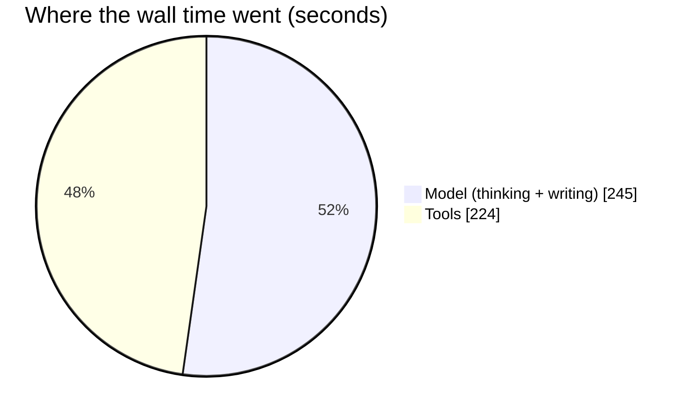

# firm-knowledge/tasks/198 · run2 (`hv-fk250-lunahigh-rep2-20261112T122308Z`)

Result: **all-pass** 4/4 criteria · 7.8 min · 34 model calls · 78 tool calls (2 errors or timeouts) · ending `completed` · started 11-12 19:05:42 IST

## Overview

One box per stretch of steps that used the same kind of tool (blue: looking/searching/reading, purple: writing or editing files, yellow: a message with no tool call, red border: a tool error or timeout inside the box).

```mermaid
flowchart TD
    T(["Task prompt"])
    P0["<b>Step 1</b> · 0.1 min<br/>todo_write"]
    T --> P0
    class P0 look
    P1["<b>Steps 2-4</b> · 0.3 min<br/>glob x9<br/><i>*, **/*credit*, **/*loan* +6</i>"]
    P0 --> P1
    class P1 look
    P2["<b>Step 5</b> · 0.2 min<br/>bash<br/><i>parse-doc docx 'documents/matters/100…</i>"]
    P1 --> P2
    class P2 look
    P3["<b>Step 6</b> · 0.1 min<br/>read<br/><i>fed344896edb-glob-results.txt</i>"]
    P2 --> P3
    class P3 err
    P4["<b>Steps 7-9</b> · 0.4 min<br/>glob x18<br/><i>documents/matters/*/*/*credit*executi…, documents/matters/*/*/*credit*agreeme…, documents/matters/*/*/*term*loan*agre… +15</i>"]
    P3 --> P4
    class P4 look
    P5["<b>Step 10</b> · 2.3 min<br/>bash<br/><i>set -o pipefail out='candidate_source…</i>"]
    P4 --> P5
    class P5 err
    P6["<b>Step 11</b> · 0.1 min<br/>read<br/><i>candidate_sources.txt</i>"]
    P5 --> P6
    class P6 look
    P7["<b>Step 12</b> · 0.1 min<br/>grep<br/><i>candidate_sources.txt</i>"]
    P6 --> P7
    class P7 look
    P8["<b>Steps 13-15</b> · 1.3 min<br/>bash x13<br/><i>parse-doc docx 'documents/matters/100…, parse-doc docx 'documents/matters/101…, parse-doc docx 'documents/matters/102… +3</i>"]
    P7 --> P8
    class P8 look
    P9["<b>Steps 16-19</b> · 1.2 min<br/>grep x14<br/>glob x4<br/><i>1001-00007_spa.txt, 1001-00007_credit.txt, 1003-00003_credit.txt +11</i>"]
    P8 --> P9
    class P9 look
    P10["<b>Steps 20-23</b> · 0.3 min<br/>read x4<br/><i>1003-00003_credit.txt, 1041-00003_credit.txt, 1005-00001_credit.txt</i>"]
    P9 --> P10
    class P10 look
    P11["<b>Step 24</b> · 0.2 min<br/>todo_write"]
    P10 --> P11
    class P11 look
    P12["<b>Step 25</b> · 0.2 min<br/>grep<br/><i>1041-00003_credit.txt</i>"]
    P11 --> P12
    class P12 look
    P13["<b>Step 26</b> · 0.1 min<br/>read<br/><i>1041-00003_credit.txt</i>"]
    P12 --> P13
    class P13 look
    P14["<b>Step 27</b> · 0.1 min<br/>grep<br/><i>1003-00003_credit.txt</i>"]
    P13 --> P14
    class P14 look
    P15["<b>Step 28</b> · 0.0 min<br/>read<br/><i>1003-00003_credit.txt</i>"]
    P14 --> P15
    class P15 look
    P16["<b>Step 29</b> · 0.1 min<br/>grep<br/><i>1005-00001_credit.txt</i>"]
    P15 --> P16
    class P16 look
    P17["<b>Steps 30-32</b> · 0.8 min<br/>read x2<br/>write<br/><i>1005-00001_credit.txt, response.md</i>"]
    P16 --> P17
    class P17 write
    P18["<b>Step 33</b> · 0.1 min<br/>todo_write"]
    P17 --> P18
    class P18 look
    P19["<b>Step 34</b> · 0.1 min<br/>final message"]
    P18 --> P19
    class P19 ans
    R(["ALL PASS: 4/4 criteria"])
    P19 --> R
    class R pass
    classDef look fill:#e8f0fe,stroke:#4a6fa5,color:#111
    classDef write fill:#f3e8fd,stroke:#7b1fa2,color:#111
    classDef ans fill:#fff8e1,stroke:#b58900,color:#111
    classDef err fill:#e8f0fe,stroke:#c62828,stroke-width:3px,color:#111
    classDef pass fill:#e6f4ea,stroke:#2e7d32,color:#111
    classDef fail fill:#fce8e6,stroke:#c62828,color:#111
```





One row per model call:

| Step | Started (IST) | Model s | Tools s | Tool calls | Tools | Output chars |
|---|---|---|---|---|---|---|
| 1 | 19:05:42 | 4 | 0 | 1 | todo_write | 57 |
| 2 | 19:05:46 | 1 | 1 | 1 | glob | 8,520 |
| 3 | 19:05:48 | 3 | 4 | 4 | glob x4 | 26,127 |
| 4 | 19:05:56 | 6 | 2 | 4 | glob x4 | 24,710 |
| 5 | 19:06:04 | 7 | 2 | 1 | bash | 6,517 |
| 6 | 19:06:13 | 3 | 0 | 1 | read ⚠ | 66 |
| 7 | 19:06:16 | 3 | 2 | 4 | glob x4 | 5,554 |
| 8 | 19:06:22 | 6 | 5 | 8 | glob x8 | 1,537 |
| 9 | 19:06:32 | 3 | 3 | 6 | glob x6 | 19,512 |
| 10 | 19:06:38 | 16 | 121 | 1 | bash ⚠ | 55 |
| 11 | 19:08:55 | 5 | 0 | 1 | read | 36,747 |
| 12 | 19:09:00 | 3 | 1 | 1 | grep | 7,217 |
| 13 | 19:09:04 | 8 | 17 | 6 | bash x6 | 108,441 |
| 14 | 19:09:29 | 6 | 16 | 6 | bash x6 | 103,302 |
| 15 | 19:09:50 | 7 | 23 | 1 | bash | 975 |
| 16 | 19:10:20 | 6 | 7 | 5 | grep x5 | 249,981 |
| 17 | 19:10:33 | 21 | 9 | 6 | grep x6 | 299,977 |
| 18 | 19:11:03 | 16 | 4 | 3 | grep x3 | 149,987 |
| 19 | 19:11:23 | 6 | 5 | 4 | glob x4 | 1,306 |
| 20 | 19:11:34 | 12 | 0 | 1 | read | 2,499 |
| 21 | 19:11:46 | 3 | 0 | 1 | read | 6,009 |
| 22 | 19:11:49 | 3 | 0 | 1 | read | 13,812 |
| 23 | 19:11:52 | 3 | 0 | 1 | read | 8,938 |
| 24 | 19:11:55 | 12 | 0 | 1 | todo_write | 57 |
| 25 | 19:12:07 | 12 | 1 | 1 | grep | 8,470 |
| 26 | 19:12:19 | 4 | 0 | 1 | read | 3,314 |
| 27 | 19:12:23 | 4 | 1 | 1 | grep | 9,779 |
| 28 | 19:12:27 | 3 | 0 | 1 | read | 3,040 |
| 29 | 19:12:30 | 5 | 1 | 1 | grep | 8,065 |
| 30 | 19:12:36 | 2 | 0 | 1 | read | 1,835 |
| 31 | 19:12:38 | 41 | 0 | 1 | write | 205 |
| 32 | 19:13:19 | 3 | 0 | 1 | read | 16,487 |
| 33 | 19:13:23 | 5 | 0 | 1 | todo_write | 57 |
| 34 | 19:13:28 | 3 | 0 | 0 | (message only) | 0 |

## Task prompt

```text
I need a set of comparables for a large financing we're papering. Pull the executed credit agreements from our deals valued over a billion dollars.

Output: write your complete answer to `response.md` — a single self-contained markdown file with your findings, the matters/documents you relied on, and your reasoning.
```

## Rubric

| # | Criterion | Verdict |
|---|---|---|
| C-001 | Qualifying matter — Harrowgate PE 1003-00003 | pass |
| C-002 | Qualifying matter — Nexford Industrial 1005-00001 | pass |
| C-003 | Qualifying matter — Solara Digital 1041-00003 | pass |
| C-004 | Qualifying set — precision | pass |

Judge's reasoning:

**C-001 (pass):** Qualifying matter — Harrowgate PE 1003-00003

```text
The output identifies matter 1003-00003 as a qualifying approximately $1.9 billion deal and expressly names the executed credit agreement file `documents/matters/1003-00003/Financing/credit-agreement-execution.docx`, satisfying the criterion.
```

**C-002 (pass):** Qualifying matter — Nexford Industrial 1005-00001

```text
The output expressly identifies Matter 1005-00001 (Nexford Industrial) as a qualifying $1.4 billion financing and names the executed agreement file: `documents/matters/1005-00001/Transaction Documents/Credit Agreement/credit-agreement-execution-version.docx`.
```

**C-003 (pass):** Qualifying matter — Solara Digital 1041-00003

```text
The output identifies matter 1041-00003 and expressly names the executed agreement file `documents/matters/1041-00003/Financing/credit-agreement-execution-version.docx`, satisfying the criterion despite referring to the matter as Cloudium rather than Solara Digital.
```

**C-004 (pass):** Qualifying set — precision

```text
The output identifies only matters 1003-00003, 1005-00001, and 1041-00003 as qualifying. Other matters are mentioned solely as exclusions, not asserted as qualifying.
```

## Delivered files (output/)

- `response.md` (15,938 bytes)

`response.md`:

```markdown
# Executed Credit-Agreement Comparables for Deals Over $1 Billion

## Executive conclusion

I identified **three executed credit agreements** in matters whose documented transaction/financing value exceeds $1 billion:

1. **Nexford Industrial Holdings Inc. — $1.4 billion senior secured Term Loan B refinancing and dividend recapitalization** (Matter 1005-00001).
2. **VeloPay Systems, Inc. — approximately $1.9 billion acquisition** (Matter 1003-00003), financed with a $500 million term loan and $260 million revolving facility.
3. **Cloudium Technologies plc — approximately $6.8 billion acquisition** (Matter 1041-00003), financed with a $3.74 billion Term Loan B and $500 million revolving facility.

For screening purposes, I treated a matter as qualifying where either the transaction consideration was documented above $1 billion or, for a standalone financing matter, the financing itself exceeded $1 billion. The Nexford matter qualifies on the latter basis; its governing credit agreement is a $1.4 billion financing rather than an acquisition agreement with a separate purchase price.

## Comparable terms at a glance

| Matter / transaction | Executed credit agreement | Documented value | Facility size and structure | Closing / maturity | Pricing and principal features |
|---|---|---:|---|---|---|
| **1005-00001 — Nexford Industrial Holdings Inc.** | Credit Agreement dated March 28, 2025 | **$1.4 billion financing**; refinancing and dividend recapitalization | **$1.4B senior secured first-lien Term Loan B**; single draw; no new revolving facility in the agreement (the existing $190M revolver was terminated) | Closing: **March 28, 2025**; maturity: **March 28, 2032** | Term SOFR margin **4.00%**; **0.75% SOFR floor**; 99.50 issue price / **1.00% OID**; 1.00% six-month repricing soft call; $3.5M quarterly amortization; springing 5.00x first-lien net leverage test only if an incremental revolver is drawn above its trigger |
| **1003-00003 — VeloPay Systems, Inc.** | Senior Secured Credit Agreement dated July 22, 2025 | **Approximately $1.9B aggregate merger consideration** | **$500M senior secured term loan** plus **$260M senior secured revolving facility**; $254.7M initial revolver draw at closing; $50M swingline sublimit and letters-of-credit capacity under the revolver | Closing: **July 22, 2025**; term maturity: **July 22, 2032**; revolver maturity: **July 22, 2030** | Term SOFR margin **3.75%** (base rate margin 2.75%); revolver SOFR grid **2.75%–3.25%** based on leverage; $1.25M quarterly term amortization (0.25% of original principal); total net leverage covenant steps from **6.50x** through Q4 2025 to **5.00x** thereafter; minimum interest coverage 2.00x / 2.25x |
| **1041-00003 — Cloudium Technologies plc** | Credit Agreement dated July 9, 2024 | **Approximately $6.8B acquisition consideration** | **$3.74B senior secured Term Loan B** plus **$500M senior secured revolving facility**; $50M swingline sublimit and $75M LC sublimit; no revolver draw at closing | Closing: **July 9, 2024**; term maturity: **July 9, 2031**; revolver maturity: **July 9, 2029** | Term SOFR margin **3.25%**; revolver SOFR margin **2.75%**; 0.375% initial revolver commitment fee stepping down to 0.25% at lower leverage; $9.35M quarterly term amortization (0.25% of original principal); 1.00% six-month repricing soft call; springing 5.00x first-lien net leverage covenant for the revolver only; no maintenance covenant for the Term Loan B |

## Matter-by-matter findings

### 1. Nexford Industrial Holdings Inc. — Matter 1005-00001

**Transaction and value.** The matter-opening memorandum describes a **$1,400,000,000 senior secured Term Loan B refinancing and dividend recapitalization**. The stated uses were approximately: (i) $879.375 million to repay the existing $875 million term loan, including accrued interest and premium; (ii) $335 million dividend recapitalization; (iii) $38.625 million of fees and expenses; and (iv) $147 million of cash to the balance sheet.

**Executed agreement.** The execution-version Credit Agreement is dated March 28, 2025, and is among Nexford Industrial Holdings Inc. as Borrower, Granite Peak NIH Holdings LLC as Holdings, the guarantors and lenders, and Crescent Harbor Bank, N.A. as Administrative Agent and Collateral Agent. The agreement provides a **single $1.4 billion Term Loan B draw** at closing. It is issued at 99.50% of par, producing $7 million of original issue discount.

**Terms useful for comparison.**

- **Tenor/amortization:** Maturity is March 28, 2032. Scheduled amortization is $3.5 million per quarter, equal to 1.00% per annum of original principal.
- **Pricing:** The applicable Term Loan rate is 4.00%; the agreement also includes a 0.75% SOFR floor and a credit-spread adjustment tied to the SOFR tenor.
- **Repricing protection:** A 1.00% soft-call premium applies to repricing transactions during the first six months.
- **Leverage:** Pro forma first-lien net leverage is approximately 3.38x; pro forma total net leverage, including $250 million of existing senior unsecured notes, is approximately 4.03x. A 5.00x first-lien net leverage covenant is springing only if an incremental revolving facility is drawn above its specified utilization trigger; there is no revolving facility in the agreement at closing.
- **Mandatory prepayments:** Excess-cash-flow sweep of 50% above 4.25x first-lien net leverage, 25% between 3.50x and 4.25x, and 0% at or below 3.50x; asset-sale, debt-issuance, and casualty/condemnation proceeds are also subject to mandatory prepayment, subject to reinvestment exceptions.
- **Collateral/guaranty:** First-priority liens on substantially all assets of the Borrower and guarantors, supported by Holdings and 11 subsidiary guarantors, with customary exclusions and an intercreditor arrangement addressing the existing unsecured notes.

### 2. VeloPay Systems, Inc. — Matter 1003-00003

**Transaction and value.** The executed merger agreement defines aggregate merger consideration of approximately **$1.9 billion**, representing $20.00 per fully diluted share. The executed credit agreement confirms that its proceeds fund part of that merger consideration, refinance approximately $113.23 million of existing debt, pay transaction expenses, and fund general corporate purposes.

**Executed agreement.** The Senior Secured Credit Agreement is dated July 22, 2025, and includes VeloPay Systems, Inc. as Borrower; Tralvendo National Bank as Administrative Agent for the Term Loan Facility and lender; Prairie State Bank, N.A. as Administrative Agent for the Revolving Credit Facility and lender; and Holdings, guarantors and the lender syndicate. The agreement contains executed signature pages and is expressly tied to the July 22, 2025 closing.

**Terms useful for comparison.**

- **Facility structure:** $500 million senior secured term loan funded in one closing-date draw, plus a $260 million revolving facility. The agreement provides for a $254.7 million initial revolving draw, a $50 million swingline sublimit, and the related letter-of-credit mechanics.
- **Tenor/amortization:** Term Loan maturity is July 22, 2032; revolver maturity is July 22, 2030. Term amortization is $1.25 million per quarter, or 0.25% of original principal.
- **Pricing:** Term SOFR margin is 3.75% (base-rate margin 2.75%). Revolver SOFR margins are 3.25% above 4.00x total net leverage, 3.00% between 3.00x and 4.00x, and 2.75% at or below 3.00x; the corresponding base-rate margins are 2.25%, 2.00%, and 1.75%.
- **Financial covenants:** Maximum total net leverage is 6.50x through Q4 2025, 6.00x during 2026, 5.50x during 2027, and 5.00x from Q1 2028 onward. Minimum interest coverage is 2.00x through Q4 2026 and 2.25x thereafter. The agreement also provides an excess-cash-flow sweep of 75% / 50% / 25% / 0% as leverage moves through greater than 5.00x, 4.00x–5.00x, 3.00x–4.00x, and at or below 3.00x, respectively.
- **Permitted acquisitions / incremental debt:** Permitted acquisitions generally require no default, pro forma covenant compliance, and an officer certificate; cash consideration above $50 million requires Required Lender consent. Incremental term loans and revolver increases are available subject to a free-and-clear basket and leverage-based incurrence capacity.
- **Collateral/guaranty:** The agreement grants a security interest in the assets of VeloPay, Holdings and the guarantors and is accompanied by a Guarantee and Collateral Agreement and intercreditor agreement separating the term-loan and revolver agent roles.

### 3. Cloudium Technologies plc — Matter 1041-00003

**Transaction and value.** The matter-opening form describes the Cloudium acquisition as preliminarily valued at $6–7 billion. The executed credit agreement's transaction schedule states **total deal value / acquisition consideration of $6.8 billion**, with $544 million of escrow equal to 8% of that consideration. The agreement also records $2.833 billion of sponsor equity and approximately $616.1 million of management/shareholder rollover equity.

**Executed agreement.** The executed-version Credit Agreement is dated July 9, 2024, and is among Cloudium Technologies plc as Borrower, Meridian Atlantic Bank, N.A. as Administrative Agent, Collateral Agent, Swingline Lender and Issuing Bank, Ironclad Capital Markets LLC as Co-Arranger, and the lender syndicate. It contains signature pages and provides for funding on July 9, 2024.

**Terms useful for comparison.**

- **Facility structure:** $3.74 billion Term Loan B, $500 million revolving facility, $50 million swingline sublimit, and $75 million LC sublimit. The term loan funded in full at closing; the revolving facility was available but undrawn at closing.
- **Tenor/amortization:** Term Loan maturity is July 9, 2031; revolver maturity is July 9, 2029. Term amortization is $9.35 million per quarter, or 0.25% of original term-loan principal, through June 2031.
- **Pricing:** Term SOFR margin is 3.25%; revolv
… [5,869 more chars]
```

## Trajectory

### Step 1: 1 tool call

_Started 11-12 19:05:42 IST · model 4 s · tools 0 s_

**Call `todo_write`** (0.0 s)

```json
{
 "todos": [
  {
   "content": "Inventory available deal documents and identify transactions valued over $1 billion",
   "status": "in_progress"
  },
  {
   "content": "Review candidate matters and locate executed credit agreements",
   "status": "pending"
  },
  {
   "content": "Prepare a self-contained comparables summary with sources and reasoning",
   "status": "pending"
  },
  {
   "content": "Write and verify response.md in the output directory",
   "status": "pending"
  }
 ]
}
```

Output (57 chars):

```text
Updated todo list: 3 pending, 1 in progress, 0 completed.
```

**Todo list now:**

- [~] Inventory available deal documents and identify transactions valued over $1 billion
- [ ] Review candidate matters and locate executed credit agreements
- [ ] Prepare a self-contained comparables summary with sources and reasoning
- [ ] Write and verify response.md in the output directory

### Step 2: 1 tool call

_Started 11-12 19:05:46 IST · model 1 s · tools 1 s_

**Call `glob`** (0.8 s)

```json
{
 "pattern": "*"
}
```

Output (8,520 chars):

```text
documents/matters/1001-00001/Antitrust Analysis/competitor-identification-chart.xlsx
documents/matters/1001-00001/Antitrust Analysis/portfolio-company-overlap-analysis.docx
documents/matters/1001-00001/Antitrust Analysis/hhi-concentration-analysis.xlsx
documents/matters/1001-00001/Antitrust Analysis/market-definition-competitive-analysis-memo.docx
documents/matters/1001-00001/Client Updates/biweekly-status-report-1.docx
documents/matters/1001-00001/Antitrust Analysis/preliminary-antitrust-risk-assessment.docx
documents/matters/1001-00001/Antitrust Analysis/state-regulatory-con-analysis.docx
documents/matters/1001-00001/Antitrust Analysis/vertical-relationships-analysis.docx
documents/matters/1001-00001/Closing/closing-memo-antitrust-workstream.docx
documents/matters/1001-00001/Client Updates/client-update-early-termination-granted.eml
documents/matters/1001-00001/Client Updates/biweekly-status-report-2.docx
documents/matters/1001-00001/Client Updates/client-update-hsr-forms-filed.eml
documents/matters/1001-00001/Closing/final-invoice-matter-closing-letter.docx
documents/matters/1001-00001/Closing/hsr-clearance-certificate.docx
documents/matters/1001-00001/Correspondence/Counterparty Counsel/email-gk-naics-code-consistency.eml
documents/matters/1001-00001/Early Termination/early-termination-request-letter.docx
documents/matters/1001-00001/Correspondence/Counterparty Counsel/letter-bracewell-thornton-regulatory-condition.docx
documents/matters/1001-00001/Correspondence/Counterp
… [7,020 more chars]
```

### Step 3: 4 tool calls

_Started 11-12 19:05:48 IST · model 3 s · tools 4 s_

**Reasoning summary:**

```text
**Searching for credit matters**

I need to identify matters related to valuation and executed credit agreements. To do this, I’ll search for filenames that contain keywords like credit, loan, or financing. It’s also important to check document descriptions as they might contain relevant information. I think using glob patterns could help me efficiently find the files I need. This seems like a solid plan to streamline my search process!
```

**Call `glob`** (0.9 s)

```json
{
 "pattern": "**/*credit*"
}
```

Output (9,714 chars):

```text
documents/matters/1001-00004/Financing/credit-agreement-draft.docx
documents/matters/1001-00004/Financing/intercreditor-agreement.docx
documents/matters/1001-00007/Financing/senior-secured-credit-agreement.docx
documents/matters/1002-00004/Diligence/credit-facility-review-memo.docx
documents/matters/1003-00003/Financing/credit-agreement-execution.docx
documents/matters/1003-00003/Financing/intercreditor-agreement-execution.docx
documents/matters/1003-00005/Debt/Capital Structure/credit-agreement-spin-covenant-analysis.docx
documents/matters/1005-00001/Closing/signature-pages-intercreditor-agreement.docx
documents/matters/1005-00001/Closing/signature-pages-credit-agreement.docx
documents/matters/1005-00001/Diligence/memo-review-existing-credit-agreement.docx
documents/matters/1005-00001/Transaction Documents/Credit Agreement/credit-agreement-execution-version.docx
documents/matters/1005-00001/Transaction Documents/Credit Agreement/credit-agreement-issues-list-v1.xlsx
documents/matters/1005-00001/Transaction Documents/Credit Agreement/credit-agreement-issues-list-v3.xlsx
documents/matters/1005-00001/Transaction Documents/Credit Agreement/credit-agreement-issues-list-v2.xlsx
documents/matters/1005-00001/Transaction Documents/Credit Agreement/credit-agreement-sc-marked-draft-2.docx
documents/matters/1005-00001/Transaction Documents/Credit Agreement/credit-agreement-near-final-draft.docx
documents/matters/1005-00001/Transaction Documents/Credit Agreement/credit-agreement-sc-marked
… [8,214 more chars]
```

**Call `glob`** (0.7 s)

```json
{
 "pattern": "**/*loan*"
}
```

Output (3,604 chars):

```text
documents/matters/1005-00001/Closing/certified-organizational-documents-all-loan-parties.docx
documents/matters/1005-00001/Closing/good-standing-certificates-all-loan-parties.docx
documents/matters/1006-00006/Financing/incremental-term-loan-amendment.docx
documents/matters/1006-00008/Financing/incremental-term-loan-amendment.docx
documents/matters/1010-00001/Engagement/engagement-letter-aht-bridge-loan.docx
documents/matters/1010-00001/Transaction Documents/bridge-loan-agreement-execution.docx
documents/matters/1013-00001/Transaction Documents/bridge-loan-agreement-execution.docx
documents/matters/1021-00001/Transaction Documents/form-of-term-loan-note.docx
documents/matters/1021-00007/Correspondence/email-nakamura-to-yee-loan-doc-markup.eml
documents/matters/1021-00007/Loan Documents/loan-agreement-borrower-markup.docx
documents/matters/1021-00007/Loan Documents/loan-agreement-wbd-initial-draft.docx
documents/matters/1021-00007/Loan Documents/loan-document-issues-memo.docx
documents/matters/1021-00007/Transaction Overview/existing-loan-review-memo.docx
documents/matters/1026-00004/Financing/loan-document-review-memorandum.docx
documents/matters/1027-00004/Financing/loan-term-sheet-review-memo.docx
documents/matters/1031-00004/Transaction Documents/Mezzanine/mezzanine-loan-agreement.docx
documents/matters/1031-00004/Transaction Documents/Mezzanine/mezzanine-loan-agreement-redline-v2.docx
documents/matters/1031-00004/Transaction Documents/Senior Mortgage/building-loan-agreemen
… [2,104 more chars]
```

**Call `glob`** (1.4 s)

```json
{
 "pattern": "**/*financ*"
}
```

Output (3,896 chars):

```text
documents/matters/1001-00007/Financing/financing-fee-letter.docx
documents/matters/1005-00001/Correspondence/email-merritt-to-kaplan-re-financial-covenants.eml
documents/matters/1006-00002/DIP Financing/motion-dip-financing.docx
documents/matters/1011-00002/Court Filings & Demands/dip-financing-limited-objection.docx
documents/matters/1012-00001/UCC/Perfection/ucc-1-financing-statement-delaware-mezzanine.docx
documents/matters/1012-00001/UCC/Perfection/ucc-1-financing-statement-texas-mezzanine.docx
documents/matters/1014-00004/Damages Analysis/lumicore-financial-data-summary.xlsx
documents/matters/1015-00001/Diligence/dd-memo-debt-financing.docx
documents/matters/1015-00001/Diligence/dd-request-list-debt-financing.docx
documents/matters/1015-00001/NYSE & FINRA/finra-corporate-financing-application.docx
documents/matters/1015-00001/Registration Statement/selected-financial-data.docx
documents/matters/1015-00003/Closing/officers-certificate-financial-close.docx
documents/matters/1016-00003/Closing/ucc-1-financing-statements.docx
documents/matters/1017-00009/Diligence/landlord-financial-diligence-memo.docx
documents/matters/1018-00004/Transaction Documents/Investigator Agreements/financial-disclosure-certification-template.docx
documents/matters/1018-00008/Financing/financing-conditions-checklist.xlsx
documents/matters/1018-00008/Transaction Documents/side-letter-financing-cooperation.docx
documents/matters/1018-00009/Appeals/settlement-financial-impact-analysis.xlsx
documents/m
… [2,396 more chars]
```

**Call `glob`** (1.5 s)

```json
{
 "pattern": "**/*agreement*",
 "path": "documents/matters"
}
```

Output (8,913 chars):

```text
documents/matters/1001-00002/Carry & Economics/carried-interest-allocation-agreement.docx
documents/matters/1001-00002/Amended Governing Documents/gp-second-amended-llc-agreement.docx
documents/matters/1001-00002/Amended Governing Documents/manco-second-amended-llc-agreement.docx
documents/matters/1001-00002/Carry & Economics/management-fee-sharing-agreement.docx
documents/matters/1001-00002/Departing Principals/kellner-senior-advisor-agreement.docx
documents/matters/1001-00002/Departing Principals/trask-separation-agreement.docx
documents/matters/1001-00002/Departing Principals/trask-separation-agreement-redline.docx
documents/matters/1001-00002/Departing Principals/kellner-separation-agreement.docx
documents/matters/1001-00002/Entity Formation/gp-intermediate-llc-agreement.docx
documents/matters/1001-00002/Entity Formation/holdco-llc-agreement.docx
documents/matters/1001-00003/Transaction Documents/APA Drafts/asset-purchase-agreement-first-draft.docx
documents/matters/1001-00003/Transaction Documents/Employment/employment-agreement-whitfield-torres.docx
documents/matters/1001-00003/Transaction Documents/APA Drafts/asset-purchase-agreement-redline-seller-markup.docx
documents/matters/1001-00003/Transaction Documents/Employment/employment-agreement-whitfield.docx
documents/matters/1001-00003/Transaction Documents/assignment-and-assumption-agreement.docx
documents/matters/1001-00003/Transaction Documents/asset-purchase-agreement-execution.docx
documents/matters/1001-00003/Tran
… [7,413 more chars]
```

### Step 4: 4 tool calls

_Started 11-12 19:05:56 IST · model 6 s · tools 2 s_

**Call `glob`** (0.6 s)

```json
{
 "pattern": "documents/matters/*/Engagement*/*"
}
```

Output (8,271 chars):

```text
documents/matters/1001-00001/Engagement & Administration/conflicts-check-memorandum.docx
documents/matters/1001-00001/Engagement & Administration/matter-opening-memorandum.docx
documents/matters/1001-00001/Engagement & Administration/engagement-letter-ardent-capital.docx
documents/matters/1001-00002/Engagement & Administration/engagement-letter.docx
documents/matters/1001-00002/Engagement & Administration/matter-closing-memo.docx
documents/matters/1001-00002/Engagement & Administration/conflict-check-memo.docx
documents/matters/1001-00003/Engagement/engagement-letter-ardent-capital.docx
documents/matters/1001-00004/Engagement & Administrative/billing-rate-schedule.xlsx
documents/matters/1001-00004/Engagement & Administrative/conflict-waiver-letter-vectis.docx
documents/matters/1001-00004/Engagement & Administrative/staffing-budget-memorandum.docx
documents/matters/1001-00004/Engagement & Administrative/matter-opening-memorandum.docx
documents/matters/1001-00004/Engagement & Administrative/engagement-letter-ardent-capital.docx
documents/matters/1001-00005/Engagement/engagement-letter-ardent-cp-iii.docx
documents/matters/1001-00006/Engagement & Administrative/conflict-check-memorandum.docx
documents/matters/1001-00006/Engagement & Administrative/staffing-and-budget-memorandum.docx
documents/matters/1001-00006/Engagement & Administrative/engagement-letter.docx
documents/matters/1001-00006/Engagement & Administrative/engagement-close-out-memorandum.docx
documents/matters/1002-000
… [6,771 more chars]
```

**Call `glob`** (0.5 s)

```json
{
 "pattern": "documents/matters/*/*matter*"
}
```

Output (14 chars):

```text
No files found
```

**Call `glob`** (0.6 s)

```json
{
 "pattern": "documents/matters/*/*/*closing*"
}
```

Output (7,415 chars):

```text
documents/matters/1001-00001/Closing/closing-memo-antitrust-workstream.docx
documents/matters/1001-00001/Closing/final-invoice-matter-closing-letter.docx
documents/matters/1001-00002/Closing/closing-certificate-gp.docx
documents/matters/1001-00002/Closing/closing-checklist.xlsx
documents/matters/1001-00002/Engagement & Administration/matter-closing-memo.docx
documents/matters/1001-00003/Closing/buyer-closing-certificate.docx
documents/matters/1001-00003/Closing/closing-statement.xlsx
documents/matters/1001-00003/Closing/closing-checklist.xlsx
documents/matters/1001-00003/Closing/seller-closing-certificate.docx
documents/matters/1001-00003/Correspondence/post-closing-letter-to-client.docx
documents/matters/1001-00003/Correspondence/pre-closing-deficiency-letter.eml
documents/matters/1001-00004/Closing/closing-checklist-master.xlsx
documents/matters/1001-00006/Closing/closing-tax-memorandum.docx
documents/matters/1001-00006/Closing/tax-closing-certificate.docx
documents/matters/1001-00006/Post-Closing/post-closing-tax-integration-memorandum.docx
documents/matters/1001-00007/Closing/closing-certificate-buyer.docx
documents/matters/1001-00007/Closing/closing-certificate-sellers.docx
documents/matters/1001-00007/Closing/closing-checklist.xlsx
documents/matters/1001-00007/Closing/closing-funds-flow-memorandum.xlsx
documents/matters/1001-00007/Transaction Documents/post-closing-employment-agreements.docx
documents/matters/1002-00001/Closing/closing-checklist.xlsx
documents/matters/1
… [5,915 more chars]
```

**Call `glob`** (0.6 s)

```json
{
 "pattern": "documents/matters/*/*/*execution*"
}
```

Output (9,010 chars):

```text
documents/matters/1001-00003/Transaction Documents/asset-purchase-agreement-execution.docx
documents/matters/1001-00005/Transaction Documents/merger-agreement-execution-version.docx
documents/matters/1001-00006/Purchase Price Allocation & TRA/tax-receivable-agreement-execution.docx
documents/matters/1001-00007/Transaction Documents/stock-purchase-agreement-execution.docx
documents/matters/1003-00003/Financing/credit-agreement-execution.docx
documents/matters/1003-00003/Financing/debt-commitment-letter-execution.docx
documents/matters/1003-00003/Financing/guarantee-collateral-agreement-execution.docx
documents/matters/1003-00003/Financing/fee-letter-execution.docx
documents/matters/1003-00003/Financing/intercreditor-agreement-execution.docx
documents/matters/1003-00003/Transaction Documents/equity-commitment-letter-execution.docx
documents/matters/1003-00003/Transaction Documents/escrow-agreement-execution.docx
documents/matters/1003-00003/Transaction Documents/limited-guarantee-execution.docx
documents/matters/1003-00003/Transaction Documents/stockholder-representative-agreement-execution.docx
documents/matters/1003-00003/Transaction Documents/paying-agent-agreement-execution.docx
documents/matters/1003-00003/Transaction Documents/stockholder-support-agreement-execution.docx
documents/matters/1003-00003/Transaction Documents/rollover-agreement-execution.docx
documents/matters/1003-00004/Transaction Documents/merger-agreement-execution.docx
documents/matters/1004-00001/Transac
… [7,510 more chars]
```

### Step 5: 1 tool call

_Started 11-12 19:06:04 IST · model 7 s · tools 2 s_

**Reasoning summary:**

```text
**Exploring file parsing options**

I’m considering running a bash loop over all .docx files with the `parse-doc` command to extract their contents. It might be around 9,000 files, which seems a bit much but doable. I need to look into how to use `parse-doc` correctly with a command like `parse-doc docx file`. Maybe I could use bash to run it with `... | head` to limit the output. I should consider whether I need to install anything first. Let’s test it on a candidate file!
```

**Call `bash`** (2.4 s)

```json
{
 "command": "parse-doc docx 'documents/matters/1005-00001/Engagement & Administrative/new-matter-memorandum.docx' | head -80",
 "description": "Inspect a candidate matter memorandum",
 "timeoutMs": 120000
}
```

Output (6,517 chars):

```text
**CALDERWOOD & HARKNESS LLP**

**INTERNAL MEMORANDUM --- CONFIDENTIAL**

**To:** File --- Matter No. 1005-00001

**From:** Claudia Merritt, Responsible Partner, Banking & Finance

**Date:** February 3, 2025

**Re:** New Matter Opening --- Nexford Industrial Holdings Inc. --- \$1,400,000,000 Senior Secured Term Loan B Refinancing and Dividend Recapitalization

This memorandum is prepared for the internal files of Calderwood & Harkness LLP in connection with the opening of Matter No. 1005-00001 and is intended to serve as the definitive reference document for all attorneys and professional staff assigned to this engagement. The information set forth herein is based on materials provided by the client, the private equity sponsor, and the lead arranger, as well as publicly available information and internal firm records. This memorandum is privileged and confidential, prepared in the course of and in furtherance of the attorney-client relationship with Nexford Industrial Holdings Inc., and is intended solely for internal Calderwood & Harkness LLP use. It should not be distributed to any person or entity outside the firm without the prior written consent of the Responsible Partner.

**[1. Matter Information]{.underline}**

The following information summarizes the key identifying data for this matter as entered into the firm\'s matter management and billing systems:

**Matter Number:** 1005-00001

**Billing Partner Client/Matter Code:** IBL-NIH-2025-031

**Date Opened:** February 3
… [5,016 more chars]
```

### Step 6: 1 tool call

_Started 11-12 19:06:13 IST · model 3 s · tools 0 s_

**Call `read`** (0.0 s · **error/timeout**)

```json
{
 "file_path": "/tmp/dsh-spill-y2SJ7P/session-4dc9def2646a/fed344896edb-glob-results.txt",
 "offset": 1,
 "limit": 250
}
```

Output (66 chars):

```text
Error: [sandbox: file access denied under workspace-isolated mode]
```

### Step 7: 4 tool calls

_Started 11-12 19:06:16 IST · model 3 s · tools 2 s_

**Reasoning summary:**

```text
**Gathering document categories**

I’m thinking about how to gather candidate documents by using specific categories. For executed credit agreements, I might use a glob pattern like `documents/matters/*/*/*credit*execution*`. This should help filter through the files more effectively. It’s interesting how these patterns can streamline the search process, simplifying what could be a complex task. I just want to make sure I’m covering all the necessary details!
```

**Call `glob`** (0.6 s)

```json
{
 "pattern": "documents/matters/*/*/*credit*execution*"
}
```

Output (1,117 chars):

```text
documents/matters/1003-00003/Financing/credit-agreement-execution.docx
documents/matters/1003-00003/Financing/intercreditor-agreement-execution.docx
documents/matters/1006-00001/Transaction Documents/mezzanine-credit-agreement-execution.docx
documents/matters/1008-00001/Transaction Documents/credit-agreement-execution.docx
documents/matters/1012-00001/Transaction Documents/amendment-no-3-senior-credit-agreement-execution.docx
documents/matters/1012-00001/Transaction Documents/mezzanine-credit-agreement-execution.docx
documents/matters/1012-00001/Transaction Documents/intercreditor-agreement-execution.docx
documents/matters/1013-00001/Transaction Documents/intercreditor-agreement-execution.docx
documents/matters/1015-00005/Transaction Documents/tax-credit-purchase-agreement-execution.docx
documents/matters/1038-00002/documents/credit-agreement-execution-version.docx
documents/matters/1041-00003/Financing/credit-agreement-execution-version.docx
documents/matters/1041-00003/Financing/intercreditor-agreement-execution.docx
documents/matters/1043-00001/Transaction Documents/credit-agreement-execution.docx
```

**Call `glob`** (0.6 s)

```json
{
 "pattern": "documents/matters/*/*/*credit*agreement*"
}
```

Output (4,012 chars):

```text
documents/matters/1001-00004/Financing/credit-agreement-draft.docx
documents/matters/1001-00004/Financing/intercreditor-agreement.docx
documents/matters/1001-00007/Financing/senior-secured-credit-agreement.docx
documents/matters/1003-00003/Financing/credit-agreement-execution.docx
documents/matters/1003-00003/Financing/intercreditor-agreement-execution.docx
documents/matters/1005-00001/Closing/signature-pages-intercreditor-agreement.docx
documents/matters/1005-00001/Closing/signature-pages-credit-agreement.docx
documents/matters/1005-00001/Diligence/memo-review-existing-credit-agreement.docx
documents/matters/1006-00001/Transaction Documents/intercreditor-agreement.docx
documents/matters/1006-00001/Transaction Documents/mezzanine-credit-agreement-execution.docx
documents/matters/1006-00002/Post-Confirmation/new-first-lien-take-back-credit-agreement.docx
documents/matters/1007-00001/Transaction Documents/credit-agreement-draft.docx
documents/matters/1007-00001/Transaction Documents/credit-agreement-redline.docx
documents/matters/1007-00001/Transaction Documents/intercreditor-agreement.docx
documents/matters/1008-00001/Transaction Documents/credit-agreement-execution.docx
documents/matters/1010-00002/Credit Facility/credit-agreement-amendment-memo.docx
documents/matters/1010-00002/Credit Facility/first-amendment-credit-agreement.docx
documents/matters/1012-00001/Correspondence/letter-borrower-comments-mezzanine-credit-agreement.docx
documents/matters/1012-00001/Transaction Docu
… [2,512 more chars]
```

**Call `glob`** (0.6 s)

```json
{
 "pattern": "documents/matters/*/*/*term*loan*agreement*"
}
```

Output (164 chars):

```text
documents/matters/1038-00009/Financing/term-loan-b-credit-agreement-draft.docx
documents/matters/1042-00001/Transaction Documents/term-loan-agreement-execution.docx
```

**Call `glob`** (0.5 s)

```json
{
 "pattern": "documents/matters/*/*/*loan*agreement*execution*"
}
```

Output (261 chars):

```text
documents/matters/1010-00001/Transaction Documents/bridge-loan-agreement-execution.docx
documents/matters/1013-00001/Transaction Documents/bridge-loan-agreement-execution.docx
documents/matters/1042-00001/Transaction Documents/term-loan-agreement-execution.docx
```

### Step 8: 8 tool calls

_Started 11-12 19:06:22 IST · model 6 s · tools 5 s_

**Call `glob`** (0.7 s)

```json
{
 "pattern": "documents/matters/1003-00003/Engagement/*"
}
```

Output (74 chars):

```text
documents/matters/1003-00003/Engagement/engagement-letter-hpe-fund-iv.docx
```

**Call `glob`** (0.6 s)

```json
{
 "pattern": "documents/matters/1005-00001/Engagement & Administrative/*"
}
```

Output (772 chars):

```text
documents/matters/1005-00001/Engagement & Administrative/conflict-check-memorandum.docx
documents/matters/1005-00001/Engagement & Administrative/engagement-letter-briarcliff-de-local-counsel.docx
documents/matters/1005-00001/Engagement & Administrative/outside-counsel-guidelines-acknowledgment.docx
documents/matters/1005-00001/Engagement & Administrative/new-matter-memorandum.docx
documents/matters/1005-00001/Engagement & Administrative/staffing-memorandum.docx
documents/matters/1005-00001/Engagement & Administrative/internal-budget-estimate-memorandum.docx
documents/matters/1005-00001/Engagement & Administrative/engagement-letter-hargrove-whitmore-il-local-counsel.docx
documents/matters/1005-00001/Engagement & Administrative/engagement-letter-sc-to-nexford.docx
```

**Call `glob`** (0.4 s)

```json
{
 "pattern": "documents/matters/1006-00001/Engagement/*"
}
```

Output (72 chars):

```text
documents/matters/1006-00001/Engagement/engagement-letter-crestline.docx
```

**Call `glob`** (0.6 s)

```json
{
 "pattern": "documents/matters/1008-00001/Engagement*/*"
}
```

Output (14 chars):

```text
No files found
```

**Call `glob`** (0.5 s)

```json
{
 "pattern": "documents/matters/1012-00001/Engagement*/*"
}
```

Output (14 chars):

```text
No files found
```

**Call `glob`** (0.6 s)

```json
{
 "pattern": "documents/matters/1013-00001/Engagement*/*"
}
```

Output (14 chars):

```text
No files found
```

**Call `glob`** (0.5 s)

```json
{
 "pattern": "documents/matters/1019-00002/Engagement*/*"
}
```

Output (62 chars):

```text
documents/matters/1019-00002/Engagement/engagement-letter.docx
```

**Call `glob`** (0.5 s)

```json
{
 "pattern": "documents/matters/1021-00001/Engagement*/*"
}
```

Output (515 chars):

```text
documents/matters/1021-00001/Engagement & Preliminary/conflict-check-memo.docx
documents/matters/1021-00001/Engagement & Preliminary/existing-tlb-provisions-analysis.docx
documents/matters/1021-00001/Engagement & Preliminary/engagement-letter-vhg.docx
documents/matters/1021-00001/Engagement & Preliminary/tax-considerations-memo.docx
documents/matters/1021-00001/Engagement & Preliminary/preliminary-assessment-memo.docx
documents/matters/1021-00001/Engagement & Preliminary/existing-credit-facilities-summary.docx
```

### Step 9: 6 tool calls

_Started 11-12 19:06:32 IST · model 3 s · tools 3 s_

**Call `glob`** (0.4 s)

```json
{
 "pattern": "documents/matters/1012-00001/*/*"
}
```

Output (2,625 chars):

```text
documents/matters/1012-00001/Closing/borrowing-request-funding-notice.docx
documents/matters/1012-00001/Closing/secretarys-certificate-subsidiary-guarantors.docx
documents/matters/1012-00001/Closing/solvency-certificate.docx
documents/matters/1012-00001/Closing/initial-compliance-certificate.docx
documents/matters/1012-00001/Closing/secretarys-certificate-stonefield.docx
documents/matters/1012-00001/Closing/officers-certificate-closing-conditions.docx
documents/matters/1012-00001/Closing/closing-checklist.xlsx
documents/matters/1012-00001/Closing/closing-funds-flow-memorandum.xlsx
documents/matters/1012-00001/Correspondence/email-intercreditor-standstill-negotiation-update.eml
documents/matters/1012-00001/Correspondence/engagement-letter.docx
documents/matters/1012-00001/Correspondence/pre-closing-letter-ridgeline.docx
documents/matters/1012-00001/Correspondence/letter-borrower-comments-mezzanine-credit-agreement.docx
documents/matters/1012-00001/Correspondence/post-closing-letter-to-client.docx
documents/matters/1012-00001/Correspondence/letter-intercreditor-redline-commentary.docx
documents/matters/1012-00001/Correspondence/email-term-sheet-markup-commentary.eml
documents/matters/1012-00001/Memoranda/change-of-control-provisions-analysis.docx
documents/matters/1012-00001/Opinions/borrowers-counsel-opinion-letter.docx
documents/matters/1012-00001/Memoranda/intercreditor-issues-memorandum.docx
documents/matters/1012-00001/Memoranda/tax-structuring-memorandum.docx
documents/ma
… [1,125 more chars]
```

**Call `glob`** (0.6 s)

```json
{
 "pattern": "documents/matters/1013-00001/*/*"
}
```

Output (931 chars):

```text
documents/matters/1013-00001/Closing/borrowers-counsel-legal-opinion.docx
documents/matters/1013-00001/Transaction Documents/bridge-loan-agreement-execution.docx
documents/matters/1013-00001/Closing/closing-checklist.xlsx
documents/matters/1013-00001/Closing/funds-flow-memorandum.xlsx
documents/matters/1013-00001/Closing/officers-certificate.docx
documents/matters/1013-00001/Correspondence/closing-letter-to-client.docx
documents/matters/1013-00001/Diligence/internal-memo-deal-summary-key-issues.docx
documents/matters/1013-00001/Transaction Documents/security-agreement-execution.docx
documents/matters/1013-00001/Transaction Documents/warrant-agreement-cobalt.docx
documents/matters/1013-00001/Transaction Documents/warrant-agreement-pinnacle.docx
documents/matters/1013-00001/Transaction Documents/ip-security-agreement-execution.docx
documents/matters/1013-00001/Transaction Documents/intercreditor-agreement-execution.docx
```

**Call `glob`** (0.5 s)

```json
{
 "pattern": "documents/matters/1008-00001/*/*"
}
```

Output (906 chars):

```text
documents/matters/1008-00001/Closing/borrowers-counsel-legal-opinion.docx
documents/matters/1008-00001/Administrative/engagement-letter.docx
documents/matters/1008-00001/Transaction Documents/credit-agreement-execution.docx
documents/matters/1008-00001/Closing/closing-checklist.xlsx
documents/matters/1008-00001/Closing/post-closing-letter.docx
documents/matters/1008-00001/Closing/officers-closing-certificate.docx
documents/matters/1008-00001/Firm Memos/deal-summary-memorandum.docx
documents/matters/1008-00001/Transaction Documents/perfection-certificate.docx
documents/matters/1008-00001/Transaction Documents/form-of-compliance-certificate.docx
documents/matters/1008-00001/Transaction Documents/form-of-borrowing-request.docx
documents/matters/1008-00001/Transaction Documents/security-agreement-execution.docx
documents/matters/1008-00001/Transaction Documents/ip-security-agreement-execution.docx
```

**Call `glob`** (0.5 s)

```json
{
 "pattern": "documents/matters/1038-00002/*/*"
}
```

Output (2,486 chars):

```text
documents/matters/1038-00002/documents/abl-negotiation-issues-memo.docx
documents/matters/1038-00002/documents/compliance-certificate-form.docx
documents/matters/1038-00002/documents/credit-agreement-execution-version.docx
documents/matters/1038-00002/documents/collateral-perfection-memo.docx
documents/matters/1038-00002/documents/borrowers-counsel-legal-opinion.docx
documents/matters/1038-00002/documents/closing-checklist.xlsx
documents/matters/1038-00002/documents/closing-memorandum.docx
documents/matters/1038-00002/documents/borrowing-base-certificate-closing.xlsx
documents/matters/1038-00002/documents/credit-agreement-second-draft-redline.docx
documents/matters/1038-00002/documents/daca-meridian-trust.docx
documents/matters/1038-00002/documents/credit-agreement-initial-draft.docx
documents/matters/1038-00002/documents/daca-chb-concentration.docx
documents/matters/1038-00002/documents/daca-chb-operating.docx
documents/matters/1038-00002/documents/daca-ncb.docx
documents/matters/1038-00002/documents/email-closing-confirmation.eml
documents/matters/1038-00002/documents/guaranty-agreement.docx
documents/matters/1038-00002/documents/engagement-letter.docx
documents/matters/1038-00002/documents/perfection-certificate.docx
documents/matters/1038-00002/documents/payoff-letter-harborview.docx
documents/matters/1038-00002/documents/email-execution-version-circulation.eml
documents/matters/1038-00002/documents/email-initial-draft-comments.eml
documents/matters/1038-00002/documents/e
… [986 more chars]
```

**Call `glob`** (0.6 s)

```json
{
 "pattern": "documents/matters/1041-00003/*/*"
}
```

Output (8,236 chars):

```text
documents/matters/1041-00003/Antitrust & Regulatory/cma-information-request-response.docx
documents/matters/1041-00003/Antitrust & Regulatory/hsr-notification-form-draft.docx
documents/matters/1041-00003/Antitrust & Regulatory/cma-phase-1-clearance-summary.docx
documents/matters/1041-00003/Antitrust & Regulatory/hsr-expiration-confirmation-letter.docx
documents/matters/1041-00003/Antitrust & Regulatory/cma-merger-notice-final.docx
documents/matters/1041-00003/Antitrust & Regulatory/cma-merger-notice-draft.docx
documents/matters/1041-00003/Antitrust & Regulatory/letter-ftc-voluntary-market-data.docx
documents/matters/1041-00003/Antitrust & Regulatory/hsr-filing-final-submission.docx
documents/matters/1041-00003/Antitrust & Regulatory/hsr-pre-filing-memorandum.docx
documents/matters/1041-00003/Antitrust & Regulatory/memo-fsr-analysis.docx
documents/matters/1041-00003/Antitrust & Regulatory/memo-german-fdi-screening.docx
documents/matters/1041-00003/Antitrust & Regulatory/memo-eu-merger-regulation-analysis.docx
documents/matters/1041-00003/Antitrust & Regulatory/regulatory-conditions-tracker.xlsx
documents/matters/1041-00003/Antitrust & Regulatory/memo-indian-fdi-cci-analysis.docx
documents/matters/1041-00003/Antitrust & Regulatory/memo-cfius-assessment.docx
documents/matters/1041-00003/Closing/appraisal-rights-notice.docx
documents/matters/1041-00003/Closing/letter-of-transmittal-final.docx
documents/matters/1041-00003/Closing/certificate-of-merger-execution.docx
documents/matt
… [6,736 more chars]
```

**Call `glob`** (0.6 s)

```json
{
 "pattern": "documents/matters/1043-00001/*/*"
}
```

Output (4,328 chars):

```text
documents/matters/1043-00001/Closing/closing-agenda.docx
documents/matters/1043-00001/Administrative/internal-staffing-budget-memo.docx
documents/matters/1043-00001/Closing/escrow-agreement-virginia.docx
documents/matters/1043-00001/Closing/greystone-payoff-letter.docx
documents/matters/1043-00001/Closing/closing-memorandum.docx
documents/matters/1043-00001/Closing/funds-flow-memorandum.xlsx
documents/matters/1043-00001/Closing/greystone-lien-release.docx
documents/matters/1043-00001/Closing/escrow-agreement-frankfurt.docx
documents/matters/1043-00001/Closing/officers-closing-certificate.docx
documents/matters/1043-00001/Closing/solvency-certificate.docx
documents/matters/1043-00001/Closing/signature-pages-compilation.docx
documents/matters/1043-00001/Closing/post-closing-letter.docx
documents/matters/1043-00001/Correspondence/client-alert-tlb-market-update.docx
documents/matters/1043-00001/Correspondence/email-sanctions-screening-status.eml
documents/matters/1043-00001/Correspondence/engagement-letter.docx
documents/matters/1043-00001/Correspondence/letter-lien-search-results.docx
documents/matters/1043-00001/Correspondence/email-closing-conditions-update.eml
documents/matters/1043-00001/Correspondence/email-german-security-coordination.eml
documents/matters/1043-00001/Correspondence/letter-cim-transmittal-negative-assurance.docx
documents/matters/1043-00001/Correspondence/issues-list-negotiation-memo.docx
documents/matters/1043-00001/Correspondence/markup-transmittal-letter
… [2,828 more chars]
```

### Step 10: 1 tool call

_Started 11-12 19:06:38 IST · model 16 s · tools 121 s_

**Reasoning summary:**

```text
**Searching for large deals**

I need to handle numerous large deals from 1001 to 1044. The plan involves efficiently searching through engagement documents for candidate credit agreement matters. I can look for "billion" in all .docx files using Bash. The task focuses on executed credit agreements linked to deals over a billion, so I don’t need to list all deals, just extract comparables. I’m considering using Python to batch parse documents with filenames indicating credit agreements and relevant metadata. I can utilize various terms to narrow down the search and construct lists using shell globbing.

**Using glob patterns for file discovery**

The developer mentioned to use glob patterns instead of find to discover files, which is interesting. I found some patterns for known roots, like `for f in documents/matters/*/Engagement*/*.docx`, focusing on a glob-based approach. But there could be issues with names that have spaces. I can use a Bash command to parse and output a temporary combined file, then utilize the grep tool to search file contents. Maybe I'll write the temp file to my workspace and loop through with `parse-doc`, outputting to `workspace/parsed_candidates.txt`. I need to ensure I avoid inspecting task.json.

**Defining candidate document patterns**

I’m considering which candidate documents to include based on specific patterns. I can use paths like `documents/matters/*/Engagement*/*.docx` for one depth, plus paths for Administrative and specific Correspondence files. I need to look for anything that starts with `deal-summary*`, `matter-opening*`, `new-matter*`, `transaction-overview*`, `closing-memorandum*`, `closing-memo*`, `preliminary-assessment*`, and `existing-credit-facilities-summary*`. I'll rely on shell globs to navigate these specific patterns, turning off bash globstar and focusing on explicit matches.

**Parsing files in Bash**

I’m thinking about using a Bash loop to go through all `documents/matters/*` and parse files that match each matter. There are 1044 files, but it seems there are only about 100 matter roots to consider. I can pull candidate matter IDs from a credit docs list using a glob pattern, like 1001 and 1003. Then, I’ll parse the metadata for these candidate IDs. First, I'll focus on executed credit docs and their corresponding engagement or deal summaries to see the names and values. I plan to build `candidate_sources.md` using `printf` headers.
```

**Call `bash`** (120.6 s · **error/timeout**)

```json
{
 "command": "set -o pipefail\nout='candidate_sources.txt'\n: > \"$out\"\nshopt -s globstar nullglob\n# Parse all documents whose names indicate an executed or final credit/loan agreement.\nfiles=(documents/matters/**/*credit*agreement*.docx documents/matters/**/*loan*agreement*execution*.docx documents/matters/**/*term*loan*agreement*execution*.docx)\nfor f in \"${files[@]}\"; do\n  printf '\\n===== SOURCE: %s =====\\n' \"$f\" >> \"$out\"\n  parse-doc docx \"$f\" >> \"$out\" 2>/dev/null || printf '[parse failed]\\n' >> \"$out\"\ndone\n# Parse matter-opening/deal-summary/engagement materials for matters represented in the agreement set.\nfor id in 1001-00004 1001-00007 1003-00003 1005-00001 1006-00001 1006-00002 1008-00001 1010-00001 1010-00002 1012-00001 1012-00002 1013-00001 1019-00002 1021-00001 1038-00002 1041-00003 1042-00001 1043-00001 1044-00003; do\n  meta=(documents/matters/$id/**/*matter-opening*.docx documents/matters/$id/**/*new-matter*.docx documents/matters/$id/**/*deal-summary*.docx documents/matters/$id/**/*transaction-overview*.docx documents/matters/$id/**/*engagement-letter*.docx documents/matters/$id/**/*existing-credit-facilities-summary*.docx documents/matter
… [462 more chars]
```

Output (55 chars):

```text
(no output)
[timed out after 120000ms]
[exit code: 143]
```

### Step 11: 1 tool call

_Started 11-12 19:08:55 IST · model 5 s · tools 0 s_

**Call `read`** (0.1 s)

```json
{
 "file_path": "candidate_sources.txt",
 "offset": 1,
 "limit": 200
}
```

Output (36,747 chars):

```text
<path>/home/agarwaldi/dsh-bench-harness/runs/hv-fk250-lunahigh-rep2-20261112T122308Z/tasks/firm-knowledge__tasks__198/workspace/candidate_sources.txt</path>
<type>file</type>
<content>
1: 
2: ===== SOURCE: documents/matters/1001-00004/Financing/credit-agreement-draft.docx =====
3: **CREDIT AGREEMENT**
4: 
5: dated as of
6: 
7: \[●\], 2025
8: 
9: among
10: 
11: **LUMINEX SYSTEMS HOLDINGS INC.**, a Delaware corporation, as Borrower,
12: 
13: **ARDENT APEX HOLDINGS INC.**, a Delaware corporation, as Holdings,
14: 
15: **THE LENDERS FROM TIME TO TIME PARTY HERETO**,
16: 
17: and
18: 
19: **STONEBRIDGE CREDIT PARTNERS LLC**, as Administrative Agent and Collateral Agent
20: 
21: \_\_\_\_\_\_\_\_\_\_\_\_\_\_\_\_\_\_\_\_\_\_\_\_\_\_\_\_\_\_\_\_\_\_\_\_\_\_\_\_
22: 
23: **\$1,400,000,000 SENIOR SECURED CREDIT FACILITY**
24: 
25: consisting of
26: 
27: **\$1,200,000,000 Term Loan B Facility**
28: 
29: and
30: 
31: **\$200,000,000 Revolving Credit Facility**
32: 
33: \_\_\_\_\_\_\_\_\_\_\_\_\_\_\_\_\_\_\_\_\_\_\_\_\_\_\_\_\_\_\_\_\_\_\_\_\_\_\_\_
34: 
35: Reference: Commitment Letter Ref. SC-2025-0312-AC dated March 8, 2025
36: 
37: DRAFT --- FOR DISCUSSION PURPOSES ONLY --- SUBJECT TO REVISION. This document is a draft and has been prepared for discussion purposes only. It does not constitute a commitment or an offer to provide financing on the terms described herein or on any other terms. This document is subject to revision and further negotiation and does not create any obligation o
… [35,247 more chars]
```

### Step 12: 1 tool call

_Started 11-12 19:09:00 IST · model 3 s · tools 1 s_

**Reasoning summary:**

```text
**Trying to process data**

I’m working with a draft from candidate_sources that has a whopping 76,000 lines. It seems like it timed out, which probably means I only parsed the first few lines. To dig deeper and find relevant information, I should use the grep tool specifically looking for "SOURCE:" in candidate_sources. That way, I can efficiently sift through the data and find what I need! Let's get to it!
```

**Call `grep`** (0.6 s)

```json
{
 "pattern": "^===== SOURCE:",
 "path": "candidate_sources.txt"
}
```

Output (7,217 chars):

```text
Found 56 matches

candidate_sources.txt
Line 2: ===== SOURCE: documents/matters/1001-00004/Financing/credit-agreement-draft.docx =====
Line 2327: ===== SOURCE: documents/matters/1001-00004/Financing/intercreditor-agreement.docx =====
Line 3228: ===== SOURCE: documents/matters/1001-00007/Financing/senior-secured-credit-agreement.docx =====
Line 5867: ===== SOURCE: documents/matters/1003-00003/Financing/credit-agreement-execution.docx =====
Line 8078: ===== SOURCE: documents/matters/1003-00003/Financing/intercreditor-agreement-execution.docx =====
Line 8859: ===== SOURCE: documents/matters/1003-00005/Debt/Capital Structure/credit-agreement-spin-covenant-analysis.docx =====
Line 9286: ===== SOURCE: documents/matters/1005-00001/Closing/signature-pages-credit-agreement.docx =====
Line 9845: ===== SOURCE: documents/matters/1005-00001/Closing/signature-pages-intercreditor-agreement.docx =====
Line 10042: ===== SOURCE: documents/matters/1005-00001/Diligence/memo-review-existing-credit-agreement.docx =====
Line 10553: ===== SOURCE: documents/matters/1005-00001/Transaction Documents/Credit Agreement/credit-agreement-execution-version.docx =====
Line 12682: ===== SOURCE: documents/matters/1005-00001/Transaction Documents/Credit Agreement/credit-agreement-near-final-draft.docx =====
Line 14767: ===== SOURCE: documents/matters/1005-00001/Transaction Documents/Credit Agreement/credit-agreement-sc-marked-draft-1.docx =====
Line 17431: ===== SOURCE: documents/matters/1005-00001/Transaction D
… [5,717 more chars]
```

### Step 13: 6 tool calls

_Started 11-12 19:09:04 IST · model 8 s · tools 17 s_

**Reasoning summary:**

```text
**Considering billion-dollar deals**

The user mentioned "deals valued over a billion" and "executed credit agreements," which could relate to refinancings or acquisitions. I think I need to determine the valuation from the engagement or deal documents. It makes sense to parse the key files individually, and running them in parallel sounds efficient since I can execute multiple bash commands at once. I'll look at the beginning of each document and target specific sections using grep. No need to write the output yet.
```

**Call `bash`** (2.1 s)

```json
{
 "command": "parse-doc docx 'documents/matters/1003-00003/Engagement/engagement-letter-hpe-fund-iv.docx' | head -120",
 "description": "Inspect HPE financing matter",
 "timeoutMs": 120000
}
```

Output (21,553 chars):

```text
PRIVILEGED AND CONFIDENTIAL --- ATTORNEY-CLIENT COMMUNICATION

**CALDERWOOD & HARKNESS LLP** *Attorneys at Law*

787 Seventh Avenue, 38th Floor New York, New York 10019

Telephone: (212) 554-7000 Facsimile: (212) 554-7001 www.calderwoodharkness.com

October 7, 2024

Priya Deshmukh Managing Partner, Fund IV Harrowgate Private Equity Fund IV LP 300 King Street, Suite 4200 Wilmington, Delaware 19801

> **Re: Engagement of Calderwood & Harkness LLP --- Potential Acquisition of VeloPay Systems, Inc.**
>
> **Matter Number: 1003-00003**

Dear Ms. Deshmukh:

**[1. Introduction and Purpose]{.underline}**

Thank you for selecting Calderwood & Harkness LLP (\"Calderwood & Harkness\" or the \"Firm\") as your outside legal counsel. We are pleased to confirm that the Firm is being engaged to represent Harrowgate Private Equity Fund IV LP, a Delaware limited partnership (\"HPE Fund IV\" or the \"Client\"), in connection with the potential acquisition (whether by merger, stock purchase, or other structure to be determined) of VeloPay Systems, Inc., a Delaware corporation (\"VeloPay\" or the \"Target\"). VeloPay is a cloud-based payments processing and financial technology company headquartered in Austin, Texas, that operates a payments processing platform serving mid-market and enterprise customers across a range of industry verticals.

We understand that this potential transaction is of significant strategic importance to HPE Fund IV and the broader Harrowgate platform, and we are committed
… [20,052 more chars]
```

**Call `bash`** (2.0 s)

```json
{
 "command": "parse-doc docx 'documents/matters/1006-00001/Engagement/engagement-letter-crestline.docx' | head -120",
 "description": "Inspect Crestline matter",
 "timeoutMs": 120000
}
```

Output (15,110 chars):

```text
**CALDERWOOD & HARKNESS LLP** *Attorneys at Law*

1251 Avenue of the Americas, 40th Floor New York, NY 10020

Telephone: (212) 455-7800 Facsimile: (212) 455-7801 www.calderwoodharkness.com

February 8, 2021

**VIA ELECTRONIC MAIL AND U.S. MAIL**

Raymond Cho, Esq. General Counsel Crestline Packaging Solutions LLC 4510 Harshman Road Dayton, OH 45424

> **Re: Engagement of Calderwood & Harkness LLP as Borrower\'s Counsel --- \$20,000,000 Mezzanine Financing from Ironwood Capital Finance LLC** **C&H Matter No. 1006-00001**

Dear Mr. Cho:

**[1. Purpose and Engagement]{.underline}**

Calderwood & Harkness LLP (the \"Firm\" or \"Calderwood & Harkness\" or \"we\") is pleased to confirm its engagement by Crestline Packaging Solutions LLC (\"Crestline\" or the \"Company\"), an Ohio limited liability company, to serve as borrower\'s counsel in connection with the proposed \$20,000,000 subordinated secured mezzanine term loan financing (the \"Mezzanine Financing\") from Ironwood Capital Finance LLC (\"Ironwood\"), a Delaware limited liability company. This letter (this \"Engagement Letter\") sets forth the terms and conditions upon which the Firm will undertake this representation. We ask that you review these terms carefully and, if they are acceptable, execute this Engagement Letter in the space provided below and return an executed copy to us so that we may proceed with the engagement.

We note that this engagement represents the Firm\'s first financing engagement for the Company. W
… [13,609 more chars]
```

**Call `bash`** (1.9 s)

```json
{
 "command": "parse-doc docx 'documents/matters/1008-00001/Administrative/engagement-letter.docx' | head -120",
 "description": "Inspect matter 1008 financing",
 "timeoutMs": 120000
}
```

Output (15,082 chars):

```text
CONFIDENTIAL --- ATTORNEY-CLIENT PRIVILEGED

**CALDERWOOD & HARKNESS LLP** **Attorneys at Law** 555 Mission Street, Suite 3100 San Francisco, CA 94105 Telephone: (415) 552-7000 Facsimile: (415) 552-7001 www.calderwoodharkness.com

January 16, 2023

VIA ELECTRONIC MAIL AND DocuSign

Lumos Analytics Inc. 2180 Gateway Boulevard, Suite 400 San Jose, CA 95110

> Attention: Marcus Delaney, General Counsel

**Re: Engagement of Calderwood & Harkness LLP --- Representation of Lumos Analytics Inc. in Connection with Senior Secured Revolving Credit Facility** **C&H Matter No. 1008-00001**

Dear Mr. Delaney:

**[1. Purpose and Acceptance]{.underline}**

Calderwood & Harkness LLP (\"C&H\" or the \"Firm\") is pleased to confirm its engagement by Lumos Analytics Inc., a Delaware corporation (\"Lumos\" or the \"Company\"), as outside counsel in connection with the matter described herein. We appreciate the confidence you and the Lumos management team have placed in our Firm, and we look forward to a productive and collaborative working relationship.

This letter (this \"Engagement Letter\") sets forth the terms and conditions governing the Firm\'s engagement by the Company. This Engagement Letter shall become effective upon countersignature by an authorized representative of the Company and return of a signed copy to the Firm. We ask that you review this Engagement Letter carefully and contact us with any questions before signing. If the terms set forth herein are acceptable, please sign and
… [13,581 more chars]
```

**Call `bash`** (2.8 s)

```json
{
 "command": "parse-doc docx 'documents/matters/1012-00001/Correspondence/engagement-letter.docx' | head -120",
 "description": "Inspect Ridgeline matter",
 "timeoutMs": 120000
}
```

Output (19,874 chars):

```text
PRIVILEGED & CONFIDENTIAL

**CALDERWOOD & HARKNESS LLP** 601 Lexington Avenue New York, New York 10022 Telephone: (212) 540-7000 Facsimile: (212) 540-7001 www.calderwoodharkness.com

June 28, 2023

Robert D. Nagamine, Esq. General Counsel & Secretary Stonefield Logistics Group Inc. 4800 Commerce Parkway, Suite 1200 Fort Worth, Texas 76107

**Re: Engagement of Calderwood & Harkness LLP as Borrower\'s Counsel --- Proposed \$120,000,000 Mezzanine Financing from Ridgeline Mezzanine Capital Fund III, LP** **Matter No. 1012-00001** **Billing Code: 231892.SLG**

Dear Robert:

We very much appreciate Stonefield Logistics Group Inc. (\"Stonefield,\" \"SLG,\" or the \"Company\"), a corporation organized under the laws of the State of Delaware, selecting Calderwood & Harkness LLP (the \"Firm,\" \"we,\" or \"us\") to serve as its counsel. We are pleased to confirm that the Firm accepts the engagement to act as counsel to Stonefield in connection with the proposed \$120,000,000 mezzanine term loan financing (the \"Mezzanine Financing\") to be provided by Ridgeline Mezzanine Capital Fund III, LP (\"Ridgeline\"), a limited partnership organized under the laws of the State of Delaware, as mezzanine lender. This letter follows the productive discussions between Stephanie Okafor of this Firm and you regarding the contemplated transaction, its structure, and the expected timeline for negotiation and closing.

The purpose of this letter (the \"Engagement Letter\") is to set forth and confirm the
… [18,373 more chars]
```

**Call `bash`** (3.4 s)

```json
{
 "command": "parse-doc docx 'documents/matters/1019-00002/Engagement/engagement-letter.docx' | head -120",
 "description": "Inspect matter 1019 financing",
 "timeoutMs": 120000
}
```

Output (20,198 chars):

```text
**CALDERWOOD & HARKNESS LLP** *Counselors at Law*

780 Third Avenue New York, NY 10017

Telephone: (212) 554-7000 Facsimile: (212) 554-7001 www.calderwoodharkness.com

October 20, 2025

Gregory Alston, Esq. General Counsel & Secretary Whitmore Aerospace LLC 2400 Centennial Tower Drive, Suite 800 Herndon, VA 20170

**Re: Engagement of Calderwood & Harkness LLP by Whitmore Aerospace LLC --- \$450,000,000 Senior Secured Syndicated Revolving Credit Facility** **Matter No. 1019-00002**

Dear Mr. Alston:

**[1. Purpose and Engagement]{.underline}**

Calderwood & Harkness LLP (\"C&H\" or the \"Firm\") is pleased to confirm its engagement by Whitmore Aerospace LLC, a Delaware limited liability company (\"WAL,\" \"Whitmore,\" or the \"Company\"), to serve as borrower\'s counsel in connection with a proposed \$450,000,000 senior secured syndicated revolving credit facility (the \"Facility\" or the \"Transaction\"). This letter (the \"Engagement Letter\") sets forth the terms and conditions upon which the Firm will provide legal services to WAL in this matter. We appreciate the confidence that WAL and its management team have placed in the Firm by selecting us for this important engagement, and we are committed to providing the highest quality of legal representation throughout the course of the Transaction.

The engagement is effective as of the date first written above. This Engagement Letter supersedes all prior oral and written discussions between the Firm and WAL regarding the scop
… [18,697 more chars]
```

**Call `bash`** (4.3 s)

```json
{
 "command": "parse-doc docx 'documents/matters/1021-00001/Engagement & Preliminary/preliminary-assessment-memo.docx' | head -160",
 "description": "Inspect VRP financing matter",
 "timeoutMs": 120000
}
```

Output (16,624 chars):

```text
**MEMORANDUM**

**PRIVILEGED AND CONFIDENTIAL --- ATTORNEY WORK PRODUCT**

April 11, 2022

**TO:** Ian Blackwood, Partner, Banking & Finance, Calderwood & Harkness LLP

**FROM:** Sophie Tremblay, Lead Associate, Banking & Finance Daniel Obi, Associate, Banking & Finance

**RE:** Verimark Hospitality Group Inc. --- Preliminary Assessment of Proposed \$700,000,000 Term Loan B Refinancing

**Engagement No.:** 1016-00009

**Client:** Verimark Hospitality Group Inc.

This memorandum is protected by the attorney-client privilege and constitutes attorney work product prepared in anticipation of litigation or in connection with the provision of legal advice. It is intended solely for the use of Calderwood & Harkness LLP attorneys and staff working on Engagement No. 1016-00009. Distribution to any person not authorized to receive privileged communications is strictly prohibited.

Right-click to update Table of Contents

**[I. Executive Summary]{.underline}**

Calderwood & Harkness LLP (\"C&H\") has been engaged to represent Verimark Hospitality Group Inc. (\"VHG\" or the \"Company\") as borrower in a proposed \$700,000,000 senior secured Term Loan B refinancing (the \"Proposed Refinancing\" or the \"Transaction\"). The engagement letter was executed on April 8, 2022, and the matter was formally opened on April 4, 2022, under Engagement No. 1016-00009. VHG is a Delaware corporation publicly traded on the New York Stock Exchange under the ticker symbol \"VMRK,\" with its principal execu
… [15,123 more chars]
```

### Step 14: 6 tool calls

_Started 11-12 19:09:29 IST · model 6 s · tools 16 s_

**Call `bash`** (2.8 s)

```json
{
 "command": "parse-doc docx 'documents/matters/1021-00001/Engagement & Preliminary/existing-credit-facilities-summary.docx' | head -180",
 "description": "Inspect VRP facility summary",
 "timeoutMs": 120000
}
```

Output (13,822 chars):

```text
PRIVILEGED AND CONFIDENTIAL ATTORNEY WORK PRODUCT

**[SUMMARY OF EXISTING CREDIT FACILITIES]{.underline}**

**[VERIMARK HOSPITALITY GROUP INC.]{.underline}**

**WORKING MEMORANDUM**

April 12, 2022

**TO:** Ian Blackwood, Partner, Banking & Finance Sophie Tremblay, Lead Associate, Banking & Finance

**FROM:** Daniel Obi, Associate, Banking & Finance

**RE:** Summary of Existing Credit Facilities of Verimark Hospitality Group Inc. in Connection with Proposed \$700,000,000 Term Loan B Refinancing

**ENGAGEMENT NO.:** 1016-00009

**CLIENT:** Verimark Hospitality Group Inc. (\"VHG\")

This memorandum is protected by the attorney-client privilege and constitutes attorney work product. It is prepared solely for the internal use of the engagement team at Calderwood & Harkness LLP in connection with the representation of Verimark Hospitality Group Inc. This memorandum should not be disclosed to any third party without the prior written consent of the undersigned or the responsible partner.

Right-click to update Table of Contents

**[I. Purpose and Executive Summary]{.underline}**

**A. Purpose.** The purpose of this memorandum is to provide the engagement team with a comprehensive summary of VHG\'s existing credit facilities and outstanding indebtedness. This summary is intended to serve as foundational context for structuring and negotiating the proposed \$700,000,000 Term Loan B refinancing (the \"Proposed Refinancing\") with Crescent Harbor Bank, N.A., as lead arranger and admini
… [12,321 more chars]
```

**Call `bash`** (2.5 s)

```json
{
 "command": "parse-doc docx 'documents/matters/1038-00002/documents/engagement-letter.docx' | head -140",
 "description": "Inspect Bridgevale financing matter",
 "timeoutMs": 120000
}
```

Output (17,619 chars):

```text
CONFIDENTIAL --- ATTORNEY-CLIENT PRIVILEGED

**CALDERWOOD & HARKNESS LLP** Counselors at Law 599 Lexington Avenue, 42nd Floor New York, NY 10022 Telephone: (212) 554-6000 Facsimile: (212) 554-6001 www.calderwoodharkness.com

February 13, 2023

VIA EMAIL AND OVERNIGHT COURIER

Derek Tanaka, Esq. General Counsel & Corporate Secretary Cascade Retail Holdings Inc. 2200 Elliott Avenue, Suite 1400 Seattle, WA 98121

**Re: Engagement of Calderwood & Harkness LLP as Borrower\'s Counsel --- Proposed \$300,000,000 Senior Secured Asset-Based Revolving Credit Facility**

Dear Mr. Tanaka:

We are delighted to have the opportunity to work with Cascade Retail Holdings Inc. and its affiliated entities in connection with the proposed financing transaction described below. This letter sets forth the terms and conditions of our engagement as your outside legal counsel for this matter. We ask that you review this letter carefully and, if the terms are acceptable to you, countersign and return a copy to us at your earliest convenience so that we may proceed with the work outlined herein.

**[1. Engagement and Scope of Representation]{.underline}**

Calderwood & Harkness LLP (\"Calderwood & Harkness,\" the \"Firm,\" \"we,\" or \"us\") is pleased to confirm its engagement by Cascade Retail Holdings Inc. (\"Cascade,\" \"CRH,\" or the \"Company\"), a Delaware corporation publicly traded on The Nasdaq Stock Market LLC (ticker symbol: CRHI), to serve as borrower\'s counsel in connection with the negoti
… [16,118 more chars]
```

**Call `bash`** (2.2 s)

```json
{
 "command": "parse-doc docx 'documents/matters/1041-00003/Engagement & Administration/new-matter-opening-form.docx' | head -180",
 "description": "Inspect Solara financing matter",
 "timeoutMs": 120000
}
```

Output (18,186 chars):

```text
**CALDERWOOD & HARKNESS LLP** 599 Lexington Avenue New York, NY 10022

**NEW MATTER OPENING FORM**

Internal Administrative Form --- Confidential

**Date of Submission:** August 14, 2023

**MATTER NO. 1041-00003**

This New Matter Opening Form is submitted in accordance with the policies and procedures of Calderwood & Harkness LLP (the \"Firm\") governing the intake and opening of new client matters. All information contained herein is confidential, is intended solely for internal Firm administrative and conflict-clearance purposes, and should not be distributed outside of authorized Firm personnel. The requesting partner certifies that the information set forth below is accurate and complete as of the date of submission and undertakes to update this form promptly upon any material change in the information provided.

**[Section 1: Matter Information]{.underline}**

**Matter Number:** 1041-00003

**Matter Name / Description:** Proposed Acquisition of Cloudium Technologies plc by Solara Digital Infrastructure LP (Reverse Triangular Merger)

**Date Opened:** August 14, 2023

**Practice Area:** Mergers & Acquisitions

**Sub-Practice / Cross-Practice Tags:** Private Equity; Leveraged Finance; Tax; Antitrust & Competition. Additional cross-practice tags are to be added as the scope of the engagement expands and supplemental engagement letters are executed. It is anticipated that the Tax and Antitrust & Competition sub-practice designations will be formally activated upon execution
… [16,685 more chars]
```

**Call `bash`** (2.1 s)

```json
{
 "command": "parse-doc docx 'documents/matters/1043-00001/Correspondence/engagement-letter.docx' | head -160",
 "description": "Inspect international TLB matter",
 "timeoutMs": 120000
}
```

Output (21,076 chars):

```text
**CALDERWOOD & HARKNESS LLP** *Attorneys at Law*

125 Broad Street New York, New York 10004 Telephone: (212) 555-7800 Facsimile: (212) 555-7801 www.calderwoodharkness.com

January 29, 2024

Jonathan Pryce-Williams, Esq. General Counsel & Secretary Ironhaven Data Centers LLC 4500 Dominion Ridge Boulevard, Suite 300 Ashburn, Virginia 20147

**Re:** Engagement of Calderwood & Harkness LLP as Borrower\'s Counsel --- Ironhaven Data Centers LLC Senior Secured Term Loan B Financing (\$950,000,000)

> Matter Number: 1043-00001 Billing Code: IHDC-TLB-2024

Dear Jonathan:

**[1. Purpose and Introduction]{.underline}**

We are pleased that Ironhaven Data Centers LLC (\"IHDC\" or the \"Company\") has selected Calderwood & Harkness LLP (\"C&H\" or the \"Firm\") to serve as its legal counsel in connection with the transaction described below. We appreciate the confidence that you and the Company have placed in the Firm, and we look forward to working closely with you and your team throughout this engagement.

The purpose of this letter is to set forth the terms and conditions pursuant to which C&H will represent IHDC in connection with this matter, including the scope of the engagement, the staffing of the matter, the Firm\'s fee arrangements, certain conflict-of-interest disclosures, and other matters customarily addressed in an engagement letter of this nature. Upon execution by both parties, this letter will constitute the binding agreement between C&H and IHDC governing this engagement
… [19,575 more chars]
```

**Call `bash`** (3.3 s)

```json
{
 "command": "parse-doc docx 'documents/matters/1001-00007/Transaction Documents/stock-purchase-agreement-execution.docx' | head -100",
 "description": "Inspect stock purchase deal value",
 "timeoutMs": 120000
}
```

Output (13,406 chars):

```text
**[STOCK PURCHASE AGREEMENT]{.underline}**

dated as of February 10, 2025

among

**ARDENT HEALTHCARE HOLDINGS INC.,** as Purchaser,

**THE SELLING STOCKHOLDERS IDENTIFIED HEREIN,**

and

**MEDVANCE HEALTH SYSTEMS, INC.,** as the Company

\_\_\_\_\_\_\_\_\_\_\_\_\_\_\_\_\_\_\_\_\_\_\_\_\_\_\_\_\_\_\_\_\_\_\_\_\_\_\_\_

**Purchase and Sale of 100% of the Issued and Outstanding Common Stock of MedVance Health Systems, Inc.**

\_\_\_\_\_\_\_\_\_\_\_\_\_\_\_\_\_\_\_\_\_\_\_\_\_\_\_\_\_\_\_\_\_\_\_\_\_\_\_\_

**[RECITALS]{.underline}**

**WHEREAS**, MedVance Health Systems, Inc., a Delaware corporation (the \"Company\"), with its principal offices located at 4200 West End Avenue, Suite 1100, Nashville, Tennessee 37205, is engaged in the business of owning and operating healthcare facilities and providing related healthcare services across the southeastern United States;

**WHEREAS**, the Company was founded in 2009 by Dr. Catherine Ryland and currently owns and operates healthcare facilities in the States of Tennessee, Alabama, Georgia, and Kentucky, serving patients through a diversified platform of acute care, outpatient, and specialty healthcare services;

**WHEREAS**, the Selling Stockholders (as defined below) collectively own 100% of the issued and outstanding shares of common stock, par value \$0.001 per share, of the Company (the \"Shares\"), allocated as follows: (a) Crestline Growth Equity Fund II LP, a Delaware limited partnership (\"Crestline\"), owns approximately 68.
… [11,905 more chars]
```

**Call `bash`** (2.7 s)

```json
{
 "command": "parse-doc docx 'documents/matters/1003-00003/Transaction Documents/Merger Agreement/merger-agreement-execution-version.docx' | head -160",
 "description": "Inspect VeloPay deal value",
 "timeoutMs": 120000
}
```

Output (19,193 chars):

```text
**[AGREEMENT AND PLAN OF MERGER]{.underline}**

by and among

**HARROWGATE PRIVATE EQUITY FUND IV LP**

a Delaware limited partnership

(\"Parent\")

**HARROWGATE VELOCITY MERGER SUB INC.**

a Delaware corporation

(\"Merger Sub\")

and

**VELOPAY SYSTEMS, INC.**

a Delaware corporation

(the \"Company\")

Dated as of March 18, 2025

**TABLE OF CONTENTS**

Right-click to update Table of Contents

**[RECITALS]{.underline}**

**WHEREAS**, Harrowgate Private Equity Fund IV LP, a Delaware limited partnership (\"Parent\"), with its principal office at 300 King Street, Suite 4200, Wilmington, Delaware 19801, is a private equity investment fund. Parent\'s general partner is Harrowgate Capital Management IV LLC, a Delaware limited liability company;

**WHEREAS**, Harrowgate Velocity Merger Sub Inc., a Delaware corporation (\"Merger Sub\"), is a direct, wholly-owned subsidiary of Parent, newly incorporated on February 24, 2025, and formed solely for the purpose of effecting the Merger (as defined herein) contemplated by this Agreement and Plan of Merger (this \"Agreement\"). Merger Sub\'s registered agent is Capitol Registered Agents LLC, located at 1209 Orange Street, Wilmington, Delaware 19801, and its Delaware file number is 7291034. Since its date of incorporation, Merger Sub has not conducted any business activities other than those incident to its formation and those undertaken in connection with the transactions contemplated by this Agreement;

**WHEREAS**, VeloPay Systems, Inc
… [17,692 more chars]
```

### Step 15: 1 tool call

_Started 11-12 19:09:50 IST · model 7 s · tools 23 s_

**Call `bash`** (22.9 s)

```json
{
 "command": "set -o pipefail\nfor spec in \\\n'1001-00007_spa|documents/matters/1001-00007/Transaction Documents/stock-purchase-agreement-execution.docx' \\\n'1001-00007_credit|documents/matters/1001-00007/Financing/senior-secured-credit-agreement.docx' \\\n'1003-00003_credit|documents/matters/1003-00003/Financing/credit-agreement-execution.docx' \\\n'1005-00001_credit|documents/matters/1005-00001/Transaction Documents/Credit Agreement/credit-agreement-execution-version.docx' \\\n'1019-00002_credit|documents/matters/1019-00002/Transaction Documents/Credit Agreement/credit-agreement-execution.docx' \\\n'1021-00001_credit|documents/matters/1021-00001/Transaction Documents/Credit Agreement/credit-agreement-execution-version.docx' \\\n'1038-00002_credit|documents/matters/1038-00002/documents/credit-agreement-execution-version.docx' \\\n'1041-00003_credit|documents/matters/1041-00003/Financing/credit-agreement-execution-version.docx' \\\n'1042-00001_termloan|documents/matters/1042-00001/Transaction Documents/term-loan-agreement-execution.docx' \\\n'1043-00001_credit|documents/matters/1043-00001/Transaction Documents/credit-agreement-execution.docx'; do\n  name=${spec%%|*}; f=${spec#*|
… [230 more chars]
```

Output (975 chars):

```text
done
[stderr]
Parsing documents/matters/1001-00007/Transaction Documents/stock-purchase-agreement-execution.docx
Parsing documents/matters/1001-00007/Financing/senior-secured-credit-agreement.docx
Parsing documents/matters/1003-00003/Financing/credit-agreement-execution.docx
Parsing documents/matters/1005-00001/Transaction Documents/Credit Agreement/credit-agreement-execution-version.docx
Parsing documents/matters/1019-00002/Transaction Documents/Credit Agreement/credit-agreement-execution.docx
Parsing documents/matters/1021-00001/Transaction Documents/Credit Agreement/credit-agreement-execution-version.docx
Parsing documents/matters/1038-00002/documents/credit-agreement-execution-version.docx
Parsing documents/matters/1041-00003/Financing/credit-agreement-execution-version.docx
Parsing documents/matters/1042-00001/Transaction Documents/term-loan-agreement-execution.docx
Parsing documents/matters/1043-00001/Transaction Documents/credit-agreement-execution.docx
```

### Step 16: 5 tool calls

_Started 11-12 19:10:20 IST · model 6 s · tools 7 s_

**Call `grep`** (0.8 s)

```json
{
 "pattern": "(?i)(purchase price|transaction value|enterprise value|aggregate merger|aggregate consideration|deal size|facility|term loan|revolving credit|closing date|borrower|administrative agent|maturity|applicable rate|leverage ratio|covenant|mandatory prepayment|permitted acquisition)",
 "path": "1001-00007_spa.txt"
}
```

Output (49,989 chars):

```text
Found 112 matches

1001-00007_spa.txt
Line 35: **WHEREAS**, certain members of the Management Rollover Group will, simultaneously with the Closing, reinvest a portion of their sale proceeds into equity interests of the Purchaser or its parent entity pursuant to separate Rollover Agreements to be executed on or prior to the Closing Date;
Line 37: **WHEREAS**, the Purchaser has obtained debt financing commitments from Ridgeline National Bank, N.A. (\"Ridgeline\"), as administrative agent and lead arranger, and Pinnacle Commercial Credit Corp. (\"Pinnacle\"), as co-lender, consisting of (i) a \$340,000,000 senior secured term loan B facility and (ii) a \$50,000,000 revolving credit facility, each on the terms and conditions set forth in the Debt Commitment Letters delivered to the Selling Stockholders concurrently herewith;
Line 39: **WHEREAS**, concurrently with the execution and delivery of this Agreement, the parties hereto are entering into an Escrow Agreement (the \"Escrow Agreement\") with Continental Fiduciary Trust Company (the \"Escrow Agent\"), which provides for the deposit of \$49,600,000 of the Purchase Price into an escrow account to secure certain post-closing obligations of the Selling Stockholders as more fully described herein;
Line 45: **NOW, THEREFORE**, in consideration of the mutual covenants and agreements hereinafter set forth, and for other good and valuable consideration, the receipt and sufficiency of which are hereby acknowledged, the parties hereto a
… [48,489 more chars]
```

**Call `grep`** (0.8 s)

```json
{
 "pattern": "(?i)(purchase price|transaction value|enterprise value|deal size|facility|term loan|revolving credit|closing date|borrower|administrative agent|maturity|applicable rate|leverage ratio|covenant|mandatory prepayment|permitted acquisition)",
 "path": "1001-00007_credit.txt"
}
```

Output (49,999 chars):

```text
Found 250 of 524 matches

1001-00007_credit.txt
Line 11: **ARDENT HEALTHCARE HOLDINGS INC.,** as Borrower,
Line 15: **RIDGELINE NATIONAL BANK, N.A.,** as Administrative Agent, Collateral Agent, Swing Line Lender, and an Issuing Bank,
Line 29: **WHEREAS**, Ardent Healthcare Holdings Inc., a Delaware corporation (the \"Borrower\"), is a newly formed acquisition vehicle organized on January 8, 2025, under the laws of the State of Delaware (DE File No. 7201548; EIN 93-2047861), and an indirect wholly owned subsidiary of Ardent Capital Partners III LP, a Delaware limited partnership (the \"Sponsor\");
Line 31: **WHEREAS**, the Sponsor has agreed to acquire (the \"Acquisition\") all of the outstanding equity interests of MedVance Health Systems, Inc., a Delaware corporation (the \"Target\"; DE File No. 4938217; EIN 62-7083149), pursuant to that certain Stock Purchase Agreement dated as of February 10, 2025 (the \"Acquisition Agreement\"), among the Borrower, Crestline Growth Equity Fund II LP, Ryland Family Holdings LLC, and the other sellers party thereto, for an aggregate purchase price of \$620,000,000 (the \"Purchase Price\");
Line 33: **WHEREAS**, in connection with the Acquisition, the Borrower has requested that the Lenders provide (a) a term loan facility in an aggregate principal amount of \$340,000,000 (the \"Term Loan B Facility\") and (b) a revolving credit facility in an aggregate principal amount of \$50,000,000 (the \"Revolving Credit Facility\" and, together with th
… [48,499 more chars]
```

**Call `grep`** (0.9 s)

```json
{
 "pattern": "(?i)(facility|term loan|revolving credit|closing date|borrower|administrative agent|maturity|applicable rate|leverage ratio|covenant|mandatory prepayment|permitted acquisition|acquisition)",
 "path": "1003-00003_credit.txt"
}
```

Output (49,999 chars):

```text
Found 250 of 431 matches

1003-00003_credit.txt
Line 7: **VELOPAY SYSTEMS, INC.**, a Delaware corporation, as Borrower,
Line 11: **TRALVENDO NATIONAL BANK**, as Administrative Agent for the Term Loan Facility and as a Lender,
Line 13: **PRAIRIE STATE BANK, N.A.**, as Administrative Agent for the Revolving Credit Facility and as a Lender,
Line 19: Tralvendo National Bank, as Lead Arranger and Sole Bookrunner for the Term Loan Facility
Line 21: Prairie State Bank, N.A., as Co-Arranger for the Revolving Credit Facility
Line 25: Prepared by Maplewood & Strauss LLP, counsel to the Administrative Agents and Lenders, One International Place, Suite 3600, Boston, MA 02110 (lead partner: Gordon Strauss). Calderwood & Harkness LLP, counsel to Holdings and Borrower, 787 Seventh Avenue, 38th Floor, New York, NY 10019.
Line 33: **\"Additional Guarantor\"** means any Subsidiary of the Borrower that becomes a Guarantor after the Closing Date by executing and delivering a Joinder Agreement in accordance with Section 5.11.
Line 35: **\"Administrative Agent\"** means (a) with respect to the Term Loan Facility, Tralvendo National Bank, in its capacity as administrative agent for the Term Loan Lenders under this Agreement and the other Loan Documents, and (b) with respect to the Revolving Credit Facility, Prairie State Bank, N.A., in its capacity as administrative agent for the Revolving Lenders under this Agreement and the other Loan Documents, and, in each case, any successor thereto appointed 
… [48,499 more chars]
```

**Call `grep`** (3.7 s)

```json
{
 "pattern": "(?i)(facility|term loan|revolving credit|closing date|borrower|administrative agent|maturity|applicable rate|leverage ratio|covenant|mandatory prepayment|permitted acquisition|acquisition)",
 "path": "1005-00001_credit.txt"
}
```

Output (49,994 chars):

```text
Found 250 of 313 matches

1005-00001_credit.txt
Line 7: **NEXFORD INDUSTRIAL HOLDINGS INC.,** a Delaware corporation, as Borrower
Line 15: **CRESCENT HARBOR BANK, N.A.,** as Administrative Agent and Collateral Agent
Line 27: **\$1,400,000,000 Senior Secured Term Loan B Facility**
Line 33: This CREDIT AGREEMENT, dated as of March 28, 2025, is entered into by and among NEXFORD INDUSTRIAL HOLDINGS INC., a Delaware corporation (the "Borrower"), GRANITE PEAK NIH HOLDINGS, LLC, a Delaware limited liability company ("Holdings"), the Subsidiary Guarantors party hereto from time to time, the several banks, financial institutions and other entities from time to time party hereto as lenders (collectively, the "Lenders"), and CRESCENT HARBOR BANK, N.A., as administrative agent (in such capacity, the "Administrative Agent") and as collateral agent (in such capacity, the "Collateral Agent").
Line 35: The Borrower has requested that the Lenders provide a senior secured first lien term loan B facility in an aggregate principal amount of \$1,400,000,000 on the Closing Date. The proceeds of such facility shall be used, together with cash on hand, to consummate the Transactions, including the Refinancing, the Dividend Recapitalization, the payment of Transaction Costs and the funding of cash to the Borrower's balance sheet.
Line 37: The Administrative Agent, the Arrangers and the Lenders are willing to provide such financing on the terms and subject to the conditions set forth herein.
Line 39: 
… [48,494 more chars]
```

**Call `grep`** (0.9 s)

```json
{
 "pattern": "(?i)(facility|term loan|revolving credit|closing date|borrower|administrative agent|maturity|applicable rate|leverage ratio|covenant|mandatory prepayment|permitted acquisition|acquisition)",
 "path": "1021-00001_credit.txt"
}
```

Output (50,000 chars):

```text
Found 250 of 305 matches

1021-00001_credit.txt
Line 7: VERIMARK HOSPITALITY GROUP INC., as Borrower,
Line 15: CRESCENT HARBOR BANK, NATIONAL ASSOCIATION, as Administrative Agent and Collateral Agent
Line 17: \$700,000,000 Senior Secured Term Loan B Facility
Line 19: Administrative Agent, Collateral Agent, Lead Arranger and Bookrunner
Line 29: This CREDIT AGREEMENT, dated as of July 21, 2022, is entered into among VERIMARK HOSPITALITY GROUP INC., a Delaware corporation (the \"Borrower\"), the Guarantors party hereto, the Lenders from time to time party hereto, and CRESCENT HARBOR BANK, NATIONAL ASSOCIATION, as Administrative Agent and as Collateral Agent.
Line 33: WHEREAS, the Borrower, Verimark Hospitality Group Inc., a corporation organized under the laws of the State of Delaware (EIN: 82-3741956; Delaware File Number: 7291843), with its principal executive offices located at 8200 West Palmetto Park Road, Suite 1500, Boca Raton, Florida 33433, and whose common equity is publicly traded on the New York Stock Exchange under the ticker symbol \"VMRK\", has requested that the Lenders extend credit to the Borrower in the form of term loans in an aggregate principal amount of \$700,000,000;
Line 35: WHEREAS, the proceeds of such Term Loans shall be used by the Borrower to (i) refinance in full the existing \$625,000,000 Term Loan B facility (CUSIP: 92347LAA0) for which Greystone Federal Credit Corp. serves as administrative agent (the \"Existing Term Loan Facility\"), including t
… [48,500 more chars]
```

### Step 17: 6 tool calls

_Started 11-12 19:10:33 IST · model 21 s · tools 9 s_

**Reasoning summary:**

```text
**Evaluating deal values**

I'm focused on the acquisition value of 1041, which is around $700M. However, I'm wondering about VHG since the transaction or portfolio value is $3.1B, and that could be ambiguous. I need to pull information from "our deals valued over a billion dollars" and search for other transaction documents regarding values. I'll also inspect key lines in the executed credit agreement and check the deal value in the merger agreement for both 1041 and 1042.
```

**Call `grep`** (3.1 s)

```json
{
 "pattern": "(?i)(facility|term loan|revolving credit|closing date|borrower|administrative agent|maturity|applicable rate|leverage ratio|covenant|mandatory prepayment|acquisition|enterprise value|purchase price|merger consideration)",
 "path": "1041-00003_credit.txt"
}
```

Output (49,997 chars):

```text
Found 250 of 254 matches

1041-00003_credit.txt
Line 11: **CLOUDIUM TECHNOLOGIES PLC,** as Borrower,
Line 13: **MERIDIAN ATLANTIC BANK, N.A.,** as Administrative Agent, Collateral Agent, Swingline Lender and an Issuing Bank,
Line 23: **\$3,740,000,000 Senior Secured Term Loan B Facility** **\$500,000,000 Senior Secured Revolving Credit Facility**
Line 27: MERIDIAN ATLANTIC BANK, N.A., as Lead Arranger, Sole Bookrunner and Administrative Agent
Line 33: This **CREDIT AGREEMENT** (this \"**Agreement**\") is entered into as of July 9, 2024, among **CLOUDIUM TECHNOLOGIES PLC**, a public limited company incorporated under the laws of England and Wales (Company No. 09734521) (the \"**Borrower**\"); **MERIDIAN ATLANTIC BANK, N.A.**, a national banking association, as Administrative Agent, Collateral Agent, Swingline Lender and an Issuing Bank (in such capacities, the \"**Administrative Agent**\"); **IRONCLAD CAPITAL MARKETS LLC**, a Delaware limited liability company, as Co-Arranger; and the several banks, financial institutions and other lenders from time to time party hereto (each a \"**Lender**\" and collectively, the \"**Lenders**\").
Line 37: WHEREAS, pursuant to that certain Agreement and Plan of Merger dated as of January 22, 2024 (the \"**Merger Agreement**\"), among the Borrower, Stratos Merger Sub Inc., a Delaware corporation (\"**Merger Sub**\"), and Solara Digital Infrastructure Fund VI LP, a Delaware limited partnership (\"**Parent**\" or \"**Sponsor**\"), Merger Sub is 
… [48,497 more chars]
```

**Call `grep`** (1.6 s)

```json
{
 "pattern": "(?i)(facility|term loan|revolving credit|closing date|borrower|administrative agent|maturity|applicable rate|leverage ratio|covenant|mandatory prepayment|acquisition|enterprise value|purchase price|merger consideration)",
 "path": "1043-00001_credit.txt"
}
```

Output (49,984 chars):

```text
Found 250 of 403 matches

1043-00001_credit.txt
Line 1: **[SENIOR SECURED TERM LOAN B CREDIT AGREEMENT]{.underline}**
Line 9: **IRONHAVEN DATA CENTERS LLC,** a Delaware limited liability company, as Borrower,
Line 11: **IRONHAVEN FRANKFURT GmbH,** a German Gesellschaft mit beschränkter Haftung, as Co-Borrower,
Line 17: **CRESCENT HARBOR BANK, N.A.,** as Administrative Agent, Sole Lead Arranger, and Sole Bookrunner,
Line 25: This credit agreement has been arranged by Crescent Harbor Bank, N.A. in its capacity as Sole Lead Arranger and Sole Bookrunner. Neither the Sole Lead Arranger nor the Sole Bookrunner shall have any duties or responsibilities in such capacity after the Closing Date.
Line 29: This SENIOR SECURED TERM LOAN B CREDIT AGREEMENT (this \"**Agreement**\"), dated as of May 15, 2024 (the \"**Signing Date**\"), is entered into among IRONHAVEN DATA CENTERS LLC, a Delaware limited liability company (the \"**Borrower**\" or \"**IHDC**\"), IRONHAVEN FRANKFURT GmbH, a German Gesellschaft mit beschränkter Haftung (the \"**Co-Borrower**\" or \"**IHDC Frankfurt**\"), IRONHAVEN HOLDINGS INC., a Delaware corporation (the \"**Parent Guarantor**\" or \"**Holdings**\"), the LENDERS from time to time party hereto (collectively, the \"**Lenders**\" and individually, each a \"**Lender**\"), CRESCENT HARBOR BANK, N.A., a national banking association, as administrative agent for the Lenders (in such capacity, together with its successors in such capacity, the \"**Administrative Agent*
… [48,484 more chars]
```

**Call `grep`** (1.0 s)

```json
{
 "pattern": "(?i)(facility|term loan|revolving credit|closing date|borrower|administrative agent|maturity|applicable rate|leverage ratio|covenant|mandatory prepayment|acquisition|enterprise value|purchase price|merger consideration)",
 "path": "1038-00002_credit.txt"
}
```

Output (49,999 chars):

```text
Found 250 of 329 matches

1038-00002_credit.txt
Line 9: **CASCADE RETAIL HOLDINGS INC.** a Delaware corporation, as a Borrower,
Line 11: **CASCADE RETAIL OPERATING COMPANY LLC** a Delaware limited liability company, as a Borrower,
Line 19: **CRESCENT HARBOR BANK, N.A.** as Administrative Agent and Collateral Agent
Line 27: **\$300,000,000 Senior Secured Asset-Based Revolving Credit Facility**
Line 78:   Section 2.12            Payments Generally; Administrative Agent\'s Clawback     
Line 154:   **ARTICLE VI**          **AFFIRMATIVE COVENANTS**                                
Line 188:   **ARTICLE VII**         **NEGATIVE COVENANTS**                                   
Line 216:   **ARTICLE VIII**        **FINANCIAL COVENANT**                                   
Line 228:   **ARTICLE X**           **ADMINISTRATIVE AGENT AND COLLATERAL AGENT**            
Line 236:   Section 10.04           Reliance by Administrative Agent                         
Line 240:   Section 10.06           Resignation of Administrative Agent                      
Line 242:   Section 10.07           Non-Reliance on Administrative Agent and Other Lenders   
Line 246:   Section 10.09           Administrative Agent May File Proofs of Claim            
Line 322:   Schedule 2.15                       Borrowing Base (Closing Date)
Line 349: This CREDIT AGREEMENT (this \"**Agreement**\") is entered into as of May 4, 2023 (the \"**Agreement Date**\"), with an Effective Date of May 19, 2023, among **CASCADE RETA
… [48,499 more chars]
```

**Call `grep`** (1.3 s)

```json
{
 "pattern": "(?i)(facility|term loan|revolving credit|closing date|borrower|administrative agent|maturity|applicable rate|leverage ratio|covenant|mandatory prepayment|acquisition|enterprise value|purchase price|merger consideration)",
 "path": "1019-00002_credit.txt"
}
```

Output (49,999 chars):

```text
Found 250 of 374 matches

1019-00002_credit.txt
Line 1: **[SENIOR SECURED REVOLVING CREDIT AGREEMENT]{.underline}**
Line 9: **WHITMORE AEROSPACE LLC**, a Delaware limited liability company, as Borrower,
Line 15: **PRESCOTT NATIONAL BANK, N.A.**, as Administrative Agent, Collateral Agent, and Swingline Lender,
Line 54:   Section 2.01            Revolving Credit Loans                                   
Line 56:   Section 2.02            Borrowing Requests; Revolving Credit Borrowings          
Line 76:   Section 2.12            Payments Generally; Administrative Agent\'s Clawback     
Line 82:   Section 2.15            Incremental Facility                                     
Line 90:   Section 3.01            Conditions Precedent to Effectiveness (Closing Date)     
Line 144:   **ARTICLE V**           **AFFIRMATIVE COVENANTS**                                
Line 174:   **ARTICLE VI**          **NEGATIVE COVENANTS**                                   
Line 200:   **ARTICLE VII**         **FINANCIAL COVENANTS**                                  
Line 202:   Section 7.01            Maximum Total Leverage Ratio                             
Line 214:   **ARTICLE IX**          **THE ADMINISTRATIVE AGENT**                             
Line 222:   Section 9.04            Reliance by Administrative Agent                         
Line 226:   Section 9.06            Resignation of Administrative Agent                      
Line 228:   Section 9.07            Non-Reliance on Administrative
… [48,499 more chars]
```

**Call `grep`** (1.5 s)

```json
{
 "pattern": "(?i)(facility|term loan|revolving credit|closing date|borrower|administrative agent|maturity|applicable rate|leverage ratio|covenant|mandatory prepayment|acquisition|enterprise value|purchase price|merger consideration)",
 "path": "1042-00001_termloan.txt"
}
```

Output (49,999 chars):

```text
Found 250 of 327 matches

1042-00001_termloan.txt
Line 1: **[TERM LOAN AGREEMENT]{.underline}**
Line 11: **BRIGHTFIELD CLOUD SERVICES INC.** as Borrower
Line 13: **PINNACLE NATIONAL BANK, NATIONAL ASSOCIATION** as Lender and Administrative Agent
Line 21: This **TERM LOAN AGREEMENT** dated as of July 28, 2022 (this \"**Agreement**\") is entered into among:
Line 23: **BRIGHTFIELD CLOUD SERVICES INC.**, a corporation duly organized and validly existing under the laws of the State of Delaware (the \"**Borrower**\"), with its principal office at 4200 Lone Star Parkway, Suite 800, Austin, Texas 78731;
Line 25: **PINNACLE NATIONAL BANK, NATIONAL ASSOCIATION**, a national banking association duly organized and existing under the laws of the United States (the \"**Lender**\" and the \"**Administrative Agent**\"), with its principal office at 600 Lexington Avenue, 35th Floor, New York, New York 10022; and
Line 31: **WHEREAS**, the Borrower has requested that the Lender make a senior secured term loan to the Borrower in the aggregate principal amount of Thirty-Five Million Dollars (\$35,000,000) (the \"**Term Loan**\");
Line 33: **WHEREAS**, the proceeds of the Term Loan will be used for (a) the repayment in full of all outstanding obligations under the Existing Credit Facility (as defined herein) with Ridgeline Commercial Bank, (b) funding the build-out of new regional cloud data centers in Dallas, Texas and Phoenix, Arizona, (c) the procurement of proprietary server hardware and relat
… [48,499 more chars]
```

**Call `grep`** (0.7 s)

```json
{
 "pattern": "(?i)(facility|term loan|revolving credit|closing date|borrower|administrative agent|maturity|applicable rate|leverage ratio|covenant|mandatory prepayment|acquisition|enterprise value|purchase price|merger consideration)",
 "path": "1001-00007_credit.txt"
}
```

Output (49,999 chars):

```text
Found 250 of 533 matches

1001-00007_credit.txt
Line 11: **ARDENT HEALTHCARE HOLDINGS INC.,** as Borrower,
Line 15: **RIDGELINE NATIONAL BANK, N.A.,** as Administrative Agent, Collateral Agent, Swing Line Lender, and an Issuing Bank,
Line 29: **WHEREAS**, Ardent Healthcare Holdings Inc., a Delaware corporation (the \"Borrower\"), is a newly formed acquisition vehicle organized on January 8, 2025, under the laws of the State of Delaware (DE File No. 7201548; EIN 93-2047861), and an indirect wholly owned subsidiary of Ardent Capital Partners III LP, a Delaware limited partnership (the \"Sponsor\");
Line 31: **WHEREAS**, the Sponsor has agreed to acquire (the \"Acquisition\") all of the outstanding equity interests of MedVance Health Systems, Inc., a Delaware corporation (the \"Target\"; DE File No. 4938217; EIN 62-7083149), pursuant to that certain Stock Purchase Agreement dated as of February 10, 2025 (the \"Acquisition Agreement\"), among the Borrower, Crestline Growth Equity Fund II LP, Ryland Family Holdings LLC, and the other sellers party thereto, for an aggregate purchase price of \$620,000,000 (the \"Purchase Price\");
Line 33: **WHEREAS**, in connection with the Acquisition, the Borrower has requested that the Lenders provide (a) a term loan facility in an aggregate principal amount of \$340,000,000 (the \"Term Loan B Facility\") and (b) a revolving credit facility in an aggregate principal amount of \$50,000,000 (the \"Revolving Credit Facility\" and, together with th
… [48,499 more chars]
```

### Step 18: 3 tool calls

_Started 11-12 19:11:03 IST · model 16 s · tools 4 s_

**Reasoning summary:**

```text
**Evaluating loan facilities**

I'm considering the important facility sized at $950M, but I wonder what the total project value could be. The engagement references it as a loan facility and not the deal value, which leaves me questioning if the underlying campuses could be worth over $1B. I might need to check the data sources for comparisons of executed credit agreements with deal values greater than $1B. It's tricky thinking about exclusions based on threshold criteria for facility sizes.

**Assessing credit agreements**

I need to check if the matter of the 1001-00004 deal, which was for Luminex’s acquisition and valued over $1B, could be relevant. The user asked for "executed credit agreements," suggesting I should exclude any drafts unless there's a strong reason to mention them. I'll focus on the executed agreements like 1005, 1003, and 1041, extracting important terms such as facility size, borrower, pricing, and covenants. Document paths will clarify sources, and I might need to look closely at relevant lines in the parsed text.

**Using grep for details**

I'm planning to use the grep tool to pull specific details from documents efficiently. For agreements 1003 and 1041, I need to ensure I retrieve information about signatures and their executed status. I'll search for exact phrases like "BORROWER:", "ADMINISTRATIVE," "Maturity," "Applicable Rate," "closing date," "first lien," "covenant," "prepayment," "Term Loan B Facility," and "Revolving Facility." This should give me the key information I need in a manageable format.

**Parsing document signatures**

I'm working on extracting certain lines from a document, particularly focusing on signature pages and executed agreement lines. I should use specific terms with grep to trace these exact elements in the file. The goal is to confirm signatures by pinpointing them through the 1003 file name execution. I'll look near those signature lines, possibly using a command like `^\*\*BORROWER` to refine my search effectively.
```

**Call `grep`** (1.9 s)

```json
{
 "pattern": "(?i)(Term Loan Facility|Revolving Credit Facility|Closing Date|Maturity Date|Applicable Rate|Total Net Leverage Ratio|First Lien Net Leverage Ratio|Interest Coverage Ratio|Excess Cash Flow|mandatory prepayment|soft call|SOFR floor|collateral|Guarantors|BORROWER:|ADMINISTRATIVE AGENT|signature)",
 "path": "1003-00003_credit.txt"
}
```

Output (49,999 chars):

```text
Found 250 of 278 matches

1003-00003_credit.txt
Line 11: **TRALVENDO NATIONAL BANK**, as Administrative Agent for the Term Loan Facility and as a Lender,
Line 13: **PRAIRIE STATE BANK, N.A.**, as Administrative Agent for the Revolving Credit Facility and as a Lender,
Line 19: Tralvendo National Bank, as Lead Arranger and Sole Bookrunner for the Term Loan Facility
Line 21: Prairie State Bank, N.A., as Co-Arranger for the Revolving Credit Facility
Line 25: Prepared by Maplewood & Strauss LLP, counsel to the Administrative Agents and Lenders, One International Place, Suite 3600, Boston, MA 02110 (lead partner: Gordon Strauss). Calderwood & Harkness LLP, counsel to Holdings and Borrower, 787 Seventh Avenue, 38th Floor, New York, NY 10019.
Line 33: **\"Additional Guarantor\"** means any Subsidiary of the Borrower that becomes a Guarantor after the Closing Date by executing and delivering a Joinder Agreement in accordance with Section 5.11.
Line 35: **\"Administrative Agent\"** means (a) with respect to the Term Loan Facility, Tralvendo National Bank, in its capacity as administrative agent for the Term Loan Lenders under this Agreement and the other Loan Documents, and (b) with respect to the Revolving Credit Facility, Prairie State Bank, N.A., in its capacity as administrative agent for the Revolving Lenders under this Agreement and the other Loan Documents, and, in each case, any successor thereto appointed in accordance with Section 9.06. Unless the context otherwise requires, 
… [48,499 more chars]
```

**Call `grep`** (0.8 s)

```json
{
 "pattern": "(?i)(Term Loan B Facility|Revolving Facility|Closing Date|Term Loan Maturity Date|Revolving Maturity Date|Applicable Rate|Total Net Leverage Ratio|First Lien Net Leverage Ratio|Excess Cash Flow|mandatory prepayment|Soft Call|SOFR floor|collateral|Guarantors|BORROWER:|ADMINISTRATIVE AGENT|signature)",
 "path": "1041-00003_credit.txt"
}
```

Output (50,000 chars):

```text
Found 194 matches

1041-00003_credit.txt
Line 13: **MERIDIAN ATLANTIC BANK, N.A.,** as Administrative Agent, Collateral Agent, Swingline Lender and an Issuing Bank,
Line 23: **\$3,740,000,000 Senior Secured Term Loan B Facility** **\$500,000,000 Senior Secured Revolving Credit Facility**
Line 27: MERIDIAN ATLANTIC BANK, N.A., as Lead Arranger, Sole Bookrunner and Administrative Agent
Line 33: This **CREDIT AGREEMENT** (this \"**Agreement**\") is entered into as of July 9, 2024, among **CLOUDIUM TECHNOLOGIES PLC**, a public limited company incorporated under the laws of England and Wales (Company No. 09734521) (the \"**Borrower**\"); **MERIDIAN ATLANTIC BANK, N.A.**, a national banking association, as Administrative Agent, Collateral Agent, Swingline Lender and an Issuing Bank (in such capacities, the \"**Administrative Agent**\"); **IRONCLAD CAPITAL MARKETS LLC**, a Delaware limited liability company, as Co-Arranger; and the several banks, financial institutions and other lenders from time to time party hereto (each a \"**Lender**\" and collectively, the \"**Lenders**\").
Line 37: WHEREAS, pursuant to that certain Agreement and Plan of Merger dated as of January 22, 2024 (the \"**Merger Agreement**\"), among the Borrower, Stratos Merger Sub Inc., a Delaware corporation (\"**Merger Sub**\"), and Solara Digital Infrastructure Fund VI LP, a Delaware limited partnership (\"**Parent**\" or \"**Sponsor**\"), Merger Sub is merging with and into the Borrower on the Closing Date, with
… [48,500 more chars]
```

**Call `grep`** (0.9 s)

```json
{
 "pattern": "(?i)(Senior Secured Term Loan B Facility|Closing Date|Maturity Date|Applicable Rate|First Lien Net Leverage Ratio|Total Net Leverage Ratio|Excess Cash Flow|mandatory prepayment|Soft Call|SOFR Floor|collateral|Guarantors|BORROWER:|ADMINISTRATIVE AGENT|signature)",
 "path": "1005-00001_credit.txt"
}
```

Output (49,988 chars):

```text
Found 215 matches

1005-00001_credit.txt
Line 9: **THE GUARANTORS PARTY HERETO**
Line 15: **CRESCENT HARBOR BANK, N.A.,** as Administrative Agent and Collateral Agent
Line 27: **\$1,400,000,000 Senior Secured Term Loan B Facility**
Line 33: This CREDIT AGREEMENT, dated as of March 28, 2025, is entered into by and among NEXFORD INDUSTRIAL HOLDINGS INC., a Delaware corporation (the "Borrower"), GRANITE PEAK NIH HOLDINGS, LLC, a Delaware limited liability company ("Holdings"), the Subsidiary Guarantors party hereto from time to time, the several banks, financial institutions and other entities from time to time party hereto as lenders (collectively, the "Lenders"), and CRESCENT HARBOR BANK, N.A., as administrative agent (in such capacity, the "Administrative Agent") and as collateral agent (in such capacity, the "Collateral Agent").
Line 35: The Borrower has requested that the Lenders provide a senior secured first lien term loan B facility in an aggregate principal amount of \$1,400,000,000 on the Closing Date. The proceeds of such facility shall be used, together with cash on hand, to consummate the Transactions, including the Refinancing, the Dividend Recapitalization, the payment of Transaction Costs and the funding of cash to the Borrower's balance sheet.
Line 37: The Administrative Agent, the Arrangers and the Lenders are willing to provide such financing on the terms and subject to the conditions set forth herein.
Line 47: "ABR" means, for any day, a rate per annum equal 
… [48,488 more chars]
```

### Step 19: 4 tool calls

_Started 11-12 19:11:23 IST · model 6 s · tools 5 s_

**Call `glob`** (1.3 s)

```json
{
 "pattern": "documents/matters/1041-00003/**/*merger*agreement*"
}
```

Output (634 chars):

```text
documents/matters/1041-00003/Correspondence/letter-transmittal-initial-draft-merger-agreement.eml
documents/matters/1041-00003/Transaction Documents/Merger Agreement/merger-agreement-execution-version.docx
documents/matters/1041-00003/Transaction Documents/Merger Agreement/merger-agreement-initial-draft.docx
documents/matters/1041-00003/Transaction Documents/Merger Agreement/merger-agreement-target-markup.docx
documents/matters/1041-00003/Transaction Documents/Merger Agreement/merger-agreement-second-revised-draft.docx
documents/matters/1041-00003/Transaction Documents/Merger Agreement/merger-agreement-third-revised-draft.docx
```

**Call `glob`** (1.7 s)

```json
{
 "pattern": "documents/matters/1003-00003/**/*merger*agreement*"
}
```

Output (439 chars):

```text
documents/matters/1003-00003/Transaction Documents/Merger Agreement/merger-agreement-redline-wjc-feb-2025.docx
documents/matters/1003-00003/Transaction Documents/Merger Agreement/merger-agreement-redline-sc-response-mar-2025.docx
documents/matters/1003-00003/Transaction Documents/Merger Agreement/merger-agreement-execution-version.docx
documents/matters/1003-00003/Transaction Documents/Merger Agreement/merger-agreement-first-draft.docx
```

**Call `glob`** (0.7 s)

```json
{
 "pattern": "documents/matters/1005-00001/**/*credit*agreement*execution*"
}
```

Output (219 chars):

```text
documents/matters/1005-00001/Transaction Documents/Credit Agreement/credit-agreement-execution-version.docx
documents/matters/1005-00001/Transaction Documents/Intercreditor/intercreditor-agreement-execution-version.docx
```

**Call `glob`** (1.6 s)

```json
{
 "pattern": "documents/matters/1001-00004/**/*credit*agreement*execution*"
}
```

Output (14 chars):

```text
No files found
```

### Step 20: 1 tool call

_Started 11-12 19:11:34 IST · model 12 s · tools 0 s_

**Call `read`** (0.0 s)

```json
{
 "file_path": "1003-00003_credit.txt",
 "offset": 45,
 "limit": 18
}
```

Output (2,499 chars):

```text
<path>/home/agarwaldi/dsh-bench-harness/runs/hv-fk250-lunahigh-rep2-20261112T122308Z/tasks/firm-knowledge__tasks__198/workspace/1003-00003_credit.txt</path>
<type>file</type>
<content>
45: **\"Anti-Corruption Laws\"** means the Foreign Corrupt Practices Act of 1977, as amended, the UK Bribery Act 2010, and all other applicable anti-bribery and anti-corruption laws of any jurisdiction in which any Loan Party or any of its Subsidiaries conducts business.
46: 
47: **\"Applicable Rate\"** means (a) with respect to Term Loans, (i) for SOFR Loans, 3.75% per annum, and (ii) for Base Rate Loans, 2.75% per annum; and (b) with respect to Revolving Loans, the rate set forth in the following pricing grid, based on the Total Net Leverage Ratio as determined from the most recently delivered Compliance Certificate:
48: 
49:   ------------------------------------------------------------------------------------------------------------
50:   **Total Net Leverage Ratio**                                 **SOFR Spread**         **Base Rate Spread**
51:   ------------------------------------------------------------ ----------------------- -----------------------
52:   Greater than 4.00:1.00                                       3.25%                   2.25%
53: 
54:   Greater than 3.00:1.00 but less than or equal to 4.00:1.00   3.00%                   2.00%
55: 
56:   Less than or equal to 3.00:1.00                              2.75%                   1.75%
57:   ----------------------------------
… [999 more chars]
```

### Step 21: 1 tool call

_Started 11-12 19:11:46 IST · model 3 s · tools 0 s_

**Call `read`** (0.0 s)

```json
{
 "file_path": "1003-00003_credit.txt",
 "offset": 347,
 "limit": 20
}
```

Output (6,009 chars):

```text
<path>/home/agarwaldi/dsh-bench-harness/runs/hv-fk250-lunahigh-rep2-20261112T122308Z/tasks/firm-knowledge__tasks__198/workspace/1003-00003_credit.txt</path>
<type>file</type>
<content>
347: **[ARTICLE II --- THE COMMITMENTS AND CREDIT EXTENSIONS]{.underline}**
348: 
349: **Section 2.01 --- Term Loans**
350: 
351: **(a) Term Loan Commitments.** Subject to the terms and conditions set forth herein, each Term Loan Lender severally agrees to make a term loan (each, a \"Term Loan\") to the Borrower on the Closing Date in an amount equal to such Term Loan Lender\'s Term Loan Commitment as set forth on Schedule 1.01(a). The Term Loans shall be made in a single drawing on the Closing Date in an aggregate principal amount of Five Hundred Million Dollars (\$500,000,000). The Term Loan Commitment of each Term Loan Lender shall terminate immediately and without further action upon the funding of such Term Loan Lender\'s Term Loan on the Closing Date. Amounts borrowed under this Section 2.01(a) and subsequently repaid or prepaid may not be re-borrowed.
352: 
353: **(b) Borrowing of Term Loans.** The Term Loans shall be drawn in a single Borrowing on the Closing Date, subject to satisfaction of the conditions precedent set forth in Section 3.01. The proceeds of the Term Loans shall be applied by the Borrower on the Closing Date as follows: (i) to fund a portion of the merger consideration payable to the stockholders of VeloPay Systems, Inc. pursuant to the Merger Agreement (aggregate merge
… [4,509 more chars]
```

### Step 22: 1 tool call

_Started 11-12 19:11:49 IST · model 3 s · tools 0 s_

**Call `read`** (0.0 s)

```json
{
 "file_path": "1041-00003_credit.txt",
 "offset": 285,
 "limit": 70
}
```

Output (13,812 chars):

```text
<path>/home/agarwaldi/dsh-bench-harness/runs/hv-fk250-lunahigh-rep2-20261112T122308Z/tasks/firm-knowledge__tasks__198/workspace/1041-00003_credit.txt</path>
<type>file</type>
<content>
285: For all purposes under the Loan Documents, in connection with any division or plan of division under Delaware law (or any comparable event under a different jurisdiction\'s laws): (a) if any asset, right, obligation or liability of any Person becomes the asset, right, obligation or liability of a different Person, then it shall be deemed to have been transferred from the original Person to the subsequent Person, and (b) if any new Person comes into existence, such new Person shall be deemed to have been organized on the first date of its existence by the holders of its equity interests at such time.
286: 
287: **[Section 1.09. Exchange Rates]{.underline}**
288: 
289: The Dollar Equivalent of any amount denominated in a currency other than Dollars shall be determined by the Administrative Agent using the spot rate of exchange for the applicable currency in the New York foreign exchange market on the applicable determination date, as published by the Administrative Agent or such other publicly available source as the Administrative Agent may select.
290: 
291: **[ARTICLE II]{.underline}**
292: 
293: **[THE COMMITMENTS AND CREDIT EXTENSIONS]{.underline}**
294: 
295: **[Section 2.01. The Loans]{.underline}**
296: 
297: **(a) Term Loan B Commitments.** Subject to the terms and conditions set fo
… [12,312 more chars]
```

### Step 23: 1 tool call

_Started 11-12 19:11:52 IST · model 3 s · tools 0 s_

**Call `read`** (0.0 s)

```json
{
 "file_path": "1005-00001_credit.txt",
 "offset": 409,
 "limit": 65
}
```

Output (8,938 chars):

```text
<path>/home/agarwaldi/dsh-bench-harness/runs/hv-fk250-lunahigh-rep2-20261112T122308Z/tasks/firm-knowledge__tasks__198/workspace/1005-00001_credit.txt</path>
<type>file</type>
<content>
409: **[ARTICLE II --- THE COMMITMENTS AND BORROWINGS]{.underline}**
410: 
411: **[Section 2.01 --- Term Loans]{.underline}**
412: 
413: Subject to the terms and conditions set forth herein, each Lender severally agrees to make to the Borrower on the Closing Date a single Term Loan in Dollars in an amount equal to such Lender's Commitment. The aggregate principal amount of the Term Loans made on the Closing Date shall equal \$1,400,000,000. The Term Loans shall be made in a single draw on the Closing Date, and amounts repaid or prepaid may not be reborrowed. The Term Loans shall be issued at an issue price of 99.50% of the principal amount thereof, resulting in aggregate OID of \$7,000,000.
414: 
415: **[Section 2.02 --- Borrowings, Conversions and Continuations of Term Loans]{.underline}**
416: 
417: \(a\) Each Borrowing of Term Loans shall be comprised entirely of ABR Loans or Term SOFR Loans, as the Borrower may request in accordance herewith.
418: 
419: \(b\) To request that the Term Loans be made as Term SOFR Loans on the Closing Date, the Borrower shall deliver to the Administrative Agent a Borrowing Notice substantially in the form of Exhibit C not later than 12:00 noon, three Business Days prior to the Closing Date, specifying the requested Type, amount and Interest Period. Any Borrowin
… [7,438 more chars]
```

### Step 24: 1 tool call

_Started 11-12 19:11:55 IST · model 12 s · tools 0 s_

**Reasoning summary:**

```text
**Evaluating credit agreements**

I need to pull executed credit agreements from deals valued over a billion dollars. I think the focus should be on the transaction size, like the deal value for financing being the facility amount, and for refinancing, it’s the facility size. I’ve identified some transactions: a $1.4B financing, a $1.9B acquisition, and a $6.8B acquisition are valid. However, one refinancing isn’t relevant, and a draft agreement wasn’t executed. So, no executed docs exist for the most recent ones.

**Reviewing deal execution**

I need to check the credit agreement for potential matter 1003-00003, which indicates an execution date of July 22, 2025, while the merger agreement is dated March 18. I wonder if the merger agreement corresponds to the actual closing date. This could be important for timing and compliance, so I’ll make sure to clarify this detail. It seems like I’m on the right track with my understanding here!

**Organizing executed agreements**

I’m thinking about creating a table for the "executed agreement" that includes hyperlinks. I’ll use markdown for local file links, ensuring that they use a relative path with spaces properly escaped. I need to simplify the code path in the Sources section. Also, I’ll create a response.md file by writing it in plain markdown. But first, I need to update the todo statuses, confirming that step 1 (inventory) and step 2 (review) are done.
```

**Call `todo_write`** (0.0 s)

```json
{
 "todos": [
  {
   "content": "Inventory available deal documents and identify transactions valued over $1 billion",
   "status": "completed"
  },
  {
   "content": "Review candidate matters and locate executed credit agreements",
   "status": "completed"
  },
  {
   "content": "Prepare a self-contained comparables summary with sources and reasoning",
   "status": "in_progress"
  },
  {
   "content": "Write and verify response.md in the output directory",
   "status": "pending"
  }
 ]
}
```

Output (57 chars):

```text
Updated todo list: 1 pending, 1 in progress, 2 completed.
```

**Todo list now:**

- [x] Inventory available deal documents and identify transactions valued over $1 billion
- [x] Review candidate matters and locate executed credit agreements
- [~] Prepare a self-contained comparables summary with sources and reasoning
- [ ] Write and verify response.md in the output directory

### Step 25: 1 tool call

_Started 11-12 19:12:07 IST · model 12 s · tools 1 s_

**Call `grep`** (0.7 s)

```json
{
 "pattern": "(?i)(springing first lien|financial covenant|maximum.*leverage|Total Net Leverage Ratio.*shall not|ECF|Excess Cash Flow Percentage|Equity Cure)",
 "path": "1041-00003_credit.txt"
}
```

Output (8,470 chars):

```text
Found 11 matches

1041-00003_credit.txt
Line 403: **(b) Terms of Incremental Term Loans.** Each Incremental Term Loan shall (i) mature no earlier than the Term Loan Maturity Date and have a weighted average life to maturity no shorter than the remaining weighted average life to maturity of the initial Term Loans; (ii) have the same guarantors and be secured by the same Collateral as the initial Term Loans; (iii) rank pari passu with the initial Term Loans (or, if agreed by the Administrative Agent and the Required Lenders, be subordinated in right of payment and/or lien priority); and (iv) otherwise be on terms determined by the Borrower and the applicable incremental lenders (except that financial covenants, if any, that are more restrictive than those applicable to the Term Loans shall be incorporated into this Agreement for the benefit of all Lenders). During the period from the Closing Date through and including the six-month anniversary of the Closing Date, if any Incremental Term Loan is incurred with an all-in yield (including original issue discount and upfront fees, but excluding customary arrangement, structuring and underwriting fees) exceeding the all-in yield of the initial Term Loans by more than 50 basis points, the interest rate margin applicable to the initial Term Loans shall be increased so that the difference does not exceed 50 basis points (the \"**MFN Adjustment**\"). No MFN Adjustment shall apply to Incremental Term Loans incurred after such six-month a
… [6,970 more chars]
```

### Step 26: 1 tool call

_Started 11-12 19:12:19 IST · model 4 s · tools 0 s_

**Call `read`** (0.0 s)

```json
{
 "file_path": "1041-00003_credit.txt",
 "offset": 765,
 "limit": 14
}
```

Output (3,314 chars):

```text
<path>/home/agarwaldi/dsh-bench-harness/runs/hv-fk250-lunahigh-rep2-20261112T122308Z/tasks/firm-knowledge__tasks__198/workspace/1041-00003_credit.txt</path>
<type>file</type>
<content>
765: **[Section 7.11. Financial Covenant]{.underline}**
766: 
767: **(a) Springing First Lien Net Leverage Ratio (Revolving Facility Only).** If, as of the last day of any fiscal quarter (commencing with the fiscal quarter ending December 31, 2024), the sum of (x) the aggregate outstanding principal amount of Revolving Loans plus (y) the aggregate outstanding face amount of Letters of Credit (other than up to \$20,000,000 of undrawn Letters of Credit and all Letters of Credit that are cash collateralized on terms reasonably acceptable to the Administrative Agent) plus (z) the aggregate outstanding principal amount of Swingline Loans exceeds 40% of the aggregate Revolving Commitments then in effect (i.e., \$200,000,000 based on the initial \$500,000,000 Revolving Commitments) (such condition, the \"**Financial Covenant Trigger**\"), then the Borrower shall maintain a First Lien Net Leverage Ratio as of the last day of such fiscal quarter of not greater than 5.00:1.00.
768: 
769: **(b) Scope of Financial Covenant.** The financial covenant set forth in Section 7.11(a) is for the benefit solely of the Revolving Lenders (and the Swingline Lender and each Issuing Bank in respect of their exposure participated in by the Revolving Lenders). Only the Required Revolving Lenders may (i) enforce the financ
… [1,814 more chars]
```

### Step 27: 1 tool call

_Started 11-12 19:12:23 IST · model 4 s · tools 1 s_

**Reasoning summary:**

```text
**Exploring VeloPay**

I’m considering whether I should use the VeloPay covenant and if it might relate to not needing financial maintenance. To clarify this, I can search for “Financial Covenant” to find more information. It’s important to understand how this fits into the bigger picture, and I want to ensure I'm getting the right details. Alright, let's proceed with that search!
```

**Call `grep`** (0.6 s)

```json
{
 "pattern": "(?i)(financial covenant|Excess Cash Flow Percentage|springing|maximum.*leverage|Total Net Leverage Ratio.*not exceed|First Lien Net Leverage Ratio.*not exceed|Soft Call|Mandatory Prepayments)",
 "path": "1003-00003_credit.txt"
}
```

Output (9,779 chars):

```text
Found 17 matches

1003-00003_credit.txt
Line 157: **\"Excess Cash Flow\"** means, for any Fiscal Year, an amount equal to (a) Consolidated EBITDA for such Fiscal Year, minus (b) the sum of (i) Consolidated Cash Interest Expense paid in cash during such Fiscal Year, (ii) scheduled principal payments of Indebtedness actually made during such Fiscal Year (excluding any voluntary or mandatory prepayments), (iii) the amount of income taxes paid in cash during such Fiscal Year, (iv) Capital Expenditures made during such Fiscal Year (to the extent not financed with the proceeds of Indebtedness or equity contributions), (v) the aggregate amount of cash consideration paid for Permitted Acquisitions during such Fiscal Year (to the extent not financed with the proceeds of Indebtedness or equity contributions), (vi) increases in Working Capital during such Fiscal Year (or minus decreases in Working Capital during such Fiscal Year), and (vii) cash restructuring charges and integration costs actually paid during such Fiscal Year.
Line 227: **\"Permitted Acquisitions\"** means acquisitions by the Borrower or any Subsidiary that are permitted under the negative covenants set forth in Article VI, subject to the following conditions: (a) the acquired entity or assets shall be in a line of business reasonably related to the business of the Borrower as conducted on the Closing Date, (b) no Default or Event of Default shall exist or would result therefrom, (c) the Borrower shall be in pro forma c
… [8,279 more chars]
```

### Step 28: 1 tool call

_Started 11-12 19:12:27 IST · model 3 s · tools 0 s_

**Call `read`** (0.0 s)

```json
{
 "file_path": "1003-00003_credit.txt",
 "offset": 1057,
 "limit": 32
}
```

Output (3,040 chars):

```text
<path>/home/agarwaldi/dsh-bench-harness/runs/hv-fk250-lunahigh-rep2-20261112T122308Z/tasks/firm-knowledge__tasks__198/workspace/1003-00003_credit.txt</path>
<type>file</type>
<content>
1057: **[ARTICLE VII --- FINANCIAL COVENANTS]{.underline}**
1058: 
1059: So long as any Loan or other Obligation hereunder shall remain unpaid or unsatisfied, any Letter of Credit shall remain outstanding, or any Commitment hereunder shall remain in effect, the Borrower shall comply with the following financial covenants:
1060: 
1061: **Section 7.01 --- Total Net Leverage Ratio**
1062: 
1063: The Borrower shall not permit the Total Net Leverage Ratio, measured as of the last day of each Fiscal Quarter on a trailing four-quarter basis, commencing with the first full fiscal quarter ending after the Closing Date, to exceed the ratio set forth below for the corresponding period:
1064: 
1065:   --------------------------------------------------------------------------
1066:   **Period**                          **Maximum Total Net Leverage Ratio**
1067:   ----------------------------------- --------------------------------------
1068:   Through Q4 2025                     6.50:1.00
1069: 
1070:   Q1 2026 through Q4 2026             6.00:1.00
1071: 
1072:   Q1 2027 through Q4 2027             5.50:1.00
1073: 
1074:   Q1 2028 and thereafter              5.00:1.00
1075:   --------------------------------------------------------------------------
1076: 
1077: For the avoidance of doubt, Total Net Levera
… [1,540 more chars]
```

### Step 29: 1 tool call

_Started 11-12 19:12:30 IST · model 5 s · tools 1 s_

**Reasoning summary:**

```text
**Considering financial covenants**

I’m thinking about VeloPay and its unusual maintenance covenants, which seem beneficial. I should check the financial covenant section, maybe around line 1005, and look for anything specific in lines 801 and others. I’m curious about the lack of a maintenance covenant springing on the revolver—if there’s a new agreement without a revolver, does that mean the Term Loan B (TLB) doesn't have a maintenance covenant? I should search around line 797.
```

**Call `grep`** (0.5 s)

```json
{
 "pattern": "(?i)(Financial Covenant|Maximum First Lien Net Leverage|maintenance covenant|Total Net Leverage Ratio|Excess Cash Flow Percentage|Maturity Date|Soft Call Premium|SOFR Floor)",
 "path": "1005-00001_credit.txt"
}
```

Output (8,065 chars):

```text
Found 25 matches

1005-00001_credit.txt
Line 171: "Excess Cash Flow Percentage" means, for any fiscal year, (a) 50% if the First Lien Net Leverage Ratio as of the last day of such fiscal year exceeds 4.25 to 1.00, (b) 25% if the First Lien Net Leverage Ratio as of the last day of such fiscal year is less than or equal to 4.25 to 1.00 but greater than 3.50 to 1.00, and (c) 0% if the First Lien Net Leverage Ratio as of the last day of such fiscal year is less than or equal to 3.50 to 1.00.
Line 215: "Interest Payment Date" means (a) as to any Term SOFR Loan, the last day of each Interest Period applicable thereto and, in the case of any Interest Period longer than three months, each day that is three months after the commencement of such Interest Period, and (b) as to any ABR Loan, the last Business Day of each March, June, September and December and the Maturity Date.
Line 237: "Maturity Date" means March 28, 2032.
Line 281: "Pro Forma Basis" means, with respect to any event, that such event shall be given effect as if it had occurred on the first day of the applicable Test Period, and the financial covenants and ratio calculations shall be recalculated giving effect thereto, including pro forma adjustments and Permitted Add-Backs to the extent permitted by this Agreement.
Line 315: "SOFR Floor" means 0.75% per annum.
Line 321: "Soft Call Premium" means a prepayment premium equal to 1.00% of the principal amount of the Term Loans so prepaid, payable in connection with a Repric
… [6,565 more chars]
```

### Step 30: 1 tool call

_Started 11-12 19:12:36 IST · model 2 s · tools 0 s_

**Call `read`** (0.0 s)

```json
{
 "file_path": "1005-00001_credit.txt",
 "offset": 799,
 "limit": 14
}
```

Output (1,835 chars):

```text
<path>/home/agarwaldi/dsh-bench-harness/runs/hv-fk250-lunahigh-rep2-20261112T122308Z/tasks/firm-knowledge__tasks__198/workspace/1005-00001_credit.txt</path>
<type>file</type>
<content>
799: Until the Commitments have terminated and the principal of and interest on each Loan and all fees and other Obligations payable under the Loan Documents shall have been paid in full, the Borrower covenants and agrees that:
800: 
801: **[Section 6.01 --- Financial Covenant --- Maximum First Lien Net Leverage Ratio]{.underline}**
802: 
803: The Borrower shall not permit the First Lien Net Leverage Ratio, tested as of the last day of any fiscal quarter, to exceed 5.00 to 1.00; provided that this covenant shall be tested only for any fiscal quarter if, as of the last day of such fiscal quarter, the aggregate outstanding Revolving Loans under any revolving facility established as an Incremental Facility exceed 40% of the aggregate revolving commitments under such revolving facility. No revolving facility is established under this Agreement as of the Closing Date. The parties acknowledge that, after giving effect to the Transactions, the pro forma First Lien Net Leverage Ratio is approximately 3.38 to 1.00, reflecting approximately 1.62 turns of cushion to the covenant level.
804: 
805: **[Section 6.02 --- Liens]{.underline}**
806: 
807: The Borrower shall not, and shall not permit any Restricted Subsidiary to, create, incur, assume or permit to exist any Lien on any property or assets now owned
… [335 more chars]
```

### Step 31: 1 tool call

_Started 11-12 19:12:38 IST · model 41 s · tools 0 s_

**Reasoning summary:**

```text
**Preparing output file**

I need to create an output file that's concise yet detailed, covering the "Scope/selection" section. I'll clarify that "valued over $1B" includes both documented transactions over that amount and financing facilities. This is relevant for Nexford’s $1.4B facility. 

I need to list out sources for three matters, ensuring I include items like execution versions and signature pages, while also mentioning the execution status with the appropriate language. It's all about being transparent and clear in my documentation.

**Clarifying documentation terminology**

I need to be careful not to overstate things when referring to documents as execution versions instead of final signed versions. For Matter 1005, I’ll include the signature pages, as well as for Matter 1041 and Matter 1003. It’s important to clarify that I’m not including intercreditor agreements as comparable items since the request specifically focuses on credit agreements. Those ancillary agreements will only be mentioned for context. Alright, it’s time to start writing!
```

**Call `write`** (0.1 s)

```json
{
 "file_path": "response.md",
 "content": "# Executed Credit-Agreement Comparables for Deals Over $1 Billion\n\n## Executive conclusion\n\nI identified **three executed credit agreements** in matters whose documented transaction/financing value exceeds $1 billion:\n\n1. **Nexford Industrial Holdings Inc. — $1.4 billion senior secured Term Loan B refinancing and dividend recapitalization** (Matter 1005-00001).\n2. **VeloPay Systems, Inc. — approximately $1.9 billion acquisition** (Matter 1003-00003), financed with a $500 million term loan and $260 million revolving facility.\n3. **Cloudium Technologies plc — approximately $6.8 billion acquisition** (Matter 1041-00003), financed with a $3.74 billion Term Loan B and $500 million revolving facility.\n\nFor screening purposes, I treated a matter as qualifying where either the transaction consideration was documented above $1 billion or, for a standalone financing matter, the financing itself exceeded $1 billion. The Nexford matter qualifies on the latter basis; its governing credit agreement is a $1.4 billion financing rather than an acquisition agreement with a separate purchase price.\n\n## Comparable terms at a glance\n\n| Matter / 
… [14,817 more chars]
```

Output (205 chars):

```text
<path>/home/agarwaldi/dsh-bench-harness/runs/hv-fk250-lunahigh-rep2-20261112T122308Z/tasks/firm-knowledge__tasks__198/workspace/output/response.md</path>
<type>file</type>
<content>
Created file
</content>
```

### Step 32: 1 tool call

_Started 11-12 19:13:19 IST · model 3 s · tools 0 s_

**Call `read`** (0.0 s)

```json
{
 "file_path": "output/response.md",
 "offset": 1,
 "limit": 260
}
```

Output (16,487 chars):

```text
<path>/home/agarwaldi/dsh-bench-harness/runs/hv-fk250-lunahigh-rep2-20261112T122308Z/tasks/firm-knowledge__tasks__198/workspace/output/response.md</path>
<type>file</type>
<content>
1: # Executed Credit-Agreement Comparables for Deals Over $1 Billion
2: 
3: ## Executive conclusion
4: 
5: I identified **three executed credit agreements** in matters whose documented transaction/financing value exceeds $1 billion:
6: 
7: 1. **Nexford Industrial Holdings Inc. — $1.4 billion senior secured Term Loan B refinancing and dividend recapitalization** (Matter 1005-00001).
8: 2. **VeloPay Systems, Inc. — approximately $1.9 billion acquisition** (Matter 1003-00003), financed with a $500 million term loan and $260 million revolving facility.
9: 3. **Cloudium Technologies plc — approximately $6.8 billion acquisition** (Matter 1041-00003), financed with a $3.74 billion Term Loan B and $500 million revolving facility.
10: 
11: For screening purposes, I treated a matter as qualifying where either the transaction consideration was documented above $1 billion or, for a standalone financing matter, the financing itself exceeded $1 billion. The Nexford matter qualifies on the latter basis; its governing credit agreement is a $1.4 billion financing rather than an acquisition agreement with a separate purchase price.
12: 
13: ## Comparable terms at a glance
14: 
15: | Matter / transaction | Executed credit agreement | Documented value | Facility size and structure | Closing / maturity | Pricing and p
… [14,987 more chars]
```

### Step 33: 1 tool call

_Started 11-12 19:13:23 IST · model 5 s · tools 0 s_

**Call `todo_write`** (0.0 s)

```json
{
 "todos": [
  {
   "content": "Inventory available deal documents and identify transactions valued over $1 billion",
   "status": "completed"
  },
  {
   "content": "Review candidate matters and locate executed credit agreements",
   "status": "completed"
  },
  {
   "content": "Prepare a self-contained comparables summary with sources and reasoning",
   "status": "completed"
  },
  {
   "content": "Write and verify response.md in the output directory",
   "status": "completed"
  }
 ]
}
```

Output (57 chars):

```text
Updated todo list: 0 pending, 0 in progress, 4 completed.
```

**Todo list now:**

- [x] Inventory available deal documents and identify transactions valued over $1 billion
- [x] Review candidate matters and locate executed credit agreements
- [x] Prepare a self-contained comparables summary with sources and reasoning
- [x] Write and verify response.md in the output directory

### Step 34: 0 tool calls

_Started 11-12 19:13:28 IST · model 3 s · tools 0 s_

**Text:**

```markdown
Completed the requested comparables summary and saved it to:

`output/response.md`
```

