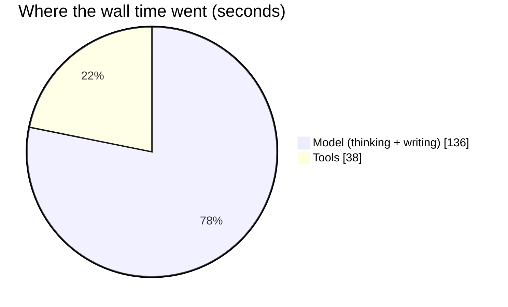

# firm-knowledge/tasks/210 · run2 (`hv-fk250-lunahigh-rep2-20261112T122308Z`)

Result: **all-pass** 15/15 criteria · 2.9 min · 19 model calls · 32 tool calls (1 errors or timeouts) · ending `completed` · started 11-12 19:10:34 IST

## Overview

One box per stretch of steps that used the same kind of tool (blue: looking/searching/reading, purple: writing or editing files, yellow: a message with no tool call, red border: a tool error or timeout inside the box).

```mermaid
flowchart TD
    T(["Task prompt"])
    P0["<b>Step 1</b> · 0.1 min<br/>todo_write"]
    T --> P0
    class P0 look
    P1["<b>Steps 2-3</b> · 0.4 min<br/>glob x5<br/><i>*, documents/matters/*/Engagement*/*, documents/matters/*/Client*/* +2</i>"]
    P0 --> P1
    class P1 look
    P2["<b>Step 4</b> · 0.1 min<br/>read<br/><i>8e7be033f74d-glob-results.txt</i>"]
    P1 --> P2
    class P2 err
    P3["<b>Steps 5-6</b> · 0.6 min<br/>bash x5<br/><i>parse-doc docx 'documents/matters/100…, python - #lt;#lt;'PY' from pathlib import P…</i>"]
    P2 --> P3
    class P3 look
    P4["<b>Step 7</b> · 0.1 min<br/>read<br/><i>engagement_snippets.txt</i>"]
    P3 --> P4
    class P4 look
    P5["<b>Step 8</b> · 0.1 min<br/>bash<br/><i>python - #lt;#lt;'PY' from pathlib import P…</i>"]
    P4 --> P5
    class P5 look
    P6["<b>Step 9</b> · 0.1 min<br/>grep<br/><i>engagement_snippets.txt</i>"]
    P5 --> P6
    class P6 look
    P7["<b>Step 10</b> · 0.0 min<br/>read x4<br/><i>engagement_snippets.txt</i>"]
    P6 --> P7
    class P7 look
    P8["<b>Step 11</b> · 0.2 min<br/>bash<br/><i>python - #lt;#lt;'PY' from pathlib import P…</i>"]
    P7 --> P8
    class P8 look
    P9["<b>Step 12</b> · 0.1 min<br/>glob x4<br/><i>documents/matters/1017-00001/*, documents/matters/1017-00001/**/*, documents/matters/1018-00009/**/* +1</i>"]
    P8 --> P9
    class P9 look
    P10["<b>Step 13</b> · 0.2 min<br/>glob x2<br/>bash<br/><i>documents/matters/1043-00002/**/*, documents/matters/1017-00001/**/*, python - #lt;#lt;'PY' from pathlib import P…</i>"]
    P9 --> P10
    class P10 look
    P11["<b>Step 14</b> · 0.3 min<br/>todo_write"]
    P10 --> P11
    class P11 look
    P12["<b>Steps 15-17</b> · 0.6 min<br/>write<br/>read<br/>edit<br/><i>response.md</i>"]
    P11 --> P12
    class P12 write
    P13["<b>Step 18</b> · 0.1 min<br/>todo_write"]
    P12 --> P13
    class P13 look
    P14["<b>Step 19</b> · 0.0 min<br/>final message"]
    P13 --> P14
    class P14 ans
    R(["ALL PASS: 15/15 criteria"])
    P14 --> R
    class R pass
    classDef look fill:#e8f0fe,stroke:#4a6fa5,color:#111
    classDef write fill:#f3e8fd,stroke:#7b1fa2,color:#111
    classDef ans fill:#fff8e1,stroke:#b58900,color:#111
    classDef err fill:#e8f0fe,stroke:#c62828,stroke-width:3px,color:#111
    classDef pass fill:#e6f4ea,stroke:#2e7d32,color:#111
    classDef fail fill:#fce8e6,stroke:#c62828,color:#111
```





One row per model call:

| Step | Started (IST) | Model s | Tools s | Tool calls | Tools | Output chars |
|---|---|---|---|---|---|---|
| 1 | 19:10:34 | 4 | 0 | 1 | todo_write | 57 |
| 2 | 19:10:38 | 2 | 1 | 1 | glob | 8,520 |
| 3 | 19:10:40 | 5 | 14 | 4 | glob x4 | 22,503 |
| 4 | 19:10:59 | 6 | 0 | 1 | read ⚠ | 66 |
| 5 | 19:11:05 | 7 | 13 | 4 | bash x4 | 139,244 |
| 6 | 19:11:26 | 13 | 2 | 1 | bash | 14 |
| 7 | 19:11:41 | 5 | 0 | 1 | read | 34,219 |
| 8 | 19:11:45 | 7 | 1 | 1 | bash | 341 |
| 9 | 19:11:53 | 3 | 0 | 1 | grep | 5,660 |
| 10 | 19:11:57 | 2 | 0 | 4 | read x4 | 126,567 |
| 11 | 19:12:00 | 11 | 1 | 1 | bash | 5,670 |
| 12 | 19:12:11 | 4 | 3 | 4 | glob x4 | 13,340 |
| 13 | 19:12:18 | 7 | 2 | 3 | glob x2, bash | 57,614 |
| 14 | 19:12:27 | 17 | 0 | 1 | todo_write | 57 |
| 15 | 19:12:45 | 26 | 0 | 1 | write | 205 |
| 16 | 19:13:11 | 7 | 0 | 1 | read | 9,370 |
| 17 | 19:13:18 | 4 | 0 | 1 | edit | 180 |
| 18 | 19:13:23 | 4 | 0 | 1 | todo_write | 57 |
| 19 | 19:13:26 | 2 | 0 | 0 | (message only) | 0 |

## Task prompt

```text
I'm prepping for a relationship review and want to know where our weight is — who are our top five clients by number of matters, with the counts?

Output: write your complete answer to `response.md` — a single self-contained markdown file with your findings, the matters/documents you relied on, and your reasoning.
```

## Rubric

| # | Criterion | Verdict |
|---|---|---|
| C-001 | Cascade Retail is included | pass |
| C-002 | Cascade Retail matter count | pass |
| C-003 | Lumos Analytics is included | pass |
| C-004 | Lumos Analytics matter count | pass |
| C-005 | Quorum Insurance is included | pass |
| C-006 | Quorum Insurance matter count | pass |
| C-007 | Dunmore Energy is included at the cutoff | pass |
| C-008 | Dunmore Energy matter count | pass |
| C-009 | Aurelius Media is included at the cutoff | pass |
| C-010 | Aurelius Media matter count | pass |
| C-011 | Penterra Pharma is included at the cutoff | pass |
| C-012 | Penterra Pharma matter count | pass |
| C-013 | Three clients share the highest count | pass |
| C-014 | Three-way tie at the top-five cutoff | pass |
| C-015 | Top group — client-level precision | pass |

Judge's reasoning:

**C-001 (pass):** Cascade Retail is included

```text
The output includes Cascade Retail Holdings Inc. (client 1038/CRH) in the top group, reporting 10 matters and listing matter numbers 1038-00001 through 1038-00010.
```

**C-002 (pass):** Cascade Retail matter count

```text
The output explicitly reports Cascade Retail Holdings Inc. (client 1038) as having 10 matters, numbered 1038-00001 through 1038-00010.
```

**C-003 (pass):** Lumos Analytics is included

```text
The output explicitly identifies Lumos Analytics Inc. (client/matter series 1008) as tied for first among the top clients, with 10 matters.
```

**C-004 (pass):** Lumos Analytics matter count

```text
The output explicitly reports Lumos Analytics Inc. (client 1008) as having 10 matters, numbered 1008-00001 through 1008-00010.
```

**C-005 (pass):** Quorum Insurance is included

```text
The output includes Quorum Insurance Holdings Corp. (client 1025/QIH) in the top group, tied for first with 10 matters.
```

**C-006 (pass):** Quorum Insurance matter count

```text
The output explicitly reports Quorum Insurance Holdings Corp. (client 1025) as having 10 matters, numbered 1025-00001 through 1025-00010.
```

**C-007 (pass):** Dunmore Energy is included at the cutoff

```text
The output includes Dunmore Energy Holdings Ltd. (client 1016/DEH) with 9 matters and correctly identifies it as tied for the fourth and fifth cutoff positions.
```

**C-008 (pass):** Dunmore Energy matter count

```text
The output explicitly reports Dunmore Energy Holdings Ltd. (client 1016) as having 9 matters, numbered 1016-00001 through 1016-00009.
```

**C-009 (pass):** Aurelius Media is included at the cutoff

```text
The output includes Aurelius Global Media Group PLC (client 1017) with 9 matters, tied at rank 4, and explicitly notes Aurelius Media Americas Inc. as a subsidiary within that client relationship.
```

**C-010 (pass):** Aurelius Media matter count

```text
The output reports Aurelius Global Media Group PLC, client 1017, as having 9 matters (1017-00001 through 1017-00009), satisfying the criterion.
```

**C-011 (pass):** Penterra Pharma is included at the cutoff

```text
The output includes Penterra Pharmaceuticals Corp. (client 1018/PPC) with 9 matters and correctly identifies it as tied for the fourth and fifth cutoff positions.
```

**C-012 (pass):** Penterra Pharma matter count

```text
The output explicitly reports Penterra Pharmaceuticals Corp. (client 1018) as having 9 matters, numbered 1018-00001 through 1018-00009.
```

**C-013 (pass):** Three clients share the highest count

```text
The output clearly identifies Lumos Analytics, Quorum Insurance, and Cascade Retail as tied for the highest matter count, with 10 matters each.
```

**C-014 (pass):** Three-way tie at the top-five cutoff

```text
The output explicitly identifies Dunmore Energy, Aurelius Media, and Penterra Pharma as tied at 9 matters for ranks 4 and 5, and explains that all three are shown rather than arbitrarily excluding one at the top-five cutoff.
```

**C-015 (pass):** Top group — client-level precision

```text
The output identifies only the six permitted clients—Cascade Retail, Lumos Analytics, Quorum Insurance, Dunmore Energy, Aurelius Media, and Penterra Pharma—as belonging to the top group, including the tie at the cutoff. It does not put forward any other client.
```

## Delivered files (output/)

- `response.md` (8,706 bytes)

`response.md`:

```markdown
# Top clients by number of matters

## Answer

I counted each unique matter folder (`documents/matters/<matter-number>/`) once and grouped the folders by the client relationship identified in the engagement or matter-administration documents. I did **not** count individual documents, drafts, closing letters, or scope-expansion letters as additional matters.

| Rank | Client / relationship | Matter count | Matter numbers |
|---:|---|---:|---|
| 1 (tie) | **Lumos Analytics Inc.** | **10** | 1008-00001 through 1008-00010 |
| 1 (tie) | **Quorum Insurance Holdings Corp.** | **10** | 1025-00001 through 1025-00010 |
| 1 (tie) | **Cascade Retail Holdings Inc.** | **10** | 1038-00001 through 1038-00010 |
| 4 (tie) | **Dunmore Energy Holdings Ltd.** | **9** | 1016-00001 through 1016-00009 |
| 4 (tie) | **Aurelius Global Media Group PLC** | **9** | 1017-00001 through 1017-00009 |
| 4 (tie) | **Penterra Pharmaceuticals Corp.** | **9** | 1018-00001 through 1018-00009 |

There is a three-way tie at the cutoff: the fifth-ranked position is shared by Dunmore, Aurelius, and Penterra. Accordingly, I have shown all six clients occupying the top-five rank positions rather than arbitrarily excluding one tied client.

## Reasoning and verification

1. I treated a matter as the unique matter-number directory, so multiple documents within one folder remained one matter.
2. I read the client-identification language in the engagement letters and related administrative/closing materials. The three 10-matter series consistently identify Lumos, Quorum, and Cascade, respectively.
3. I verified the 9-matter series similarly for Dunmore, Aurelius, and Penterra. The Aurelius series includes parent-company, board, and subsidiary engagements, but the documents consistently identify the Aurelius relationship; those were counted once per matter folder.
4. As a cross-check, the workspace contains 266 unique matter folders. The highest folder-series counts are 10 for 1008, 1025, and 1038; 9 for 1016, 1017, and 1018; and no other series exceeds 8.

## Matters and documents relied on

The following are the representative client-identification documents used to verify the matter series and counts. Where a matter contained multiple engagement versions, I selected the principal engagement letter and counted the matter only once.

### Lumos Analytics Inc. — 10 matters

- `documents/matters/1008-00001/Administrative/engagement-letter.docx`
- `documents/matters/1008-00002/Engagement & Organization/engagement-letter.docx`
- `documents/matters/1008-00003/Engagement/engagement-letter-lumos.docx`
- `documents/matters/1008-00004/Engagement/engagement-letter-lumos-immigration.docx`
- `documents/matters/1008-00005/Matter Administration/engagement-letter-lumos.docx`
- `documents/matters/1008-00006/Engagement/engagement-letter-el-2024-0847-rv.docx`
- `documents/matters/1008-00007/Engagement/engagement-letter-lumos.docx`
- `documents/matters/1008-00008/Engagement/engagement-letter-lumos.docx`
- `documents/matters/1008-00009/Engagement/engagement-letter-lumos-breach-response.docx`
- `documents/matters/1008-00010/Engagement/engagement-letter-lumos.docx`

These letters identify Lumos Analytics Inc. as the client across the credit facility, IPO, financing, immigration, investigation/litigation, employment, acquisition, incident-response, and commercial matters.

### Quorum Insurance Holdings Corp. — 10 matters

- `documents/matters/1025-00001/Engagement/engagement-letter-quorum-follow-on.docx`
- `documents/matters/1025-00002/Engagement/engagement-letter-qih.docx`
- `documents/matters/1025-00003/Engagement & Administrative/engagement-letter-executed.docx`
- `documents/matters/1025-00004/Engagement/engagement-letter-quorum.docx`
- `documents/matters/1025-00005/Engagement/engagement-letter-qih-executed.docx`
- `documents/matters/1025-00006/Engagement & Privilege/engagement-letter-quorum.docx`
- `documents/matters/1025-00007/Engagement & Administration/engagement-letter-sc-to-qih.docx`
- `documents/matters/1025-00008/Engagement & Administration/engagement-letter-quorum.docx`
- `documents/matters/1025-00009/Engagement/engagement-letter.docx`
- `documents/matters/1025-00010/Engagement/engagement-letter-qih-audit-committee.docx`

The documents identify Quorum Insurance Holdings Corp. (also referred to as QIH/Quorum) as the client, with certain matters involving its insurance subsidiaries, board, or audit committee.

### Cascade Retail Holdings Inc. — 10 matters

- `documents/matters/1038-00001/Engagement & Administration/engagement-letter-cascade.docx`
- `documents/matters/1038-00002/documents/engagement-letter.docx`
- `documents/matters/1038-00003/Engagement/engagement-letter-crh-shelf-registration.docx`
- `documents/matters/1038-00004/Engagement/engagement-letter-crh.docx`
- `documents/matters/1038-00005/Engagement/engagement-letter-2024-01-18.docx`
- `documents/matters/1038-00006/Engagement & Administration/engagement-letter-crh.docx`
- `documents/matters/1038-00007/Engagement/engagement-letter-cascade-retail.docx`
- `documents/matters/1038-00008/Engagement/engagement-letter-cascade-divestiture.docx`
- `documents/matters/1038-00009/Pre-Signing/engagement-letter-cascade-retail.docx`
- `documents/matters/1038-00010/Engagement/engagement-letter-cascade-privacy-program.docx`

The documents identify Cascade Retail Holdings Inc. (also referred to as CRH/Cascade) as the client. Matter 1038-00006 also contains engagement letters for investigators and forensic providers, but the client-facing engagement letter identifies Cascade as the represented client; it remains one Cascade matter.

### Dunmore Energy Holdings Ltd. — 9 matters

- `documents/matters/1016-00001/Engagement/engagement-letter-deh.docx`
- `documents/matters/1016-00002/Engagement/engagement-letter-deh.docx`
- `documents/matters/1016-00003/Engagement and Administrative/engagement-letter-deh.docx`
- `documents/matters/1016-00004/Pre-Engagement/engagement-letter.docx`
- `documents/matters/1016-00005/Engagement & Conflicts/engagement-letter-deh.docx`
- `documents/matters/1016-00006/Engagement/engagement-letter-deh.docx`
- `documents/matters/1016-00007/Engagement/engagement-letter-deh-ofac-vsd.docx`
- `documents/matters/1016-00008/Engagement/engagement-letter-deh.docx`
- `documents/matters/1016-00009/Engagement & Scope/engagement-letter-deh.docx`

The letters identify Dunmore Energy Holdings Ltd. (DEH/Dunmore), sometimes together with the relevant Dunmore subsidiary, as the client.

### Aurelius Global Media Group PLC — 9 matters

- `documents/matters/1017-00001/Firm Internal/sc-transaction-summary-memo.docx` and `documents/matters/1017-00001/Closing/sc-10b5-negative-assurance-letter.docx` (the matter has no file named as an engagement letter, but these documents identify the Aurelius representation)
- `documents/matters/1017-00002/documents/engagement-letter-sc-to-agmg-board.docx`
- `documents/matters/1017-00003/Engagement & Administrative/engagement-letter-aurelius.docx`
- `documents/matters/1017-00004/Engagement & Administration/engagement-letter-ama.docx`
- `documents/matters/1017-00005/Engagement/engagement-letter-agmg.docx`
- `documents/matters/1017-00006/Engagement/engagement-letter-agmg.docx`
- `documents/matters/1017-00007/Engagement/engagement-letter-aurelius.docx`
- `documents/matters/1017-00008/Engagement/engagement-letter-agmg-gdpr-remediation.docx`
- `documents/matters/1017-00009/Engagement/engagement-letter.docx`

The documents identify Aurelius Global Media Group PLC (AGMG/Aurelius) as the relationship client. Matter 1017-00004 is for Aurelius Media Americas Inc., a subsidiary, and the matter series also includes board-level and other group engagements; each matter folder was counted once.

### Penterra Pharmaceuticals Corp. — 9 matters

- `documents/matters/1018-00001/Engagement & Internal/engagement-letter-ppc.docx`
- `documents/matters/1018-00002/Engagement/engagement-letter-penterra.docx`
- `documents/matters/1018-00003/Engagement & Independence Protocol/engagement-letter-ch-calderwood-harkness.docx`
- `documents/matters/1018-00004/Engagement/engagement-letter-penterra.docx`
- `documents/matters/1018-00005/Engagement/engagement-letter-penterra-snda.docx`
- `documents/matters/1018-00006/Engagement/engagement-letter-penterra.docx`
- `documents/matters/1018-00007/Pre-Litigation/engagement-letter.docx`
- `documents/matters/1018-00008/Engagement & Preliminary/engagement-letter-penterra.docx`
- `documents/matters/1018-00009/Engagement/engagement-letter-ppc-executed.docx`

The documents identify Penterra Pharmaceuticals Corp. (Penterra/PPC), including the special-committee and tax-related engagements, as the client relationship.
```

## Trajectory

### Step 1: 1 tool call

_Started 11-12 19:10:34 IST · model 4 s · tools 0 s_

**Reasoning summary:**

```text
**Inspecting workspace details**

I need to take a look at the workspace documents to better understand the task ahead. It seems that I'll probably be dealing with PDFs or DOCX files, so I should consider using glob to list those files. This sounds like a multi-step process, which means it might be a good idea to create a response.md as part of my plans. I'll make sure to organize everything clearly!
```

**Call `todo_write`** (0.1 s)

```json
{
 "todos": [
  {
   "content": "Inventory the workspace documents and identify matter/client sources",
   "status": "in_progress"
  },
  {
   "content": "Extract matter records and count matters by client",
   "status": "pending"
  },
  {
   "content": "Verify the top five counts against source documents",
   "status": "pending"
  },
  {
   "content": "Write the complete self-contained findings to response.md",
   "status": "pending"
  }
 ]
}
```

Output (57 chars):

```text
Updated todo list: 3 pending, 1 in progress, 0 completed.
```

**Todo list now:**

- [~] Inventory the workspace documents and identify matter/client sources
- [ ] Extract matter records and count matters by client
- [ ] Verify the top five counts against source documents
- [ ] Write the complete self-contained findings to response.md

### Step 2: 1 tool call

_Started 11-12 19:10:38 IST · model 2 s · tools 1 s_

**Call `glob`** (0.7 s)

```json
{
 "pattern": "*"
}
```

Output (8,520 chars):

```text
documents/matters/1001-00001/Antitrust Analysis/competitor-identification-chart.xlsx
documents/matters/1001-00001/Antitrust Analysis/portfolio-company-overlap-analysis.docx
documents/matters/1001-00001/Antitrust Analysis/hhi-concentration-analysis.xlsx
documents/matters/1001-00001/Antitrust Analysis/market-definition-competitive-analysis-memo.docx
documents/matters/1001-00001/Client Updates/biweekly-status-report-1.docx
documents/matters/1001-00001/Antitrust Analysis/preliminary-antitrust-risk-assessment.docx
documents/matters/1001-00001/Antitrust Analysis/state-regulatory-con-analysis.docx
documents/matters/1001-00001/Antitrust Analysis/vertical-relationships-analysis.docx
documents/matters/1001-00001/Closing/closing-memo-antitrust-workstream.docx
documents/matters/1001-00001/Client Updates/client-update-early-termination-granted.eml
documents/matters/1001-00001/Client Updates/biweekly-status-report-2.docx
documents/matters/1001-00001/Client Updates/client-update-hsr-forms-filed.eml
documents/matters/1001-00001/Closing/final-invoice-matter-closing-letter.docx
documents/matters/1001-00001/Closing/hsr-clearance-certificate.docx
documents/matters/1001-00001/Correspondence/Counterparty Counsel/email-gk-naics-code-consistency.eml
documents/matters/1001-00001/Early Termination/early-termination-request-letter.docx
documents/matters/1001-00001/Correspondence/Counterparty Counsel/letter-bracewell-thornton-regulatory-condition.docx
documents/matters/1001-00001/Correspondence/Counterp
… [7,020 more chars]
```

### Step 3: 4 tool calls

_Started 11-12 19:10:40 IST · model 5 s · tools 14 s_

**Call `glob`** (4.8 s)

```json
{
 "pattern": "documents/matters/*/Engagement*/*"
}
```

Output (8,271 chars):

```text
documents/matters/1001-00001/Engagement & Administration/conflicts-check-memorandum.docx
documents/matters/1001-00001/Engagement & Administration/matter-opening-memorandum.docx
documents/matters/1001-00001/Engagement & Administration/engagement-letter-ardent-capital.docx
documents/matters/1001-00002/Engagement & Administration/engagement-letter.docx
documents/matters/1001-00002/Engagement & Administration/matter-closing-memo.docx
documents/matters/1001-00002/Engagement & Administration/conflict-check-memo.docx
documents/matters/1001-00003/Engagement/engagement-letter-ardent-capital.docx
documents/matters/1001-00004/Engagement & Administrative/billing-rate-schedule.xlsx
documents/matters/1001-00004/Engagement & Administrative/conflict-waiver-letter-vectis.docx
documents/matters/1001-00004/Engagement & Administrative/staffing-budget-memorandum.docx
documents/matters/1001-00004/Engagement & Administrative/matter-opening-memorandum.docx
documents/matters/1001-00004/Engagement & Administrative/engagement-letter-ardent-capital.docx
documents/matters/1001-00005/Engagement/engagement-letter-ardent-cp-iii.docx
documents/matters/1001-00006/Engagement & Administrative/conflict-check-memorandum.docx
documents/matters/1001-00006/Engagement & Administrative/staffing-and-budget-memorandum.docx
documents/matters/1001-00006/Engagement & Administrative/engagement-letter.docx
documents/matters/1001-00006/Engagement & Administrative/engagement-close-out-memorandum.docx
documents/matters/1002-000
… [6,771 more chars]
```

**Call `glob`** (1.5 s)

```json
{
 "pattern": "documents/matters/*/Client*/*"
}
```

Output (3,582 chars):

```text
documents/matters/1001-00001/Client Updates/biweekly-status-report-1.docx
documents/matters/1001-00001/Client Updates/client-update-early-termination-granted.eml
documents/matters/1001-00001/Client Updates/biweekly-status-report-2.docx
documents/matters/1001-00001/Client Updates/client-update-hsr-forms-filed.eml
documents/matters/1012-00004/Client Reporting & Governance/board-update-memorandum.docx
documents/matters/1012-00004/Client Reporting & Governance/monthly-litigation-status-report-june-2025.docx
documents/matters/1012-00004/Client Reporting & Governance/monthly-litigation-status-report-july-2025.docx
documents/matters/1021-00006/Client Reporting/final-invoice-fee-summary.xlsx
documents/matters/1021-00006/Client Reporting/matter-closing-memorandum.docx
documents/matters/1021-00006/Client Reporting/quarterly-status-report-q2-2022.docx
documents/matters/1021-00006/Client Reporting/quarterly-status-report-q4-2023.docx
documents/matters/1023-00002/Client Correspondence/client-letter-investor-communication.docx
documents/matters/1023-00002/Client Correspondence/quarterly-litigation-budget-q1-2025.xlsx
documents/matters/1023-00002/Client Correspondence/email-oral-argument-preparation.eml
documents/matters/1023-00002/Client Correspondence/client-update-filing-of-complaint.docx
documents/matters/1023-00002/Client Correspondence/client-update-mtd-analysis.docx
documents/matters/1025-00005/Client Reporting/board-audit-committee-presentation.pptx
documents/matters/1025-00005/Clie
… [2,082 more chars]
```

**Call `glob`** (4.2 s)

```json
{
 "pattern": "documents/matters/*/Matter*/*"
}
```

Output (1,597 chars):

```text
documents/matters/1002-00004/Matter Administration/conflict-check-memo.docx
documents/matters/1002-00004/Matter Administration/matter-status-memo-file-inventory.docx
documents/matters/1002-00004/Matter Administration/engagement-letter-pinnacle.docx
documents/matters/1008-00005/Matter Administration/engagement-letter-lumos.docx
documents/matters/1008-00005/Matter Administration/matter-closing-memo.docx
documents/matters/1014-00003/Matter Administration/billing-summary-january-2023.xlsx
documents/matters/1014-00003/Matter Administration/final-fee-reconciliation-retainer-return.docx
documents/matters/1014-00003/Matter Administration/lessons-learned-post-mortem-memo.docx
documents/matters/1014-00003/Matter Administration/matter-status-report-october-2022.docx
documents/matters/1014-00003/Matter Administration/billing-summary-october-2022.xlsx
documents/matters/1014-00003/Matter Administration/billing-summary-june-2022.xlsx
documents/matters/1014-00003/Matter Administration/matter-closing-memo.docx
documents/matters/1014-00003/Matter Administration/matter-status-report-january-2023.docx
documents/matters/1014-00003/Matter Administration/retainer-replenishment-letters.docx
documents/matters/1014-00003/Matter Administration/matter-budget-memo-forecast.docx
documents/matters/1016-00004/Matter Closure/matter-closing-memorandum.docx
documents/matters/1016-00009/Matter Closure/letter-to-deh-declination-confirmation.docx
documents/matters/1016-00009/Matter Closure/matter-closure-summary-
… [97 more chars]
```

**Call `glob`** (3.8 s)

```json
{
 "pattern": "documents/matters/*/Engagement & Administration/*"
}
```

Output (9,053 chars):

```text
documents/matters/1001-00001/Engagement & Administration/conflicts-check-memorandum.docx
documents/matters/1001-00001/Engagement & Administration/matter-opening-memorandum.docx
documents/matters/1001-00001/Engagement & Administration/engagement-letter-ardent-capital.docx
documents/matters/1001-00002/Engagement & Administration/engagement-letter.docx
documents/matters/1001-00002/Engagement & Administration/matter-closing-memo.docx
documents/matters/1001-00002/Engagement & Administration/conflict-check-memo.docx
documents/matters/1009-00001/Engagement & Administration/conflict-check-memo.docx
documents/matters/1009-00001/Engagement & Administration/new-matter-intake-form.docx
documents/matters/1009-00001/Engagement & Administration/engagement-letter-skybridge.docx
documents/matters/1009-00001/Engagement & Administration/fee-estimate-budget-memo.docx
documents/matters/1009-00001/Engagement & Administration/engagement-letter-amendment-ip-scope.docx
documents/matters/1009-00001/Engagement & Administration/staffing-plan-memo.docx
documents/matters/1009-00004/Engagement & Administration/conflict-check-memo.docx
documents/matters/1009-00004/Engagement & Administration/matter-opening-memo.docx
documents/matters/1009-00004/Engagement & Administration/engagement-letter-skybridge.docx
documents/matters/1010-00003/Engagement & Administration/conflict-check-memorandum.docx
documents/matters/1010-00003/Engagement & Administration/engagement-letter.docx
documents/matters/1010-00003/Engagemen
… [7,553 more chars]
```

### Step 4: 1 tool call

_Started 11-12 19:10:59 IST · model 6 s · tools 0 s_

**Reasoning summary:**

```text
**Figuring out engagement parsing**

I’m looking at engagements and thinking about those 637 matters. It seems I need to find the top clients by the number of matters. I might infer those by mapping engagement letters. To do this, I’ll need to parse 637 files, and I can use a bash script combined with Python to extract text. The developer suggests using a read method on text rather than cat, which sounds like a plan. I’ll also check if I can use Python's glob to read the paths.

**Examining file access**

I think it's better to use the glob result spill and read from it, but I’m not sure if the tool output is accessible from the shell. The spill path might be visible in /tmp, so I could test that with `wc`, but I shouldn't use shell cat. Maybe using Python to read the spill is the right approach, even if it still feels like shell reading. I could also consider using a glob pattern for documents, but it seems like I’ll only get 100 paths shown. Let’s see if I can read the spill path.
```

**Call `read`** (0.0 s · **error/timeout**)

```json
{
 "file_path": "/tmp/dsh-spill-IrGLVu/session-d5e27d2f9481/8e7be033f74d-glob-results.txt",
 "offset": 1,
 "limit": 1000
}
```

Output (66 chars):

```text
Error: [sandbox: file access denied under workspace-isolated mode]
```

### Step 5: 4 tool calls

_Started 11-12 19:11:05 IST · model 7 s · tools 13 s_

**Call `bash`** (2.9 s)

```json
{
 "command": "parse-doc docx 'documents/matters/1001-00001/Engagement & Administration/engagement-letter-ardent-capital.docx'",
 "description": "Parse a sample Ardent engagement letter",
 "timeoutMs": 120000
}
```

Output (38,477 chars):

```text
**CALDERWOOD & HARKNESS LLP** *Attorneys at Law*

600 Lexington Avenue New York, New York 10022 Telephone: (212) 554-7000 Facsimile: (212) 554-7001 www.calderwoodharkness.com

January 29, 2024

Ardent Capital Partners III LP c/o Ardent Capital Management LLC 399 Park Avenue, 41st Floor New York, New York 10022

> Attention: Julian Desmond, Co-Founder & Managing Partner
>
> Priya Chandrasekar, Co-Founder & Managing Partner

**Re: Engagement of Calderwood & Harkness LLP --- Antitrust and Hart-Scott-Rodino Advisory Services in Connection with the Acquisition of Pinnacle Health Systems, Inc.**

**Matter No.: 1001-00001**

Dear Mr. Desmond and Ms. Chandrasekar:

**[1. Introduction and Engagement Overview]{.underline}**

We are pleased to confirm that Calderwood & Harkness LLP (\"the Firm,\" \"Calderwood & Harkness,\" \"we,\" or \"us\") has been engaged by Ardent Capital Partners III LP (\"Ardent Capital,\" \"Fund III,\" or \"you\"), a Delaware limited partnership, to provide antitrust and competition law advisory services in connection with Ardent Capital\'s proposed acquisition of one hundred percent (100%) of the outstanding equity interests of Pinnacle Health Systems, Inc. (\"Pinnacle\" or \"PHS\"), a Delaware corporation headquartered in Charlotte, North Carolina. Pinnacle is a specialty healthcare services platform that owns and operates a network of ambulatory surgical centers (\"ASCs\") and physician practice management entities across nine states. Pinnacle\'s operations sp
… [36,976 more chars]
```

**Call `bash`** (4.7 s)

```json
{
 "command": "parse-doc docx 'documents/matters/1002-00001/Engagement/engagement-letter-pinnacle-vc.docx'",
 "description": "Parse a sample Pinnacle engagement letter",
 "timeoutMs": 120000
}
```

Output (28,327 chars):

```text
**CALDERWOOD & HARKNESS LLP** 900 Third Avenue, 28th Floor New York, New York 10022

March 15, 2021

PRIVILEGED AND CONFIDENTIAL

Mr. Marcus Yuen Managing Partner Pinnacle Venture Fund II LP 388 Embarcadero Center, Suite 2400 San Francisco, California 94111

**Re: Engagement of Calderwood & Harkness LLP --- Initial Public Offering of Pinnacle Acquisition Corp. I**

Dear Mr. Yuen:

We are pleased to confirm that Calderwood & Harkness LLP (\"C&H\" or the \"Firm\") has been engaged by Pinnacle Venture Fund II LP, a Delaware limited partnership (\"Pinnacle\" or the \"Sponsor\"), and Pinnacle Acquisition Corp. I, a Delaware corporation (the \"Company\" and, together with the Sponsor, the \"Clients\"), to serve as issuer\'s counsel in connection with the proposed initial public offering (the \"IPO\") of units of the Company (the \"Transaction\"). This letter sets forth the terms and conditions of the engagement, and we ask that you review them carefully. We understand that this is one of the Firm\'s earliest engagements for Pinnacle, and we greatly appreciate the opportunity to work with you and your team. We look forward to bringing the full depth of our capital markets practice to bear on behalf of the Clients and to building a lasting professional relationship.

The terms and conditions governing our representation are set forth below.

**[1. Scope of Engagement]{.underline}**

Our representation of the Clients in connection with the Transaction will include, but not be limited 
… [26,826 more chars]
```

**Call `bash`** (2.2 s)

```json
{
 "command": "parse-doc docx 'documents/matters/1003-00002/Engagement/engagement-letter-hcp.docx'",
 "description": "Parse a sample HCP engagement letter",
 "timeoutMs": 120000
}
```

Output (40,609 chars):

```text
**CALDERWOOD & HARKNESS LLP** **Attorneys at Law**

400 South Ashbury Asset Advisors, Suite 3000 Wilmington, Delaware 19801 Telephone: (302) 555-7800 \| Facsimile: (302) 555-7801

New York Office: 620 Eighth Avenue, 42nd Floor New York, New York 10018 Telephone: (212) 555-9400 \| Facsimile: (212) 555-9401

www.calderwoodharkness.com

April 2, 2025

**VIA EMAIL AND FIRST-CLASS MAIL**

Catherine E. Loomis, Esq. General Counsel & Chief Compliance Officer Harrowgate Capital Partners LLC 1200 Concord Pike, Suite 600 Wilmington, Delaware 19803

> **Re: Engagement of Calderwood & Harkness LLP --- Formation of Harrowgate Private Equity Fund V LP and Related Vehicles** **Matter Number: 1003-00002**

Dear Ms. Loomis:

We are delighted to set forth the terms pursuant to which Calderwood & Harkness LLP (the \"Firm,\" \"we,\" \"us,\" or \"our\") will represent Harrowgate Capital Partners LLC (\"HCP\" or the \"Client\") in connection with the formation and fundraise of the Client\'s fifth flagship private equity fund, as described in greater detail below. This letter (this \"Engagement Letter\"), when countersigned by the Client, shall constitute the binding agreement between the Firm and the Client with respect to the engagement described herein.

**[1. Engagement and Client Identification]{.underline}**

Calderwood & Harkness LLP is pleased to confirm its engagement by Harrowgate Capital Partners LLC, a Delaware limited liability company, in connection with the formation, structuring, an
… [39,108 more chars]
```

**Call `bash`** (3.5 s)

```json
{
 "command": "parse-doc docx 'documents/matters/1007-00001/Engagement/engagement-letter-vms.docx'",
 "description": "Parse a sample VMS engagement letter",
 "timeoutMs": 120000
}
```

Output (31,831 chars):

```text
PRIVILEGED AND CONFIDENTIAL

**CALDERWOOD & HARKNESS LLP** **Attorneys at Law**

425 Park Avenue, 31st Floor New York, NY 10022 Tel: (212) 554-7000

Fax: (212) 554-7001

www.calderwoodharkness.com

May 19, 2025

**VIA EMAIL AND OVERNIGHT DELIVERY**

Derek Wainwright, Esq. General Counsel Vantage Mobility Systems Corp. 4100 Industrial Parkway Auburn Hills, MI 48326

Dear Mr. Wainwright:

We are writing to confirm the terms of the engagement of Calderwood & Harkness LLP (\"C&H\" or the \"Firm\") by Vantage Mobility Systems Corp., a Delaware corporation (\"VMS\" or the \"Company\"), and to set forth the scope of our representation, the fee arrangements, and other terms and conditions governing our relationship. We ask that you review this engagement letter carefully and, if the terms are acceptable, execute and return a copy to us at your earliest convenience.

**[1. Engagement and Scope of Representation]{.underline}**

Calderwood & Harkness LLP is pleased to confirm its engagement by VMS in connection with the documentation and closing of a \$45,000,000 Senior Secured Revolving Credit Facility (the \"Facility\"). The Facility is to be arranged by Pinnacle National Bank, N.A. (\"Pinnacle\"), acting as Sole Lead Arranger, Sole Bookrunner, Administrative Agent, Collateral Agent, Issuing Lender, and Swing Line Lender, with a three-lender syndicate consisting of Pinnacle, Great Lakes Commercial Lending Corp., and Ironbridge Capital Finance, LLC (collectively, the \"Lenders\"). The 
… [30,330 more chars]
```

### Step 6: 1 tool call

_Started 11-12 19:11:26 IST · model 13 s · tools 2 s_

**Reasoning summary:**

```text
**Extracting client names**

I'm looking into unzipping docx files using zipfile and lxml to extract text. I'll implement regex patterns to find terms like "engaged by" and "representation of" to identify client names. Engagement letters are key; they often mention client names multiple times. I might use a heuristic to find the canonical name format. I'll create extraction records for manual review by analyzing the text from engagement letters, aiming for the first 1200 characters for each document.

**Setting up a workspace**

I’m considering that I could potentially handle 637 items as output to a file. Using Python to write in a scratch workspace, like /tmp, seems manageable. There's also the idea of outputting files with bash, which might work too. However, I’ll need to utilize the reading tool to access the text files. Maybe creating a workspace at /home could be better to keep everything organized. It’s important to set up a clear workspace first!
```

**Call `bash`** (2.1 s)

```json
{
 "command": "python - <<'PY'\nfrom pathlib import Path\nfrom zipfile import ZipFile\nfrom xml.etree import ElementTree as ET\nimport re\nroot=Path('documents/matters')\nns={'w':'http://schemas.openxmlformats.org/wordprocessingml/2006/main'}\nrows=[]\nfor p in sorted(root.glob('*/*/engagement*.docx')):\n    try:\n        with ZipFile(p) as z:\n            xml=z.read('word/document.xml')\n        tree=ET.fromstring(xml)\n        paras=[]\n        for para in tree.findall('.//w:p',ns):\n            txt=''.join(t.text or '' for t in para.findall('.//w:t',ns))\n            if txt.strip(): paras.append(txt.strip())\n        text='\\n'.join(paras)\n        rows.append((p.parent.parent.name,str(p.relative_to(root)),text[:1800]))\n    except Exception as e:\n        rows.append((p.parent.parent.name,str(p.relative_to(root)),f'ERROR {e}'))\nwith open('engagement_snippets.txt','w') as f:\n    for matter,path,snip in rows:\n        f.write(f'### {matter} | {path}\\n{snip}\\n\\n')\nprint('processed',len(rows))\nPY",
 "description": "Extract engagement-letter text snippets",
 "timeoutMs": 120000
}
```

Output (14 chars):

```text
processed 290
```

### Step 7: 1 tool call

_Started 11-12 19:11:41 IST · model 5 s · tools 0 s_

**Reasoning summary:**

```text
**Analyzing engagement data**

It seems like there are around 290 named engagement files, along with 165 Engagement/Admin files that don’t include the term "engagement." I’m wondering if the total matters might be greater than that — perhaps around 280. I need to count all the matter directories. Top clients should be identifiable through the engagement letters and related documents. I could read through snippets; maybe I'll use grep or regex in bash to look for repeated client names. Let's check the first 50 snippets.
```

**Call `read`** (0.0 s)

```json
{
 "file_path": "engagement_snippets.txt",
 "offset": 1,
 "limit": 250
}
```

Output (34,219 chars):

```text
<path>/home/agarwaldi/dsh-bench-harness/runs/hv-fk250-lunahigh-rep2-20261112T122308Z/tasks/firm-knowledge__tasks__210/workspace/engagement_snippets.txt</path>
<type>file</type>
<content>
1: ### 1001-00001 | 1001-00001/Engagement & Administration/engagement-letter-ardent-capital.docx
2: CALDERWOOD & HARKNESS LLP Attorneys at Law
3: 600 Lexington Avenue New York, New York 10022 Telephone: (212) 554-7000 Facsimile: (212) 554-7001 www.calderwoodharkness.com
4: January 29, 2024
5: Ardent Capital Partners III LP c/o Ardent Capital Management LLC 399 Park Avenue, 41st Floor New York, New York 10022
6: Attention: Julian Desmond, Co-Founder & Managing Partner
7: Priya Chandrasekar, Co-Founder & Managing Partner
8: Re: Engagement of Calderwood & Harkness LLP — Antitrust and Hart-Scott-Rodino Advisory Services in Connection with the Acquisition of Pinnacle Health Systems, Inc.
9: Matter No.: 1001-00001
10: Dear Mr. Desmond and Ms. Chandrasekar:
11: 1. Introduction and Engagement Overview
12: We are pleased to confirm that Calderwood & Harkness LLP ("the Firm," "Calderwood & Harkness," "we," or "us") has been engaged by Ardent Capital Partners III LP ("Ardent Capital," "Fund III," or "you"), a Delaware limited partnership, to provide antitrust and competition law advisory services in connection with Ardent Capital's proposed acquisition of one hundred percent (100%) of the outstanding equity interests of Pinnacle Health Systems, Inc. ("Pinnacle" or "PHS"), a Delaware corporation headquar
… [32,719 more chars]
```

### Step 8: 1 tool call

_Started 11-12 19:11:45 IST · model 7 s · tools 1 s_

**Reasoning summary:**

```text
**Identifying top clients by matters**

I’m looking at repetitive matter groups by client code like 1001 for Ardent and others. I need to find the top five clients with over 10 matters. I could count matter directories based on group codes, but it gets tricky if matters involve different clients or targets. I want to identify unique matter directories using the 4-digit prefixes and figure out the main clients tied to those. Using `Path.glob` to enumerate directories sounds good.

**Setting up for unique matter counts**

I’m considering using the glob tool with the pattern documents/matters/*/* to find the relevant directories. That could work well for counting unique matter directories and engagement documents. I think I can run a Python script for this purpose using `os`, so it seems like a solid plan. I'll need to ensure everything is set up correctly to compile the counts effectively. This should help me get the data I need!
```

**Call `bash`** (1.0 s)

```json
{
 "command": "python - <<'PY'\nfrom pathlib import Path\nfrom collections import Counter\nroot=Path('documents/matters')\nmatters=sorted({p.parts[2] for p in root.glob('*/*/*') if len(p.parts)>=3})\nprint('matter dirs',len(matters))\ncounts=Counter(m.split('-')[0] for m in matters)\nfor k,v in counts.most_common(): print(k,v)\nPY",
 "description": "Count matter directories by client code",
 "timeoutMs": 120000
}
```

Output (341 chars):

```text
matter dirs 266
1008 10
1025 10
1038 10
1016 9
1017 9
1018 9
1006 8
1007 8
1011 8
1021 8
1022 8
1001 7
1009 7
1032 7
1037 7
1044 7
1045 7
1005 6
1010 6
1012 6
1013 6
1014 6
1020 6
1033 6
1036 6
1002 5
1003 5
1015 5
1019 5
1026 5
1027 5
1035 5
1039 5
1041 5
1042 5
1024 4
1031 4
1034 4
1004 3
1023 3
1030 3
1043 3
1029 2
1028 1
1040 1
1046 1
```

### Step 9: 1 tool call

_Started 11-12 19:11:53 IST · model 3 s · tools 0 s_

**Call `grep`** (0.5 s)

```json
{
 "pattern": "### (1008|1025|1038|1016|1017|1018)-",
 "path": "engagement_snippets.txt"
}
```

Output (5,660 chars):

```text
Found 64 matches

engagement_snippets.txt
Line 640: ### 1008-00001 | 1008-00001/Administrative/engagement-letter.docx
Line 655: ### 1008-00002 | 1008-00002/Engagement & Organization/engagement-letter.docx
Line 671: ### 1008-00002 | 1008-00002/Withdrawal/engagement-closing-letter.docx
Line 685: ### 1008-00003 | 1008-00003/Engagement/engagement-letter-lumos.docx
Line 697: ### 1008-00004 | 1008-00004/Engagement/engagement-letter-lumos-immigration.docx
Line 711: ### 1008-00005 | 1008-00005/Matter Administration/engagement-letter-lumos.docx
Line 725: ### 1008-00006 | 1008-00006/Engagement/engagement-letter-el-2024-0847-rv.docx
Line 735: ### 1008-00007 | 1008-00007/Engagement/engagement-letter-lumos.docx
Line 746: ### 1008-00008 | 1008-00008/Engagement/engagement-letter-lumos.docx
Line 760: ### 1008-00009 | 1008-00009/Engagement/engagement-letter-lumos-breach-response.docx
Line 773: ### 1008-00010 | 1008-00010/Engagement/engagement-letter-lumos.docx
Line 1413: ### 1016-00001 | 1016-00001/Engagement/engagement-letter-deh.docx
Line 1425: ### 1016-00002 | 1016-00002/Engagement/engagement-letter-deh.docx
Line 1441: ### 1016-00003 | 1016-00003/Engagement and Administrative/engagement-letter-deh.docx
Line 1455: ### 1016-00004 | 1016-00004/Pre-Engagement/engagement-letter.docx
Line 1469: ### 1016-00005 | 1016-00005/Engagement & Conflicts/engagement-letter-deh.docx
Line 1480: ### 1016-00006 | 1016-00006/Engagement/engagement-letter-deh.docx
Line 1493: ### 1016-00007 | 1016-00007/Engagement
… [4,160 more chars]
```

### Step 10: 4 tool calls

_Started 11-12 19:11:57 IST · model 2 s · tools 0 s_

**Call `read`** (0.1 s)

```json
{
 "file_path": "engagement_snippets.txt",
 "offset": 640,
 "limit": 150
}
```

Output (21,791 chars):

```text
<path>/home/agarwaldi/dsh-bench-harness/runs/hv-fk250-lunahigh-rep2-20261112T122308Z/tasks/firm-knowledge__tasks__210/workspace/engagement_snippets.txt</path>
<type>file</type>
<content>
640: ### 1008-00001 | 1008-00001/Administrative/engagement-letter.docx
641: CONFIDENTIAL — ATTORNEY-CLIENT PRIVILEGED
642: CALDERWOOD & HARKNESS LLP Attorneys at Law 555 Mission Street, Suite 3100 San Francisco, CA 94105 Telephone: (415) 552-7000 Facsimile: (415) 552-7001 www.calderwoodharkness.com
643: January 16, 2023
644: VIA ELECTRONIC MAIL AND DocuSign
645: Lumos Analytics Inc. 2180 Gateway Boulevard, Suite 400 San Jose, CA 95110
646: Attention: Marcus Delaney, General Counsel
647: Re: Engagement of Calderwood & Harkness LLP — Representation of Lumos Analytics Inc. in Connection with Senior Secured Revolving Credit Facility C&H Matter No. 1008-00001
648: Dear Mr. Delaney:
649: 1. Purpose and Acceptance
650: Calderwood & Harkness LLP ("C&H" or the "Firm") is pleased to confirm its engagement by Lumos Analytics Inc., a Delaware corporation ("Lumos" or the "Company"), as outside counsel in connection with the matter described herein. We appreciate the confidence you and the Lumos management team have placed in our Firm, and we look forward to a productive and collaborative working relationship.
651: This letter (this "Engagement Letter") sets forth the terms and conditions governing the Firm's engagement by the Company. This Engagement Letter shall become effective upon countersignature by 
… [20,291 more chars]
```

**Call `read`** (0.1 s)

```json
{
 "file_path": "engagement_snippets.txt",
 "offset": 1413,
 "limit": 385
}
```

Output (53,533 chars):

```text
<path>/home/agarwaldi/dsh-bench-harness/runs/hv-fk250-lunahigh-rep2-20261112T122308Z/tasks/firm-knowledge__tasks__210/workspace/engagement_snippets.txt</path>
<type>file</type>
<content>
1413: ### 1016-00001 | 1016-00001/Engagement/engagement-letter-deh.docx
1414: CALDERWOOD & HARKNESS LLP Attorneys at Law
1415: 1900 K Street NW, Suite 1100 Washington, DC 20006
1416: Telephone: (202) 555-7400 Facsimile: (202) 555-7401 www.calderwoodharkness.com
1417: PRIVILEGED AND CONFIDENTIAL ATTORNEY-CLIENT COMMUNICATION
1418: August 27, 2025
1419: Ms. Patricia Aldridge Senior Vice President & General Counsel Dunmore Energy Holdings Ltd. 4100 Westchase Boulevard, Suite 1200 Houston, TX 77042
1420: Re: Engagement of Calderwood & Harkness LLP — Meridian Attorney General Antitrust Investigation (CID No. AG-ANT-2025-04172) C&H Matter No. 1016-00001
1421: Dear Ms. Aldridge:
1422: We are pleased to confirm that Calderwood & Harkness LLP ("C&H" or the "Firm") has been engaged to represent Dunmore Energy Holdings Ltd. ("DEH") and its wholly owned subsidiary Dunmore Fuel Supply, Inc. ("DFS," and together with DEH, the "Client") in connection with the Civil Investigative Demand ("CID") issued on August 22, 2025, by the Office of the Attorney General of the State of Meridian, Antitrust Division, bearing reference number AG-ANT-2025-04172, and any related proceedings, inquiries, negotiations, or enforcement actions arising out of or in connection with the investigation referenced therein (collectively
… [52,033 more chars]
```

**Call `read`** (0.1 s)

```json
{
 "file_path": "engagement_snippets.txt",
 "offset": 2331,
 "limit": 170
}
```

Output (23,937 chars):

```text
<path>/home/agarwaldi/dsh-bench-harness/runs/hv-fk250-lunahigh-rep2-20261112T122308Z/tasks/firm-knowledge__tasks__210/workspace/engagement_snippets.txt</path>
<type>file</type>
<content>
2331: ### 1025-00001 | 1025-00001/Engagement/engagement-letter-quorum-follow-on.docx
2332: CALDERWOOD & HARKNESS LLP 1301 Avenue of the Americas New York, NY 10019
2333: May 10, 2021
2334: PRIVILEGED AND CONFIDENTIAL
2335: Mr. Yusuf A. Okafor General Counsel & Corporate Secretary Quorum Insurance Holdings Corp. 200 Constitution Plaza, Suite 3100 Hartford, CT 06103
2336: Re: Engagement of Calderwood & Harkness LLP — Follow-On Offering of Common Stock
2337: Dear Mr. Okafor:
2338: We are pleased to confirm that Quorum Insurance Holdings Corp. ("Quorum" or the "Company") has engaged Calderwood & Harkness LLP ("C&H" or the "Firm") to serve as counsel to the Company in connection with a proposed registered follow-on offering (the "Offering") of shares of the Company's common stock, par value $0.01 per share (the "Common Stock"). We understand that the Offering will be made pursuant to the Company's effective shelf registration statement on Form S-3, File No. 333-248710 (the "Registration Statement"), which was declared effective by the Securities and Exchange Commission (the "SEC") on September 18, 2020. This letter sets forth the terms and conditions upon which the Firm will provide legal services to the Company in connection with the Offering.
2339: 1. Scope of Engagement
2340: The Firm's engagem
… [22,437 more chars]
```

**Call `read`** (0.1 s)

```json
{
 "file_path": "engagement_snippets.txt",
 "offset": 3284,
 "limit": 190
}
```

Output (27,306 chars):

```text
<path>/home/agarwaldi/dsh-bench-harness/runs/hv-fk250-lunahigh-rep2-20261112T122308Z/tasks/firm-knowledge__tasks__210/workspace/engagement_snippets.txt</path>
<type>file</type>
<content>
3284: ### 1038-00001 | 1038-00001/Engagement & Administration/engagement-letter-cascade.docx
3285: CALDERWOOD & HARKNESS LLP Attorneys at Law
3286: 1401 K Street NW, Suite 1200 Washington, D.C. 20005 Telephone: (202) 555-7400 Facsimile: (202) 555-7401
3287: New York · 280 Park Avenue, 38th Floor, New York, NY 10017 San Francisco · 555 California Street, Suite 2700, San Francisco, CA 94104 Seattle · 901 Fifth Avenue, Suite 4100, Seattle, WA 98164 Chicago
3288: June 25, 2025
3289: VIA HAND DELIVERY AND ELECTRONIC MAIL
3290: Mr. Jerome Weston General Counsel and Corporate Secretary Cascade Retail Holdings Inc. 2200 Westlake Avenue North, Suite 3400 Seattle, WA 98109
3291: Re: Engagement of Calderwood & Harkness LLP as Lead Defense Counsel — Federal Trade Commission v. Cascade Retail Holdings Inc. et al., Case No. 2:25-cv-01087-RAJ (U.S. District Court for the Western District of Washington, Seattle Division); and related FTC Administrative Proceeding, Docket No. 9438
3292: Our Matter No.: 1038-00001
3293: Dear Mr. Weston:
3294: 1. Purpose and Confirmation of Engagement
3295: Calderwood & Harkness LLP ("the Firm," "C&H," or "we") is pleased to confirm its engagement by Cascade Retail Holdings Inc. ("Cascade," "CRH," or "the Company"), a Delaware corporation headquartered in Seattle, Washington, a
… [25,806 more chars]
```

### Step 11: 1 tool call

_Started 11-12 19:12:00 IST · model 11 s · tools 1 s_

**Reasoning summary:**

```text
**Explaining the method**

I need to clarify the approach: I should treat each unique matter folder, like `documents/matters/<matter number>/`, as a single matter rather than counting each document individually. It's important to reference the client identity as outlined in the engagement letter or the engagement close documents. Additionally, I want to ensure that I tally the matter IDs properly under each client to stay organized.
```

**Call `bash`** (0.7 s)

```json
{
 "command": "python - <<'PY'\nfrom pathlib import Path\nfor prefix in ['1008','1025','1038','1016','1017','1018']:\n print('\\n'+prefix)\n for matter in sorted(p for p in {x.parts[2] for x in Path('documents/matters').glob(prefix+'-*/*/*')}):\n  files=sorted(Path('documents/matters',matter).glob('**/engagement*.docx'))\n  print(matter, ' | '.join(str(f) for f in files))\nPY",
 "description": "List source engagement documents for ranked clients",
 "timeoutMs": 120000
}
```

Output (5,670 chars):

```text
1008
1008-00001 documents/matters/1008-00001/Administrative/engagement-letter.docx
1008-00002 documents/matters/1008-00002/Engagement & Organization/engagement-letter.docx | documents/matters/1008-00002/Withdrawal/engagement-closing-letter.docx
1008-00003 documents/matters/1008-00003/Engagement/engagement-letter-lumos.docx
1008-00004 documents/matters/1008-00004/Engagement/engagement-letter-lumos-immigration.docx
1008-00005 documents/matters/1008-00005/Matter Administration/engagement-letter-lumos.docx
1008-00006 documents/matters/1008-00006/Engagement/engagement-letter-el-2024-0847-rv.docx
1008-00007 documents/matters/1008-00007/Engagement/engagement-letter-lumos.docx
1008-00008 documents/matters/1008-00008/Engagement/engagement-letter-lumos.docx
1008-00009 documents/matters/1008-00009/Engagement/engagement-letter-lumos-breach-response.docx
1008-00010 documents/matters/1008-00010/Engagement/engagement-letter-lumos.docx

1025
1025-00001 documents/matters/1025-00001/Engagement/engagement-letter-quorum-follow-on.docx
1025-00002 documents/matters/1025-00002/Engagement/engagement-letter-qih.docx
1025-00003 documents/matters/1025-00003/Engagement & Administrative/engagement-closing-memo.docx | documents/matters/1025-00003/Engagement & Administrative/engagement-letter-executed.docx
1025-00004 documents/matters/1025-00004/Engagement/engagement-letter-quorum.docx
1025-00005 documents/matters/1025-00005/Engagement/engagement-letter-qih-executed.docx
1025-00006 documents/matters/1025-0
… [4,168 more chars]
```

### Step 12: 4 tool calls

_Started 11-12 19:12:11 IST · model 4 s · tools 3 s_

**Call `glob`** (0.5 s)

```json
{
 "pattern": "documents/matters/1017-00001/*"
}
```

Output (14 chars):

```text
No files found
```

**Call `glob`** (0.7 s)

```json
{
 "pattern": "documents/matters/1017-00001/**/*"
}
```

Output (949 chars):

```text
documents/matters/1017-00001/Closing/closing-checklist.xlsx
documents/matters/1017-00001/Transaction Documents/block-trade-agreement-execution.docx
documents/matters/1017-00001/Closing/transfer-agent-instruction-letter.docx
documents/matters/1017-00001/Closing/sc-10b5-negative-assurance-letter.docx
documents/matters/1017-00001/Closing/officer-certificate-closing.docx
documents/matters/1017-00001/Closing/sc-corporate-validity-opinion.docx
documents/matters/1017-00001/Firm Internal/sc-transaction-summary-memo.docx
documents/matters/1017-00001/Diligence/bring-down-due-diligence-memo.docx
documents/matters/1017-00001/Transaction Documents/lock-up-agreement-crestwood.docx
documents/matters/1017-00001/Transaction Documents/prospectus-supplement-draft-424b7.docx
documents/matters/1017-00001/Transaction Documents/selling-shareholder-questionnaire-poa.docx
documents/matters/1017-00001/Transaction Documents/issuer-support-cooperation-letter.docx
```

**Call `glob`** (1.0 s)

```json
{
 "pattern": "documents/matters/1018-00009/**/*"
}
```

Output (9,125 chars):

```text
documents/matters/1018-00009/Administration/billing-summary-2022.xlsx
documents/matters/1018-00009/Administration/matter-status-report-q1-2024.docx
documents/matters/1018-00009/Administration/document-preservation-notice.docx
documents/matters/1018-00009/Administration/billing-summary-2024-final.xlsx
documents/matters/1018-00009/Administration/matter-status-report-q3-2022.docx
documents/matters/1018-00009/Administration/matter-status-report-q1-2023.docx
documents/matters/1018-00009/Administration/matter-closing-memo.docx
documents/matters/1018-00009/Administration/billing-summary-2023.xlsx
documents/matters/1018-00009/Administration/matter-status-report-q2-2023.docx
documents/matters/1018-00009/Appeals/appeals-brief-document-binder-index.docx
documents/matters/1018-00009/Administration/matter-status-report-q3-2023.docx
documents/matters/1018-00009/Administration/timeline-key-events.xlsx
documents/matters/1018-00009/Administration/matter-status-report-q4-2023.docx
documents/matters/1018-00009/Administration/privilege-protocol-memo.docx
documents/matters/1018-00009/Administration/matter-status-report-q4-2022.docx
documents/matters/1018-00009/Appeals/appeals-conference-summary.docx
documents/matters/1018-00009/Appeals/appeals-conference-attendee-list.docx
documents/matters/1018-00009/Appeals/appeals-pre-conference-memo.docx
documents/matters/1018-00009/Appeals/appeals-supplemental-submission.docx
documents/matters/1018-00009/Appeals/appeals-conference-talking-points.docx
documen
… [7,625 more chars]
```

**Call `glob`** (0.6 s)

```json
{
 "pattern": "documents/matters/1025-00003/**/*"
}
```

Output (3,252 chars):

```text
documents/matters/1025-00003/Analysis & Memoranda/delaware-law-memo-delegation-authority.docx
documents/matters/1025-00003/Analysis & Memoranda/final-board-memorandum.docx
documents/matters/1025-00003/Analysis & Memoranda/peer-benchmarking-summary.docx
documents/matters/1025-00003/Analysis & Memoranda/gap-analysis-memo-doa-matrix.docx
documents/matters/1025-00003/Analysis & Memoranda/insurance-regulatory-implications-memo.docx
documents/matters/1025-00003/Analysis & Memoranda/gap-analysis-memo-committee-charters.docx
documents/matters/1025-00003/Analysis & Memoranda/nyse-listing-rule-compliance-analysis.docx
documents/matters/1025-00003/Board Resolutions & Meeting Materials/board-meeting-presentation-deck.pptx
documents/matters/1025-00003/Board Resolutions & Meeting Materials/committee-composition-matrix.xlsx
documents/matters/1025-00003/Board Resolutions & Meeting Materials/written-consent-of-the-board.docx
documents/matters/1025-00003/Board Resolutions & Meeting Materials/omnibus-board-resolution.docx
documents/matters/1025-00003/Charters/Execution Versions/charter-tech-cybersecurity-committee.docx
documents/matters/1025-00003/Charters/Redlines/redline-audit-committee-charter.docx
documents/matters/1025-00003/Charters/Execution Versions/restated-charter-compensation-hc-committee.docx
documents/matters/1025-00003/Charters/Execution Versions/restated-charter-nomgov-committee.docx
documents/matters/1025-00003/Charters/Execution Versions/restated-charter-investment-committee.do
… [1,752 more chars]
```

### Step 13: 3 tool calls

_Started 11-12 19:12:18 IST · model 7 s · tools 2 s_

**Call `glob`** (0.6 s)

```json
{
 "pattern": "documents/matters/1043-00002/**/*"
}
```

Output (6,857 chars):

```text
documents/matters/1043-00002/Closing/bring-down-dd-memo.docx
documents/matters/1043-00002/Closing/master-closing-checklist.xlsx
documents/matters/1043-00002/Closing/post-closing-obligations-tracker.xlsx
documents/matters/1043-00002/Closing/closing-binder-index.docx
documents/matters/1043-00002/Construction/EPC/bond-review-memo.docx
documents/matters/1043-00002/Correspondence/email-fairchild-to-ellsworth-loan-terms.eml
documents/matters/1043-00002/Construction/EPC/epc-agreement-draft.docx
documents/matters/1043-00002/Construction/EPC/form-notice-to-proceed.docx
documents/matters/1043-00002/Construction/EPC/epc-exhibit-d-insurance-requirements.docx
documents/matters/1043-00002/Construction/EPC/epc-exhibit-b-gmp-schedule.xlsx
documents/matters/1043-00002/Construction/EPC/epc-exhibit-a-scope.docx
documents/matters/1043-00002/Construction/EPC/epc-negotiation-issues-memo.docx
documents/matters/1043-00002/Construction/EPC/epc-exhibit-c-construction-schedule.xlsx
documents/matters/1043-00002/Easements & Reciprocal Agreements/cross-access-utility-easement.docx
documents/matters/1043-00002/Correspondence/email-fairchild-to-thorne-engagement-kickoff.eml
documents/matters/1043-00002/Correspondence/email-ho-to-dunleavy-meridian-psa.eml
documents/matters/1043-00002/Correspondence/email-nakamura-to-ashcroft-zmod.eml
documents/matters/1043-00002/Correspondence/email-ho-to-tran-epc-markup.eml
documents/matters/1043-00002/Correspondence/email-ho-to-poole-psa-comments.eml
documents/matters/1043
… [5,357 more chars]
```

**Call `glob`** (0.5 s)

```json
{
 "pattern": "documents/matters/1017-00001/**/*"
}
```

Output (949 chars):

```text
documents/matters/1017-00001/Closing/closing-checklist.xlsx
documents/matters/1017-00001/Transaction Documents/block-trade-agreement-execution.docx
documents/matters/1017-00001/Closing/transfer-agent-instruction-letter.docx
documents/matters/1017-00001/Closing/sc-10b5-negative-assurance-letter.docx
documents/matters/1017-00001/Closing/officer-certificate-closing.docx
documents/matters/1017-00001/Closing/sc-corporate-validity-opinion.docx
documents/matters/1017-00001/Firm Internal/sc-transaction-summary-memo.docx
documents/matters/1017-00001/Diligence/bring-down-due-diligence-memo.docx
documents/matters/1017-00001/Transaction Documents/lock-up-agreement-crestwood.docx
documents/matters/1017-00001/Transaction Documents/prospectus-supplement-draft-424b7.docx
documents/matters/1017-00001/Transaction Documents/selling-shareholder-questionnaire-poa.docx
documents/matters/1017-00001/Transaction Documents/issuer-support-cooperation-letter.docx
```

**Call `bash`** (1.3 s)

```json
{
 "command": "python - <<'PY'\nfrom pathlib import Path\nfrom zipfile import ZipFile\nfrom xml.etree import ElementTree as ET\nns={'w':'http://schemas.openxmlformats.org/wordprocessingml/2006/main'}\nfor m in ['1017-00001','1043-00002']:\n print('\\n###',m)\n for p in sorted(Path('documents/matters',m).glob('**/*')):\n  if p.suffix.lower()=='.docx':\n   with ZipFile(p) as z:\n    tree=ET.fromstring(z.read('word/document.xml'))\n   paras=[]\n   for para in tree.findall('.//w:p',ns):\n    s=''.join(t.text or '' for t in para.findall('.//w:t',ns)).strip()\n    if s: paras.append(s)\n   print(p, '\\n', '\\n'.join(paras[:8]))\nPY",
 "description": "Inspect ambiguous Aurelius matter sources",
 "timeoutMs": 120000
}
```

Output (49,808 chars):

```text
### 1017-00001
documents/matters/1017-00001/Closing/officer-certificate-closing.docx 
 OFFICER'S CERTIFICATE OF AURELIUS GLOBAL MEDIA GROUP PLC
Delivered Pursuant to Section 6(e) of the Block Trade Agreement
March 16, 2026
Delivered to:
Meridian Zanthor & Co. 399 Park Avenue, 22nd Floor New York, New York 10022
Attention: Equity Capital Markets — Block Trade Desk
Reference: Block Trade Agreement, dated as of March 12, 2026 (the "Block Trade Agreement"), among Crestwood Venture Partners III, L.P., a Delaware limited partnership (the "Selling Shareholder"), Meridian Zanthor & Co., a New York limited partnership (the "Underwriter"), and Aurelius Global Media Group PLC, a public limited company incorporated under the laws of England and Wales (the "Company" or the "Issuer").
RECITALS
documents/matters/1017-00001/Closing/sc-10b5-negative-assurance-letter.docx 
 CALDERWOOD & HARKNESS LLP One Liberty Plaza, 50th Floor New York, NY 10006, USA Telephone: (212) 558-4000 Facsimile: (212) 558-3588 www.calderwoodharkness.com
March 16, 2026
Meridian Zanthor & Co. 399 Park Avenue, 22nd Floor New York, NY 10022
Attention: Samantha Reeves, Managing Director, Equity Capital Markets
Re: Registered Block Secondary Offering of 1,500,000 Ordinary Shares of Aurelius Global Media Group PLC (the "Company" or the "Issuer") by Crestwood Venture Partners III, L.P. (the "Selling Shareholder"); Block Trade Agreement dated March 12, 2026 (the "Agreement")
Dear Ms. Reeves:
We have acted as counsel to Aureli
… [48,307 more chars]
```

### Step 14: 1 tool call

_Started 11-12 19:12:27 IST · model 17 s · tools 0 s_

**Reasoning summary:**

```text
**Evaluating matter folder mapping**

I'm thinking about how to group matter folders, possibly by client aliases across prefixes. The top matters aren't an issue except for 1017, which has 9 directories labeled Aurelius. For 1018, it’s tied to Penterra. I wonder if I need to verify the matter counts to ensure no group exceeds 10 due to client records spread out. It seems some clients might use multiple prefixes. I should run a program to extract client names and cluster them for better organization.

**Extracting client identities**

I'm considering building a rough identity extraction from all matter directories, focusing on files under Engagement/Administration. There are 266 matters, and the user expects us to use the directory structure. I need to check if the prefixes correlate to clients. Since we have almost all engagement docs, I can extract names from them and potentially group them. I'll also count matters by actual clients in the docs and verify the top five. Using a script, I'll pull the first ten lines without firm identifiers for each engagement document.

**Presenting top clients**

I’m thinking, if the user wants the exact top five, I should present it as "Top five rank positions..." but note that there’s a tie for the fifth position, meaning we include six clients instead of five. I definitely don’t want to exclude Penterra. I can clarify that I'm including all clients that are tied for fifth place. There's no need to create a long-running goal since it’s a straightforward task. I'll also compile the matter IDs and source documents for each client.

**Verifying task progress**

I need to check the matter folders to ensure that I've got the top groups and counts correct. I think it’ll be best to use Python to output that list, then I can move on to the next steps. Once that’s done, I’ll write the complete answer in the response.md. Before I write, I should update my todos to include inventory complete, extraction complete, and verification in progress or completed. Then I’ll proceed with the writing!
```

**Call `todo_write`** (0.0 s)

```json
{
 "todos": [
  {
   "content": "Inventory the workspace documents and identify matter/client sources",
   "status": "completed"
  },
  {
   "content": "Extract matter records and count matters by client",
   "status": "completed"
  },
  {
   "content": "Verify the top five counts against source documents",
   "status": "completed"
  },
  {
   "content": "Write the complete self-contained findings to response.md",
   "status": "in_progress"
  }
 ]
}
```

Output (57 chars):

```text
Updated todo list: 0 pending, 1 in progress, 3 completed.
```

**Todo list now:**

- [x] Inventory the workspace documents and identify matter/client sources
- [x] Extract matter records and count matters by client
- [x] Verify the top five counts against source documents
- [~] Write the complete self-contained findings to response.md

### Step 15: 1 tool call

_Started 11-12 19:12:45 IST · model 26 s · tools 0 s_

**Reasoning summary:**

```text
**Clarifying engagement documents**

I'm examining selected documents for this task. For the engagement letter, I see that it pertains to the client parent, not any third-party docs. The second document doesn't have any issues, which is good. I think I should mention that one source identifies the representation and another names Aurelius, so I'll list both as supporting documents. I'll focus on counts from unique matter folders, not just "engagement letters," and I need to include all matter IDs in the table. Let's get this written!
```

**Call `write`** (0.0 s)

```json
{
 "file_path": "response.md",
 "content": "# Top clients by number of matters\n\n## Answer\n\nI counted each unique matter folder (`documents/matters/<matter-number>/`) once and grouped the folders by the client relationship identified in the engagement or matter-administration documents. I did **not** count individual documents, drafts, closing letters, or scope-expansion letters as additional matters.\n\n| Rank | Client / relationship | Matter count | Matter numbers |\n|---:|---|---:|---|\n| 1 (tie) | **Lumos Analytics Inc.** | **10** | 1008-00001 through 1008-00010 |\n| 1 (tie) | **Quorum Insurance Holdings Corp.** | **10** | 1025-00001 through 1025-00010 |\n| 1 (tie) | **Cascade Retail Holdings Inc.** | **10** | 1038-00001 through 1038-00010 |\n| 4 (tie) | **Dunmore Energy Holdings Ltd.** | **9** | 1016-00001 through 1016-00009 |\n| 4 (tie) | **Aurelius Global Media Group PLC** | **9** | 1017-00001 through 1017-00009 |\n| 4 (tie) | **Penterra Pharmaceuticals Corp.** | **9** | 1018-00001 through 1018-00009 |\n\nThere is a three-way tie at the cutoff: the fifth-ranked position is shared by Dunmore, Aurelius, and Penterra. Accordingly, I have shown all six clients occupying the t
… [7,644 more chars]
```

Output (205 chars):

```text
<path>/home/agarwaldi/dsh-bench-harness/runs/hv-fk250-lunahigh-rep2-20261112T122308Z/tasks/firm-knowledge__tasks__210/workspace/output/response.md</path>
<type>file</type>
<content>
Created file
</content>
```

### Step 16: 1 tool call

_Started 11-12 19:13:11 IST · model 7 s · tools 0 s_

**Reasoning summary:**

```text
**Verifying response details**

I need to verify the response file that was read, especially regarding group counts. It looks like there's a potential issue where the ranking table shows ties, which might confuse the user since they asked for the top five clients. I should include six clients to be safe. The ranks for ties could impact what the user expects, and I'll need to consider how to handle that in my response. It's a challenging scenario with ties!

**Clarifying client rankings**

I’m considering the expected rankings for clients, where we might have "Lumos 10, Quorum 10, Cascade 10, Dunmore 9, and Aurelius 9," with Penterra possibly tied at 9. However, I want to ensure I keep the "top five" rows precise. Reporting all ties makes sense, but if the user needs exactly five, I could clarify that Dunmore and Aurelius should be prioritized. To ensure accuracy, I’ll verify the response using a reading tool and check for any typos with the top groups.
```

**Call `read`** (0.0 s)

```json
{
 "file_path": "output/response.md",
 "offset": 1,
 "limit": 260
}
```

Output (9,370 chars):

```text
<path>/home/agarwaldi/dsh-bench-harness/runs/hv-fk250-lunahigh-rep2-20261112T122308Z/tasks/firm-knowledge__tasks__210/workspace/output/response.md</path>
<type>file</type>
<content>
1: # Top clients by number of matters
2: 
3: ## Answer
4: 
5: I counted each unique matter folder (`documents/matters/<matter-number>/`) once and grouped the folders by the client relationship identified in the engagement or matter-administration documents. I did **not** count individual documents, drafts, closing letters, or scope-expansion letters as additional matters.
6: 
7: | Rank | Client / relationship | Matter count | Matter numbers |
8: |---:|---|---:|---|
9: | 1 (tie) | **Lumos Analytics Inc.** | **10** | 1008-00001 through 1008-00010 |
10: | 1 (tie) | **Quorum Insurance Holdings Corp.** | **10** | 1025-00001 through 1025-00010 |
11: | 1 (tie) | **Cascade Retail Holdings Inc.** | **10** | 1038-00001 through 1038-00010 |
12: | 4 (tie) | **Dunmore Energy Holdings Ltd.** | **9** | 1016-00001 through 1016-00009 |
13: | 4 (tie) | **Aurelius Global Media Group PLC** | **9** | 1017-00001 through 1017-00009 |
14: | 4 (tie) | **Penterra Pharmaceuticals Corp.** | **9** | 1018-00001 through 1018-00009 |
15: 
16: There is a three-way tie at the cutoff: the fifth-ranked position is shared by Dunmore, Aurelius, and Penterra. Accordingly, I have shown all six clients occupying the top-five rank positions rather than arbitrarily excluding one tied client.
17: 
18: ## Reasoning and verification
19: 
20: 
… [7,870 more chars]
```

### Step 17: 1 tool call

_Started 11-12 19:13:18 IST · model 4 s · tools 0 s_

**Call `edit`** (0.0 s)

```json
{
 "file_path": "output/response.md",
 "old_string": "3. I verified the 9-matter series similarly for Dunmore and Penterra. The Aurelius series includes parent-company, board, and subsidiary engagements, but the documents consistently identify the Aurelius relationship; those were counted once per matter folder.",
 "new_string": "3. I verified the 9-matter series similarly for Dunmore, Aurelius, and Penterra. The Aurelius series includes parent-company, board, and subsidiary engagements, but the documents consistently identify the Aurelius relationship; those were counted once per matter folder."
}
```

Output (180 chars):

```text
The file /home/agarwaldi/dsh-bench-harness/runs/hv-fk250-lunahigh-rep2-20261112T122308Z/tasks/firm-knowledge__tasks__210/workspace/output/response.md has been updated successfully.
```

### Step 18: 1 tool call

_Started 11-12 19:13:23 IST · model 4 s · tools 0 s_

**Reasoning summary:**

```text
**Clarifying engagement details**

I need to look for source documents related to matters like 1017-00002, specifically the engagement letter identifying AGMG. I think it’s important to get those details right. Also, I should update my to-do list to reflect that this task is completed. It’s all about staying organized and ensuring nothing gets overlooked! I wonder if there's anything else related I should check while I’m at it.
```

**Call `todo_write`** (0.0 s)

```json
{
 "todos": [
  {
   "content": "Inventory the workspace documents and identify matter/client sources",
   "status": "completed"
  },
  {
   "content": "Extract matter records and count matters by client",
   "status": "completed"
  },
  {
   "content": "Verify the top five counts against source documents",
   "status": "completed"
  },
  {
   "content": "Write the complete self-contained findings to response.md",
   "status": "completed"
  }
 ]
}
```

Output (57 chars):

```text
Updated todo list: 0 pending, 0 in progress, 4 completed.
```

**Todo list now:**

- [x] Inventory the workspace documents and identify matter/client sources
- [x] Extract matter records and count matters by client
- [x] Verify the top five counts against source documents
- [x] Write the complete self-contained findings to response.md

### Step 19: 0 tool calls

_Started 11-12 19:13:26 IST · model 2 s · tools 0 s_

**Text:**

```markdown
Completed the requested analysis and saved the self-contained answer to:

`output/response.md`
```

