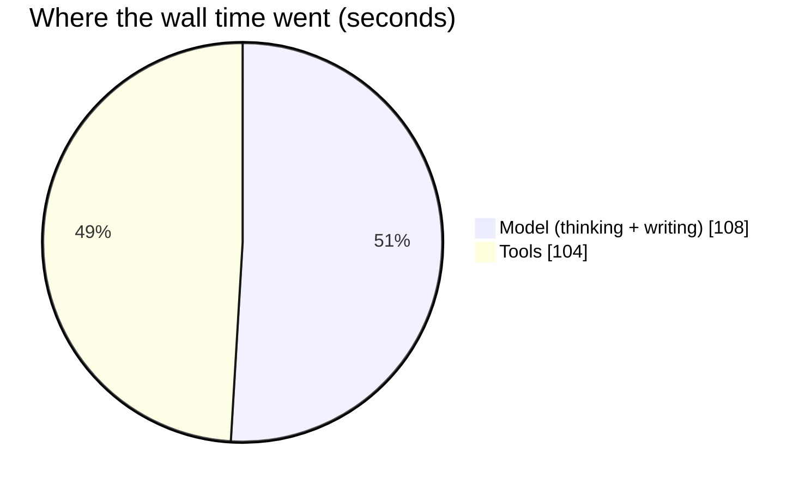

# firm-knowledge/tasks/229 · run1 (`hv-fk250-lunahigh-20261110T175632Z`)

Result: **fail** 0/3 criteria · 3.5 min · 17 model calls · 46 tool calls (0 errors or timeouts) · ending `completed` · started 11-11 00:57:10 IST

## Overview

One box per stretch of steps that used the same kind of tool (blue: looking/searching/reading, purple: writing or editing files, yellow: a message with no tool call, red border: a tool error or timeout inside the box).

```mermaid
flowchart TD
    T(["Task prompt"])
    P0["<b>Step 1</b> · 0.1 min<br/>todo_write"]
    T --> P0
    class P0 look
    P1["<b>Steps 2-4</b> · 0.4 min<br/>glob x4<br/>grep x4<br/><i>*, documents, . +2</i>"]
    P0 --> P1
    class P1 look
    P2["<b>Step 5</b> · 0.4 min<br/>bash x4<br/><i>parse-doc docx 'documents/matters/101…, parse-doc docx 'documents/matters/103…</i>"]
    P1 --> P2
    class P2 look
    P3["<b>Step 6</b> · 0.4 min<br/>glob x3<br/>grep<br/><i>., 1036-00004</i>"]
    P2 --> P3
    class P3 look
    P4["<b>Step 7</b> · 0.3 min<br/>bash x4<br/><i>parse-doc docx 'documents/matters/104…</i>"]
    P3 --> P4
    class P4 look
    P5["<b>Step 8</b> · 0.1 min<br/>glob x4<br/><i>.</i>"]
    P4 --> P5
    class P5 look
    P6["<b>Step 9</b> · 0.1 min<br/>read x4<br/><i>email-fairchild-to-devereaux-pinnacle…, email-fairchild-to-devereaux-closing-…, email-nakamura-to-pryce-psa-initial-d… +1</i>"]
    P5 --> P6
    class P6 look
    P7["<b>Step 10</b> · 0.4 min<br/>bash x4<br/><i>parse-doc docx 'documents/matters/103…, parse-doc xlsx 'documents/matters/103…, parse-doc docx 'documents/matters/104…</i>"]
    P6 --> P7
    class P7 look
    P8["<b>Step 11</b> · 0.2 min<br/>glob x3<br/>grep<br/><i>., 1036-00004</i>"]
    P7 --> P8
    class P8 look
    P9["<b>Step 12</b> · 0.3 min<br/>bash x4<br/><i>parse-doc docx 'documents/matters/103…, parse-doc docx 'documents/matters/101…, parse-doc docx 'documents/matters/104…</i>"]
    P8 --> P9
    class P9 look
    P10["<b>Step 13</b> · 0.2 min<br/>todo_write"]
    P9 --> P10
    class P10 look
    P11["<b>Step 14</b> · 0.4 min<br/>write<br/><i>response.md</i>"]
    P10 --> P11
    class P11 write
    P12["<b>Step 15</b> · 0.1 min<br/>read<br/>glob<br/><i>response.md, .</i>"]
    P11 --> P12
    class P12 look
    P13["<b>Step 16</b> · 0.1 min<br/>todo_write"]
    P12 --> P13
    class P13 look
    P14["<b>Step 17</b> · 0.0 min<br/>final message"]
    P13 --> P14
    class P14 ans
    R(["FAIL: 0/3 criteria"])
    P14 --> R
    class R fail
    classDef look fill:#e8f0fe,stroke:#4a6fa5,color:#111
    classDef write fill:#f3e8fd,stroke:#7b1fa2,color:#111
    classDef ans fill:#fff8e1,stroke:#b58900,color:#111
    classDef err fill:#e8f0fe,stroke:#c62828,stroke-width:3px,color:#111
    classDef pass fill:#e6f4ea,stroke:#2e7d32,color:#111
    classDef fail fill:#fce8e6,stroke:#c62828,color:#111
```





One row per model call:

| Step | Started (IST) | Model s | Tools s | Tool calls | Tools | Output chars |
|---|---|---|---|---|---|---|
| 1 | 00:57:10 | 3 | 0 | 1 | todo_write | 57 |
| 2 | 00:57:13 | 1 | 3 | 1 | glob | 8,520 |
| 3 | 00:57:17 | 3 | 4 | 3 | grep x2, glob | 3,429 |
| 4 | 00:57:24 | 5 | 6 | 4 | glob x2, grep x2 | 32,178 |
| 5 | 00:57:35 | 5 | 17 | 4 | bash x4 | 162,817 |
| 6 | 00:57:57 | 12 | 9 | 4 | glob x3, grep | 2,991 |
| 7 | 00:58:19 | 9 | 11 | 4 | bash x4 | 199,417 |
| 8 | 00:58:39 | 3 | 5 | 4 | glob x4 | 16,530 |
| 9 | 00:58:47 | 7 | 0 | 4 | read x4 | 35,716 |
| 10 | 00:58:54 | 4 | 21 | 4 | bash x4 | 178,207 |
| 11 | 00:59:20 | 5 | 6 | 4 | glob x3, grep | 7,049 |
| 12 | 00:59:31 | 4 | 16 | 4 | bash x4 | 195,040 |
| 13 | 00:59:51 | 13 | 0 | 1 | todo_write | 57 |
| 14 | 01:00:04 | 22 | 0 | 1 | write | 200 |
| 15 | 01:00:26 | 3 | 5 | 2 | read, glob | 8,069 |
| 16 | 01:00:34 | 5 | 0 | 1 | todo_write | 57 |
| 17 | 01:00:39 | 3 | 0 | 0 | (message only) | 0 |

## Task prompt

```text
I'm papering a new lease and want to work off our most recent form. What's the latest Real Estate matter where we negotiated an SNDA, and can you pull that document?

Output: write your complete answer to `response.md` — a single self-contained markdown file with your findings, the matters/documents you relied on, and your reasoning.
```

## Rubric

| # | Criterion | Verdict |
|---|---|---|
| C-001 | Qualifying matter — Metropolitan Transit Development Corp. 1031-00004 | **FAIL** |
| C-002 | Document — the executed SNDA | **FAIL** |
| C-003 | Latest-matter answer — precision | **FAIL** |

Judge's reasoning:

**C-001 (fail):** Qualifying matter — Metropolitan Transit Development Corp. 1031-00004

```text
The output identifies Matter 1036-00004 (Fairwater REIT) as the latest qualifying Real Estate SNDA matter, rather than the required Matter 1031-00004 involving Metropolitan Transit Development Corp. It therefore does not satisfy the criterion.
```

**C-002 (fail):** Document — the executed SNDA

```text
The output identifies Matter 1036-00004 and a clean PSA Exhibit F form, rather than the required executed SNDA from Matter 1031-00004 (MTDC), snda-ground-lessor.docx. It neither names nor clearly describes the required document.
```

**C-003 (fail):** Latest-matter answer — precision

```text
The output identifies Matter 1036-00004 (Fairwater REIT) as the latest qualifying Real Estate SNDA matter. The criterion requires that no matter other than 1031-00004 (Metropolitan Transit Development Corp.) be asserted as the latest, so the output does not satisfy it.
```

## Delivered files (output/)

- `response.md` (7,541 bytes)

`response.md`:

````markdown
# Latest Real Estate SNDA matter and document

## Bottom line

The latest **Real Estate** matter in which the firm negotiated SNDAs is **C&H Matter No. 1036-00004 — Fairwater Real Estate Investment Trust / acquisition of the 14-property Sun Belt logistics and office portfolio from Greystone Meridian Partners Fund III, L.P.** The engagement letter is dated **October 5, 2023**; the PSA is dated **February 28, 2024**; the transaction closed **June 6, 2024**; and the remaining post-closing SNDA deliveries were completed by **July 2, 2024**.

### Document to use as the latest clean form

**[PSA Exhibit F — Form of Subordination, Non-Disturbance and Attornment Agreement](../documents/matters/1036-00004/Transaction%20Documents/Exhibits/psa-exhibit-f-form-snda.docx)**

Workspace path:

```text
documents/matters/1036-00004/Transaction Documents/Exhibits/psa-exhibit-f-form-snda.docx
```

This is the most recent reusable SNDA form located in the matter. It is a clean, unexecuted template—not a tenant-specific signed SNDA—so its bracketed fields must be completed for the applicable property, landlord/Target Entity, tenant, lender, loan, recording information, governing law, and lease particulars.

## What the form covers

The form is **Exhibit F to the February 28, 2024 Purchase and Sale Agreement** between Fairwater and Greystone Meridian. It was designed for the portfolio's 38 Major Tenant SNDAs and adapts to the three existing lenders:

- Pinnacle Federal Bank, N.A.;
- Veltrano Capital Lending Corp.; and
- Sycamore Life Insurance Company.

Its principal protections and mechanics are:

- **Subordination:** the lease is subordinate to the applicable mortgage/loan documents, expressly conditioned on the lender's non-disturbance covenant.
- **Non-disturbance:** a foreclosure event does not terminate or interfere with the tenant's possession or lease rights while the tenant is not in uncured default; the form expressly preserves options, renewal rights, expansion rights, purchase/ROFR/ROFO rights, assignment/subletting rights, signage rights, and other lease benefits.
- **Attornment:** the tenant attorns to a lender or foreclosure purchaser as successor landlord, with the lease continuing as a direct lease.
- **Successor-landlord limitations:** customary limitations address prior landlord defaults, offsets and defenses, prepaid rent, unauthorized lease amendments, security deposits/letters of credit, and unfunded tenant-improvement obligations.
- **Tenant and lender mechanics:** notice to the lender of landlord defaults, lender cure periods, restrictions on material lease amendments or termination without lender consent, and treatment of casualty/condemnation proceeds.
- **State-specific completion:** governing law, recording office, notary blocks, property legal description, and lease-identification schedule are to be completed for the applicable state and property.

## Why Matter 1036-00004 is the latest qualifying matter

1. **It expressly includes SNDA negotiation and coordination.** The engagement letter assigns the Real Estate team responsibility for tenant estoppels and SNDAs. The January 8, 2024 PSA transmittal email identifies an SNDA requirement for all Major Tenants and identifies **Exhibit F** as the form of SNDA.
2. **The SNDA work was actually negotiated and implemented.** The June 3, 2024 closing-readiness email reports that 34 of 38 required SNDAs were executed and that Buyer and Seller negotiated a post-closing carve-out for the remaining four, secured by a **$200,000 holdback**. The compliance certificate confirms the form-compliance review and the negotiated carve-out mechanism.
3. **It is later than the other clear lease-SNDA matter.** Matter **1017-00009**, the Aurelius headquarters lease at 787 Seventh Avenue, New York, opened April 6, 2023 and produced a signed SNDA dated July 10, 2023. Matter 1036-00004 has the later engagement and later SNDA form/work product.
4. **A newer Real Estate matter does not qualify on the evidence reviewed.** Matter **1043-00002** opened March 12, 2025 and concerns a data-center development. Its opening memorandum and workstream files cover land acquisition, construction financing, EPC, easements, and development matters; they do not show a negotiated SNDA workstream or a clean SNDA deliverable. A draft deed of trust contains only a generic requirement that leases be subordinate or accompanied by an SNDA, which is not evidence of an SNDA negotiation comparable to Matter 1036-00004.

## Related documents relied on

- **Engagement letter — Fairwater REIT:**
  `documents/matters/1036-00004/Engagement & Matter Management/engagement-letter-fairwater.docx`  
  Identifies the client, the portfolio acquisition, the Real Estate team, and SNDA coordination as a staffed responsibility; dated October 5, 2023.

- **Initial PSA transmittal email:**
  `documents/matters/1036-00004/Correspondence/email-nakamura-to-pryce-psa-initial-draft-transmittal.eml`  
  Dated January 8, 2024; states that Buyer must deliver SNDAs to all Major Tenants and identifies Exhibit F as the form of SNDA.

- **Closing-readiness email:**
  `documents/matters/1036-00004/Correspondence/email-fairchild-to-devereaux-closing-readiness.eml`  
  Dated June 3, 2024; reports 34 of 38 SNDAs executed, four subject to a negotiated post-closing carve-out, a 30-day delivery period, and a $200,000 seller-proceeds holdback.

- **Estoppel and SNDA compliance certificate:**
  `documents/matters/1036-00004/Estoppels & SNDAs/estoppel-snda-compliance-certificate.docx`  
  Dated June 6, 2024; confirms 38 required SNDAs, 34 executed at closing, four covered by the negotiated carve-out, and review of the executed documents for conformity to Exhibit F.

- **Executed SNDA compilation:**
  `documents/matters/1036-00004/Estoppels & SNDAs/snda-compilation-executed.docx`  
  A signed precedent/closing binder containing the executed compilation and substantive description of the 34 SNDAs delivered at closing. It is useful for execution and signature-block precedent, but it is not the clean form requested for reuse.

- **SNDA post-closing carve-out side letter:**
  `documents/matters/1036-00004/Estoppels & SNDAs/snda-post-closing-carveout-side-letter.docx`  
  Dated June 6, 2024; documents the negotiated post-closing delivery mechanism and holdback.

- **Earlier signed comparison document:**
  `documents/matters/1017-00009/Transaction Documents/snda-execution.docx`  
  Executed July 10, 2023 for Aurelius Media Holdings Inc.'s 787 Seventh Avenue lease; useful as an older single-tenant lease precedent, but superseded for purposes of identifying the latest form.

## Important reconciliation point before reuse

The Matter 1036 closing materials are not fully consistent about the identities of the four SNDAs that were outstanding at the June 6 closing: the executed compilation, the post-closing side letter, and the tracking spreadsheet give different tenant/property names, while the compliance certificate reports the counts and property-level status. That inconsistency does **not** change the conclusion that **PSA Exhibit F is the latest clean form**, but the tenant-specific outstanding-SNDA schedule should be reconciled against the final executed documents and closing records before a new lease package is circulated.

**Recommendation:** use the linked **PSA Exhibit F form** as the starting template, and consult the executed compilation only for a completed signature/execution example and tenant- or lender-specific language.
````

## Trajectory

### Step 1: 1 tool call

_Started 11-11 00:57:10 IST · model 3 s · tools 0 s_

**Reasoning summary:**

```text
**Inspecting documents**

I need to inspect some documents for the latest Real Estate matter related to the SNDA negotiation. First, I'll consider using my skills to retrieve the document. I’ll start by listing the relevant files using a glob search. It looks like this will likely involve a multi-step process, so I’ll be prepared for that. I just want to make sure I handle everything properly and accurately!
```

**Call `todo_write`** (0.0 s)

```json
{
 "todos": [
  {
   "content": "Inspect available matter and document files",
   "status": "in_progress"
  },
  {
   "content": "Identify latest Real Estate matter involving SNDA negotiation",
   "status": "pending"
  },
  {
   "content": "Locate and copy or link the relied-on document",
   "status": "pending"
  },
  {
   "content": "Write self-contained findings to response.md",
   "status": "pending"
  },
  {
   "content": "Verify output and document references",
   "status": "pending"
  }
 ]
}
```

Output (57 chars):

```text
Updated todo list: 4 pending, 1 in progress, 0 completed.
```

**Todo list now:**

- [~] Inspect available matter and document files
- [ ] Identify latest Real Estate matter involving SNDA negotiation
- [ ] Locate and copy or link the relied-on document
- [ ] Write self-contained findings to response.md
- [ ] Verify output and document references

### Step 2: 1 tool call

_Started 11-11 00:57:13 IST · model 1 s · tools 3 s_

**Call `glob`** (2.7 s)

```json
{
 "pattern": "*"
}
```

Output (8,520 chars):

```text
documents/matters/1001-00001/Antitrust Analysis/competitor-identification-chart.xlsx
documents/matters/1001-00001/Antitrust Analysis/portfolio-company-overlap-analysis.docx
documents/matters/1001-00001/Antitrust Analysis/hhi-concentration-analysis.xlsx
documents/matters/1001-00001/Antitrust Analysis/market-definition-competitive-analysis-memo.docx
documents/matters/1001-00001/Client Updates/biweekly-status-report-1.docx
documents/matters/1001-00001/Antitrust Analysis/preliminary-antitrust-risk-assessment.docx
documents/matters/1001-00001/Antitrust Analysis/state-regulatory-con-analysis.docx
documents/matters/1001-00001/Antitrust Analysis/vertical-relationships-analysis.docx
documents/matters/1001-00001/Closing/closing-memo-antitrust-workstream.docx
documents/matters/1001-00001/Client Updates/client-update-early-termination-granted.eml
documents/matters/1001-00001/Client Updates/biweekly-status-report-2.docx
documents/matters/1001-00001/Client Updates/client-update-hsr-forms-filed.eml
documents/matters/1001-00001/Closing/final-invoice-matter-closing-letter.docx
documents/matters/1001-00001/Closing/hsr-clearance-certificate.docx
documents/matters/1001-00001/Correspondence/Counterparty Counsel/email-gk-naics-code-consistency.eml
documents/matters/1001-00001/Early Termination/early-termination-request-letter.docx
documents/matters/1001-00001/Correspondence/Counterparty Counsel/letter-bracewell-thornton-regulatory-condition.docx
documents/matters/1001-00001/Correspondence/Counterp
… [7,020 more chars]
```

### Step 3: 3 tool calls

_Started 11-11 00:57:17 IST · model 3 s · tools 4 s_

**Reasoning summary:**

```text
**Identifying real estate files**

I’m looking at 9,288 files and thinking I need to find anything related to real estate, specifically looking for metadata documents. My plan is to search for filenames that include "SNDA" and also use grep to search the contents for mentions of "SNDA" and anything else relevant to real estate. There's definitely a lot to sift through, but I’m hopeful I can identify what I need efficiently!
```

**Call `glob`** (1.2 s)

```json
{
 "pattern": "**/*SNDA*",
 "path": "documents"
}
```

Output (14 chars):

```text
No files found
```

**Call `grep`** (1.3 s)

```json
{
 "pattern": "SNDA|subordination, non[- ]?disturbance|non[- ]?disturbance",
 "path": "documents"
}
```

Output (3,399 chars):

```text
Found 33 matches

documents/matters/1017-00009/Lease Negotiation/final-business-terms-email.eml
Line 124: **19. SNDA:** Atlas Continental Bank, N.A. (existing first mortgagee) shall e=
Line 148: On a parallel track, SNDA negotiations with Atlas Continental Bank and its co=
Line 150: inate timing between the lease execution and the SNDA delivery to ensure we d=

documents/matters/1017-00009/Correspondence/snda-negotiation-email.eml
Line 6:  Avenue, New York, NY 10019 — Tenant's Comments on Initial SNDA Form
Line 16: nment Agreement (the "SNDA") that your office circulated on behalf of Atlas C=
Line 21: As you know, the SNDA arises in connection with the Agreement of Lease (the "=
Line 28: n executed SNDA is a condition precedent to the Commencement Date under the L=
Line 29: ease, and accordingly the parties share an interest in bringing the SNDA to c=
Line 32: Attached for your review is our redline markup of the initial SNDA form, toge=
Line 34: e **SNDA - Tenant Redline (06.20.2023).docx**. I have set forth below a summa=
Line 48: As currently drafted, the non-disturbance protections in the initial form are=
Line 50: f the demised premises. Tenant's redline broadens the non-disturbance covenan=
Line 95: Section 7 of the initial SNDA form vests Lender with absolute control over in=
Line 116: ortgage, provided the non-disturbance protections described above are satisfa=
Line 131: - **Governing Law.** Tenant requests that the SNDA be governed by the laws of=
Line 136: that Len
… [1,899 more chars]
```

**Call `grep`** (1.5 s)

```json
{
 "pattern": "Real Estate|real estate",
 "path": "documents",
 "include": "*.docx"
}
```

Output (16 chars):

```text
No matches found
```

### Step 4: 4 tool calls

_Started 11-11 00:57:24 IST · model 5 s · tools 6 s_

**Reasoning summary:**

```text
**Searching for lease negotiations**

I'm looking into candidates like 1017-00009 for possible lease negotiations and 1036-00004 related to a portfolio. I want to find the latest real estate matters where a negotiated SNDA is involved. I need to determine important dates and practice categories, as well as inspect necessary documents. I'll search for filenames with "matter-opening" and identify all SNDA mentions. However, I have to consider that grep might not yield results with unreadable docx files, so I need to parse the relevant emails next.
```

**Call `glob`** (1.7 s)

```json
{
 "pattern": "documents/matters/1017-00009/**/*",
 "path": "."
}
```

Output (2,948 chars):

```text
./documents/matters/1017-00009/Closing/aurelius-plc-board-minutes-extract.docx
./documents/matters/1017-00009/Closing/good-standing-request-letters.docx
./documents/matters/1017-00009/Closing/closing-checklist.xlsx
./documents/matters/1017-00009/Closing/letter-of-credit-transmittal.docx
./documents/matters/1017-00009/Closing/tenant-officers-certificate.docx
./documents/matters/1017-00009/Closing/tenant-board-resolutions.docx
./documents/matters/1017-00009/Closing/insurance-certificate-transmittal.docx
./documents/matters/1017-00009/Correspondence/post-closing-summary-letter.docx
./documents/matters/1017-00009/Correspondence/snda-negotiation-email.eml
./documents/matters/1017-00009/Engagement/conflict-check-memorandum.docx
./documents/matters/1017-00009/Diligence/Zoning/survey-zoning-review-memo.docx
./documents/matters/1017-00009/Diligence/Title/title-commitment-review-memo.docx
./documents/matters/1017-00009/Diligence/landlord-financial-diligence-memo.docx
./documents/matters/1017-00009/Diligence/Environmental/environmental-report-summary-memo.docx
./documents/matters/1017-00009/Lease Negotiation/change-of-control-analysis-memo.docx
./documents/matters/1017-00009/Engagement/engagement-letter.docx
./documents/matters/1017-00009/Engagement/matter-opening-memo.docx
./documents/matters/1017-00009/Engagement/fee-estimate-memo.docx
./documents/matters/1017-00009/Lease Negotiation/first-comment-letter.docx
./documents/matters/1017-00009/Lease Negotiation/lease-redline-v1.docx
./doc
… [1,448 more chars]
```

**Call `glob`** (1.1 s)

```json
{
 "pattern": "documents/matters/1036-00004/**/*",
 "path": "."
}
```

Output (9,099 chars):

```text
./documents/matters/1036-00004/Closing/Assignments/assignment-membership-interests-alliance.docx
./documents/matters/1036-00004/Closing/Assignments/assignment-membership-interests-buckhead.docx
./documents/matters/1036-00004/Closing/Assignments/assignment-membership-interests-katy.docx
./documents/matters/1036-00004/Closing/Assignments/assignment-membership-interests-mount-juliet.docx
./documents/matters/1036-00004/Closing/Assignments/assignment-membership-interests-brickell.docx
./documents/matters/1036-00004/Closing/Assignments/assignment-membership-interests-peachtree.docx
./documents/matters/1036-00004/Closing/Assignments/assignment-membership-interests-fairfield-ii.docx
./documents/matters/1036-00004/Closing/Assignments/assignment-membership-interests-cool-springs.docx
./documents/matters/1036-00004/Closing/Assignments/assignment-membership-interests-fairfield-i.docx
./documents/matters/1036-00004/Closing/Assignments/assignment-membership-interests-lakeland.docx
./documents/matters/1036-00004/Closing/Assignments/assignment-membership-interests-murfreesboro.docx
./documents/matters/1036-00004/Closing/Funds Flow/funds-flow-memorandum.xlsx
./documents/matters/1036-00004/Closing/Assignments/assignment-membership-interests-southport.docx
./documents/matters/1036-00004/Closing/Assignments/assignment-membership-interests-southpark.docx
./documents/matters/1036-00004/Closing/Assignments/assignment-membership-interests-westlake.docx
./documents/matters/1036-00004/Closing/Funds Fl
… [7,599 more chars]
```

**Call `grep`** (2.0 s)

```json
{
 "pattern": "matter|Matter|Practice|Real Estate|Date|opened|closing|lease",
 "path": "documents/matters/1017-00009",
 "include": "*.eml"
}
```

Output (1,975 chars):

```text
Found 24 matches

documents/matters/1017-00009/Lease Negotiation/final-business-terms-email.eml
Line 4: Date: Wed, 28 Jun 2023 04:47:00 -0000
Line 16: a Holdings Inc. ("Tenant") for the lease of premises at 787 Seventh Avenue, N=
Line 18: ate the preparation of the final lease form and is subject in all respects to=
Line 30: **3. Commencement Date:** August 1, 2023.
Line 32: **4. Rent Commencement Date:** February 1, 2024 (following a six-month rent-f=
Line 35: **5. Expiration Date:** July 31, 2038.
Line 47: ement Date through January 31, 2024.
Line 61: ent at a rate of 7.5% per annum over the remaining lease term.
Line 105: as of the Lease Date); (ii) the successor entity assumes in writing all oblig=
Line 114: C shall be released from its guaranty obligations prospectively from and afte=
Line 126: n favor of Tenant, as a condition precedent to the Commencement Date.
Line 138: th our associates =E2=80=94 will begin preparing the final lease form reflect=
Line 139: ing the foregoing. Please let us know whether Pemberton Locke & Strauss inten=
Line 150: inate timing between the lease execution and the SNDA delivery to ensure we d=
Line 151: o not create any gap that would delay the Commencement Date. I would welcome =
Line 155: complete and should not present any obstacles to closing on the anticipated t=
Line 181: unication in error, please notify the sender immediately by reply email and p=

documents/matters/1017-00009/Correspondence/snda-negotiation-email.eml
Line 4: Date:
… [475 more chars]
```

**Call `grep`** (1.1 s)

```json
{
 "pattern": "matter|Matter|Practice|Real Estate|Date|opened|closing|lease",
 "path": "documents/matters/1036-00004",
 "include": "*.eml"
}
```

Output (18,156 chars):

```text
Found 212 matches

documents/matters/1036-00004/Correspondence/email-hartwell-to-ikeda-transfer-tax.eml
Line 5: Date:
Line 16: eystone Meridian Partners Fund III, L.P. (C&H Matter No. 1036-00004) to coord=
Line 20: As you know, closing is currently anticipated for May 31, 2024, though there =
Line 23: treams are well in hand regardless of how the closing date lands.
Line 139: *$1,925,000**. These amounts will be reflected on the closing settlement stat=
Line 146: To ensure we are fully aligned ahead of closing, I would appreciate your assi=
Line 149: 1. **Allocation Confirmation.** Please confirm the purchase price allocation =
Line 158: 3. **Appraisal Reports.** Please let us know whether Ashford Prewitt needs an=
Line 163:  before the anticipated closing date so that they can be finalized and execut=
Line 164: ed at closing. We will circulate the draft returns as attachments in a follow=
Line 167: 5. **Funds Flow / Withholding.** Please confirm that the transfer tax payment=
Line 168: s will be wired at closing per the funds flow memorandum that C&H is currentl=
Line 177: Could you please confirm receipt of this email and provide any comments or qu=
Line 180: ugh the calculations in detail. Please just let me know what works, and Grace=
Line 184: this to a smooth closing.
Line 196: *C&H Matter No. 1036-00004*
Line 205: tion is strictly prohibited. If you have received this email in error, please=

documents/matters/1036-00004/Correspondence/email-fairchild-to-devereaux-clos
… [16,656 more chars]
```

### Step 5: 4 tool calls

_Started 11-11 00:57:35 IST · model 5 s · tools 17 s_

**Call `bash`** (3.4 s)

```json
{
 "command": "parse-doc docx 'documents/matters/1017-00009/Engagement/matter-opening-memo.docx'",
 "workdir": ".",
 "timeoutMs": 120000,
 "description": "Read lease matter opening memo"
}
```

Output (41,835 chars):

```text
**[MEMORANDUM]{.underline}**

**CONFIDENTIAL --- ATTORNEY WORK PRODUCT**

**TO:** Angela Fontaine, Billing Partner, Real Estate

**FROM:** Douglas Fairchild, Responsible Partner, Real Estate

**DATE:** April 6, 2023

**RE:** Matter Opening --- Aurelius Global Media Group PLC Headquarters Lease, 787 Seventh Avenue, New York, NY 10019

**MATTER NO.:** 1017-00009

**[I. Purpose of Memorandum]{.underline}**

This memorandum memorializes the opening of a new real estate matter for Calderwood & Harkness LLP\'s representation of Aurelius Global Media Group PLC (\"Aurelius\" or \"AGMG\") and its United States operating subsidiary, Aurelius Media Holdings Inc. (\"AMH\" or \"Tenant\"), in connection with the negotiation and documentation of a long-term headquarters lease at Greystone Tower, 787 Seventh Avenue, New York, NY 10019 (the \"Building\"). The engagement letter between Calderwood & Harkness LLP and Aurelius was executed today, April 6, 2023, following a period of preliminary discussions with Aurelius\'s General Counsel. The matter is now open and active in the firm\'s matter management and billing systems under matter number 1017-00009. This memorandum is intended to provide the Billing Partner with a comprehensive overview of the engagement, the client, the transaction, the staffing plan, the estimated budget, the projected timeline, and the key deal terms so that appropriate billing protocols and budget monitoring may be established at the outset of the engagement.

**[II. C
… [40,334 more chars]
```

**Call `bash`** (2.5 s)

```json
{
 "command": "parse-doc docx 'documents/matters/1036-00004/Engagement & Matter Management/engagement-letter-fairwater.docx'",
 "workdir": ".",
 "timeoutMs": 120000,
 "description": "Read portfolio engagement letter"
}
```

Output (32,885 chars):

```text
CONFIDENTIAL --- ATTORNEY-CLIENT PRIVILEGED

**CALDERWOOD & HARKNESS LLP** 450 Park Avenue, 28th Floor New York, New York 10022 Tel: (212) 554-8000

Fax: (212) 554-8001

1700 K Street NW, Suite 900 Washington, DC 20006 Tel: (202) 331-6200

Fax: (202) 331-6201

October 5, 2023

David Elgin Park, Esq. General Counsel Fairwater Real Estate Investment Trust 7200 Chesapeake Parkway, Suite 1100 Columbia, Maryland 21044

> cc: Marcus Devereaux, EVP, Acquisitions Fairwater Real Estate Investment Trust 7200 Chesapeake Parkway, Suite 1100 Columbia, Maryland 21044
>
> cc: Camille Oduya, Esq., In-House Real Estate Counsel Fairwater Real Estate Investment Trust 7200 Chesapeake Parkway, Suite 1100 Columbia, Maryland 21044

**Re:** Representation of Fairwater Real Estate Investment Trust in connection with the proposed acquisition of a 14-property Sun Belt logistics and office portfolio from Greystone Meridian Partners Fund III, L.P.

**Matter Number:** 1036-00004

Dear David:

We are pleased to provide this engagement letter (this \"Engagement Letter\") setting forth the terms and conditions upon which Calderwood & Harkness LLP (the \"Firm,\" \"we,\" or \"us\") will represent Fairwater Real Estate Investment Trust (\"Fairwater\" or the \"Company\") as outside counsel in the matter referenced above. This letter, together with the Firm\'s standard Terms of Engagement enclosed herewith, constitutes the entire agreement between the Firm and the Company with respect to this engagement and super
… [31,384 more chars]
```

**Call `bash`** (4.8 s)

```json
{
 "command": "parse-doc docx 'documents/matters/1036-00004/Estoppels & SNDAs/snda-compilation-executed.docx'",
 "workdir": ".",
 "timeoutMs": 120000,
 "description": "Read executed SNDA compilation"
}
```

Output (49,935 chars):

```text
**[SUBORDINATION, NON-DISTURBANCE AND ATTORNMENT AGREEMENTS]{.underline}**

**[EXECUTED COMPILATION]{.underline}**

**[34 of 38 Required SNDAs]{.underline}**

 

**FAIRWATER REAL ESTATE INVESTMENT TRUST**

*Acquisition of 14-Property Sun Belt Logistics & Office Portfolio*

*from*

**GREYSTONE MERIDIAN PARTNERS FUND III, L.P.**

 

**Purchase Price: \$1,100,000,000**

**Closing Date: June 6, 2024**

 

 

*Prepared by:*

**Calderwood & Harkness LLP** 450 Park Avenue, 28th Floor New York, New York 10022

**Matter Number: 1036-00004**

 

 

This binder contains thirty-four (34) of the thirty-eight (38) required Subordination, Non-Disturbance and Attornment Agreements (\"SNDAs\") executed by Major Tenants (as defined in the Purchase and Sale Agreement) on or before the closing date of June 6, 2024. The remaining four (4) SNDAs are subject to a post-closing delivery carve-out pursuant to the SNDA Post-Closing Carve-Out Side Letter dated as of June 6, 2024, between Seller and Buyer, with a thirty (30)-day post-closing delivery deadline of July 6, 2024, and a Two Hundred Thousand Dollars (\$200,000) holdback from Seller proceeds pending delivery. Actual post-closing delivery of all four (4) outstanding SNDAs was completed on July 2, 2024, four (4) days in advance of the post-closing delivery deadline. The holdback was released to Seller on July 3, 2024.

 

**CONFIDENTIAL --- ATTORNEY WORK PRODUCT / PRIVILEGED**

*This compilation and all materials contained herein are protected by
… [48,435 more chars]
```

**Call `bash`** (6.8 s)

```json
{
 "command": "parse-doc docx 'documents/matters/1036-00004/Estoppels & SNDAs/snda-post-closing-carveout-side-letter.docx'",
 "workdir": ".",
 "timeoutMs": 120000,
 "description": "Read SNDA carveout side letter"
}
```

Output (38,162 chars):

```text
**SIDE LETTER RE: POST-CLOSING DELIVERY OF** **SUBORDINATION, NON-DISTURBANCE AND ATTORNMENT AGREEMENTS**

June 6, 2024

Fairwater Real Estate Investment Trust 7200 Chesapeake Parkway, Suite 1100 Columbia, Maryland 21044

Attention: David Elgin Park, General Counsel

Greystone Meridian Partners Fund III, L.P. c/o Greystone Meridian Capital LLC 3300 Peachtree Road NE, Suite 2200 Atlanta, Georgia 30326

Attention: Victor Lansdell, Co-Founder & Managing Partner

Ladies and Gentlemen:

This Side Letter Re: Post-Closing Delivery of Subordination, Non-Disturbance and Attornment Agreements (this \"**Side Letter**\") is entered into as of June 6, 2024, by and between:

**Fairwater Real Estate Investment Trust**, a Maryland real estate investment trust (\"**Buyer**\"), with principal offices at 7200 Chesapeake Parkway, Suite 1100, Columbia, Maryland 21044; and

**Greystone Meridian Partners Fund III, L.P.**, a Delaware limited partnership (\"**Seller**\"), with principal offices at 3300 Peachtree Road NE, Suite 2200, Atlanta, Georgia 30326, acting by and through its general partner, **Greystone Meridian Capital LLC**, a Delaware limited liability company.

Buyer and Seller are sometimes referred to herein individually as a \"**Party**\" and collectively as the \"**Parties**.\"

**[RECITALS]{.underline}**

**WHEREAS**, Buyer and Seller are parties to that certain Purchase and Sale Agreement, dated as of February 28, 2024 (the \"**Original PSA**\"), as amended by that certain First Amen
… [36,661 more chars]
```

### Step 6: 4 tool calls

_Started 11-11 00:57:57 IST · model 12 s · tools 9 s_

**Reasoning summary:**

```text
**Addressing document inconsistency**

I recognize there's an important inconsistency with the snda-compilation indicating four outstanding names differ from the side letter due to a synthetic inconsistency. The user may expect an answer based on the latest Real Estate matter with the most recent date, which seems to be matter 1036. I'll need to pull the relevant document for them and consider how to format the output, ensuring it meets their request precisely with the necessary details included.

**Clarifying user request**

The user specifically asked for a complete answer in a single self-contained markdown file named response.md, which likely means not to copy the entire document. I could link to the source document in markdown and reference its path while noting it's part of the "pulled" document. The question about retrieving the document suggests they want directions to it, but I should verify details about the latest matter, likely 1036, including its opening date and real estate classification. I'll list the names when I have that information.
```

**Call `glob`** (1.0 s)

```json
{
 "pattern": "documents/matters/1036-00004/Engagement & Matter Management/*",
 "path": "."
}
```

Output (479 chars):

```text
./documents/matters/1036-00004/Engagement & Matter Management/budget-fee-estimate-memorandum.xlsx
./documents/matters/1036-00004/Engagement & Matter Management/engagement-letter-supplement-tax.docx
./documents/matters/1036-00004/Engagement & Matter Management/matter-staffing-memorandum.docx
./documents/matters/1036-00004/Engagement & Matter Management/conflict-check-memorandum.docx
./documents/matters/1036-00004/Engagement & Matter Management/engagement-letter-fairwater.docx
```

**Call `glob`** (3.3 s)

```json
{
 "pattern": "documents/matters/1011-00007/**/*",
 "path": "."
}
```

Output (997 chars):

```text
./documents/matters/1011-00007/Analyses & Memos/loi-review-memorandum.docx
./documents/matters/1011-00007/Analyses & Memos/phase-i-esa-review-memo.docx
./documents/matters/1011-00007/Analyses & Memos/site-plan-change-impact-analysis.docx
./documents/matters/1011-00007/Correspondence/dormancy-status-memo-and-client-email.eml
./documents/matters/1011-00007/Transaction Documents/draft-limited-guaranty.docx
./documents/matters/1011-00007/Correspondence/letter-to-wbc-site-plan-concerns.docx
./documents/matters/1011-00007/Correspondence/lease-comments-letter-to-wbc.docx
./documents/matters/1011-00007/Engagement/engagement-letter-mcb-lease.docx
./documents/matters/1011-00007/Transaction Documents/landlord-first-draft-lease.docx
./documents/matters/1011-00007/Transaction Documents/lease-second-markup-draft-undelivered.docx
./documents/matters/1011-00007/Transaction Documents/lease-first-markup-redline.docx
./documents/matters/1011-00007/Transaction Documents/landlord-second-draft-lease.docx
```

**Call `glob`** (2.2 s)

```json
{
 "pattern": "documents/matters/*/Engagement*/matter-opening*",
 "path": "."
}
```

Output (1,499 chars):

```text
./documents/matters/1001-00001/Engagement & Administration/matter-opening-memorandum.docx
./documents/matters/1001-00004/Engagement & Administrative/matter-opening-memorandum.docx
./documents/matters/1009-00004/Engagement & Administration/matter-opening-memo.docx
./documents/matters/1009-00007/Engagement/matter-opening-memo.docx
./documents/matters/1014-00005/Engagement & Administrative/matter-opening-memorandum.docx
./documents/matters/1015-00002/Engagement & Administration/matter-opening-memo.docx
./documents/matters/1016-00003/Engagement and Administrative/matter-opening-form.docx
./documents/matters/1016-00005/Engagement & Conflicts/matter-opening-memorandum.docx
./documents/matters/1017-00009/Engagement/matter-opening-memo.docx
./documents/matters/1018-00004/Engagement/matter-opening-memo.docx
./documents/matters/1025-00007/Engagement & Administration/matter-opening-memo.docx
./documents/matters/1025-00008/Engagement & Administration/matter-opening-memo.docx
./documents/matters/1035-00005/Engagement & Administration/matter-opening-memo.docx
./documents/matters/1036-00001/Engagement & Administration/matter-opening-memorandum.docx
./documents/matters/1043-00002/Engagement & Administration/matter-opening-memo.docx
./documents/matters/1044-00004/Engagement & Administration/matter-opening-memorandum.docx
./documents/matters/1044-00005/Engagement & Administration/matter-opening-memorandum.docx
./documents/matters/1045-00004/Engagement & Administration/matter-opening-memo.docx
```

**Call `grep`** (2.7 s)

```json
{
 "pattern": "SNDA|Subordination|non-disturbance|attornment",
 "path": "documents/matters/1036-00004",
 "include": "*.docx"
}
```

Output (16 chars):

```text
No matches found
```

### Step 7: 4 tool calls

_Started 11-11 00:58:19 IST · model 9 s · tools 11 s_

**Reasoning summary:**

```text
**Following developer instructions**

I need to use the grep tool, not shell grep or rg, to search within file contents. So, I should definitely avoid shell grep. Maybe I could use `parse-doc` based on filenames or metadata. It seems like I need to check the latest IDs from the openings, like 1045, 1044, 1043, to know their dates and scope. I'll also look for any relevant matters like Real Estate or SNDA. I'll use multi parallel parse docs for the latest IDs and engagement letters before reviewing everything.
```

**Call `bash`** (2.8 s)

```json
{
 "command": "parse-doc docx 'documents/matters/1045-00004/Engagement & Administration/matter-opening-memo.docx'",
 "workdir": ".",
 "timeoutMs": 120000,
 "description": "Read latest matter opening memo"
}
```

Output (49,943 chars):

```text
terclaim Plaintiff).** Marcus J. Kappel is the founder, Chief Executive Officer, and majority equity holder of Triton Harbor, holding a 72% membership interest in the company. Mr. Kappel is 58 years of age and has over 30 years of experience in the marine industrial services industry. Prior to founding Triton Harbor in 2009, Mr. Kappel served as a senior executive at Atlantic Basin Marine Corp., a publicly traded company in the same industry sector. His extensive industry experience and executive background are relevant to the sophistication-of-borrower defense discussed in Section IV below.

Mr. Kappel executed the original limited personal guaranty of \$4,500,000 in connection with the closing of the original credit facility on June 15, 2021. Significantly, he subsequently executed an amended unlimited personal guaranty as part of the October 6, 2023 Forbearance Agreement. The expansion of his personal guaranty from a \$4.5 million cap to an unlimited obligation is a central element of the counterclaim narrative, as THI alleges that BRB induced this expansion through fraudulent misrepresentations regarding future lending intentions.

Mr. Kappel\'s residence is located at 14 Birchmont Lane, Westport, CT 06880, which was pledged as additional collateral under the Forbearance Agreement.

**4. Elaine D. Kappel (Personal Guarantor / Counterclaim Plaintiff).** Elaine D. Kappel is the spouse of Marcus Kappel, a 28% equity member of Triton Harbor, and the company\'s Chief Financial
… [48,443 more chars]
```

**Call `bash`** (2.8 s)

```json
{
 "command": "parse-doc docx 'documents/matters/1044-00005/Engagement & Administration/matter-opening-memorandum.docx'",
 "workdir": ".",
 "timeoutMs": 120000,
 "description": "Read adjacent matter opening memo"
}
```

Output (49,683 chars):

```text
**CALDERWOOD & HARKNESS LLP**

CONFIDENTIAL --- INTERNAL

**MEMORANDUM**

**TO:** Matter Administration Department

**FROM:** James Prentice, Sandra Tung

**DATE:** September 22, 2022

**RE:** New Matter Opening --- Thalassa Shipping & Logistics SA --- Customs Classification and Valuation Dispute

**[1. Matter Identification]{.underline}**

The following table sets forth the key identifying information for this new matter. All records, billing entries, time entries, and internal communications should reference the matter number designated below.

  ----------------------------------------------------------------------------------------------------------------------------------------------------------------------------
  **Field**                           **Information**
  ----------------------------------- ----------------------------------------------------------------------------------------------------------------------------------------
  **Matter Number**                   C&H-2022-ITS-04781

  **Client**                          Thalassa Shipping & Logistics Société Anonyme (EORI: GR094827361000; AFM: 094827361; Piraeus Commercial Registry No. 78214/06/B/09/42)

  **Client Short Name**               TSL, Thalassa

  **Client Entity Type**              Ανώνυμη Εταιρεία (A.E. / Société Anonyme) under Greek law

  **Client Address**                  47 Akti Miaouli, 185 35 Piraeus, Greece

  **Primary Client Contact**          Nikolaos Andreadis, Chairman & Chief Executi
… [48,183 more chars]
```

**Call `bash`** (2.4 s)

```json
{
 "command": "parse-doc docx 'documents/matters/1044-00004/Engagement & Administration/matter-opening-memorandum.docx'",
 "workdir": ".",
 "timeoutMs": 120000,
 "description": "Read prior matter opening memo"
}
```

Output (49,884 chars):

```text
**CONFIDENTIAL --- INTERNAL MEMORANDUM**

**CALDERWOOD & HARKNESS LLP** **125 Broad Street, New York, NY 10004**

**MATTER OPENING MEMORANDUM**

**TO:** New Matter File

**FROM:** Robert Adeyemi, Responsible Partner, Capital Markets

**DATE:** June 13, 2022

**RE:** Matter Opening --- Thalassa Shipping & Logistics SA --- \$400,000,000 Senior Secured Notes due 2029

**MATTER NO.:** 1044-00004

**CLIENT NO.:** 80214-TSL

**PRACTICE AREA:** Capital Markets

**STATUS:** Active --- New Engagement

Right-click to update Table of Contents

**[1. Purpose]{.underline}**

This memorandum establishes the new matter file for Calderwood & Harkness LLP\'s representation of Thalassa Shipping & Logistics SA (\"TSL\" or the \"Issuer\") as issuer\'s counsel in connection with a proposed offering of \$400,000,000 aggregate principal amount of Senior Secured Notes due 2029 (the \"Notes\" or the \"Offering\"). Calderwood & Harkness LLP (\"C&H\" or the \"Firm\") has been retained as lead international counsel to the Issuer, and this memorandum sets forth the relevant client information, transaction summary, engagement scope, staffing, billing arrangements, conflicts clearance, and anticipated timeline necessary to facilitate the orderly administration of this matter.

This memorandum is to be circulated to the Firm\'s Conflicts Committee, the Finance and Billing Department, and Capital Markets Practice Group leadership for their respective records and administrative processing. Each recipient is r
… [48,384 more chars]
```

**Call `bash`** (3.0 s)

```json
{
 "command": "parse-doc docx 'documents/matters/1043-00002/Engagement & Administration/matter-opening-memo.docx'",
 "workdir": ".",
 "timeoutMs": 120000,
 "description": "Read earlier matter opening memo"
}
```

Output (49,907 chars):

```text
**[MEMORANDUM --- CONFIDENTIAL / ATTORNEY WORK PRODUCT]{.underline}**

**TO:** File --- Matter No. 1043-00002

**FROM:** Douglas Fairchild, Partner, Real Estate Department

**DATE:** March 12, 2025

**RE:** New Matter Opening --- Ironhaven Data Centers LLC --- Stonebridge Data Center Campus Development (\$600,000,000) --- Loudoun County, Virginia

This memorandum is prepared as the internal matter opening memorandum for the above-referenced engagement. It sets forth the relevant client, project, and transaction information, the anticipated scope of engagement, the proposed engagement team, key milestones and timelines, identified parties and counterparties, conflict and ethical considerations, initial action items, and document management procedures. This memorandum is protected by the attorney work product doctrine and the attorney-client privilege. It is intended solely for internal use by Calderwood & Harkness LLP personnel assigned to or otherwise involved in Matter No. 1043-00002 and should not be distributed outside the firm without the prior approval of the undersigned.

**[1. Matter Information]{.underline}**

**Matter Number:** 1043-00002

**Client:** Ironhaven Data Centers LLC (\"IHDC\")

**Client EIN:** 84-3291057

**Virginia SCC Entity ID:** S7491283

**Client Address:** 44680 Prentice Drive, Suite 200, Ashburn, VA 20147

**Client Entity Type:** Delaware limited liability company, headquartered in Ashburn, Virginia. IHDC was organized under the Delaware Limited Li
… [48,407 more chars]
```

### Step 8: 4 tool calls

_Started 11-11 00:58:39 IST · model 3 s · tools 5 s_

**Call `glob`** (0.7 s)

```json
{
 "pattern": "documents/matters/1043-00002/**/*",
 "path": "."
}
```

Output (7,023 chars):

```text
./documents/matters/1043-00002/Closing/bring-down-dd-memo.docx
./documents/matters/1043-00002/Closing/master-closing-checklist.xlsx
./documents/matters/1043-00002/Closing/post-closing-obligations-tracker.xlsx
./documents/matters/1043-00002/Closing/closing-binder-index.docx
./documents/matters/1043-00002/Construction/EPC/bond-review-memo.docx
./documents/matters/1043-00002/Correspondence/email-fairchild-to-ellsworth-loan-terms.eml
./documents/matters/1043-00002/Construction/EPC/epc-agreement-draft.docx
./documents/matters/1043-00002/Construction/EPC/form-notice-to-proceed.docx
./documents/matters/1043-00002/Construction/EPC/epc-exhibit-d-insurance-requirements.docx
./documents/matters/1043-00002/Construction/EPC/epc-exhibit-b-gmp-schedule.xlsx
./documents/matters/1043-00002/Construction/EPC/epc-exhibit-a-scope.docx
./documents/matters/1043-00002/Construction/EPC/epc-negotiation-issues-memo.docx
./documents/matters/1043-00002/Construction/EPC/epc-exhibit-c-construction-schedule.xlsx
./documents/matters/1043-00002/Easements & Reciprocal Agreements/cross-access-utility-easement.docx
./documents/matters/1043-00002/Correspondence/email-fairchild-to-thorne-engagement-kickoff.eml
./documents/matters/1043-00002/Correspondence/email-ho-to-dunleavy-meridian-psa.eml
./documents/matters/1043-00002/Correspondence/email-nakamura-to-ashcroft-zmod.eml
./documents/matters/1043-00002/Correspondence/email-ho-to-tran-epc-markup.eml
./documents/matters/1043-00002/Correspondence/email-ho-to-poole-p
… [5,523 more chars]
```

**Call `glob`** (0.8 s)

```json
{
 "pattern": "documents/matters/1045-00004/**/*",
 "path": "."
}
```

Output (3,154 chars):

```text
./documents/matters/1045-00004/Discovery/Depositions/depo-outline-elaine-kappel.docx
./documents/matters/1045-00004/Discovery/Depositions/depo-prep-memo-whitmore.docx
./documents/matters/1045-00004/Discovery/Depositions/depo-outline-marcus-kappel.docx
./documents/matters/1045-00004/Discovery/Depositions/depo-prep-memo-reeves.docx
./documents/matters/1045-00004/Discovery/Depositions/depo-summary-memo-brb-witnesses.docx
./documents/matters/1045-00004/Discovery/Depositions/depo-prep-memo-aaronson.docx
./documents/matters/1045-00004/Discovery/Document Production/brb-responses-document-requests.docx
./documents/matters/1045-00004/Engagement & Administration/engagement-letter-brb.docx
./documents/matters/1045-00004/Discovery/Document Production/brb-responses-interrogatories.docx
./documents/matters/1045-00004/Discovery/Document Production/stipulated-protective-order.docx
./documents/matters/1045-00004/Discovery/Document Production/privilege-log-initial-production.xlsx
./documents/matters/1045-00004/Discovery/Document Production/memo-privilege-aaronson-memorandum.docx
./documents/matters/1045-00004/Discovery/Document Production/clawback-notice-letter.docx
./documents/matters/1045-00004/Discovery/Document Production/document-production-protocol-letter.docx
./documents/matters/1045-00004/Engagement & Administration/matter-opening-memo.docx
./documents/matters/1045-00004/Engagement & Administration/litigation-hold-memo.docx
./documents/matters/1045-00004/Engagement & Administration/pri
… [1,654 more chars]
```

**Call `glob`** (1.5 s)

```json
{
 "pattern": "documents/matters/1044-00004/**/*",
 "path": "."
}
```

Output (3,131 chars):

```text
./documents/matters/1044-00004/Closing/closing-checklist.xlsx
./documents/matters/1044-00004/Closing/closing-memorandum-signature-pages.docx
./documents/matters/1044-00004/Corporate Authorizations/board-resolutions-tfpl-draft.docx
./documents/matters/1044-00004/Correspondence/payoff-letter-request-clearwater.docx
./documents/matters/1044-00004/Corporate Authorizations/board-resolutions-tsl-draft.docx
./documents/matters/1044-00004/Correspondence/payoff-letter-request-meridian.docx
./documents/matters/1044-00004/Correspondence/suspension-notice-tsl-to-abs.docx
./documents/matters/1044-00004/Diligence/comfort-letter-request-kestrel-white.docx
./documents/matters/1044-00004/Engagement & Administration/conflict-check-memorandum.docx
./documents/matters/1044-00004/Diligence/officers-certificate-form.docx
./documents/matters/1044-00004/Diligence/due-diligence-memorandum.docx
./documents/matters/1044-00004/Legal Opinions/legal-opinion-draft-calderwood-harkness.docx
./documents/matters/1044-00004/Engagement & Administration/engagement-letter.docx
./documents/matters/1044-00004/Engagement & Administration/matter-opening-memorandum.docx
./documents/matters/1044-00004/Engagement & Administration/dormancy-memorandum.docx
./documents/matters/1044-00004/Engagement & Administration/dormancy-status-update-2024.docx
./documents/matters/1044-00004/Legal Opinions/legal-opinion-draft-delphi-karidis-reviewed.docx
./documents/matters/1044-00004/Legal Opinions/legal-opinion-draft-rajendra-osman-rev
… [1,631 more chars]
```

**Call `glob`** (1.9 s)

```json
{
 "pattern": "documents/matters/1044-00005/**/*",
 "path": "."
}
```

Output (3,222 chars):

```text
./documents/matters/1044-00005/Administrative Proceedings/objection-adan-2022-0073-classification.docx
./documents/matters/1044-00005/BTI Application & Filings/bti-application-draft.docx
./documents/matters/1044-00005/Administrative Proceedings/response-to-aade-information-request.docx
./documents/matters/1044-00005/Administrative Proceedings/objection-adan-2022-0074-valuation.docx
./documents/matters/1044-00005/Administrative Proceedings/standstill-agreement-letter.docx
./documents/matters/1044-00005/BTI Application & Filings/bti-application-technical-annex.docx
./documents/matters/1044-00005/BTI Application & Filings/supplemental-submission-dg-taxud.docx
./documents/matters/1044-00005/BTI Application & Filings/bti-application-legal-argument-annex.docx
./documents/matters/1044-00005/Correspondence/Client/client-update-bti-filing.docx
./documents/matters/1044-00005/Correspondence/Third Parties/demand-letter-peloros.docx
./documents/matters/1044-00005/Correspondence/Client/client-update-dg-taxud-referral.docx
./documents/matters/1044-00005/Correspondence/Client/client-update-initial-assessment.docx
./documents/matters/1044-00005/Correspondence/Client/document-preservation-notice-tsl.docx
./documents/matters/1044-00005/Correspondence/Client/client-update-standstill-execution.docx
./documents/matters/1044-00005/Correspondence/Third Parties/notice-of-claim-oceanos.docx
./documents/matters/1044-00005/Correspondence/Third Parties/response-to-oceanos-ror.docx
./documents/matters/104
… [1,722 more chars]
```

### Step 9: 4 tool calls

_Started 11-11 00:58:47 IST · model 7 s · tools 0 s_

**Call `read`** (0.1 s)

```json
{
 "file_path": "documents/matters/1036-00004/Correspondence/email-fairchild-to-devereaux-pinnacle-delay.eml",
 "offset": 1,
 "limit": 180
}
```

Output (9,914 chars):

```text
<path>/home/agarwaldi/dsh-bench-harness/runs/hv-fk250-lunahigh-20261110T175632Z/tasks/firm-knowledge__tasks__229/workspace/documents/matters/1036-00004/Correspondence/email-fairchild-to-devereaux-pinnacle-delay.eml</path>
<type>file</type>
<content>
1: From: Douglas Fairchild <dfairchild@calderwoodharkness.com>
2: To: Marcus Devereaux <mdevereaux@fairwaterreit.com>
3: Cc: David Elgin Park <depark@fairwaterreit.com>; Camille Oduya <coduya@fairwaterreit.com>;
4:  Grace Nakamura <gnakamura@calderwoodharkness.com>
5: Date: Fri, 24 May 2024 06:47:00 -0000
6: Subject: Pinnacle Federal Bank — Lender Consent Status and Recommended Closing
7:  Extension
8: Content-Type: text/plain; charset="utf-8"
9: Content-Transfer-Encoding: quoted-printable
10: MIME-Version: 1.0
11: 
12: Marcus,
13: 
14: I am writing to update you on the status of the change of control consent fro=
15: m Pinnacle Federal Bank, N.A., which as of this evening remains the sole outs=
16: tanding lender consent under the Purchase and Sale Agreement. Today, May 24, =
17: is the lender consent deadline under the PSA, and Pinnacle's consent has not =
18: been received. I want to walk you through where things stand across all three=
19:  lender consents, explain the nature of the Pinnacle delay, and recommend a c=
20: ourse of action to address the timing issue while keeping this transaction on=
21:  track.
22: 
23: **Status of Lender Consents**
24: 
25: As you know, the transfer of membership interests in the 14 Target Ent
… [8,414 more chars]
```

**Call `read`** (0.1 s)

```json
{
 "file_path": "documents/matters/1036-00004/Correspondence/email-fairchild-to-devereaux-closing-readiness.eml",
 "offset": 1,
 "limit": 100
}
```

Output (5,780 chars):

```text
<path>/home/agarwaldi/dsh-bench-harness/runs/hv-fk250-lunahigh-20261110T175632Z/tasks/firm-knowledge__tasks__229/workspace/documents/matters/1036-00004/Correspondence/email-fairchild-to-devereaux-closing-readiness.eml</path>
<type>file</type>
<content>
1: From: Douglas Fairchild <dfairchild@calderwoodharkness.com>
2: To: Marcus Devereaux <mdevereaux@fairwaterreit.com>
3: Cc: David Elgin Park <dpark@fairwaterreit.com>; Camille Oduya <coduya@fairwaterreit.com>;
4:  Grace Nakamura <gnakamura@calderwoodharkness.com>; Angela Fontaine <afontaine@calderwoodharkness.com>
5: Date: Mon, 03 Jun 2024 06:47:00 -0000
6: Subject: Closing Readiness Update — GMP Fund III Portfolio Acquisition
7: Content-Type: text/plain; charset="utf-8"
8: Content-Transfer-Encoding: quoted-printable
9: MIME-Version: 1.0
10: 
11: Marcus,
12: 
13: Please find below a comprehensive closing readiness update as of end of day t=
14: oday, June 3, 2024, for the GMP Fund III portfolio acquisition.
15: 
16: We are targeting closing on Thursday, June 6, 2024, in accordance with the ex=
17: tended outside closing date established under the Second Amendment to the Pur=
18: chase and Sale Agreement (dated May 28, 2024, which extended the original May=
19:  31 outside date to June 7, 2024). As detailed below, all closing conditions =
20: are satisfied or expected to be satisfied by June 6, with one critical item s=
21: till outstanding =E2=80=94 the Pinnacle Federal Bank lender consent. Based on=
22:  today's discussions, 
… [4,280 more chars]
```

**Call `read`** (0.1 s)

```json
{
 "file_path": "documents/matters/1036-00004/Correspondence/email-nakamura-to-pryce-psa-initial-draft-transmittal.eml",
 "offset": 1,
 "limit": 170
}
```

Output (9,800 chars):

```text
<path>/home/agarwaldi/dsh-bench-harness/runs/hv-fk250-lunahigh-20261110T175632Z/tasks/firm-knowledge__tasks__229/workspace/documents/matters/1036-00004/Correspondence/email-nakamura-to-pryce-psa-initial-draft-transmittal.eml</path>
<type>file</type>
<content>
1: From: Grace Nakamura <gnakamura@calderwoodharkness.com>
2: To: Nathaniel Pryce <npryce@blackridgehayes.com>
3: Cc: Douglas Fairchild <dfairchild@calderwoodharkness.com>; Angela Fontaine <afontaine@calderwoodharkness.com>;
4:  Thomas Keating <tkeating@blackridgehayes.com>; Rafael Dominguez <rdominguez@calderwoodharkness.com>;
5:  David Elgin Park <dpark@fairwaterreit.com>; Camille Oduya <coduya@fairwaterreit.com>;
6:  Marcus Devereaux <mdevereaux@fairwaterreit.com>
7: Date: Mon, 08 Jan 2024 06:42:00 -0000
8: Subject: Fairwater / GMP Fund III — Initial Draft Purchase and Sale Agreement
9: Content-Type: text/plain; charset="utf-8"
10: Content-Transfer-Encoding: quoted-printable
11: MIME-Version: 1.0
12: 
13: Nate,
14: 
15: I hope the new year is off to a good start. I am writing on behalf of our cli=
16: ent, Fairwater Real Estate Investment Trust (the "Buyer"), in connection with=
17:  the proposed acquisition of 100% of the membership interests in the fourteen=
18:  property-owning single-purpose Delaware limited liability companies (the "Ta=
19: rget Entities") from Greystone Meridian Partners Fund III, L.P. (the "Seller"=
20: ). Please find attached, for your and Thomas's review and comment on behalf o=
21: f the Sel
… [8,300 more chars]
```

**Call `read`** (0.1 s)

```json
{
 "file_path": "documents/matters/1017-00009/Correspondence/snda-negotiation-email.eml",
 "offset": 1,
 "limit": 180
}
```

Output (10,222 chars):

```text
<path>/home/agarwaldi/dsh-bench-harness/runs/hv-fk250-lunahigh-20261110T175632Z/tasks/firm-knowledge__tasks__229/workspace/documents/matters/1017-00009/Correspondence/snda-negotiation-email.eml</path>
<type>file</type>
<content>
1: From: Rafael Dominguez <rdominguez@calderwoodharkness.com>
2: To: Thomas Brinkley <tbrinkley@halstedbrinkley.com>
3: Cc: Douglas Fairchild <dfairchild@calderwoodharkness.com>; Diane Ashford <dashford@pembertonlocke.com>
4: Date:
5: Subject: Subordination, Non-Disturbance and Attornment Agreement — 787 Seventh
6:  Avenue, New York, NY 10019 — Tenant's Comments on Initial SNDA Form
7: Content-Type: text/plain; charset="utf-8"
8: Content-Transfer-Encoding: quoted-printable
9: MIME-Version: 1.0
10: 
11: Dear Tom,
12: 
13: I hope this message finds you well. I am writing on behalf of our client, Aur=
14: elius Media Holdings Inc. ("Tenant"), to transmit Tenant's initial comments a=
15: nd proposed revisions to the form of Subordination, Non-Disturbance and Attor=
16: nment Agreement (the "SNDA") that your office circulated on behalf of Atlas C=
17: ontinental Bank, N.A. ("Lender") on June 8, 2023.
18: 
19: **Background**
20: 
21: As you know, the SNDA arises in connection with the Agreement of Lease (the "=
22: Lease") between Greystone Metropolitan Realty LLC ("Landlord") and Tenant for=
23:  approximately 185,000 rentable square feet on Floors 34 through 38 at 787 Se=
24: venth Avenue, New York, NY 10019 (commonly known as Greystone Tower). The SND=
2
… [8,722 more chars]
```

### Step 10: 4 tool calls

_Started 11-11 00:58:54 IST · model 4 s · tools 21 s_

**Call `bash`** (4.2 s)

```json
{
 "command": "parse-doc docx 'documents/matters/1036-00004/Estoppels & SNDAs/snda-transmittal-letter-to-tenants.docx'",
 "workdir": ".",
 "timeoutMs": 120000,
 "description": "Read SNDA transmittal letter"
}
```

Output (40,176 chars):

```text
**CALDERWOOD & HARKNESS LLP**

**Attorneys at Law**

450 Park Avenue, 28th Floor New York, New York 10022 Telephone: (212) 555-7400 Facsimile: (212) 555-7401

1700 K Street NW, Suite 900 Washington, DC 20006 Telephone: (202) 555-2100 Facsimile: (202) 555-2101

\[Date\]

Via Certified Mail, Return Receipt Requested, and Electronic Mail

\[Tenant Name\] \[Tenant Notice Address\]

Attention: \[Name / Title\]

> **Re:** Subordination, Non-Disturbance and Attornment Agreement **Property:** \[Property Name\], \[Property Address\] **Lease:** Lease dated \[Lease Date\] between \[Target Entity LLC\], as landlord, and \[Tenant Name\], as tenant (the \"**Lease**\") **Lender:** \[Pinnacle Federal Bank, N.A. / Veltrano Capital Lending Corp. / Sycamore Life Insurance Company\]

Dear Sir or Madam:

**[I. Introduction]{.underline}**

We are counsel to Fairwater Real Estate Investment Trust, a Maryland real estate investment trust (\"**Fairwater**\" or the \"**Buyer**\"), with principal offices located at 7200 Chesapeake Parkway, Suite 1100, Columbia, Maryland 21044. Fairwater is a publicly traded real estate investment trust listed on the New York Stock Exchange under the ticker symbol \"FREIT.\" We are writing to you in your capacity as tenant under the above-referenced Lease in connection with a pending acquisition transaction and a related lender requirement, as described more fully below.

Fairwater is in the process of acquiring one hundred percent (100%) of the membership interests in 
… [38,675 more chars]
```

**Call `bash`** (9.4 s)

```json
{
 "command": "parse-doc docx 'documents/matters/1036-00004/Estoppels & SNDAs/estoppel-snda-compliance-certificate.docx'",
 "workdir": ".",
 "timeoutMs": 120000,
 "description": "Read SNDA compliance certificate"
}
```

Output (38,068 chars):

```text
**[ESTOPPEL AND SNDA COMPLIANCE CERTIFICATE]{.underline}**

**Delivered Pursuant to Section 8.2(d) of the Purchase and Sale Agreement**

**June 6, 2024**

**Reference Transaction:** Purchase and Sale Agreement dated February 28, 2024 (as amended by the First Amendment dated April 12, 2024, and the Second Amendment dated May 28, 2024) (as so amended, the \"**PSA**\"), by and between Greystone Meridian Partners Fund III, L.P., a Delaware limited partnership (\"**Seller**\"), and Fairwater Real Estate Investment Trust, a Maryland real estate investment trust (\"**Buyer**\").

**Delivered by:** Calderwood & Harkness LLP, as counsel to Buyer

**Delivered to:**

> Fairwater Real Estate Investment Trust
>
> Attention: David Elgin Park, General Counsel, and Marcus Devereaux, EVP, Acquisitions
>
> 7200 Chesapeake Parkway, Suite 1100 Columbia, Maryland 21044

**Copy to:**

> Camille Oduya, In-House Real Estate Counsel Fairwater Real Estate Investment Trust 7200 Chesapeake Parkway, Suite 1100 Columbia, Maryland 21044

**Matter Number:** 1036-00004

**[SECTION 1: RECITALS AND BACKGROUND]{.underline}**

**A.** The PSA provides for Buyer\'s acquisition of one hundred percent (100%) of the membership interests (the \"**Interests**\") in each of the fourteen (14) property-owning Delaware limited liability companies identified below (each, a \"**Target Entity**\" and collectively, the \"**Target Entities**\") from Seller, for an aggregate purchase price of One Billion One Hundred Million Doll
… [36,567 more chars]
```

**Call `bash`** (2.6 s)

```json
{
 "command": "parse-doc xlsx 'documents/matters/1036-00004/Estoppels & SNDAs/snda-tracking-spreadsheet.xlsx'",
 "workdir": ".",
 "timeoutMs": 120000,
 "description": "Read SNDA tracking spreadsheet"
}
```

Output (49,968 chars):

```text
=== Sheet: SNDA Tracker ===
 SNDA #                      Property Name                                            Property Address              City State Property Type Target Entity (LLC Name) Loan ID                          Lender              Lender Counsel                             Tenant Name                 Suite / Unit  Leased RSF Annual Base Rent (ABR) % of Total Portfolio ABR SNDA Form Transmitted Date           SNDA Status Tenant Execution Date Lender Counter-Signature Date Fully Executed Post-Closing Carve-Out Post-Closing Delivery Date                                                                                                                                                     Notes
    1.0          Westlake Distribution Hub                   11500 Westlake Parkway, Houston, TX 77082           Houston    TX     Logistics         GMP Westlake LLC     1-C     Pinnacle Federal Bank, N.A.      Whitfield & Archer LLP     Cascade Supply Chain Solutions Inc.              Entire Building    624000.0             $8,736,000                    11.7%                 2024-03-15              Executed            2024-04-22                    2024-05-02            Yes                     No                        NaN                                                                                               Largest tenant by ABR; SNDA fully executed prior to closing
    2.0        Katy Freeway Logistics Park                          22600 Katy Freeway, Katy, TX 77449    
… [48,468 more chars]
```

**Call `bash`** (4.8 s)

```json
{
 "command": "parse-doc docx 'documents/matters/1043-00002/Financing/deed-of-trust-draft.docx'",
 "workdir": ".",
 "timeoutMs": 120000,
 "description": "Check newer matter for SNDA references"
}
```

Output (49,995 chars):

```text
tax rate of \$1.25 per \$100 of assessed value will be applicable to IT equipment installed in the data center buildings following the issuance of the certificate of occupancy for each building.

**Section 5.7 --- Insurance**

Borrower maintains, and will continue to maintain throughout the term of the Loan, insurance coverages as required by the Loan Agreement, including, without limitation:

> \(a\) Builder\'s risk insurance in the amount of Four Hundred Twelve Million Dollars (\$412,000,000.00) issued by Great Basin Surety & Insurance Corp., with a deductible of Two Hundred Fifty Thousand Dollars (\$250,000) per occurrence;
>
> \(b\) Directors\' and officers\' liability insurance in the amount of Ten Million Dollars (\$10,000,000.00) issued by Clearwater Specialty Underwriters, Inc.;
>
> \(c\) Commercial general liability insurance and such other coverages as specified in the Loan Agreement; and
>
> \(d\) Such additional insurance coverages as may be required by the Loan Agreement from time to time.

All required insurance policies name, or will name, Beneficiary as additional insured and/or loss payee, as applicable, and are placed through Northgate Insurance Brokerage, LLC (William Keane, Account Executive).

**Section 5.8 --- Single-Purpose Entity Representations**

Borrower has at all times since its formation complied with all single-purpose entity and separateness covenants set forth in the Operating Agreement of Stonebridge Campus Holdings LLC and the Loan Agreement
… [48,495 more chars]
```

### Step 11: 4 tool calls

_Started 11-11 00:59:20 IST · model 5 s · tools 6 s_

**Call `glob`** (1.5 s)

```json
{
 "pattern": "documents/matters/1036-00004/**/*psa*",
 "path": "."
}
```

Output (3,248 chars):

```text
./documents/matters/1036-00004/Correspondence/email-nakamura-to-keating-psa-second-amendment.eml
./documents/matters/1036-00004/Correspondence/email-nakamura-to-keating-psa-first-amendment.eml
./documents/matters/1036-00004/Correspondence/email-nakamura-to-pryce-psa-initial-draft-transmittal.eml
./documents/matters/1036-00004/Transaction Documents/Exhibits/psa-exhibit-a-legal-descriptions.docx
./documents/matters/1036-00004/Transaction Documents/Exhibits/psa-exhibit-c-form-seller-closing-certificate.docx
./documents/matters/1036-00004/Transaction Documents/Exhibits/psa-exhibit-d-form-buyer-closing-certificate.docx
./documents/matters/1036-00004/Transaction Documents/Exhibits/psa-exhibit-i-service-contracts-list.xlsx
./documents/matters/1036-00004/Transaction Documents/Exhibits/psa-exhibit-l-form-transition-services-agreement.docx
./documents/matters/1036-00004/Transaction Documents/Exhibits/psa-exhibit-h-rent-roll.xlsx
./documents/matters/1036-00004/Transaction Documents/Exhibits/psa-exhibit-e-form-tenant-estoppel-certificate.docx
./documents/matters/1036-00004/Transaction Documents/Exhibits/psa-exhibit-k-purchase-price-allocation.xlsx
./documents/matters/1036-00004/Transaction Documents/Exhibits/psa-exhibit-b-form-assignment-membership-interests.docx
./documents/matters/1036-00004/Transaction Documents/Exhibits/psa-exhibit-j-pending-litigation.docx
./documents/matters/1036-00004/Transaction Documents/Exhibits/psa-exhibit-g-form-escrow-agreement.docx
./documents/matters/1036-
… [1,748 more chars]
```

**Call `glob`** (2.6 s)

```json
{
 "pattern": "documents/matters/1036-00004/**/*form*",
 "path": "."
}
```

Output (1,512 chars):

```text
./documents/matters/1036-00004/Closing/tenant-notification-letters-form.docx
./documents/matters/1036-00004/Tax/irs-form-8594-draft.docx
./documents/matters/1036-00004/Title & Survey/title-pro-forma-owners-policies.docx
./documents/matters/1036-00004/Transaction Documents/Exhibits/psa-exhibit-c-form-seller-closing-certificate.docx
./documents/matters/1036-00004/Transaction Documents/Exhibits/psa-exhibit-d-form-buyer-closing-certificate.docx
./documents/matters/1036-00004/Transaction Documents/Exhibits/psa-exhibit-l-form-transition-services-agreement.docx
./documents/matters/1036-00004/Transaction Documents/Exhibits/psa-exhibit-e-form-tenant-estoppel-certificate.docx
./documents/matters/1036-00004/Transaction Documents/Exhibits/psa-exhibit-b-form-assignment-membership-interests.docx
./documents/matters/1036-00004/Transaction Documents/Exhibits/psa-exhibit-g-form-escrow-agreement.docx
./documents/matters/1036-00004/Transaction Documents/Exhibits/psa-exhibit-f-form-snda.docx
./documents/matters/1036-00004/Transaction Documents/Exhibits/psa-exhibit-s-form-replacement-guaranty.docx
./documents/matters/1036-00004/Transaction Documents/Exhibits/psa-exhibit-o-form-firpta-certificate.docx
./documents/matters/1036-00004/Transaction Documents/Exhibits/psa-exhibit-r-form-lender-consent-letter.docx
./documents/matters/1036-00004/Transaction Documents/Exhibits/psa-exhibit-t-form-title-affidavit.docx
./documents/matters/1036-00004/Transaction Documents/Exhibits/psa-exhibit-v-form-true-up-st
… [12 more chars]
```

**Call `glob`** (1.3 s)

```json
{
 "pattern": "documents/matters/1036-00004/**/*agreement*",
 "path": "."
}
```

Output (907 chars):

```text
./documents/matters/1036-00004/Closing/escrow-agreement-emd-executed.docx
./documents/matters/1036-00004/Closing/escrow-agreement-indemnity-execution.docx
./documents/matters/1036-00004/Closing/transition-services-agreement-execution.docx
./documents/matters/1036-00004/Lender Consents/assumption-agreement-pinnacle-execution.docx
./documents/matters/1036-00004/Lender Consents/assumption-agreement-ridgemont-execution.docx
./documents/matters/1036-00004/Lender Consents/assumption-agreement-sycamore-execution.docx
./documents/matters/1036-00004/Post-Closing/amended-restated-operating-agreements-14-entities.docx
./documents/matters/1036-00004/Pre-PSA/confidentiality-agreement-nda.docx
./documents/matters/1036-00004/Transaction Documents/Exhibits/psa-exhibit-l-form-transition-services-agreement.docx
./documents/matters/1036-00004/Transaction Documents/Exhibits/psa-exhibit-g-form-escrow-agreement.docx
```

**Call `grep`** (0.8 s)

```json
{
 "pattern": "SNDA|Subordination, Non-Disturbance|attornment",
 "path": "documents/matters/1036-00004",
 "include": "*.eml"
}
```

Output (1,382 chars):

```text
Found 12 matches

documents/matters/1036-00004/Correspondence/email-fairchild-to-park-dd-summary-transmittal.eml
Line 242: 3. Estoppel and SNDA delivery =E2=80=94 ongoing; deadline May 15, 2024.

documents/matters/1036-00004/Correspondence/email-fairchild-to-devereaux-pinnacle-delay.eml
Line 111: - **SNDAs:** 34 of 38 required Major Tenant SNDAs executed; the remaining 4 a=

documents/matters/1036-00004/Correspondence/email-nakamura-to-pryce-psa-initial-draft-transmittal.eml
Line 88: *SNDA Requirement.* Buyer to deliver subordination, non-disturbance, and atto=
Line 145: - **Exhibit F:** Form of SNDA

documents/matters/1036-00004/Correspondence/email-nakamura-to-keating-psa-first-amendment.eml
Line 23: **1. Extension of Estoppel and SNDA Delivery Deadline**
Line 34: by five days to May 15, 2024. For consistency, the SNDA delivery deadline wil=

documents/matters/1036-00004/Correspondence/email-fairchild-to-devereaux-closing-readiness.eml
Line 72: **3. SNDA STATUS**
Line 74: Thirty-four of 38 required Major Tenant SNDAs (tenants with ABR =E2=89=A5 $1,=
Line 76: utstanding SNDAs, Seller and Buyer have agreed to a post-closing carve-out si=
Line 77: de letter under which the remaining SNDAs are to be delivered within 30 days =
Line 81: The SNDA condition precedent under the PSA is satisfied with this carve-out m=
Line 232: - 4 outstanding SNDAs due within 30 days
```

### Step 12: 4 tool calls

_Started 11-11 00:59:31 IST · model 4 s · tools 16 s_

**Call `bash`** (4.4 s)

```json
{
 "command": "parse-doc docx 'documents/matters/1036-00004/Transaction Documents/Exhibits/psa-exhibit-f-form-snda.docx'",
 "workdir": ".",
 "timeoutMs": 120000,
 "description": "Read latest clean SNDA form"
}
```

Output (50,000 chars):

```text
**[EXHIBIT F]{.underline}**

**[FORM OF SUBORDINATION, NON-DISTURBANCE AND ATTORNMENT AGREEMENT]{.underline}**

This Exhibit F is attached to and forms a part of that certain Purchase and Sale Agreement dated as of February 28, 2024 (the \"**Purchase and Sale Agreement**\"), by and between **Greystone Meridian Partners Fund III, L.P.**, a Delaware limited partnership (\"**Seller**\"), and **Fairwater Real Estate Investment Trust**, a Maryland real estate investment trust (\"**Buyer**\").

This form of Subordination, Non-Disturbance and Attornment Agreement is required to be executed by each Major Tenant (as defined in the Purchase and Sale Agreement, being those tenants with annual base rent equal to or exceeding One Million Five Hundred Thousand Dollars (\$1,500,000) per annum) in connection with the assumption of existing mortgage indebtedness encumbering the applicable Property. A total of thirty-eight (38) Major Tenant SNDAs are required across the fourteen-property portfolio.

This form is to be adapted for use with each of the three lenders, as applicable:

> \(i\) **Pinnacle Federal Bank, N.A.**, 600 Travis Street, Suite 4400, Houston, TX 77002;
>
> \(ii\) **Veltrano Capital Lending Corp.**, 200 South Biscayne Boulevard, Suite 3100, Miami, FL 33131; or
>
> \(iii\) **Sycamore Life Insurance Company**, 100 Constitution Plaza, Hartford, CT 06103.

The specific loan references, addresses, notice contacts, counsel information, and governing law provisions shall be completed
… [48,500 more chars]
```

**Call `bash`** (3.2 s)

```json
{
 "command": "parse-doc docx 'documents/matters/1017-00009/Transaction Documents/snda-execution.docx'",
 "workdir": ".",
 "timeoutMs": 120000,
 "description": "Read earlier executed SNDA"
}
```

Output (45,346 chars):

```text
**SUBORDINATION, NON-DISTURBANCE AND ATTORNMENT AGREEMENT**

**Dated as of July 10, 2023**

**among**

**ATLAS CONTINENTAL BANK, N.A.** *as Lender*

**GREYSTONE METROPOLITAN REALTY LLC** *as Landlord/Borrower*

**AURELIUS MEDIA HOLDINGS INC.** *as Tenant*

**Property: Greystone Tower** **787 Seventh Avenue, New York, New York 10019** **Block 1024, Lot 18, Borough of Manhattan**

**SUBORDINATION, NON-DISTURBANCE AND ATTORNMENT AGREEMENT**

This Subordination, Non-Disturbance and Attornment Agreement (this \"**Agreement**\") is entered into as of July 10, 2023, by and among:

**ATLAS CONTINENTAL BANK, N.A.**, a national banking association organized under the laws of the United States, having an office at 277 Park Avenue, New York, New York 10172 (together with its successors and assigns, \"**Lender**\");

**GREYSTONE METROPOLITAN REALTY LLC**, a Delaware limited liability company, having an office at 600 Lexington Avenue, 32nd Floor, New York, New York 10022 (\"**Landlord**\" or \"**Borrower**\"); and

**AURELIUS MEDIA HOLDINGS INC.**, a Delaware corporation, having an office at 787 Seventh Avenue, Floors 34--38, New York, New York 10019 (\"**Tenant**\").

Lender, Landlord, and Tenant are sometimes referred to herein individually as a \"**Party**\" and collectively as the \"**Parties**.\"

**RECITALS**

**WHEREAS**, Landlord is the fee simple owner of the real property and improvements commonly known as Greystone Tower, located at 787 Seventh Avenue, New York, New York 10019, 
… [43,845 more chars]
```

**Call `bash`** (4.5 s)

```json
{
 "command": "parse-doc docx 'documents/matters/1043-00002/Engagement & Administration/matter-opening-memo.docx'",
 "workdir": ".",
 "timeoutMs": 120000,
 "description": "Recheck newer real estate matter"
}
```

Output (49,907 chars):

```text
**[MEMORANDUM --- CONFIDENTIAL / ATTORNEY WORK PRODUCT]{.underline}**

**TO:** File --- Matter No. 1043-00002

**FROM:** Douglas Fairchild, Partner, Real Estate Department

**DATE:** March 12, 2025

**RE:** New Matter Opening --- Ironhaven Data Centers LLC --- Stonebridge Data Center Campus Development (\$600,000,000) --- Loudoun County, Virginia

This memorandum is prepared as the internal matter opening memorandum for the above-referenced engagement. It sets forth the relevant client, project, and transaction information, the anticipated scope of engagement, the proposed engagement team, key milestones and timelines, identified parties and counterparties, conflict and ethical considerations, initial action items, and document management procedures. This memorandum is protected by the attorney work product doctrine and the attorney-client privilege. It is intended solely for internal use by Calderwood & Harkness LLP personnel assigned to or otherwise involved in Matter No. 1043-00002 and should not be distributed outside the firm without the prior approval of the undersigned.

**[1. Matter Information]{.underline}**

**Matter Number:** 1043-00002

**Client:** Ironhaven Data Centers LLC (\"IHDC\")

**Client EIN:** 84-3291057

**Virginia SCC Entity ID:** S7491283

**Client Address:** 44680 Prentice Drive, Suite 200, Ashburn, VA 20147

**Client Entity Type:** Delaware limited liability company, headquartered in Ashburn, Virginia. IHDC was organized under the Delaware Limited Li
… [48,407 more chars]
```

**Call `bash`** (3.6 s)

```json
{
 "command": "parse-doc docx 'documents/matters/1036-00004/Transaction Documents/psa-execution-version.docx'",
 "workdir": ".",
 "timeoutMs": 120000,
 "description": "Read latest PSA execution version"
}
```

Output (49,787 chars):

```text
1/2023       03/31/2025     Yes

  4          Fairfield I    Apex Fire Protection Corp.           Fire/Life Safety       06/01/2021       05/31/2024     Yes

  5          Fairfield II   Pinnacle Janitorial Services LLC     Janitorial             01/01/2023       12/31/2024     Yes

  6          Fairfield II   SouthernComfort HVAC Inc.            HVAC Maintenance       03/01/2022       02/28/2025     Yes

  7          Fairfield II   TrueGreen Landscaping LLC            Landscaping            04/01/2023       03/31/2025     Yes

  8          Westlake       Metro Building Maintenance Co.       Janitorial             07/01/2022       06/30/2024     Yes

  9          Westlake       Precision Mechanical Services Inc.   HVAC Maintenance       01/01/2023       12/31/2025     Yes

  10         Westlake       BrightStar Landscaping Ltd.          Landscaping            03/01/2023       02/28/2025     Yes

  11         Westlake       Guardian Pest Solutions LLC          Pest Control           01/01/2024       12/31/2024     Yes

  12         Westlake       Lone Star Elevator Co.               Elevator Maintenance   05/01/2021       04/30/2026     90-Day Notice
  --------------------------------------------------------------------------------------------------------------------------------------------------------

*Note: This table is representative and presents the first twelve (12) of sixty-three (63) service contracts. The complete list, including all vendor details, scope of work desc
… [48,287 more chars]
```

### Step 13: 1 tool call

_Started 11-11 00:59:51 IST · model 13 s · tools 0 s_

**Call `todo_write`** (0.0 s)

```json
{
 "todos": [
  {
   "content": "Inspect available matter and document files",
   "status": "completed"
  },
  {
   "content": "Identify latest Real Estate matter involving SNDA negotiation",
   "status": "completed"
  },
  {
   "content": "Locate and copy or link the relied-on document",
   "status": "completed"
  },
  {
   "content": "Write self-contained findings to response.md",
   "status": "in_progress"
  },
  {
   "content": "Verify output and document references",
   "status": "pending"
  }
 ]
}
```

Output (57 chars):

```text
Updated todo list: 1 pending, 1 in progress, 3 completed.
```

**Todo list now:**

- [x] Inspect available matter and document files
- [x] Identify latest Real Estate matter involving SNDA negotiation
- [x] Locate and copy or link the relied-on document
- [~] Write self-contained findings to response.md
- [ ] Verify output and document references

### Step 14: 1 tool call

_Started 11-11 01:00:04 IST · model 22 s · tools 0 s_

**Reasoning summary:**

```text
**Verifying tenant details**

I need to ensure that the executed compilation, compliance certificate, side letter, and tracker align regarding the outstanding tenant SNDAs. It’s important to check tenant/property-specific schedules before relying on this information. I wonder if this step is necessary, but I think it helps clarify things and prevents any potential misstatements. Getting the details right is crucial here. I want to avoid any confusion!
```

**Call `write`** (0.0 s)

````json
{
 "file_path": "response.md",
 "content": "# Latest Real Estate SNDA matter and document\n\n## Bottom line\n\nThe latest **Real Estate** matter in which the firm negotiated SNDAs is **C&H Matter No. 1036-00004 — Fairwater Real Estate Investment Trust / acquisition of the 14-property Sun Belt logistics and office portfolio from Greystone Meridian Partners Fund III, L.P.** The engagement letter is dated **October 5, 2023**; the PSA is dated **February 28, 2024**; the transaction closed **June 6, 2024**; and the remaining post-closing SNDA deliveries were completed by **July 2, 2024**.\n\n### Document to use as the latest clean form\n\n**[PSA Exhibit F — Form of Subordination, Non-Disturbance and Attornment Agreement](../documents/matters/1036-00004/Transaction%20Documents/Exhibits/psa-exhibit-f-form-snda.docx)**\n\nWorkspace path:\n\n```text\ndocuments/matters/1036-00004/Transaction Documents/Exhibits/psa-exhibit-f-form-snda.docx\n```\n\nThis is the most recent reusable SNDA form located in the matter. It is a clean, unexecuted template—not a tenant-specific signed SNDA—so its bracketed fields must be completed for the applicable property, landlord/Target Entity, tenant, lender, loa
… [6,455 more chars]
````

Output (200 chars):

```text
<path>/home/agarwaldi/dsh-bench-harness/runs/hv-fk250-lunahigh-20261110T175632Z/tasks/firm-knowledge__tasks__229/workspace/output/response.md</path>
<type>file</type>
<content>
Created file
</content>
```

### Step 15: 2 tool calls

_Started 11-11 01:00:26 IST · model 3 s · tools 5 s_

**Reasoning summary:**

```text
**Verifying output steps**

I need to verify the output by reading it and checking if the file exists, possibly by using a glob pattern. I’m also a bit concerned about any markdown links that might have spaces in them; replacing them with `%20` should be fine. My goal is to ensure that the output is limited to just `response.md` when using the glob. It's all about getting this right!
```

**Call `read`** (0.0 s)

```json
{
 "file_path": "output/response.md",
 "offset": 1,
 "limit": 260
}
```

Output (8,049 chars):

````text
<path>/home/agarwaldi/dsh-bench-harness/runs/hv-fk250-lunahigh-20261110T175632Z/tasks/firm-knowledge__tasks__229/workspace/output/response.md</path>
<type>file</type>
<content>
1: # Latest Real Estate SNDA matter and document
2: 
3: ## Bottom line
4: 
5: The latest **Real Estate** matter in which the firm negotiated SNDAs is **C&H Matter No. 1036-00004 — Fairwater Real Estate Investment Trust / acquisition of the 14-property Sun Belt logistics and office portfolio from Greystone Meridian Partners Fund III, L.P.** The engagement letter is dated **October 5, 2023**; the PSA is dated **February 28, 2024**; the transaction closed **June 6, 2024**; and the remaining post-closing SNDA deliveries were completed by **July 2, 2024**.
6: 
7: ### Document to use as the latest clean form
8: 
9: **[PSA Exhibit F — Form of Subordination, Non-Disturbance and Attornment Agreement](../documents/matters/1036-00004/Transaction%20Documents/Exhibits/psa-exhibit-f-form-snda.docx)**
10: 
11: Workspace path:
12: 
13: ```text
14: documents/matters/1036-00004/Transaction Documents/Exhibits/psa-exhibit-f-form-snda.docx
15: ```
16: 
17: This is the most recent reusable SNDA form located in the matter. It is a clean, unexecuted template—not a tenant-specific signed SNDA—so its bracketed fields must be completed for the applicable property, landlord/Target Entity, tenant, lender, loan, recording information, governing law, and lease particulars.
18: 
19: ## What the form covers
20: 
21: The form is **Exhi
… [6,549 more chars]
````

**Call `glob`** (4.7 s)

```json
{
 "pattern": "output/*",
 "path": "."
}
```

Output (20 chars):

```text
./output/response.md
```

### Step 16: 1 tool call

_Started 11-11 01:00:34 IST · model 5 s · tools 0 s_

**Call `todo_write`** (0.0 s)

```json
{
 "todos": [
  {
   "content": "Inspect available matter and document files",
   "status": "completed"
  },
  {
   "content": "Identify latest Real Estate matter involving SNDA negotiation",
   "status": "completed"
  },
  {
   "content": "Locate and copy or link the relied-on document",
   "status": "completed"
  },
  {
   "content": "Write self-contained findings to response.md",
   "status": "completed"
  },
  {
   "content": "Verify output and document references",
   "status": "completed"
  }
 ]
}
```

Output (57 chars):

```text
Updated todo list: 0 pending, 0 in progress, 5 completed.
```

**Todo list now:**

- [x] Inspect available matter and document files
- [x] Identify latest Real Estate matter involving SNDA negotiation
- [x] Locate and copy or link the relied-on document
- [x] Write self-contained findings to response.md
- [x] Verify output and document references

### Step 17: 0 tool calls

_Started 11-11 01:00:39 IST · model 3 s · tools 0 s_

**Text:**

```markdown
Completed `output/response.md` with the latest qualifying Real Estate matter, the recommended SNDA form, supporting documents, reasoning, and a reconciliation caution regarding inconsistent post-closing schedules.
```

