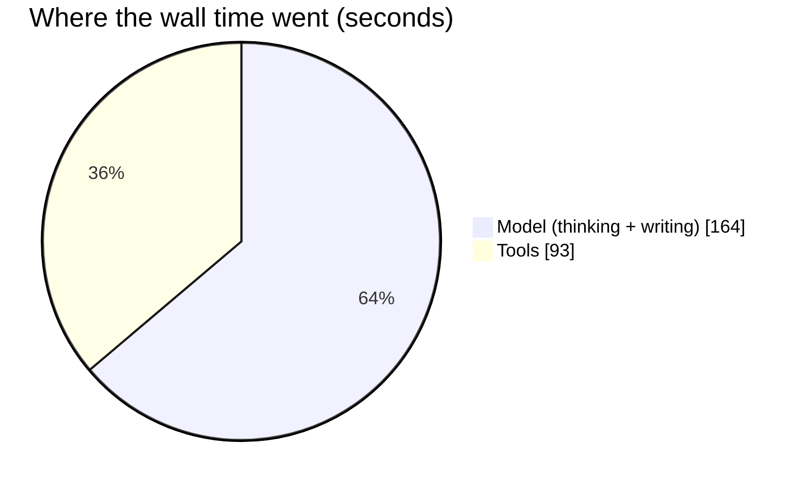

# firm-knowledge/tasks/229 · run3 (`hv-fk250-lunahigh-rep3-20261112T141312Z`)

Result: **all-pass** 3/3 criteria · 4.3 min · 24 model calls · 41 tool calls (1 errors or timeouts) · ending `completed` · started 11-12 21:12:46 IST

## Overview

One box per stretch of steps that used the same kind of tool (blue: looking/searching/reading, purple: writing or editing files, yellow: a message with no tool call, red border: a tool error or timeout inside the box).

```mermaid
flowchart TD
    T(["Task prompt"])
    P0["<b>Step 1</b> · 0.1 min<br/>todo_write"]
    T --> P0
    class P0 look
    P1["<b>Steps 2-4</b> · 0.4 min<br/>glob x9<br/><i>*, **/*snda*, **/*SNDA* +6</i>"]
    P0 --> P1
    class P1 look
    P2["<b>Step 5</b> · 0.2 min<br/>bash<br/><i>mkdir -p /tmp/snda-review && parse-do…</i>"]
    P1 --> P2
    class P2 look
    P3["<b>Step 6</b> · 0.1 min<br/>read<br/><i>1017-snda.txt</i>"]
    P2 --> P3
    class P3 err
    P4["<b>Step 7</b> · 0.5 min<br/>bash<br/><i>mkdir -p scratch/snda-review; parse-d…</i>"]
    P3 --> P4
    class P4 look
    P5["<b>Steps 8-10</b> · 0.5 min<br/>grep x5<br/>glob x2<br/><i>1017-snda.txt, 1017-memo.txt, 1031-snda.txt +4</i>"]
    P4 --> P5
    class P5 look
    P6["<b>Step 11</b> · 0.3 min<br/>bash x3<br/><i>parse-doc docx 'documents/matters/103…, parse-doc docx 'documents/matters/101…</i>"]
    P5 --> P6
    class P6 look
    P7["<b>Steps 12-13</b> · 0.4 min<br/>grep x4<br/>glob x4<br/><i>1031-engagement.txt, 1031-intake.txt, 1031-postclose.txt +5</i>"]
    P6 --> P7
    class P7 look
    P8["<b>Steps 14-15</b> · 0.1 min<br/>read x2<br/><i>1031-snda.txt</i>"]
    P7 --> P8
    class P8 look
    P9["<b>Step 16</b> · 0.5 min<br/>bash<br/><i>parse-doc docx 'documents/matters/104…</i>"]
    P8 --> P9
    class P9 look
    P10["<b>Steps 17-18</b> · 0.3 min<br/>grep<br/>glob<br/><i>1041-realestate.txt, output/*</i>"]
    P9 --> P10
    class P10 look
    P11["<b>Steps 19-21</b> · 0.6 min<br/>write<br/>read<br/>edit<br/><i>response.md</i>"]
    P10 --> P11
    class P11 write
    P12["<b>Step 22</b> · 0.1 min<br/>todo_write"]
    P11 --> P12
    class P12 look
    P13["<b>Step 23</b> · 0.1 min<br/>bash<br/><i>test -s output/response.md && printf …</i>"]
    P12 --> P13
    class P13 look
    P14["<b>Step 24</b> · 0.0 min<br/>final message"]
    P13 --> P14
    class P14 ans
    R(["ALL PASS: 3/3 criteria"])
    P14 --> R
    class R pass
    classDef look fill:#e8f0fe,stroke:#4a6fa5,color:#111
    classDef write fill:#f3e8fd,stroke:#7b1fa2,color:#111
    classDef ans fill:#fff8e1,stroke:#b58900,color:#111
    classDef err fill:#e8f0fe,stroke:#c62828,stroke-width:3px,color:#111
    classDef pass fill:#e6f4ea,stroke:#2e7d32,color:#111
    classDef fail fill:#fce8e6,stroke:#c62828,color:#111
```





One row per model call:

| Step | Started (IST) | Model s | Tools s | Tool calls | Tools | Output chars |
|---|---|---|---|---|---|---|
| 1 | 21:12:46 | 4 | 0 | 1 | todo_write | 57 |
| 2 | 21:12:50 | 1 | 2 | 1 | glob | 8,520 |
| 3 | 21:12:53 | 6 | 2 | 4 | glob x4 | 7,837 |
| 4 | 21:13:02 | 8 | 6 | 4 | glob x4 | 1,569 |
| 5 | 21:13:16 | 7 | 4 | 1 | bash | 961 |
| 6 | 21:13:27 | 4 | 0 | 1 | read ⚠ | 66 |
| 7 | 21:13:31 | 5 | 28 | 1 | bash | 3,568 |
| 8 | 21:14:04 | 4 | 4 | 5 | grep x5 | 198,830 |
| 9 | 21:14:12 | 4 | 3 | 1 | glob | 14 |
| 10 | 21:14:19 | 12 | 4 | 1 | glob | 6,470 |
| 11 | 21:14:35 | 5 | 14 | 3 | bash x3 | 2,004 |
| 12 | 21:14:54 | 4 | 4 | 4 | grep x4 | 119,544 |
| 13 | 21:15:03 | 9 | 5 | 4 | glob x4 | 455 |
| 14 | 21:15:17 | 6 | 0 | 1 | read | 9,524 |
| 15 | 21:15:23 | 2 | 0 | 1 | read | 7,134 |
| 16 | 21:15:26 | 21 | 9 | 1 | bash | 739 |
| 17 | 21:15:56 | 2 | 2 | 1 | grep | 11,903 |
| 18 | 21:16:00 | 12 | 3 | 1 | glob | 14 |
| 19 | 21:16:14 | 27 | 2 | 1 | write | 205 |
| 20 | 21:16:42 | 6 | 0 | 1 | read | 6,313 |
| 21 | 21:16:48 | 4 | 0 | 1 | edit | 180 |
| 22 | 21:16:52 | 4 | 0 | 1 | todo_write | 57 |
| 23 | 21:16:56 | 3 | 3 | 1 | bash | 37 |
| 24 | 21:17:02 | 2 | 0 | 0 | (message only) | 0 |

## Task prompt

```text
I'm papering a new lease and want to work off our most recent form. What's the latest Real Estate matter where we negotiated an SNDA, and can you pull that document?

Output: write your complete answer to `response.md` — a single self-contained markdown file with your findings, the matters/documents you relied on, and your reasoning.
```

## Rubric

| # | Criterion | Verdict |
|---|---|---|
| C-001 | Qualifying matter — Metropolitan Transit Development Corp. 1031-00004 | pass |
| C-002 | Document — the executed SNDA | pass |
| C-003 | Latest-matter answer — precision | pass |

Judge's reasoning:

**C-001 (pass):** Qualifying matter — Metropolitan Transit Development Corp. 1031-00004

```text
The output expressly identifies Matter 1031-00004 for Metropolitan Transit Development Corp. (MTDC) as the latest qualifying Real Estate matter and explains that the SNDA was fully executed at closing, satisfying the criterion.
```

**C-002 (pass):** Document — the executed SNDA

```text
The output explicitly identifies Matter 1031-00004’s SNDA as `snda-ground-lessor.docx`, provides its workspace path and link, and explains that the fully executed original was delivered at closing. This satisfies the criterion of identifying the executed SNDA.
```

**C-003 (pass):** Latest-matter answer — precision

```text
The output expressly identifies Matter 1031-00004 for Metropolitan Transit Development Corp. (MTDC) as the latest qualifying Real Estate matter involving a negotiated/executed SNDA. Other matters are mentioned only as comparisons and are clearly excluded as later open diligence or older SNDA matters, not asserted as the latest.
```

## Delivered files (output/)

- `response.md` (5,917 bytes)

`response.md`:

```markdown
# Latest Real Estate SNDA matter

## Answer

The latest qualifying Real Estate matter I found is **Matter No. 1031-00004 — Hudson Yards West — Construction Financing**, a **Real Estate Finance** matter opened February 12, 2025 for **Metropolitan Transit Development Corp. (MTDC)**. The related SNDA is dated **June 15, 2025**, the closing date of the financing.

### Document to use as the precedent/form

**[Subordination, Non-Disturbance and Attornment Agreement](../documents/matters/1031-00004/Transaction%20Documents/Intercreditor/snda-ground-lessor.docx)**  
Workspace path: `documents/matters/1031-00004/Transaction Documents/Intercreditor/snda-ground-lessor.docx`

This is the SNDA among:

- **NYC Economic Development Corporation**, as ground lessor;
- **Hudson Yards West Mortgage LLC**, as ground lessee; and
- **Ironclad National Bank, N.A.**, as administrative agent for the senior lenders.

It covers the ground-leased project at **450 West 34th Street, New York, New York 10001**, designated as Manhattan Block 729, Lots 1, 5, 12, and 15. The SNDA was prepared in connection with the **$475 million senior construction loan** supporting the Hudson Yards West project.

## What the document covers

The document provides the principal leasehold-mortgage protections expected in an SNDA, including:

- subordination of the ground lease to the leasehold mortgage and loan documents;
- non-disturbance and preservation of the ground lessee’s possession and ground-lease rights after a foreclosure event, so long as applicable defaults are cured within the applicable periods;
- attornment to a successor ground lessee or successor owner following foreclosure;
- lender notice and cure rights before the ground lessor may terminate the ground lease or exercise remedies;
- recognition of the successor and continuation of the ground lease after foreclosure;
- protections addressing bankruptcy rejection, including the agent’s right to retain possession or obtain a new lease; and
- treatment of insurance proceeds and condemnation awards in the context of the leasehold financing.

## Why this is the latest qualifying matter

I compared the SNDA-related Real Estate records by date and distinguished a completed/negotiated SNDA from a later matter that merely identifies SNDA diligence as an open issue:

1. **Matter 1031-00004 — Hudson Yards West — Construction Financing**: the SNDA is dated **June 15, 2025**. The engagement materials identify the matter as Real Estate Finance and expressly include review of the ground lease, leasehold-mortgage protections, subordination/non-disturbance arrangements, and recognition agreements. The post-closing obligations letter states that the original SNDA was fully executed at closing and delivered for recording with the mortgage and leasehold assignment.
2. **Matter 1041-00004 — Project Trident / Meridian FleetWorks lease diligence**: a later Real Estate memorandum dated **February 26, 2026** mentions SNDAs only as items to confirm and obtain during ongoing diligence. It does not identify a negotiated or executed SNDA, and no SNDA document appears in that matter’s identified materials. I therefore did not treat it as a qualifying SNDA matter.
3. **Matter 1036-00004 — Acquisition of the Greystone Meridian Partners Fund III portfolio**: the executed SNDA compilation is tied to the **June 6, 2024** closing and contains 34 of 38 required tenant SNDAs, with the remaining four handled through a post-closing carve-out.
4. **Matter 1017-00009 — Aurelius / Greystone Tower lease negotiation**: the executed SNDA is dated **July 10, 2023** and relates to the 787 Seventh Avenue lease in New York.

Accordingly, **1031-00004 is the most recent matter in the materials with an actual SNDA form/instrument connected to a completed Real Estate financing and closing**, notwithstanding the later 1041-00004 diligence matter.

## Materials relied on

- `documents/matters/1031-00004/Engagement/new-business-intake-form.docx` — identifies Matter 1031-00004 as **Hudson Yards West — Construction Financing**, classifies it as **Real Estate Finance**, places it in the **Real Estate** department, and gives the February 12, 2025 opening date.
- `documents/matters/1031-00004/Engagement/engagement-letter-mtdc.docx` — identifies MTDC as the client and describes the $475 million senior mortgage and $200 million mezzanine financing; its scope includes ground-lease review and leasehold-mortgage/subordination/non-disturbance analysis.
- `documents/matters/1031-00004/Transaction Documents/Intercreditor/snda-ground-lessor.docx` — the June 15, 2025 SNDA/form to use as the precedent.
- `documents/matters/1031-00004/Closing/post-closing-obligations-letter.docx` — confirms the June 15, 2025 closing and states that the original SNDA was fully executed at closing and delivered for recording.
- `documents/matters/1041-00004/Diligence/Real Estate/real-estate-lease-review-memo.docx` — later Real Estate diligence record, but it treats SNDAs as unconfirmed/open diligence items rather than a negotiated SNDA transaction.
- `documents/matters/1036-00004/Estoppels & SNDAs/snda-compilation-executed.docx` — 2024 executed-SNDA comparison record.
- `documents/matters/1017-00009/Transaction Documents/snda-execution.docx` — 2023 executed-SNDA comparison record.

## Important document-status note

The workspace DOCX identified above is the correct latest SNDA precedent, but its extracted signature pages contain blank signature and notary fields. The separate post-closing letter says that a fully executed original was delivered to the title company for recording. Thus, for a new lease form, use the linked DOCX as the drafting precedent; if a fully signed counterpart is required, obtain the recorded or executed closing copy from the closing binder rather than assuming that the workspace DOCX itself is the signed counterpart.
```

## Trajectory

### Step 1: 1 tool call

_Started 11-12 21:12:46 IST · model 4 s · tools 0 s_

**Reasoning summary:**

```text
**Exploring workspace files**

I need to inspect the workspace documents to find the answer for response.md. I'm thinking of discovering files, but I shouldn't touch task.json. I'll use glob to search for files. The user might be asking for the latest matter in real estate negotiations related to SNDA, so I should pull that document. It seems I should list files using glob with the wildcard "*", which returns all up to 100 results.
```

**Call `todo_write`** (0.0 s)

```json
{
 "todos": [
  {
   "content": "Inspect workspace materials and identify Real Estate matters mentioning SNDA",
   "status": "in_progress"
  },
  {
   "content": "Determine the latest qualifying matter and locate the negotiated document",
   "status": "pending"
  },
  {
   "content": "Write a self-contained findings and reasoning response.md",
   "status": "pending"
  },
  {
   "content": "Verify the final deliverable and summarize completion",
   "status": "pending"
  }
 ]
}
```

Output (57 chars):

```text
Updated todo list: 3 pending, 1 in progress, 0 completed.
```

**Todo list now:**

- [~] Inspect workspace materials and identify Real Estate matters mentioning SNDA
- [ ] Determine the latest qualifying matter and locate the negotiated document
- [ ] Write a self-contained findings and reasoning response.md
- [ ] Verify the final deliverable and summarize completion

### Step 2: 1 tool call

_Started 11-12 21:12:50 IST · model 1 s · tools 2 s_

**Call `glob`** (1.8 s)

```json
{
 "pattern": "*"
}
```

Output (8,520 chars):

```text
documents/matters/1001-00001/Antitrust Analysis/competitor-identification-chart.xlsx
documents/matters/1001-00001/Antitrust Analysis/portfolio-company-overlap-analysis.docx
documents/matters/1001-00001/Antitrust Analysis/hhi-concentration-analysis.xlsx
documents/matters/1001-00001/Antitrust Analysis/market-definition-competitive-analysis-memo.docx
documents/matters/1001-00001/Client Updates/biweekly-status-report-1.docx
documents/matters/1001-00001/Antitrust Analysis/preliminary-antitrust-risk-assessment.docx
documents/matters/1001-00001/Antitrust Analysis/state-regulatory-con-analysis.docx
documents/matters/1001-00001/Antitrust Analysis/vertical-relationships-analysis.docx
documents/matters/1001-00001/Closing/closing-memo-antitrust-workstream.docx
documents/matters/1001-00001/Client Updates/client-update-early-termination-granted.eml
documents/matters/1001-00001/Client Updates/biweekly-status-report-2.docx
documents/matters/1001-00001/Client Updates/client-update-hsr-forms-filed.eml
documents/matters/1001-00001/Closing/final-invoice-matter-closing-letter.docx
documents/matters/1001-00001/Closing/hsr-clearance-certificate.docx
documents/matters/1001-00001/Correspondence/Counterparty Counsel/email-gk-naics-code-consistency.eml
documents/matters/1001-00001/Early Termination/early-termination-request-letter.docx
documents/matters/1001-00001/Correspondence/Counterparty Counsel/letter-bracewell-thornton-regulatory-condition.docx
documents/matters/1001-00001/Correspondence/Counterp
… [7,020 more chars]
```

### Step 3: 4 tool calls

_Started 11-12 21:12:53 IST · model 6 s · tools 2 s_

**Reasoning summary:**

```text
**Exploring search options**

I realize I need to search for contents related to SNDA and Real Estate. I wonder if grep can search binary formats, but it likely focuses on text extraction. So I'll need to consider parsing documents with a tool like parse-doc, since grep may not effectively handle docx files. I might also want to glob filenames that include "snda" and "real estate" to make sure I cover all the right documents.
```

**Call `glob`** (0.5 s)

```json
{
 "pattern": "**/*snda*"
}
```

Output (906 chars):

```text
documents/matters/1017-00009/Correspondence/snda-negotiation-email.eml
documents/matters/1017-00009/Transaction Documents/snda-execution.docx
documents/matters/1018-00005/Engagement/engagement-letter-penterra-snda.docx
documents/matters/1031-00004/Transaction Documents/Intercreditor/snda-ground-lessor.docx
documents/matters/1036-00004/Estoppels & SNDAs/estoppel-snda-compliance-certificate.docx
documents/matters/1036-00004/Estoppels & SNDAs/snda-compilation-executed.docx
documents/matters/1036-00004/Estoppels & SNDAs/snda-post-closing-carveout-side-letter.docx
documents/matters/1036-00004/Estoppels & SNDAs/snda-tracking-spreadsheet.xlsx
documents/matters/1036-00004/Estoppels & SNDAs/snda-transmittal-letter-to-tenants.docx
documents/matters/1036-00004/Post-Closing/snda-post-closing-delivery-confirmation.docx
documents/matters/1036-00004/Transaction Documents/Exhibits/psa-exhibit-f-form-snda.docx
```

**Call `glob`** (0.5 s)

```json
{
 "pattern": "**/*SNDA*"
}
```

Output (14 chars):

```text
No files found
```

**Call `glob`** (0.5 s)

```json
{
 "pattern": "**/*real*estate*"
}
```

Output (229 chars):

```text
documents/matters/1003-00004/Diligence/real-estate-lease-summary.docx
documents/matters/1006-00008/Diligence/real-estate-diligence-summary.docx
documents/matters/1041-00004/Diligence/Real Estate/real-estate-lease-review-memo.docx
```

**Call `glob`** (0.6 s)

```json
{
 "pattern": "**/*lease*"
}
```

Output (6,688 chars):

```text
documents/matters/1001-00003/Closing/payoff-letter-lien-release-instructions.docx
documents/matters/1001-00003/Diligence/lease-consent-tracker.xlsx
documents/matters/1001-00004/Diligence/real-property-leases-diligence-memo.docx
documents/matters/1003-00004/Diligence/real-estate-lease-summary.docx
documents/matters/1005-00001/Closing/lien-release-authorization-letter.docx
documents/matters/1005-00005/Settlement/settlement-agreement-and-mutual-release.docx
documents/matters/1006-00003/Diligence/Lease & Property Review/clarksburg-lease-environmental-analysis.docx
documents/matters/1006-00003/Diligence/Lease & Property Review/weirton-lease-vrdp-review.docx
documents/matters/1006-00005/Settlement/settlement-agreement-and-mutual-release.docx
documents/matters/1006-00008/Transaction Documents/Ancillary Agreements/assignment-assumption-of-leases.docx
documents/matters/1007-00003/Settlement Documents/settlement-agreement-and-mutual-release.docx
documents/matters/1007-00005/Settlement/settlement-agreement-mutual-release.docx
documents/matters/1007-00008/Negotiation Documents/draft-mutual-release-standstill-agreement.docx
documents/matters/1008-00003/Termination Documents/termination-release-canopy-growth.docx
documents/matters/1008-00003/Termination Documents/termination-release-ridgeline.docx
documents/matters/1008-00003/Termination Documents/termination-release-vantage-peak.docx
documents/matters/1008-00007/Settlement/settlement-agreement-and-mutual-release.docx
documents/matters/100
… [5,188 more chars]
```

### Step 4: 4 tool calls

_Started 11-12 21:13:02 IST · model 8 s · tools 6 s_

**Reasoning summary:**

```text
**Evaluating parsing tools**

I'm figuring out what tools to use for searching file contents. They say to use the grep tool, but for binary docs, I need parse-doc instead. I'll create a scratch text file using bash and locate matter metadata. For the snda candidates, I have some specifics: 1017-00009 could involve lease negotiation, while 1031-00004 covers ground leases. I also suspect that 1018 might not have documents, so I need to check for other filenames related to SNDAs.
```

**Call `glob`** (0.5 s)

```json
{
 "pattern": "**/*estoppel*"
}
```

Output (927 chars):

```text
documents/matters/1013-00005/Validity/prosecution-history-estoppel-memo.docx
documents/matters/1014-00003/Claim Construction/memo-rebuttal-prosecution-history-estoppel.docx
documents/matters/1026-00003/Transaction Documents/Exhibits/psa-exhibit-tenant-estoppel-form.docx
documents/matters/1036-00004/Correspondence/email-nakamura-to-keating-estoppel-discrepancies.eml
documents/matters/1036-00004/Estoppels & SNDAs/estoppel-certificate-compilation-executed.docx
documents/matters/1036-00004/Estoppels & SNDAs/estoppel-snda-compliance-certificate.docx
documents/matters/1036-00004/Estoppels & SNDAs/estoppel-tracking-spreadsheet.xlsx
documents/matters/1036-00004/Estoppels & SNDAs/estoppel-review-memorandum-discrepancies.docx
documents/matters/1036-00004/Estoppels & SNDAs/estoppel-transmittal-letter-to-seller.docx
documents/matters/1036-00004/Transaction Documents/Exhibits/psa-exhibit-e-form-tenant-estoppel-certificate.docx
```

**Call `glob`** (2.0 s)

```json
{
 "pattern": "**/*non*disturb*"
}
```

Output (14 chars):

```text
No files found
```

**Call `glob`** (2.4 s)

```json
{
 "pattern": "**/*subordination*"
}
```

Output (392 chars):

```text
documents/matters/1009-00001/Transaction Documents/Subordination/subordination-agreement-execution.docx
documents/matters/1009-00001/Transaction Documents/Subordination/subordination-agreement-initial-draft.docx
documents/matters/1031-00004/Construction/contractor-lien-subordination.docx
documents/matters/1031-00004/Transaction Documents/Intercreditor/subordination-property-management.docx
```

**Call `glob`** (1.0 s)

```json
{
 "pattern": "**/*ground*lease*"
}
```

Output (236 chars):

```text
documents/matters/1015-00003/Transaction Documents/ground-lease-execution.docx
documents/matters/1030-00002/Transaction Documents/ground-lease-agreement-execution.docx
documents/matters/1031-00004/Diligence/ground-lease-review-memo.docx
```

### Step 5: 1 tool call

_Started 11-12 21:13:16 IST · model 7 s · tools 4 s_

**Reasoning summary:**

```text
**Investigating recent matters**

I’m thinking maybe matter 1036 is the most recent because of the higher number, but I need to confirm the actual dates. I should inspect relevant documents to figure this out. I'll parse several key docs, along with any closing memos or engagement details for matter names and dates. I plan to use a bash command to parse the documents effectively. It’s all about checking the command help to make sure I'm on the right track!
```

**Call `bash`** (4.2 s)

```json
{
 "command": "mkdir -p /tmp/snda-review && parse-doc docx 'documents/matters/1017-00009/Transaction Documents/snda-execution.docx' > /tmp/snda-review/1017-snda.txt && parse-doc eml 'documents/matters/1017-00009/Correspondence/snda-negotiation-email.eml' > /tmp/snda-review/1017-email.txt && parse-doc docx 'documents/matters/1017-00009/Lease Negotiation/initial-lease-review-memo.docx' > /tmp/snda-review/1017-memo.txt && parse-doc docx 'documents/matters/1017-00009/Transaction Documents/agreement-of-lease-execution.docx' > /tmp/snda-review/1017-lease.txt && parse-doc docx 'documents/matters/1031-00004/Transaction Documents/Intercreditor/snda-ground-lessor.docx' > /tmp/snda-review/1031-snda.txt && parse-doc docx 'documents/matters/1031-00004/Diligence/ground-lease-review-memo.docx' > /tmp/snda-review/1031-groundmemo.txt && parse-doc docx 'documents/matters/1036-00004/Estoppels & SNDAs/snda-compilation-executed.docx' > /tmp/snda-review/1036-snda.txt && parse-doc docx 'documents/matters/1036-00004/Estoppels & SNDAs/estoppel-snda-compliance-certificate.docx' > /tmp/snda-review/1036-compliance.txt && parse-doc docx 'documents/matters/1036-00004/Transaction Documents/Exhibits/psa-exhibit-f
… [292 more chars]
```

Output (961 chars):

```text
total 44
-rw-r--r-- 1 agarwaldi@microsoft.com users     0 Nov 12 15:43 1017-email.txt
-rw-r--r-- 1 agarwaldi@microsoft.com users 44976 Nov 12 15:43 1017-snda.txt
[stderr]
2026-11-12 15:43:24.735086003 [W:onnxruntime:Default, device_discovery.cc:95 GetPciBusId] Skipping pci_bus_id for PCI path at "/sys/devices/LNXSYSTM:00/LNXSYBUS:00/ACPI0004:00/VMBUS:00/5620e0c7-8062-4dce-aeb7-520c7ef76171" because filename "5620e0c7-8062-4dce-aeb7-520c7ef76171" did not match expected pattern of [0-9a-f]+:[0-9a-f]+:[0-9a-f]+[.][0-9a-f]+
2026-11-12 15:43:26.573168122 [W:onnxruntime:Default, device_discovery.cc:95 GetPciBusId] Skipping pci_bus_id for PCI path at "/sys/devices/LNXSYSTM:00/LNXSYBUS:00/ACPI0004:00/VMBUS:00/5620e0c7-8062-4dce-aeb7-520c7ef76171" because filename "5620e0c7-8062-4dce-aeb7-520c7ef76171" did not match expected pattern of [0-9a-f]+:[0-9a-f]+:[0-9a-f]+[.][0-9a-f]+
usage: /usr/local/bin/parse-doc {docx|pdf|pptx|xlsx} <path>
```

### Step 6: 1 tool call

_Started 11-12 21:13:27 IST · model 4 s · tools 0 s_

**Reasoning summary:**

```text
**Analyzing parsing issues**

I’m noticing that the parse-doc doesn't seem to handle eml files. It looks like the chain stopped at the eml because of the use of "&&"—only the first docx got parsed, and then there was a failure with the eml, causing the rest not to process. I think I need to treat the parse candidates separately and take another look at the 1017 snda to see how to address this situation!
```

**Call `read`** (0.0 s · **error/timeout**)

```json
{
 "file_path": "/tmp/snda-review/1017-snda.txt",
 "offset": 1,
 "limit": 240
}
```

Output (66 chars):

```text
Error: [sandbox: file access denied under workspace-isolated mode]
```

### Step 7: 1 tool call

_Started 11-12 21:13:31 IST · model 5 s · tools 28 s_

**Reasoning summary:**

```text
**Figuring out workspace usage**

I’m noticing that tools can only work in the workspace, not in /tmp, despite what I thought about bash scratch space. It seems I need to create a scratch directory within the workspace instead. Maybe I can use the output there? I’m not sure if it’s deliverable yet, but creating a workspace scratch under `snda-review/` could work. I guess I need to follow the policy and do this under the `scratch/` workspace.
```

**Call `bash`** (27.5 s)

```json
{
 "command": "mkdir -p scratch/snda-review; parse-doc docx 'documents/matters/1017-00009/Transaction Documents/snda-execution.docx' > scratch/snda-review/1017-snda.txt; parse-doc docx 'documents/matters/1017-00009/Lease Negotiation/initial-lease-review-memo.docx' > scratch/snda-review/1017-memo.txt; parse-doc docx 'documents/matters/1017-00009/Transaction Documents/agreement-of-lease-execution.docx' > scratch/snda-review/1017-lease.txt; parse-doc docx 'documents/matters/1031-00004/Transaction Documents/Intercreditor/snda-ground-lessor.docx' > scratch/snda-review/1031-snda.txt; parse-doc docx 'documents/matters/1031-00004/Diligence/ground-lease-review-memo.docx' > scratch/snda-review/1031-groundmemo.txt; parse-doc docx 'documents/matters/1036-00004/Estoppels & SNDAs/snda-compilation-executed.docx' > scratch/snda-review/1036-snda.txt; parse-doc docx 'documents/matters/1036-00004/Estoppels & SNDAs/estoppel-snda-compliance-certificate.docx' > scratch/snda-review/1036-compliance.txt; parse-doc docx 'documents/matters/1036-00004/Transaction Documents/Exhibits/psa-exhibit-f-form-snda.docx' > scratch/snda-review/1036-form.txt; ls -l scratch/snda-review",
 "description": "Parse likely SNDA
… [50 more chars]
```

Output (3,568 chars):

```text
total 616
-rw-r--r-- 1 agarwaldi@microsoft.com users 164813 Nov 12 15:43 1017-lease.txt
-rw-r--r-- 1 agarwaldi@microsoft.com users  82869 Nov 12 15:43 1017-memo.txt
-rw-r--r-- 1 agarwaldi@microsoft.com users  44976 Nov 12 15:43 1017-snda.txt
-rw-r--r-- 1 agarwaldi@microsoft.com users  93557 Nov 12 15:43 1031-groundmemo.txt
-rw-r--r-- 1 agarwaldi@microsoft.com users  66987 Nov 12 15:43 1031-snda.txt
-rw-r--r-- 1 agarwaldi@microsoft.com users  37722 Nov 12 15:44 1036-compliance.txt
-rw-r--r-- 1 agarwaldi@microsoft.com users  62097 Nov 12 15:44 1036-form.txt
-rw-r--r-- 1 agarwaldi@microsoft.com users  59442 Nov 12 15:43 1036-snda.txt
[stderr]
2026-11-12 15:43:42.692391873 [W:onnxruntime:Default, device_discovery.cc:95 GetPciBusId] Skipping pci_bus_id for PCI path at "/sys/devices/LNXSYSTM:00/LNXSYBUS:00/ACPI0004:00/VMBUS:00/5620e0c7-8062-4dce-aeb7-520c7ef76171" because filename "5620e0c7-8062-4dce-aeb7-520c7ef76171" did not match expected pattern of [0-9a-f]+:[0-9a-f]+:[0-9a-f]+[.][0-9a-f]+
2026-11-12 15:43:45.806511088 [W:onnxruntime:Default, device_discovery.cc:95 GetPciBusId] Skipping pci_bus_id for PCI path at "/sys/devices/LNXSYSTM:00/LNXSYBUS:00/ACPI0004:00/VMBUS:00/5620e0c7-8062-4dce-aeb7-520c7ef76171" because filename "5620e0c7-8062-4dce-aeb7-520c7ef76171" did not match expected pattern of [0-9a-f]+:[0-9a-f]+:[0-9a-f]+[.][0-9a-f]+
2026-11-12 15:43:50.364989400 [W:onnxruntime:Default, device_discovery.cc:95 GetPciBusId] Skipping pci_bus_id for P
… [2,067 more chars]
```

### Step 8: 5 tool calls

_Started 11-12 21:14:04 IST · model 4 s · tools 4 s_

**Call `grep`** (0.8 s)

```json
{
 "pattern": "(?i)(date|matter|client|effective|executed|execution|SNDA|lease|property|purchase|seller|buyer)",
 "path": "scratch/snda-review/1017-snda.txt"
}
```

Output (36,022 chars):

```text
Found 70 matches

scratch/snda-review/1017-snda.txt
Line 3: **Dated as of July 10, 2023**
Line 13: **Property: Greystone Tower** **787 Seventh Avenue, New York, New York 10019** **Block 1024, Lot 18, Borough of Manhattan**
Line 29: **WHEREAS**, Landlord is the fee simple owner of the real property and improvements commonly known as Greystone Tower, located at 787 Seventh Avenue, New York, New York 10019, designated as Block 1024, Lot 18, Borough of Manhattan, City and County of New York, State of New York, as more particularly described on **Exhibit A** attached hereto (the \"**Building**\" or \"**Property**\"); and
Line 31: **WHEREAS**, Lender has made a mortgage loan to Landlord in connection with the Property, which loan is secured by, among other things, a first priority mortgage lien on the Property and the rents and profits thereof (the \"**Mortgage**\"), which Mortgage was recorded on January 15, 2019, in the Office of the City Register of the City of New York, New York County, at CRFN 2019000012438, as the same may have been amended, modified, extended, consolidated, replaced, or restated from time to time, with an outstanding principal balance of approximately Six Hundred Twenty Million and 00/100 Dollars (\$620,000,000.00) as of the date hereof; and
Line 33: **WHEREAS**, Landlord, as landlord, and Tenant, as tenant, have entered into that certain Agreement of Lease dated as of July 13, 2023 (as the same may be amended, modified, or supplemented from time to time in 
… [34,522 more chars]
```

**Call `grep`** (0.7 s)

```json
{
 "pattern": "(?i)(date|matter|client|effective|executed|execution|SNDA|lease|property|purchase|seller|buyer)",
 "path": "scratch/snda-review/1017-memo.txt"
}
```

Output (49,978 chars):

```text
Found 169 matches

scratch/snda-review/1017-memo.txt
Line 9: **Date:** April 20, 2023
Line 11: **Re:** Initial Review of Landlord\'s Draft Lease --- Aurelius Media Holdings Inc. / Greystone Metropolitan Realty LLC --- 787 Seventh Avenue, Floors 34--38, New York, NY 10019
Line 13: **Matter No.:** 1017-00009
Line 15: **Client:** Aurelius Global Media Group PLC / Aurelius Media Holdings Inc.
Line 17: Right-click to update Table of Contents
Line 21: The purpose of this memorandum is to summarize key provisions and identify critical issues in the initial draft Agreement of Lease (the \"Draft Lease\") received from Pemberton Locke & Strauss LLP (Diane Ashford and Kevin Mulcahy), counsel for Greystone Metropolitan Realty LLC (\"Landlord\"), which was transmitted to our office on April 18, 2023. This memorandum is intended to provide a comprehensive initial assessment to facilitate our team\'s discussion of negotiation strategy and priorities prior to the preparation of a first redline markup.
Line 23: The Draft Lease contemplates a lease between Greystone Metropolitan Realty LLC, a Delaware limited liability company, as Landlord, and Aurelius Media Holdings Inc., a Delaware corporation (\"Tenant\"), as Tenant, for the occupancy of approximately 185,000 rentable square feet (\"RSF\") on Floors 34, 35, 36, 37, and 38 of the building known as Greystone Tower, located at 787 Seventh Avenue, New York, NY 10019 (Block 1024, Lot 18, Borough of Manhattan) (the \"Building\"). The Building is
… [48,478 more chars]
```

**Call `grep`** (1.0 s)

```json
{
 "pattern": "(?i)(date|matter|client|effective|executed|execution|SNDA|lease|property|purchase|seller|buyer)",
 "path": "scratch/snda-review/1031-snda.txt"
}
```

Output (49,997 chars):

```text
Found 115 matches

scratch/snda-review/1031-snda.txt
Line 19: **Dated as of June 15, 2025**
Line 21: **Property: 450 West 34th Street, New York, New York 10001**
Line 37: > \(1\) **NYC ECONOMIC DEVELOPMENT CORPORATION** (\"**NYCEDC**\"), a New York City local development corporation organized and existing under the Not-for-Profit Corporation Law of the State of New York, having its principal office at One Liberty Plaza, New York, New York 10006, as ground lessor under the Ground Lease (as defined below);
Line 39: > \(2\) **HUDSON YARDS WEST MORTGAGE LLC** (\"**Ground Lessee**\"), a Delaware limited liability company, having an address at c/o Metropolitan Transit Development Corp., 200 South Michigan Avenue, Suite 3100, Chicago, Illinois 60604, as ground lessee under the Ground Lease; and
Line 45: **A.** NYCEDC is a New York City local development corporation that functions as the City of New York\'s primary agent for economic development, and is the owner in fee simple of the real property more particularly described in **Exhibit A** attached hereto and incorporated herein by reference (the \"**Land**\"), located at 450 West 34th Street, New York, New York 10001, designated on the Tax Map of the City of New York as Borough of Manhattan, Block 729, Lots 1, 5, 12, and 15, together with all buildings, structures, fixtures, and other improvements now or hereafter located thereon.
Line 47: **B.** NYCEDC, as ground lessor, and Metropolitan Transit Development Corp., a Delaware corp
… [48,497 more chars]
```

**Call `grep`** (0.6 s)

```json
{
 "pattern": "(?i)(date|matter|client|effective|executed|execution|SNDA|lease|property|purchase|seller|buyer)",
 "path": "scratch/snda-review/1036-snda.txt"
}
```

Output (36,501 chars):

```text
Found 125 matches

scratch/snda-review/1036-snda.txt
Line 3: **[EXECUTED COMPILATION]{.underline}**
Line 5: **[34 of 38 Required SNDAs]{.underline}**
Line 11: *Acquisition of 14-Property Sun Belt Logistics & Office Portfolio*
Line 19: **Purchase Price: \$1,100,000,000**
Line 21: **Closing Date: June 6, 2024**
Line 31: **Matter Number: 1036-00004**
Line 37: This binder contains thirty-four (34) of the thirty-eight (38) required Subordination, Non-Disturbance and Attornment Agreements (\"SNDAs\") executed by Major Tenants (as defined in the Purchase and Sale Agreement) on or before the closing date of June 6, 2024. The remaining four (4) SNDAs are subject to a post-closing delivery carve-out pursuant to the SNDA Post-Closing Carve-Out Side Letter dated as of June 6, 2024, between Seller and Buyer, with a thirty (30)-day post-closing delivery deadline of July 6, 2024, and a Two Hundred Thousand Dollars (\$200,000) holdback from Seller proceeds pending delivery. Actual post-closing delivery of all four (4) outstanding SNDAs was completed on July 2, 2024, four (4) days in advance of the post-closing delivery deadline. The holdback was released to Seller on July 3, 2024.
Line 43: *This compilation and all materials contained herein are protected by the attorney-client privilege and the work product doctrine. Distribution is restricted to authorized representatives of Fairwater Real Estate Investment Trust and its counsel. Any unauthorized review, use, disclosure, or distribution is
… [35,001 more chars]
```

**Call `grep`** (0.6 s)

```json
{
 "pattern": "(?i)(date|matter|client|effective|executed|execution|SNDA|lease|property|purchase|seller|buyer)",
 "path": "scratch/snda-review/1036-compliance.txt"
}
```

Output (26,332 chars):

```text
Found 91 matches

scratch/snda-review/1036-compliance.txt
Line 1: **[ESTOPPEL AND SNDA COMPLIANCE CERTIFICATE]{.underline}**
Line 3: **Delivered Pursuant to Section 8.2(d) of the Purchase and Sale Agreement**
Line 7: **Reference Transaction:** Purchase and Sale Agreement dated February 28, 2024 (as amended by the First Amendment dated April 12, 2024, and the Second Amendment dated May 28, 2024) (as so amended, the \"**PSA**\"), by and between Greystone Meridian Partners Fund III, L.P., a Delaware limited partnership (\"**Seller**\"), and Fairwater Real Estate Investment Trust, a Maryland real estate investment trust (\"**Buyer**\").
Line 9: **Delivered by:** Calderwood & Harkness LLP, as counsel to Buyer
Line 23: **Matter Number:** 1036-00004
Line 27: **A.** The PSA provides for Buyer\'s acquisition of one hundred percent (100%) of the membership interests (the \"**Interests**\") in each of the fourteen (14) property-owning Delaware limited liability companies identified below (each, a \"**Target Entity**\" and collectively, the \"**Target Entities**\") from Seller, for an aggregate purchase price of One Billion One Hundred Million Dollars (\$1,100,000,000) (the \"**Purchase Price**\"), subject to the adjustments and prorations set forth therein.
Line 59: **C.** Each Target Entity owns and operates one commercial real property. In the aggregate, the portfolio comprises fourteen (14) properties located across five (5) states --- specifically, four (4) properties in the State o
… [24,832 more chars]
```

### Step 9: 1 tool call

_Started 11-12 21:14:12 IST · model 4 s · tools 3 s_

**Call `glob`** (2.6 s)

```json
{
 "pattern": "documents/matters/1031-00004/*"
}
```

Output (14 chars):

```text
No files found
```

### Step 10: 1 tool call

_Started 11-12 21:14:19 IST · model 12 s · tools 4 s_

**Reasoning summary:**

```text
**Exploring glob patterns**

I’m thinking about glob patterns and how the one without a slash works. It looks like a glob pattern without a slash can match filenames across any directory depth, but it seems that `documents/matters/1031-00004/*` is limited to files only. I wonder if I need to specify `documents/matters/1031-00004/**/*.docx` to make sure I'm including all relevant files. This could help me clarify the matching rules!
```

**Call `glob`** (3.9 s)

```json
{
 "pattern": "documents/matters/1031-00004/**/*.docx"
}
```

Output (6,470 chars):

```text
documents/matters/1031-00004/Closing Opinions/delaware-entity-opinion.docx
documents/matters/1031-00004/Closing/board-resolution-certificate-mtdc.docx
documents/matters/1031-00004/Closing Opinions/zoning-opinion-transmittal.docx
documents/matters/1031-00004/Closing Opinions/tax-exempt-status-opinion.docx
documents/matters/1031-00004/Closing Opinions/opinion-letter-senior-lender.docx
documents/matters/1031-00004/Closing Opinions/opinion-letter-mezzanine-lender.docx
documents/matters/1031-00004/Closing/closing-escrow-agreement.docx
documents/matters/1031-00004/Closing/borrower-closing-certificate.docx
documents/matters/1031-00004/Closing/officers-certificate-mtdc.docx
documents/matters/1031-00004/Closing/managers-certificate-hyw-mortgage.docx
documents/matters/1031-00004/Closing/managers-certificate-hyw-mezzanine.docx
documents/matters/1031-00004/Closing/title-endorsement-request-letter.docx
documents/matters/1031-00004/Closing/post-closing-obligations-letter.docx
documents/matters/1031-00004/Construction/consent-agreement-architect.docx
documents/matters/1031-00004/Correspondence/client-memo-closing-conditions.docx
documents/matters/1031-00004/Construction/contractor-lien-subordination.docx
documents/matters/1031-00004/Construction/construction-consultant-engagement.docx
documents/matters/1031-00004/Construction/consent-agreement-general-contractor.docx
documents/matters/1031-00004/Deal Analysis/ny-mortgage-recording-tax-memo.docx
documents/matters/1031-00004/Correspondence/le
… [4,970 more chars]
```

### Step 11: 3 tool calls

_Started 11-12 21:14:35 IST · model 5 s · tools 14 s_

**Reasoning summary:**

```text
**Parsing engagements and closings**

I'm focusing on parsing information about engagement and new business closings. I think I need to consider dates and specific matters related to these engagements. There's also a mention of engagement number 1036, which might need some attention. For engagement 1018, I’m curious if it refers to matters related to SNDAs. I should definitely work on parsing the details for engagement 1018 to clarify things further.
```

**Call `bash`** (6.6 s)

```json
{
 "command": "parse-doc docx 'documents/matters/1031-00004/Engagement/engagement-letter-mtdc.docx' > scratch/snda-review/1031-engagement.txt; parse-doc docx 'documents/matters/1031-00004/Engagement/new-business-intake-form.docx' > scratch/snda-review/1031-intake.txt; parse-doc docx 'documents/matters/1031-00004/Closing/post-closing-obligations-letter.docx' > scratch/snda-review/1031-postclose.txt",
 "description": "Parse latest candidate matter records",
 "timeoutMs": 120000
}
```

Output (1,104 chars):

```text
[stderr]
2026-11-12 15:44:41.836926960 [W:onnxruntime:Default, device_discovery.cc:95 GetPciBusId] Skipping pci_bus_id for PCI path at "/sys/devices/LNXSYSTM:00/LNXSYBUS:00/ACPI0004:00/VMBUS:00/5620e0c7-8062-4dce-aeb7-520c7ef76171" because filename "5620e0c7-8062-4dce-aeb7-520c7ef76171" did not match expected pattern of [0-9a-f]+:[0-9a-f]+:[0-9a-f]+[.][0-9a-f]+
2026-11-12 15:44:44.448837441 [W:onnxruntime:Default, device_discovery.cc:95 GetPciBusId] Skipping pci_bus_id for PCI path at "/sys/devices/LNXSYSTM:00/LNXSYBUS:00/ACPI0004:00/VMBUS:00/5620e0c7-8062-4dce-aeb7-520c7ef76171" because filename "5620e0c7-8062-4dce-aeb7-520c7ef76171" did not match expected pattern of [0-9a-f]+:[0-9a-f]+:[0-9a-f]+[.][0-9a-f]+
2026-11-12 15:44:46.102309680 [W:onnxruntime:Default, device_discovery.cc:95 GetPciBusId] Skipping pci_bus_id for PCI path at "/sys/devices/LNXSYSTM:00/LNXSYBUS:00/ACPI0004:00/VMBUS:00/5620e0c7-8062-4dce-aeb7-520c7ef76171" because filename "5620e0c7-8062-4dce-aeb7-520c7ef76171" did not match expected pattern of [0-9a-f]+:[0-9a-f]+:[0-9a-f]+[.][0-9a-f]+
```

**Call `bash`** (3.1 s)

```json
{
 "command": "parse-doc docx 'documents/matters/1036-00004/Engagement/engagement-letter.docx' > scratch/snda-review/1036-engagement.txt; parse-doc docx 'documents/matters/1036-00004/Closing/closing-memo.docx' > scratch/snda-review/1036-closingmemo.txt 2> scratch/snda-review/1036-closingmemo.err || true",
 "description": "Parse portfolio matter records",
 "timeoutMs": 120000
}
```

Output (526 chars):

```text
[stderr]
2026-11-12 15:44:48.279801293 [W:onnxruntime:Default, device_discovery.cc:95 GetPciBusId] Skipping pci_bus_id for PCI path at "/sys/devices/LNXSYSTM:00/LNXSYBUS:00/ACPI0004:00/VMBUS:00/5620e0c7-8062-4dce-aeb7-520c7ef76171" because filename "5620e0c7-8062-4dce-aeb7-520c7ef76171" did not match expected pattern of [0-9a-f]+:[0-9a-f]+:[0-9a-f]+[.][0-9a-f]+
RuntimeError: pandoc failed: documents/matters/1036-00004/Engagement/engagement-letter.docx: withBinaryFile: does not exist (No such file or directory)
```

**Call `bash`** (4.6 s)

```json
{
 "command": "parse-doc docx 'documents/matters/1018-00005/Engagement/engagement-letter-penterra-snda.docx' > scratch/snda-review/1018-engagement.txt",
 "description": "Parse other SNDA matter record",
 "timeoutMs": 120000
}
```

Output (374 chars):

```text
[stderr]
2026-11-12 15:44:51.435270183 [W:onnxruntime:Default, device_discovery.cc:95 GetPciBusId] Skipping pci_bus_id for PCI path at "/sys/devices/LNXSYSTM:00/LNXSYBUS:00/ACPI0004:00/VMBUS:00/5620e0c7-8062-4dce-aeb7-520c7ef76171" because filename "5620e0c7-8062-4dce-aeb7-520c7ef76171" did not match expected pattern of [0-9a-f]+:[0-9a-f]+:[0-9a-f]+[.][0-9a-f]+
```

### Step 12: 4 tool calls

_Started 11-12 21:14:54 IST · model 4 s · tools 4 s_

**Call `grep`** (0.6 s)

```json
{
 "pattern": "(?i)(matter|client|date|real estate|transaction|project|loan|ground lease|snda)",
 "path": "scratch/snda-review/1031-engagement.txt"
}
```

Output (42,774 chars):

```text
Found 110 matches

scratch/snda-review/1031-engagement.txt
Line 15: **Re: Engagement of Calderwood & Harkness LLP as Borrower\'s Counsel --- Senior Mortgage Financing (\$475,000,000) and Mezzanine Financing (\$200,000,000) for Hudson Yards West, 450 West 34th Street, New York, New York 10001 (C&H Matter No. 1031-00004)**
Line 21: We are pleased and honored that Metropolitan Transit Development Corp. (\"MTDC\" or the \"Client\") has selected Calderwood & Harkness LLP (the \"Firm,\" \"we,\" \"us,\" or \"our\") to serve as borrower\'s counsel in connection with the financing described herein. We greatly appreciate the confidence you and your colleagues have placed in our Firm, and we look forward to working with the MTDC team throughout this important transaction.
Line 23: The purpose of this letter (this \"Engagement Letter\") is to memorialize the terms and conditions under which the Firm will represent MTDC as borrower\'s counsel in connection with the \$675,000,000 combined senior mortgage and mezzanine financing (the \"Financing\" or the \"Transaction\") for the mixed-use development project commonly known as Hudson Yards West, located at 450 West 34th Street, New York, New York 10001, situated on Block 729, Lots 1, 5, 12, and 15, Borough of Manhattan, County of New York, State of New York (the \"Project\"). The Financing consists of a \$475,000,000 senior mortgage loan and a \$200,000,000 mezzanine loan, as more fully described in Section III below.
Line 27: **[II. Identit
… [41,274 more chars]
```

**Call `grep`** (1.1 s)

```json
{
 "pattern": "(?i)(matter|client|date|real estate|transaction|project|loan|ground lease|snda)",
 "path": "scratch/snda-review/1031-intake.txt"
}
```

Output (23,652 chars):

```text
Found 79 matches

scratch/snda-review/1031-intake.txt
Line 3: **NEW BUSINESS INTAKE / MATTER OPENING FORM**
Line 7: **Submission Date:** February 12, 2025
Line 13: **[Section 1 --- Matter Information]{.underline}**
Line 18:   **Matter Number**                   1031-00004
Line 20:   **Matter Name**                     Hudson Yards West --- Construction Financing
Line 22:   **Matter Type**                     Real Estate Finance (Construction Loan / Mezzanine Loan)
Line 26:   **Department**                      Real Estate
Line 28:   **Date Opened**                     February 12, 2025
Line 32:   **Target Closing Date**             June 15, 2025
Line 37: Representation of Metropolitan Transit Development Corp. (\"MTDC\") as borrower in connection with (a) a \$475,000,000 senior mortgage construction loan from a syndicate led by Ironclad National Bank, N.A., as administrative agent (the \"Senior Loan\"), and (b) a \$200,000,000 mezzanine loan from Granite Peak Capital Partners, LP (the \"Mezzanine Loan\"), for the development of a mixed-use, transit-oriented project located at 450 West 34th Street, New York, New York 10001 (the \"Project\"). The total project cost is approximately \$920,000,000, inclusive of the combined loan proceeds, equity contributions from MTDC, and anticipated public incentive funds.
Line 39: The engagement will encompass, among other things, the negotiation, drafting, and review of the senior loan agreement, the mezzanine loan agreement, intercreditor a
… [22,152 more chars]
```

**Call `grep`** (1.7 s)

```json
{
 "pattern": "(?i)(matter|client|date|real estate|transaction|project|loan|ground lease|snda)",
 "path": "scratch/snda-review/1031-postclose.txt"
}
```

Output (43,575 chars):

```text
Found 99 matches

scratch/snda-review/1031-postclose.txt
Line 11: Connor McBride Project Director, Hudson Yards West Metropolitan Transit Development Corp. 200 South Michigan Avenue, Suite 3100 Chicago, Illinois 60604
Line 13: > **Re:** Hudson Yards West --- Post-Closing Obligations and Deliverables Senior Mortgage Loan (\$475,000,000) --- Ironclad National Bank, N.A., as Agent Mezzanine Loan (\$200,000,000) --- Granite Peak Capital Partners, LP C&H Matter No. 1031-00004
Line 17: We are pleased to confirm that the closing (the \"Closing\") of (a) the Senior Mortgage Loan in the original principal amount of \$475,000,000 (the \"Senior Loan\"), made by the lenders party thereto (the \"Senior Lenders\") through Ironclad National Bank, N.A., as administrative agent (the \"Agent\" or \"Ironclad\"), to Hudson Yards West Mortgage LLC (\"HYW Mortgage\"), and (b) the Mezzanine Loan in the original principal amount of \$200,000,000 (the \"Mezzanine Loan\"), made by Granite Peak Capital Partners, LP (\"Granite Peak\"), to Hudson Yards West Mezzanine LLC (\"HYW Mezzanine\"), occurred on June 15, 2025 (the \"Closing Date\"). Capitalized terms used but not defined herein shall have the meanings ascribed to them in the Senior Loan Agreement or the Mezzanine Loan Agreement, as applicable.
Line 19: This letter summarizes all post-closing obligations, outstanding deliverables, and continuing compliance items arising under the Loan Documents executed and delivered at or in connection with the C
… [42,075 more chars]
```

**Call `grep`** (0.6 s)

```json
{
 "pattern": "(?i)(matter|client|date|real estate|transaction|project|snda)",
 "path": "scratch/snda-review/1018-engagement.txt"
}
```

Output (9,543 chars):

```text
Found 22 matches

scratch/snda-review/1018-engagement.txt
Line 9: **Re: Engagement of Calderwood & Harkness LLP --- sNDA Labeling Supplement for Velonatib (NDA No. 215-847)**
Line 13: Thank you for selecting Calderwood & Harkness LLP (\"the Firm\" or \"C&H\") to serve as outside regulatory counsel to Penterra Pharmaceuticals Corp. (\"Penterra\" or the \"Company\"), a Delaware corporation publicly traded on the New York Stock Exchange under the ticker symbol PTRC. We are pleased to have the opportunity to assist the Company on this important matter, and we appreciate the confidence that you and your colleagues have placed in the Firm. The purpose of this letter is to set forth the terms and conditions of our engagement and to confirm our mutual understanding of the scope of the legal services we will provide, the fees and billing arrangements applicable to the engagement, and certain other matters. We ask that you review this letter carefully and, if it accurately reflects our agreement, sign and return a copy to the Firm in accordance with the instructions set forth below.
Line 17: The Firm is retained to provide legal advice and services to the Company in connection with the preparation, review, and submission of a supplemental New Drug Application (\"sNDA\") to the United States Food and Drug Administration (\"FDA\"). The sNDA will seek approval to add a new indication --- specifically, the treatment of moderate-to-severe chronic plaque psoriasis in adults who are candidate
… [8,043 more chars]
```

### Step 13: 4 tool calls

_Started 11-12 21:15:03 IST · model 9 s · tools 5 s_

**Reasoning summary:**

```text
**Searching for documents**

I’m thinking about whether there are any later 1041 documents or others where SNDA isn’t in the filename. I need to search through all filenames for keywords like "recognition," "non-disturbance," and "leasehold." I'm wondering if there are any latest documents I might have missed. It feels like a thorough check is necessary to ensure I find what I need. Let's dig into this and see what I can discover!
```

**Call `glob`** (0.8 s)

```json
{
 "pattern": "**/*recognition*"
}
```

Output (413 chars):

```text
documents/matters/1021-00008/Investigation Analysis/revenue-recognition-analysis-memo.docx
documents/matters/1022-00007/DPIAs/dpia-008-cctv-facial-recognition.docx
documents/matters/1031-00004/Transaction Documents/Intercreditor/recognition-agreement.docx
documents/matters/1044-00001/documents/draft-application-recognition-cyprus.docx
documents/matters/1044-00003/documents/memo-comi-chapter-15-recognition.docx
```

**Call `glob`** (0.8 s)

```json
{
 "pattern": "**/*attornment*"
}
```

Output (14 chars):

```text
No files found
```

**Call `glob`** (1.1 s)

```json
{
 "pattern": "**/*leasehold*mortgage*"
}
```

Output (14 chars):

```text
No files found
```

**Call `glob`** (2.5 s)

```json
{
 "pattern": "**/*mortgagee*protection*"
}
```

Output (14 chars):

```text
No files found
```

### Step 14: 1 tool call

_Started 11-12 21:15:17 IST · model 6 s · tools 0 s_

**Call `read`** (0.0 s)

```json
{
 "file_path": "scratch/snda-review/1031-snda.txt",
 "offset": 1,
 "limit": 75
}
```

Output (9,524 chars):

```text
<path>/home/agarwaldi/dsh-bench-harness/runs/hv-fk250-lunahigh-rep3-20261112T141312Z/tasks/firm-knowledge__tasks__229/workspace/scratch/snda-review/1031-snda.txt</path>
<type>file</type>
<content>
1: RECORDING REQUESTED BY AND WHEN RECORDED MAIL TO:
2: 
3: Clearfield & Associates LLP 399 Park Avenue, 28th Floor New York, New York 10022
4: 
5: Attention: Harrison Whitmore, Esq.
6: 
7: **[SUBORDINATION, NON-DISTURBANCE AND ATTORNMENT AGREEMENT]{.underline}**
8: 
9: **Among**
10: 
11: **NYC ECONOMIC DEVELOPMENT CORPORATION,** as Ground Lessor,
12: 
13: **HUDSON YARDS WEST MORTGAGE LLC,** as Ground Lessee,
14: 
15: **and**
16: 
17: **IRONCLAD NATIONAL BANK, N.A.,** as Administrative Agent
18: 
19: **Dated as of June 15, 2025**
20: 
21: **Property: 450 West 34th Street, New York, New York 10001**
22: 
23: **Block 729, Lots 1, 5, 12, 15**
24: 
25: **Borough of Manhattan, City, County and State of New York**
26: 
27: **Record and Return to:**
28: 
29: Clearfield & Associates LLP 399 Park Avenue, 28th Floor New York, New York 10022
30: 
31: Attention: Harrison Whitmore, Esq.
32: 
33: **SUBORDINATION, NON-DISTURBANCE AND ATTORNMENT AGREEMENT**
34: 
35: This SUBORDINATION, NON-DISTURBANCE AND ATTORNMENT AGREEMENT (this \"**Agreement**\") is entered into as of June 15, 2025, by and among:
36: 
37: > \(1\) **NYC ECONOMIC DEVELOPMENT CORPORATION** (\"**NYCEDC**\"), a New York City local development corporation organized and existing under the Not-for-Profit Corporation Law of the State of
… [8,024 more chars]
```

### Step 15: 1 tool call

_Started 11-12 21:15:23 IST · model 2 s · tools 0 s_

**Call `read`** (0.0 s)

```json
{
 "file_path": "scratch/snda-review/1031-snda.txt",
 "offset": 345,
 "limit": 100
}
```

Output (7,134 chars):

```text
<path>/home/agarwaldi/dsh-bench-harness/runs/hv-fk250-lunahigh-rep3-20261112T141312Z/tasks/firm-knowledge__tasks__229/workspace/scratch/snda-review/1031-snda.txt</path>
<type>file</type>
<content>
345: **12.13 Further Assurances.** Each party hereto shall, from time to time and without further consideration, promptly execute, acknowledge, and deliver, or cause to be executed, acknowledged, and delivered, such additional documents, instruments, conveyances, assignments, and assurances, and shall take such further actions, as may be reasonably necessary or appropriate to carry out the purposes and intent of this Agreement, to confirm and perfect the rights created or intended to be created hereby, and to consummate the transactions contemplated by this Agreement.
346: 
347: *\[Remainder of page intentionally left blank. Signature pages follow.\]*
348: 
349: IN WITNESS WHEREOF, the parties hereto have duly executed this Subordination, Non-Disturbance and Attornment Agreement as of the date first written above.
350: 
351: **GROUND LESSOR:**
352: 
353: **NYC ECONOMIC DEVELOPMENT CORPORATION**
354: 
355: By: **\_\_\_\_\_\_\_\_**
356: 
357: Name: **\_\_\_\_\_\_\_\_**
358: 
359: Title: **\_\_\_\_\_\_\_\_**
360: 
361: **STATE OF NEW YORK** ) ) ss.: **COUNTY OF NEW YORK** )
362: 
363: On the **\_** day of **\_\_, 2025, before me, the undersigned, personally appeared \_\_\_\_\_\_**\_\_, personally known to me or proved to me on the basis of satisfactory evidence to be the individual(s) 
… [5,634 more chars]
```

### Step 16: 1 tool call

_Started 11-12 21:15:26 IST · model 21 s · tools 9 s_

**Reasoning summary:**

```text
**Evaluating recent documents**

If the user is asking for the most recent form, it seems like 1031 might be the latest, but it doesn't specifically mention a "negotiated SNDA" in a tenant context. I could check the document titled "1031 recognition-agreement.docx" as another possibility. It might just be an SNDA for the ground lessor only. I need to examine the documents for relevant content and look for patterns in the document titles to find the most recent Real Estate matter.

**Gathering SNDA details**

I want to search through all the SNDA filenames and their respective dates. The most recent documents I have are: 1031 dated June 15, 2025; 1036 from June 2024; and 1017 dated July 10, 2023. It looks like 1031 is the latest. I need to make sure to provide the path for this document, including the matter number, matter name, client details, transaction specifics, involved parties, and the date. This way, all the relevant information is organized!
```

**Call `bash`** (9.2 s)

```json
{
 "command": "parse-doc docx 'documents/matters/1041-00004/Diligence/Real Estate/real-estate-lease-review-memo.docx' > scratch/snda-review/1041-realestate.txt; parse-doc docx 'documents/matters/1017-00009/Transaction Documents/snda-execution.docx' > scratch/snda-review/1017-snda.txt",
 "description": "Parse another Real Estate record for comparison",
 "timeoutMs": 120000
}
```

Output (739 chars):

```text
[stderr]
2026-11-12 15:45:48.318646156 [W:onnxruntime:Default, device_discovery.cc:95 GetPciBusId] Skipping pci_bus_id for PCI path at "/sys/devices/LNXSYSTM:00/LNXSYBUS:00/ACPI0004:00/VMBUS:00/5620e0c7-8062-4dce-aeb7-520c7ef76171" because filename "5620e0c7-8062-4dce-aeb7-520c7ef76171" did not match expected pattern of [0-9a-f]+:[0-9a-f]+:[0-9a-f]+[.][0-9a-f]+
2026-11-12 15:45:55.260436695 [W:onnxruntime:Default, device_discovery.cc:95 GetPciBusId] Skipping pci_bus_id for PCI path at "/sys/devices/LNXSYSTM:00/LNXSYBUS:00/ACPI0004:00/VMBUS:00/5620e0c7-8062-4dce-aeb7-520c7ef76171" because filename "5620e0c7-8062-4dce-aeb7-520c7ef76171" did not match expected pattern of [0-9a-f]+:[0-9a-f]+:[0-9a-f]+[.][0-9a-f]+
```

### Step 17: 1 tool call

_Started 11-12 21:15:56 IST · model 2 s · tools 2 s_

**Call `grep`** (1.6 s)

```json
{
 "pattern": "(?i)(SNDA|subordination|non-disturbance|attornment|date|matter|client|real estate)",
 "path": "scratch/snda-review/1041-realestate.txt"
}
```

Output (11,903 chars):

```text
Found 44 matches

scratch/snda-review/1041-realestate.txt
Line 9: **DATE:** February 26, 2026
Line 11: **RE:** Real Estate and Lease Due Diligence Review --- Meridian FleetWorks, Inc. (Project Trident)
Line 13: **MATTER NO.:** 1041-00004
Line 17: This memorandum is a privileged and confidential attorney work product prepared in connection with the representation of Solara Fleet Holdings LLC and its affiliates. It is intended solely for the use of the addressee and other members of the Project Trident deal team at Calderwood & Harkness LLP. Distribution or disclosure to any person outside of the deal team, including the client, should not occur without prior approval from the supervising partner. This memorandum is subject to the attorney-client privilege and the attorney work product doctrine.
Line 39: > \(b\) **Renewal Options and Remaining Term.** The remaining terms of MFW\'s three leases range from approximately eleven (11) months (Boise) to approximately three (3) years and four (4) months (McLean) from the assumed closing date of April 30, 2026. The Boise and Austin leases, in particular, have near- to medium-term expirations that Solara should factor into post-acquisition integration and budgetary planning. The availability and terms of any renewal options are being confirmed.
Line 41: > \(c\) **Absence of Material Lease-Related Liabilities.** Subject to the open diligence items described in Section VI below, no material lease-related liabilities, defaults, disputes, o
… [10,403 more chars]
```

### Step 18: 1 tool call

_Started 11-12 21:16:00 IST · model 12 s · tools 3 s_

**Reasoning summary:**

```text
**Clarifying document status**

I need to confirm that the pulled document is indeed the relevant SNDA form. The closing letter states that an executed original exists, but if they require that version, this path might be the only copy available, and it looks signature-ready without showing completed signatures in the extracted text. I shouldn't refer to it as "executed" based solely on the document, so I'll include a caveat to clarify this point.
```

**Call `glob`** (2.5 s)

```json
{
 "pattern": "output/*"
}
```

Output (14 chars):

```text
No files found
```

### Step 19: 1 tool call

_Started 11-12 21:16:14 IST · model 27 s · tools 2 s_

**Call `write`** (1.8 s)

```json
{
 "file_path": "response.md",
 "content": "# Latest Real Estate SNDA matter\n\n## Answer\n\nThe latest qualifying Real Estate matter I found is **Matter No. 1031-00004 — Hudson Yards West — Construction Financing**, a **Real Estate Finance** matter opened February 12, 2025 for **Metropolitan Transit Development Corp. (MTDC)**. The related SNDA is dated **June 15, 2025**, the closing date of the financing.\n\n### Document to use as the precedent/form\n\n**[Subordination, Non-Disturbance and Attornment Agreement](documents/matters/1031-00004/Transaction%20Documents/Intercreditor/snda-ground-lessor.docx)**  \nWorkspace path: `documents/matters/1031-00004/Transaction Documents/Intercreditor/snda-ground-lessor.docx`\n\nThis is the SNDA among:\n\n- **NYC Economic Development Corporation**, as ground lessor;\n- **Hudson Yards West Mortgage LLC**, as ground lessee; and\n- **Ironclad National Bank, N.A.**, as administrative agent for the senior lenders.\n\nIt covers the ground-leased project at **450 West 34th Street, New York, New York 10001**, designated as Manhattan Block 729, Lots 1, 5, 12, and 15. The SNDA was prepared in connection with the **$475 million senior construction loan** s
… [4,780 more chars]
```

Output (205 chars):

```text
<path>/home/agarwaldi/dsh-bench-harness/runs/hv-fk250-lunahigh-rep3-20261112T141312Z/tasks/firm-knowledge__tasks__229/workspace/output/response.md</path>
<type>file</type>
<content>
Created file
</content>
```

### Step 20: 1 tool call

_Started 11-12 21:16:42 IST · model 6 s · tools 0 s_

**Reasoning summary:**

```text
**Verifying document links**

I need to verify the final deliverable. I'll check if the markdown links are accurately formatted, like ensuring `%20` is used correctly. The current `documents/...` link might not resolve since it points to a nonexistent location. Using a code block might work better. Instead, I could replace it with a relative link like `[Open the document](../documents/...)`. This would ensure it points correctly to the workspace's root and avoids any issues with delivering documents. I’ll make sure to fix this!
```

**Call `read`** (0.1 s)

```json
{
 "file_path": "output/response.md",
 "offset": 1,
 "limit": 240
}
```

Output (6,313 chars):

```text
<path>/home/agarwaldi/dsh-bench-harness/runs/hv-fk250-lunahigh-rep3-20261112T141312Z/tasks/firm-knowledge__tasks__229/workspace/output/response.md</path>
<type>file</type>
<content>
1: # Latest Real Estate SNDA matter
2: 
3: ## Answer
4: 
5: The latest qualifying Real Estate matter I found is **Matter No. 1031-00004 — Hudson Yards West — Construction Financing**, a **Real Estate Finance** matter opened February 12, 2025 for **Metropolitan Transit Development Corp. (MTDC)**. The related SNDA is dated **June 15, 2025**, the closing date of the financing.
6: 
7: ### Document to use as the precedent/form
8: 
9: **[Subordination, Non-Disturbance and Attornment Agreement](documents/matters/1031-00004/Transaction%20Documents/Intercreditor/snda-ground-lessor.docx)**  
10: Workspace path: `documents/matters/1031-00004/Transaction Documents/Intercreditor/snda-ground-lessor.docx`
11: 
12: This is the SNDA among:
13: 
14: - **NYC Economic Development Corporation**, as ground lessor;
15: - **Hudson Yards West Mortgage LLC**, as ground lessee; and
16: - **Ironclad National Bank, N.A.**, as administrative agent for the senior lenders.
17: 
18: It covers the ground-leased project at **450 West 34th Street, New York, New York 10001**, designated as Manhattan Block 729, Lots 1, 5, 12, and 15. The SNDA was prepared in connection with the **$475 million senior construction loan** supporting the Hudson Yards West project.
19: 
20: ## What the document covers
21: 
22: The document provides the pri
… [4,813 more chars]
```

### Step 21: 1 tool call

_Started 11-12 21:16:48 IST · model 4 s · tools 0 s_

**Reasoning summary:**

```text
**Assessing real estate details**

I need to check line 41, which mentions “completed Real Estate financing and closing,” and it seems okay. However, there’s a note about the "latest qualifying Real Estate matter." The SNDA date is 6/15/2025, and the 1041 is dated 2/26/2026, which doesn’t qualify, so that’s good to note. I should fix the link to be relative and maybe consider editing it. I’ll need to look into that more closely.
```

**Call `edit`** (0.0 s)

```json
{
 "file_path": "output/response.md",
 "old_string": "**[Subordination, Non-Disturbance and Attornment Agreement](documents/matters/1031-00004/Transaction%20Documents/Intercreditor/snda-ground-lessor.docx)**  ",
 "new_string": "**[Subordination, Non-Disturbance and Attornment Agreement](../documents/matters/1031-00004/Transaction%20Documents/Intercreditor/snda-ground-lessor.docx)**  "
}
```

Output (180 chars):

```text
The file /home/agarwaldi/dsh-bench-harness/runs/hv-fk250-lunahigh-rep3-20261112T141312Z/tasks/firm-knowledge__tasks__229/workspace/output/response.md has been updated successfully.
```

### Step 22: 1 tool call

_Started 11-12 21:16:52 IST · model 4 s · tools 0 s_

**Reasoning summary:**

```text
**Considering document handling**

The user asked me to "pull that document," meaning they want me to locate it. However, they explicitly requested a single, self-contained markdown file. I should clarify that I can’t just copy the document into the output. First, I need to check the todos and ensure everything marked as complete is up to date. It's about being thorough before moving forward!
```

**Call `todo_write`** (0.0 s)

```json
{
 "todos": [
  {
   "content": "Inspect workspace materials and identify Real Estate matters mentioning SNDA",
   "status": "completed"
  },
  {
   "content": "Determine the latest qualifying matter and locate the negotiated document",
   "status": "completed"
  },
  {
   "content": "Write a self-contained findings and reasoning response.md",
   "status": "completed"
  },
  {
   "content": "Verify the final deliverable and summarize completion",
   "status": "completed"
  }
 ]
}
```

Output (57 chars):

```text
Updated todo list: 0 pending, 0 in progress, 4 completed.
```

**Todo list now:**

- [x] Inspect workspace materials and identify Real Estate matters mentioning SNDA
- [x] Determine the latest qualifying matter and locate the negotiated document
- [x] Write a self-contained findings and reasoning response.md
- [x] Verify the final deliverable and summarize completion

### Step 23: 1 tool call

_Started 11-12 21:16:56 IST · model 3 s · tools 3 s_

**Reasoning summary:**

```text
**Verifying file existence**

I need to ensure that the final answer is concise and saved correctly. There’s no specific goal for the task since it’s just a single turn. I’m thinking that maybe I should verify if the file exists using the bash command `ls`. The developer pointed out to check the exit codes, so I might run a command like `ls -l output/response.md` to see if that works okay.
```

**Call `bash`** (2.6 s)

```json
{
 "command": "test -s output/response.md && printf 'response.md is present and non-empty\\n'",
 "description": "Verify final response file exists",
 "timeoutMs": 10000
}
```

Output (37 chars):

```text
response.md is present and non-empty
```

### Step 24: 0 tool calls

_Started 11-12 21:17:02 IST · model 2 s · tools 0 s_

**Text:**

```markdown
Created `output/response.md` with the complete findings, document path, matter comparison, reasoning, and document-status caveat.

The identified latest qualifying matter is **1031-00004 — Hudson Yards West — Construction Financing**, with the SNDA dated **June 15, 2025**.
```

