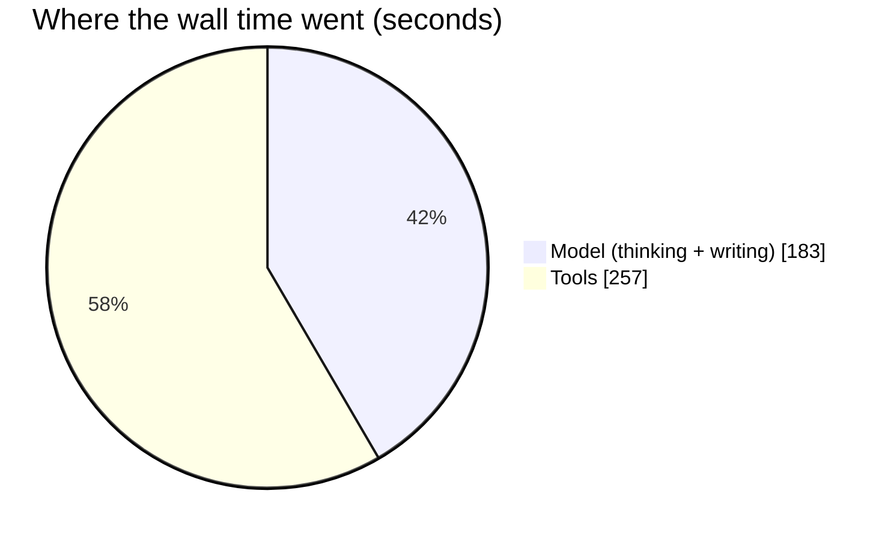

# firm-knowledge/tasks/233 · run1 (`hv-fk250-lunahigh-20261110T175632Z`)

Result: **all-pass** 3/3 criteria · 7.4 min · 28 model calls · 42 tool calls (1 errors or timeouts) · ending `completed` · started 11-11 00:58:06 IST

## Overview

One box per stretch of steps that used the same kind of tool (blue: looking/searching/reading, purple: writing or editing files, yellow: a message with no tool call, red border: a tool error or timeout inside the box).

```mermaid
flowchart TD
    T(["Task prompt"])
    P0["<b>Step 1</b> · 0.1 min<br/>todo_write"]
    T --> P0
    class P0 look
    P1["<b>Steps 2-3</b> · 0.2 min<br/>glob x5<br/><i>documents</i>"]
    P0 --> P1
    class P1 look
    P2["<b>Step 4</b> · 0.1 min<br/>read<br/><i>92d934daadfb-glob-results.txt</i>"]
    P1 --> P2
    class P2 err
    P3["<b>Step 5</b> · 0.1 min<br/>bash<br/><i>python - #lt;#lt;'PY' try: import docx prin…</i>"]
    P2 --> P3
    class P3 look
    P4["<b>Steps 6-7</b> · 0.6 min<br/>glob x10<br/><i>.</i>"]
    P3 --> P4
    class P4 look
    P5["<b>Steps 8-10</b> · 3.7 min<br/>bash x3<br/><i>python - #lt;#lt;'PY' from pathlib import P…</i>"]
    P4 --> P5
    class P5 look
    P6["<b>Step 11</b> · 0.2 min<br/>glob x5<br/><i>.</i>"]
    P5 --> P6
    class P6 look
    P7["<b>Steps 12-18</b> · 1.2 min<br/>bash x7<br/><i>python - #lt;#lt;'PY' from pathlib import P…, parse-doc docx 'documents/matters/100…</i>"]
    P6 --> P7
    class P7 look
    P8["<b>Step 19</b> · 0.0 min<br/>read<br/><i>opinion-1001-00006.txt</i>"]
    P7 --> P8
    class P8 look
    P9["<b>Step 20</b> · 0.2 min<br/>bash<br/><i>python - #lt;#lt;'PY' from pathlib import P…</i>"]
    P8 --> P9
    class P9 look
    P10["<b>Step 21</b> · 0.1 min<br/>read<br/><i>opinion-1001-00006.txt</i>"]
    P9 --> P10
    class P10 look
    P11["<b>Step 22</b> · 0.1 min<br/>bash<br/><i>python - #lt;#lt;'PY' from pathlib import P…</i>"]
    P10 --> P11
    class P11 look
    P12["<b>Step 23</b> · 0.0 min<br/>read<br/><i>email-cross-to-mattingly-lender-conse…</i>"]
    P11 --> P12
    class P12 look
    P13["<b>Step 24</b> · 0.2 min<br/>todo_write"]
    P12 --> P13
    class P13 look
    P14["<b>Steps 25-26</b> · 0.4 min<br/>write<br/>read<br/><i>response.md</i>"]
    P13 --> P14
    class P14 write
    P15["<b>Step 27</b> · 0.1 min<br/>todo_write"]
    P14 --> P15
    class P15 look
    P16["<b>Step 28</b> · 0.0 min<br/>final message"]
    P15 --> P16
    class P16 ans
    R(["ALL PASS: 3/3 criteria"])
    P16 --> R
    class R pass
    classDef look fill:#e8f0fe,stroke:#4a6fa5,color:#111
    classDef write fill:#f3e8fd,stroke:#7b1fa2,color:#111
    classDef ans fill:#fff8e1,stroke:#b58900,color:#111
    classDef err fill:#e8f0fe,stroke:#c62828,stroke-width:3px,color:#111
    classDef pass fill:#e6f4ea,stroke:#2e7d32,color:#111
    classDef fail fill:#fce8e6,stroke:#c62828,color:#111
```





One row per model call:

| Step | Started (IST) | Model s | Tools s | Tool calls | Tools | Output chars |
|---|---|---|---|---|---|---|
| 1 | 00:58:06 | 8 | 0 | 1 | todo_write | 57 |
| 2 | 00:58:13 | 1 | 3 | 1 | glob | 8,520 |
| 3 | 00:58:18 | 4 | 4 | 4 | glob x4 | 32,113 |
| 4 | 00:58:26 | 6 | 0 | 1 | read ⚠ | 66 |
| 5 | 00:58:32 | 8 | 1 | 1 | bash | 22 |
| 6 | 00:58:40 | 9 | 7 | 5 | glob x5 | 13,269 |
| 7 | 00:58:56 | 5 | 17 | 5 | glob x5 | 70 |
| 8 | 00:59:17 | 8 | 56 | 1 | bash | 49,785 |
| 9 | 01:00:21 | 9 | 19 | 1 | bash | 38,674 |
| 10 | 01:00:49 | 11 | 120 | 1 | bash | 49,888 |
| 11 | 01:02:59 | 4 | 5 | 5 | glob x5 | 1,296 |
| 12 | 01:03:09 | 4 | 2 | 1 | bash | 20,749 |
| 13 | 01:03:15 | 5 | 3 | 1 | bash | 49,916 |
| 14 | 01:03:23 | 7 | 1 | 1 | bash | 13,825 |
| 15 | 01:03:31 | 6 | 2 | 1 | bash | 48,699 |
| 16 | 01:03:39 | 14 | 5 | 1 | bash | 2,096 |
| 17 | 01:03:59 | 4 | 5 | 1 | bash | 1,476 |
| 18 | 01:04:08 | 7 | 3 | 1 | bash | 374 |
| 19 | 01:04:18 | 2 | 0 | 1 | read | 52,375 |
| 20 | 01:04:21 | 7 | 2 | 1 | bash | 725 |
| 21 | 01:04:31 | 7 | 0 | 1 | read | 3,113 |
| 22 | 01:04:38 | 5 | 3 | 1 | bash | 97 |
| 23 | 01:04:46 | 3 | 0 | 1 | read | 7,456 |
| 24 | 01:04:48 | 9 | 0 | 1 | todo_write | 57 |
| 25 | 01:04:58 | 19 | 0 | 1 | write | 200 |
| 26 | 01:05:17 | 4 | 0 | 1 | read | 7,520 |
| 27 | 01:05:20 | 5 | 0 | 1 | todo_write | 57 |
| 28 | 01:05:25 | 2 | 0 | 0 | (message only) | 0 |

## Task prompt

```text
I'm assembling our tax-opinion precedent file. Pull every opinion we've issued at the more-likely-than-not level.

Output: write your complete answer to `response.md` — a single self-contained markdown file with your findings, the matters/documents you relied on, and your reasoning.
```

## Rubric

| # | Criterion | Verdict |
|---|---|---|
| C-001 | Qualifying matter — Ardent Capital Partners 1001-00006 | pass |
| C-002 | Proof document — 1001-00006 | pass |
| C-003 | Qualifying set — precision | pass |

Judge's reasoning:

**C-001 (pass):** Qualifying matter — Ardent Capital Partners 1001-00006

```text
The output expressly identifies Matter 1001-00006 involving Ardent Capital Partners as the qualifying more-likely-than-not tax opinion matter.
```

**C-002 (pass):** Proof document — 1001-00006

```text
The output expressly identifies `documents/matters/1001-00006/Transaction Documents — Tax Sections/tax-opinion-letter.docx` as the issued Ardent Capital Partners tax opinion letter, satisfying the proof-document criterion.
```

**C-003 (pass):** Qualifying set — precision

```text
The output identifies only Matter 1001-00006 (Ardent Capital Partners) as qualifying. All other matters are explicitly discussed as excluded near matches, not asserted as qualifying matters.
```

## Delivered files (output/)

- `response.md` (7,136 bytes)

`response.md`:

```markdown
# More-Likely-Than-Not Tax Opinions

## Result

I identified **one issued tax opinion** in the provided materials that is expressly rendered at the **“more likely than not”** level. The opinion is:

- **Matter 1001-00006 — Ardent Healthcare acquisition / Pinnacle rollover**
- **Document:** `documents/matters/1001-00006/Transaction Documents — Tax Sections/tax-opinion-letter.docx`
- **Title:** *Tax Opinion Regarding Tax-Deferred Treatment of Rollover Contributions to Ardent Healthcare Holdings LLC in Connection with the Acquisition of Pinnacle Health Services Group LLC*
- **Date:** May 29, 2024
- **Issuer/signatory:** Calderwood & Harkness LLP, by Leonard Cross, Partner, Tax Department
- **Client/addressee:** Ardent Capital Partners III LP
- **Status:** Issued final opinion—not a draft. The letter states that it supersedes prior preliminary or draft analyses and is dated and signed for delivery in connection with the Acquisition closing scheduled for May 31, 2024.

## Opinion and conclusion

The opinion addresses the federal income tax treatment of the contribution by three rollover participants of portions of their Pinnacle Health Services Group LLC membership interests to **Ardent Healthcare Holdings LLC**, a Delaware LLC classified as a partnership, in exchange for Class B Units of Holdings LLC.

The letter’s express “Level of Opinion” section states that, based on the stated facts, assumptions, representations, qualifications, and limitations, it is the Firm’s opinion at the **“more likely than not”** level—defined as a greater than 50% likelihood—that:

1. Each rollover participant’s contribution of a portion of their Pinnacle membership interests to Holdings LLC in exchange for Class B Units qualifies as a tax-deferred contribution under **IRC § 721(a)**;
2. No gain or loss is recognized by any rollover participant on the contribution; and
3. No gain or loss is recognized by Holdings LLC upon receipt of the contributions.

The opinion expressly distinguishes this standard from higher “should” or “will” standards and says it is not a guarantee of the tax result.

The underlying analysis also covers and supports the following related matters:

- Holdings LLC’s classification as a partnership for federal income tax purposes;
- The characterization of the contributed Pinnacle interests as property contributed to a partnership in exchange for partnership interests under § 721(a);
- The inapplicability of the investment-company exception under § 721(b), because Holdings LLC holds an interest in a single operating healthcare business rather than a diversified investment portfolio;
- The conclusion that the rollover contributions are not disguised sales under § 707(a)(2)(B);
- Carryover/substituted basis consequences under §§ 722 and 723;
- Section 704(c) treatment of built-in gain or loss; and
- Holding-period tacking under § 1223(1), subject to the letter’s stated assumptions and qualifications.

## Documents and matters relied on for the included opinion

The opinion states that the Firm examined originals or copies of the following materials:

1. **Agreement and Plan of Merger**, dated March 15, 2024, among Ardent Healthcare Holdings LLC, Ardent Healthcare Intermediate Inc., Ardent Healthcare Merger Sub LLC, Pinnacle Health Services Group LLC, and the identified Pinnacle members, including related schedules, exhibits, and ancillary agreements;
2. **Amended and Restated Limited Liability Company Agreement of Ardent Healthcare Holdings LLC**, dated March 15, 2024 and further amended and restated May 28, 2024, including provisions concerning Class A and Class B Units, capital accounts, allocations, distributions, and governance;
3. **Rollover Contribution Agreements**, dated March 15, 2024, for Dr. Raymond Carvallo, Dr. Nadia Ostrowski, and Jonathan Farnsworth, including the contributed-interest and Class B Unit schedules;
4. **Operating Agreement of Pinnacle Health Services Group LLC**, originally dated August 12, 2016 and amended March 3, 2020, together with later amendments, supplements, and joinders;
5. **Certificate of Formation of Ardent Healthcare Holdings LLC**, filed March 5, 2024 under Delaware File No. 7834219;
6. **Tax Receivable Agreement**, dated May 28, 2024, among Ardent Healthcare Holdings LLC, Ardent Healthcare Intermediate Inc., and the identified TRA holders;
7. Other documents, certificates, organizational filings, IRS correspondence, corporate records, and Pinnacle tax-return materials the Firm considered necessary, including **Forms 1065 and Schedules K-1 for taxable years 2020–2023**; and
8. **Tax Representation Letters** from the rollover participants dated May 20, 2024 and from Ardent Capital dated May 22, 2024.

The Firm also states that it discussed the transaction’s structure, business purposes, and economic terms with Marcus Pellegrino and other Ardent Capital representatives, Thomas Kundra of Harcourt Shaw & DeVries LLP, and counsel for the rollover participants. The opinion relies on the factual representations in the transaction documents and Tax Representation Letters without independent verification.

The opinion is furnished to Ardent Capital for the Acquisition and rollover transactions. The letter consents to limited furnishing to the three rollover participants and their personal tax advisers for their individual federal income tax reporting, and to Harcourt Shaw & DeVries LLP for transaction review. It does not authorize broader reliance or use.

## Completeness and exclusions

I treated a document as responsive only if it was (i) an opinion rather than an advisory memorandum or work paper, (ii) issued/final rather than a draft, and (iii) expressly rendered at the more-likely-than-not level. On that basis, the Ardent/Pinnacle letter is the only responsive item.

I excluded the following near matches after reviewing their status and stated opinion level:

- `documents/matters/1002-00005/Tax Analysis/draft-tax-opinion-section-721.docx` — a draft Section 721 opinion that uses the higher **“should”** formulation and contains a target/future closing date;
- `documents/matters/1003-00005/Tax Opinion/draft-tax-opinion-letter-first-draft.docx` — expressly marked “DRAFT — FOR DISCUSSION PURPOSES ONLY — NOT FOR RELIANCE”; it states that the Firm was not then in a position to render a more-likely-than-not opinion;
- `documents/matters/1033-00002/Legal Opinions/tax-disclosure-opinion-draft.docx` — expressly a draft for discussion purposes, not a final issued opinion, although it discusses a more-likely-than-not standard; and
- `documents/matters/1037-00007/Opinion/final-tax-opinion-letter.docx` — a final **“should”** opinion. Its own standard section distinguishes “should” as materially higher than a more-likely-than-not opinion, so it is not a more-likely-than-not-level opinion for this request.

Other tax opinions in the file are stated at “should,” “will,” or an unstated opinion level, or are advisory memoranda rather than issued opinions. They therefore do not expand the responsive set.
```

## Trajectory

### Step 1: 1 tool call

_Started 11-11 00:58:06 IST · model 8 s · tools 0 s_

**Reasoning summary:**

```text
**Inspecting documents**

I need to review some documents, and it sounds like this task involves searching through files. I should probably create a list to keep track of everything. Using glob could be useful for this multi-step task, so I'll want to set up a to-do list. It's also important that I don’t read the task.json right now. I’ll focus on preparing the response.md file and get started on the inspection.
```

**Call `todo_write`** (0.0 s)

```json
{
 "todos": [
  {
   "content": "Inventory the provided precedent files",
   "status": "in_progress"
  },
  {
   "content": "Read and evaluate opinions for more-likely-than-not conclusions",
   "status": "pending"
  },
  {
   "content": "Draft and save the complete findings to response.md",
   "status": "pending"
  },
  {
   "content": "Verify response.md is self-contained and complete",
   "status": "pending"
  }
 ]
}
```

Output (57 chars):

```text
Updated todo list: 3 pending, 1 in progress, 0 completed.
```

**Todo list now:**

- [~] Inventory the provided precedent files
- [ ] Read and evaluate opinions for more-likely-than-not conclusions
- [ ] Draft and save the complete findings to response.md
- [ ] Verify response.md is self-contained and complete

### Step 2: 1 tool call

_Started 11-11 00:58:13 IST · model 1 s · tools 3 s_

**Call `glob`** (3.4 s)

```json
{
 "pattern": "**/*",
 "path": "documents"
}
```

Output (8,520 chars):

```text
documents/matters/1001-00001/Antitrust Analysis/competitor-identification-chart.xlsx
documents/matters/1001-00001/Antitrust Analysis/portfolio-company-overlap-analysis.docx
documents/matters/1001-00001/Antitrust Analysis/hhi-concentration-analysis.xlsx
documents/matters/1001-00001/Antitrust Analysis/market-definition-competitive-analysis-memo.docx
documents/matters/1001-00001/Client Updates/biweekly-status-report-1.docx
documents/matters/1001-00001/Antitrust Analysis/preliminary-antitrust-risk-assessment.docx
documents/matters/1001-00001/Antitrust Analysis/state-regulatory-con-analysis.docx
documents/matters/1001-00001/Antitrust Analysis/vertical-relationships-analysis.docx
documents/matters/1001-00001/Closing/closing-memo-antitrust-workstream.docx
documents/matters/1001-00001/Client Updates/client-update-early-termination-granted.eml
documents/matters/1001-00001/Client Updates/biweekly-status-report-2.docx
documents/matters/1001-00001/Client Updates/client-update-hsr-forms-filed.eml
documents/matters/1001-00001/Closing/final-invoice-matter-closing-letter.docx
documents/matters/1001-00001/Closing/hsr-clearance-certificate.docx
documents/matters/1001-00001/Correspondence/Counterparty Counsel/email-gk-naics-code-consistency.eml
documents/matters/1001-00001/Early Termination/early-termination-request-letter.docx
documents/matters/1001-00001/Correspondence/Counterparty Counsel/letter-bracewell-thornton-regulatory-condition.docx
documents/matters/1001-00001/Correspondence/Counterp
… [7,020 more chars]
```

### Step 3: 4 tool calls

_Started 11-11 00:58:18 IST · model 4 s · tools 4 s_

**Call `glob`** (0.7 s)

```json
{
 "pattern": "**/*opinion*",
 "path": "documents"
}
```

Output (7,802 chars):

```text
documents/matters/1001-00003/Closing/legal-opinion-calderwood-harkness.docx
documents/matters/1001-00004/Opinions & Deliverables/legal-opinion-calderwood-harkness.docx
documents/matters/1001-00006/Transaction Documents — Tax Sections/tax-opinion-letter.docx
documents/matters/1001-00007/Closing/sellers-counsel-legal-opinion.docx
documents/matters/1002-00001/Opinions/sc-legal-opinion-10b5-letter.docx
documents/matters/1002-00001/Opinions/sc-tax-opinion.docx
documents/matters/1002-00002/Closing/legal-opinion-form.docx
documents/matters/1002-00005/Tax Analysis/draft-tax-opinion-section-721.docx
documents/matters/1003-00002/Closing/legal-opinion-reg-d.docx
documents/matters/1003-00002/Closing/legal-opinion-valid-formation.docx
documents/matters/1003-00003/Opinions/buyers-counsel-legal-opinion.docx
documents/matters/1003-00003/Opinions/opinion-request-letter-wjc.docx
documents/matters/1003-00005/Tax Opinion/draft-tax-opinion-letter-first-draft.docx
documents/matters/1003-00005/Tax Opinion/email-cross-to-yeung-chandrasekar-draft-opinion.eml
documents/matters/1003-00005/Tax Opinion/internal-comments-draft-opinion.docx
documents/matters/1004-00001/Closing/company-counsel-legal-opinion-draft.docx
documents/matters/1005-00001/Correspondence/correspondence-sc-to-local-counsel-re-opinion-scope.eml
documents/matters/1005-00001/Opinions/draft-opinion-letter-sc-preliminary.docx
documents/matters/1005-00001/Opinions/legal-opinion-sc-enforceability.docx
documents/matters/1005-00001/Opinions/op
… [6,302 more chars]
```

**Call `glob`** (0.9 s)

```json
{
 "pattern": "**/*tax*",
 "path": "documents"
}
```

Output (7,988 chars):

```text
documents/matters/1001-00002/Correspondence/email-to-heathrow-whitman-re-tax-reporting.eml
documents/matters/1001-00002/Structuring & Analysis/tax-structuring-memo.docx
documents/matters/1001-00003/Tax/tax-structure-memorandum.docx
documents/matters/1001-00004/Tax/tax-provisions-merger-agreement-commentary.docx
documents/matters/1001-00004/Tax/swiss-withholding-tax-memo.docx
documents/matters/1001-00004/Tax/state-local-tax-memo.docx
documents/matters/1001-00004/Tax/tax-structure-memo-338h10.docx
documents/matters/1001-00006/Closing/closing-tax-memorandum.docx
documents/matters/1001-00006/Closing/tax-closing-certificate.docx
documents/matters/1001-00006/Earnout Treatment/earnout-provisions-tax-review-comment-letter.docx
documents/matters/1001-00006/Earnout Treatment/earnout-tax-characterization-memorandum.docx
documents/matters/1001-00006/Post-Closing/post-closing-tax-integration-memorandum.docx
documents/matters/1001-00006/Purchase Price Allocation & TRA/tax-receivable-agreement-draft.docx
documents/matters/1001-00006/Purchase Price Allocation & TRA/tax-receivable-agreement-execution.docx
documents/matters/1001-00006/Rollover Equity/llc-agreement-tax-provisions-draft-markup.docx
documents/matters/1001-00006/Rollover Equity/rollover-equity-tax-memorandum.docx
documents/matters/1001-00006/State & Local Tax/state-local-tax-memorandum.docx
documents/matters/1001-00006/State & Local Tax/state-tax-structuring-recommendations-letter.docx
documents/matters/1001-00006/Structure & Enti
… [6,488 more chars]
```

**Call `glob`** (1.4 s)

```json
{
 "pattern": "**/*memorandum*",
 "path": "documents"
}
```

Output (8,093 chars):

```text
documents/matters/1001-00001/Engagement & Administration/conflicts-check-memorandum.docx
documents/matters/1001-00001/Engagement & Administration/matter-opening-memorandum.docx
documents/matters/1001-00003/Closing/funds-flow-memorandum.xlsx
documents/matters/1001-00003/Diligence/due-diligence-summary-memorandum.docx
documents/matters/1001-00003/Tax/tax-structure-memorandum.docx
documents/matters/1001-00004/Antitrust & Regulatory/hsr-filing-memorandum.docx
documents/matters/1001-00004/Closing/funds-flow-memorandum.xlsx
documents/matters/1001-00004/Engagement & Administrative/staffing-budget-memorandum.docx
documents/matters/1001-00004/Engagement & Administrative/matter-opening-memorandum.docx
documents/matters/1001-00004/Transaction Documents/Merger Agreement/no-shop-compliance-memorandum.docx
documents/matters/1001-00006/Closing/closing-tax-memorandum.docx
documents/matters/1001-00006/Engagement & Administrative/conflict-check-memorandum.docx
documents/matters/1001-00006/Earnout Treatment/earnout-tax-characterization-memorandum.docx
documents/matters/1001-00006/Earnout Treatment/open-closed-transaction-installment-method-memorandum.docx
documents/matters/1001-00006/Post-Closing/engagement-summary-lessons-learned-memorandum.docx
documents/matters/1001-00006/Engagement & Administrative/staffing-and-budget-memorandum.docx
documents/matters/1001-00006/Engagement & Administrative/engagement-close-out-memorandum.docx
documents/matters/1001-00006/Post-Closing/post-closing-tax-integr
… [6,593 more chars]
```

**Call `glob`** (0.9 s)

```json
{
 "pattern": "**/*memo*",
 "path": "documents"
}
```

Output (8,230 chars):

```text
documents/matters/1001-00001/Antitrust Analysis/market-definition-competitive-analysis-memo.docx
documents/matters/1001-00001/Closing/closing-memo-antitrust-workstream.docx
documents/matters/1001-00001/Engagement & Administration/conflicts-check-memorandum.docx
documents/matters/1001-00001/Engagement & Administration/matter-opening-memorandum.docx
documents/matters/1001-00001/FTC/DOJ Correspondence/memo-federal-register-notice.docx
documents/matters/1001-00002/Engagement & Administration/matter-closing-memo.docx
documents/matters/1001-00002/Engagement & Administration/conflict-check-memo.docx
documents/matters/1001-00002/LP Consent & Notification/lpac-presentation-memo.docx
documents/matters/1001-00002/LP Consent & Notification/side-letter-compliance-memo.docx
documents/matters/1001-00002/Regulatory/form-adv-amendment-summary-memo.docx
documents/matters/1001-00002/Structuring & Analysis/restructuring-options-memo.docx
documents/matters/1001-00002/Structuring & Analysis/tax-structuring-memo.docx
documents/matters/1001-00002/Structuring & Analysis/section-704-analysis-memo.docx
documents/matters/1001-00003/Closing/funds-flow-memorandum.xlsx
documents/matters/1001-00003/Diligence/healthcare-regulatory-compliance-memo.docx
documents/matters/1001-00003/Diligence/due-diligence-summary-memorandum.docx
documents/matters/1001-00003/Diligence/rw-insurance-coverage-memo.docx
documents/matters/1001-00003/Diligence/litigation-regulatory-review-memo.docx
documents/matters/1001-00003/Tax/se
… [6,730 more chars]
```

### Step 4: 1 tool call

_Started 11-11 00:58:26 IST · model 6 s · tools 0 s_

**Call `read`** (0.0 s · **error/timeout**)

```json
{
 "file_path": "/tmp/dsh-spill-WiMyrq/session-74e441622730/92d934daadfb-glob-results.txt",
 "offset": 1,
 "limit": 250
}
```

Output (66 chars):

```text
Error: [sandbox: file access denied under workspace-isolated mode]
```

### Step 5: 1 tool call

_Started 11-11 00:58:32 IST · model 8 s · tools 1 s_

**Reasoning summary:**

```text
**Checking document processing options**

I'm looking at the task of retrieving documents related to “tax” rather than opinions. The query about our level of opinion could mean we need to find documents with “tax opinion” in the titles. I might have to search through all documents for that specific phrase. I wonder if I should process 2-3k tax-related documents in parallel. Using `python-docx` to handle docx files could be the way to go, but I need to check its installation.
```

**Call `bash`** (0.9 s)

```json
{
 "command": "python - <<'PY'\ntry:\n import docx\n print('python-docx available')\nexcept Exception as e: print('no',e)\nPY",
 "description": "Check document parsing availability"
}
```

Output (22 chars):

```text
python-docx available
```

### Step 6: 5 tool calls

_Started 11-11 00:58:40 IST · model 9 s · tools 7 s_

**Reasoning summary:**

```text
**Exploring file discovery with glob**

I'm thinking about how to script walking through documents using the glob tool instead of shell find as instructed. I might need to use glob patterns to access `.docx` files, but it seems there's a limitation to the first 100 results. To ensure I follow the instructions properly, I’ll consider calling glob separately to get all matters. The goal is to make sure I have the best approach to discover the files without violating any rules.

**Considering file discovery patterns**

I'm thinking about how to discover files in the `documents/matters` folder using glob patterns instead of shell commands. The instruction is clear: use glob to get specific `.docx` files. I might start with patterns like `documents/matters/100[0-9]-*/**/*.docx`. It seems necessary to split my search by matter ranges to efficiently access only what I need, like opinion files. My goal is to refine my patterns to make sure I gather the right documents without overcomplicating things.
```

**Call `glob`** (1.4 s)

```json
{
 "pattern": "documents/matters/100[1-9]-*/**/*opinion*.docx",
 "path": "."
}
```

Output (2,882 chars):

```text
./documents/matters/1001-00003/Closing/legal-opinion-calderwood-harkness.docx
./documents/matters/1001-00004/Opinions & Deliverables/legal-opinion-calderwood-harkness.docx
./documents/matters/1001-00006/Transaction Documents — Tax Sections/tax-opinion-letter.docx
./documents/matters/1001-00007/Closing/sellers-counsel-legal-opinion.docx
./documents/matters/1002-00001/Opinions/sc-legal-opinion-10b5-letter.docx
./documents/matters/1002-00001/Opinions/sc-tax-opinion.docx
./documents/matters/1002-00002/Closing/legal-opinion-form.docx
./documents/matters/1002-00005/Tax Analysis/draft-tax-opinion-section-721.docx
./documents/matters/1003-00002/Closing/legal-opinion-reg-d.docx
./documents/matters/1003-00002/Closing/legal-opinion-valid-formation.docx
./documents/matters/1003-00003/Opinions/buyers-counsel-legal-opinion.docx
./documents/matters/1003-00003/Opinions/opinion-request-letter-wjc.docx
./documents/matters/1003-00005/Tax Opinion/draft-tax-opinion-letter-first-draft.docx
./documents/matters/1003-00005/Tax Opinion/internal-comments-draft-opinion.docx
./documents/matters/1004-00001/Closing/company-counsel-legal-opinion-draft.docx
./documents/matters/1005-00001/Opinions/draft-opinion-letter-sc-preliminary.docx
./documents/matters/1005-00001/Opinions/legal-opinion-sc-enforceability.docx
./documents/matters/1005-00001/Opinions/opinion-backup-certificate-borrower.docx
./documents/matters/1005-00001/Opinions/legal-opinion-sc-ucc-perfection.docx
./documents/matters/1005-00001/Opinions/l
… [1,382 more chars]
```

**Call `glob`** (1.3 s)

```json
{
 "pattern": "documents/matters/101[0-9]-*/**/*opinion*.docx",
 "path": "."
}
```

Output (3,757 chars):

```text
./documents/matters/1010-00001/Closing/borrowers-counsel-legal-opinion.docx
./documents/matters/1010-00002/Legal Opinions/legal-opinion-delaware-corporate.docx
./documents/matters/1010-00002/Legal Opinions/legal-opinion-validity-of-shares.docx
./documents/matters/1010-00002/Legal Opinions/legal-opinion-lock-up-no-registration.docx
./documents/matters/1010-00002/Legal Opinions/legal-opinion-tax-matters.docx
./documents/matters/1010-00002/Legal Opinions/opinion-reliance-letter-meridian-hale.docx
./documents/matters/1011-00006/Closing/legal-opinion-letter.docx
./documents/matters/1012-00001/Opinions/borrowers-counsel-opinion-letter.docx
./documents/matters/1012-00001/Opinions/ucc-lien-perfection-opinion.docx
./documents/matters/1012-00002/Closing/legal-opinion-letter.docx
./documents/matters/1012-00003/Analysis/coverage-opinion-memo.docx
./documents/matters/1013-00001/Closing/borrowers-counsel-legal-opinion.docx
./documents/matters/1013-00002/Closing/legal-opinion-issuers-counsel.docx
./documents/matters/1013-00003/Closing/legal-opinion-letter.docx
./documents/matters/1014-00001/documents/issuers-counsel-opinion-initial-purchasers.docx
./documents/matters/1014-00001/documents/issuers-counsel-opinion-trustee.docx
./documents/matters/1014-00002/O-1 Petitions/template-o1-advisory-opinion-letter-request.docx
./documents/matters/1014-00004/Pleadings & Motions/motion-to-compel-opinion-letters.docx
./documents/matters/1015-00001/Closing/pdy-opinion-checklist.docx
./documents/matters/10
… [2,257 more chars]
```

**Call `glob`** (1.5 s)

```json
{
 "pattern": "documents/matters/102[0-9]-*/**/*opinion*.docx",
 "path": "."
}
```

Output (2,045 chars):

```text
./documents/matters/1020-00001/Closing/draft-legal-opinion-outline.docx
./documents/matters/1021-00001/Opinions/enforceability-opinion-ny-law.docx
./documents/matters/1021-00001/Opinions/opinion-backup-certificate-vhg.docx
./documents/matters/1021-00001/Opinions/legal-opinion-borrowers-counsel.docx
./documents/matters/1021-00001/Opinions/tax-opinion-oid-ahydo.docx
./documents/matters/1021-00002/Closing/opinion-of-issuers-counsel.docx
./documents/matters/1021-00002/Closing/tax-opinion.docx
./documents/matters/1022-00008/Closing/legal-opinion-wgm.docx
./documents/matters/1024-00004/Legal Opinions/cayman-legal-opinion-applegate.docx
./documents/matters/1024-00004/Legal Opinions/trustees-counsel-opinion-ashworth-pratt.docx
./documents/matters/1024-00004/Legal Opinions/tax-opinion-issuers-counsel.docx
./documents/matters/1024-00004/Legal Opinions/us-legal-opinion-issuers-counsel.docx
./documents/matters/1025-00001/Transaction Documents/legal-opinion-outline-draft.docx
./documents/matters/1025-00007/Legal Opinions/draft-opinion-de-llc-formation-qrf.docx
./documents/matters/1025-00007/Legal Opinions/draft-opinion-de-llc-formation-qrh.docx
./documents/matters/1025-00007/Legal Opinions/draft-opinion-true-sale-qrh-to-qrf.docx
./documents/matters/1025-00007/Legal Opinions/draft-opinion-no-registration-required.docx
./documents/matters/1025-00007/Legal Opinions/draft-opinion-enforceability-indenture-notes.docx
./documents/matters/1025-00007/Legal Opinions/draft-opinion-security-interest-
… [545 more chars]
```

**Call `glob`** (1.1 s)

```json
{
 "pattern": "documents/matters/103[0-9]-*/**/*opinion*.docx",
 "path": "."
}
```

Output (2,564 chars):

```text
./documents/matters/1030-00001/Opinions & Certificates/approving-legal-opinion-bond-counsel.docx
./documents/matters/1030-00001/Opinions & Certificates/tax-opinion-bond-counsel.docx
./documents/matters/1030-00001/Opinions & Certificates/enforceability-opinion-revenue-pledge.docx
./documents/matters/1030-00001/Opinions & Certificates/issuers-counsel-opinion.docx
./documents/matters/1031-00004/Closing Opinions/delaware-entity-opinion.docx
./documents/matters/1031-00004/Closing Opinions/zoning-opinion-transmittal.docx
./documents/matters/1031-00004/Closing Opinions/tax-exempt-status-opinion.docx
./documents/matters/1031-00004/Closing Opinions/opinion-letter-senior-lender.docx
./documents/matters/1031-00004/Closing Opinions/opinion-letter-mezzanine-lender.docx
./documents/matters/1032-00003/Closing/draft-opinion-validity-of-ads.docx
./documents/matters/1032-00003/Closing/draft-opinion-negative-assurance-10b5.docx
./documents/matters/1032-00003/Closing/draft-tax-opinion-prospectus.docx
./documents/matters/1032-00005/Transaction Documents/legal-opinion-halcyon-merger-sub.docx
./documents/matters/1033-00002/Legal Opinions/legal-opinion-exhibit-5-1-draft.docx
./documents/matters/1033-00002/Legal Opinions/legal-opinion-exhibit-5-1-final.docx
./documents/matters/1033-00002/Legal Opinions/tax-disclosure-opinion-draft.docx
./documents/matters/1036-00001/Transaction Documents/draft-legal-opinion-letter.docx
./documents/matters/1036-00002/Opinions/legal-opinion-exhibit-5-1.docx
./documents
… [1,064 more chars]
```

**Call `glob`** (1.4 s)

```json
{
 "pattern": "documents/matters/104[0-9]-*/**/*opinion*.docx",
 "path": "."
}
```

Output (2,021 chars):

```text
./documents/matters/1041-00003/Opinions/legal-opinion-cloudium-de-law.docx
./documents/matters/1041-00003/Opinions/legal-opinion-cobalt-trust.docx
./documents/matters/1041-00003/Opinions/memo-opinion-backup.docx
./documents/matters/1041-00003/Opinions/legal-opinion-meridian-atlantic.docx
./documents/matters/1042-00001/Closing/borrowers-counsel-legal-opinion.docx
./documents/matters/1042-00004/Closing/legal-opinion-buyers-counsel.docx
./documents/matters/1043-00001/Legal Opinions/german-local-counsel-opinion.docx
./documents/matters/1043-00001/Legal Opinions/sc-us-regulatory-opinion.docx
./documents/matters/1043-00001/Legal Opinions/sc-virginia-law-opinion.docx
./documents/matters/1043-00001/Legal Opinions/sc-tax-opinion.docx
./documents/matters/1043-00001/Legal Opinions/sc-ny-law-legal-opinion.docx
./documents/matters/1043-00002/Financing/legal-opinion-letter-draft.docx
./documents/matters/1043-00003/Closing/borrower-counsel-opinion-letter.docx
./documents/matters/1044-00002/Diligence/Legal Opinions/greek-law-opinion-outline.docx
./documents/matters/1044-00002/Diligence/Legal Opinions/ny-law-opinion-outline.docx
./documents/matters/1044-00003/documents/legal-opinion-authorization-enforceability.docx
./documents/matters/1044-00003/documents/legal-opinion-no-conflicts.docx
./documents/matters/1044-00004/Legal Opinions/legal-opinion-draft-calderwood-harkness.docx
./documents/matters/1044-00004/Legal Opinions/legal-opinion-draft-delphi-karidis-reviewed.docx
./documents/matters/10
… [521 more chars]
```

### Step 7: 5 tool calls

_Started 11-11 00:58:56 IST · model 5 s · tools 17 s_

**Call `glob`** (1.4 s)

```json
{
 "pattern": "documents/matters/105[0-9]-*/**/*opinion*.docx",
 "path": "."
}
```

Output (14 chars):

```text
No files found
```

**Call `glob`** (1.3 s)

```json
{
 "pattern": "documents/matters/106[0-9]-*/**/*opinion*.docx",
 "path": "."
}
```

Output (14 chars):

```text
No files found
```

**Call `glob`** (9.4 s)

```json
{
 "pattern": "documents/matters/107[0-9]-*/**/*opinion*.docx",
 "path": "."
}
```

Output (14 chars):

```text
No files found
```

**Call `glob`** (1.8 s)

```json
{
 "pattern": "documents/matters/108[0-9]-*/**/*opinion*.docx",
 "path": "."
}
```

Output (14 chars):

```text
No files found
```

**Call `glob`** (2.9 s)

```json
{
 "pattern": "documents/matters/109[0-9]-*/**/*opinion*.docx",
 "path": "."
}
```

Output (14 chars):

```text
No files found
```

### Step 8: 1 tool call

_Started 11-11 00:59:17 IST · model 8 s · tools 56 s_

**Call `bash`** (55.5 s)

```json
{
 "command": "python - <<'PY'\nfrom pathlib import Path\nfrom zipfile import ZipFile\nfrom xml.etree import ElementTree as ET\nimport re\nroot=Path('documents')\npat=re.compile(r'more[\\s\\-‐‑–—]+likely[\\s\\-‐‑–—]+than[\\s\\-‐‑–—]+not',re.I)\n# process all docx, but only print matches\ncount=0\nfor p in root.rglob('*.docx'):\n    try:\n        with ZipFile(p) as z:\n            xml=z.read('word/document.xml')\n        text=' '.join(ET.fromstring(xml).itertext())\n    except Exception:\n        continue\n    if pat.search(text):\n        count+=1\n        matches=list(pat.finditer(text))\n        snippets=[]\n        for m in matches[:5]:\n            snippets.append(re.sub(r'\\s+',' ',text[max(0,m.start()-280):m.end()+500]))\n        print(f'FILE: {p}\\n'+'\\n'.join('SNIP: '+s for s in snippets)+'\\n')\nprint('MATCH_COUNT',count)\nPY",
 "description": "Search documents for MLTN language",
 "timeoutMs": 120000
}
```

Output (49,785 chars):

```text
ansfer pricing positions as supported by contemporaneous documentation and the WVG economic analyses, and the range of potential IRS adjustments, C&H concluded that PPC's $62.4 million FIN 48 reserve is appr

FILE: documents/matters/1018-00009/Related Matters/sec-disclosure-analysis-memo.docx
SNIP: gal assessment of the hazards of the Company's positions in a memorandum dated September 2022). The $62.4 million reserve reflects the application of the two-step FIN 48 analysis to PPC's transfer pricing positions. In the recognition step, PPC determined that its positions were more likely than not (i.e., greater than 50% likely) to be sustained on their technical merits. In the measurement step, PPC measured the positions at the largest amount of benefit that is greater than 50% likely to be realized upon ultimate settlement, and reserved $62.4 million for the portion of the benefit that did not meet this threshold. The positions giving rise to the reserve include: • PPC's cost-sharing ratios under the CSA, which allocated between 38.2% and 42.7% of total intangible development costs to
SNIP: Income Taxes), which incorporated the principles of FASB Interpretation No. 48 ("FIN 48"), prescribes a two-step process for the recognition and measurement of uncertain tax positions: Step 1 — Recognition. A tax position is recognized in the financial statements only if it is "more likely than not" (i.e., a likelihood of greater than 50%) that the position will be sustained upon examination
… [48,285 more chars]
```

### Step 9: 1 tool call

_Started 11-11 01:00:21 IST · model 9 s · tools 19 s_

**Call `bash`** (18.5 s)

```json
{
 "command": "python - <<'PY'\nfrom pathlib import Path\nfrom docx import Document\nimport re\nroot=Path('documents')\nfor p in sorted(root.rglob('*.docx')):\n    s=str(p).lower()\n    if not any(k in s for k in ('opinion','tax')): continue\n    try:\n      d=Document(p)\n      paras=[x.text.strip() for x in d.paragraphs]\n      paras += [c.text.strip() for t in d.tables for row in t.rows for c in row.cells]\n      text='\\n'.join(x for x in paras if x)\n    except Exception: continue\n    low=text.lower()\n    if 'more likely than not' not in low and 'more-likely-than-not' not in low and 'mltn' not in low: continue\n    # score likely issued opinion\n    score=0\n    for k in ('this opinion','tax opinion','opinion standard','we conclude','we are of the opinion','we believe'):\n      if k in low: score+=1\n    matches=[]\n    for i,line in enumerate(text.splitlines()):\n      ll=line.lower()\n      if ('opinion' in ll and ('more likely' in ll or 'should' in ll or 'will' in ll)) or 'opinion standard' in ll or 'level of confidence' in ll:\n        matches.append(line[:500])\n    print(f'[{score}] {p}')\n    print(' | '.join(matches[:6]))\nPY",
 "description": "Profile MLTN tax and o
… [41 more chars]
```

Output (38,674 chars):

```text
[3] documents/matters/1001-00006/Earnout Treatment/earnout-tax-characterization-memorandum.docx
3. This memorandum does not constitute a formal tax opinion and does not express a "more likely than not," "should," or "will" level of confidence with respect to any tax position. Our conclusion that capital gain treatment is "supportable" means that, in our professional judgment, there is a reasonable basis for the position and that it could be sustained on the merits if challenged by the IRS. The ultimate determination of the proper tax treatment would depend on a facts-and-circumstances anal
[3] documents/matters/1001-00006/Transaction Documents — Tax Sections/tax-opinion-letter.docx
2.  All representations and certifications made by each of the Rollover Participants and by Ardent Capital in the Tax Representation Letters are true, correct, and complete in all material respects as of the date of this opinion and will remain true, correct, and complete in all material respects as of the Closing Date (May 31, 2024), and no Rollover Participant or representative of Ardent Capital has made any representation or certification that is misleading or that omits material information. | 7.  Scope of Opinion. No opinion is expressed as to any federal, state, local, or foreign tax matter not specifically and expressly addressed in this opinion. The omission of any particular issue or topic from this opinion should not be construed as an indication of our view, whether favorable or unfavora
… [37,173 more chars]
```

### Step 10: 1 tool call

_Started 11-11 01:00:49 IST · model 11 s · tools 120 s_

**Reasoning summary:**

```text
**Exploring file generation options**

I'm considering whether to generate a file using bash commands directed to a scratch file. There seems to be a limit I should keep in mind. The developer suggested using a write method for plain markdown documents but also mentioned that creating a scratch file via bash is acceptable. Okay, redirecting seems feasible, but I need to ensure I can read the tool text file properly afterward.
```

**Call `bash`** (120.1 s)

```json
{
 "command": "python - <<'PY'\nfrom pathlib import Path\nfrom docx import Document\nimport re\nfor p in sorted(Path('documents').rglob('*.docx')):\n    try:\n      d=Document(p); paras=[x.text.strip() for x in d.paragraphs]\n      paras += [c.text.strip() for t in d.tables for r in t.rows for c in r.cells]\n      lines=[x for x in paras if x]\n    except: continue\n    text='\\n'.join(lines); low=text.lower()\n    if 'more likely than not' not in low and 'more-likely-than-not' not in low: continue\n    # candidate if opinion-focused content and formal-type language\n    if not any(k in low for k in ('this opinion','tax opinion','formal opinion','opinion standard','level of confidence','we are of the opinion','opinion letter')): continue\n    hits=[]\n    for line in lines:\n      ll=line.lower()\n      if any(k in ll for k in ('this opinion','tax opinion','formal opinion','opinion standard','level of confidence','more likely than not')):\n        hits.append(line)\n    print(f'FILE: {p}')\n    for h in hits[:10]: print('  '+re.sub(r'\\s+',' ',h)[:700])\n    print()\nPY",
 "description": "Identify formal MLTN opinion candidates",
 "timeoutMs": 120000
}
```

Output (49,888 chars):

```text
FILE: documents/matters/1001-00006/Earnout Treatment/earnout-tax-characterization-memorandum.docx
  3. This memorandum does not constitute a formal tax opinion and does not express a "more likely than not," "should," or "will" level of confidence with respect to any tax position. Our conclusion that capital gain treatment is "supportable" means that, in our professional judgment, there is a reasonable basis for the position and that it could be sustained on the merits if challenged by the IRS. The ultimate determination of the proper tax treatment would depend on a facts-and-circumstances analysis by the IRS or a court, and we can provide no assurance as to the outcome of any such proceeding.

FILE: documents/matters/1001-00006/Transaction Documents — Tax Sections/tax-opinion-letter.docx
  Re: Tax Opinion Regarding Tax-Deferred Treatment of Rollover Contributions to Ardent Healthcare Holdings LLC in Connection with the Acquisition of Pinnacle Health Services Group LLC
  This opinion specifically addresses the federal income tax treatment of the contribution of certain Pinnacle membership interests by certain rollover participants (the "Rollover Participants," as further defined in Section III.A below) to Ardent Healthcare Holdings LLC (Employer Identification Number 93-2187445), a Delaware limited liability company classified as a partnership for federal income tax purposes ("Holdings LLC"), in exchange for Class B Units of Holdings LLC. This opinion is delivered in connectio
… [48,388 more chars]
```

### Step 11: 5 tool calls

_Started 11-11 01:02:59 IST · model 4 s · tools 5 s_

**Reasoning summary:**

```text
**Inspecting tax documents**

I see that I've timed out trying to gather all the necessary tax opinions, which is a bit frustrating. I want to focus on identifying the correct filenames and ensuring I have a complete list of relevant paths. I'll use the glob function to search for specific tax-opinion patterns, particularly looking for `**/*tax-opinion*.docx`. I think this will likely help me find the documents I need and give me a comprehensive overview.
```

**Call `glob`** (0.9 s)

```json
{
 "pattern": "documents/matters/100[0-9]-*/**/*tax-opinion*.docx",
 "path": "."
}
```

Output (373 chars):

```text
./documents/matters/1001-00006/Transaction Documents — Tax Sections/tax-opinion-letter.docx
./documents/matters/1002-00001/Opinions/sc-tax-opinion.docx
./documents/matters/1002-00005/Tax Analysis/draft-tax-opinion-section-721.docx
./documents/matters/1003-00005/Tax Opinion/draft-tax-opinion-letter-first-draft.docx
./documents/matters/1009-00003/Tax/tax-opinion-draft.docx
```

**Call `glob`** (1.1 s)

```json
{
 "pattern": "documents/matters/101[0-9]-*/**/*tax-opinion*.docx",
 "path": "."
}
```

Output (221 chars):

```text
./documents/matters/1015-00001/Tax/draft-tax-opinion.docx
./documents/matters/1015-00005/Opinions & Certificates/tax-opinion-ridgeline.docx
./documents/matters/1015-00005/Opinions & Certificates/tax-opinion-pinehurst.docx
```

**Call `glob`** (1.1 s)

```json
{
 "pattern": "documents/matters/102[0-9]-*/**/*tax-opinion*.docx",
 "path": "."
}
```

Output (201 chars):

```text
./documents/matters/1021-00001/Opinions/tax-opinion-oid-ahydo.docx
./documents/matters/1021-00002/Closing/tax-opinion.docx
./documents/matters/1024-00004/Legal Opinions/tax-opinion-issuers-counsel.docx
```

**Call `glob`** (1.2 s)

```json
{
 "pattern": "documents/matters/103[0-9]-*/**/*tax-opinion*.docx",
 "path": "."
}
```

Output (364 chars):

```text
./documents/matters/1030-00001/Opinions & Certificates/tax-opinion-bond-counsel.docx
./documents/matters/1032-00003/Closing/draft-tax-opinion-prospectus.docx
./documents/matters/1036-00002/Opinions/tax-opinion-exhibit-8-1.docx
./documents/matters/1037-00007/Opinion/draft-tax-opinion-letter.docx
./documents/matters/1037-00007/Opinion/final-tax-opinion-letter.docx
```

**Call `glob`** (1.0 s)

```json
{
 "pattern": "documents/matters/104[0-9]-*/**/*tax-opinion*.docx",
 "path": "."
}
```

Output (137 chars):

```text
./documents/matters/1043-00001/Legal Opinions/sc-tax-opinion.docx
./documents/matters/1045-00001/Opinions/issuer-counsel-tax-opinion.docx
```

### Step 12: 1 tool call

_Started 11-11 01:03:09 IST · model 4 s · tools 2 s_

**Reasoning summary:**

```text
**Examining tax-opinion files**

I’m realizing there are only 21 exact tax-opinion filenames to inspect. I’ll need to parse all of these docx files and gather metadata from them, focusing on the first paragraphs, lines labeled "standard," "MLTN" lines, and any final or draft notes. I think using a python script with an explicit list pattern would be a good approach, though I might need to keep it simple since there are only a few files to handle here!
```

**Call `bash`** (1.9 s)

```json
{
 "command": "python - <<'PY'\nfrom pathlib import Path\nfrom docx import Document\nimport re\nfiles=sorted(Path('documents').rglob('*.docx'))\nfor p in files:\n if 'tax-opinion' not in p.name.lower(): continue\n d=Document(p); lines=[x.text.strip() for x in d.paragraphs if x.text.strip()]\n print('\\n###',p)\n print('FIRST:', ' | '.join(lines[:4])[:1000])\n for x in lines:\n  ll=x.lower()\n  if any(k in ll for k in ('opinion standard','more likely than not','more-likely-than-not','should level','will level','not constitute a final','draft —','draft -','final opinion')):\n   print('HIT:',re.sub(r'\\s+',' ',x)[:1000])\nPY",
 "description": "Review tax opinion standards and status",
 "timeoutMs": 120000
}
```

Output (20,749 chars):

```text
### documents/matters/1001-00006/Transaction Documents — Tax Sections/tax-opinion-letter.docx
FIRST: CALDERWOOD & HARKNESS LLP Attorneys at Law | One Liberty Plaza, 45th Floor New York, New York 10006 Telephone: (212) 504-6000 Facsimile: (212) 504-6100 www.calderwoodharkness.com | May 29, 2024 | Ardent Capital Partners III LP 600 Lexington Avenue, 38th Floor New York, New York 10022
HIT: Based on the facts, assumptions, and representations set forth above, and subject in all respects to the qualifications and limitations described in Section VII above, it is our opinion that it is "more likely than not" (i.e., there is a greater than fifty percent (50%) likelihood) that:
HIT: The "more likely than not" standard means that we believe the position described herein, if challenged by the Internal Revenue Service, would prevail on the merits based on the weight of applicable legal authorities. This opinion should not be understood as an opinion at a higher level of confidence (such as "should" or "will"), and should not be relied upon as a guarantee of a particular outcome.

### documents/matters/1002-00001/Opinions/sc-tax-opinion.docx
FIRST: CALDERWOOD & HARKNESS LLP 900 Third Avenue, 28th Floor New York, NY 10022 | June 25, 2021 | Pinnacle Acquisition Corp. I 388 Embarcadero Center, Suite 2400 San Francisco, California 94111 | Re: Federal Income Tax Treatment of Units — Initial Public Offering of Pinnacle Acquisition Corp. I

### documents/matters/1002-00005/Tax Analysis/draft-t
… [19,247 more chars]
```

### Step 13: 1 tool call

_Started 11-11 01:03:15 IST · model 5 s · tools 3 s_

**Call `bash`** (2.5 s)

```json
{
 "command": "python - <<'PY'\nfrom pathlib import Path\nfrom docx import Document\nimport re\nfor p in sorted(Path('documents').rglob('*.docx')):\n if 'tax-opinion' not in p.name.lower() and not (p.name.lower()=='sc-tax-opinion.docx' or 'tax-opinion' in str(p).lower()): continue\n try:\n  d=Document(p); lines=[x.text.strip() for x in d.paragraphs if x.text.strip()]\n except: continue\n print('\\n###',p)\n for x in lines:\n  ll=x.lower()\n  if any(k in ll for k in ('standard','level of','level that','it is our opinion','we conclude','we are of the opinion','we believe','opine','opinion that','opinion is')):\n   print(re.sub(r'\\s+',' ',x)[:1100])\nPY",
 "description": "Classify tax opinion confidence levels",
 "timeoutMs": 120000
}
```

Output (49,916 chars):

```text
Reporting FFI") with the Cayman Islands Tax Information Authority for purposes of the Foreign Account Tax Compliance Act ("FATCA"), codified in Sections 1471 through 1474 of the Code, and the Common Reporting Standard ("CRS") adopted by the Organisation for Economic Co-operation and Development ("OECD") and implemented in the Cayman Islands through the Tax Information Authority (International Tax Compliance) (Common Reporting Standard) Regulations (as revised). The Issuer has obtained a Global Intermediary Identification Number ("GIIN") and intends to comply with applicable FATCA intergovernmental agreement procedures and CRS reporting obligations.
We further note that the Issuer itself should not be subject to U.S. withholding tax on income received from the Collateral Obligations, provided that the Issuer is not engaged in a U.S. trade or business (as opined in Section 5.1 above). Interest income received by the Issuer on the Collateral Obligations (which consist of loans to U.S. obligors) generally should be subject to the portfolio interest exemption or, in the case of certain bank loans, may be excluded from the definition of U.S.-source income under applicable rules. We note, however, that certain types of income — including original issue discount, commitment fees, facility fees, and other non-interest compensation — may be subject to different withholding rules, and the Issuer should consult with its tax advisors regarding the application of withholding tax to specifi
… [48,416 more chars]
```

### Step 14: 1 tool call

_Started 11-11 01:03:23 IST · model 7 s · tools 1 s_

**Reasoning summary:**

```text
**Considering document parsing**

It looks like I’m thinking about whether to use `parse-doc`, but maybe that's not necessary. It seems like using Python-docx should be sufficient for my needs. I should also consider making groups like 1002 and 1015, so I’ll need to plan how to organize that effectively. I want to keep everything streamlined and efficient as I tackle this task!
```

**Call `bash`** (1.3 s)

```json
{
 "command": "python - <<'PY'\nfrom pathlib import Path\nfrom docx import Document\nimport re\nwanted=['1002-00001/Opinions/sc-tax-opinion.docx','1015-00005/Opinions & Certificates/tax-opinion-ridgeline.docx','1015-00005/Opinions & Certificates/tax-opinion-pinehurst.docx','1021-00002/Closing/tax-opinion.docx','1024-00004/Legal Opinions/tax-opinion-issuers-counsel.docx']\nfor w in wanted:\n p=Path('documents/matters')/w\n d=Document(p); lines=[x.text.strip() for x in d.paragraphs if x.text.strip()]\n print('\\n###',p)\n for i,x in enumerate(lines):\n  ll=x.lower()\n  if any(k in ll for k in ('more likely','more-likely','should level','will level','opinion standard','standard of confidence','confidence level','at a \"should','at the \"should','at a \"will','at the \"will','we are of the opinion','it is our opinion','we conclude','we believe')):\n   print(f'{i+1}: {re.sub(r\"\\s+\",\" \",x)[:1400]}')\nPY",
 "description": "Inspect selected issued tax opinions",
 "timeoutMs": 120000
}
```

Output (13,825 chars):

```text
### documents/matters/1002-00001/Opinions/sc-tax-opinion.docx
31: Based upon and subject to the foregoing, and subject to the limitations, qualifications, and assumptions set forth herein, we are of the opinion that, under currently applicable U.S. federal income tax law:

### documents/matters/1015-00005/Opinions & Certificates/tax-opinion-ridgeline.docx
136: Based upon and subject to the foregoing, and subject to the qualifications, limitations, and exceptions set forth in Sections VI and VII of this Opinion, we are of the opinion that:
142: Accordingly, it is our opinion that each of the seven Projects constitutes energy property eligible for the ITC under Section 48(a) of the Code, as amended by the IRA, and that ITCs should be allowed with respect to the eligible basis of each Project.
148: Conclusion. Based on the foregoing, it is our opinion that the prevailing wage and apprenticeship requirements of Sections 48(a)(10) and 48(a)(11) of the Code have been satisfied with respect to each of the seven Projects, and accordingly, the 5× multiplier applies, resulting in a base ITC rate of 30% for each Project.
152: Conclusion. Based on the foregoing, it is our opinion that the domestic content requirements of Section 48(a)(12) of the Code have been satisfied with respect to each of the seven Projects, and accordingly, the additional 10% Domestic Content Bonus applies to each Project.
170: Based on the foregoing, it is our opinion that the allocations under the LLCA satisfy th
… [12,323 more chars]
```

### Step 15: 1 tool call

_Started 11-11 01:03:31 IST · model 6 s · tools 2 s_

**Reasoning summary:**

```text
**Clarifying opinion standards**

I need to determine if "more likely than not level" includes "should" opinions. In tax terminology, "should" is generally a higher standard than "more likely than not," and since the user is asking specifically about the MLTN standard, I should only include opinions that adhere to this standard. I'll focus on excluding memoranda and drafts and consider including the 1002 sc-tax opinion if it aligns. I need to inspect the first 50 lines and decide on my approach.
```

**Call `bash`** (1.8 s)

```json
{
 "command": "python - <<'PY'\nfrom pathlib import Path\nfrom docx import Document\nfor w in ['1002-00001/Opinions/sc-tax-opinion.docx','1015-00005/Opinions & Certificates/tax-opinion-ridgeline.docx','1015-00005/Opinions & Certificates/tax-opinion-pinehurst.docx','1021-00002/Closing/tax-opinion.docx','1024-00004/Legal Opinions/tax-opinion-issuers-counsel.docx']:\n p=Path('documents/matters')/w; d=Document(p); lines=[x.text.strip() for x in d.paragraphs if x.text.strip()]\n print('\\n###',w)\n for i,x in enumerate(lines[:40]): print(f'{i+1}: {x[:1200]}')\nPY",
 "description": "Read opening terms of tax opinions",
 "timeoutMs": 120000
}
```

Output (48,699 chars):

```text
### 1002-00001/Opinions/sc-tax-opinion.docx
1: CALDERWOOD & HARKNESS LLP 900 Third Avenue, 28th Floor New York, NY 10022
2: June 25, 2021
3: Pinnacle Acquisition Corp. I 388 Embarcadero Center, Suite 2400 San Francisco, California 94111
4: Re: Federal Income Tax Treatment of Units — Initial Public Offering of Pinnacle Acquisition Corp. I
5: Ladies and Gentlemen:
6: I. Engagement and Purpose
7: We have acted as counsel to Pinnacle Acquisition Corp. I, a Delaware corporation (the "Company"), in connection with the initial public offering (the "Offering") of 20,000,000 units (the "Units"). Each Unit consists of one share of the Company's Class A common stock, par value $0.0001 per share (the "Class A Common Stock"), and one-half of one redeemable warrant (each whole warrant, a "Warrant"). Each whole Warrant entitles the holder thereof to purchase one share of Class A Common Stock at an exercise price of $11.50 per share, subject to adjustment as set forth in the Warrant Agreement (as defined below).
8: This opinion is being delivered pursuant to Section 5(b) of the Underwriting Agreement dated June 22, 2021 (the "Underwriting Agreement") among the Company, Pinnacle Venture Fund II LP (the "Sponsor"), and Ridgeline Whitfield Securities LLC, as representative of the several underwriters named therein. This opinion is referenced in the section entitled "Material U.S. Federal Income Tax Considerations" in the prospectus dated May 24, 2021, as supplemented by the prospectus supplemen
… [47,197 more chars]
```

### Step 16: 1 tool call

_Started 11-11 01:03:39 IST · model 14 s · tools 5 s_

**Call `bash`** (5.4 s)

```json
{
 "command": "python - <<'PY'\nfrom pathlib import Path\nfrom zipfile import ZipFile\nfrom xml.etree import ElementTree as ET\nimport re\npat=re.compile(r'more[\\s\\-‐‑–—]+likely[\\s\\-‐‑–—]+than[\\s\\-‐‑–—]+not',re.I)\nfor p in sorted(Path('documents').rglob('*.docx')):\n    if not any(k in str(p).lower() for k in ('opinion','tax')): continue\n    try:\n      with ZipFile(p) as z: text=' '.join(ET.fromstring(z.read('word/document.xml')).itertext())\n    except: continue\n    if pat.search(text): print(p)\nPY",
 "description": "List tax and opinion MLTN matches",
 "timeoutMs": 120000
}
```

Output (2,096 chars):

```text
documents/matters/1001-00006/Earnout Treatment/earnout-tax-characterization-memorandum.docx
documents/matters/1001-00006/Transaction Documents — Tax Sections/tax-opinion-letter.docx
documents/matters/1002-00002/Transaction Analysis/qsbs-eligibility-tax-memo.docx
documents/matters/1002-00005/Tax Analysis/draft-tax-opinion-section-721.docx
documents/matters/1002-00005/Tax Analysis/section-1061-carried-interest-memo.docx
documents/matters/1003-00005/Tax Analysis/business-purpose-memorandum.docx
documents/matters/1003-00005/Tax Analysis/device-test-analysis-memo.docx
documents/matters/1003-00005/Tax Analysis/section-355e-plan-analysis-memo.docx
documents/matters/1003-00005/Tax Opinion/draft-tax-opinion-letter-first-draft.docx
documents/matters/1003-00005/Tax Opinion/internal-comments-draft-opinion.docx
documents/matters/1005-00001/Diligence/Tax/memo-tax-structure-dividend-recap-analysis.docx
documents/matters/1012-00002/Tax/tax-memo-section-382-analysis.docx
documents/matters/1014-00001/documents/accounting-tax-treatment-memo.docx
documents/matters/1015-00001/Diligence/Tax/dd-request-list-tax.docx
documents/matters/1016-00003/Tax/us-federal-income-tax-memo.docx
documents/matters/1018-00008/Diligence/Tax/tax-dd-memo.docx
documents/matters/1018-00009/Tax Reserve Analysis/fin-48-reserve-analysis-memo.docx
documents/matters/1018-00009/Tax Reserve Analysis/fin-48-reserve-update-post-nopa.docx
documents/matters/1018-00009/Tax Reserve Analysis/fin-48-reserve-update-post-settlement.docx

… [595 more chars]
```

### Step 17: 1 tool call

_Started 11-11 01:03:59 IST · model 4 s · tools 5 s_

**Reasoning summary:**

```text
**Searching opinion patterns**

I'm looking into forming a final opinion, where I need to consider the “greater than 50% likelihood” phrasing but without using the exact phrase. My next step is to search for specific content patterns in opinion documents with variations like “greater than fifty” or “at least a 50.” I plan to analyze all relevant opinion and tax filenames to identify candidates that include “greater than 50” alongside “opinion” and “final.” Then, I’ll script that list.
```

**Call `bash`** (5.1 s)

```json
{
 "command": "python - <<'PY'\nfrom pathlib import Path\nfrom zipfile import ZipFile\nfrom xml.etree import ElementTree as ET\nimport re\nfor p in sorted(Path('documents').rglob('*.docx')):\n    if not any(k in str(p).lower() for k in ('opinion','tax')): continue\n    try:\n      with ZipFile(p) as z: text=' '.join(ET.fromstring(z.read('word/document.xml')).itertext())\n    except: continue\n    low=text.lower()\n    if ('greater than 50' in low or 'greater than fifty' in low or 'at least 50' in low or 'at least fifty' in low) and 'opinion' in low:\n      print(p)\nPY",
 "description": "Find quantified tax opinion thresholds",
 "timeoutMs": 120000
}
```

Output (1,476 chars):

```text
documents/matters/1001-00006/Transaction Documents — Tax Sections/tax-opinion-letter.docx
documents/matters/1002-00005/Transaction Documents/draft-tax-protection-agreement.docx
documents/matters/1003-00005/Tax Analysis/coi-368a1d-reorganization-analysis.docx
documents/matters/1003-00005/Tax Analysis/section-355d-disqualified-distribution-memo.docx
documents/matters/1003-00005/Transaction Documents/draft-tax-sharing-agreement-outline.docx
documents/matters/1009-00003/Tax/tax-structure-memorandum.docx
documents/matters/1010-00002/Tax/tax-memo-section-382.docx
documents/matters/1012-00002/Tax/tax-memo-section-382-analysis.docx
documents/matters/1014-00001/documents/tax-memorandum.docx
documents/matters/1015-00005/Opinions & Certificates/tax-opinion-pinehurst.docx
documents/matters/1018-00003/Due Diligence & Evaluation/memo-tax-structure-considerations.docx
documents/matters/1018-00009/Tax Reserve Analysis/fin-48-reserve-analysis-memo.docx
documents/matters/1018-00009/Tax Reserve Analysis/fin-48-reserve-update-post-nopa.docx
documents/matters/1033-00002/Legal Opinions/tax-disclosure-opinion-draft.docx
documents/matters/1037-00007/Opinion/draft-tax-opinion-letter.docx
documents/matters/1037-00007/Opinion/final-tax-opinion-letter.docx
documents/matters/1041-00005/Tax Analysis/master-tax-analysis-memorandum.docx
documents/matters/1043-00001/Tax/transfer-pricing-intercompany-loan-memo.docx
documents/matters/1043-00002/Financing/legal-opinion-letter-draft.docx
```

### Step 18: 1 tool call

_Started 11-11 01:04:08 IST · model 7 s · tools 3 s_

**Reasoning summary:**

```text
**Evaluating document processing methods**

It seems like using python-docx is the best way to print paragraphs, and handling text files with read is more straightforward. The developer suggests converting .docx files to text using bash with the command parse-doc. I can create a scratch text file in the workspace with this command. It looks like this method is feasible for processing, so I'll proceed with this plan for the 1001 opinion document.
```

**Call `bash`** (2.9 s)

```json
{
 "command": "parse-doc docx 'documents/matters/1001-00006/Transaction Documents — Tax Sections/tax-opinion-letter.docx' > opinion-1001-00006.txt",
 "description": "Convert selected tax opinion to text",
 "timeoutMs": 120000
}
```

Output (374 chars):

```text
[stderr]
2026-11-10 19:34:17.911758786 [W:onnxruntime:Default, device_discovery.cc:95 GetPciBusId] Skipping pci_bus_id for PCI path at "/sys/devices/LNXSYSTM:00/LNXSYBUS:00/ACPI0004:00/VMBUS:00/5620e0c7-8062-4dce-aeb7-520c7ef76171" because filename "5620e0c7-8062-4dce-aeb7-520c7ef76171" did not match expected pattern of [0-9a-f]+:[0-9a-f]+:[0-9a-f]+[.][0-9a-f]+
```

### Step 19: 1 tool call

_Started 11-11 01:04:18 IST · model 2 s · tools 0 s_

**Call `read`** (0.0 s)

```json
{
 "file_path": "opinion-1001-00006.txt",
 "offset": 1,
 "limit": 400
}
```

Output (52,375 chars):

```text
<path>/home/agarwaldi/dsh-bench-harness/runs/hv-fk250-lunahigh-20261110T175632Z/tasks/firm-knowledge__tasks__233/workspace/opinion-1001-00006.txt</path>
<type>file</type>
<content>
1: **CALDERWOOD & HARKNESS LLP** *Attorneys at Law*
2: 
3: One Liberty Plaza, 45th Floor New York, New York 10006 Telephone: (212) 504-6000 Facsimile: (212) 504-6100 www.calderwoodharkness.com
4: 
5: May 29, 2024
6: 
7: Ardent Capital Partners III LP 600 Lexington Avenue, 38th Floor New York, New York 10022
8: 
9: > Attention: Marcus Pellegrino, Partner, Healthcare
10: >
11: > Copy to: Claire Ashworth, Co-Founder & Managing Partner Dominic Ferrera, Co-Founder & Managing Partner
12: 
13: **Re: Tax Opinion Regarding Tax-Deferred Treatment of Rollover Contributions to Ardent Healthcare Holdings LLC in Connection with the Acquisition of Pinnacle Health Services Group LLC**
14: 
15: Matter Number: 1001-00006 Engagement Number: 1001-00006
16: 
17: Ladies and Gentlemen:
18: 
19: **[I. INTRODUCTION AND ENGAGEMENT]{.underline}**
20: 
21: Calderwood & Harkness LLP (\"we,\" \"us,\" or the \"Firm\") has been engaged by Ardent Capital Partners III LP (\"Ardent Capital\" or the \"Fund\") as tax counsel in connection with the acquisition (the \"Acquisition\") of one hundred percent (100%) of the issued and outstanding membership interests in Pinnacle Health Services Group LLC (\"Pinnacle\" or the \"Company\"), a Delaware limited liability company classified as a partnership for federal income tax purposes (Employ
… [50,875 more chars]
```

### Step 20: 1 tool call

_Started 11-11 01:04:21 IST · model 7 s · tools 2 s_

**Reasoning summary:**

```text
**Searching opinion files**

I’m planning to search all my opinion filenames for phrases like "more likely" and "greater than 50." It seems I’ve got files numbered 1001 and 1037, plus possibly more that aren't tax-related. I could run an exact scan for any files ending in `*opinion*.docx` and print those matching patterns: "more likely," "greater than 50," "should level," and "will level." That way, I can create a manageable list and establish proper exclusions.
```

**Call `bash`** (2.5 s)

```json
{
 "command": "python - <<'PY'\nfrom pathlib import Path\nfrom zipfile import ZipFile\nfrom xml.etree import ElementTree as ET\nimport re\nfor p in sorted(Path('documents').rglob('*.docx')):\n    if 'opinion' not in p.name.lower(): continue\n    try:\n      with ZipFile(p) as z: text=' '.join(ET.fromstring(z.read('word/document.xml')).itertext())\n    except: continue\n    low=text.lower()\n    terms=[]\n    for label,pat in [('MLTN',r'more[\\s\\-‐‑–—]+likely[\\s\\-‐‑–—]+than[\\s\\-‐‑–—]+not'),('>50',r'greater than (?:50|fifty)'),('SHOULD',r'\"should\" level|should-level'),('WILL',r'\"will\" level|will-level')]:\n      if re.search(pat,low): terms.append(label)\n    if terms: print(','.join(terms),p)\nPY",
 "description": "Audit opinion files for confidence language",
 "timeoutMs": 120000
}
```

Output (725 chars):

```text
MLTN,>50 documents/matters/1001-00006/Transaction Documents — Tax Sections/tax-opinion-letter.docx
MLTN documents/matters/1002-00005/Tax Analysis/draft-tax-opinion-section-721.docx
MLTN,SHOULD documents/matters/1003-00005/Tax Opinion/draft-tax-opinion-letter-first-draft.docx
MLTN,SHOULD,WILL documents/matters/1003-00005/Tax Opinion/internal-comments-draft-opinion.docx
>50,SHOULD,WILL documents/matters/1015-00005/Opinions & Certificates/tax-opinion-pinehurst.docx
MLTN,>50 documents/matters/1033-00002/Legal Opinions/tax-disclosure-opinion-draft.docx
MLTN,>50,SHOULD,WILL documents/matters/1037-00007/Opinion/draft-tax-opinion-letter.docx
MLTN,>50,SHOULD documents/matters/1037-00007/Opinion/final-tax-opinion-letter.docx
```

### Step 21: 1 tool call

_Started 11-11 01:04:31 IST · model 7 s · tools 0 s_

**Reasoning summary:**

```text
**Organizing legal documents**

The user is asking about the matters and documents relied upon, which are needed to support the included opinion. I should present the documents listed in Section II and also include relevant law documents and representations. Additionally, I need to mention that preceding drafts are excluded. I'll focus on parsing details from the 1001 opinion conclusion and extract essential conclusions from specific sections, especially lines 199-242 and the remaining lines for consent, reliance, and signatures.
```

**Call `read`** (0.0 s)

```json
{
 "file_path": "opinion-1001-00006.txt",
 "offset": 279,
 "limit": 80
}
```

Output (3,113 chars):

```text
<path>/home/agarwaldi/dsh-bench-harness/runs/hv-fk250-lunahigh-20261110T175632Z/tasks/firm-knowledge__tasks__233/workspace/opinion-1001-00006.txt</path>
<type>file</type>
<content>
279: **[IX. CONSENT AND RELIANCE]{.underline}**
280: 
281: This opinion is furnished to Ardent Capital Partners III LP solely in connection with the Acquisition and the rollover transactions described herein and may not be used, quoted, or relied upon for any other purpose or in connection with any other transaction.
282: 
283: We consent to a copy of this opinion being furnished to each of the Rollover Participants (Dr. Raymond Carvallo, Dr. Nadia Ostrowski, and Jonathan Farnsworth) and their respective personal tax advisors for purposes of their individual federal income tax reporting in connection with the rollover contributions described herein, and to Harcourt Shaw & DeVries LLP, in its capacity as M&A counsel to Ardent Capital, solely for purposes of its review in connection with the Acquisition.
284: 
285: This opinion may not be disclosed, furnished, or made available to any other person or entity, or quoted, excerpted, or referred to in any document, filing, marketing material, prospectus, or communication, in whole or in part, without our prior written consent, except as may be required by applicable law, regulation, or a valid subpoena, court order, or similar legal process. In the event that disclosure is required by law or regulation, Ardent Capital shall, to the extent practicable, pr
… [1,613 more chars]
```

### Step 22: 1 tool call

_Started 11-11 01:04:38 IST · model 5 s · tools 3 s_

**Reasoning summary:**

```text
**Verifying title and opinions**

I feel like we have enough information, but I need to verify the 1001 final title and that there's no draft. The date is May 29, which explicitly replaces the draft. The transaction closing is set for May 31, but I might specify that the opinion letter is ready to be delivered on May 29, 2024. I think it’s important to cross-check any `.eml` files for this final opinion delivery. I'll search emails for terms like "tax opinion" and "more likely" to see if any relevant attachments exist.
```

**Call `bash`** (2.6 s)

```json
{
 "command": "python - <<'PY'\nfrom pathlib import Path\nimport re\npat=re.compile(r'more[\\s\\-‐‑–—]+likely[\\s\\-‐‑–—]+than[\\s\\-‐‑–—]+not',re.I)\nfor p in Path('documents').rglob('*.eml'):\n try: text=p.read_text(errors='ignore')\n except: continue\n if pat.search(text) and 'opinion' in text.lower():\n  print(p)\nPY",
 "description": "Check correspondence for issued MLTN opinions",
 "timeoutMs": 120000
}
```

Output (97 chars):

```text
documents/matters/1003-00005/Correspondence/email-cross-to-mattingly-lender-consent-question.eml
```

### Step 23: 1 tool call

_Started 11-11 01:04:46 IST · model 3 s · tools 0 s_

**Call `read`** (0.0 s)

```json
{
 "file_path": "documents/matters/1003-00005/Correspondence/email-cross-to-mattingly-lender-consent-question.eml",
 "offset": 1,
 "limit": 200
}
```

Output (7,456 chars):

```text
<path>/home/agarwaldi/dsh-bench-harness/runs/hv-fk250-lunahigh-20261110T175632Z/tasks/firm-knowledge__tasks__233/workspace/documents/matters/1003-00005/Correspondence/email-cross-to-mattingly-lender-consent-question.eml</path>
<type>file</type>
<content>
1: From: Leonard Cross <lcross@calderwoodharkness.com>
2: To: Philip Crundell <pmattingly@veldranindustries.com>
3: Cc: Garrett Simmons <gsimmons@calderwoodharkness.com>; Priya Chandrasekar <pchandrasekar@whitfieldgage.com>
4: Date: Fri, 29 Jul 2022 03:47:00 -0000
5: Subject:
6:  Veldran / Meridian Spin-Off — Lender Consent and Tax Covenant Questions
7: Content-Type: text/plain; charset="utf-8"
8: Content-Transfer-Encoding: quoted-printable
9: MIME-Version: 1.0
10: 
11: Philip,
12: 
13: As Calderwood & Harkness continues its work on the tax opinion for the propos=
14: ed pro rata distribution by Veldran Industries Holdings, Inc. of 100% of the =
15: common stock of Meridian Flow Technologies, Inc. (the "Spin-Off") (matter cod=
16: e HRW-SPIN-001), we need to review the provisions of Veldran's principal debt=
17:  instruments that may interact with the tax analysis. Specifically, we need t=
18: o understand any tax-related covenants or conditions in the existing debt agr=
19: eements that could affect the structuring of the Spin-Off or the scope of the=
20:  tax opinion we will be delivering. I have organized our requests below by in=
21: strument.
22: 
23: **1. First Lien Term Loan B Credit Agreement**
24: 
25: With respect t
… [5,956 more chars]
```

### Step 24: 1 tool call

_Started 11-11 01:04:48 IST · model 9 s · tools 0 s_

**Reasoning summary:**

```text
**Evaluating document retrieval**

I need to clarify if there’s any `.xlsx` content related to tax opinions. It seems likely that I won’t find them, especially since searching for "opinion" in file names only shows `.docx` results. If the user wants a thorough answer, I may need to consider documents listed in the opinion itself, particularly in Section II. While I shouldn't summarize all underlying documents, citing necessary file paths might be expected when explaining what matters were relied on. This response is about retrieval, not a legal opinion itself.

**Listing relevant documents**

I can compile a list of documents related to the tax opinion. For instance, there's the tax opinion letter that references various examined materials, such as the Merger Agreement and tax representation letters. To ensure completeness, I’ll also screen additional documents, like the draft tax opinion for section 721 and other relevant drafts. While I didn’t parse every document deeply, I can summarize their status and what I've seen through brief content scans. It’s important to mention if they’re drafts and the reason based on those scans.
```

**Call `todo_write`** (0.0 s)

```json
{
 "todos": [
  {
   "content": "Inventory the provided precedent files",
   "status": "completed"
  },
  {
   "content": "Read and evaluate opinions for more-likely-than-not conclusions",
   "status": "completed"
  },
  {
   "content": "Draft and save the complete findings to response.md",
   "status": "in_progress"
  },
  {
   "content": "Verify response.md is self-contained and complete",
   "status": "pending"
  }
 ]
}
```

Output (57 chars):

```text
Updated todo list: 1 pending, 1 in progress, 2 completed.
```

**Todo list now:**

- [x] Inventory the provided precedent files
- [x] Read and evaluate opinions for more-likely-than-not conclusions
- [~] Draft and save the complete findings to response.md
- [ ] Verify response.md is self-contained and complete

### Step 25: 1 tool call

_Started 11-11 01:04:58 IST · model 19 s · tools 0 s_

**Call `write`** (0.0 s)

```json
{
 "file_path": "response.md",
 "content": "# More-Likely-Than-Not Tax Opinions\n\n## Result\n\nI identified **one issued tax opinion** in the provided materials that is expressly rendered at the **“more likely than not”** level. The opinion is:\n\n- **Matter 1001-00006 — Ardent Healthcare acquisition / Pinnacle rollover**\n- **Document:** `documents/matters/1001-00006/Transaction Documents — Tax Sections/tax-opinion-letter.docx`\n- **Title:** *Tax Opinion Regarding Tax-Deferred Treatment of Rollover Contributions to Ardent Healthcare Holdings LLC in Connection with the Acquisition of Pinnacle Health Services Group LLC*\n- **Date:** May 29, 2024\n- **Issuer/signatory:** Calderwood & Harkness LLP, by Leonard Cross, Partner, Tax Department\n- **Client/addressee:** Ardent Capital Partners III LP\n- **Status:** Issued final opinion—not a draft. The letter states that it supersedes prior preliminary or draft analyses and is dated and signed for delivery in connection with the Acquisition closing scheduled for May 31, 2024.\n\n## Opinion and conclusion\n\nThe opinion addresses the federal income tax treatment of the contribution by three rollover participants of portions of their Pinnacl
… [5,960 more chars]
```

Output (200 chars):

```text
<path>/home/agarwaldi/dsh-bench-harness/runs/hv-fk250-lunahigh-20261110T175632Z/tasks/firm-knowledge__tasks__233/workspace/output/response.md</path>
<type>file</type>
<content>
Created file
</content>
```

### Step 26: 1 tool call

_Started 11-11 01:05:17 IST · model 4 s · tools 0 s_

**Call `read`** (0.0 s)

```json
{
 "file_path": "output/response.md",
 "offset": 1,
 "limit": 300
}
```

Output (7,520 chars):

```text
<path>/home/agarwaldi/dsh-bench-harness/runs/hv-fk250-lunahigh-20261110T175632Z/tasks/firm-knowledge__tasks__233/workspace/output/response.md</path>
<type>file</type>
<content>
1: # More-Likely-Than-Not Tax Opinions
2: 
3: ## Result
4: 
5: I identified **one issued tax opinion** in the provided materials that is expressly rendered at the **“more likely than not”** level. The opinion is:
6: 
7: - **Matter 1001-00006 — Ardent Healthcare acquisition / Pinnacle rollover**
8: - **Document:** `documents/matters/1001-00006/Transaction Documents — Tax Sections/tax-opinion-letter.docx`
9: - **Title:** *Tax Opinion Regarding Tax-Deferred Treatment of Rollover Contributions to Ardent Healthcare Holdings LLC in Connection with the Acquisition of Pinnacle Health Services Group LLC*
10: - **Date:** May 29, 2024
11: - **Issuer/signatory:** Calderwood & Harkness LLP, by Leonard Cross, Partner, Tax Department
12: - **Client/addressee:** Ardent Capital Partners III LP
13: - **Status:** Issued final opinion—not a draft. The letter states that it supersedes prior preliminary or draft analyses and is dated and signed for delivery in connection with the Acquisition closing scheduled for May 31, 2024.
14: 
15: ## Opinion and conclusion
16: 
17: The opinion addresses the federal income tax treatment of the contribution by three rollover participants of portions of their Pinnacle Health Services Group LLC membership interests to **Ardent Healthcare Holdings LLC**, a Delaware LLC classified as a partn
… [6,020 more chars]
```

### Step 27: 1 tool call

_Started 11-11 01:05:20 IST · model 5 s · tools 0 s_

**Call `todo_write`** (0.0 s)

```json
{
 "todos": [
  {
   "content": "Inventory the provided precedent files",
   "status": "completed"
  },
  {
   "content": "Read and evaluate opinions for more-likely-than-not conclusions",
   "status": "completed"
  },
  {
   "content": "Draft and save the complete findings to response.md",
   "status": "completed"
  },
  {
   "content": "Verify response.md is self-contained and complete",
   "status": "completed"
  }
 ]
}
```

Output (57 chars):

```text
Updated todo list: 0 pending, 0 in progress, 4 completed.
```

**Todo list now:**

- [x] Inventory the provided precedent files
- [x] Read and evaluate opinions for more-likely-than-not conclusions
- [x] Draft and save the complete findings to response.md
- [x] Verify response.md is self-contained and complete

### Step 28: 0 tool calls

_Started 11-11 01:05:25 IST · model 2 s · tools 0 s_

**Text:**

```markdown
Completed the requested precedent-file review and saved the self-contained findings to:

`output/response.md`
```

