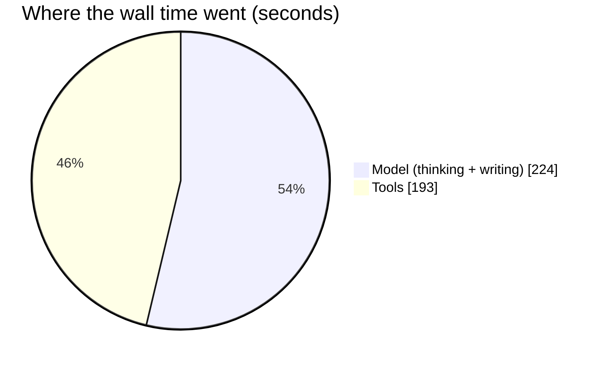

# firm-knowledge/tasks/233 · run3 (`hv-fk250-lunahigh-rep3-20261112T141312Z`)

Result: **fail** 2/3 criteria · 7.0 min · 43 model calls · 47 tool calls (1 errors or timeouts) · ending `completed` · started 11-12 21:14:34 IST

## Overview

One box per stretch of steps that used the same kind of tool (blue: looking/searching/reading, purple: writing or editing files, yellow: a message with no tool call, red border: a tool error or timeout inside the box).

```mermaid
flowchart TD
    T(["Task prompt"])
    P0["<b>Step 1</b> · 0.0 min<br/>todo_write"]
    T --> P0
    class P0 look
    P1["<b>Steps 2-4</b> · 0.2 min<br/>glob x4<br/>grep<br/><i>documents</i>"]
    P0 --> P1
    class P1 look
    P2["<b>Step 5</b> · 0.1 min<br/>bash<br/><i>parse-doc docx 'documents/matters/100…</i>"]
    P1 --> P2
    class P2 look
    P3["<b>Step 6</b> · 0.1 min<br/>read<br/><i>16d5ee9db6be-glob-results.txt</i>"]
    P2 --> P3
    class P3 err
    P4["<b>Step 7</b> · 0.1 min<br/>glob x4<br/><i>documents</i>"]
    P3 --> P4
    class P4 look
    P5["<b>Step 8</b> · 1.6 min<br/>bash<br/><i>python - #lt;#lt;'PY' from pathlib import P…</i>"]
    P4 --> P5
    class P5 look
    P6["<b>Step 9</b> · 0.1 min<br/>grep<br/><i>scratch_docx_text.txt</i>"]
    P5 --> P6
    class P6 look
    P7["<b>Steps 10-12</b> · 0.2 min<br/>read x3<br/><i>scratch_docx_text.txt</i>"]
    P6 --> P7
    class P7 look
    P8["<b>Step 13</b> · 1.4 min<br/>bash<br/><i>python - #lt;#lt;'PY' from pathlib import P…</i>"]
    P7 --> P8
    class P8 look
    P9["<b>Steps 14-16</b> · 0.1 min<br/>read x3<br/><i>scratch_mlt_candidates.txt</i>"]
    P8 --> P9
    class P9 look
    P10["<b>Step 17</b> · 0.1 min<br/>glob<br/><i>.</i>"]
    P9 --> P10
    class P10 look
    P11["<b>Step 18</b> · 0.2 min<br/>bash<br/><i>python - #lt;#lt;'PY' from pathlib import P…</i>"]
    P10 --> P11
    class P11 look
    P12["<b>Steps 19-21</b> · 0.2 min<br/>read x3<br/><i>scratch_opinion_index.txt, scratch_docx_text.txt</i>"]
    P11 --> P12
    class P12 look
    P13["<b>Step 22</b> · 0.1 min<br/>grep<br/><i>scratch_docx_text.txt</i>"]
    P12 --> P13
    class P13 look
    P14["<b>Step 23</b> · 0.1 min<br/>read<br/><i>scratch_docx_text.txt</i>"]
    P13 --> P14
    class P14 look
    P15["<b>Step 24</b> · 0.1 min<br/>grep<br/><i>scratch_docx_text.txt</i>"]
    P14 --> P15
    class P15 look
    P16["<b>Steps 25-28</b> · 0.2 min<br/>read x4<br/><i>scratch_docx_text.txt</i>"]
    P15 --> P16
    class P16 look
    P17["<b>Step 29</b> · 0.1 min<br/>grep<br/><i>scratch_docx_text.txt</i>"]
    P16 --> P17
    class P17 look
    P18["<b>Step 30</b> · 0.1 min<br/>read<br/><i>scratch_docx_text.txt</i>"]
    P17 --> P18
    class P18 look
    P19["<b>Step 31</b> · 0.1 min<br/>grep<br/><i>scratch_docx_text.txt</i>"]
    P18 --> P19
    class P19 look
    P20["<b>Step 32</b> · 0.0 min<br/>read<br/><i>scratch_docx_text.txt</i>"]
    P19 --> P20
    class P20 look
    P21["<b>Step 33</b> · 0.2 min<br/>grep<br/><i>scratch_mlt_candidates.txt</i>"]
    P20 --> P21
    class P21 look
    P22["<b>Step 34</b> · 0.3 min<br/>todo_write"]
    P21 --> P22
    class P22 look
    P23["<b>Step 35</b> · 0.7 min<br/>write<br/><i>response.md</i>"]
    P22 --> P23
    class P23 write
    P24["<b>Step 36</b> · 0.1 min<br/>todo_write"]
    P23 --> P24
    class P24 look
    P25["<b>Steps 37-41</b> · 0.5 min<br/>edit x3<br/>read x2<br/><i>response.md</i>"]
    P24 --> P25
    class P25 write
    P26["<b>Step 42</b> · 0.1 min<br/>todo_write"]
    P25 --> P26
    class P26 look
    P27["<b>Step 43</b> · 0.0 min<br/>final message"]
    P26 --> P27
    class P27 ans
    R(["FAIL: 2/3 criteria"])
    P27 --> R
    class R fail
    classDef look fill:#e8f0fe,stroke:#4a6fa5,color:#111
    classDef write fill:#f3e8fd,stroke:#7b1fa2,color:#111
    classDef ans fill:#fff8e1,stroke:#b58900,color:#111
    classDef err fill:#e8f0fe,stroke:#c62828,stroke-width:3px,color:#111
    classDef pass fill:#e6f4ea,stroke:#2e7d32,color:#111
    classDef fail fill:#fce8e6,stroke:#c62828,color:#111
```





One row per model call:

| Step | Started (IST) | Model s | Tools s | Tool calls | Tools | Output chars |
|---|---|---|---|---|---|---|
| 1 | 21:14:34 | 3 | 0 | 1 | todo_write | 57 |
| 2 | 21:14:37 | 1 | 1 | 1 | glob | 8,520 |
| 3 | 21:14:39 | 4 | 1 | 1 | grep | 1,245 |
| 4 | 21:14:44 | 4 | 2 | 3 | glob x3 | 23,883 |
| 5 | 21:14:49 | 5 | 4 | 1 | bash | 10,694 |
| 6 | 21:14:58 | 4 | 0 | 1 | read ⚠ | 66 |
| 7 | 21:15:02 | 4 | 3 | 4 | glob x4 | 2,158 |
| 8 | 21:15:09 | 10 | 84 | 1 | bash | 26 |
| 9 | 21:16:44 | 2 | 1 | 1 | grep | 49,877 |
| 10 | 21:16:47 | 3 | 1 | 1 | read | 52,200 |
| 11 | 21:16:51 | 3 | 1 | 1 | read | 53,041 |
| 12 | 21:16:54 | 2 | 1 | 1 | read | 21,401 |
| 13 | 21:16:58 | 9 | 75 | 1 | bash | 20 |
| 14 | 21:18:22 | 2 | 0 | 1 | read | 52,216 |
| 15 | 21:18:24 | 3 | 0 | 1 | read | 51,719 |
| 16 | 21:18:27 | 3 | 0 | 1 | read | 28,152 |
| 17 | 21:18:30 | 3 | 1 | 1 | glob | 9,325 |
| 18 | 21:18:34 | 12 | 2 | 1 | bash | 11 |
| 19 | 21:18:48 | 2 | 0 | 1 | read | 51,993 |
| 20 | 21:18:50 | 2 | 0 | 1 | read | 52,455 |
| 21 | 21:18:52 | 7 | 1 | 1 | read | 52,897 |
| 22 | 21:19:00 | 4 | 1 | 1 | grep | 429 |
| 23 | 21:19:05 | 2 | 1 | 1 | read | 52,928 |
| 24 | 21:19:08 | 4 | 1 | 1 | grep | 299 |
| 25 | 21:19:12 | 2 | 1 | 1 | read | 52,612 |
| 26 | 21:19:17 | 3 | 1 | 1 | read | 8,743 |
| 27 | 21:19:21 | 2 | 1 | 1 | read | 53,369 |
| 28 | 21:19:25 | 2 | 1 | 1 | read | 19,365 |
| 29 | 21:19:28 | 5 | 2 | 1 | grep | 155 |
| 30 | 21:19:35 | 2 | 1 | 1 | read | 16,449 |
| 31 | 21:19:38 | 7 | 1 | 1 | grep | 146 |
| 32 | 21:19:46 | 2 | 1 | 1 | read | 9,360 |
| 33 | 21:19:49 | 9 | 2 | 1 | grep | 49,882 |
| 34 | 21:19:59 | 17 | 0 | 1 | todo_write | 57 |
| 35 | 21:20:16 | 40 | 0 | 1 | write | 205 |
| 36 | 21:20:57 | 3 | 0 | 1 | todo_write | 57 |
| 37 | 21:21:00 | 3 | 0 | 1 | read | 15,262 |
| 38 | 21:21:03 | 13 | 0 | 1 | edit | 180 |
| 39 | 21:21:16 | 6 | 0 | 1 | edit | 180 |
| 40 | 21:21:22 | 4 | 0 | 1 | edit | 180 |
| 41 | 21:21:26 | 3 | 0 | 1 | read | 4,653 |
| 42 | 21:21:28 | 4 | 0 | 1 | todo_write | 57 |
| 43 | 21:21:32 | 2 | 0 | 0 | (message only) | 0 |

## Task prompt

```text
I'm assembling our tax-opinion precedent file. Pull every opinion we've issued at the more-likely-than-not level.

Output: write your complete answer to `response.md` — a single self-contained markdown file with your findings, the matters/documents you relied on, and your reasoning.
```

## Rubric

| # | Criterion | Verdict |
|---|---|---|
| C-001 | Qualifying matter — Ardent Capital Partners 1001-00006 | pass |
| C-002 | Proof document — 1001-00006 | pass |
| C-003 | Qualifying set — precision | **FAIL** |

Judge's reasoning:

**C-001 (pass):** Qualifying matter — Ardent Capital Partners 1001-00006

```text
The output expressly identifies matter 1001-00006 as the Ardent Capital Partners matter and describes its final more-likely-than-not tax opinion, satisfying the criterion.
```

**C-002 (pass):** Proof document — 1001-00006

```text
The output explicitly identifies `documents/matters/1001-00006/Transaction Documents — Tax Sections/tax-opinion-letter.docx` as the issued Ardent Capital Partners tax opinion letter and describes its date, addressee, subject, and conclusions.
```

**C-003 (fail):** Qualifying set — precision

```text
The output asserts matter 1018-00009 as containing qualifying more-likely-than-not tax opinion letters and an update memorandum. The criterion permits qualifying assertions only for matter 1001-00006, so including 1018-00009 violates the required precision.
```

## Delivered files (output/)

- `response.md` (15,272 bytes)

`response.md`:

```markdown
# More-Likely-Than-Not Tax Opinions

## Executive finding

I identified **three standalone, final external opinion/analysis letters** issued at an expressly “more likely than not” level, covering **two matters**, plus a later final update memorandum in the second matter that refreshes the same MLTN analysis after settlement. “More likely than not” is used in the documents in its ordinary tax-opinion/ASC 740 sense: a likelihood **greater than 50%** that the position will be sustained on its merits, assuming examination with knowledge of the relevant facts.

| Matter | Issued document | Date | MLTN subject |
|---|---|---:|---|
| **1001-00006** | `documents/matters/1001-00006/Transaction Documents — Tax Sections/tax-opinion-letter.docx` | May 29, 2024 | Federal income-tax treatment of rollover contributions in the Pinnacle acquisition |
| **1018-00009** | `documents/matters/1018-00009/Correspondence/Third Party/letter-to-crestfield-fin48-support-20220920.docx` | September 20, 2022 | PPC’s FIN 48/ASC 740-10 uncertain tax positions for 2017–2020 |
| **1018-00009** | `documents/matters/1018-00009/Correspondence/Third Party/letter-to-crestfield-fin48-update-20231120.docx` | November 20, 2023 | Updated FIN 48/ASC 740-10 analysis after the IRS NOPA |

The 1018-00009 matter also contains a **March 30, 2024 final post-settlement reserve-analysis memorandum** that expressly updates the same MLTN conclusions for tax years 2021 forward. I include it below as an update to the issued opinion series, rather than as a fourth standalone opinion letter.

---

## 1. Matter 1001-00006 — Ardent/Pinnacle rollover contribution opinion

### Issued opinion

**Document:** `documents/matters/1001-00006/Transaction Documents — Tax Sections/tax-opinion-letter.docx`  
**Date:** May 29, 2024  
**Addressee:** Ardent Capital Partners III LP  
**Subject:** Tax-deferred treatment of rollover contributions to Ardent Healthcare Holdings LLC in connection with the acquisition of Pinnacle Health Services Group LLC.

The letter states in a dedicated “Level of Opinion” section that it is the Firm’s opinion that it is **“more likely than not”**—defined there as a greater-than-50% likelihood—that:

1. Each Rollover Participant’s contribution of Pinnacle membership interests to Ardent Healthcare Holdings LLC in exchange for Class B Units qualifies as a tax-deferred contribution under **Code § 721(a)**.
2. No gain or loss is recognized by any Rollover Participant on the contribution.
3. No gain or loss is recognized by Holdings LLC on receipt of the contributions.

The letter also gives related conclusions that Holdings LLC is properly classified as a partnership, the § 721(b) investment-company exception does not apply, the contributions are not disguised sales under § 707(a)(2)(B), and the applicable § 722, § 723, § 704(c), and § 1223(1) basis/allocation/holding-period consequences follow. The letter says it supersedes prior preliminary or draft analyses.

### Documents and materials relied upon

The opinion’s “Summary of Relevant Transaction Documents Reviewed” identifies, among other things:

- The **Agreement and Plan of Merger dated March 15, 2024**, including its exhibits, schedules, disclosure schedules, and ancillary agreements.
- The **Amended and Restated Limited Liability Company Agreement of Ardent Healthcare Holdings LLC**, dated March 15, 2024 and further amended and restated May 28, 2024, including the Class A/Class B unit, capital-account, allocation, distribution, and governance provisions.
- The **Rollover Contribution Agreements** for Dr. Raymond Carvallo, Dr. Nadia Ostrowski, and Jonathan Farnsworth.
- The **Operating Agreement of Pinnacle Health Services Group LLC**, originally dated August 12, 2016 and amended March 3, 2020.
- The **Certificate of Formation of Ardent Healthcare Holdings LLC**, filed March 5, 2024.
- The **Tax Receivable Agreement**, dated May 28, 2024.
- Pinnacle’s prior federal income-tax returns and related Forms 1065/Schedules K-1, IRS correspondence, corporate records, and other records the Firm considered relevant.
- Written **Tax Representation Letters** from the Rollover Participants dated May 20, 2024 and from Ardent Capital dated May 22, 2024.
- Discussions with Ardent Capital representatives, M&A counsel Harcourt Shaw & DeVries LLP, and the Rollover Participants’ personal counsel.

### Reasoning supporting the MLTN conclusion

The reasoning is principally:

- Holdings LLC is a domestic, multi-member LLC treated as a partnership under the default entity-classification rules, so § 721(a), rather than § 351, governs the contribution.
- Pinnacle membership interests are “property” contributed in exchange for partnership interests. The Class B Units received are bona fide partnership interests.
- The transaction does not fall within § 721(b)’s investment-company exception because Holdings LLC holds an interest in a single operating healthcare business rather than a diversified portfolio of readily marketable investment securities, and the rollover does not produce the relevant diversification.
- The cash received for the non-rolled portions of the Rollover Participants’ interests is merger consideration paid by Ardent Healthcare Intermediate Inc., not money or property distributed by Holdings LLC. The rollover contributions therefore are not recharacterized as disguised sales.
- Under § 722 and § 723, the relevant partner and partnership bases carry over. Section 704(c) preserves the allocation of built-in gain, and § 1223(1) generally tacks the holding period of the contributed Pinnacle interests to the Class B Units.

The opinion is expressly limited by its factual assumptions, including the accuracy of the Tax Representation Letters, continued partnership classification, consummation of the transaction as described, the absence of an integrated Holdings LLC distribution arrangement, and the validity of the Class B Units as partnership interests.

---

## 2. Matter 1018-00009 — Penterra Pharmaceuticals FIN 48 / ASC 740-10 opinions

### 2.1 Initial issued legal analysis/opinion

**Document:** `documents/matters/1018-00009/Correspondence/Third Party/letter-to-crestfield-fin48-support-20220920.docx`  
**Date:** September 20, 2022  
**Addressee:** Martin Ogilvy, Engagement Partner, Crestfield & Associates LLP  
**Client/matter:** Penterra Pharmaceuticals Corp. (“PPC”), IRS transfer-pricing examination for tax years 2017–2020.

This letter was issued to support Crestfield’s financial-statement reserve analysis under **ASC 740-10 (FIN 48)**. It expressly applies the “more likely than not” recognition threshold, defined as a likelihood of more than 50% that a tax position will be sustained upon examination, including related appeals or litigation, based solely on the technical merits.

The letter concluded that the following PPC positions met the MLTN recognition threshold:

- The **cost-sharing arrangement ratios** for 2017–2020.
- The **4.5% legacy intellectual-property royalty rate**.
- The **$312 million platform contribution transaction (PCT) valuation**.
- **Penterra Biopharma International DAC’s economic substance**, including its ability to function as an IP owner and qualified participant in the cost-sharing arrangement.

The letter also supported a **$62.4 million FIN 48 reserve**, applying ASC 740-10’s separate measurement step: the largest amount of tax benefit greater than 50% likely to be realized upon ultimate settlement.

### Documents and materials relied upon

The letter’s analysis describes and relies on the following record:

- PPC’s Forms 1120 and the IRS examination for tax years 2017–2020, initiated by **IRS Letter 2205-A dated May 16, 2022**.
- The PPC–PBI **qualified cost-sharing arrangement** effective July 1, 2012, including the reasonably anticipated benefits methodology and the 38.2%–42.7% PBI cost-sharing ratios.
- The **legacy IP License** and its 4.5% royalty on non-Americas sales.
- The **$312 million PCT payment** and supporting valuation materials.
- Crestfield’s contemporaneous transfer-pricing documentation prepared under Treasury Regulation § 1.6662-6 and the penalty-protection provisions of § 6662(e).
- Whitmore Valuation Group’s economic work, including the comparable-profits/TNMM analysis, the comparable-uncontrolled-transaction analysis of 14 pharmaceutical license agreements, and the PCT discounted-cash-flow analysis.
- PBI’s operational and economic-substance evidence, including approximately 185 employees, 42 board meetings during 2017–2020, approximately €47.2 million of regulatory expenditures, independent pricing authority in 68 country markets, Dublin office space, local banking, and substantive DEMPE functions.
- The Kovel arrangement with Whitmore Valuation Group and related factual and economic materials.

### Reasoning supporting the MLTN conclusion

The letter applied ASC 740-10 in two steps:

1. **Recognition:** Each position had to be more likely than not to be sustained if examined with full knowledge of the relevant information. The Firm found the positions supported by the applicable § 482 regulations, contemporaneous documentation, economic analyses, and PBI’s factual operational record.
2. **Measurement:** Even where recognition was appropriate, the reserve had to reflect the largest tax benefit with a greater-than-50% cumulative probability of realization. The Firm concluded that $62.4 million was an appropriate reserve for the range of possible IRS adjustments, including the risk of concessions despite the underlying positions satisfying the recognition threshold.

The letter did not promise a particular result. It expressly reserved the need to reassess the analysis if the IRS issued a Notice of Proposed Adjustment, new facts emerged, or the law changed.

### 2.2 Updated issued opinion after the IRS NOPA

**Document:** `documents/matters/1018-00009/Correspondence/Third Party/letter-to-crestfield-fin48-update-20231120.docx`  
**Date:** November 20, 2023 
… [5,127 more chars]
```

## Trajectory

### Step 1: 1 tool call

_Started 11-12 21:14:34 IST · model 3 s · tools 0 s_

**Reasoning summary:**

```text
**Looking into documents**

I need to search through documents and inspect files to fulfill the user's request. It seems like this could get a bit long, so I might need to create a to-do list for better organization. I should prioritize the important information, but it looks like I don't need to read the task.json specifically. Alright, let's start compiling this list and see where it leads me!
```

**Call `todo_write`** (0.0 s)

```json
{
 "todos": [
  {
   "content": "Inspect the available precedent documents and identify tax-opinion matters",
   "status": "in_progress"
  },
  {
   "content": "Verify which opinions were issued at the more-likely-than-not level",
   "status": "pending"
  },
  {
   "content": "Write a self-contained findings and reasoning memo to response.md",
   "status": "pending"
  },
  {
   "content": "Review the deliverable for completeness and accuracy",
   "status": "pending"
  }
 ]
}
```

Output (57 chars):

```text
Updated todo list: 3 pending, 1 in progress, 0 completed.
```

**Todo list now:**

- [~] Inspect the available precedent documents and identify tax-opinion matters
- [ ] Verify which opinions were issued at the more-likely-than-not level
- [ ] Write a self-contained findings and reasoning memo to response.md
- [ ] Review the deliverable for completeness and accuracy

### Step 2: 1 tool call

_Started 11-12 21:14:37 IST · model 1 s · tools 1 s_

**Call `glob`** (0.8 s)

```json
{
 "pattern": "*",
 "path": "documents"
}
```

Output (8,520 chars):

```text
documents/matters/1001-00001/Antitrust Analysis/competitor-identification-chart.xlsx
documents/matters/1001-00001/Antitrust Analysis/portfolio-company-overlap-analysis.docx
documents/matters/1001-00001/Antitrust Analysis/hhi-concentration-analysis.xlsx
documents/matters/1001-00001/Antitrust Analysis/market-definition-competitive-analysis-memo.docx
documents/matters/1001-00001/Client Updates/biweekly-status-report-1.docx
documents/matters/1001-00001/Antitrust Analysis/preliminary-antitrust-risk-assessment.docx
documents/matters/1001-00001/Antitrust Analysis/state-regulatory-con-analysis.docx
documents/matters/1001-00001/Antitrust Analysis/vertical-relationships-analysis.docx
documents/matters/1001-00001/Closing/closing-memo-antitrust-workstream.docx
documents/matters/1001-00001/Client Updates/client-update-early-termination-granted.eml
documents/matters/1001-00001/Client Updates/biweekly-status-report-2.docx
documents/matters/1001-00001/Client Updates/client-update-hsr-forms-filed.eml
documents/matters/1001-00001/Closing/final-invoice-matter-closing-letter.docx
documents/matters/1001-00001/Closing/hsr-clearance-certificate.docx
documents/matters/1001-00001/Correspondence/Counterparty Counsel/email-gk-naics-code-consistency.eml
documents/matters/1001-00001/Early Termination/early-termination-request-letter.docx
documents/matters/1001-00001/Correspondence/Counterparty Counsel/letter-bracewell-thornton-regulatory-condition.docx
documents/matters/1001-00001/Correspondence/Counterp
… [7,020 more chars]
```

### Step 3: 1 tool call

_Started 11-12 21:14:39 IST · model 4 s · tools 1 s_

**Reasoning summary:**

```text
**Searching for opinions**

I have 9288 files and I need to identify every opinion that matches the phrase "more likely than not." I wonder if using grep across all documents is the way to go, but I need to check if it can search through binary files since some of the documents might be large. I'll need to search in all file types, possibly including .docx. I should use bash with parse-doc, and I think grep might be better for indexing the text overall. Let's search for this phrase!
```

**Call `grep`** (1.1 s)

```json
{
 "pattern": "(?i)more[- ]likely[- ]than[- ]not|MLTN|more likely",
 "path": "documents"
}
```

Output (1,245 chars):

```text
Found 8 matches

documents/matters/1017-00002/documents/email-bower-to-greenvale-iss-recommendation.eml
Line 147: **My assessment is that it is now more likely than not that at least two Corv=
Line 288: her shift the dynamic =E2=80=94 in either direction, though more likely towar=

documents/matters/1022-00004/Term Sheet Negotiation/email-vasquez-to-whitford-counterparty-positions.eml
Line 280: d is far more likely to survive judicial scrutiny.

documents/matters/1037-00004/Settlement Negotiation/settlement-negotiation-email-chain.eml
Line 397: al total is more likely in the **$18=E2=80=9322M** range. That is a significa=

documents/matters/1021-00003/Mediation & Settlement/email-pre-mediation-strategy.eml
Line 253: son and the complexity of this case, **substantive movement is more likely on=

documents/matters/1003-00005/Correspondence/email-cross-to-mattingly-lender-consent-question.eml
Line 42: l (e.g., "should," "will," or "more likely than not")?

documents/matters/1018-00009/Correspondence/Client/email-cross-to-staines-sec-disclosure-20231125.eml
Line 74:  as soon as it is finalized) evaluating both the "more-likely-than-not" recog=
Line 76: s. Our view remains that PPC's transfer pricing positions are more likely tha=
```

### Step 4: 3 tool calls

_Started 11-12 21:14:44 IST · model 4 s · tools 2 s_

**Reasoning summary:**

```text
**Exploring tax documents**

I need to focus on locating only specific document types, like tax opinion docs, rather than docx files. I think I should enumerate these by their filenames, searching for terms like "tax opinion," "tax memorandum," or simply "opinion." For searching paths, I can use glob to identify files that contain "*opinion*". Let’s ensure I’m being thorough with my searches while staying on track!
```

**Call `glob`** (0.6 s)

```json
{
 "pattern": "**/*opinion*",
 "path": "documents"
}
```

Output (7,802 chars):

```text
documents/matters/1001-00003/Closing/legal-opinion-calderwood-harkness.docx
documents/matters/1001-00004/Opinions & Deliverables/legal-opinion-calderwood-harkness.docx
documents/matters/1001-00006/Transaction Documents — Tax Sections/tax-opinion-letter.docx
documents/matters/1001-00007/Closing/sellers-counsel-legal-opinion.docx
documents/matters/1002-00001/Opinions/sc-legal-opinion-10b5-letter.docx
documents/matters/1002-00001/Opinions/sc-tax-opinion.docx
documents/matters/1002-00002/Closing/legal-opinion-form.docx
documents/matters/1002-00005/Tax Analysis/draft-tax-opinion-section-721.docx
documents/matters/1003-00002/Closing/legal-opinion-reg-d.docx
documents/matters/1003-00002/Closing/legal-opinion-valid-formation.docx
documents/matters/1003-00003/Opinions/buyers-counsel-legal-opinion.docx
documents/matters/1003-00003/Opinions/opinion-request-letter-wjc.docx
documents/matters/1003-00005/Tax Opinion/draft-tax-opinion-letter-first-draft.docx
documents/matters/1003-00005/Tax Opinion/email-cross-to-yeung-chandrasekar-draft-opinion.eml
documents/matters/1003-00005/Tax Opinion/internal-comments-draft-opinion.docx
documents/matters/1004-00001/Closing/company-counsel-legal-opinion-draft.docx
documents/matters/1005-00001/Correspondence/correspondence-sc-to-local-counsel-re-opinion-scope.eml
documents/matters/1005-00001/Opinions/draft-opinion-letter-sc-preliminary.docx
documents/matters/1005-00001/Opinions/legal-opinion-sc-enforceability.docx
documents/matters/1005-00001/Opinions/op
… [6,302 more chars]
```

**Call `glob`** (0.6 s)

```json
{
 "pattern": "**/*tax*",
 "path": "documents"
}
```

Output (7,988 chars):

```text
documents/matters/1001-00002/Correspondence/email-to-heathrow-whitman-re-tax-reporting.eml
documents/matters/1001-00002/Structuring & Analysis/tax-structuring-memo.docx
documents/matters/1001-00003/Tax/tax-structure-memorandum.docx
documents/matters/1001-00004/Tax/tax-provisions-merger-agreement-commentary.docx
documents/matters/1001-00004/Tax/swiss-withholding-tax-memo.docx
documents/matters/1001-00004/Tax/state-local-tax-memo.docx
documents/matters/1001-00004/Tax/tax-structure-memo-338h10.docx
documents/matters/1001-00006/Closing/closing-tax-memorandum.docx
documents/matters/1001-00006/Closing/tax-closing-certificate.docx
documents/matters/1001-00006/Earnout Treatment/earnout-provisions-tax-review-comment-letter.docx
documents/matters/1001-00006/Earnout Treatment/earnout-tax-characterization-memorandum.docx
documents/matters/1001-00006/Post-Closing/post-closing-tax-integration-memorandum.docx
documents/matters/1001-00006/Purchase Price Allocation & TRA/tax-receivable-agreement-draft.docx
documents/matters/1001-00006/Purchase Price Allocation & TRA/tax-receivable-agreement-execution.docx
documents/matters/1001-00006/Rollover Equity/llc-agreement-tax-provisions-draft-markup.docx
documents/matters/1001-00006/Rollover Equity/rollover-equity-tax-memorandum.docx
documents/matters/1001-00006/State & Local Tax/state-local-tax-memorandum.docx
documents/matters/1001-00006/State & Local Tax/state-tax-structuring-recommendations-letter.docx
documents/matters/1001-00006/Structure & Enti
… [6,488 more chars]
```

**Call `glob`** (0.4 s)

```json
{
 "pattern": "**/*memorandum*",
 "path": "documents"
}
```

Output (8,093 chars):

```text
documents/matters/1001-00001/Engagement & Administration/conflicts-check-memorandum.docx
documents/matters/1001-00001/Engagement & Administration/matter-opening-memorandum.docx
documents/matters/1001-00003/Closing/funds-flow-memorandum.xlsx
documents/matters/1001-00003/Diligence/due-diligence-summary-memorandum.docx
documents/matters/1001-00003/Tax/tax-structure-memorandum.docx
documents/matters/1001-00004/Antitrust & Regulatory/hsr-filing-memorandum.docx
documents/matters/1001-00004/Closing/funds-flow-memorandum.xlsx
documents/matters/1001-00004/Engagement & Administrative/staffing-budget-memorandum.docx
documents/matters/1001-00004/Engagement & Administrative/matter-opening-memorandum.docx
documents/matters/1001-00004/Transaction Documents/Merger Agreement/no-shop-compliance-memorandum.docx
documents/matters/1001-00006/Closing/closing-tax-memorandum.docx
documents/matters/1001-00006/Engagement & Administrative/conflict-check-memorandum.docx
documents/matters/1001-00006/Earnout Treatment/earnout-tax-characterization-memorandum.docx
documents/matters/1001-00006/Earnout Treatment/open-closed-transaction-installment-method-memorandum.docx
documents/matters/1001-00006/Post-Closing/engagement-summary-lessons-learned-memorandum.docx
documents/matters/1001-00006/Engagement & Administrative/staffing-and-budget-memorandum.docx
documents/matters/1001-00006/Engagement & Administrative/engagement-close-out-memorandum.docx
documents/matters/1001-00006/Post-Closing/post-closing-tax-integr
… [6,593 more chars]
```

### Step 5: 1 tool call

_Started 11-12 21:14:49 IST · model 5 s · tools 4 s_

**Call `bash`** (4.2 s)

```json
{
 "command": "parse-doc docx 'documents/matters/1002-00001/Opinions/sc-tax-opinion.docx' | head -80",
 "description": "Inspect a tax opinion document",
 "workdir": "/home/agarwaldi/dsh-bench-harness/runs/hv-fk250-lunahigh-rep3-20261112T141312Z/tasks/firm-knowledge__tasks__233/workspace",
 "timeoutMs": 120000
}
```

Output (10,694 chars):

```text
**CALDERWOOD & HARKNESS LLP** 900 Third Avenue, 28th Floor New York, NY 10022

June 25, 2021

Pinnacle Acquisition Corp. I 388 Embarcadero Center, Suite 2400 San Francisco, California 94111

> **Re: Federal Income Tax Treatment of Units --- Initial Public Offering of Pinnacle Acquisition Corp. I**

Ladies and Gentlemen:

**[I. Engagement and Purpose]{.underline}**

We have acted as counsel to Pinnacle Acquisition Corp. I, a Delaware corporation (the \"Company\"), in connection with the initial public offering (the \"Offering\") of 20,000,000 units (the \"Units\"). Each Unit consists of one share of the Company\'s Class A common stock, par value \$0.0001 per share (the \"Class A Common Stock\"), and one-half of one redeemable warrant (each whole warrant, a \"Warrant\"). Each whole Warrant entitles the holder thereof to purchase one share of Class A Common Stock at an exercise price of \$11.50 per share, subject to adjustment as set forth in the Warrant Agreement (as defined below).

This opinion is being delivered pursuant to Section 5(b) of the Underwriting Agreement dated June 22, 2021 (the \"Underwriting Agreement\") among the Company, Pinnacle Venture Fund II LP (the \"Sponsor\"), and Ridgeline Whitfield Securities LLC, as representative of the several underwriters named therein. This opinion is referenced in the section entitled \"Material U.S. Federal Income Tax Considerations\" in the prospectus dated May 24, 2021, as supplemented by the prospectus supplement dated June
… [9,193 more chars]
```

### Step 6: 1 tool call

_Started 11-12 21:14:58 IST · model 4 s · tools 0 s_

**Reasoning summary:**

```text
**Retrieving opinions and documents**

I need to gather every opinion we’ve issued at a "more likely than not" level. It might involve looking at specific taxonomy or final opinion documents that state things like "we are of the opinion." I should inspect the relevant tax opinion files across all documents and think about using filenames from glob outputs. I might need to retrieve full lists through temp files since the temp path could be accessible with read.
```

**Call `read`** (0.0 s · **error/timeout**)

```json
{
 "file_path": "/tmp/dsh-spill-9v4OMS/session-8980f968ec7d/16d5ee9db6be-glob-results.txt",
 "offset": 1,
 "limit": 250
}
```

Output (66 chars):

```text
Error: [sandbox: file access denied under workspace-isolated mode]
```

### Step 7: 4 tool calls

_Started 11-12 21:15:02 IST · model 4 s · tools 3 s_

**Reasoning summary:**

```text
**Narrowing candidate patterns**

I realize I can't proceed just yet. I need to refine my glob patterns to be more specific for the candidate names. Perhaps I'll consider using anchored patterns with "Tax?" and a wildcard "*" to match those tax opinion documents better. I can aim for patterns like **/tax-opinion*.docx or **/*tax*opinion*.docx. I’ll also look for any exact opinion documents that might fit the criteria. Let's see how I can optimize this!
```

**Call `glob`** (0.6 s)

```json
{
 "pattern": "**/tax-opinion*.docx",
 "path": "documents"
}
```

Output (651 chars):

```text
documents/matters/1001-00006/Transaction Documents — Tax Sections/tax-opinion-letter.docx
documents/matters/1009-00003/Tax/tax-opinion-draft.docx
documents/matters/1015-00005/Opinions & Certificates/tax-opinion-ridgeline.docx
documents/matters/1015-00005/Opinions & Certificates/tax-opinion-pinehurst.docx
documents/matters/1021-00001/Opinions/tax-opinion-oid-ahydo.docx
documents/matters/1021-00002/Closing/tax-opinion.docx
documents/matters/1024-00004/Legal Opinions/tax-opinion-issuers-counsel.docx
documents/matters/1030-00001/Opinions & Certificates/tax-opinion-bond-counsel.docx
documents/matters/1036-00002/Opinions/tax-opinion-exhibit-8-1.docx
```

**Call `glob`** (1.0 s)

```json
{
 "pattern": "**/*tax*opinion*.docx",
 "path": "documents"
}
```

Output (1,419 chars):

```text
documents/matters/1001-00006/Transaction Documents — Tax Sections/tax-opinion-letter.docx
documents/matters/1002-00001/Opinions/sc-tax-opinion.docx
documents/matters/1002-00005/Tax Analysis/draft-tax-opinion-section-721.docx
documents/matters/1003-00005/Tax Opinion/draft-tax-opinion-letter-first-draft.docx
documents/matters/1009-00003/Tax/tax-opinion-draft.docx
documents/matters/1015-00001/Tax/draft-tax-opinion.docx
documents/matters/1015-00005/Opinions & Certificates/tax-opinion-ridgeline.docx
documents/matters/1015-00005/Opinions & Certificates/tax-opinion-pinehurst.docx
documents/matters/1021-00001/Opinions/tax-opinion-oid-ahydo.docx
documents/matters/1021-00002/Closing/tax-opinion.docx
documents/matters/1024-00004/Legal Opinions/tax-opinion-issuers-counsel.docx
documents/matters/1030-00001/Opinions & Certificates/tax-opinion-bond-counsel.docx
documents/matters/1031-00004/Closing Opinions/tax-exempt-status-opinion.docx
documents/matters/1032-00003/Closing/draft-tax-opinion-prospectus.docx
documents/matters/1033-00002/Legal Opinions/tax-disclosure-opinion-draft.docx
documents/matters/1036-00002/Opinions/tax-opinion-exhibit-8-1.docx
documents/matters/1037-00007/Opinion/draft-tax-opinion-letter.docx
documents/matters/1037-00007/Opinion/final-tax-opinion-letter.docx
documents/matters/1043-00001/Legal Opinions/sc-tax-opinion.docx
documents/matters/1045-00001/Opinions/issuer-counsel-tax-opinion.docx
```

**Call `glob`** (0.8 s)

```json
{
 "pattern": "**/opinion*tax*.docx",
 "path": "documents"
}
```

Output (14 chars):

```text
No files found
```

**Call `glob`** (0.7 s)

```json
{
 "pattern": "**/legal-opinion-tax*.docx",
 "path": "documents"
}
```

Output (74 chars):

```text
documents/matters/1010-00002/Legal Opinions/legal-opinion-tax-matters.docx
```

### Step 8: 1 tool call

_Started 11-12 21:15:09 IST · model 10 s · tools 84 s_

**Reasoning summary:**

```text
**Exploring document processing**

I’m thinking about how to process documents containing the phrase "more likely than not." I could script a solution to parse all the .docx files, extracting text with something like Python-docx. There’s the possibility of formatting complications, but it should work. The instructions suggest using bash for conversion, but I might still rely on Python for extraction. I'll also have to manage candidate files carefully, especially with names related to tax opinions.

**Planning document search**

I need to search all .docx files for the phrase "more likely than not" using a Python-based extraction. I'm wondering if using grep would violate something, but since I can extract text first with Python and then grep later, that should be fine. I’ll extract text from about 9,288 documents and keep track of filenames. Using zipfile XML would help, and I might write to a scratch file in a temporary location to keep things organized.
```

**Call `bash`** (84.4 s)

```json
{
 "command": "python - <<'PY'\nfrom pathlib import Path\nfrom zipfile import ZipFile\nfrom xml.etree import ElementTree as ET\nroot=Path('documents')\nout=Path('scratch_docx_text.txt')\nns={'w':'http://schemas.openxmlformats.org/wordprocessingml/2006/main'}\ncount=0\nwith out.open('w',encoding='utf-8') as f:\n    for p in root.rglob('*.docx'):\n        try:\n            with ZipFile(p) as z:\n                xml=z.read('word/document.xml')\n            tree=ET.fromstring(xml)\n            paras=[]\n            for para in tree.findall('.//w:p',ns):\n                text=''.join(t.text or '' for t in para.findall('.//w:t',ns))\n                if text:\n                    paras.append(text)\n            f.write('\\n===FILE: '+str(p)+'===\\n')\n            f.write('\\n'.join(paras)+'\\n')\n            count+=1\n        except Exception as e:\n            f.write('\\n===FILE ERROR: '+str(p)+' :: '+repr(e)+'===\\n')\nprint('processed',count,'docx files')\nPY",
 "description": "Extract text from all Word documents",
 "workdir": "/home/agarwaldi/dsh-bench-harness/runs/hv-fk250-lunahigh-rep3-20261112T141312Z/tasks/firm-knowledge__tasks__233/workspace",
 "timeoutMs": 120000
}
```

Output (26 chars):

```text
processed 8055 docx files
```

### Step 9: 1 tool call

_Started 11-12 21:16:44 IST · model 2 s · tools 1 s_

**Call `grep`** (1.2 s)

```json
{
 "pattern": "(?i)more[- ]likely[- ]than[- ]not|more likely than not",
 "path": "scratch_docx_text.txt"
}
```

Output (49,877 chars):

```text
Found 217 matches

scratch_docx_text.txt
Line 2095: "Tax Opinion" means the reasoned "should" level tax opinion letter delivered by Calderwood & Harkness LLP to Buyer at Closing, opining as to the validity and effectiveness of the Transfer Elections under Section 6418 of the Code and the availability of the Transferred Credits to Buyer; for the avoidance of doubt, a "more likely than not" level opinion shall not satisfy this requirement.
Line 2326: (iv) Tax Opinion from Calderwood & Harkness LLP addressed to Buyer, opining as to the validity and effectiveness of the Transfer Elections under Section 6418 of the Code and the availability of the Transferred Credits to Buyer, at a "should" level of confidence (not "more likely than not");
Line 2360: (e) Tax Opinion from Calderwood & Harkness LLP, addressed to Buyer and dated as of the Closing Date, opining (subject to customary qualifications and assumptions) at a "should" level of confidence (not "more likely than not") that (i) the Transfer Elections with respect to the Transferred Credits are valid and effective under Section 6418 of the Code, (ii) the Transferred Credits should be treated as tax credits allowed to Buyer under the Code for Buyer's taxable year that includes the Closing Date, and (iii) the tax treatment described in Section 2.4 should apply.
Line 52352: Probability Assessment. We assess the probability that AMA's "for cause" termination of Aldrich would be upheld at trial at approximately 60/40 in AMA's favor, 
… [48,377 more chars]
```

### Step 10: 1 tool call

_Started 11-12 21:16:47 IST · model 3 s · tools 1 s_

**Call `read`** (1.4 s)

```json
{
 "file_path": "scratch_docx_text.txt",
 "offset": 64880,
 "limit": 260
}
```

Output (52,200 chars):

```text
<path>/home/agarwaldi/dsh-bench-harness/runs/hv-fk250-lunahigh-rep3-20261112T141312Z/tasks/firm-knowledge__tasks__233/workspace/scratch_docx_text.txt</path>
<type>file</type>
<content>
64880: This memorandum is protected by the attorney-client privilege and constitutes attorney work product. It is prepared solely for the use of Calderwood & Harkness LLP and Pinnacle Capital Management LLC in connection with the structuring of Pinnacle Continuation Vehicle LP. This memorandum should not be disclosed to any third party without the prior written consent of Calderwood & Harkness LLP. No person other than the intended recipients should rely on the analysis or conclusions contained herein.
64881: I. Executive Summary
64882: This memorandum analyzes the implications of Section 1061 of the Internal Revenue Code of 1986, as amended (the "Code"), as they relate to the holding period requirements applicable to the carried interest held by the general partner of Pinnacle Venture Fund II LP ("Fund II") in connection with the proposed GP-led secondary transaction and the formation of Pinnacle Continuation Vehicle LP (the "CV"). Specifically, this memorandum addresses whether, and under what conditions, the existing Section 1061 holding period applicable to the Fund II carried interest can be preserved when the GP's carried interest is rolled into the CV, and separately analyzes the holding period that will apply to the new carried interest to be issued in the CV.
64883: The general partner
… [50,700 more chars]
```

### Step 11: 1 tool call

_Started 11-12 21:16:51 IST · model 3 s · tools 1 s_

**Call `read`** (0.9 s)

```json
{
 "file_path": "scratch_docx_text.txt",
 "offset": 66580,
 "limit": 240
}
```

Output (53,041 chars):

```text
<path>/home/agarwaldi/dsh-bench-harness/runs/hv-fk250-lunahigh-rep3-20261112T141312Z/tasks/firm-knowledge__tasks__233/workspace/scratch_docx_text.txt</path>
<type>file</type>
<content>
66580: Step 6: Total CV Capitalization. The total capitalization of the CV at closing will be approximately One Billion Seventy-Four Million Dollars ($1,074,000,000), consisting of:
66581: (a) $680,000,000 in rolling limited partner interests;
66582: (b) $380,000,000 in new capital from Garrison;
66583: (c) $14,000,000 in CV GP co-investment.
66584: The CV will also establish approximately One Hundred Million Dollars ($100,000,000) in follow-on reserves, calculated as the excess of Garrison's $380,000,000 commitment over the $280,000,000 liquidity pool allocated to cashing-out limited partners.
66585: blocker Entities. Certain capital will be routed through blocker entities interposed for the benefit of tax-exempt U.S. limited partners and non-U.S. limited partners:
66586: (i) PCV Domestic blocker Inc., a Delaware C-corporation, will be interposed for the benefit of tax-exempt U.S. limited partners, including the Meridian Public Employees' Retirement System (approximately $125,000,000) and the Ashford University Endowment (approximately $50,000,000); and
66587: (ii) PCV International Holdings Ltd., a Cayman Islands exempted company, will be interposed for the benefit of non-U.S. limited partners, including Sovereign Capital Partners (Cayman) Ltd. (approximately $75,000,000).
66588: In total, ap
… [51,541 more chars]
```

### Step 12: 1 tool call

_Started 11-12 21:16:54 IST · model 2 s · tools 1 s_

**Call `read`** (1.1 s)

```json
{
 "file_path": "scratch_docx_text.txt",
 "offset": 66480,
 "limit": 110
}
```

Output (21,401 chars):

```text
<path>/home/agarwaldi/dsh-bench-harness/runs/hv-fk250-lunahigh-rep3-20261112T141312Z/tasks/firm-knowledge__tasks__233/workspace/scratch_docx_text.txt</path>
<type>file</type>
<content>
66480: Finally, we note that California does not conform to the Section 1202 QSBS exclusion. Gains allocated to California residents or sourced to California will be taxed at California's ordinary income tax rates, which reach up to 13.3%. This represents a material state tax cost that exists independently of the federal QSBS analysis and cannot be addressed through the transaction structure.
66481: We recommend proceeding with the Section 721 contribution structure and implementing all recommended protective provisions — including the Vectral holding covenant, broader minimum holding covenants, QSBS representations and certifications, and make-whole provisions — in the Tax Protection Agreement and the CV LPA. We further recommend completing all outstanding diligence items on an expedited basis (target completion: August 20, 2025) to allow for incorporation of the results into the comprehensive Tax Structure Memorandum and timely delivery of the Section 721 Tax Opinion Letter.
66482: XI. Limitations and Caveats
66483: This memorandum is prepared for internal use by the Calderwood & Harkness LLP engagement team and for the exclusive benefit of the addressees identified above. It reflects preliminary analysis based on the facts and circumstances known to us as of the date hereof. The analysis is 
… [19,901 more chars]
```

### Step 13: 1 tool call

_Started 11-12 21:16:58 IST · model 9 s · tools 75 s_

**Reasoning summary:**

```text
**Evaluating candidate documents**

I see that the candidate document is titled "draft-tax-opinion-section-721," but it looks more like a final letter with a blank date. The terms "being delivered" and "condition precedent" appear in it, which makes me wonder if it's truly issued. Since the file is labeled as a draft, it likely isn't. The user mentioned every opinion issued, so I need to identify all drafts and inspect each document for specific wording and statuses.
```

**Call `bash`** (74.9 s)

```json
{
 "command": "python - <<'PY'\nfrom pathlib import Path\nfrom zipfile import ZipFile\nfrom xml.etree import ElementTree as ET\nns={'w':'http://schemas.openxmlformats.org/wordprocessingml/2006/main'}\nterms=('more likely than not','more-likely-than-not','more-likely than not','at least more likely','MLTN')\nout=Path('scratch_mlt_candidates.txt')\ncount=0\nwith out.open('w',encoding='utf-8') as f:\n  for p in Path('documents').rglob('*.docx'):\n    try:\n      with ZipFile(p) as z: xml=z.read('word/document.xml')\n      tree=ET.fromstring(xml)\n      lines=[]\n      for para in tree.findall('.//w:p',ns):\n        text=''.join(t.text or '' for t in para.findall('.//w:t',ns))\n        if text: lines.append(text)\n      hits=[(i+1,x) for i,x in enumerate(lines) if any(t.lower() in x.lower() for t in terms)]\n      if hits:\n        f.write('\\n===FILE: '+str(p)+'===\\n')\n        for i,x in hits: f.write(f'{i}: {x}\\n')\n        count+=1\n    except Exception: pass\nprint('candidate files',count)\nPY",
 "description": "Find documents discussing MLTN tax standards",
 "workdir": "/home/agarwaldi/dsh-bench-harness/runs/hv-fk250-lunahigh-rep3-20261112T141312Z/tasks/firm-knowledge__tasks__2
… [37 more chars]
```

Output (20 chars):

```text
candidate files 110
```

### Step 14: 1 tool call

_Started 11-12 21:18:22 IST · model 2 s · tools 0 s_

**Call `read`** (0.0 s)

```json
{
 "file_path": "scratch_mlt_candidates.txt",
 "offset": 1,
 "limit": 1000
}
```

Output (52,216 chars):

```text
<path>/home/agarwaldi/dsh-bench-harness/runs/hv-fk250-lunahigh-rep3-20261112T141312Z/tasks/firm-knowledge__tasks__233/workspace/scratch_mlt_candidates.txt</path>
<type>file</type>
<content>
1: 
2: ===FILE: documents/matters/1015-00005/Transaction Documents/tcpa-redline-v2-to-v3.docx===
3: 108: "Tax Opinion" means the reasoned "should" level tax opinion letter delivered by Calderwood & Harkness LLP to Buyer at Closing, opining as to the validity and effectiveness of the Transfer Elections under Section 6418 of the Code and the availability of the Transferred Credits to Buyer; for the avoidance of doubt, a "more likely than not" level opinion shall not satisfy this requirement.
4: 339: (iv) Tax Opinion from Calderwood & Harkness LLP addressed to Buyer, opining as to the validity and effectiveness of the Transfer Elections under Section 6418 of the Code and the availability of the Transferred Credits to Buyer, at a "should" level of confidence (not "more likely than not");
5: 373: (e) Tax Opinion from Calderwood & Harkness LLP, addressed to Buyer and dated as of the Closing Date, opining (subject to customary qualifications and assumptions) at a "should" level of confidence (not "more likely than not") that (i) the Transfer Elections with respect to the Transferred Credits are valid and effective under Section 6418 of the Code, (ii) the Transferred Credits should be treated as tax credits allowed to Buyer under the Code for Buyer's taxable year that includes the Closing Date, an
… [50,716 more chars]
```

### Step 15: 1 tool call

_Started 11-12 21:18:24 IST · model 3 s · tools 0 s_

**Call `read`** (0.0 s)

```json
{
 "file_path": "scratch_mlt_candidates.txt",
 "offset": 200,
 "limit": 1000
}
```

Output (51,719 chars):

```text
<path>/home/agarwaldi/dsh-bench-harness/runs/hv-fk250-lunahigh-rep3-20261112T141312Z/tasks/firm-knowledge__tasks__233/workspace/scratch_mlt_candidates.txt</path>
<type>file</type>
<content>
200: ===FILE: documents/matters/1029-00002/Findings & Reports/final-investigative-report.docx===
201: 98: Standard of Proof. C&H's findings are based on the preponderance-of-the-evidence standard — that is, whether the evidence makes it more likely than not that the alleged conduct occurred as described. This standard is consistent with widely accepted best practices for internal workplace investigations and is the standard recommended by the Equal Employment Opportunity Commission for employer-conducted investigations. It is not the "beyond a reasonable doubt" standard applicable in criminal proceedings.
202: 
203: ===FILE: documents/matters/1003-00005/Engagement & Administrative/engagement-letter-hpe-fund-iv.docx===
204: 34: The "should" level of comfort represents the second-highest level of assurance customarily employed by major law firms in rendering tax opinions, falling below a "will" opinion (the highest level of assurance, reflecting a conclusion that the relevant tax treatment is virtually certain) but above a "more likely than not" opinion (reflecting a conclusion that the relevant tax treatment is more likely than not to be sustained if challenged). A "should" opinion reflects a conclusion that, in our judgment, the relevant tax treatment is the correct treatment under applica
… [50,219 more chars]
```

### Step 16: 1 tool call

_Started 11-12 21:18:27 IST · model 3 s · tools 0 s_

**Call `read`** (0.0 s)

```json
{
 "file_path": "scratch_mlt_candidates.txt",
 "offset": 346,
 "limit": 500
}
```

Output (28,152 chars):

```text
<path>/home/agarwaldi/dsh-bench-harness/runs/hv-fk250-lunahigh-rep3-20261112T141312Z/tasks/firm-knowledge__tasks__233/workspace/scratch_mlt_candidates.txt</path>
<type>file</type>
<content>
346: ===FILE: documents/matters/1018-00009/Correspondence/Third Party/letter-to-crestfield-fin48-support-20220920.docx===
347: 125: V. ASC 740-10 Legal Analysis — Recognition Step (More-Likely-Than-Not)
348: 127: Under ASC 740-10-25-6, a tax position should be recognized in the financial statements only if it is "more likely than not" (defined as a likelihood of more than 50 percent) that the position will be sustained upon examination by the relevant taxing authority, including resolution of any related appeals or litigation processes, based solely on the technical merits of the position. The evaluation of a tax position's technical merits should be based on legislation, regulations, case law, revenue rulings, revenue procedures, and other administrative guidance and interpretive authority in effect as of the reporting date.
349: 128: ASC 740-10-25-7 provides that the more-likely-than-not recognition threshold should be applied assuming that the taxing authority will examine the position and have full knowledge of all relevant information. In the present case, this assumption is not hypothetical; the IRS has in fact commenced an examination of PPC's returns for the Exam Years and has full access to relevant information through the IDR process.
350: 140: Conclusion. Based on the foregoing 
… [26,652 more chars]
```

### Step 17: 1 tool call

_Started 11-12 21:18:30 IST · model 3 s · tools 1 s_

**Call `glob`** (1.0 s)

```json
{
 "pattern": "documents/matters/1018-00009/**/*",
 "path": "."
}
```

Output (9,325 chars):

```text
./documents/matters/1018-00009/Administration/billing-summary-2022.xlsx
./documents/matters/1018-00009/Administration/matter-status-report-q1-2024.docx
./documents/matters/1018-00009/Administration/document-preservation-notice.docx
./documents/matters/1018-00009/Administration/billing-summary-2024-final.xlsx
./documents/matters/1018-00009/Administration/matter-status-report-q3-2022.docx
./documents/matters/1018-00009/Administration/matter-status-report-q1-2023.docx
./documents/matters/1018-00009/Administration/matter-closing-memo.docx
./documents/matters/1018-00009/Administration/billing-summary-2023.xlsx
./documents/matters/1018-00009/Administration/matter-status-report-q2-2023.docx
./documents/matters/1018-00009/Appeals/appeals-brief-document-binder-index.docx
./documents/matters/1018-00009/Administration/matter-status-report-q3-2023.docx
./documents/matters/1018-00009/Administration/timeline-key-events.xlsx
./documents/matters/1018-00009/Administration/matter-status-report-q4-2023.docx
./documents/matters/1018-00009/Administration/privilege-protocol-memo.docx
./documents/matters/1018-00009/Administration/matter-status-report-q4-2022.docx
./documents/matters/1018-00009/Appeals/appeals-conference-summary.docx
./documents/matters/1018-00009/Appeals/appeals-conference-attendee-list.docx
./documents/matters/1018-00009/Appeals/appeals-pre-conference-memo.docx
./documents/matters/1018-00009/Appeals/appeals-supplemental-submission.docx
./documents/matters/1018-00009/Appeals/appeal
… [7,825 more chars]
```

### Step 18: 1 tool call

_Started 11-12 21:18:34 IST · model 12 s · tools 2 s_

**Call `bash`** (1.7 s)

```json
{
 "command": "python - <<'PY'\nfrom pathlib import Path\nfrom zipfile import ZipFile\nfrom xml.etree import ElementTree as ET\nns={'w':'http://schemas.openxmlformats.org/wordprocessingml/2006/main'}\nterms=('tax opinion','tax-opinion','tax opinion letter','opinion letter','formal tax opinion')\nout=Path('scratch_opinion_index.txt')\nwith out.open('w',encoding='utf-8') as f:\n  for p in Path('documents').rglob('*.docx'):\n    if 'opinion' not in p.name.lower() and 'opinion' not in str(p.parent).lower() and 'tax-opinion' not in p.name.lower():\n      continue\n    try:\n      with ZipFile(p) as z: xml=z.read('word/document.xml')\n      tree=ET.fromstring(xml)\n      lines=[]\n      for para in tree.findall('.//w:p',ns):\n        text=''.join(t.text or '' for t in para.findall('.//w:t',ns))\n        if text: lines.append(text)\n      hits=[x for x in lines if any(t in x.lower() for t in ('more likely than not','more-likely-than-not','should level','will level','opinion standard','opinion is','this opinion is','rendered at a'))]\n      f.write('\\n===FILE: '+str(p)+'===\\n')\n      for x in lines[:12]: f.write(x+'\\n')\n      if hits:\n        f.write('---STANDARD HITS---\\n')\n      
… [289 more chars]
```

Output (11 chars):

```text
(no output)
```

### Step 19: 1 tool call

_Started 11-12 21:18:48 IST · model 2 s · tools 0 s_

**Call `read`** (0.0 s)

```json
{
 "file_path": "scratch_opinion_index.txt",
 "offset": 1,
 "limit": 2000
}
```

Output (51,993 chars):

```text
<path>/home/agarwaldi/dsh-bench-harness/runs/hv-fk250-lunahigh-rep3-20261112T141312Z/tasks/firm-knowledge__tasks__233/workspace/scratch_opinion_index.txt</path>
<type>file</type>
<content>
1: 
2: ===FILE: documents/matters/1015-00005/Opinions & Certificates/tax-opinion-ridgeline.docx===
3: CALDERWOOD & HARKNESS LLP Attorneys at Law
4: 600 Lexington Avenue New York, NY 10022
5: Telephone: (212) 558-4000 Facsimile: (212) 558-3588 www.calderwoodharkness.com
6: December 8, 2023
7: Ridgeline Capital Partners, LLC 390 Park Avenue, 22nd Floor New York, NY 10022
8: Attention: Jonathan Kessler, Managing Partner
9: Samara Okonkwo, Partner, Head of Renewable Energy Investments David Lim, Vice President
10: Re: Tax Opinion — Investment Tax Credit Availability, Partnership Allocations, and Flip Mechanics in Connection with the Tax-Equity Investment in Solstice Holdings, LLC (the "Partnership")
11: C&H Matter No. 1015-00005
12: Ladies and Gentlemen:
13: I. INTRODUCTION AND ENGAGEMENT
14: Calderwood & Harkness LLP ("we," "our," "us," or "C&H") has acted as special tax counsel to Calloway-Briggs Renewables Inc. ("CBR"), a Texas corporation, in connection with the structuring, negotiation, and closing of the tax-equity investment (the "Transaction") by Ridgeline Capital Partners, LLC ("Ridgeline" or the "Investor") in Solstice Holdings, LLC (the "Partnership"), a Delaware limited liability company classified as a partnership for federal income tax purposes (Employer Identification Number: 88-
… [50,493 more chars]
```

### Step 20: 1 tool call

_Started 11-12 21:18:50 IST · model 2 s · tools 0 s_

**Call `read`** (0.0 s)

```json
{
 "file_path": "scratch_opinion_index.txt",
 "offset": 220,
 "limit": 500
}
```

Output (52,455 chars):

```text
<path>/home/agarwaldi/dsh-bench-harness/runs/hv-fk250-lunahigh-rep3-20261112T141312Z/tasks/firm-knowledge__tasks__233/workspace/scratch_opinion_index.txt</path>
<type>file</type>
<content>
220: No opinion is expressed as to any matter not explicitly addressed herein. No opinion is implied or should be inferred beyond the enforceability opinions expressly stated in Section 4 above, as qualified by the assumptions, qualifications, exceptions, and limitations set forth in Sections 3, 5, and 6 hereof. Without limiting the generality of the foregoing, we express no opinion as to (a) the business or financial terms of the Opinion Documents or the fairness, advisability, or suitability of the transactions contemplated thereby, (b) the tax consequences of the transactions contemplated by the Opinion Documents, (c) the compliance of VHG, the Guarantors, or any other party with applicable regulatory requirements (including without limitation those of the Securities and Exchange Commission, the Federal Reserve Board, or any state regulatory authority), (d) the effect of any pending or threatened litigation involving VHG, the Guarantors, or any other party, or (e) the adequacy of the collateral securing the obligations under the Credit Agreement or the value thereof.
221: 
222: ===FILE: documents/matters/1005-00002/Closing/legal-opinion-issuers-counsel.docx===
223: CALDERWOOD & HARKNESS LLP Attorneys at Law
224: One Liberty Plaza, 48th Floor New York, New York 10006 Telephone: (212) 558-
… [50,955 more chars]
```

### Step 21: 1 tool call

_Started 11-12 21:18:52 IST · model 7 s · tools 1 s_

**Call `read`** (1.3 s)

```json
{
 "file_path": "scratch_docx_text.txt",
 "offset": 64300,
 "limit": 500
}
```

Output (52,897 chars):

```text
<path>/home/agarwaldi/dsh-bench-harness/runs/hv-fk250-lunahigh-rep3-20261112T141312Z/tasks/firm-knowledge__tasks__233/workspace/scratch_docx_text.txt</path>
<type>file</type>
<content>
64300: $374,000,000
64301: $421,000,000
64302: Gross Assets at Issuance < $50M?
64303: Confirmed
64304: Confirmed
64305: Near threshold — additional diligence pending
64306: Shares Acquired at Original Issuance?
64307: Yes
64308: Yes
64309: Yes
64310: Active Business Requirement (§1202(e))
64311: Believed satisfied
64312: Believed satisfied
64313: Believed satisfied
64314: Section 1202(c)(3) Redemption Issues
64315: None known
64316: None known
64317: None known
64318: SCHEDULE C
64319: SECTION 707 DISGUISED SALE ANALYSIS SUMMARY
64320: The following is a summary of the Disguised Sale analysis performed by Calderwood & Harkness LLP in connection with the Contribution. This summary is for informational purposes only and is qualified in its entirety by reference to the Section 721 Tax Opinion Letter to be delivered by Calderwood & Harkness LLP (Sylvia Hartwell, signing partner) on or prior to the Closing Date.
64321: 1. Overview of Section 707(a)(2)(B) and Treasury Regulation Section 1.707-3.
64322: Under Section 707(a)(2)(B) of the Code, if there is a direct or indirect transfer of money or other property by a partner to a partnership and a related direct or indirect transfer of money or other property by the partnership to such partner, and the two transfers, when viewed together, are properly 
… [51,397 more chars]
```

### Step 22: 1 tool call

_Started 11-12 21:19:00 IST · model 4 s · tools 1 s_

**Call `grep`** (0.7 s)

```json
{
 "pattern": "^===FILE: documents/matters/1001-00006/Transaction Documents",
 "path": "scratch_docx_text.txt"
}
```

Output (429 chars):

```text
Found 3 matches

scratch_docx_text.txt
Line 1232926: ===FILE: documents/matters/1001-00006/Transaction Documents — Tax Sections/tax-opinion-letter.docx===
Line 1233098: ===FILE: documents/matters/1001-00006/Transaction Documents — Tax Sections/tax-representations-covenants-draft-markup.docx===
Line 1233460: ===FILE: documents/matters/1001-00006/Transaction Documents — Tax Sections/tax-indemnity-provisions-draft-markup.docx===
```

### Step 23: 1 tool call

_Started 11-12 21:19:05 IST · model 2 s · tools 1 s_

**Call `read`** (1.3 s)

```json
{
 "file_path": "scratch_docx_text.txt",
 "offset": 1232926,
 "limit": 180
}
```

Output (52,928 chars):

```text
<path>/home/agarwaldi/dsh-bench-harness/runs/hv-fk250-lunahigh-rep3-20261112T141312Z/tasks/firm-knowledge__tasks__233/workspace/scratch_docx_text.txt</path>
<type>file</type>
<content>
1232926: ===FILE: documents/matters/1001-00006/Transaction Documents — Tax Sections/tax-opinion-letter.docx===
1232927: CALDERWOOD & HARKNESS LLP Attorneys at Law
1232928: One Liberty Plaza, 45th Floor New York, New York 10006 Telephone: (212) 504-6000 Facsimile: (212) 504-6100 www.calderwoodharkness.com
1232929: May 29, 2024
1232930: Ardent Capital Partners III LP 600 Lexington Avenue, 38th Floor New York, New York 10022
1232931: Attention: Marcus Pellegrino, Partner, Healthcare
1232932: Copy to: Claire Ashworth, Co-Founder & Managing Partner Dominic Ferrera, Co-Founder & Managing Partner
1232933: Re: Tax Opinion Regarding Tax-Deferred Treatment of Rollover Contributions to Ardent Healthcare Holdings LLC in Connection with the Acquisition of Pinnacle Health Services Group LLC
1232934: Matter Number: 1001-00006 Engagement Number: 1001-00006
1232935: Ladies and Gentlemen:
1232936: I. INTRODUCTION AND ENGAGEMENT
1232937: Calderwood & Harkness LLP ("we," "us," or the "Firm") has been engaged by Ardent Capital Partners III LP ("Ardent Capital" or the "Fund") as tax counsel in connection with the acquisition (the "Acquisition") of one hundred percent (100%) of the issued and outstanding membership interests in Pinnacle Health Services Group LLC ("Pinnacle" or the "Company"), a Delaware limited liabi
… [51,428 more chars]
```

### Step 24: 1 tool call

_Started 11-12 21:19:08 IST · model 4 s · tools 1 s_

**Reasoning summary:**

```text
**Organizing documentation**

Alright, I've got a dated issue: May 29, and it supersedes earlier drafts. The closing is set for May 31. I need to make sure I'm including everything, like the signed document which is blank but includes the partner's name and date. 

It's crucial to include the 1018 letter, complete with all relevant details and documents relied upon for the conclusions. I'll also look for the markers in my scratch notes to keep everything organized.
```

**Call `grep`** (0.6 s)

```json
{
 "pattern": "^===FILE: documents/matters/1018-00009/Correspondence/Third Party/letter-to-crestfield",
 "path": "scratch_docx_text.txt"
}
```

Output (299 chars):

```text
Found 2 matches

scratch_docx_text.txt
Line 2160191: ===FILE: documents/matters/1018-00009/Correspondence/Third Party/letter-to-crestfield-fin48-support-20220920.docx===
Line 2160434: ===FILE: documents/matters/1018-00009/Correspondence/Third Party/letter-to-crestfield-fin48-update-20231120.docx===
```

### Step 25: 1 tool call

_Started 11-12 21:19:12 IST · model 2 s · tools 1 s_

**Call `read`** (1.2 s)

```json
{
 "file_path": "scratch_docx_text.txt",
 "offset": 2160191,
 "limit": 260
}
```

Output (52,612 chars):

```text
<path>/home/agarwaldi/dsh-bench-harness/runs/hv-fk250-lunahigh-rep3-20261112T141312Z/tasks/firm-knowledge__tasks__233/workspace/scratch_docx_text.txt</path>
<type>file</type>
<content>
2160191: ===FILE: documents/matters/1018-00009/Correspondence/Third Party/letter-to-crestfield-fin48-support-20220920.docx===
2160192: PRIVILEGED AND CONFIDENTIAL ATTORNEY-CLIENT COMMUNICATION
2160193: CALDERWOOD & HARKNESS LLP Attorneys at Law
2160194: 1735 Market Street, Suite 3100 Philadelphia, PA 19103 Tel: (215) 448-6200 | Fax: (215) 448-6201
2160195: 600 Lexington Avenue New York, NY 10022 Tel: (212) 536-7400 | Fax: (212) 536-7401
2160196: www.calderwoodharkness.com
2160197: September 20, 2022
2160198: Martin Ogilvy, CPA Engagement Partner Crestfield & Associates LLP 1200 Avenue of the Americas New York, NY 10036
2160199: Re: Penterra Pharmaceuticals Corp. (EIN: 22-3741856) — ASC 740-10 (FIN 48) Analysis — Uncertain Tax Positions Related to Transfer Pricing, Tax Years 2017–2020 Matter No. 1018-00009
2160200: Dear Mr. Ogilvy:
2160201: I. Purpose and Scope of Letter
2160202: Calderwood & Harkness LLP ("C&H" or the "Firm") serves as outside tax counsel to Penterra Pharmaceuticals Corp. ("PPC" or the "Company") in connection with the defense of an ongoing examination by the Internal Revenue Service, Large Business & International Division (Exam Team ID: LB&I-NE-TP-2022-00641) of PPC's federal income tax returns (Forms 1120) for tax years ended December 31, 2017, December 31, 2018, December 31
… [51,112 more chars]
```

### Step 26: 1 tool call

_Started 11-12 21:19:17 IST · model 3 s · tools 1 s_

**Call `read`** (1.3 s)

```json
{
 "file_path": "scratch_docx_text.txt",
 "offset": 2160404,
 "limit": 35
}
```

Output (8,743 chars):

```text
<path>/home/agarwaldi/dsh-bench-harness/runs/hv-fk250-lunahigh-rep3-20261112T141312Z/tasks/firm-knowledge__tasks__233/workspace/scratch_docx_text.txt</path>
<type>file</type>
<content>
2160404: GILTI. The TCJA introduced the Global Intangible Low-Taxed Income ("GILTI") provisions under IRC § 951A, effective for tax years beginning after December 31, 2017. Under GILTI, U.S. shareholders of CFCs are required to include in gross income the CFC's tested income to the extent it exceeds a deemed return on the CFC's qualified business asset investment ("QBAI"). To the extent that any § 482 adjustment increases PBI's income (or reduces PBI's cost-sharing deductions), it may have secondary effects on PPC's GILTI inclusion, the GILTI high-tax exclusion analysis, and the availability of foreign tax credits under IRC § 960. These secondary GILTI effects have been considered in the reserve quantification, though they are complex and depend on the specific nature and magnitude of any adjustment.
2160405: BEAT. The TCJA also introduced the Base Erosion and Anti-Abuse Tax ("BEAT") under IRC § 59A, which imposes a minimum tax on certain large corporations that make deductible payments to related foreign persons. To the extent that PPC claims deductions for intercompany payments to PBI (such as cost-sharing payments or other intercompany charges), these payments may be treated as base erosion payments subject to the BEAT calculation. Any § 482 adjustment that recharacterizes the magnitude or n
… [7,243 more chars]
```

### Step 27: 1 tool call

_Started 11-12 21:19:21 IST · model 2 s · tools 1 s_

**Call `read`** (1.4 s)

```json
{
 "file_path": "scratch_docx_text.txt",
 "offset": 2160434,
 "limit": 260
}
```

Output (53,369 chars):

```text
<path>/home/agarwaldi/dsh-bench-harness/runs/hv-fk250-lunahigh-rep3-20261112T141312Z/tasks/firm-knowledge__tasks__233/workspace/scratch_docx_text.txt</path>
<type>file</type>
<content>
2160434: ===FILE: documents/matters/1018-00009/Correspondence/Third Party/letter-to-crestfield-fin48-update-20231120.docx===
2160435: CALDERWOOD & HARKNESS LLP Counsellors at Law
2160436: 1735 Market Street, Suite 3100 Philadelphia, PA 19103 Tel: (215) 864-7200
2160437: Fax: (215) 864-7201
2160438: 600 Lexington Avenue New York, NY 10022 Tel: (212) 506-5100
2160439: Fax: (212) 506-5101
2160440: www.calderwoodharkness.com
2160441: November 20, 2023
2160442: VIA EMAIL AND FIRST CLASS MAIL — PRIVILEGED AND CONFIDENTIAL
2160443: Martin Ogilvy, CPA Engagement Partner Crestfield & Associates LLP 1200 Avenue of the Americas New York, NY 10036
2160444: Re: Penterra Pharmaceuticals Corp. (EIN: 22-3741856) — Updated Legal Analysis Regarding ASC 740-10 (FIN 48) Uncertain Tax Position Reserve — IRS Transfer Pricing Examination, Tax Years 2017–2020; Notice of Proposed Adjustment Issued October 12, 2023
2160445: C&H Matter No.: 1018-00009
2160446: Dear Mr. Ogilvy:
2160447: I. Purpose and Context of the Letter
2160448: This letter updates the prior legal analysis issued by Calderwood & Harkness LLP ("C&H") on September 20, 2022, regarding the uncertain tax position ("UTP") reserve maintained by Penterra Pharmaceuticals Corp. ("PPC" or the "Company") under ASC 740-10 (formerly Financial Accounting Standards Bo
… [51,869 more chars]
```

### Step 28: 1 tool call

_Started 11-12 21:19:25 IST · model 2 s · tools 1 s_

**Call `read`** (1.4 s)

```json
{
 "file_path": "scratch_docx_text.txt",
 "offset": 2160671,
 "limit": 80
}
```

Output (19,365 chars):

```text
<path>/home/agarwaldi/dsh-bench-harness/runs/hv-fk250-lunahigh-rep3-20261112T141312Z/tasks/firm-knowledge__tasks__233/workspace/scratch_docx_text.txt</path>
<type>file</type>
<content>
2160671: XIII. Conclusion
2160672: Based on the foregoing analysis, C&H's updated conclusions are as follows:
2160673: 1.  Recognition. PPC's transfer pricing positions — including the CSA cost-sharing ratios, the 4.5% royalty rate for the legacy IP license, the PCT valuation, and PBI's economic substance — continue to meet the more-likely-than-not recognition threshold under ASC 740-10-25 as of November 20, 2023.
2160674: 2.  Measurement. The measurement analysis under ASC 740-10-30, incorporating the new information provided by the NOPA, supports maintaining the current FIN 48 reserve level. The largest amount of tax benefit that is greater than 50% likely of being realized upon settlement remains high relative to PPC's as-reported positions.
2160675: 3.  Reserve Adequacy. PPC's existing FIN 48 reserve of $62,400,000 remains reasonable and adequate for year-end 2023 financial reporting purposes in light of the NOPA and the IRS's proposed adjustments of $380,400,000.
2160676: 4.  Penalty. C&H concludes that it is more-likely-than-not that the proposed IRC § 6662(e) penalty would be abated, and no separate reserve for the penalty component is recommended.
2160677: 5.  Further Updates. C&H will provide further updates following the filing of the formal Protest (expected on or before December 22,
… [17,865 more chars]
```

### Step 29: 1 tool call

_Started 11-12 21:19:28 IST · model 5 s · tools 2 s_

**Reasoning summary:**

```text
**Evaluating documentation types**

I’m considering if the document should be a memo or perhaps an opinion. It seems like it might be more suitable as a formal letter. The title suggests it relates to the Tax Reserve Analysis. I should inspect the header to see the specifics and determine the right approach. My goal is to ensure I'm accurately categorizing this document to avoid any issues later on. Let's clarify this!
```

**Call `grep`** (1.8 s)

```json
{
 "pattern": "^===FILE: documents/matters/1018-00009/Tax Reserve Analysis/fin-48-reserve-update-post-settlement.docx===",
 "path": "scratch_docx_text.txt"
}
```

Output (155 chars):

```text
Found 1 match

scratch_docx_text.txt
Line 2127879: ===FILE: documents/matters/1018-00009/Tax Reserve Analysis/fin-48-reserve-update-post-settlement.docx===
```

### Step 30: 1 tool call

_Started 11-12 21:19:35 IST · model 2 s · tools 1 s_

**Call `read`** (1.1 s)

```json
{
 "file_path": "scratch_docx_text.txt",
 "offset": 2127879,
 "limit": 100
}
```

Output (16,449 chars):

```text
<path>/home/agarwaldi/dsh-bench-harness/runs/hv-fk250-lunahigh-rep3-20261112T141312Z/tasks/firm-knowledge__tasks__233/workspace/scratch_docx_text.txt</path>
<type>file</type>
<content>
2127879: ===FILE: documents/matters/1018-00009/Tax Reserve Analysis/fin-48-reserve-update-post-settlement.docx===
2127880: PRIVILEGED AND CONFIDENTIAL ATTORNEY-CLIENT PRIVILEGE / ATTORNEY WORK PRODUCT
2127881: March 30, 2024
2127882: C&H Matter Number: 1018-00009
2127883: UPDATED FIN 48 / ASC 740-10 RESERVE ANALYSIS — POST-SETTLEMENT
2127884: Prepared By:
2127885: Calderwood & Harkness LLP 1735 Market Street, Suite 3100 Philadelphia, PA 19103
2127886: Leonard Cross, Partner (Responsible Partner) Garrett Simmons, Associate (Lead Associate)
2127887: Prepared For:
2127888: Marcus Whitfield, Vice President of Global Tax Penterra Pharmaceuticals Corp.
2127889: Deborah Staines, General Counsel Penterra Pharmaceuticals Corp.
2127890: Rajesh Iyer, Chief Financial Officer Penterra Pharmaceuticals Corp.
2127891: Re: Final FIN 48 / ASC 740-10 Uncertain Tax Position Reserve Analysis Following IRS Appeals Settlement — Penterra Pharmaceuticals Corp. (EIN 22-3741856), Tax Years 2017–2020
2127892: Supersedes:
2127893: (1) Initial FIN 48 Reserve Analysis dated September 20, 2022
2127894: (2) Updated FIN 48 Analysis — Post-NOPA dated November 20, 2023
2127895: Right-click to update Table of Contents
2127896: I. Executive Summary
2127897: The purpose of this memorandum is to provide our final legal analysis under
… [14,949 more chars]
```

### Step 31: 1 tool call

_Started 11-12 21:19:38 IST · model 7 s · tools 1 s_

**Call `grep`** (0.7 s)

```json
{
 "pattern": "^===FILE: documents/matters/1018-00009/Tax Reserve Analysis/fin-48-reserve-analysis-memo.docx===",
 "path": "scratch_docx_text.txt"
}
```

Output (146 chars):

```text
Found 1 match

scratch_docx_text.txt
Line 2127235: ===FILE: documents/matters/1018-00009/Tax Reserve Analysis/fin-48-reserve-analysis-memo.docx===
```

### Step 32: 1 tool call

_Started 11-12 21:19:46 IST · model 2 s · tools 1 s_

**Call `read`** (1.1 s)

```json
{
 "file_path": "scratch_docx_text.txt",
 "offset": 2127235,
 "limit": 35
}
```

Output (9,360 chars):

```text
<path>/home/agarwaldi/dsh-bench-harness/runs/hv-fk250-lunahigh-rep3-20261112T141312Z/tasks/firm-knowledge__tasks__233/workspace/scratch_docx_text.txt</path>
<type>file</type>
<content>
2127235: ===FILE: documents/matters/1018-00009/Tax Reserve Analysis/fin-48-reserve-analysis-memo.docx===
2127236: PRIVILEGED AND CONFIDENTIAL ATTORNEY-CLIENT PRIVILEGE / ATTORNEY WORK PRODUCT
2127237: MEMORANDUM
2127238: TO: Marcus Whitfield, VP, Global Tax, Penterra Pharmaceuticals Corp. Deborah Staines, General Counsel, Penterra Pharmaceuticals Corp.
2127239: CC: Sylvia Hartwell, Partner, Calderwood & Harkness LLP
2127240: FROM: Leonard Cross, Partner, Calderwood & Harkness LLP Garrett Simmons, Associate, Calderwood & Harkness LLP
2127241: DATE: September 22, 2022
2127242: RE: FIN 48 (ASC 740-10) Reserve Analysis — Penterra Pharmaceuticals Corp. Transfer Pricing Positions Related to Irish IP-Holding Structure (TY 2017–2020)
2127243: MATTER NO.: 1018-00009
2127244: Right-click to update Table of Contents
2127245: I. Executive Summary
2127246: The purpose of this memorandum is to provide a detailed legal analysis supporting Penterra Pharmaceuticals Corp.'s ("PPC" or the "Company") evaluation and quantification of its uncertain tax position ("UTP") reserves under Accounting Standards Codification Topic 740-10 ("ASC 740-10"), formerly Financial Accounting Standards Board Interpretation No. 48 ("FIN 48"), with respect to the intercompany transfer pricing arrangements between PPC and its Irish subs
… [7,860 more chars]
```

### Step 33: 1 tool call

_Started 11-12 21:19:49 IST · model 9 s · tools 2 s_

**Reasoning summary:**

```text
**Analyzing tax opinions**

I need to pull opinions issued at the "more-likely-than-not" level based on the user's request. The relevant documents include tax opinion letters and drafts, like 1001-00006, 1018-00009, and 1002-00005. I should review the final documents too, like 1037 and `fin-48-reserve-update-post-settlement`, which may offer valuable insights despite not being explicitly labeled as opinions. I'll check the sections near the conclusions to determine if they meet the MLTN threshold.
```

**Call `grep`** (1.5 s)

```json
{
 "pattern": "^===FILE: documents/matters/1018-00009/Tax Reserve Analysis/fin-48-reserve-update-post-settlement.docx===|more likely than not",
 "path": "scratch_mlt_candidates.txt",
 "include": "scratch_mlt_candidates.txt"
}
```

Output (49,882 chars):

```text
Found 165 matches

scratch_mlt_candidates.txt
Line 3: 108: "Tax Opinion" means the reasoned "should" level tax opinion letter delivered by Calderwood & Harkness LLP to Buyer at Closing, opining as to the validity and effectiveness of the Transfer Elections under Section 6418 of the Code and the availability of the Transferred Credits to Buyer; for the avoidance of doubt, a "more likely than not" level opinion shall not satisfy this requirement.
Line 4: 339: (iv) Tax Opinion from Calderwood & Harkness LLP addressed to Buyer, opining as to the validity and effectiveness of the Transfer Elections under Section 6418 of the Code and the availability of the Transferred Credits to Buyer, at a "should" level of confidence (not "more likely than not");
Line 5: 373: (e) Tax Opinion from Calderwood & Harkness LLP, addressed to Buyer and dated as of the Closing Date, opining (subject to customary qualifications and assumptions) at a "should" level of confidence (not "more likely than not") that (i) the Transfer Elections with respect to the Transferred Credits are valid and effective under Section 6418 of the Code, (ii) the Transferred Credits should be treated as tax credits allowed to Buyer under the Code for Buyer's taxable year that includes the Closing Date, and (iii) the tax treatment described in Section 2.4 should apply.
Line 8: 56: Probability Assessment. We assess the probability that AMA's "for cause" termination of Aldrich would be upheld at trial at approximately 60/40 in AM
… [48,382 more chars]
```

### Step 34: 1 tool call

_Started 11-12 21:19:59 IST · model 17 s · tools 0 s_

**Call `todo_write`** (0.0 s)

```json
{
 "todos": [
  {
   "content": "Inspect the available precedent documents and identify tax-opinion matters",
   "status": "completed"
  },
  {
   "content": "Verify which opinions were issued at the more-likely-than-not level",
   "status": "in_progress"
  },
  {
   "content": "Write a self-contained findings and reasoning memo to response.md",
   "status": "pending"
  },
  {
   "content": "Review the deliverable for completeness and accuracy",
   "status": "pending"
  }
 ]
}
```

Output (57 chars):

```text
Updated todo list: 2 pending, 1 in progress, 1 completed.
```

**Todo list now:**

- [x] Inspect the available precedent documents and identify tax-opinion matters
- [~] Verify which opinions were issued at the more-likely-than-not level
- [ ] Write a self-contained findings and reasoning memo to response.md
- [ ] Review the deliverable for completeness and accuracy

### Step 35: 1 tool call

_Started 11-12 21:20:16 IST · model 40 s · tools 0 s_

**Call `write`** (0.0 s)

```json
{
 "file_path": "response.md",
 "content": "# More-Likely-Than-Not Tax Opinions\n\n## Executive finding\n\nI identified **three standalone, final tax-opinion letters** issued at an expressly “more likely than not” level, covering **two matters**, plus a later final update memorandum in the second matter that refreshes the same MLTN analysis after settlement. “More likely than not” is used in the documents in its ordinary tax-opinion/ASC 740 sense: a likelihood **greater than 50%** that the position will be sustained on its merits, assuming examination with knowledge of the relevant facts.\n\n| Matter | Issued document | Date | MLTN subject |\n|---|---|---:|---|\n| **1001-00006** | `documents/matters/1001-00006/Transaction Documents — Tax Sections/tax-opinion-letter.docx` | May 29, 2024 | Federal income-tax treatment of rollover contributions in the Pinnacle acquisition |\n| **1018-00009** | `documents/matters/1018-00009/Correspondence/Third Party/letter-to-crestfield-fin48-support-20220920.docx` | September 20, 2022 | PPC’s FIN 48/ASC 740-10 uncertain tax positions for 2017–2020 |\n| **1018-00009** | `documents/matters/1018-00009/Correspondence/Third Party/letter-to-crestfield-fin4
… [13,366 more chars]
```

Output (205 chars):

```text
<path>/home/agarwaldi/dsh-bench-harness/runs/hv-fk250-lunahigh-rep3-20261112T141312Z/tasks/firm-knowledge__tasks__233/workspace/output/response.md</path>
<type>file</type>
<content>
Created file
</content>
```

### Step 36: 1 tool call

_Started 11-12 21:20:57 IST · model 3 s · tools 0 s_

**Call `todo_write`** (0.0 s)

```json
{
 "todos": [
  {
   "content": "Inspect the available precedent documents and identify tax-opinion matters",
   "status": "completed"
  },
  {
   "content": "Verify which opinions were issued at the more-likely-than-not level",
   "status": "completed"
  },
  {
   "content": "Write a self-contained findings and reasoning memo to response.md",
   "status": "completed"
  },
  {
   "content": "Review the deliverable for completeness and accuracy",
   "status": "in_progress"
  }
 ]
}
```

Output (57 chars):

```text
Updated todo list: 0 pending, 1 in progress, 3 completed.
```

**Todo list now:**

- [x] Inspect the available precedent documents and identify tax-opinion matters
- [x] Verify which opinions were issued at the more-likely-than-not level
- [x] Write a self-contained findings and reasoning memo to response.md
- [~] Review the deliverable for completeness and accuracy

### Step 37: 1 tool call

_Started 11-12 21:21:00 IST · model 3 s · tools 0 s_

**Call `read`** (0.0 s)

```json
{
 "file_path": "output/response.md",
 "offset": 1,
 "limit": 260
}
```

Output (15,262 chars):

```text
<path>/home/agarwaldi/dsh-bench-harness/runs/hv-fk250-lunahigh-rep3-20261112T141312Z/tasks/firm-knowledge__tasks__233/workspace/output/response.md</path>
<type>file</type>
<content>
1: # More-Likely-Than-Not Tax Opinions
2: 
3: ## Executive finding
4: 
5: I identified **three standalone, final tax-opinion letters** issued at an expressly “more likely than not” level, covering **two matters**, plus a later final update memorandum in the second matter that refreshes the same MLTN analysis after settlement. “More likely than not” is used in the documents in its ordinary tax-opinion/ASC 740 sense: a likelihood **greater than 50%** that the position will be sustained on its merits, assuming examination with knowledge of the relevant facts.
6: 
7: | Matter | Issued document | Date | MLTN subject |
8: |---|---|---:|---|
9: | **1001-00006** | `documents/matters/1001-00006/Transaction Documents — Tax Sections/tax-opinion-letter.docx` | May 29, 2024 | Federal income-tax treatment of rollover contributions in the Pinnacle acquisition |
10: | **1018-00009** | `documents/matters/1018-00009/Correspondence/Third Party/letter-to-crestfield-fin48-support-20220920.docx` | September 20, 2022 | PPC’s FIN 48/ASC 740-10 uncertain tax positions for 2017–2020 |
11: | **1018-00009** | `documents/matters/1018-00009/Correspondence/Third Party/letter-to-crestfield-fin48-update-20231120.docx` | November 20, 2023 | Updated FIN 48/ASC 740-10 analysis after the IRS NOPA |
12: 
13: The 1018-00009 matter also
… [13,762 more chars]
```

### Step 38: 1 tool call

_Started 11-12 21:21:03 IST · model 13 s · tools 0 s_

**Call `edit`** (0.3 s)

```json
{
 "file_path": "output/response.md",
 "old_string": "I identified **three standalone, final tax-opinion letters** issued at an expressly “more likely than not” level, covering **two matters**, plus a later final update memorandum in the second matter that refreshes the same MLTN analysis after settlement.",
 "new_string": "I identified **three standalone, final external opinion/analysis letters** issued at an expressly “more likely than not” level, covering **two matters**, plus a later final update memorandum in the second matter that refreshes the same MLTN analysis after settlement."
}
```

Output (180 chars):

```text
The file /home/agarwaldi/dsh-bench-harness/runs/hv-fk250-lunahigh-rep3-20261112T141312Z/tasks/firm-knowledge__tasks__233/workspace/output/response.md has been updated successfully.
```

### Step 39: 1 tool call

_Started 11-12 21:21:16 IST · model 6 s · tools 0 s_

**Call `edit`** (0.0 s)

```json
{
 "file_path": "output/response.md",
 "old_string": "For the continuing positions, it states that the CSA, royalty, PCT, and PBI economic-substance positions remain **more likely than not** sustainable on their technical merits and that the $14.8 million reserve reflects the measurement step for the residual uncertainty.\n\n---\n\n## Exclusions and classification judgments",
 "new_string": "For the continuing positions, it states that the CSA, royalty, PCT, and PBI economic-substance positions remain **more likely than not** sustainable on their technical merits and that the $14.8 million reserve reflects the measurement step for the residual uncertainty.\n\n### Related internal reserve analyses\n\nThe matter also contains internal supporting memoranda that track the same analysis but are not separately counted as additional external opinions:\n\n- `documents/matters/1018-00009/Tax Reserve Analysis/fin-48-reserve-analysis-memo.docx` (September 22, 2022), an internal FIN 48 reserve-analysis memorandum that mirrors the initial MLTN conclusions and $62.4 million reserve recommendation.\n- `documents/matters/1018-00009/Tax Reserve Analysis/fin-48-reserve-update-post-nopa.docx`, an int
… [260 more chars]
```

Output (180 chars):

```text
The file /home/agarwaldi/dsh-bench-harness/runs/hv-fk250-lunahigh-rep3-20261112T141312Z/tasks/firm-knowledge__tasks__233/workspace/output/response.md has been updated successfully.
```

### Step 40: 1 tool call

_Started 11-12 21:21:22 IST · model 4 s · tools 0 s_

**Reasoning summary:**

```text
**Revising wording for clarity**

I need to make a final adjustment to the wording here. Instead of saying "three dated opinion letters," I'm thinking it should be changed to "three dated external opinion/analysis letters." This feels clearer and more descriptive. It’s important that this revision gets communicated properly, as clarity can make a difference in how the information is received. Making sure every word counts is what I aim for!
```

**Call `edit`** (0.0 s)

```json
{
 "file_path": "output/response.md",
 "old_string": "Accordingly, the complete set of final standalone MLTN tax opinions is the three dated opinion letters listed in the opening table, with the March 30, 2024 PPC memorandum treated as the final update to the 1018-00009 opinion series rather than a separate opinion.",
 "new_string": "Accordingly, the complete set of final standalone MLTN tax opinions/opinion analyses is the three dated external letters listed in the opening table, with the March 30, 2024 PPC memorandum treated as the final update to the 1018-00009 opinion series rather than a separate opinion."
}
```

Output (180 chars):

```text
The file /home/agarwaldi/dsh-bench-harness/runs/hv-fk250-lunahigh-rep3-20261112T141312Z/tasks/firm-knowledge__tasks__233/workspace/output/response.md has been updated successfully.
```

### Step 41: 1 tool call

_Started 11-12 21:21:26 IST · model 3 s · tools 0 s_

**Call `read`** (0.0 s)

```json
{
 "file_path": "output/response.md",
 "offset": 120,
 "limit": 100
}
```

Output (4,653 chars):

```text
<path>/home/agarwaldi/dsh-bench-harness/runs/hv-fk250-lunahigh-rep3-20261112T141312Z/tasks/firm-knowledge__tasks__233/workspace/output/response.md</path>
<type>file</type>
<content>
120: The update also concluded that:
121: 
122: - The existing **$62.4 million reserve remained reasonable and adequate** for year-end 2023.
123: - PPC’s proposed penalty was **more likely than not to be abated**, so no separate penalty reserve was recommended.
124: - The NOPA materially affected the measurement analysis but did not change the technical-merits recognition conclusion.
125: 
126: ### 2.3 Related final post-settlement update (same MLTN opinion series)
127: 
128: **Document:** `documents/matters/1018-00009/Tax Reserve Analysis/fin-48-reserve-update-post-settlement.docx`  
129: **Date:** March 30, 2024  
130: **Title:** “Final FIN 48 / ASC 740-10 Uncertain Tax Position Reserve Analysis Following IRS Appeals Settlement.”
131: 
132: This is a final legal-analysis memorandum, not a separately addressed opinion letter. It expressly supersedes the September 20, 2022 initial analysis and the November 20, 2023 post-NOPA analysis to the extent inconsistent. It is included here because it continues the issued MLTN analysis and is the final update in the matter.
133: 
134: The memorandum relied on the executed **IRS Form 906 Closing Agreement dated March 29, 2024**, the settlement terms, the prior examination record, and the continuing factual and legal risk profile. It reports:
135: 
136: - A $
… [3,153 more chars]
```

### Step 42: 1 tool call

_Started 11-12 21:21:28 IST · model 4 s · tools 0 s_

**Call `todo_write`** (0.0 s)

```json
{
 "todos": [
  {
   "content": "Inspect the available precedent documents and identify tax-opinion matters",
   "status": "completed"
  },
  {
   "content": "Verify which opinions were issued at the more-likely-than-not level",
   "status": "completed"
  },
  {
   "content": "Write a self-contained findings and reasoning memo to response.md",
   "status": "completed"
  },
  {
   "content": "Review the deliverable for completeness and accuracy",
   "status": "completed"
  }
 ]
}
```

Output (57 chars):

```text
Updated todo list: 0 pending, 0 in progress, 4 completed.
```

**Todo list now:**

- [x] Inspect the available precedent documents and identify tax-opinion matters
- [x] Verify which opinions were issued at the more-likely-than-not level
- [x] Write a self-contained findings and reasoning memo to response.md
- [x] Review the deliverable for completeness and accuracy

### Step 43: 0 tool calls

_Started 11-12 21:21:32 IST · model 2 s · tools 0 s_

**Text:**

```markdown
Created `output/response.md` with the complete self-contained findings, relied-on documents, reasoning, and exclusions.
```

