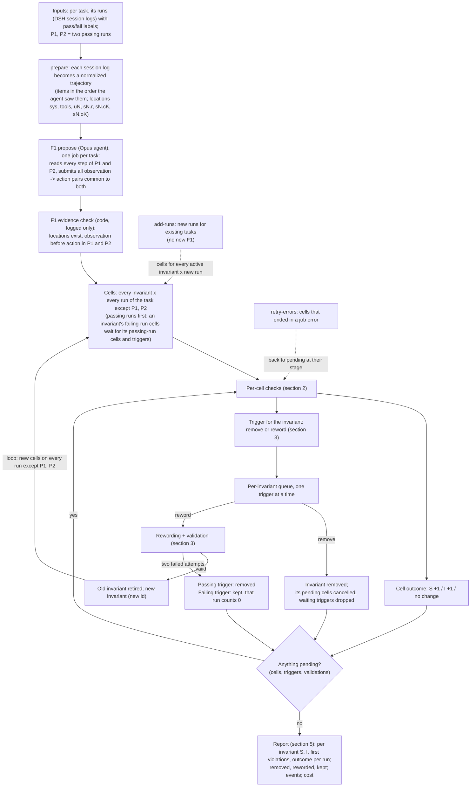
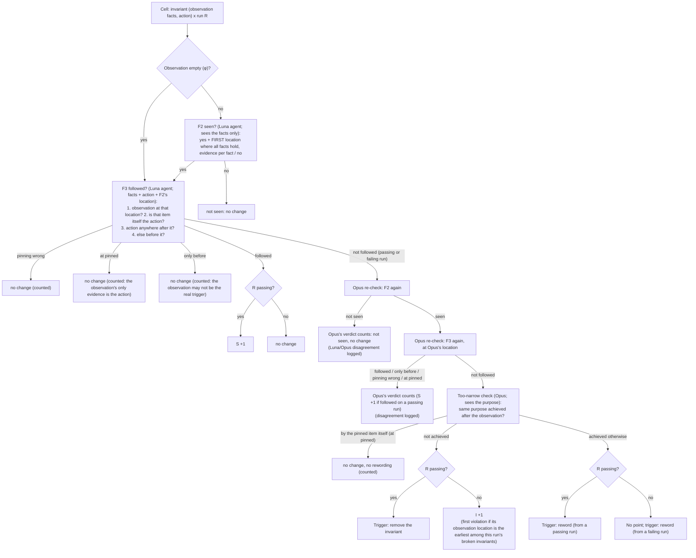
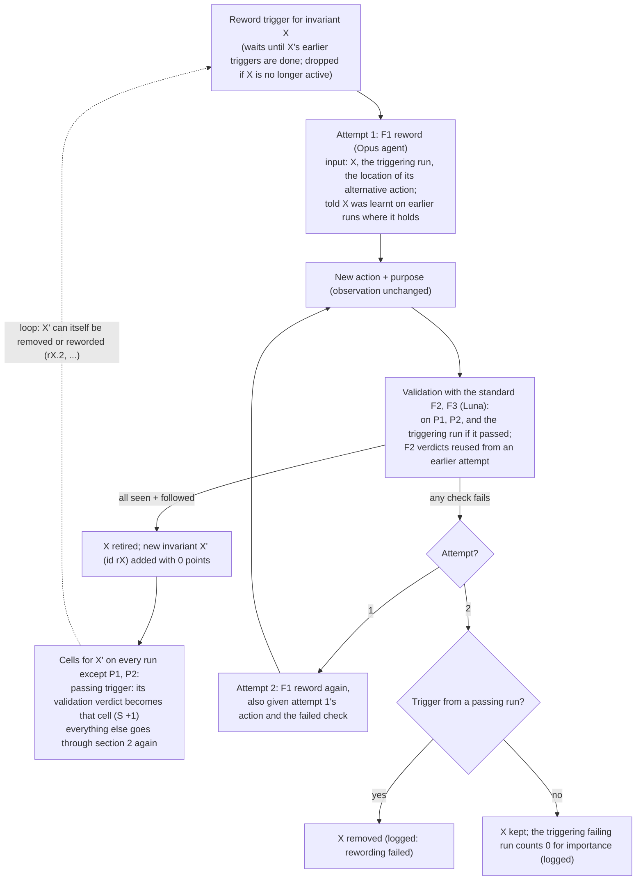
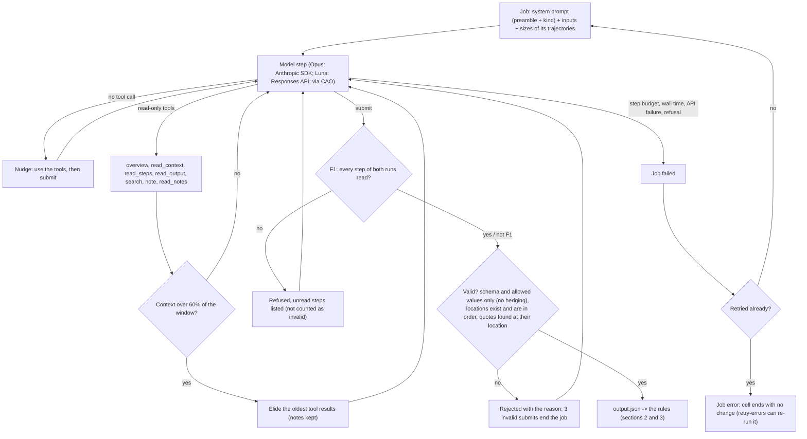
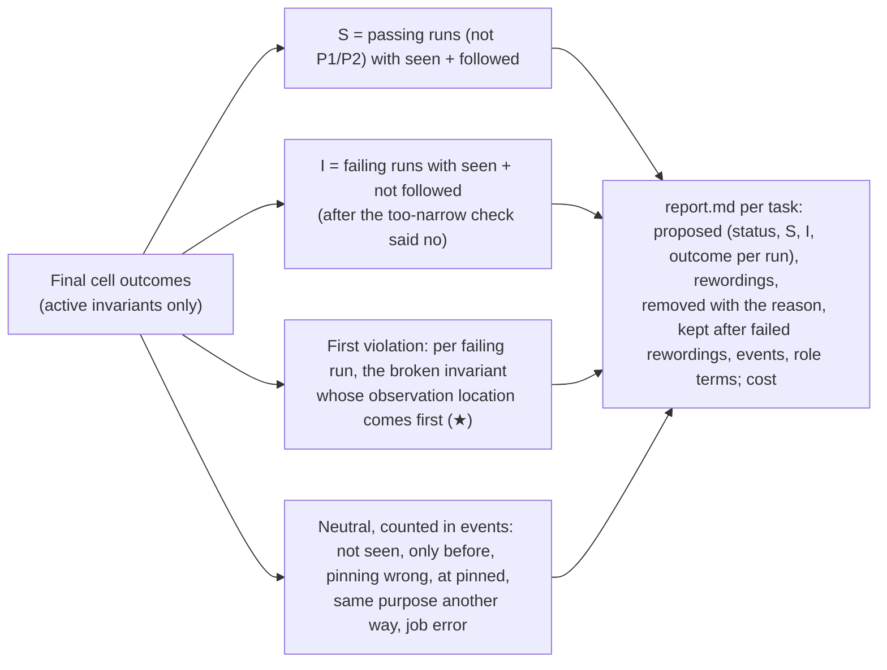

# Same-task invariant mining: flowcharts

How the algorithm in [DESIGN.md](DESIGN.md) runs, from the inputs to the table of points in the report. Built as
`invariant_mining/` ([TECHNICAL.md](TECHNICAL.md)). GitHub renders the diagrams below.

Legend: **Opus** = Claude Opus 5.5, effort high; **Luna** = GPT-5.6 Luna, effort high; **pass / fail** = the run's
all-pass verdict from the grader (the only thing taken from grading); **S** = support point, **I** = importance point.

## 1. The whole pipeline

## 2. One cell: one invariant on one run

Since turn 97: "at pinned" outcomes (the action, or the purpose-achieving action, is the pinned item itself), and the
Opus re-check for a failing run's "not followed" as well.

## 3. Rewording and its validation (the loop back)

## 4. One job: a fresh agent

Every F1, F2, F3, too-narrow and reword job is its own agent with a fresh context; jobs of a kind share a system prompt.

## 5. From cells to the table of numbers

## Scheduling

All work goes through one SQLite table of cells plus the trigger queue and the validations; a row without a final
verdict is pending work. Up to 20 jobs run at a time (worker threads); only the main thread changes the state. Each
round it starts, in order: F1 for tasks not yet proposed, the front trigger of each invariant (a removal is applied at
once, a rewording or validation becomes a job), then pending cells, passing runs first: an invariant's failing-run
cells become ready only when all its passing-run cells are final and it has no open trigger. A stopped run resumes where it was (`run` again).
Points are computed when the report is written, never stored, so changing a scoring rule needs no new model calls.
