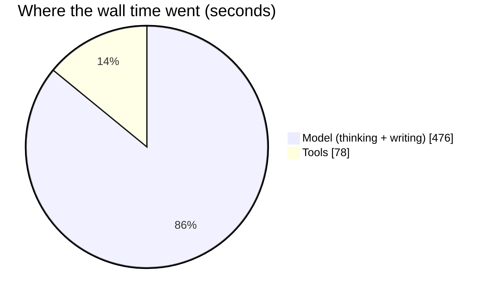

# corporate-ma/draft-markup-of-stock-purchase-agreement-provisions · run10 (`hv-mixed200-lunahigh-flip-r10-20261118T030322Z`)

Result: **all-pass** 59/59 criteria · 9.3 min · 98 model calls · 115 tool calls (8 errors or timeouts) · ending `completed` · started 11-18 08:34:10 IST

## Overview

One box per stretch of steps that used the same kind of tool (blue: looking/searching/reading, purple: writing or editing files, yellow: a message with no tool call, red border: a tool error or timeout inside the box).

```mermaid
flowchart TD
    T(["Task prompt"])
    P0["<b>Step 1</b> · 0.1 min<br/>create_goal"]
    T --> P0
    class P0 look
    P1["<b>Step 2</b> · 0.0 min<br/>todo_write"]
    P0 --> P1
    class P1 look
    P2["<b>Step 3</b> · 0.1 min<br/>glob<br/><i>**/*</i>"]
    P1 --> P2
    class P2 look
    P3["<b>Steps 4-5</b> · 0.7 min<br/>bash x6<br/><i>parse-doc docx documents/buyer-ma-pla…, parse-doc docx documents/sellers-draf…, parse-doc docx documents/environmenta… +3</i>"]
    P2 --> P3
    class P3 look
    P4["<b>Step 6</b> · 0.0 min<br/>read<br/><i>term-sheet.txt</i>"]
    P3 --> P4
    class P4 look
    P5["<b>Step 7</b> · 0.1 min<br/>grep x3<br/><i>buyer-playbook.txt, env-dd.txt, seller-spa.txt</i>"]
    P4 --> P5
    class P5 look
    P6["<b>Steps 8-12</b> · 0.3 min<br/>read x13<br/><i>seller-spa.txt, buyer-playbook.txt</i>"]
    P5 --> P6
    class P6 look
    P7["<b>Step 13</b> · 0.1 min<br/>grep x3<br/><i>seller-spa.txt</i>"]
    P6 --> P7
    class P7 look
    P8["<b>Step 14</b> · 0.0 min<br/>read x3<br/><i>seller-spa.txt</i>"]
    P7 --> P8
    class P8 look
    P9["<b>Step 15</b> · 0.7 min<br/>todo_write"]
    P8 --> P9
    class P9 look
    P10["<b>Steps 16-17</b> · 2.2 min<br/>bash x2<br/><i>python - #lt;#lt;'PY' import docx print(doc…, cat #gt; build_memo.py #lt;#lt;'PY' from docx …</i>"]
    P9 --> P10
    class P10 look
    P11["<b>Step 18</b> · 0.1 min<br/>read<br/><i>build_memo.py</i>"]
    P10 --> P11
    class P11 look
    P12["<b>Step 19</b> · 0.1 min<br/>grep<br/><i>build_memo.py</i>"]
    P11 --> P12
    class P12 look
    P13["<b>Steps 20-33</b> · 0.6 min<br/>edit x13<br/>read<br/><i>build_memo.py</i>"]
    P12 --> P13
    class P13 err
    P14["<b>Step 34</b> · 0.1 min<br/>grep<br/><i>build_memo.py</i>"]
    P13 --> P14
    class P14 look
    P15["<b>Steps 35-39</b> · 0.2 min<br/>edit x5<br/><i>build_memo.py</i>"]
    P14 --> P15
    class P15 err
    P16["<b>Step 40</b> · 0.0 min<br/>grep<br/><i>build_memo.py</i>"]
    P15 --> P16
    class P16 look
    P17["<b>Steps 41-48</b> · 0.3 min<br/>edit x8<br/><i>build_memo.py</i>"]
    P16 --> P17
    class P17 err
    P18["<b>Step 49</b> · 0.1 min<br/>grep<br/><i>build_memo.py</i>"]
    P17 --> P18
    class P18 look
    P19["<b>Steps 50-51</b> · 0.1 min<br/>bash x2<br/><i>python -m py_compile build_memo.py, python build_memo.py && ls -lh output…</i>"]
    P18 --> P19
    class P19 look
    P20["<b>Step 52</b> · 0.1 min<br/>read<br/><i>build_memo.py</i>"]
    P19 --> P20
    class P20 look
    P21["<b>Steps 53-54</b> · 0.3 min<br/>grep x2<br/><i>build_memo.py</i>"]
    P20 --> P21
    class P21 err
    P22["<b>Steps 55-56</b> · 0.2 min<br/>edit x2<br/><i>build_memo.py</i>"]
    P21 --> P22
    class P22 err
    P23["<b>Step 57</b> · 0.1 min<br/>bash<br/><i>python - #lt;#lt;'PY' from pathlib import P…</i>"]
    P22 --> P23
    class P23 look
    P24["<b>Steps 58-79</b> · 0.9 min<br/>edit x22<br/><i>build_memo.py</i>"]
    P23 --> P24
    class P24 write
    P25["<b>Step 80</b> · 0.0 min<br/>grep<br/><i>build_memo.py</i>"]
    P24 --> P25
    class P25 look
    P26["<b>Steps 81-82</b> · 0.2 min<br/>bash x2<br/><i>python -m py_compile build_memo.py &&…, parse-doc docx output/spa-markup-memo…</i>"]
    P25 --> P26
    class P26 look
    P27["<b>Steps 83-84</b> · 0.1 min<br/>read x2<br/><i>memo-validation.txt</i>"]
    P26 --> P27
    class P27 look
    P28["<b>Steps 85-86</b> · 0.2 min<br/>bash x2<br/><i>mkdir -p /tmp/memo-render && libreoff…, pdfinfo /tmp/memo-render/spa-markup-m…</i>"]
    P27 --> P28
    class P28 look
    P29["<b>Steps 87-89</b> · 0.2 min<br/>edit x3<br/><i>build_memo.py</i>"]
    P28 --> P29
    class P29 err
    P30["<b>Step 90</b> · 0.1 min<br/>grep<br/><i>build_memo.py</i>"]
    P29 --> P30
    class P30 look
    P31["<b>Step 91</b> · 0.0 min<br/>edit<br/><i>build_memo.py</i>"]
    P30 --> P31
    class P31 write
    P32["<b>Step 92</b> · 0.2 min<br/>bash<br/><i>python -m py_compile build_memo.py &&…</i>"]
    P31 --> P32
    class P32 look
    P33["<b>Step 93</b> · 0.3 min<br/>glob<br/><i>output/*</i>"]
    P32 --> P33
    class P33 look
    P34["<b>Step 94</b> · 0.1 min<br/>bash<br/><i>unzip -t output/spa-markup-memorandum…</i>"]
    P33 --> P34
    class P34 look
    P35["<b>Step 95</b> · 0.1 min<br/>todo_write"]
    P34 --> P35
    class P35 look
    P36["<b>Step 96</b> · 0.1 min<br/>get_goal"]
    P35 --> P36
    class P36 look
    P37["<b>Step 97</b> · 0.0 min<br/>update_goal"]
    P36 --> P37
    class P37 look
    P38["<b>Step 98</b> · 0.1 min<br/>final message"]
    P37 --> P38
    class P38 ans
    R(["ALL PASS: 59/59 criteria"])
    P38 --> R
    class R pass
    classDef look fill:#e8f0fe,stroke:#4a6fa5,color:#111
    classDef write fill:#f3e8fd,stroke:#7b1fa2,color:#111
    classDef ans fill:#fff8e1,stroke:#b58900,color:#111
    classDef err fill:#e8f0fe,stroke:#c62828,stroke-width:3px,color:#111
    classDef pass fill:#e6f4ea,stroke:#2e7d32,color:#111
    classDef fail fill:#fce8e6,stroke:#c62828,color:#111
```





One row per model call:

| Step | Started (IST) | Model s | Tools s | Tool calls | Tools | Output chars |
|---|---|---|---|---|---|---|
| 1 | 08:34:10 | 3 | 0 | 1 | create_goal | 407 |
| 2 | 08:34:13 | 2 | 0 | 1 | todo_write | 57 |
| 3 | 08:34:15 | 2 | 6 | 1 | glob | 179 |
| 4 | 08:34:23 | 4 | 26 | 5 | bash x5 | 17,444 |
| 5 | 08:34:52 | 3 | 9 | 1 | bash | 1,791 |
| 6 | 08:35:05 | 3 | 0 | 1 | read | 53,466 |
| 7 | 08:35:07 | 3 | 3 | 3 | grep x3 | 135,262 |
| 8 | 08:35:14 | 3 | 0 | 5 | read x5 | 74,907 |
| 9 | 08:35:17 | 3 | 0 | 5 | read x5 | 78,208 |
| 10 | 08:35:19 | 3 | 0 | 1 | read | 53,051 |
| 11 | 08:35:23 | 2 | 0 | 1 | read | 8,206 |
| 12 | 08:35:24 | 10 | 0 | 1 | read | 11,076 |
| 13 | 08:35:34 | 4 | 2 | 3 | grep x3 | 31,230 |
| 14 | 08:35:40 | 2 | 0 | 3 | read x3 | 39,311 |
| 15 | 08:35:43 | 44 | 0 | 1 | todo_write | 57 |
| 16 | 08:36:27 | 4 | 1 | 1 | bash | 6 |
| 17 | 08:36:31 | 124 | 1 | 1 | bash | 437 |
| 18 | 08:38:36 | 3 | 0 | 1 | read | 26,260 |
| 19 | 08:38:40 | 4 | 1 | 1 | grep | 5,338 |
| 20 | 08:38:44 | 5 | 0 | 1 | read | 46,750 |
| 21 | 08:38:49 | 4 | 0 | 1 | edit ⚠ | 218 |
| 22 | 08:38:53 | 3 | 0 | 1 | edit | 221 |
| 23 | 08:38:56 | 3 | 0 | 1 | edit | 221 |
| 24 | 08:38:59 | 2 | 0 | 1 | edit | 221 |
| 25 | 08:39:01 | 3 | 0 | 1 | edit | 221 |
| 26 | 08:39:04 | 2 | 0 | 1 | edit | 221 |
| 27 | 08:39:06 | 2 | 0 | 1 | edit | 221 |
| 28 | 08:39:08 | 2 | 0 | 1 | edit | 221 |
| 29 | 08:39:10 | 2 | 0 | 1 | edit | 221 |
| 30 | 08:39:12 | 2 | 0 | 1 | edit | 221 |
| 31 | 08:39:14 | 2 | 0 | 1 | edit | 221 |
| 32 | 08:39:16 | 2 | 0 | 1 | edit | 221 |
| 33 | 08:39:18 | 3 | 0 | 1 | edit ⚠ | 218 |
| 34 | 08:39:22 | 3 | 0 | 1 | grep | 620 |
| 35 | 08:39:25 | 2 | 0 | 1 | edit | 221 |
| 36 | 08:39:28 | 4 | 0 | 1 | edit | 221 |
| 37 | 08:39:32 | 2 | 0 | 1 | edit | 221 |
| 38 | 08:39:34 | 2 | 0 | 1 | edit | 221 |
| 39 | 08:39:36 | 2 | 0 | 1 | edit ⚠ | 218 |
| 40 | 08:39:38 | 2 | 0 | 1 | grep | 904 |
| 41 | 08:39:41 | 2 | 0 | 1 | edit ⚠ | 218 |
| 42 | 08:39:43 | 3 | 0 | 1 | edit | 221 |
| 43 | 08:39:45 | 2 | 0 | 1 | edit | 221 |
| 44 | 08:39:47 | 2 | 0 | 1 | edit | 221 |
| 45 | 08:39:49 | 3 | 0 | 1 | edit | 221 |
| 46 | 08:39:52 | 2 | 0 | 1 | edit | 221 |
| 47 | 08:39:54 | 2 | 0 | 1 | edit | 221 |
| 48 | 08:39:56 | 2 | 0 | 1 | edit | 221 |
| 49 | 08:39:58 | 3 | 1 | 1 | grep | 16 |
| 50 | 08:40:01 | 3 | 1 | 1 | bash | 11 |
| 51 | 08:40:05 | 2 | 1 | 1 | bash | 513 |
| 52 | 08:40:09 | 4 | 0 | 1 | read | 6,573 |
| 53 | 08:40:13 | 9 | 2 | 1 | grep ⚠ | 229 |
| 54 | 08:40:24 | 5 | 2 | 1 | grep | 6,467 |
| 55 | 08:40:31 | 7 | 0 | 1 | edit ⚠ | 218 |
| 56 | 08:40:39 | 7 | 0 | 1 | edit ⚠ | 218 |
| 57 | 08:40:46 | 4 | 1 | 1 | bash | 2,530 |
| 58 | 08:40:50 | 5 | 0 | 1 | edit | 221 |
| 59 | 08:40:55 | 2 | 0 | 1 | edit | 221 |
| 60 | 08:40:57 | 3 | 0 | 1 | edit | 221 |
| 61 | 08:41:00 | 3 | 0 | 1 | edit | 221 |
| 62 | 08:41:03 | 2 | 0 | 1 | edit | 221 |
| 63 | 08:41:06 | 4 | 0 | 1 | edit | 221 |
| 64 | 08:41:10 | 2 | 0 | 1 | edit | 221 |
| 65 | 08:41:12 | 2 | 0 | 1 | edit | 221 |
| 66 | 08:41:15 | 2 | 0 | 1 | edit | 221 |
| 67 | 08:41:17 | 2 | 0 | 1 | edit | 221 |
| 68 | 08:41:19 | 3 | 0 | 1 | edit | 221 |
| 69 | 08:41:22 | 2 | 0 | 1 | edit | 221 |
| 70 | 08:41:24 | 2 | 0 | 1 | edit | 221 |
| 71 | 08:41:27 | 2 | 0 | 1 | edit | 221 |
| 72 | 08:41:29 | 2 | 0 | 1 | edit | 221 |
| 73 | 08:41:31 | 2 | 0 | 1 | edit | 221 |
| 74 | 08:41:33 | 2 | 0 | 1 | edit | 221 |
| 75 | 08:41:35 | 2 | 0 | 1 | edit | 221 |
| 76 | 08:41:38 | 2 | 0 | 1 | edit | 221 |
| 77 | 08:41:40 | 2 | 0 | 1 | edit | 221 |
| 78 | 08:41:42 | 2 | 0 | 1 | edit | 221 |
| 79 | 08:41:43 | 2 | 0 | 1 | edit | 221 |
| 80 | 08:41:46 | 2 | 1 | 1 | grep | 16 |
| 81 | 08:41:49 | 4 | 1 | 1 | bash | 184 |
| 82 | 08:41:53 | 4 | 5 | 1 | bash | 666 |
| 83 | 08:42:02 | 4 | 0 | 1 | read | 33,855 |
| 84 | 08:42:06 | 4 | 0 | 1 | read | 30,287 |
| 85 | 08:42:10 | 5 | 4 | 1 | bash | 958 |
| 86 | 08:42:19 | 4 | 1 | 1 | bash | 90 |
| 87 | 08:42:24 | 7 | 0 | 1 | edit | 221 |
| 88 | 08:42:31 | 3 | 0 | 1 | edit | 221 |
| 89 | 08:42:34 | 2 | 0 | 1 | edit ⚠ | 218 |
| 90 | 08:42:36 | 3 | 1 | 1 | grep | 311 |
| 91 | 08:42:40 | 2 | 0 | 1 | edit | 221 |
| 92 | 08:42:42 | 7 | 3 | 1 | bash | 1,368 |
| 93 | 08:42:52 | 13 | 3 | 1 | glob | 33 |
| 94 | 08:43:08 | 4 | 1 | 1 | bash | 201 |
| 95 | 08:43:13 | 4 | 0 | 1 | todo_write | 57 |
| 96 | 08:43:16 | 3 | 0 | 1 | get_goal | 407 |
| 97 | 08:43:20 | 3 | 0 | 1 | update_goal | 412 |
| 98 | 08:43:23 | 4 | 0 | 0 | (message only) | 0 |

## Task prompt

```text
Review the seller's draft SPA against the buyer's playbook, executed term sheet, and diligence materials, and prepare a detailed markup memorandum with draft-ready redline language. Output: `spa-markup-memorandum.docx`.
```

## Rubric

| # | Criterion | Verdict |
|---|---|---|
| C-001 | ISSUE_001: Identifies overbroad MAE carve-outs for environmental industry/regulations | pass |
| C-002 | ISSUE_001: Proposes adding disproportionate impact qualifier to MAE carve-outs | pass |
| C-003 | ISSUE_001: Provides actual revised contract language for MAE definition | pass |
| C-004 | ISSUE_001: Explains rationale — environmental company needs MAE protection | pass |
| C-005 | ISSUE_002: Identifies missing interim covenant restricting affiliate transactions | pass |
| C-006 | ISSUE_002: Proposes covenant requiring Buyer consent for affiliate transactions | pass |
| C-007 | ISSUE_002: References the above-market rent to Seller affiliate as rationale | pass |
| C-008 | ISSUE_003: Identifies indemnification cap discrepancy (20% vs. 12.5%) | pass |
| C-009 | ISSUE_003: Proposes redline reducing cap to 12.5% / $26,875,000 | pass |
| C-010 | ISSUE_003: References the term sheet as basis for cap correction | pass |
| C-011 | ISSUE_004: Identifies that environmental reps survival period is too short | pass |
| C-012 | ISSUE_004: Proposes extending environmental reps survival to at least 36 months | pass |
| C-013 | ISSUE_004: References CERCLA/Dalton Creek exposure as rationale for longer survival | pass |
| C-014 | ISSUE_005: Identifies anti-sandbagging provision in Section 9.06 | pass |
| C-015 | ISSUE_005: Proposes replacing with pro-sandbagging language | pass |
| C-016 | ISSUE_005: Provides actual pro-sandbagging contract text | pass |
| C-017 | ISSUE_006: Identifies need for Special Indemnity for Dalton Creek CERCLA matter | pass |
| C-018 | ISSUE_006: Special Indemnity survival of 72 months | pass |
| C-019 | ISSUE_006: Special Indemnity not subject to basket or cap | pass |
| C-020 | ISSUE_006: References Dalton Creek liability range ($1.5M-$6M) | pass |
| C-021 | ISSUE_007: Identifies problematic earnout operational covenant | pass |
| C-022 | ISSUE_007: Proposes limiting earnout covenant to no-frustration standard | pass |
| C-023 | ISSUE_007: Explains rationale — Buyer integration/restructuring flexibility | pass |
| C-024 | ISSUE_008: Identifies missing payoff letter requirement | pass |
| C-025 | ISSUE_008: Proposes payoff letters at least 3 business days pre-closing | pass |
| C-026 | ISSUE_008: Proposes simultaneous repayment at closing through funds flow | pass |
| C-027 | ISSUE_008: Proposes payoff letter delivery as a condition to closing | pass |
| C-028 | ISSUE_009: Identifies missing government contract anti-assignment/novation requirement | pass |
| C-029 | ISSUE_009: References specific government contracts requiring novation | pass |
| C-030 | ISSUE_009: Proposes closing condition or covenant for government contract novation | pass |
| C-031 | ISSUE_009: References Anti-Assignment Act or FAR provisions | pass |
| C-032 | ISSUE_010: Identifies missing environmental permit transfer/notification covenant | pass |
| C-033 | ISSUE_010: Proposes cooperation covenant for environmental permit transfers | pass |
| C-034 | ISSUE_010: Notes that permits may require notification even in a stock deal | pass |
| C-035 | ISSUE_011: Identifies missing R&W Insurance subrogation waiver | pass |
| C-036 | ISSUE_011: Proposes subrogation waiver provision with fraud exception | pass |
| C-037 | ISSUE_011: References R&W Insurance policy / Granite Ridge Underwriters | pass |
| C-038 | ISSUE_012: Identifies non-compete scope exceeds term sheet (duration) | pass |
| C-039 | ISSUE_012: Identifies non-compete scope exceeds term sheet (geographic) | pass |
| C-040 | ISSUE_012: Identifies non-compete scope exceeds term sheet (activity) | pass |
| C-041 | ISSUE_012: Proposes narrowing non-compete duration to 3 years | pass |
| C-042 | ISSUE_012: Proposes narrowing non-compete geographic scope to OR, WA, CA, NV | pass |
| C-043 | ISSUE_012: Proposes narrowing non-compete activity scope to environmental remediation and hazardous waste management | pass |
| C-044 | ISSUE_012: Notes enforceability risk of overbroad non-compete | pass |
| C-045 | Indemnification cap issue rated as Critical or High priority | pass |
| C-046 | Anti-sandbagging issue rated as Critical or High priority | pass |
| C-047 | Memorandum identifies provisions acceptable as drafted | pass |
| C-048 | Memorandum flags items for partner/client discussion | pass |
| C-049 | Escrow amount correctly stated as $16,125,000 (7.5% of EV) | pass |
| C-050 | ISSUE_006: Proposes 36-month escrow holdback for Special Indemnity | pass |
| C-051 | Earnout maximum correctly referenced as $25,000,000 | pass |
| C-052 | Earnout Adjusted EBITDA threshold correctly referenced as $38,000,000 | pass |
| C-053 | Earnout floor correctly referenced as $32,000,000 | pass |
| C-054 | References playbook as authority for at least 3 markup positions | pass |
| C-055 | References term sheet as authority for at least 3 markup positions | pass |
| C-056 | References environmental DD memo for at least one markup position | pass |
| C-057 | Memorandum identifies specific SPA section numbers for issues | pass |
| C-058 | Proposed redline language is actual contract text for at least 8 issues | pass |
| C-059 | ISSUE_008: Identifies all three sources of Target indebtedness | pass |

Judge's reasoning:

**C-001 (pass):** ISSUE_001: Identifies overbroad MAE carve-outs for environmental industry/regulations

```text
The memorandum expressly identifies the MAE carve-outs for conditions generally affecting the environmental services industry and changes in Environmental Laws as problematic because they lack a disproportionate-impact exception, and it proposes adding such a qualifier.
```

**C-002 (pass):** ISSUE_001: Proposes adding disproportionate impact qualifier to MAE carve-outs

```text
The proposed MAE definition expressly adds a disproportionate-impact exception for the general carve-outs and specifically states that industry and Environmental Law changes are taken into account when they disproportionately affect the Company relative to other environmental services industry participants.
```

**C-003 (pass):** ISSUE_001: Provides actual revised contract language for MAE definition

```text
The memorandum includes a full draft-ready replacement MAE definition and expressly provides that specified carve-outs are taken into account to the extent they disproportionately affect the Company relative to other industry participants.
```

**C-004 (pass):** ISSUE_001: Explains rationale — environmental company needs MAE protection

```text
The memorandum expressly explains that Cascadia's value is directly exposed to environmental regulation and industry economics, so carve-outs for environmental-services industry conditions and Environmental Law changes could remove the very risks the MAE provision is intended to cover. It further notes that the qualifier is especially important given the target's environmental permits, government contracts, and CERCLA exposure.
```

**C-005 (pass):** ISSUE_002: Identifies missing interim covenant restricting affiliate transactions

```text
The memorandum expressly identifies that the interim covenant omits restrictions on transactions with Seller and Seller affiliates, and proposes a buyer-consent restriction covering entry into, amendment, renewal, payment under, and termination of affiliate arrangements between signing and closing.
```

**C-006 (pass):** ISSUE_002: Proposes covenant requiring Buyer consent for affiliate transactions

```text
The memorandum proposes a new Section 6.01(b)(xiv) prohibiting the Company from entering into, amending, modifying, extending, renewing, supplementing, altering, or terminating transactions or agreements with Seller or its affiliates without Buyer's prior written consent.
```

**C-007 (pass):** ISSUE_002: References the above-market rent to Seller affiliate as rationale

```text
The memorandum expressly ties the affiliate-transaction covenant to the Company’s $1,600,000 annual rent under a Seller-affiliate lease and further identifies the above-market rent adjustment as supporting the covenant.
```

**C-008 (pass):** ISSUE_003: Identifies indemnification cap discrepancy (20% vs. 12.5%)

```text
The memorandum expressly identifies that the Seller draft uses a 20% general indemnification cap of $43,000,000, while the executed term sheet requires a 12.5% cap of $26,875,000, and provides conforming replacement language.
```

**C-009 (pass):** ISSUE_003: Proposes redline reducing cap to 12.5% / $26,875,000

```text
The memorandum expressly proposes replacing the indemnification cap with $26,875,000, equal to 12.5% of the $215,000,000 Base Enterprise Value, in both the definition and Section 9.04(b).
```

**C-010 (pass):** ISSUE_003: References the term sheet as basis for cap correction

```text
The memorandum expressly cites the executed term sheet in the indemnification-cap section, stating that Term Sheet §8 fixes the general cap at 12.5% of the $215 million Base Enterprise Value, or $26.875 million.
```

**C-011 (pass):** ISSUE_004: Identifies that environmental reps survival period is too short

```text
The memorandum expressly identifies that the Seller's draft gives all non-fundamental representations, including environmental representations, only 12 months of survival and states that this is inadequate for environmental compliance, permit, remediation, CERCLA, and delayed regulatory risks. It proposes a separate 36-month survival period for Environmental Representations, expressly including Section 4.15 and Environmental Permits.
```

**C-012 (pass):** ISSUE_004: Proposes extending environmental reps survival to at least 36 months

```text
The memorandum expressly proposes that Environmental Representations survive until 36 months after closing and also notes the option of seeking survival through the full applicable statute of limitations.
```

**C-013 (pass):** ISSUE_004: References CERCLA/Dalton Creek exposure as rationale for longer survival

```text
The memorandum expressly connects longer environmental-representation survival to Dalton Creek CERCLA exposure and active remediation. It states that 12 months is inadequate because of Dalton Creek, the 24–36 month Hargrove project, delayed regulatory action, and CERCLA matters that can take years to crystallize, supporting the proposed 36-month survival period.
```

**C-014 (pass):** ISSUE_005: Identifies anti-sandbagging provision in Section 9.06

```text
The memorandum expressly identifies Section 9.06 as an anti-sandbagging provision and quotes its language barring Buyer from indemnification for breaches or inaccuracies known by Buyer or its Representatives as of the Closing Date.
```

**C-015 (pass):** ISSUE_005: Proposes replacing with pro-sandbagging language

```text
The memorandum expressly deletes the anti-sandbagging provision and replaces it with a pro-sandbagging clause stating that Buyer's indemnification and other remedies are not affected, limited, diminished, or impaired by any investigation or knowledge acquired before or after execution or Closing.
```

**C-016 (pass):** ISSUE_005: Provides actual pro-sandbagging contract text

```text
The memorandum includes actual proposed pro-sandbagging contract language in replacement Section 9.06, expressly providing that Buyer's indemnification and other remedies are not affected by its investigation, knowledge, notice, or available information.
```

**C-017 (pass):** ISSUE_006: Identifies need for Special Indemnity for Dalton Creek CERCLA matter

```text
The memorandum expressly proposes a separate “Dalton Creek Special Indemnity” for the EPA Section 104(e)/CERCLA matter, distinct from general environmental representations and general indemnification. It also specifies separate survival, basket, cap, and escrow treatment.
```

**C-018 (pass):** ISSUE_006: Special Indemnity survival of 72 months

```text
The memorandum expressly states that the Dalton Creek Special Indemnity “shall survive the Closing until the date that is seventy-two (72) months after the Closing Date,” satisfying the required six-year post-closing survival period.
```

**C-019 (pass):** ISSUE_006: Special Indemnity not subject to basket or cap

```text
The Dalton Creek Special Indemnity provision expressly states that it “shall not be subject to the Basket Amount, the Indemnification Cap, or any other general limitation,” and further clarifies that related losses do not count toward the basket or reduce the general cap.
```

**C-020 (pass):** ISSUE_006: References Dalton Creek liability range ($1.5M-$6M)

```text
The memorandum expressly states in the Dalton Creek Special Indemnity issue summary that the DD memo estimates potential CERCLA liability of $1,500,000 to $6,000,000, using that exposure to justify the Special Indemnity.
```

**C-021 (pass):** ISSUE_007: Identifies problematic earnout operational covenant

```text
The memorandum expressly identifies Section 2.05(d) as imposing an overly restrictive affirmative obligation to operate consistently with past practice, act in good faith to maximize the earnout, maintain resources, and avoid diversion of opportunities. It recommends replacing that covenant with a narrow primary-purpose negative covenant.
```

**C-022 (pass):** ISSUE_007: Proposes limiting earnout covenant to no-frustration standard

```text
The memorandum expressly replaces the affirmative past-practice and earnout-maximization obligations with a narrow covenant prohibiting actions taken with the primary purpose of reducing or avoiding the earnout payment, while preserving Buyer's operational discretion.
```

**C-023 (pass):** ISSUE_007: Explains rationale — Buyer integration/restructuring flexibility

```text
The memorandum expressly explains that the seller’s broad earnout covenant would give Seller a de facto veto over Buyer’s platform integration, bolt-on acquisitions, restructuring, and operational improvements. It also proposes language preserving Buyer’s discretion to integrate, restructure, and otherwise manage the Company, directly addressing the commercial risk to post-closing operational freedom.
```

**C-024 (pass):** ISSUE_008: Identifies missing payoff letter requirement

```text
The memorandum expressly identifies that the Seller draft permits repayment “at or promptly following” closing and lacks a payoff-letter condition, then proposes requiring executed payoff letters from each holder at least three business days before closing.
```

**C-025 (pass):** ISSUE_008: Proposes payoff letters at least 3 business days pre-closing

```text
The memorandum expressly requires executed payoff letters to be delivered no later than three business days before closing, and requires each letter to include wiring instructions and provide for lien releases, including UCC termination statements and other lien-release documents.
```

**C-026 (pass):** ISSUE_008: Proposes simultaneous repayment at closing through funds flow

```text
The memorandum expressly replaces the seller's “at or promptly following” mechanic with a requirement that all Closing Indebtedness be repaid simultaneously at Closing through the closing funds flow, including direct wires to the applicable debt holders.
```

**C-027 (pass):** ISSUE_008: Proposes payoff letter delivery as a condition to closing

```text
The memorandum expressly proposes adding Section 7.02(i), requiring Buyer to receive executed payoff letters at least three Business Days before closing and stating that delivery is a condition to Buyer's obligation to close.
```

**C-028 (pass):** ISSUE_009: Identifies missing government contract anti-assignment/novation requirement

```text
The memorandum expressly identifies that the Seller's draft does not address government-contract anti-assignment, novation, or recognition requirements for the Oregon DEQ, Washington Ecology, U.S. Army Corps of Engineers, and Bureau of Land Management contracts. It specifically discusses the Anti-Assignment Act and FAR Part 42, Subpart 42.12, and proposes related representations, covenants, and closing conditions.
```

**C-029 (pass):** ISSUE_009: References specific government contracts requiring novation

```text
The memorandum specifically lists all four active government contracts and states that the two federal contracts—U.S. Army Corps of Engineers and Bureau of Land Management—require novation analysis under FAR §42.1204.
```

**C-030 (pass):** ISSUE_009: Proposes closing condition or covenant for government contract novation

```text
The memorandum proposes a specific pre-closing covenant in new Section 6.06A requiring Seller and the Company to notify contracting officers, submit required novation or recognition requests, and use commercially reasonable efforts to obtain the agreements or approvals. It also proposes a related closing condition in Section 7.02(h) requiring submission, no denial or termination indication, and interim-performance confirmation if final novation is pending.
```

**C-031 (pass):** ISSUE_009: References Anti-Assignment Act or FAR provisions

```text
The memorandum expressly cites the federal Anti-Assignment Act, 41 U.S.C. § 6305, and FAR Part 42, Subpart 42.12, including FAR § 42.1204, as the legal basis for government-contract novation or recognition requirements.
```

**C-032 (pass):** ISSUE_010: Identifies missing environmental permit transfer/notification covenant

```text
The memorandum expressly identifies that the Seller draft represents the Company holds 23 environmental permits but lacks covenants requiring identification of change-of-control requirements, pre-closing notices or approvals, and post-closing cooperation. It also proposes a detailed Environmental Permit Change-of-Control Cooperation covenant covering transfer, reissuance, amendment, notification, and approval processes.
```

**C-033 (pass):** ISSUE_010: Proposes cooperation covenant for environmental permit transfers

```text
The memorandum expressly proposes new Section 6.06B requiring Seller and the Company to identify permit change-of-control requirements, prepare and submit pre-closing notifications and approval requests, and provide post-closing cooperation for at least 12 months with permit transfers, reissuances, amendments, notifications, and approvals under applicable state requirements.
```

**C-034 (pass):** ISSUE_010: Notes that permits may require notification even in a stock deal

```text
The memorandum expressly states that “A stock transaction does not eliminate state change-of-control requirements” and discusses notification or approval requirements for environmental permits in Oregon, Washington, California, and Nevada, including Oregon DEQ and Washington Ecology.
```

**C-035 (pass):** ISSUE_011: Identifies missing R&W Insurance subrogation waiver

```text
The memorandum expressly identifies that the Seller's draft contains no reference to R&W Insurance and no waiver of the insurer's subrogation rights against Seller or related persons, and it proposes draft waiver language.
```

**C-036 (pass):** ISSUE_011: Proposes subrogation waiver provision with fraud exception

```text
The memorandum proposes a new R&W insurance provision requiring the insurer to irrevocably waive subrogation and other recovery rights against Seller and related persons, with an express exception for losses arising from actual fraud committed by Seller. It also identifies Granite Ridge Underwriters as the contemplated insurer.
```

**C-037 (pass):** ISSUE_011: References R&W Insurance policy / Granite Ridge Underwriters

```text
The memorandum expressly states that Buyer is obtaining a representations and warranties insurance policy and ties that policy to a required insurer subrogation waiver against Seller, except for Seller fraud. It also identifies the contemplated insurer as Granite Ridge Underwriters in the issue summary and negotiation notes.
```

**C-038 (pass):** ISSUE_012: Identifies non-compete scope exceeds term sheet (duration)

```text
The memorandum expressly identifies that the Seller draft imposes a five-year non-compete and states that the term sheet requires a three-year restriction, with replacement language conforming the duration to three years.
```

**C-039 (pass):** ISSUE_012: Identifies non-compete scope exceeds term sheet (geographic)

```text
The memorandum expressly identifies that the Seller draft applies nationwide ('anywhere in the United States') while the term sheet limits the non-compete to Oregon, Washington, California, and Nevada, and proposes replacement language using those four states.
```

**C-040 (pass):** ISSUE_012: Identifies non-compete scope exceeds term sheet (activity)

```text
The memorandum expressly identifies that the Seller's draft applies to “any business” and contrasts it with the term sheet’s narrower scope limited to environmental remediation and hazardous waste management services.
```

**C-041 (pass):** ISSUE_012: Proposes narrowing non-compete duration to 3 years

```text
The memorandum expressly proposes replacing Section 6.09(a) with a non-compete lasting “three (3) years following the Closing Date,” matching the term sheet.
```

**C-042 (pass):** ISSUE_012: Proposes narrowing non-compete geographic scope to OR, WA, CA, NV

```text
The proposed replacement for Section 6.09(a) expressly limits the non-compete to environmental remediation or hazardous waste management businesses in Oregon, Washington, California, or Nevada, matching the term sheet.
```

**C-043 (pass):** ISSUE_012: Proposes narrowing non-compete activity scope to environmental remediation and hazardous waste management

```text
The proposed replacement for Section 6.09(a) expressly narrows the restricted activity to businesses providing environmental remediation services or hazardous waste management services, matching the term sheet.
```

**C-044 (pass):** ISSUE_012: Notes enforceability risk of overbroad non-compete

```text
The memorandum expressly states that the five-year, nationwide restriction on engaging in “any business” would sweep in Evergreen’s unrelated construction and timber operations and create enforceability risk, including that it could be struck as overbroad.
```

**C-045 (pass):** Indemnification cap issue rated as Critical or High priority

```text
The indemnification cap discrepancy (20% versus 12.5%) is expressly assigned HIGH priority in both the executive summary and the detailed Article IX discussion.
```

**C-046 (pass):** Anti-sandbagging issue rated as Critical or High priority

```text
The anti-sandbagging issue in Section 9.06 is expressly labeled “PRIORITY: CRITICAL,” which is the highest priority tier and satisfies the criterion.
```

**C-047 (pass):** Memorandum identifies provisions acceptable as drafted

```text
The memorandum includes a dedicated “Items Intentionally Not Marked Up” section identifying multiple provisions acceptable as drafted—such as the basket/deductible, knowledge qualifier, good-standing certificates, Delaware governing law, and NWC true-up—and briefly explains their consistency with the term sheet or buyer playbook.
```

**C-048 (pass):** Memorandum flags items for partner/client discussion

```text
The memorandum expressly includes a “Client Decisions / Negotiation Notes” section flagging multiple issues for further discussion or confirmation, including government-contract novation timing with Marcus, environmental-representation survival, the Dalton Creek escrow structure, and the R&W insurance closing condition. It also directs Elena to discuss certain positions with Marcus before finalizing the markup.
```

**C-049 (pass):** Escrow amount correctly stated as $16,125,000 (7.5% of EV)

```text
The memorandum correctly states the escrow amount as $16,125,000 and identifies it as 7.5% of the $215,000,000 base enterprise value in its indemnification and escrow discussions.
```

**C-050 (pass):** ISSUE_006: Proposes 36-month escrow holdback for Special Indemnity

```text
The memorandum expressly provides that the escrow portion allocated to the Dalton Creek Special Indemnity will be held until 36 months after closing, with unresolved timely claims reserved thereafter. It distinguishes this special-indemnity holdback from the general escrow mechanics.
```

**C-051 (pass):** Earnout maximum correctly referenced as $25,000,000

```text
The memorandum correctly states the maximum earnout payment as $25,000,000 in the proposed earnout provision and related commentary.
```

**C-052 (pass):** Earnout Adjusted EBITDA threshold correctly referenced as $38,000,000

```text
The earnout discussion correctly states that the maximum earnout is payable if Adjusted EBITDA equals or exceeds $38,000,000, and repeatedly identifies $38,000,000 as the full-payment threshold.
```

**C-053 (pass):** Earnout floor correctly referenced as $32,000,000

```text
The earnout provision correctly states a $32,000,000 floor, provides no payment below that amount, and applies linear pro-rata interpolation between $32,000,000 and the $38,000,000 full-payment threshold.
```

**C-054 (pass):** References playbook as authority for at least 3 markup positions

```text
The memorandum cites the Buyer M&A Playbook as authority for well over three distinct markup positions, including the MAE definition, earnout covenant, government-contract novation provisions, affiliate-transaction restriction, debt payoff mechanics, environmental survival, pro-sandbagging, and non-compete provisions.
```

**C-055 (pass):** References term sheet as authority for at least 3 markup positions

```text
The memorandum cites the executed term sheet as authority for well over three distinct markup positions, including earnout mechanics, the indemnification cap, environmental-representation survival, the Dalton Creek Special Indemnity, debt payoff mechanics, the R&W insurance subrogation waiver, and the non-compete.
```

**C-056 (pass):** References environmental DD memo for at least one markup position

```text
The memorandum repeatedly cites the environmental DD memo as support for markup positions, including government-contract novation, environmental permit transfers, environmental representation survival, and the Dalton Creek special indemnity.
```

**C-057 (pass):** Memorandum identifies specific SPA section numbers for issues

```text
The memorandum ties all 12 planted issues to specific SPA sections, including Sections 1.01, 2.05, 4.16, 6.01, 6.05, 6.09, 7.02, 9.01, 9.02, 9.04, 9.06, and 9.08. This exceeds the requirement of at least 8 issues.
```

**C-058 (pass):** Proposed redline language is actual contract text for at least 8 issues

```text
The memorandum provides draft-ready contractual language suitable for insertion into the SPA for all 12 principal issues, including the MAE definition, earnout, government contracts, affiliate transactions, debt payoff, environmental permits, indemnification cap, environmental survival, Dalton Creek indemnity, pro-sandbagging, R&W insurance, and non-compete provisions. This exceeds the requirement of at least 8 issues.
```

**C-059 (pass):** ISSUE_008: Identifies all three sources of Target indebtedness

```text
The payoff-letter discussion expressly identifies all three sources of Target indebtedness: Cascade Mutual Bank ($28.0M), Pacific Lease Corp. ($9.8M), and Evergreen Holdings Group, Inc. ($4.5M), and requires payoff letters from each holder.
```

## Delivered files (output/)

- `spa-markup-memorandum.docx` (59,173 bytes)

## Trajectory

### Step 1: 1 tool call

_Started 11-18 08:34:10 IST · model 3 s · tools 0 s_

**Reasoning summary:**

```text
**Creating a document goal**

I need to produce a .docx document and inspect existing ones. I wonder if there's a specific skill for document creation available, though it might not be explicitly listed. I could consider using glob to list files. It seems I should create a goal for this long-running objective. So, I’ll focus on using my to-do tools for managing this process. First, I'll inspect the workspace and check the documents available.
```

**Call `create_goal`** (0.2 s)

```json
{
 "objective": "Review the seller's draft SPA against the buyer's playbook, executed term sheet, and diligence materials, then prepare and save a detailed markup memorandum with draft-ready redline language as spa-markup-memorandum.docx in the output directory.",
 "max_goal_rounds": 10
}
```

Output (407 chars):

```text
{"goal":{"id":"goal-eb67399a-c15f-426f-907f-b820737d9c2c","revision":1,"objective":"Review the seller's draft SPA against the buyer's playbook, executed term sheet, and diligence materials, then prepare and save a detailed markup memorandum with draft-ready redline language as spa-markup-memorandum.docx in the output directory.","phase":"active","roundsStarted":0,"maxGoalRounds":10},"activation":"armed"}
```

### Step 2: 1 tool call

_Started 11-18 08:34:13 IST · model 2 s · tools 0 s_

**Call `todo_write`** (0.0 s)

```json
{
 "todos": [
  {
   "content": "Inventory and read all transaction documents",
   "status": "in_progress"
  },
  {
   "content": "Extract buyer positions and diligence risks",
   "status": "pending"
  },
  {
   "content": "Compare seller draft provisions to buyer requirements",
   "status": "pending"
  },
  {
   "content": "Draft detailed markup memorandum with redline language",
   "status": "pending"
  },
  {
   "content": "Generate and validate spa-markup-memorandum.docx",
   "status": "pending"
  }
 ]
}
```

Output (57 chars):

```text
Updated todo list: 4 pending, 1 in progress, 0 completed.
```

**Todo list now:**

- [~] Inventory and read all transaction documents
- [ ] Extract buyer positions and diligence risks
- [ ] Compare seller draft provisions to buyer requirements
- [ ] Draft detailed markup memorandum with redline language
- [ ] Generate and validate spa-markup-memorandum.docx

### Step 3: 1 tool call

_Started 11-18 08:34:15 IST · model 2 s · tools 6 s_

**Call `glob`** (5.8 s)

```json
{
 "pattern": "**/*"
}
```

Output (179 chars):

```text
documents/buyer-ma-playbook.docx
documents/sellers-draft-spa.docx
documents/environmental-dd-memo.docx
documents/executed-term-sheet.docx
documents/partner-markup-instructions.eml
```

### Step 4: 5 tool calls

_Started 11-18 08:34:23 IST · model 4 s · tools 26 s_

**Reasoning summary:**

```text
**Considering document conversion**

I need to convert a DOCX file to text format, possibly using a bash command like “parse-doc” in my workspace. It sounds like I could set things up to output the text directly. I should check if the files are read-only since that might affect what I can do. I'm noting that executing this in parallel could speed up the parsing process, which is always a plus! I'm curious to see how it works out!
```

**Call `bash`** (11.4 s)

```json
{
 "command": "parse-doc docx documents/buyer-ma-playbook.docx > /tmp/buyer-playbook.txt && wc -l /tmp/buyer-playbook.txt",
 "description": "Parse buyer playbook to text"
}
```

Output (402 chars):

```text
673 /tmp/buyer-playbook.txt
[stderr]
2026-11-18 03:04:37.536809036 [W:onnxruntime:Default, device_discovery.cc:95 GetPciBusId] Skipping pci_bus_id for PCI path at "/sys/devices/LNXSYSTM:00/LNXSYBUS:00/ACPI0004:00/VMBUS:00/5620e0c7-8062-4dce-aeb7-520c7ef76171" because filename "5620e0c7-8062-4dce-aeb7-520c7ef76171" did not match expected pattern of [0-9a-f]+:[0-9a-f]+:[0-9a-f]+[.][0-9a-f]+
```

**Call `bash`** (5.4 s)

```json
{
 "command": "parse-doc docx documents/sellers-draft-spa.docx > /tmp/seller-spa.txt && wc -l /tmp/seller-spa.txt",
 "description": "Parse seller SPA to text"
}
```

Output (399 chars):

```text
1230 /tmp/seller-spa.txt
[stderr]
2026-11-18 03:04:42.665589433 [W:onnxruntime:Default, device_discovery.cc:95 GetPciBusId] Skipping pci_bus_id for PCI path at "/sys/devices/LNXSYSTM:00/LNXSYBUS:00/ACPI0004:00/VMBUS:00/5620e0c7-8062-4dce-aeb7-520c7ef76171" because filename "5620e0c7-8062-4dce-aeb7-520c7ef76171" did not match expected pattern of [0-9a-f]+:[0-9a-f]+:[0-9a-f]+[.][0-9a-f]+
```

**Call `bash`** (3.0 s)

```json
{
 "command": "parse-doc docx documents/environmental-dd-memo.docx > /tmp/env-dd.txt && wc -l /tmp/env-dd.txt",
 "description": "Parse environmental diligence memo"
}
```

Output (394 chars):

```text
279 /tmp/env-dd.txt
[stderr]
2026-11-18 03:04:45.735359315 [W:onnxruntime:Default, device_discovery.cc:95 GetPciBusId] Skipping pci_bus_id for PCI path at "/sys/devices/LNXSYSTM:00/LNXSYBUS:00/ACPI0004:00/VMBUS:00/5620e0c7-8062-4dce-aeb7-520c7ef76171" because filename "5620e0c7-8062-4dce-aeb7-520c7ef76171" did not match expected pattern of [0-9a-f]+:[0-9a-f]+:[0-9a-f]+[.][0-9a-f]+
```

**Call `bash`** (2.5 s)

```json
{
 "command": "parse-doc docx documents/executed-term-sheet.docx > /tmp/term-sheet.txt && wc -l /tmp/term-sheet.txt",
 "description": "Parse executed term sheet to text"
}
```

Output (398 chars):

```text
435 /tmp/term-sheet.txt
[stderr]
2026-11-18 03:04:48.581917539 [W:onnxruntime:Default, device_discovery.cc:95 GetPciBusId] Skipping pci_bus_id for PCI path at "/sys/devices/LNXSYSTM:00/LNXSYBUS:00/ACPI0004:00/VMBUS:00/5620e0c7-8062-4dce-aeb7-520c7ef76171" because filename "5620e0c7-8062-4dce-aeb7-520c7ef76171" did not match expected pattern of [0-9a-f]+:[0-9a-f]+:[0-9a-f]+[.][0-9a-f]+
```

**Call `bash`** (3.2 s)

```json
{
 "command": "python - <<'PY'\nfrom pathlib import Path\nfrom email import policy\nfrom email.parser import BytesParser\np=Path('documents/partner-markup-instructions.eml')\nmsg=BytesParser(policy=policy.default).parsebytes(p.read_bytes())\nprint(msg.get_content())\nPY",
 "description": "Read partner markup instructions"
}
```

Output (15,851 chars):

```text
Jonathan,

I reviewed the initial draft SPA that Douglas Renwick at Fortuna & Blake circulated yesterday. My overall impression: this is a heavily seller-favorable draft in several material respects, and some of the positions directly contradict the September 10 term sheet — which tells me either Doug is testing our resolve or his client gave him different instructions than what was agreed at the principal level. Either way, we need a sharp, comprehensive markup.

Marcus Devereaux at Whitmore Capital wants to see our redline by end of next week. Given the November 14 target signing date, that gives the parties roughly two weeks of negotiation runway after we send our markup, which is tight. I need your comprehensive markup memorandum with redlined provisions and full track-changes commentary.

**General Instructions**

Cross-reference every material provision against three sources: (1) the executed term sheet dated September 10, 2025, (2) the firm's M&A Playbook for environmental services sector acquisitions, and (3) the environmental due diligence summary memo prepared by our environmental group.

For each issue you identify, I need you to:

(a) Quote the original Seller's draft language;
(b) Provide proposed revised language in full — actual contract text, not summaries;
(c) Include a brief track-changes comment explaining the legal or commercial rationale and citing the relevant source document (term sheet, playbook, or DD memo); and
(d) Assign a priority level: Critical, 
… [14,349 more chars]
```

### Step 5: 1 tool call

_Started 11-18 08:34:52 IST · model 3 s · tools 9 s_

**Call `bash`** (9.5 s)

```json
{
 "command": "mkdir -p extracted && parse-doc docx documents/buyer-ma-playbook.docx > extracted/buyer-playbook.txt && parse-doc docx documents/sellers-draft-spa.docx > extracted/seller-spa.txt && parse-doc docx documents/environmental-dd-memo.docx > extracted/env-dd.txt && parse-doc docx documents/executed-term-sheet.docx > extracted/term-sheet.txt && ls -l extracted",
 "description": "Save parsed documents for review"
}
```

Output (1,791 chars):

```text
total 372
-rw-r--r-- 1 agarwaldi@microsoft.com users 103361 Nov 18 03:04 buyer-playbook.txt
-rw-r--r-- 1 agarwaldi@microsoft.com users  46832 Nov 18 03:05 env-dd.txt
-rw-r--r-- 1 agarwaldi@microsoft.com users 171052 Nov 18 03:04 seller-spa.txt
-rw-r--r-- 1 agarwaldi@microsoft.com users  51863 Nov 18 03:05 term-sheet.txt
[stderr]
2026-11-18 03:04:56.842278010 [W:onnxruntime:Default, device_discovery.cc:95 GetPciBusId] Skipping pci_bus_id for PCI path at "/sys/devices/LNXSYSTM:00/LNXSYBUS:00/ACPI0004:00/VMBUS:00/5620e0c7-8062-4dce-aeb7-520c7ef76171" because filename "5620e0c7-8062-4dce-aeb7-520c7ef76171" did not match expected pattern of [0-9a-f]+:[0-9a-f]+:[0-9a-f]+[.][0-9a-f]+
2026-11-18 03:04:58.646634774 [W:onnxruntime:Default, device_discovery.cc:95 GetPciBusId] Skipping pci_bus_id for PCI path at "/sys/devices/LNXSYSTM:00/LNXSYBUS:00/ACPI0004:00/VMBUS:00/5620e0c7-8062-4dce-aeb7-520c7ef76171" because filename "5620e0c7-8062-4dce-aeb7-520c7ef76171" did not match expected pattern of [0-9a-f]+:[0-9a-f]+:[0-9a-f]+[.][0-9a-f]+
2026-11-18 03:05:00.702805194 [W:onnxruntime:Default, device_discovery.cc:95 GetPciBusId] Skipping pci_bus_id for PCI path at "/sys/devices/LNXSYSTM:00/LNXSYBUS:00/ACPI0004:00/VMBUS:00/5620e0c7-8062-4dce-aeb7-520c7ef76171" because filename "5620e0c7-8062-4dce-aeb7-520c7ef76171" did not match expected pattern of [0-9a-f]+:[0-9a-f]+:[0-9a-f]+[.][0-9a-f]+
2026-11-18 03:05:02.986696105 [W:onnxruntime:Default, device_discov
… [290 more chars]
```

### Step 6: 1 tool call

_Started 11-18 08:35:05 IST · model 3 s · tools 0 s_

**Call `read`** (0.0 s)

```json
{
 "file_path": "extracted/term-sheet.txt",
 "offset": 1,
 "limit": 500
}
```

Output (53,466 chars):

```text
<path>/home/agarwaldi/dsh-bench-harness/runs/hv-mixed200-lunahigh-flip-r10-20261118T030322Z/tasks/corporate-ma__draft-markup-of-stock-purchase-agreement-provisions/workspace/extracted/term-sheet.txt</path>
<type>file</type>
<content>
1: **BINDING TERM SHEET**
2: 
3: **Acquisition of 100% of the Outstanding Equity Interests of** **Cascadia Environmental Solutions, Inc.**
4: 
5: Dated as of September 10, 2025
6: 
7: This Binding Term Sheet (this \"Term Sheet\") sets forth the principal terms and conditions agreed upon by the parties identified below with respect to the proposed acquisition described herein. Except as set forth in Section 18 (Binding Provisions) below, this Term Sheet is intended to be binding on the parties and shall govern the preparation of the Definitive Agreement (as defined below). This Term Sheet supersedes and replaces in its entirety the non-binding Letter of Intent dated August 15, 2025 (the \"LOI\"), previously entered into between Whitmore Capital Partners LLC and Evergreen Holdings Group, Inc. with respect to the proposed acquisition of Cascadia Environmental Solutions, Inc. Capitalized terms used but not otherwise defined herein shall have the meanings ascribed to them in the context in which they appear.
8: 
9: **[Section 1: Parties]{.underline}**
10: 
11: **Buyer:** Whitmore Capital Partners LLC, a Delaware limited liability company, with its principal offices at 200 South Wacker Drive, Suite 3100, Chicago, Illinois 60606 (referred to herein as \
… [51,966 more chars]
```

### Step 7: 3 tool calls

_Started 11-18 08:35:07 IST · model 3 s · tools 3 s_

**Reasoning summary:**

```text
**Preparing for terms analysis**

I’m looking at the term sheet and it seems clear, but I need a relevant playbook for deeper context. I should search using grep for terms like MAE, sandbag, earnout, and other relevant words like gov contracts, cap, environmental issues, affiliate, debt, permits, subrogation, and non-compete. I'll want all the information tied together to make sure I'm covering everything necessary. This should help me get a comprehensive understanding!
```

**Call `grep`** (1.0 s)

```json
{
 "pattern": "MAE|Material Adverse|sandbag|Earnout|government contract|novation|cap|environmental|affiliate|payoff|permit|subrogation|non-compete|noncompetition",
 "path": "extracted/buyer-playbook.txt"
}
```

Output (49,999 chars):

```text
Found 168 matches

extracted/buyer-playbook.txt
Line 21: **NOTE:** This playbook supplements the Firm\'s General M&A Playbook (v.7.1) and should be read in conjunction with it. Where this sector-specific playbook addresses a topic also covered in the General Playbook, this playbook governs for environmental services transactions. In the event of any inconsistency between this playbook and the General M&A Playbook with respect to an environmental services acquisition, the guidance set forth in this playbook controls. Associates should maintain copies of both playbooks and consult both when reviewing or drafting transaction documents for environmental services targets.
Line 29: This playbook provides comprehensive guidance to associates at Ashford, Pennington & Yates LLP who are reviewing, drafting, or marking up stock purchase agreements (\"SPAs\") and asset purchase agreements (\"APAs\") on behalf of private equity (\"PE\") buyer clients acquiring companies in the environmental services sector. For purposes of this playbook, \"environmental services\" encompasses a broad range of businesses, including environmental remediation, hazardous waste management, hazardous waste transportation, environmental consulting, environmental engineering, environmental testing and laboratory services, and related businesses.
Line 33: > \(i\) **Significant potential environmental liabilities** under the Comprehensive Environmental Response, Compensation, and Liability Act (\"CERCLA\"), the Res
… [48,499 more chars]
```

**Call `grep`** (0.6 s)

```json
{
 "pattern": "Dalton|Hargrove|permit|government|contract|CERCLA|23|Oregon|Washington|California|Nevada|remediation|insurance",
 "path": "extracted/env-dd.txt"
}
```

Output (37,590 chars):

```text
Found 89 matches

extracted/env-dd.txt
Line 21: Ashford, Pennington & Yates LLP\'s Environmental Practice Group has completed its environmental due diligence review of Cascadia Environmental Solutions, Inc. (\"Cascadia\" or the \"Company\"), an Oregon corporation headquartered at 8700 SW Tualatin-Sherwood Road, Suite 200, Tualatin, Oregon 97062. Cascadia provides environmental remediation, hazardous waste management, and environmental consulting services, operating through seven offices located in Oregon, Washington, California, and Nevada. The Company employs approximately 340 full-time employees across these operations.
Line 27: 1\. **Dalton Creek CERCLA Exposure (HIGH RISK).** The U.S. Environmental Protection Agency has issued an information request under CERCLA § 104(e) to Cascadia regarding the Company\'s former operations at the Dalton Creek disposal facility. Although no formal enforcement action or PRP designation has been issued to date, the § 104(e) letter is a well-recognized precursor to potential enforcement activity. We estimate Cascadia\'s potential liability exposure in the range of \$1,500,000 to \$6,000,000, depending upon EPA\'s cost allocation approach and the solvency of other potentially responsible parties.
Line 29: 2\. **Hargrove Industrial Site Remediation (MODERATE RISK).** Cascadia is actively performing environmental remediation at the former Hargrove Industrial Site in Milwaukie, Oregon, under contract with the Oregon Department of Environmental 
… [36,090 more chars]
```

**Call `grep`** (1.4 s)

```json
{
 "pattern": "Material Adverse|Earnout|Knowledge|indemn|Section 2.05|9.06|affiliate|payoff|permit|government|non-comp|R&W|subrog|environment",
 "path": "extracted/seller-spa.txt"
}
```

Output (47,673 chars):

```text
Found 88 matches

extracted/seller-spa.txt
Line 27: **C.** The Company is engaged in the business of environmental remediation, hazardous waste management, and environmental consulting services, and is headquartered in Tualatin, Oregon, with operations in the states of Oregon, Washington, California, and Nevada.
Line 81: \"**Earnout Payment**\" has the meaning set forth in Section 2.05(a).
Line 83: \"**Earnout Period**\" means the twelve (12) month period commencing on January 1, 2026 and ending on December 31, 2026.
Line 89: \"**Environmental Laws**\" means all federal, state, and local Laws, and all judicial and administrative orders and decrees, relating to pollution, the protection of the environment or natural resources, or human health and safety (as it relates to exposure to Hazardous Substances), including the Comprehensive Environmental Response, Compensation, and Liability Act of 1980, as amended (\"CERCLA\"), the Resource Conservation and Recovery Act, as amended (\"RCRA\"), the Clean Air Act, as amended, the Federal Water Pollution Control Act (the \"Clean Water Act\"), as amended, the Toxic Substances Control Act (\"TSCA\"), as amended, the Hazardous Materials Transportation Act, as amended, the Oil Pollution Act of 1990, as amended, the Safe Drinking Water Act, as amended, and any and all analogues or equivalents of the foregoing under any applicable state or local Law, including the Oregon Environmental Cleanup Law (ORS 465.200 et seq.), the Washington Model To
… [46,173 more chars]
```

### Step 8: 5 tool calls

_Started 11-18 08:35:14 IST · model 3 s · tools 0 s_

**Call `read`** (0.1 s)

```json
{
 "file_path": "extracted/seller-spa.txt",
 "offset": 1,
 "limit": 180
}
```

Output (21,350 chars):

```text
<path>/home/agarwaldi/dsh-bench-harness/runs/hv-mixed200-lunahigh-flip-r10-20261118T030322Z/tasks/corporate-ma__draft-markup-of-stock-purchase-agreement-provisions/workspace/extracted/seller-spa.txt</path>
<type>file</type>
<content>
1: **[STOCK PURCHASE AGREEMENT]{.underline}**
2: 
3: **by and among**
4: 
5: **EVERGREEN HOLDINGS GROUP, INC.,** as Seller,
6: 
7: **WHITMORE CAPITAL PARTNERS LLC,** as Buyer,
8: 
9: and solely for purposes of Sections 4.01 through 4.21, Section 6.01, Section 6.02, and Section 6.03,
10: 
11: **CASCADIA ENVIRONMENTAL SOLUTIONS, INC.,** the Company
12: 
13: Dated as of \[●\], 2025
14: 
15: Right-click to update Table of Contents
16: 
17: **[STOCK PURCHASE AGREEMENT]{.underline}**
18: 
19: This **STOCK PURCHASE AGREEMENT** (this \"Agreement\") is made and entered into as of \[●\], 2025, by and among **Evergreen Holdings Group, Inc.**, a Delaware corporation (\"Seller\"), **Whitmore Capital Partners LLC**, a Delaware limited liability company (\"Buyer\"), and, solely for the purposes of Sections 4.01 through 4.21, Section 6.01, Section 6.02, and Section 6.03, **Cascadia Environmental Solutions, Inc.**, an Oregon corporation (the \"Company\"). Seller, Buyer, and the Company are each referred to herein individually as a \"Party\" and collectively as the \"Parties.\"
20: 
21: **[RECITALS]{.underline}**
22: 
23: **A.** Seller is the record and beneficial owner of 1,000,000 shares of common stock, par value \$0.01 per share, of the Company (the \"Shares\"
… [19,850 more chars]
```

**Call `read`** (0.1 s)

```json
{
 "file_path": "extracted/seller-spa.txt",
 "offset": 225,
 "limit": 35
}
```

Output (7,734 chars):

```text
<path>/home/agarwaldi/dsh-bench-harness/runs/hv-mixed200-lunahigh-flip-r10-20261118T030322Z/tasks/corporate-ma__draft-markup-of-stock-purchase-agreement-provisions/workspace/extracted/seller-spa.txt</path>
<type>file</type>
<content>
225: > \(ii\) If the Purchase Price as calculated using the Estimated Closing Statement exceeds the Purchase Price as finally determined, Seller shall pay such excess amount to Buyer (first, by instructing the Escrow Agent to release such amount from the Escrow Fund, and, to the extent the Escrow Fund is insufficient, by wire transfer of immediately available funds from Seller directly to Buyer).
226: 
227: All adjustments pursuant to this Section 2.04 shall be made on a dollar-for-dollar basis from the first dollar of any difference, without any collar, threshold, or de minimis amount. Any adjustment amounts payable under this Section 2.04 shall bear interest from the Closing Date through the date of payment at the prime rate as published in *The Wall Street Journal* on the Closing Date (or, if the Closing Date is not a Business Day, on the immediately preceding Business Day), calculated on the basis of a 365-day year and the actual number of days elapsed.
228: 
229: **Section 2.05 Earnout**
230: 
231: **(a)** *Maximum Earnout Payment.* If the Company\'s Adjusted EBITDA for the Earnout Period (the twelve (12) month period ending December 31, 2026) equals or exceeds Thirty-Eight Million Dollars (\$38,000,000), Buyer shall pay to Seller an amount 
… [6,234 more chars]
```

**Call `read`** (0.1 s)

```json
{
 "file_path": "extracted/seller-spa.txt",
 "offset": 515,
 "limit": 75
}
```

Output (12,078 chars):

```text
<path>/home/agarwaldi/dsh-bench-harness/runs/hv-mixed200-lunahigh-flip-r10-20261118T030322Z/tasks/corporate-ma__draft-markup-of-stock-purchase-agreement-provisions/workspace/extracted/seller-spa.txt</path>
<type>file</type>
<content>
515: **[ARTICLE VI]{.underline}**
516: 
517: **[COVENANTS]{.underline}**
518: 
519: **Section 6.01 Conduct of Business Prior to Closing**
520: 
521: **(a)** From the date of this Agreement until the Closing Date (or the earlier termination of this Agreement in accordance with Article VIII), except as (i) required by applicable Law, (ii) set forth on Schedule 6.01, or (iii) consented to in writing by Buyer (which consent shall not be unreasonably withheld, conditioned, or delayed), Seller shall cause the Company to:
522: 
523: > \(i\) conduct its business in the ordinary course of business consistent with past practice in all material respects;
524: >
525: > \(ii\) use commercially reasonable efforts to preserve intact its business organization, relationships with customers, suppliers, licensors, licensees, Governmental Authorities, and other Persons with whom the Company has material business relationships, and to retain its current officers, key employees, and other key personnel;
526: >
527: > \(iii\) maintain in full force and effect all insurance policies of the Company or replacement policies with comparable coverage on terms no less favorable in the aggregate; and
528: >
529: > \(iv\) maintain its books and records in accordance with past p
… [10,578 more chars]
```

**Call `read`** (0.1 s)

```json
{
 "file_path": "extracted/seller-spa.txt",
 "offset": 625,
 "limit": 160
}
```

Output (24,538 chars):

```text
<path>/home/agarwaldi/dsh-bench-harness/runs/hv-mixed200-lunahigh-flip-r10-20261118T030322Z/tasks/corporate-ma__draft-markup-of-stock-purchase-agreement-provisions/workspace/extracted/seller-spa.txt</path>
<type>file</type>
<content>
625: **Section 7.01 Conditions to Each Party\'s Obligations**
626: 
627: The respective obligations of each Party to consummate the transactions contemplated by this Agreement shall be subject to the satisfaction (or, to the extent permitted by applicable Law, waiver by each Party) at or prior to the Closing of the following conditions:
628: 
629: **(a)** No Governmental Authority shall have enacted, issued, promulgated, enforced, or entered any Law, order, injunction, judgment, decree, ruling, or other legally binding action (whether temporary, preliminary, or permanent) that is then in effect and that has the effect of making the transactions contemplated by this Agreement illegal or otherwise preventing or prohibiting the consummation of such transactions.
630: 
631: **(b)** The applicable waiting period (and any extension thereof) under the HSR Act in respect of the transactions contemplated by this Agreement shall have expired or been terminated.
632: 
633: **(c)** No Action by any Governmental Authority shall be pending that seeks to (i) restrain, enjoin, prevent, prohibit, or make illegal the consummation of the transactions contemplated by this Agreement, (ii) impose limitations on the ability of Buyer to effectively exercise full rights 
… [23,038 more chars]
```

**Call `read`** (0.1 s)

```json
{
 "file_path": "extracted/seller-spa.txt",
 "offset": 900,
 "limit": 80
}
```

Output (9,207 chars):

```text
<path>/home/agarwaldi/dsh-bench-harness/runs/hv-mixed200-lunahigh-flip-r10-20261118T030322Z/tasks/corporate-ma__draft-markup-of-stock-purchase-agreement-provisions/workspace/extracted/seller-spa.txt</path>
<type>file</type>
<content>
900: 
901: Title: Chief Executive Officer
902: 
903: **[EXHIBITS]{.underline}**
904: 
905: **EXHIBIT A --- Form of Escrow Agreement**
906: 
907: *\[To be attached.\]*
908: 
909: The Escrow Agreement shall be entered into by and among Evergreen Holdings Group, Inc., as Seller, Whitmore Capital Partners LLC, as Buyer, and Pinnacle Trust Company, a New York trust company, as Escrow Agent. The Escrow Agreement shall provide for (a) the deposit of the Escrow Amount (\$16,125,000) with the Escrow Agent at the Closing, (b) the investment of the Escrow Fund in permitted investments as directed by the Parties, (c) the release of amounts from the Escrow Fund in accordance with the escrow release schedule set forth in Section 9.08 of this Agreement (eighteen (18) months for general release; thirty-six (36) months for amounts subject to pending claims relating to Fundamental Representations), (d) the procedures for submitting joint instructions and resolving disputes regarding disbursements, and (e) such other customary terms and conditions as are reasonably appropriate for a New York trust company escrow arrangement.
910: 
911: **EXHIBIT B --- Form of Employment Agreement (Patricia Huang)**
912: 
913: *\[To be negotiated separately.\]*
914: 
915: The Employ
… [7,707 more chars]
```

### Step 9: 5 tool calls

_Started 11-18 08:35:17 IST · model 3 s · tools 0 s_

**Call `read`** (0.1 s)

```json
{
 "file_path": "extracted/seller-spa.txt",
 "offset": 425,
 "limit": 75
}
```

Output (13,258 chars):

```text
<path>/home/agarwaldi/dsh-bench-harness/runs/hv-mixed200-lunahigh-flip-r10-20261118T030322Z/tasks/corporate-ma__draft-markup-of-stock-purchase-agreement-provisions/workspace/extracted/seller-spa.txt</path>
<type>file</type>
<content>
425: **(c)** *Professional Licenses.* Schedule 4.14(b) sets forth a true and complete list of the twelve (12) employees of the Company who hold professional engineer (\"PE\") licenses, including the name, license number, and state of licensure of each such employee. To the Knowledge of the Company, all such PE licenses are in good standing and no Action is pending or threatened to revoke, suspend, or limit any such license.
426: 
427: **(d)** *Key Employees.* The key employees of the Company include Patricia Huang (Chief Executive Officer), Brian Kowalski (Vice President, Operations), Sandra Firth (Vice President, Business Development), and David Alarcon (Chief Safety Officer).
428: 
429: **Section 4.15 Environmental Matters**
430: 
431: **(a)** *Compliance.* The Company is, and during the past five (5) years has been, in compliance in all material respects with all Environmental Laws applicable to its business, operations, properties, and assets.
432: 
433: **(b)** *Environmental Permits.* The Company holds all Environmental Permits necessary for the conduct of its business as currently conducted, and all such Environmental Permits are in full force and effect. Schedule 4.15(b) sets forth a true and complete list of all twenty-three (23) active 
… [11,758 more chars]
```

**Call `read`** (0.1 s)

```json
{
 "file_path": "extracted/seller-spa.txt",
 "offset": 249,
 "limit": 90
}
```

Output (13,002 chars):

```text
<path>/home/agarwaldi/dsh-bench-harness/runs/hv-mixed200-lunahigh-flip-r10-20261118T030322Z/tasks/corporate-ma__draft-markup-of-stock-purchase-agreement-provisions/workspace/extracted/seller-spa.txt</path>
<type>file</type>
<content>
249: **Section 2.08 Closing Deliverables**
250: 
251: **(a)** *Seller Deliverables.* At the Closing, Seller shall deliver, or cause to be delivered, to Buyer the following:
252: 
253: > \(i\) stock certificates representing all of the Shares, duly endorsed in blank or accompanied by duly executed stock powers, with all required transfer stamps affixed, sufficient to transfer to Buyer good and valid title to all of the Shares, free and clear of all Encumbrances;
254: >
255: > \(ii\) a certificate of good standing (or equivalent certificate) for the Company issued by the Secretary of State of the State of Oregon, and certificates of good standing (or equivalent certificates) for the Company issued by the Secretaries of State of each of the States of Washington, California, and Nevada, in each case dated not more than ten (10) days prior to the Closing Date;
256: >
257: > \(iii\) certified copies of the resolutions duly adopted by the board of directors of Seller authorizing the execution, delivery, and performance by Seller of this Agreement and the Transaction Documents and the consummation of the transactions contemplated hereby and thereby;
258: >
259: > \(iv\) a certificate of non-foreign status of Seller, executed pursuant to Treasury Regulati
… [11,502 more chars]
```

**Call `read`** (0.1 s)

```json
{
 "file_path": "extracted/seller-spa.txt",
 "offset": 1150,
 "limit": 75
}
```

Output (12,807 chars):

```text
<path>/home/agarwaldi/dsh-bench-harness/runs/hv-mixed200-lunahigh-flip-r10-20261118T030322Z/tasks/corporate-ma__draft-markup-of-stock-purchase-agreement-provisions/workspace/extracted/seller-spa.txt</path>
<type>file</type>
<content>
1150: 
1151:   22             Air Quality Operating Permit         NV-AQ-2022-0154      Washoe County District Health Dept.   August 31, 2027
1152: 
1153:   23             Hazardous Waste Transporter Permit   NV-HWT-2024-0099     Nevada NDEP                           May 31, 2026
1154:   ------------------------------------------------------------------------------------------------------------------------------------
1155: 
1156: **Schedule 4.15(d) --- Environmental Proceedings and Matters**
1157: 
1158: **1. Hargrove Industrial Site --- Milwaukie, Oregon.**
1159: 
1160: The Company is currently performing environmental remediation services at the Hargrove Industrial Site located at 3200 SE Industrial Way, Milwaukie, OR 97222, pursuant to an Environmental Services Contract with the Oregon Department of Environmental Quality (Contract No. DEQ-OR-2022-0847, Task Order No. 14). The remediation involves the excavation and off-site disposal of contaminated soils, groundwater extraction and treatment, and long-term monitoring of residual contamination (primarily trichloroethylene and petroleum hydrocarbons). The estimated remaining cost to complete the remediation is approximately \$4,200,000 over the next 24 to 36 months. The Company carries project-
… [11,307 more chars]
```

**Call `read`** (0.1 s)

```json
{
 "file_path": "extracted/buyer-playbook.txt",
 "offset": 75,
 "limit": 150
}
```

Output (24,814 chars):

```text
<path>/home/agarwaldi/dsh-bench-harness/runs/hv-mixed200-lunahigh-flip-r10-20261118T030322Z/tasks/corporate-ma__draft-markup-of-stock-purchase-agreement-provisions/workspace/extracted/buyer-playbook.txt</path>
<type>file</type>
<content>
75: **[Section 2: Material Adverse Effect Definition]{.underline}**
76: 
77: **[2.1 Firm Standard on MAE Definitions]{.underline}**
78: 
79: The Material Adverse Effect (\"MAE\") definition is one of the most heavily negotiated provisions in any acquisition agreement and is critical to the buyer\'s closing conditions and representation structure. The MAE definition determines whether an adverse development at the target between signing and closing constitutes a material adverse change that would permit the buyer to decline to close, and it also qualifies many of the seller\'s representations and warranties (e.g., \"no events have occurred that have had or would reasonably be expected to have a Material Adverse Effect\"). Because of the MAE definition\'s outsized impact on the buyer\'s rights, associates must review it with extreme care.
80: 
81: **Our standard position is as follows:**
82: 
83: The MAE definition should be narrowly tailored to capture genuine, target-specific material adverse changes in the business, operations, financial condition, assets, liabilities, or results of operations of the target company. The definition should be broad enough to encompass any type of material adverse development, without limiting the concept to a 
… [23,314 more chars]
```

**Call `read`** (0.1 s)

```json
{
 "file_path": "extracted/buyer-playbook.txt",
 "offset": 205,
 "limit": 75
}
```

Output (14,327 chars):

```text
<path>/home/agarwaldi/dsh-bench-harness/runs/hv-mixed200-lunahigh-flip-r10-20261118T030322Z/tasks/corporate-ma__draft-markup-of-stock-purchase-agreement-provisions/workspace/extracted/buyer-playbook.txt</path>
<type>file</type>
<content>
205: Associates should review the environmental due diligence memo for a list of all active remediation projects, environmental permits, and pending environmental claims, and confirm that the interim covenants adequately cover each identified item.
206: 
207: **[Section 4: Representations and Warranties --- Survival Periods]{.underline}**
208: 
209: **[4.1 General Survival Framework]{.underline}**
210: 
211: The survival period for representations and warranties determines the window during which the buyer may assert indemnification claims for breaches of those representations. The survival framework is one of the most commercially significant elements of the indemnification structure and must be carefully reviewed in every transaction.
212: 
213: The firm\'s standard survival framework for PE acquisitions in the environmental services sector is as follows:
214: 
215: **Fundamental Representations.** Representations relating to organization and existence, authority and enforceability, capitalization and equity ownership, no conflicts with organizational documents, and brokers and finders fees (collectively, \"Fundamental Representations\") must survive for the longer of (a) the full applicable statute of limitations (including any extensions 
… [12,827 more chars]
```

### Step 10: 1 tool call

_Started 11-18 08:35:19 IST · model 3 s · tools 0 s_

**Reasoning summary:**

```text
**Preparing playbook sections**

I need to focus on several key sections for the playbook, including topics like indemnity, sandbagging, escrow, subrogation, debt, noncompete, governmental permit contracts, and closing. I’m thinking I should read specific pages, particularly from 280 to 440 and 441 to 650, to gather detailed insights on these subjects.  It's important to cover each area thoroughly, so let’s make sure I take good notes!
```

**Call `read`** (0.0 s)

```json
{
 "file_path": "extracted/buyer-playbook.txt",
 "offset": 280,
 "limit": 380
}
```

Output (53,051 chars):

```text
<path>/home/agarwaldi/dsh-bench-harness/runs/hv-mixed200-lunahigh-flip-r10-20261118T030322Z/tasks/corporate-ma__draft-markup-of-stock-purchase-agreement-provisions/workspace/extracted/buyer-playbook.txt</path>
<type>file</type>
<content>
280: 
281: Associates should confirm that these carve-outs are clearly stated in the SPA and that there is no ambiguity about their application.
282: 
283: **Mini-Basket.** Some seller drafts include a per-claim mini-basket (sometimes called a \"de minimis threshold\"), typically set at \$50,000 or \$100,000, below which individual claims are excluded from the calculation of aggregate losses for purposes of the basket. A mini-basket at a reasonable level is generally acceptable and serves the legitimate purpose of filtering out nuisance claims. A mini-basket above \$150,000 for a middle-market transaction in the \$100M--\$350M range should be resisted as disproportionate.
284: 
285: **[5.3 Sandbagging]{.underline}**
286: 
287: **THIS IS A CRITICAL REQUIREMENT.** The SPA MUST contain an express pro-sandbagging provision. The firm\'s standard is that the buyer\'s right to indemnification under the agreement shall not be limited, diminished, or otherwise affected by any investigation, due diligence review, or knowledge obtained by or on behalf of the buyer before or after the closing, regardless of whether such knowledge was obtained before or after the execution of the agreement.
288: 
289: **Specific Instruction.** If the seller\'s draft conta
… [51,551 more chars]
```

### Step 11: 1 tool call

_Started 11-18 08:35:23 IST · model 2 s · tools 0 s_

**Call `read`** (0.0 s)

```json
{
 "file_path": "extracted/buyer-playbook.txt",
 "offset": 601,
 "limit": 55
}
```

Output (8,206 chars):

```text
<path>/home/agarwaldi/dsh-bench-harness/runs/hv-mixed200-lunahigh-flip-r10-20261118T030322Z/tasks/corporate-ma__draft-markup-of-stock-purchase-agreement-provisions/workspace/extracted/buyer-playbook.txt</path>
<type>file</type>
<content>
601: **[13.2 Sector-Specific Closing Conditions]{.underline}**
602: 
603: In addition to the standard closing conditions set forth in Section 13.1, the following sector-specific closing conditions should be included in environmental services acquisitions where applicable:
604: 
605: > \(a\) **Government Contract Novation or Recognition.** Where the target holds material government contracts that require novation or recognition agreements in connection with the change of control, the receipt of such novation or recognition agreements (or, at minimum, written confirmation from the applicable contracting officer that the novation process is underway and that interim performance will be permitted) should be a closing condition. See Section 12.2 for further guidance.
606: >
607: > \(b\) **Environmental Permit Transfer Notifications.** Where applicable state law requires notification to or approval from a regulatory agency in connection with a change of control of the permit holder, confirmation that all required notifications have been filed (and, where prior approval is required, that such approval has been obtained) should be a closing condition. See Section 12.1 for further guidance.
608: >
609: > \(c\) **No New Environmental Claims.** Confirma
… [6,706 more chars]
```

### Step 12: 1 tool call

_Started 11-18 08:35:24 IST · model 10 s · tools 0 s_

**Reasoning summary:**

```text
**Organizing memo details**

I need to create a detailed markup memorandum document in .docx format, using python-docx. The user asked about .docx specifically, but there's no catalog available to check for any related skills. I'll need to thoughtfully draft the memorandum organized by SPA articles/sections, quoting the original and proposed revised language. It seems like I should include around 12 issues and ensure accurate section references. A table of contents might be helpful, along with headings and noted redline changes.

**Finalizing the document details**

I need to ensure the output is a .docx file without placeholders, like avoiding brackets. I might use something like “[new Section 6.08]” to indicate section references. It makes sense to draft the complete contract text and add “Section 6.06 Government Contract Novation and Recognition; Environmental Permit Notifications” after Third-Party Consents, proposing to call it “new Section 6.05A.” I'll also include the Special Indemnity insertion and aim for clarity while quoting the seller's draft exactly. Additionally, I should highlight at least 12 issues, including any inconsistencies.

**Clarifying clause details**

The partner mentioned I should flag anything else, so I need to draft the clause as “Seller shall correct Schedule 4.15(d)…” but I'm wondering if this is a seller draft issue and how important that is. Also, there's something I need to note: the escrow release language only mentions 36 months for Fundamental representations but doesn’t include anything about Special Indemnity. The term sheet clearly requires 36 months for both fundamental and special items. This needs attention!
```

**Call `read`** (0.0 s)

```json
{
 "file_path": "extracted/seller-spa.txt",
 "offset": 785,
 "limit": 120
}
```

Output (11,076 chars):

```text
<path>/home/agarwaldi/dsh-bench-harness/runs/hv-mixed200-lunahigh-flip-r10-20261118T030322Z/tasks/corporate-ma__draft-markup-of-stock-purchase-agreement-provisions/workspace/extracted/seller-spa.txt</path>
<type>file</type>
<content>
785: > Ashford, Pennington & Yates LLP 71 South Wacker Drive, Suite 4500 Chicago, IL 60606
786: >
787: > Attention: Elena Vasquez-Moreno
788: >
789: > Email: evasquez-moreno@apylaw.com
790: 
791: **If to Seller:**
792: 
793: > Evergreen Holdings Group, Inc. 1550 NW Everett Street, Suite 800 Portland, OR 97209
794: >
795: > Attention: Harold T. Lindquist, Chief Executive Officer
796: >
797: > Email: hlindquist@evergreenholdings.com
798: >
799: > with a copy (which shall not constitute notice) to:
800: >
801: > Fortuna & Blake LLP 900 SW Fifth Avenue, Suite 2400 Portland, OR 97204
802: >
803: > Attention: Douglas Renwick
804: >
805: > Email: drenwick@fortunablake.com
806: 
807: **If to the Company (prior to the Closing):**
808: 
809: > Cascadia Environmental Solutions, Inc. 8700 SW Tualatin-Sherwood Road, Suite 200 Tualatin, OR 97062
810: >
811: > Attention: Patricia Huang, Chief Executive Officer
812: >
813: > Email: phuang@cascadiaenvsolutions.com
814: 
815: **If to the Escrow Agent:**
816: 
817: > Pinnacle Trust Company 100 Broadway, 12th Floor New York, NY 10005
818: >
819: > Attention: Corporate Trust Department
820: >
821: > Email: escrow@pinnacletrust.com
822: 
823: or to such other address or email address as the applicable Party or the Esc
… [9,576 more chars]
```

### Step 13: 3 tool calls

_Started 11-18 08:35:34 IST · model 4 s · tools 2 s_

**Reasoning summary:**

```text
**Investigating non-compete clause**

I’m realizing that the non-compete isn’t in the main agreement! Maybe I should search for “competition” in the Schedule. My grep search didn't find anything, probably because a draft is missing entirely. I need to mention this absence. It looks like there’s no real non-compete covenant in the parsed seller draft, even though the user says it’s too broad. I’ll do a deeper search using exact terms like “five” and “United States”.
```

**Call `grep`** (0.5 s)

```json
{
 "pattern": "five \\(5\\)|United States|any business|competition|competitive|solicit|Non-Competition|non-competition",
 "path": "extracted/seller-spa.txt"
}
```

Output (10,490 chars):

```text
Found 21 matches

extracted/seller-spa.txt
Line 115: \"**GAAP**\" means generally accepted accounting principles in the United States as in effect from time to time.
Line 135: > \(i\) changes in general economic, financial, credit, securities market, or political conditions in the United States or globally;
Line 189: Unless the context of this Agreement otherwise requires: (a) words of one gender include the other genders; (b) words using the singular or plural number also include the plural or singular number, respectively; (c) the terms \"hereof,\" \"herein,\" \"hereby,\" \"hereto,\" and derivative or similar words refer to this entire Agreement; (d) the terms \"Article,\" \"Section,\" \"Schedule,\" \"Exhibit,\" and \"Recital\" refer to the specified Article, Section, Schedule, Exhibit, or Recital of or to this Agreement, unless otherwise specified; (e) the word \"including\" and words of similar import shall mean \"including, without limitation,\" unless otherwise specified; (f) the word \"or\" is not exclusive; (g) all references to \"\$\" or \"dollars\" mean the lawful currency of the United States of America; (h) the word \"extent\" in the phrase \"to the extent\" shall mean the degree to which a subject or other thing extends, and such phrase shall not mean simply \"if\"; (i) references to a statute or regulation mean such statute or regulation as amended, modified, supplemented, or replaced from time to time (and, in the case of any statute, include any rules and regu
… [8,990 more chars]
```

**Call `grep`** (0.7 s)

```json
{
 "pattern": "Section 2\\.03|repay|Indebtedness|payoff|Closing Payment|funds flow",
 "path": "extracted/seller-spa.txt"
}
```

Output (10,306 chars):

```text
Found 24 matches

extracted/seller-spa.txt
Line 65: \"**Closing Indebtedness**\" means the Indebtedness of the Company outstanding as of the Closing, determined in accordance with the Accounting Principles.
Line 69: \"**Closing Payment**\" has the meaning set forth in Section 2.03(b).
Line 103: \"**Estimated Closing Indebtedness**\" has the meaning set forth in Section 2.03(a).
Line 105: \"**Estimated Closing NWC**\" has the meaning set forth in Section 2.03(a).
Line 107: \"**Estimated Closing Statement**\" has the meaning set forth in Section 2.03(a).
Line 109: \"**Estimated Transaction Expenses**\" has the meaning set forth in Section 2.03(a).
Line 123: \"**Indebtedness**\" means, with respect to any Person, without duplication, (a) all obligations for borrowed money, (b) all obligations evidenced by bonds, debentures, notes, or similar instruments, (c) all obligations under capital leases or financing leases (as determined in accordance with GAAP), (d) all obligations for the deferred purchase price of property or services (other than trade payables incurred in the ordinary course of business), (e) all obligations, contingent or otherwise, under letters of credit (including standby and commercial), to the extent drawn upon, (f) all guarantees of any of the foregoing obligations of another Person, (g) all net obligations under interest rate swap, cap, collar, or similar agreements, and (h) all accrued and unpaid interest, premiums, penalties, fees, expenses, and other amoun
… [8,806 more chars]
```

**Call `grep`** (0.5 s)

```json
{
 "pattern": "Section 6\\.0[4-9]|permit|novat|recognition|Government Contracts|Environmental Permits",
 "path": "extracted/seller-spa.txt"
}
```

Output (10,434 chars):

```text
Found 27 matches

extracted/seller-spa.txt
Line 91: \"**Environmental Permits**\" means all Permits required under Environmental Laws for the conduct of the business of the Company as currently conducted.
Line 159: \"**Permits**\" means all licenses, permits, franchises, authorizations, approvals, registrations, consents, certificates, variances, and similar rights obtained from any Governmental Authority.
Line 433: **(b)** *Environmental Permits.* The Company holds all Environmental Permits necessary for the conduct of its business as currently conducted, and all such Environmental Permits are in full force and effect. Schedule 4.15(b) sets forth a true and complete list of all twenty-three (23) active Environmental Permits held by the Company, including a description of each permit, the issuing Governmental Authority, the permit number, and the expiration date. The Company is in compliance in all material respects with the terms and conditions of all Environmental Permits. No Action is pending or, to the Knowledge of the Company, threatened to revoke, suspend, cancel, terminate, modify, or not renew any Environmental Permit.
Line 443: **Section 4.16 Government Contracts**
Line 445: **(a)** The Company is a party to four (4) active government contracts, each of which is listed on Schedule 4.16, with the Oregon Department of Environmental Quality, the Washington Department of Ecology, the United States Army Corps of Engineers, and the Bureau of Land Management (collectively, 
… [8,934 more chars]
```

### Step 14: 3 tool calls

_Started 11-18 08:35:40 IST · model 2 s · tools 0 s_

**Call `read`** (0.0 s)

```json
{
 "file_path": "extracted/seller-spa.txt",
 "offset": 195,
 "limit": 48
}
```

Output (14,051 chars):

```text
<path>/home/agarwaldi/dsh-bench-harness/runs/hv-mixed200-lunahigh-flip-r10-20261118T030322Z/tasks/corporate-ma__draft-markup-of-stock-purchase-agreement-provisions/workspace/extracted/seller-spa.txt</path>
<type>file</type>
<content>
195: **Section 2.01 Purchase and Sale of Shares**
196: 
197: Upon the terms and subject to the conditions of this Agreement, at the Closing, Seller shall sell, assign, transfer, convey, and deliver to Buyer, and Buyer shall purchase, acquire, and accept from Seller, all of the Shares, constituting 1,000,000 shares of common stock, par value \$0.01 per share, of the Company, which represent all of the issued and outstanding shares of capital stock of the Company, free and clear of all Encumbrances (other than restrictions arising under applicable securities Laws), for the Purchase Price, payable as provided in Sections 2.02 and 2.03.
198: 
199: **Section 2.02 Purchase Price**
200: 
201: The aggregate purchase price for the Shares (the \"Purchase Price\") shall be an amount equal to (a) the Base Enterprise Value (\$215,000,000), *plus* (b) the amount, if any, by which the Estimated Closing NWC exceeds the Target NWC, *minus* (c) the amount, if any, by which the Target NWC exceeds the Estimated Closing NWC, *minus* (d) the Estimated Closing Indebtedness, *minus* (e) the Estimated Transaction Expenses. For illustrative purposes only, based on preliminary estimates, the Purchase Price would be calculated as follows: \$215,000,000 + \$18,200,000 (Estim
… [12,551 more chars]
```

**Call `read`** (0.0 s)

```json
{
 "file_path": "extracted/seller-spa.txt",
 "offset": 595,
 "limit": 40
}
```

Output (8,120 chars):

```text
<path>/home/agarwaldi/dsh-bench-harness/runs/hv-mixed200-lunahigh-flip-r10-20261118T030322Z/tasks/corporate-ma__draft-markup-of-stock-purchase-agreement-provisions/workspace/extracted/seller-spa.txt</path>
<type>file</type>
<content>
595: **(e)** *Tax Elections.* Neither Buyer nor the Company shall, without the prior written consent of Seller (not to be unreasonably withheld, conditioned, or delayed), (i) make or change any Tax election with respect to the Company that would have retroactive effect to any Pre-Closing Tax Period, (ii) amend any Tax Return of the Company for any Pre-Closing Tax Period, or (iii) initiate any voluntary disclosure or similar proceeding with any Governmental Authority with respect to any Pre-Closing Tax Period.
596: 
597: **Section 6.08 Employee Matters**
598: 
599: **(a)** For a period of not less than twelve (12) months following the Closing Date, Buyer shall, or shall cause the Company to, provide each employee of the Company who continues in employment with the Company following the Closing (each, a \"Continuing Employee\") with (i) base salary or wages at least equal to the base salary or wages provided to such Continuing Employee immediately prior to the Closing, and (ii) employee benefits that are, in the aggregate, substantially comparable to those provided to such Continuing Employee immediately prior to the Closing. Nothing in this Section 6.08 shall be construed to guarantee employment for any specific period of time, to restrict Buyer\'
… [6,620 more chars]
```

**Call `read`** (0.0 s)

```json
{
 "file_path": "extracted/seller-spa.txt",
 "offset": 335,
 "limit": 95
}
```

Output (17,140 chars):

```text
<path>/home/agarwaldi/dsh-bench-harness/runs/hv-mixed200-lunahigh-flip-r10-20261118T030322Z/tasks/corporate-ma__draft-markup-of-stock-purchase-agreement-provisions/workspace/extracted/seller-spa.txt</path>
<type>file</type>
<content>
335: The Company does not own, directly or indirectly, any equity interest, capital stock, membership interest, partnership interest, joint venture interest, or other ownership interest in any other Person. The Company has no subsidiaries.
336: 
337: **Section 4.05 No Conflicts; Consents**
338: 
339: The execution, delivery, and performance by the Company of this Agreement (to the extent it is a party hereto), and the consummation of the transactions contemplated by this Agreement, do not and will not (a) conflict with or violate the articles of incorporation or bylaws (or other organizational documents) of the Company, (b) conflict with or violate any Law or order applicable to the Company or by which any property or asset of the Company is bound or affected, or (c) result in any breach of or constitute a default (or an event that, with the giving of notice or lapse of time, or both, would become a default) under, give rise to a right of termination, cancellation, modification, or acceleration of, or result in the creation of any Encumbrance upon any of the properties or assets of the Company under, any contract, agreement, instrument, Permit, or other arrangement to which the Company is a party or by which the Company or any of its properties o
… [15,640 more chars]
```

### Step 15: 1 tool call

_Started 11-18 08:35:43 IST · model 44 s · tools 0 s_

**Reasoning summary:**

```text
**Considering contract adjustments**

The user wants me to focus on real issues and handle flags separately. I think I should keep the main issue related to the non-compete clause and mention non-solicit as an additional deviation without demanding it outright. Preparing a replacement for Section 6.09 seems like a good idea. There might be a need for Section 6.01 to include specific environmental covenants beyond just the affiliates. The partner is only asking for affiliates while permitting cooperation related to government contracts.

**Cross-referencing instructions**

I see that I need to cross-reference the term sheet, as it's concrete. I'll flag it as medium priority. There are also discrepancies regarding J. Dalton Creek's location and date, which I've noted. I might consider adding "Critical diligence consistency" as high priority since it affects liability. I’ll also draft correction language for Schedule 4.15(d) based on the authoritative memo to ensure everything is aligned.

**Creating a document in Python**

I’m planning to use a Python script to generate a polished document of 20-30 pages. I think it might be easier to handle content with larger dictionaries. By using python-docx, I can set up margins, fonts, headers, footers, tables, and colors. 

I’ll organize the document into sections and use actual quote blocks. For each issue, I’ll include background, original drafts, proposed replacements, comments, and priority information. I’ll also think about how to cite sources. Careful drafting is key here!

**Planning the document structure**

I need to ensure I include section numbering and consider how to renumber as needed. My plan for the content includes a title page that states: "SPA Markup Memorandum" for Cascadia Environmental Solutions, Inc., prepared for Whitmore Capital Partners LLC. 

I’ll include the date as October 29, 2025, since that’s the partner's deadline and relates to the document's context for 2025. This draft will be based on the seller's draft from October 22, the term sheet from September 10, and the playbook version 4.2 from October 2025, along with the environmental due diligence memo.

**Clarifying insurance offset**

I need to consider if we should explicitly avoid the insurance offset. The term sheet mentions insurance maintenance, but I’m questioning whether the indemnity amount should be reduced by the insurance proceeds. It seems like there's some complexity in how these terms may interact, and I want to make sure I understand the implications correctly. It's crucial to clarify this aspect to avoid any unintended consequences later on.
```

**Call `todo_write`** (0.0 s)

```json
{
 "todos": [
  {
   "content": "Inventory and read all transaction documents",
   "status": "completed"
  },
  {
   "content": "Extract buyer positions and diligence risks",
   "status": "completed"
  },
  {
   "content": "Compare seller draft provisions to buyer requirements",
   "status": "completed"
  },
  {
   "content": "Draft detailed markup memorandum with redline language",
   "status": "in_progress"
  },
  {
   "content": "Generate and validate spa-markup-memorandum.docx",
   "status": "pending"
  }
 ]
}
```

Output (57 chars):

```text
Updated todo list: 1 pending, 1 in progress, 3 completed.
```

**Todo list now:**

- [x] Inventory and read all transaction documents
- [x] Extract buyer positions and diligence risks
- [x] Compare seller draft provisions to buyer requirements
- [~] Draft detailed markup memorandum with redline language
- [ ] Generate and validate spa-markup-memorandum.docx

### Step 16: 1 tool call

_Started 11-18 08:36:27 IST · model 4 s · tools 1 s_

**Reasoning summary:**

```text
**Ensuring installation**

I need to write a script, and I'm considering using the python-docx library. Before I get into scripting, I should make sure that the library is installed. It’s important to verify that the dependencies are set up correctly so there aren’t any hiccups later on. I'll check if python-docx is installed in my environment, which will save me some trouble down the line. Let's get started!
```

**Call `bash`** (0.7 s)

```json
{
 "command": "python - <<'PY'\nimport docx\nprint(docx.__version__)\nPY",
 "description": "Check DOCX generation library"
}
```

Output (6 chars):

```text
1.2.0
```

### Step 17: 1 tool call

_Started 11-18 08:36:31 IST · model 124 s · tools 1 s_

**Reasoning summary:**

```text
**Considering documentation details**

I want to include the NWC dollar-for-dollar aspect, thinking that maybe the draft is acceptable without mark up. I also need to reference the term sheet and playbook since they demonstrate discipline. It's important to think about adding "source citations" for each comment, and I’ll make sure to include those in a comment paragraph. Now, I guess I should focus on writing the script for clarity!
```

**Call `bash`** (0.9 s)

```json
{
 "command": "cat > build_memo.py <<'PY'\nfrom docx import Document\nfrom docx.shared import Inches, Pt, RGBColor\nfrom docx.enum.text import WD_ALIGN_PARAGRAPH, WD_BREAK\nfrom docx.enum.section import WD_SECTION\nfrom docx.enum.table import WD_TABLE_ALIGNMENT, WD_CELL_VERTICAL_ALIGNMENT\nfrom docx.oxml import OxmlElement\nfrom docx.oxml.ns import qn\nfrom docx.enum.style import WD_STYLE_TYPE\nfrom docx.enum.text import WD_LINE_SPACING\nfrom pathlib import Path\n\nOUT = Path('output/spa-markup-memorandum.docx')\nOUT.parent.mkdir(exist_ok=True)\n\ndoc = Document()\nsec = doc.sections[0]\nsec.top_margin = Inches(0.7)\nsec.bottom_margin = Inches(0.7)\nsec.left_margin = Inches(0.8)\nsec.right_margin = Inches(0.8)\n\n# ---------- helpers ----------\ndef set_cell_shading(cell, fill):\n    tcPr = cell._tc.get_or_add_tcPr()\n    shd = tcPr.find(qn('w:shd'))\n    if shd is None:\n        shd = OxmlElement('w:shd')\n        tcPr.append(shd)\n    shd.set(qn('w:fill'), fill)\n\ndef set_cell_border(cell, **kwargs):\n    tc = cell._tc\n    tcPr = tc.get_or_add_tcPr()\n    tcBorders = tcPr.first_child_found_in('w:tcBorders')\n    if tcBorders is None:\n        tcBorders = OxmlElement('w:tcBorder
… [67,955 more chars]
```

Output (437 chars):

```text
[stderr]
  File "/home/agarwaldi/dsh-bench-harness/runs/hv-mixed200-lunahigh-flip-r10-20261118T030322Z/tasks/corporate-ma__draft-markup-of-stock-purchase-agreement-provisions/workspace/build_memo.py", line 260
    'Replace Section 2.05 in its entirety with the following:
    ^
SyntaxError: unterminated string literal (detected at line 260)
ls: cannot access 'output/spa-markup-memorandum.docx': No such file or directory
[exit code: 2]
```

### Step 18: 1 tool call

_Started 11-18 08:38:36 IST · model 3 s · tools 0 s_

**Reasoning summary:**

```text
**Fixing syntax errors**

I’m noticing a syntax error due to the multiline single quote, so I need to convert those long strings containing newlines to triple quotes. I’ve proposed some strings that I need to edit in the script. The file has been created but I have to read it before making the necessary edits. I think I’ll aim for around 250 characters to ensure everything flows smoothly after the changes.
```

**Call `read`** (0.0 s)

```json
{
 "file_path": "build_memo.py",
 "offset": 245,
 "limit": 100
}
```

Output (26,260 chars):

```text
<path>/home/agarwaldi/dsh-bench-harness/runs/hv-mixed200-lunahigh-flip-r10-20261118T030322Z/tasks/corporate-ma__draft-markup-of-stock-purchase-agreement-provisions/workspace/build_memo.py</path>
<type>file</type>
<content>
245: ])
246: add_para('Each issue below is organized by SPA article/section and includes: (i) the seller’s relevant language or identified omission; (ii) full buyer replacement language intended to be inserted into the SPA; (iii) a track-changes-style rationale; and (iv) a priority and source cross-reference.', space_after=8)
247: 
248: # ---------- issues ----------
249: add_para('Article I — Definitions', style='Heading 1', keep=True)
250: add_issue(1, 'MAE definition — disproportionate-impact qualifiers', 'CRITICAL', 'Seller SPA §1.01; Buyer Playbook §§2.1–2.2; Partner Instructions ¶1',
251:     'The seller’s definition excludes changes affecting the environmental services industry generally and changes in Environmental Laws without an exception for target-specific or disproportionate harm. Because Cascadia’s value is directly exposed to environmental regulation and industry economics, the carve-outs could remove the very risks the MAE condition is intended to address.',
252:     '“Material Adverse Effect” means any event, change, effect, development, state of facts, condition, circumstance, or occurrence that, individually or in the aggregate, has had or would reasonably be expected to have a material adverse effect on the business, assets, liabilities,
… [24,760 more chars]
```

### Step 19: 1 tool call

_Started 11-18 08:38:40 IST · model 4 s · tools 1 s_

**Call `grep`** (0.7 s)

```json
{
 "pattern": "^     '[^']*:$|^     '.*:$|^\\(a\\)|^Section |^Add new Section|^Conform Exhibit|^Delete Section|^No claim|^Replace the",
 "path": "build_memo.py"
}
```

Output (5,338 chars):

```text
Found 12 matches

build_memo.py
Line 262: (a) Maximum Earnout Payment. If the Company’s Adjusted EBITDA for the Measurement Period equals or exceeds $38,000,000, Buyer shall pay Seller $25,000,000 (the “Maximum Earnout Payment”).
Line 279: Section 4.16 Government Contracts.
Line 280: (a) Schedule 4.16 contains a true, correct, and complete list of each Government Contract, including all amendments, modifications, task orders, statements of work, and other supplements. The Government Contracts include the Oregon Department of Environmental Quality contract, the Washington Department of Ecology contract, the U.S. Army Corps of Engineers contract, and the Bureau of Land Management contract.
Line 289: Section 6.06A Government Contract Novation and Recognition.
Line 290: (a) Seller shall, and shall cause the Company to, promptly notify each applicable contracting officer and other Governmental Authority of the transactions contemplated by this Agreement and, in any event, submit each required novation, recognition, change-of-control, or similar request no later than ten (10) Business Days after the date of this Agreement, or such earlier date as required by applicable Law or contract.
Line 328: Section 6.06B Environmental Permit Change-of-Control Cooperation.
Line 329: (a) Within ten (10) Business Days after the date of this Agreement, Seller shall cause the Company to identify each of the Company’s 23 Environmental Permits for which the transactions contemplated by this Agreement
… [3,838 more chars]
```

### Step 20: 1 tool call

_Started 11-18 08:38:44 IST · model 5 s · tools 0 s_

**Reasoning summary:**

```text
**Considering scripting strategies**

I’m thinking about an alternative strategy for the script by using triple quotes to encompass entire arguments. A global replace for all `\n` within strings seems tricky, though. I could edit specific lines, like 260 and 270, using `functions.edit` for each exact substring. Also, I should identify all multiline argument starts and ends by reviewing lines 250-430. Maybe I’ll need to open the full output of 506 lines, too.
```

**Call `read`** (0.0 s)

```json
{
 "file_path": "build_memo.py",
 "offset": 250,
 "limit": 190
}
```

Output (46,750 chars):

```text
<path>/home/agarwaldi/dsh-bench-harness/runs/hv-mixed200-lunahigh-flip-r10-20261118T030322Z/tasks/corporate-ma__draft-markup-of-stock-purchase-agreement-provisions/workspace/build_memo.py</path>
<type>file</type>
<content>
250: add_issue(1, 'MAE definition — disproportionate-impact qualifiers', 'CRITICAL', 'Seller SPA §1.01; Buyer Playbook §§2.1–2.2; Partner Instructions ¶1',
251:     'The seller’s definition excludes changes affecting the environmental services industry generally and changes in Environmental Laws without an exception for target-specific or disproportionate harm. Because Cascadia’s value is directly exposed to environmental regulation and industry economics, the carve-outs could remove the very risks the MAE condition is intended to address.',
252:     '“Material Adverse Effect” means any event, change, effect, development, state of facts, condition, circumstance, or occurrence that, individually or in the aggregate, has had or would reasonably be expected to have a material adverse effect on the business, assets, liabilities, financial condition, or results of operations of the Company; provided, however, that none of the following shall be deemed to constitute, or shall be taken into account in determining whether there has been, a Material Adverse Effect: (i) changes in general economic, financial, credit, securities market, or political conditions; (ii) changes in conditions generally affecting the environmental services industry; (iii) changes in Environ
… [45,250 more chars]
```

### Step 21: 1 tool call

_Started 11-18 08:38:49 IST · model 4 s · tools 0 s_

**Call `edit`** (0.0 s · **error/timeout**)

```json
{
 "file_path": "build_memo.py",
 "old_string": "     'Replace Section 2.05 in its entirety with the following:\n",
 "new_string": "     \"\"\"Replace Section 2.05 in its entirety with the following:\n"
}
```

Output (218 chars):

```text
Error: old_string was not found in "/home/agarwaldi/dsh-bench-harness/runs/hv-mixed200-lunahigh-flip-r10-20261118T030322Z/tasks/corporate-ma__draft-markup-of-stock-purchase-agreement-provisions/workspace/build_memo.py"
```

### Step 22: 1 tool call

_Started 11-18 08:38:53 IST · model 3 s · tools 0 s_

**Call `edit`** (0.0 s)

```json
{
 "file_path": "build_memo.py",
 "old_string": "'Replace Section 2.05 in its entirety with the following:\n",
 "new_string": "\"\"\"Replace Section 2.05 in its entirety with the following:\n"
}
```

Output (221 chars):

```text
The file /home/agarwaldi/dsh-bench-harness/runs/hv-mixed200-lunahigh-flip-r10-20261118T030322Z/tasks/corporate-ma__draft-markup-of-stock-purchase-agreement-provisions/workspace/build_memo.py has been updated successfully.
```

### Step 23: 1 tool call

_Started 11-18 08:38:56 IST · model 3 s · tools 0 s_

**Call `edit`** (0.0 s)

```json
{
 "file_path": "build_memo.py",
 "old_string": "and Partner Instructions ¶3.' )",
 "new_string": "and Partner Instructions ¶3.\"\"\")"
}
```

Output (221 chars):

```text
The file /home/agarwaldi/dsh-bench-harness/runs/hv-mixed200-lunahigh-flip-r10-20261118T030322Z/tasks/corporate-ma__draft-markup-of-stock-purchase-agreement-provisions/workspace/build_memo.py has been updated successfully.
```

### Step 24: 1 tool call

_Started 11-18 08:38:59 IST · model 2 s · tools 0 s_

**Call `edit`** (0.0 s)

```json
{
 "file_path": "build_memo.py",
 "old_string": "'Replace Section 4.16 with the following:\n",
 "new_string": "\"\"\"Replace Section 4.16 with the following:\n"
}
```

Output (221 chars):

```text
The file /home/agarwaldi/dsh-bench-harness/runs/hv-mixed200-lunahigh-flip-r10-20261118T030322Z/tasks/corporate-ma__draft-markup-of-stock-purchase-agreement-provisions/workspace/build_memo.py has been updated successfully.
```

### Step 25: 1 tool call

_Started 11-18 08:39:01 IST · model 3 s · tools 0 s_

**Call `edit`** (0.1 s)

```json
{
 "file_path": "build_memo.py",
 "old_string": "and Partner Instructions ¶4.' )",
 "new_string": "and Partner Instructions ¶4.\"\"\")"
}
```

Output (221 chars):

```text
The file /home/agarwaldi/dsh-bench-harness/runs/hv-mixed200-lunahigh-flip-r10-20261118T030322Z/tasks/corporate-ma__draft-markup-of-stock-purchase-agreement-provisions/workspace/build_memo.py has been updated successfully.
```

### Step 26: 1 tool call

_Started 11-18 08:39:04 IST · model 2 s · tools 0 s_

**Call `edit`** (0.0 s)

```json
{
 "file_path": "build_memo.py",
 "old_string": "'Add the following as a new clause (xiv) to Section 6.01(b):\n",
 "new_string": "\"\"\"Add the following as a new clause (xiv) to Section 6.01(b):\n"
}
```

Output (221 chars):

```text
The file /home/agarwaldi/dsh-bench-harness/runs/hv-mixed200-lunahigh-flip-r10-20261118T030322Z/tasks/corporate-ma__draft-markup-of-stock-purchase-agreement-provisions/workspace/build_memo.py has been updated successfully.
```

### Step 27: 1 tool call

_Started 11-18 08:39:06 IST · model 2 s · tools 0 s_

**Call `edit`** (0.1 s)

```json
{
 "file_path": "build_memo.py",
 "old_string": "and Partner Instructions ¶8.' )",
 "new_string": "and Partner Instructions ¶8.\"\"\")"
}
```

Output (221 chars):

```text
The file /home/agarwaldi/dsh-bench-harness/runs/hv-mixed200-lunahigh-flip-r10-20261118T030322Z/tasks/corporate-ma__draft-markup-of-stock-purchase-agreement-provisions/workspace/build_memo.py has been updated successfully.
```

### Step 28: 1 tool call

_Started 11-18 08:39:08 IST · model 2 s · tools 0 s_

**Call `edit`** (0.0 s)

```json
{
 "file_path": "build_memo.py",
 "old_string": "'Replace Section 2.03(d) with the following:\n",
 "new_string": "\"\"\"Replace Section 2.03(d) with the following:\n"
}
```

Output (221 chars):

```text
The file /home/agarwaldi/dsh-bench-harness/runs/hv-mixed200-lunahigh-flip-r10-20261118T030322Z/tasks/corporate-ma__draft-markup-of-stock-purchase-agreement-provisions/workspace/build_memo.py has been updated successfully.
```

### Step 29: 1 tool call

_Started 11-18 08:39:10 IST · model 2 s · tools 0 s_

**Call `edit`** (0.0 s)

```json
{
 "file_path": "build_memo.py",
 "old_string": "and Partner Instructions ¶9.' )",
 "new_string": "and Partner Instructions ¶9.\"\"\")"
}
```

Output (221 chars):

```text
The file /home/agarwaldi/dsh-bench-harness/runs/hv-mixed200-lunahigh-flip-r10-20261118T030322Z/tasks/corporate-ma__draft-markup-of-stock-purchase-agreement-provisions/workspace/build_memo.py has been updated successfully.
```

### Step 30: 1 tool call

_Started 11-18 08:39:12 IST · model 2 s · tools 0 s_

**Call `edit`** (0.0 s)

```json
{
 "file_path": "build_memo.py",
 "old_string": "'Insert new Section 6.06B immediately before current Section 6.06 (and renumber subsequent sections):\n",
 "new_string": "\"\"\"Insert new Section 6.06B immediately before current Section 6.06 (and renumber subsequent sections):\n"
}
```

Output (221 chars):

```text
The file /home/agarwaldi/dsh-bench-harness/runs/hv-mixed200-lunahigh-flip-r10-20261118T030322Z/tasks/corporate-ma__draft-markup-of-stock-purchase-agreement-provisions/workspace/build_memo.py has been updated successfully.
```

### Step 31: 1 tool call

_Started 11-18 08:39:14 IST · model 2 s · tools 0 s_

**Call `edit`** (0.0 s)

```json
{
 "file_path": "build_memo.py",
 "old_string": "and Buyer Playbook §12.1.' )",
 "new_string": "and Buyer Playbook §12.1.\"\"\")"
}
```

Output (221 chars):

```text
The file /home/agarwaldi/dsh-bench-harness/runs/hv-mixed200-lunahigh-flip-r10-20261118T030322Z/tasks/corporate-ma__draft-markup-of-stock-purchase-agreement-provisions/workspace/build_memo.py has been updated successfully.
```

### Step 32: 1 tool call

_Started 11-18 08:39:16 IST · model 2 s · tools 0 s_

**Call `edit`** (0.1 s)

```json
{
 "file_path": "build_memo.py",
 "old_string": "'Replace the definition of “Indemnification Cap” in Section 1.01 with:\n",
 "new_string": "\"\"\"Replace the definition of “Indemnification Cap” in Section 1.01 with:\n"
}
```

Output (221 chars):

```text
The file /home/agarwaldi/dsh-bench-harness/runs/hv-mixed200-lunahigh-flip-r10-20261118T030322Z/tasks/corporate-ma__draft-markup-of-stock-purchase-agreement-provisions/workspace/build_memo.py has been updated successfully.
```

### Step 33: 1 tool call

_Started 11-18 08:39:18 IST · model 3 s · tools 0 s_

**Call `edit`** (0.0 s · **error/timeout**)

```json
{
 "file_path": "build_memo.py",
 "old_string": "and Buyer Playbook §5.1.' )",
 "new_string": "and Buyer Playbook §5.1.\"\"\")"
}
```

Output (218 chars):

```text
Error: old_string was not found in "/home/agarwaldi/dsh-bench-harness/runs/hv-mixed200-lunahigh-flip-r10-20261118T030322Z/tasks/corporate-ma__draft-markup-of-stock-purchase-agreement-provisions/workspace/build_memo.py"
```

### Step 34: 1 tool call

_Started 11-18 08:39:22 IST · model 3 s · tools 0 s_

**Reasoning summary:**

```text
**Addressing text issues**

I'm looking into an ending text issue that involves checking for specific references: “See Term Sheet §§4 and 8, Buyer Playbook §5.1.” It seems like a good idea to use grep for this search to pinpoint the exact locations where these references appear. I’m curious how that will help clarify everything and resolve the confusion. Let's see what I uncover by running the grep command!
```

**Call `grep`** (0.5 s)

```json
{
 "pattern": "Buyer Playbook §5\\.1",
 "path": "build_memo.py"
}
```

Output (620 chars):

```text
Found 2 matches

build_memo.py
Line 340: add_issue(7, 'General indemnification cap — conform to 12.5% term-sheet cap', 'HIGH', 'Seller SPA §1.01 “Indemnification Cap”; §9.04(b); Term Sheet §8; Buyer Playbook §5.1; Partner Instructions ¶5',
Line 350:     'This is not a drafting compromise: the term sheet states both the percentage and the dollar amount and makes the cap a binding provision. The proposed language also preserves the agreed $16,125,000 escrow (7.5% of enterprise value) with Pinnacle Trust Company and clarifies that escrow is not itself a recovery cap. See Term Sheet §§4 and 8, Buyer Playbook §5.1.' )
```

### Step 35: 1 tool call

_Started 11-18 08:39:25 IST · model 2 s · tools 0 s_

**Call `edit`** (0.0 s)

```json
{
 "file_path": "build_memo.py",
 "old_string": "and clarifies that escrow is not itself a recovery cap. See Term Sheet §§4 and 8, Buyer Playbook §5.1.' )",
 "new_string": "and clarifies that escrow is not itself a recovery cap. See Term Sheet §§4 and 8, Buyer Playbook §5.1.\"\"\")"
}
```

Output (221 chars):

```text
The file /home/agarwaldi/dsh-bench-harness/runs/hv-mixed200-lunahigh-flip-r10-20261118T030322Z/tasks/corporate-ma__draft-markup-of-stock-purchase-agreement-provisions/workspace/build_memo.py has been updated successfully.
```

### Step 36: 1 tool call

_Started 11-18 08:39:28 IST · model 4 s · tools 0 s_

**Call `edit`** (0.0 s)

```json
{
 "file_path": "build_memo.py",
 "old_string": "'Replace Section 9.01(b) and add new Sections 9.01(c)–(e) as follows:\n",
 "new_string": "\"\"\"Replace Section 9.01(b) and add new Sections 9.01(c)–(e) as follows:\n"
}
```

Output (221 chars):

```text
The file /home/agarwaldi/dsh-bench-harness/runs/hv-mixed200-lunahigh-flip-r10-20261118T030322Z/tasks/corporate-ma__draft-markup-of-stock-purchase-agreement-provisions/workspace/build_memo.py has been updated successfully.
```

### Step 37: 1 tool call

_Started 11-18 08:39:32 IST · model 2 s · tools 0 s_

**Call `edit`** (0.0 s)

```json
{
 "file_path": "build_memo.py",
 "old_string": "and Partner Instructions ¶6.' )",
 "new_string": "and Partner Instructions ¶6.\"\"\")"
}
```

Output (221 chars):

```text
The file /home/agarwaldi/dsh-bench-harness/runs/hv-mixed200-lunahigh-flip-r10-20261118T030322Z/tasks/corporate-ma__draft-markup-of-stock-purchase-agreement-provisions/workspace/build_memo.py has been updated successfully.
```

### Step 38: 1 tool call

_Started 11-18 08:39:34 IST · model 2 s · tools 0 s_

**Call `edit`** (0.0 s)

```json
{
 "file_path": "build_memo.py",
 "old_string": "'Add the following as new Section 9.02(e) (and conform cross-references throughout Article IX):\n",
 "new_string": "\"\"\"Add the following as new Section 9.02(e) (and conform cross-references throughout Article IX):\n"
}
```

Output (221 chars):

```text
The file /home/agarwaldi/dsh-bench-harness/runs/hv-mixed200-lunahigh-flip-r10-20261118T030322Z/tasks/corporate-ma__draft-markup-of-stock-purchase-agreement-provisions/workspace/build_memo.py has been updated successfully.
```

### Step 39: 1 tool call

_Started 11-18 08:39:36 IST · model 2 s · tools 0 s_

**Call `edit`** (0.0 s · **error/timeout**)

```json
{
 "file_path": "build_memo.py",
 "old_string": "and Partner Instructions ¶7.' )",
 "new_string": "and Partner Instructions ¶7.\"\"\")"
}
```

Output (218 chars):

```text
Error: old_string was not found in "/home/agarwaldi/dsh-bench-harness/runs/hv-mixed200-lunahigh-flip-r10-20261118T030322Z/tasks/corporate-ma__draft-markup-of-stock-purchase-agreement-provisions/workspace/build_memo.py"
```

### Step 40: 1 tool call

_Started 11-18 08:39:38 IST · model 2 s · tools 0 s_

**Call `grep`** (0.5 s)

```json
{
 "pattern": "Partner Instructions ¶7",
 "path": "build_memo.py"
}
```

Output (904 chars):

```text
Found 2 matches

build_memo.py
Line 368: add_issue(9, 'Dalton Creek Special Indemnity and escrow holdback', 'HIGH', 'Seller SPA §§9.02, 9.04, 9.08, Exhibit A; Term Sheet §§4, 8, 9; Buyer Playbook §6; DD Memo §III; Partner Instructions ¶7',
Line 382:     'This is a required deal-term implementation, not a new economic ask. A disclosed matter may not constitute a breach of a representation, and a 12- or 36-month general survival period does not protect against a CERCLA claim that crystallizes later. The Special Indemnity should be dollar-one, outside the general cap and basket, survive 72 months, and use the escrow as a source of recovery for 36 months. The DD memo also notes that Dalton Creek insurance coverage may be excluded or uncertain, so the indemnity should not be conditioned on exhausting insurance. See Term Sheet §§4, 8, 9; Buyer Playbook §6; DD Memo §III; Partner Instructions ¶7.' )
```

### Step 41: 1 tool call

_Started 11-18 08:39:41 IST · model 2 s · tools 0 s_

**Call `edit`** (0.0 s · **error/timeout**)

```json
{
 "file_path": "build_memo.py",
 "old_string": "and Buyer Playbook §6; DD Memo §III; Partner Instructions ¶7.' )",
 "new_string": "and Buyer Playbook §6; DD Memo §III; Partner Instructions ¶7.\"\"\")"
}
```

Output (218 chars):

```text
Error: old_string was not found in "/home/agarwaldi/dsh-bench-harness/runs/hv-mixed200-lunahigh-flip-r10-20261118T030322Z/tasks/corporate-ma__draft-markup-of-stock-purchase-agreement-provisions/workspace/build_memo.py"
```

### Step 42: 1 tool call

_Started 11-18 08:39:43 IST · model 3 s · tools 0 s_

**Call `edit`** (0.0 s)

```json
{
 "file_path": "build_memo.py",
 "old_string": "Partner Instructions ¶7.' )",
 "new_string": "Partner Instructions ¶7.\"\"\")"
}
```

Output (221 chars):

```text
The file /home/agarwaldi/dsh-bench-harness/runs/hv-mixed200-lunahigh-flip-r10-20261118T030322Z/tasks/corporate-ma__draft-markup-of-stock-purchase-agreement-provisions/workspace/build_memo.py has been updated successfully.
```

### Step 43: 1 tool call

_Started 11-18 08:39:45 IST · model 2 s · tools 0 s_

**Call `edit`** (0.0 s)

```json
{
 "file_path": "build_memo.py",
 "old_string": "'Delete Section 9.06 in its entirety and replace it with:\n",
 "new_string": "\"\"\"Delete Section 9.06 in its entirety and replace it with:\n"
}
```

Output (221 chars):

```text
The file /home/agarwaldi/dsh-bench-harness/runs/hv-mixed200-lunahigh-flip-r10-20261118T030322Z/tasks/corporate-ma__draft-markup-of-stock-purchase-agreement-provisions/workspace/build_memo.py has been updated successfully.
```

### Step 44: 1 tool call

_Started 11-18 08:39:47 IST · model 2 s · tools 0 s_

**Call `edit`** (0.0 s)

```json
{
 "file_path": "build_memo.py",
 "old_string": "and Partner Instructions ¶2.' )",
 "new_string": "and Partner Instructions ¶2.\"\"\")"
}
```

Output (221 chars):

```text
The file /home/agarwaldi/dsh-bench-harness/runs/hv-mixed200-lunahigh-flip-r10-20261118T030322Z/tasks/corporate-ma__draft-markup-of-stock-purchase-agreement-provisions/workspace/build_memo.py has been updated successfully.
```

### Step 45: 1 tool call

_Started 11-18 08:39:49 IST · model 3 s · tools 0 s_

**Call `edit`** (0.0 s)

```json
{
 "file_path": "build_memo.py",
 "old_string": "'Insert new Section 10.13 immediately before Section 10.12 (and renumber succeeding sections):\n",
 "new_string": "\"\"\"Insert new Section 10.13 immediately before Section 10.12 (and renumber succeeding sections):\n"
}
```

Output (221 chars):

```text
The file /home/agarwaldi/dsh-bench-harness/runs/hv-mixed200-lunahigh-flip-r10-20261118T030322Z/tasks/corporate-ma__draft-markup-of-stock-purchase-agreement-provisions/workspace/build_memo.py has been updated successfully.
```

### Step 46: 1 tool call

_Started 11-18 08:39:52 IST · model 2 s · tools 0 s_

**Call `edit`** (0.1 s)

```json
{
 "file_path": "build_memo.py",
 "old_string": "and Partner Instructions ¶11.' )",
 "new_string": "and Partner Instructions ¶11.\"\"\")"
}
```

Output (221 chars):

```text
The file /home/agarwaldi/dsh-bench-harness/runs/hv-mixed200-lunahigh-flip-r10-20261118T030322Z/tasks/corporate-ma__draft-markup-of-stock-purchase-agreement-provisions/workspace/build_memo.py has been updated successfully.
```

### Step 47: 1 tool call

_Started 11-18 08:39:54 IST · model 2 s · tools 0 s_

**Call `edit`** (0.0 s)

```json
{
 "file_path": "build_memo.py",
 "old_string": "'Replace Section 6.09(a) with:\n",
 "new_string": "\"\"\"Replace Section 6.09(a) with:\n"
}
```

Output (221 chars):

```text
The file /home/agarwaldi/dsh-bench-harness/runs/hv-mixed200-lunahigh-flip-r10-20261118T030322Z/tasks/corporate-ma__draft-markup-of-stock-purchase-agreement-provisions/workspace/build_memo.py has been updated successfully.
```

### Step 48: 1 tool call

_Started 11-18 08:39:56 IST · model 2 s · tools 0 s_

**Call `edit`** (0.0 s)

```json
{
 "file_path": "build_memo.py",
 "old_string": "and Partner Instructions ¶12.' )",
 "new_string": "and Partner Instructions ¶12.\"\"\")"
}
```

Output (221 chars):

```text
The file /home/agarwaldi/dsh-bench-harness/runs/hv-mixed200-lunahigh-flip-r10-20261118T030322Z/tasks/corporate-ma__draft-markup-of-stock-purchase-agreement-provisions/workspace/build_memo.py has been updated successfully.
```

### Step 49: 1 tool call

_Started 11-18 08:39:58 IST · model 3 s · tools 1 s_

**Call `grep`** (0.8 s)

```json
{
 "pattern": "^     '[^']*$|^     \"\"\"|^     '[^']*:$",
 "path": "build_memo.py"
}
```

Output (16 chars):

```text
No matches found
```

### Step 50: 1 tool call

_Started 11-18 08:40:01 IST · model 3 s · tools 1 s_

**Call `bash`** (0.7 s)

```json
{
 "command": "python -m py_compile build_memo.py",
 "description": "Check memorandum script syntax"
}
```

Output (11 chars):

```text
(no output)
```

### Step 51: 1 tool call

_Started 11-18 08:40:05 IST · model 2 s · tools 1 s_

**Call `bash`** (0.9 s)

```json
{
 "command": "python build_memo.py && ls -lh output/spa-markup-memorandum.docx && file output/spa-markup-memorandum.docx",
 "description": "Generate memorandum DOCX",
 "timeoutMs": 120000
}
```

Output (513 chars):

```text
[stderr]
Traceback (most recent call last):
  File "/home/agarwaldi/dsh-bench-harness/runs/hv-mixed200-lunahigh-flip-r10-20261118T030322Z/tasks/corporate-ma__draft-markup-of-stock-purchase-agreement-provisions/workspace/build_memo.py", line 257, in <module>
    add_issue(2, 'Earnout mechanics and operational covenant', 'CRITICAL', 'Seller SPA §2.05(a)–(e); Term Sheet §5; Buyer Playbook §§7.1–7.2; Partner Instructions ¶3',
TypeError: add_issue() missing 1 required positional argument: 'comment'
[exit code: 1]
```

### Step 52: 1 tool call

_Started 11-18 08:40:09 IST · model 4 s · tools 0 s_

**Reasoning summary:**

```text
**Inspecting code structure**

I’m wondering why there are arguments for the add_issue function after the triple quotes might have closed. It seems like the triple string could contain parts for the proposed closure, and I think the `"""` is appropriate here. However, it looks like there’s some structure issue that uses the proposed comment, leading to a TypeError. The error might relate to the number of arguments expected. I need to closely inspect lines 257-272 with the actual quote markers — maybe they convey comments?
```

**Call `read`** (0.0 s)

```json
{
 "file_path": "build_memo.py",
 "offset": 255,
 "limit": 25
}
```

Output (6,573 chars):

```text
<path>/home/agarwaldi/dsh-bench-harness/runs/hv-mixed200-lunahigh-flip-r10-20261118T030322Z/tasks/corporate-ma__draft-markup-of-stock-purchase-agreement-provisions/workspace/build_memo.py</path>
<type>file</type>
<content>
255: 
256: add_para('Article II — Purchase Price and Earnout', style='Heading 1', keep=True)
257: add_issue(2, 'Earnout mechanics and operational covenant', 'CRITICAL', 'Seller SPA §2.05(a)–(e); Term Sheet §5; Buyer Playbook §§7.1–7.2; Partner Instructions ¶3',
258:     'The financial thresholds and interpolation formula in the seller’s draft match the term sheet, but the timing mechanics do not: the draft allows 60 days for Buyer’s calculation and payment within 10 Business Days after final determination, while the term sheet calls for a calculation within 45 days and payment within 60 days after the measurement period. More importantly, §2.05(d) imposes an affirmative obligation to operate consistently with past practice, maximize the earnout, maintain resources, and avoid diversion of opportunities.',
259:     '“From and after the Closing Date through the end of the Earnout Period, Buyer shall, and shall cause the Company to, operate the business of the Company in a manner consistent with past practice and in good faith to maximize the Earnout Payment. ... Buyer shall cause the Company to maintain substantially the same level of personnel, equipment, and other resources ... and shall not divert or redirect any contracts, customers, revenues, or business 
… [5,073 more chars]
```

### Step 53: 1 tool call

_Started 11-18 08:40:13 IST · model 9 s · tools 2 s_

**Reasoning summary:**

```text
**Fixing code blocks**

I realize we need to make adjustments in all our triple blocks. It seems our replacements modified the closing comments incorrectly instead of placing the new closure before the comment because we originally thought the strings were single line. 

Now, I’ll change the final line in each block where it improperly ends with `'` followed by a comma, which is likely swallowing the comments. 

I'll need to go through each block and make these edits, potentially using a pattern search for `""")` to guide me.
```

**Call `grep`** (2.1 s · **error/timeout**)

```json
{
 "pattern": "\"\"\"\\)|\"\"\"$|',\\n|Partner Instructions|Buyer Playbook §12\\.1",
 "path": "build_memo.py"
}
```

Output (229 chars):

```text
Error: grep search failed (exit 2): rg: the literal "\n" is not allowed in a regex

Consider enabling multiline mode with the --multiline flag (or -U for short).
When multiline mode is enabled, new line characters can be matched.
```

### Step 54: 1 tool call

_Started 11-18 08:40:24 IST · model 5 s · tools 2 s_

**Call `grep`** (1.9 s)

```json
{
 "pattern": "\"\"\"\\)|\"\"\"",
 "path": "build_memo.py"
}
```

Output (6,467 chars):

```text
Found 22 matches

build_memo.py
Line 260:     """Replace Section 2.05 in its entirety with the following:
Line 271:     'The $25,000,000 maximum, $38,000,000 full-payment threshold, $32,000,000 floor, linear interpolation, and December 31, 2026 measurement period are agreed economic terms and should be retained. The draft’s affirmative “maximize” and past-practice obligations would give Seller a de facto veto over Whitmore’s platform integration, bolt-on acquisitions, restructuring, and operational improvements. The replacement is the only acceptable playbook formulation: a narrow negative covenant keyed to primary purpose. See Term Sheet §5, Buyer Playbook §7.2, and Partner Instructions ¶3.""")
Line 277:     """Replace Section 4.16 with the following:
Line 296:     'This is a critical risk allocation issue. The DD memo states that the federal contracts may require novation under FAR §42.1204 and that failure to obtain required novation could result in termination. Given agency timing, the recommended interim position is not to require executed novations as an absolute closing condition; instead require submission of all packages, no denial or termination signal, and written confirmation that interim performance may continue, with a post-closing cooperation tail. Elena should discuss with Marcus whether to push for executed novations as a hard condition or retain this balanced formulation. See DD Memo §§VI.B–C, Buyer Playbook §12.2 and §13.2(a), and Partner Instructions ¶4.""
… [4,967 more chars]
```

### Step 55: 1 tool call

_Started 11-18 08:40:31 IST · model 7 s · tools 0 s_

**Reasoning summary:**

```text
**Replacing line endings programmatically**

I need to replace line endings programmatically, using functions to edit exact substrings. It looks like I’ll make multiple calls sequentially, perhaps focusing on line 270 where `purposes.',` is located.

I'm considering using Python too, as it might simplify the task. I’ll need to inspect proposed endings and target specific patterns using grep, while ensuring to edit occurrences accurately. My approach could include using `functions.edit` for targeted replacements. I'll start by tackling issue 3 next.
```

**Call `edit`** (0.1 s · **error/timeout**)

```json
{
 "file_path": "build_memo.py",
 "old_string": "tax purposes.',\n     'The $25,000,000 maximum, $38,000,000 full-payment threshold, $32,000,000 floor, linear interpolation, and December 31, 2026 measurement period are agreed economic terms and should be retained. The draft’s affirmative “maximize” and past-practice obligations would give Seller a de facto veto over Whitmore’s platform integration, bolt-on acquisitions, restructuring, and operational improvements. The replacement is the only acceptable playbook formulation: a narrow negative covenant keyed to primary purpose. See Term Sheet §5, Buyer Playbook §7.2, and Partner Instructions ¶3.\"\"\")",
 "new_string": "tax purposes.\"\"\",\n     'The $25,000,000 maximum, $38,000,000 full-payment threshold, $32,000,000 floor, linear interpolation, and December 31, 2026 measurement period are agreed economic terms and should be retained. The draft’s affirmative “maximize” and past-practice obligations would give Seller a de facto veto over Whitmore’s platform integration, bolt-on acquisitions, restructuring, and operational improvements. The replacement is the only acceptable playbook formulation: a narrow negative covenant keyed to p
… [90 more chars]
```

Output (218 chars):

```text
Error: old_string was not found in "/home/agarwaldi/dsh-bench-harness/runs/hv-mixed200-lunahigh-flip-r10-20261118T030322Z/tasks/corporate-ma__draft-markup-of-stock-purchase-agreement-provisions/workspace/build_memo.py"
```

### Step 56: 1 tool call

_Started 11-18 08:40:39 IST · model 7 s · tools 0 s_

**Call `edit`** (0.0 s · **error/timeout**)

```json
{
 "file_path": "build_memo.py",
 "old_string": "purposes.',\n     'The $25,000,000 maximum",
 "new_string": "purposes.\"\"\",\n     'The $25,000,000 maximum"
}
```

Output (218 chars):

```text
Error: old_string was not found in "/home/agarwaldi/dsh-bench-harness/runs/hv-mixed200-lunahigh-flip-r10-20261118T030322Z/tasks/corporate-ma__draft-markup-of-stock-purchase-agreement-provisions/workspace/build_memo.py"
```

### Step 57: 1 tool call

_Started 11-18 08:40:46 IST · model 4 s · tools 1 s_

**Reasoning summary:**

```text
**Debugging string issues**

I think the line may actually have a comma inside the triple string. When I check line 270, it mentions `purposes.',` but I wonder if the quote could be a unicode curly. Hmm, can't tell. Maybe I should use the exact string "tax purposes.',\n" and look into a function to edit without a newline? I'll explore using Python for reading instead. I can't use cat, but using bash with `python repr` might be a viable option.
```

**Call `bash`** (0.5 s)

```json
{
 "command": "python - <<'PY'\nfrom pathlib import Path\nlines=Path('build_memo.py').read_text().splitlines(True)\nfor i in [269,270,271,294,295,296]:\n print(i+1,repr(lines[i]))\nPY",
 "description": "Inspect script quote boundaries"
}
```

Output (2,530 chars):

```text
270 "(e) Payment. Any Earnout Payment finally determined to be payable shall be paid by Buyer to Seller within sixty (60) days after the end of the Measurement Period; provided that, if the amount is not finally determined by that date because Seller timely disputed Buyer’s calculation, Buyer shall pay the finally determined amount within five (5) Business Days after final determination. The parties shall treat any Earnout Payment as an adjustment to the Purchase Price for U.S. federal income tax purposes.',\n"
271 '    \'The $25,000,000 maximum, $38,000,000 full-payment threshold, $32,000,000 floor, linear interpolation, and December 31, 2026 measurement period are agreed economic terms and should be retained. The draft’s affirmative “maximize” and past-practice obligations would give Seller a de facto veto over Whitmore’s platform integration, bolt-on acquisitions, restructuring, and operational improvements. The replacement is the only acceptable playbook formulation: a narrow negative covenant keyed to primary purpose. See Term Sheet §5, Buyer Playbook §7.2, and Partner Instructions ¶3.""")\n'
272 '\n'
295 "(h) Government Contract Status. With respect to each Government Contract for which a novation, recognition, consent, or change-of-control submission is required, (i) the required submission has been made, (ii) the applicable contracting officer has not denied the request or indicated an intent to terminate, suspend, or materially modify the Government Contract as a res
… [1,029 more chars]
```

### Step 58: 1 tool call

_Started 11-18 08:40:50 IST · model 5 s · tools 0 s_

**Reasoning summary:**

```text
**Troubleshooting code issue**

I'm trying to figure out why line 270 has no indentation. It seems to be inside triple quotes, but I'm wondering if I need to adjust `old_string` to include a missing prefix — maybe it's not matching because of `tax purposes`. I see a potential line ending issue with a carriage return. Let's consider testing `old_string` without a newline, just using `purposes.'` to see if that changes the outcome. It might be unique enough to work.
```

**Call `edit`** (0.0 s)

```json
{
 "file_path": "build_memo.py",
 "old_string": "tax purposes.',",
 "new_string": "tax purposes.\"\"\",",
 "replace_all": false
}
```

Output (221 chars):

```text
The file /home/agarwaldi/dsh-bench-harness/runs/hv-mixed200-lunahigh-flip-r10-20261118T030322Z/tasks/corporate-ma__draft-markup-of-stock-purchase-agreement-provisions/workspace/build_memo.py has been updated successfully.
```

### Step 59: 1 tool call

_Started 11-18 08:40:55 IST · model 2 s · tools 0 s_

**Call `edit`** (0.0 s)

```json
{
 "file_path": "build_memo.py",
 "old_string": "Partner Instructions ¶3.\"\"\")",
 "new_string": "Partner Instructions ¶3.' )"
}
```

Output (221 chars):

```text
The file /home/agarwaldi/dsh-bench-harness/runs/hv-mixed200-lunahigh-flip-r10-20261118T030322Z/tasks/corporate-ma__draft-markup-of-stock-purchase-agreement-provisions/workspace/build_memo.py has been updated successfully.
```

### Step 60: 1 tool call

_Started 11-18 08:40:57 IST · model 3 s · tools 0 s_

**Call `edit`** (0.0 s)

```json
{
 "file_path": "build_memo.py",
 "old_string": "Buyer may waive this condition in writing.',",
 "new_string": "Buyer may waive this condition in writing.\"\"\",",
 "replace_all": false
}
```

Output (221 chars):

```text
The file /home/agarwaldi/dsh-bench-harness/runs/hv-mixed200-lunahigh-flip-r10-20261118T030322Z/tasks/corporate-ma__draft-markup-of-stock-purchase-agreement-provisions/workspace/build_memo.py has been updated successfully.
```

### Step 61: 1 tool call

_Started 11-18 08:41:00 IST · model 3 s · tools 0 s_

**Call `edit`** (0.1 s)

```json
{
 "file_path": "build_memo.py",
 "old_string": "Partner Instructions ¶4.\"\"\")",
 "new_string": "Partner Instructions ¶4.' )"
}
```

Output (221 chars):

```text
The file /home/agarwaldi/dsh-bench-harness/runs/hv-mixed200-lunahigh-flip-r10-20261118T030322Z/tasks/corporate-ma__draft-markup-of-stock-purchase-agreement-provisions/workspace/build_memo.py has been updated successfully.
```

### Step 62: 1 tool call

_Started 11-18 08:41:03 IST · model 2 s · tools 0 s_

**Call `edit`** (0.1 s)

```json
{
 "file_path": "build_memo.py",
 "old_string": "conditioned, or delayed.',",
 "new_string": "conditioned, or delayed.\"\"\",",
 "replace_all": false
}
```

Output (221 chars):

```text
The file /home/agarwaldi/dsh-bench-harness/runs/hv-mixed200-lunahigh-flip-r10-20261118T030322Z/tasks/corporate-ma__draft-markup-of-stock-purchase-agreement-provisions/workspace/build_memo.py has been updated successfully.
```

### Step 63: 1 tool call

_Started 11-18 08:41:06 IST · model 4 s · tools 0 s_

**Call `edit`** (0.1 s)

```json
{
 "file_path": "build_memo.py",
 "old_string": "Partner Instructions ¶8.\"\"\")",
 "new_string": "Partner Instructions ¶8.' )"
}
```

Output (221 chars):

```text
The file /home/agarwaldi/dsh-bench-harness/runs/hv-mixed200-lunahigh-flip-r10-20261118T030322Z/tasks/corporate-ma__draft-markup-of-stock-purchase-agreement-provisions/workspace/build_memo.py has been updated successfully.
```

### Step 64: 1 tool call

_Started 11-18 08:41:10 IST · model 2 s · tools 0 s_

**Call `edit`** (0.1 s)

```json
{
 "file_path": "build_memo.py",
 "old_string": "after the Closing.',",
 "new_string": "after the Closing.\"\"\",",
 "replace_all": false
}
```

Output (221 chars):

```text
The file /home/agarwaldi/dsh-bench-harness/runs/hv-mixed200-lunahigh-flip-r10-20261118T030322Z/tasks/corporate-ma__draft-markup-of-stock-purchase-agreement-provisions/workspace/build_memo.py has been updated successfully.
```

### Step 65: 1 tool call

_Started 11-18 08:41:12 IST · model 2 s · tools 0 s_

**Call `edit`** (0.1 s)

```json
{
 "file_path": "build_memo.py",
 "old_string": "Partner Instructions ¶9.\"\"\")",
 "new_string": "Partner Instructions ¶9.' )"
}
```

Output (221 chars):

```text
The file /home/agarwaldi/dsh-bench-harness/runs/hv-mixed200-lunahigh-flip-r10-20261118T030322Z/tasks/corporate-ma__draft-markup-of-stock-purchase-agreement-provisions/workspace/build_memo.py has been updated successfully.
```

### Step 66: 1 tool call

_Started 11-18 08:41:15 IST · model 2 s · tools 0 s_

**Call `edit`** (0.0 s)

```json
{
 "file_path": "build_memo.py",
 "old_string": "operate pending approval.',",
 "new_string": "operate pending approval.\"\"\",",
 "replace_all": false
}
```

Output (221 chars):

```text
The file /home/agarwaldi/dsh-bench-harness/runs/hv-mixed200-lunahigh-flip-r10-20261118T030322Z/tasks/corporate-ma__draft-markup-of-stock-purchase-agreement-provisions/workspace/build_memo.py has been updated successfully.
```

### Step 67: 1 tool call

_Started 11-18 08:41:17 IST · model 2 s · tools 0 s_

**Call `edit`** (0.1 s)

```json
{
 "file_path": "build_memo.py",
 "old_string": "Buyer Playbook §12.1.\"\"\")",
 "new_string": "Buyer Playbook §12.1.' )"
}
```

Output (221 chars):

```text
The file /home/agarwaldi/dsh-bench-harness/runs/hv-mixed200-lunahigh-flip-r10-20261118T030322Z/tasks/corporate-ma__draft-markup-of-stock-purchase-agreement-provisions/workspace/build_memo.py has been updated successfully.
```

### Step 68: 1 tool call

_Started 11-18 08:41:19 IST · model 3 s · tools 0 s_

**Call `edit`** (0.0 s)

```json
{
 "file_path": "build_memo.py",
 "old_string": "recover up to the Indemnification Cap.',",
 "new_string": "recover up to the Indemnification Cap.\"\"\",",
 "replace_all": false
}
```

Output (221 chars):

```text
The file /home/agarwaldi/dsh-bench-harness/runs/hv-mixed200-lunahigh-flip-r10-20261118T030322Z/tasks/corporate-ma__draft-markup-of-stock-purchase-agreement-provisions/workspace/build_memo.py has been updated successfully.
```

### Step 69: 1 tool call

_Started 11-18 08:41:22 IST · model 2 s · tools 0 s_

**Call `edit`** (0.0 s)

```json
{
 "file_path": "build_memo.py",
 "old_string": "Buyer Playbook §5.1.\"\"\")",
 "new_string": "Buyer Playbook §5.1.' )"
}
```

Output (221 chars):

```text
The file /home/agarwaldi/dsh-bench-harness/runs/hv-mixed200-lunahigh-flip-r10-20261118T030322Z/tasks/corporate-ma__draft-markup-of-stock-purchase-agreement-provisions/workspace/build_memo.py has been updated successfully.
```

### Step 70: 1 tool call

_Started 11-18 08:41:24 IST · model 2 s · tools 0 s_

**Call `edit`** (0.0 s)

```json
{
 "file_path": "build_memo.py",
 "old_string": "survive until final resolution.',",
 "new_string": "survive until final resolution.\"\"\",",
 "replace_all": false
}
```

Output (221 chars):

```text
The file /home/agarwaldi/dsh-bench-harness/runs/hv-mixed200-lunahigh-flip-r10-20261118T030322Z/tasks/corporate-ma__draft-markup-of-stock-purchase-agreement-provisions/workspace/build_memo.py has been updated successfully.
```

### Step 71: 1 tool call

_Started 11-18 08:41:27 IST · model 2 s · tools 0 s_

**Call `edit`** (0.0 s)

```json
{
 "file_path": "build_memo.py",
 "old_string": "Partner Instructions ¶6.\"\"\")",
 "new_string": "Partner Instructions ¶6.' )"
}
```

Output (221 chars):

```text
The file /home/agarwaldi/dsh-bench-harness/runs/hv-mixed200-lunahigh-flip-r10-20261118T030322Z/tasks/corporate-ma__draft-markup-of-stock-purchase-agreement-provisions/workspace/build_memo.py has been updated successfully.
```

### Step 72: 1 tool call

_Started 11-18 08:41:29 IST · model 2 s · tools 0 s_

**Call `edit`** (0.1 s)

```json
{
 "file_path": "build_memo.py",
 "old_string": "Dalton Creek Special Indemnity.',",
 "new_string": "Dalton Creek Special Indemnity.\"\"\",",
 "replace_all": false
}
```

Output (221 chars):

```text
The file /home/agarwaldi/dsh-bench-harness/runs/hv-mixed200-lunahigh-flip-r10-20261118T030322Z/tasks/corporate-ma__draft-markup-of-stock-purchase-agreement-provisions/workspace/build_memo.py has been updated successfully.
```

### Step 73: 1 tool call

_Started 11-18 08:41:31 IST · model 2 s · tools 0 s_

**Call `edit`** (0.0 s)

```json
{
 "file_path": "build_memo.py",
 "old_string": "Partner Instructions ¶7.\"\"\")",
 "new_string": "Partner Instructions ¶7.' )"
}
```

Output (221 chars):

```text
The file /home/agarwaldi/dsh-bench-harness/runs/hv-mixed200-lunahigh-flip-r10-20261118T030322Z/tasks/corporate-ma__draft-markup-of-stock-purchase-agreement-provisions/workspace/build_memo.py has been updated successfully.
```

### Step 74: 1 tool call

_Started 11-18 08:41:33 IST · model 2 s · tools 0 s_

**Call `edit`** (0.0 s)

```json
{
 "file_path": "build_memo.py",
 "old_string": "regardless of when obtained.',",
 "new_string": "regardless of when obtained.\"\"\",",
 "replace_all": false
}
```

Output (221 chars):

```text
The file /home/agarwaldi/dsh-bench-harness/runs/hv-mixed200-lunahigh-flip-r10-20261118T030322Z/tasks/corporate-ma__draft-markup-of-stock-purchase-agreement-provisions/workspace/build_memo.py has been updated successfully.
```

### Step 75: 1 tool call

_Started 11-18 08:41:35 IST · model 2 s · tools 0 s_

**Call `edit`** (0.0 s)

```json
{
 "file_path": "build_memo.py",
 "old_string": "Partner Instructions ¶2.\"\"\")",
 "new_string": "Partner Instructions ¶2.' )"
}
```

Output (221 chars):

```text
The file /home/agarwaldi/dsh-bench-harness/runs/hv-mixed200-lunahigh-flip-r10-20261118T030322Z/tasks/corporate-ma__draft-markup-of-stock-purchase-agreement-provisions/workspace/build_memo.py has been updated successfully.
```

### Step 76: 1 tool call

_Started 11-18 08:41:38 IST · model 2 s · tools 0 s_

**Call `edit`** (0.0 s)

```json
{
 "file_path": "build_memo.py",
 "old_string": "Seller’s prior written consent.',",
 "new_string": "Seller’s prior written consent.\"\"\",",
 "replace_all": false
}
```

Output (221 chars):

```text
The file /home/agarwaldi/dsh-bench-harness/runs/hv-mixed200-lunahigh-flip-r10-20261118T030322Z/tasks/corporate-ma__draft-markup-of-stock-purchase-agreement-provisions/workspace/build_memo.py has been updated successfully.
```

### Step 77: 1 tool call

_Started 11-18 08:41:40 IST · model 2 s · tools 0 s_

**Call `edit`** (0.0 s)

```json
{
 "file_path": "build_memo.py",
 "old_string": "Partner Instructions ¶11.\"\"\")",
 "new_string": "Partner Instructions ¶11.' )"
}
```

Output (221 chars):

```text
The file /home/agarwaldi/dsh-bench-harness/runs/hv-mixed200-lunahigh-flip-r10-20261118T030322Z/tasks/corporate-ma__draft-markup-of-stock-purchase-agreement-provisions/workspace/build_memo.py has been updated successfully.
```

### Step 78: 1 tool call

_Started 11-18 08:41:42 IST · model 2 s · tools 0 s_

**Call `edit`** (0.0 s)

```json
{
 "file_path": "build_memo.py",
 "old_string": "additional buyer protection.',",
 "new_string": "additional buyer protection.\"\"\",",
 "replace_all": false
}
```

Output (221 chars):

```text
The file /home/agarwaldi/dsh-bench-harness/runs/hv-mixed200-lunahigh-flip-r10-20261118T030322Z/tasks/corporate-ma__draft-markup-of-stock-purchase-agreement-provisions/workspace/build_memo.py has been updated successfully.
```

### Step 79: 1 tool call

_Started 11-18 08:41:43 IST · model 2 s · tools 0 s_

**Call `edit`** (0.0 s)

```json
{
 "file_path": "build_memo.py",
 "old_string": "Partner Instructions ¶12.\"\"\")",
 "new_string": "Partner Instructions ¶12.' )"
}
```

Output (221 chars):

```text
The file /home/agarwaldi/dsh-bench-harness/runs/hv-mixed200-lunahigh-flip-r10-20261118T030322Z/tasks/corporate-ma__draft-markup-of-stock-purchase-agreement-provisions/workspace/build_memo.py has been updated successfully.
```

### Step 80: 1 tool call

_Started 11-18 08:41:46 IST · model 2 s · tools 1 s_

**Call `grep`** (0.6 s)

```json
{
 "pattern": "\"\"\"\\)|\"\"\"$",
 "path": "build_memo.py"
}
```

Output (16 chars):

```text
No matches found
```

### Step 81: 1 tool call

_Started 11-18 08:41:49 IST · model 4 s · tools 1 s_

**Call `bash`** (1.4 s)

```json
{
 "command": "python -m py_compile build_memo.py && python build_memo.py && ls -lh output/spa-markup-memorandum.docx && file output/spa-markup-memorandum.docx",
 "description": "Generate validated memorandum DOCX",
 "timeoutMs": 120000
}
```

Output (184 chars):

```text
output/spa-markup-memorandum.docx
-rw-r--r-- 1 agarwaldi@microsoft.com users 58K Nov 18 03:11 output/spa-markup-memorandum.docx
output/spa-markup-memorandum.docx: Microsoft Word 2007+
```

### Step 82: 1 tool call

_Started 11-18 08:41:53 IST · model 4 s · tools 5 s_

**Call `bash`** (4.8 s)

```json
{
 "command": "parse-doc docx output/spa-markup-memorandum.docx > extracted/memo-validation.txt && wc -l extracted/memo-validation.txt && python - <<'PY'\nfrom pathlib import Path\ntext=Path('extracted/memo-validation.txt').read_text()\nfor needle in ['MAE definition','Earnout mechanics','Government contracts','Indemnification cap','Environmental representation survival','Dalton Creek Special Indemnity','Pro-sandbagging','R&W Insurance subrogation waiver','Non-compete','Items Intentionally Not Marked Up']:\n print(needle, text.count(needle))\nPY",
 "description": "Parse and sanity-check memorandum",
 "timeoutMs": 120000
}
```

Output (666 chars):

```text
475 extracted/memo-validation.txt
MAE definition 1
Earnout mechanics 1
Government contracts 1
Indemnification cap 0
Environmental representation survival 1
Dalton Creek Special Indemnity 9
Pro-sandbagging 1
R&W Insurance subrogation waiver 1
Non-compete 2
Items Intentionally Not Marked Up 1
[stderr]
2026-11-18 03:12:01.307302379 [W:onnxruntime:Default, device_discovery.cc:95 GetPciBusId] Skipping pci_bus_id for PCI path at "/sys/devices/LNXSYSTM:00/LNXSYBUS:00/ACPI0004:00/VMBUS:00/5620e0c7-8062-4dce-aeb7-520c7ef76171" because filename "5620e0c7-8062-4dce-aeb7-520c7ef76171" did not match expected pattern of [0-9a-f]+:[0-9a-f]+:[0-9a-f]+[.][0-9a-f]+
```

### Step 83: 1 tool call

_Started 11-18 08:42:02 IST · model 4 s · tools 0 s_

**Reasoning summary:**

```text
**Checking indemnification cap**

I'm considering the term "indemnification cap" and need to verify if it should be lowercase. I should count it while being case sensitive. I'll also inspect the validation around the issues to ensure that comments are not merged and that quotes are accurate. It might be helpful to focus on a range, perhaps between 1-220, to gather what I need efficiently. Let's get to work on this!
```

**Call `read`** (0.0 s)

```json
{
 "file_path": "extracted/memo-validation.txt",
 "offset": 1,
 "limit": 240
}
```

Output (33,855 chars):

```text
<path>/home/agarwaldi/dsh-bench-harness/runs/hv-mixed200-lunahigh-flip-r10-20261118T030322Z/tasks/corporate-ma__draft-markup-of-stock-purchase-agreement-provisions/workspace/extracted/memo-validation.txt</path>
<type>file</type>
<content>
1: **SPA MARKUP MEMORANDUM**
2: 
3: **Cascadia Environmental Solutions, Inc.**
4: 
5: *Review of Seller's Draft Stock Purchase Agreement*
6: 
7:   ---------------------------------------------------------------------------------------------------------------------------------------
8:   **Prepared for**                    Whitmore Capital Partners LLC
9:   ----------------------------------- ---------------------------------------------------------------------------------------------------
10:   **Prepared by**                     Ashford, Pennington & Yates LLP --- Buyer's counsel
11: 
12:   **Review date**                     October 29, 2025
13: 
14:   **Transaction**                     Acquisition of 100% of Cascadia Environmental Solutions, Inc. from Evergreen Holdings Group, Inc.
15: 
16:   **Status**                          Buyer-side markup memorandum; draft-ready replacement language
17:   ---------------------------------------------------------------------------------------------------------------------------------------
18: 
19: > **PRIVILEGED AND CONFIDENTIAL --- ATTORNEY WORK PRODUCT**
20: >
21: > *This memorandum is prepared solely for Whitmore Capital Partners LLC and its advisers in connection with the proposed acquisition
… [32,355 more chars]
```

### Step 84: 1 tool call

_Started 11-18 08:42:06 IST · model 4 s · tools 0 s_

**Call `read`** (0.0 s)

```json
{
 "file_path": "extracted/memo-validation.txt",
 "offset": 237,
 "limit": 240
}
```

Output (30,287 chars):

```text
<path>/home/agarwaldi/dsh-bench-harness/runs/hv-mixed200-lunahigh-flip-r10-20261118T030322Z/tasks/corporate-ma__draft-markup-of-stock-purchase-agreement-provisions/workspace/extracted/memo-validation.txt</path>
<type>file</type>
<content>
237: **Draft-ready buyer language.**
238: 
239: > **BUYER PROPOSED REPLACEMENT ---** Replace the definition of "Indemnification Cap" in Section 1.01 with:\
240: > \
241: > "Indemnification Cap" means Twenty-Six Million Eight Hundred Seventy-Five Thousand Dollars (\$26,875,000), which is equal to twelve and one-half percent (12.5%) of the Base Enterprise Value (\$215,000,000 × 0.125).\
242: > \
243: > Replace Section 9.04(b) with:\
244: > \
245: > (b) Cap. The aggregate liability of Seller for all Losses arising under Section 9.02(a), other than Losses arising from breaches of Fundamental Representations or the Special Indemnity, shall not exceed the Indemnification Cap, equal to \$26,875,000, which is twelve and one-half percent (12.5%) of the Base Enterprise Value. For the avoidance of doubt, the Escrow Amount of \$16,125,000 is a source of recovery and does not limit Buyer's right to recover up to the Indemnification Cap.
246: >
247: > **TRACK-CHANGES COMMENT.** This is not a drafting compromise: the term sheet states both the percentage and the dollar amount and makes the cap a binding provision. The proposed language also preserves the agreed \$16,125,000 escrow (7.5% of enterprise value) with Pinnacle Trust Company and clarifies that es
… [28,787 more chars]
```

### Step 85: 1 tool call

_Started 11-18 08:42:10 IST · model 5 s · tools 4 s_

**Call `bash`** (4.3 s)

```json
{
 "command": "mkdir -p /tmp/memo-render && libreoffice --headless --convert-to pdf --outdir /tmp/memo-render output/spa-markup-memorandum.docx >/tmp/lo.txt 2>&1; rc=$?; cat /tmp/lo.txt; echo RC:$rc; if [ -f /tmp/memo-render/spa-markup-memorandum.pdf ]; then pdfinfo /tmp/memo-render/spa-markup-memorandum.pdf | sed -n '1,12p'; fi",
 "description": "Render DOCX to PDF for layout check",
 "timeoutMs": 120000
}
```

Output (958 chars):

```text
Warning: failed to launch javaldx - java may not function correctly
convert /home/agarwaldi/dsh-bench-harness/runs/hv-mixed200-lunahigh-flip-r10-20261118T030322Z/tasks/corporate-ma__draft-markup-of-stock-purchase-agreement-provisions/workspace/output/spa-markup-memorandum.docx as a Writer document -> /tmp/memo-render/spa-markup-memorandum.pdf using filter : writer_pdf_Export
RC:0
Title:           SPA Markup Memorandum — Cascadia Environmental Solutions, Inc.
Subject:         Buyer-side review of seller draft SPA against playbook, term sheet, and environmental diligence
Keywords:        Cascadia, SPA, markup, Dalton, Creek, environmental, diligence, Whitmore
Author:          Ashford, Pennington & Yates LLP
Creator:         Writer
Producer:        LibreOffice 25.2.3.2 (X86_64) / LibreOffice Community
CreationDate:    Wed Nov 18 03:12:19 2026 UTC
Custom Metadata: no
Metadata Stream: yes
Tagged:          yes
UserProperties:  no
Suspects:        no
```

### Step 86: 1 tool call

_Started 11-18 08:42:19 IST · model 4 s · tools 1 s_

**Call `bash`** (0.7 s)

```json
{
 "command": "pdfinfo /tmp/memo-render/spa-markup-memorandum.pdf | grep -E 'Pages|Page size|File size'",
 "description": "Check rendered memorandum pages"
}
```

Output (90 chars):

```text
Pages:           19
Page size:       612 x 792 pts (letter)
File size:       220489 bytes
```

### Step 87: 1 tool call

_Started 11-18 08:42:24 IST · model 7 s · tools 0 s_

**Reasoning summary:**

```text
**Clarifying drafting conflicts**

I might need to visually inspect the documents or convert page images since PDF reading isn't supported. I’ve already parsed the docx, but I want to ensure there are no missing parts by checking the text.  

I see a conflict in Section 7.02 regarding adding a new clause (h) for both issues; it looks like we have a duplicate. We need to figure out a consistent numbering system to resolve this. Do we combine clauses or use i and j?

**Updating clause designations**

I need to add several clauses, including (h) for Government Contract Status, (i) for Payoff Letters and Funds Flow, (j) for Environmental Permit Notifications and Approvals, and (k) for R&W Insurance. 

I want to make sure I update the memo strings to reflect these changes. Specifically, issue 5 will change from (h) to (i), and I’ll edit the exact phrases in the proposed summary. I need to be careful that the executive table doesn't specify these changes incorrectly. Let’s get this edited!
```

**Call `edit`** (0.0 s)

```json
{
 "file_path": "build_memo.py",
 "old_string": "Add the following as a new clause (h) to Section 7.02:\n\n(h) Payoff Letters and Funds Flow.",
 "new_string": "Add the following as a new clause (i) to Section 7.02:\n\n(i) Payoff Letters and Funds Flow."
}
```

Output (221 chars):

```text
The file /home/agarwaldi/dsh-bench-harness/runs/hv-mixed200-lunahigh-flip-r10-20261118T030322Z/tasks/corporate-ma__draft-markup-of-stock-purchase-agreement-provisions/workspace/build_memo.py has been updated successfully.
```

### Step 88: 1 tool call

_Started 11-18 08:42:31 IST · model 3 s · tools 0 s_

**Call `edit`** (0.0 s)

```json
{
 "file_path": "build_memo.py",
 "old_string": "Add the following as a new clause (i) to Section 7.02:\n\n(i) Environmental Permit Notifications and Approvals.",
 "new_string": "Add the following as a new clause (j) to Section 7.02:\n\n(j) Environmental Permit Notifications and Approvals."
}
```

Output (221 chars):

```text
The file /home/agarwaldi/dsh-bench-harness/runs/hv-mixed200-lunahigh-flip-r10-20261118T030322Z/tasks/corporate-ma__draft-markup-of-stock-purchase-agreement-provisions/workspace/build_memo.py has been updated successfully.
```

### Step 89: 1 tool call

_Started 11-18 08:42:34 IST · model 2 s · tools 0 s_

**Call `edit`** (0.0 s · **error/timeout**)

```json
{
 "file_path": "build_memo.py",
 "old_string": "Add new Section 7.02(j): \"R&W Insurance.",
 "new_string": "Add new Section 7.02(k): \"R&W Insurance."
}
```

Output (218 chars):

```text
Error: old_string was not found in "/home/agarwaldi/dsh-bench-harness/runs/hv-mixed200-lunahigh-flip-r10-20261118T030322Z/tasks/corporate-ma__draft-markup-of-stock-purchase-agreement-provisions/workspace/build_memo.py"
```

### Step 90: 1 tool call

_Started 11-18 08:42:36 IST · model 3 s · tools 1 s_

**Call `grep`** (0.6 s)

```json
{
 "pattern": "Section 7\\.02\\(",
 "path": "build_memo.py"
}
```

Output (311 chars):

```text
Found 1 match

build_memo.py
Line 450: add_quote('Add new Section 7.02(j): “R&W Insurance. Buyer shall have received evidence reasonably satisfactory to Buyer that the R&W Insurance Policy has been bound and is in full force and effect, subject only to customary conditions applicable after binding.”', 'buyer')
```

### Step 91: 1 tool call

_Started 11-18 08:42:40 IST · model 2 s · tools 0 s_

**Call `edit`** (0.1 s)

```json
{
 "file_path": "build_memo.py",
 "old_string": "Add new Section 7.02(j): “R&W Insurance.",
 "new_string": "Add new Section 7.02(k): “R&W Insurance."
}
```

Output (221 chars):

```text
The file /home/agarwaldi/dsh-bench-harness/runs/hv-mixed200-lunahigh-flip-r10-20261118T030322Z/tasks/corporate-ma__draft-markup-of-stock-purchase-agreement-provisions/workspace/build_memo.py has been updated successfully.
```

### Step 92: 1 tool call

_Started 11-18 08:42:42 IST · model 7 s · tools 3 s_

**Reasoning summary:**

```text
**Organizing document sections**

I notice there's a potential issue with duplicate sections 6.06A/B/C. It seems like I need to insert three new sections before the current 6.06, specifically labeled A, B, and C. That's straightforward, but then I’ll also need to renumber the later sections accordingly. I have to keep track of this structure to ensure everything flows well. I'll make sure to regenerate and verify the document after these changes.
```

**Call `bash`** (3.1 s)

```json
{
 "command": "python -m py_compile build_memo.py && python build_memo.py && parse-doc docx output/spa-markup-memorandum.docx > extracted/memo-validation.txt && grep -n \"new clause\" extracted/memo-validation.txt | head -10 && grep -n \"Section 7.02\" extracted/memo-validation.txt | tail -10",
 "description": "Regenerate and verify condition numbering",
 "timeoutMs": 120000
}
```

Output (1,368 chars):

```text
output/spa-markup-memorandum.docx
148:> Add the following to Section 7.02 as a new clause (h):\
167:> **BUYER PROPOSED REPLACEMENT ---** Add the following as a new clause (xiv) to Section 6.01(b):\
189:> Add the following as a new clause (i) to Section 7.02:\
193:> Add the following as new clause (x) to Section 2.08(a):\
219:> Add the following as a new clause (j) to Section 7.02:\
148:> Add the following to Section 7.02 as a new clause (h):\
189:> Add the following as a new clause (i) to Section 7.02:\
219:> Add the following as a new clause (j) to Section 7.02:\
421:**Original seller draft.** Section 7.02 contains no condition requiring evidence that the R&W Insurance Policy has been bound.
425:> **BUYER PROPOSED REPLACEMENT ---** Add new Section 7.02(k): "R&W Insurance. Buyer shall have received evidence reasonably satisfactory to Buyer that the R&W Insurance Policy has been bound and is in full force and effect, subject only to customary conditions applicable after binding."
[stderr]
2026-11-18 03:12:51.945116842 [W:onnxruntime:Default, device_discovery.cc:95 GetPciBusId] Skipping pci_bus_id for PCI path at "/sys/devices/LNXSYSTM:00/LNXSYBUS:00/ACPI0004:00/VMBUS:00/5620e0c7-8062-4dce-aeb7-520c7ef76171" because filename "5620e0c7-8062-4dce-aeb7-520c7ef76171" did not match expected pattern of [0-9a-f]+:[0-9a-f]+:[0-9a-f]+[.][0-9a-f]+
```

### Step 93: 1 tool call

_Started 11-18 08:42:52 IST · model 13 s · tools 3 s_

**Call `glob`** (2.7 s)

```json
{
 "pattern": "output/*"
}
```

Output (33 chars):

```text
output/spa-markup-memorandum.docx
```

### Step 94: 1 tool call

_Started 11-18 08:43:08 IST · model 4 s · tools 1 s_

**Reasoning summary:**

```text
**Validating DOCX files**

I think I might need to run `unzip -t` to check the integrity of a DOCX file. This command should help ensure that the file is properly zipped and can be opened without issues. It's good to validate these types of files, especially if they’re going to be shared or opened by someone else. Just making sure that everything is in order seems like a smart move!
```

**Call `bash`** (0.6 s)

```json
{
 "command": "unzip -t output/spa-markup-memorandum.docx | tail -3 && python - <<'PY'\nfrom pathlib import Path\nfrom zipfile import ZipFile\np=Path('output/spa-markup-memorandum.docx')\nwith ZipFile(p) as z:\n    names=set(z.namelist())\n    print('has document.xml', 'word/document.xml' in names, 'has styles.xml', 'word/styles.xml' in names)\nPY",
 "description": "Validate DOCX archive integrity"
}
```

Output (201 chars):

```text
testing: word/footer1.xml         OK
    testing: docProps/thumbnail.jpeg   OK
No errors detected in compressed data of output/spa-markup-memorandum.docx.
has document.xml True has styles.xml True
```

### Step 95: 1 tool call

_Started 11-18 08:43:13 IST · model 4 s · tools 0 s_

**Reasoning summary:**

```text
**Marking tasks as completed**

I should mark tasks as completed. This helps me stay organized and keeps track of what I've accomplished. It's a simple step, but sometimes I find myself forgetting to do it. So, I’ll make a note to go through my tasks and update their status. Remembering to do this can really keep my workflow clear and make me feel more productive! Let’s get this done so I can move on to the next task with a sense of achievement.
```

**Call `todo_write`** (0.0 s)

```json
{
 "todos": [
  {
   "content": "Inventory and read all transaction documents",
   "status": "completed"
  },
  {
   "content": "Extract buyer positions and diligence risks",
   "status": "completed"
  },
  {
   "content": "Compare seller draft provisions to buyer requirements",
   "status": "completed"
  },
  {
   "content": "Draft detailed markup memorandum with redline language",
   "status": "completed"
  },
  {
   "content": "Generate and validate spa-markup-memorandum.docx",
   "status": "completed"
  }
 ]
}
```

Output (57 chars):

```text
Updated todo list: 0 pending, 0 in progress, 5 completed.
```

**Todo list now:**

- [x] Inventory and read all transaction documents
- [x] Extract buyer positions and diligence risks
- [x] Compare seller draft provisions to buyer requirements
- [x] Draft detailed markup memorandum with redline language
- [x] Generate and validate spa-markup-memorandum.docx

### Step 96: 1 tool call

_Started 11-18 08:43:16 IST · model 3 s · tools 0 s_

**Reasoning summary:**

```text
**Updating progress on goals**

I need to retrieve my current goal using get_goal before moving on to update it. So, I’m thinking about the steps: first, I request the goal information, and then I can update it accordingly. It's a straightforward process, but I want to ensure that I execute it properly. I’d rather not miss any important details. Let’s stay focused and make sure everything is in order!
```

**Call `get_goal`** (0.0 s)

```json
{}
```

Output (407 chars):

```text
{"goal":{"id":"goal-eb67399a-c15f-426f-907f-b820737d9c2c","revision":1,"objective":"Review the seller's draft SPA against the buyer's playbook, executed term sheet, and diligence materials, then prepare and save a detailed markup memorandum with draft-ready redline language as spa-markup-memorandum.docx in the output directory.","phase":"active","roundsStarted":0,"maxGoalRounds":10},"activation":"armed"}
```

### Step 97: 1 tool call

_Started 11-18 08:43:20 IST · model 3 s · tools 0 s_

**Call `update_goal`** (0.0 s)

```json
{
 "goal_id": "goal-eb67399a-c15f-426f-907f-b820737d9c2c",
 "revision": 1,
 "action": "complete"
}
```

Output (412 chars):

```text
{"goal":{"id":"goal-eb67399a-c15f-426f-907f-b820737d9c2c","revision":2,"objective":"Review the seller's draft SPA against the buyer's playbook, executed term sheet, and diligence materials, then prepare and save a detailed markup memorandum with draft-ready redline language as spa-markup-memorandum.docx in the output directory.","phase":"complete","roundsStarted":0,"maxGoalRounds":10},"activation":"disarmed"}
```

### Step 98: 0 tool calls

_Started 11-18 08:43:23 IST · model 4 s · tools 0 s_

**Text:**

```markdown
Completed the buyer-side SPA review and prepared the detailed markup memorandum with draft-ready replacement language, source citations, priorities, and additional diligence/drafting issues.

Deliverable: [spa-markup-memorandum.docx](sandbox:/home/agarwaldi/dsh-bench-harness/runs/hv-mixed200-lunahigh-flip-r10-20261118T030322Z/tasks/corporate-ma__draft-markup-of-stock-purchase-agreement-provisions/workspace/output/spa-markup-memorandum.docx)
```

