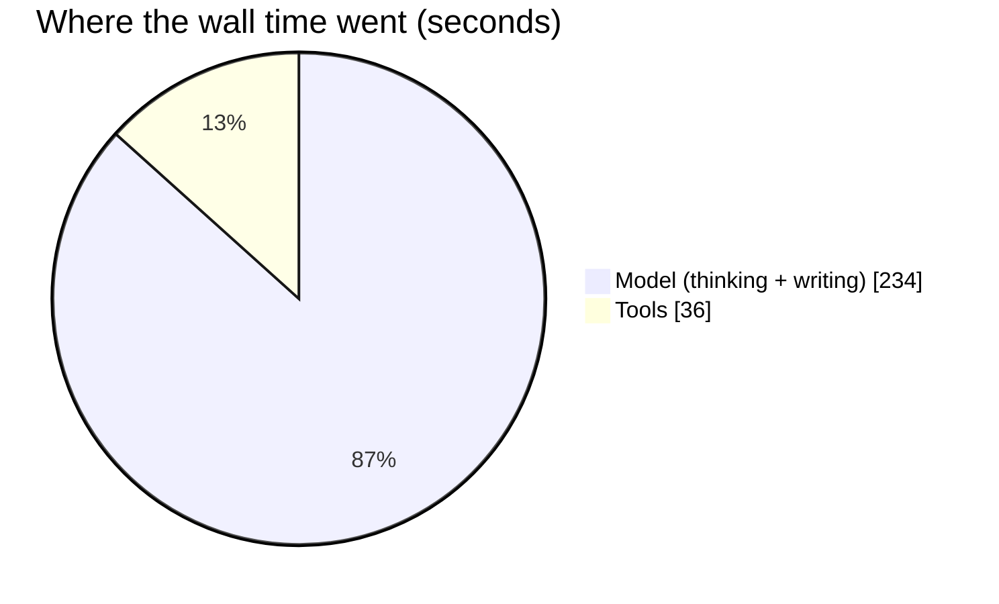

# corporate-ma/draft-markup-of-stock-purchase-agreement-provisions · run3 (`hv-mixed200-lunahigh-r3-20261116T093818Z`)

Result: **all-pass** 59/59 criteria · 4.5 min · 25 model calls · 39 tool calls (1 errors or timeouts) · ending `completed` · started 11-16 16:27:14 IST

## Overview

One box per stretch of steps that used the same kind of tool (blue: looking/searching/reading, purple: writing or editing files, yellow: a message with no tool call, red border: a tool error or timeout inside the box).

```mermaid
flowchart TD
    T(["Task prompt"])
    P0["<b>Step 1</b> · 0.0 min<br/>create_goal"]
    T --> P0
    class P0 look
    P1["<b>Step 2</b> · 0.0 min<br/>todo_write"]
    P0 --> P1
    class P1 look
    P2["<b>Step 3</b> · 0.1 min<br/>glob<br/><i>*</i>"]
    P1 --> P2
    class P2 look
    P3["<b>Step 4</b> · 0.2 min<br/>bash x4<br/><i>parse-doc docx documents/buyer-ma-pla…, parse-doc docx documents/sellers-draf…, parse-doc docx documents/environmenta… +1</i>"]
    P2 --> P3
    class P3 look
    P4["<b>Step 5</b> · 0.0 min<br/>read<br/><i>partner-markup-instructions.eml</i>"]
    P3 --> P4
    class P4 look
    P5["<b>Step 6</b> · 0.2 min<br/>bash x4<br/><i>parse-doc docx documents/sellers-draf…, parse-doc docx documents/buyer-ma-pla…, parse-doc docx documents/executed-ter… +1</i>"]
    P4 --> P5
    class P5 look
    P6["<b>Step 7</b> · 0.1 min<br/>grep x4<br/><i>spa.txt, playbook.txt, termsheet.txt +1</i>"]
    P5 --> P6
    class P6 look
    P7["<b>Steps 8-9</b> · 2.6 min<br/>read x4<br/>write<br/><i>spa.txt, spa-markup-memorandum.md</i>"]
    P6 --> P7
    class P7 write
    P8["<b>Step 10</b> · 0.1 min<br/>todo_write"]
    P7 --> P8
    class P8 look
    P9["<b>Steps 11-12</b> · 0.2 min<br/>bash x3<br/><i>mv output/spa-markup-memorandum.md sp…, parse-doc docx output/spa-markup-memo…, python - #lt;#lt;'PY' from zipfile import Z…</i>"]
    P8 --> P9
    class P9 look
    P10["<b>Step 13</b> · 0.1 min<br/>read<br/><i>final-memo.txt</i>"]
    P9 --> P10
    class P10 look
    P11["<b>Step 14</b> · 0.2 min<br/>bash<br/><i>pandoc spa-markup-memorandum.md --fro…</i>"]
    P10 --> P11
    class P11 look
    P12["<b>Step 15</b> · 0.0 min<br/>read<br/><i>final-memo.txt</i>"]
    P11 --> P12
    class P12 look
    P13["<b>Step 16</b> · 0.1 min<br/>grep x3<br/><i>final-memo.txt</i>"]
    P12 --> P13
    class P13 look
    P14["<b>Steps 17-19</b> · 0.2 min<br/>edit x2<br/>read<br/><i>spa-markup-memorandum.md</i>"]
    P13 --> P14
    class P14 err
    P15["<b>Step 20</b> · 0.1 min<br/>bash<br/><i>pandoc spa-markup-memorandum.md --fro…</i>"]
    P14 --> P15
    class P15 look
    P16["<b>Step 21</b> · 0.0 min<br/>glob<br/><i>output/*</i>"]
    P15 --> P16
    class P16 look
    P17["<b>Step 22</b> · 0.1 min<br/>todo_write"]
    P16 --> P17
    class P17 look
    P18["<b>Step 23</b> · 0.0 min<br/>get_goal"]
    P17 --> P18
    class P18 look
    P19["<b>Step 24</b> · 0.0 min<br/>update_goal"]
    P18 --> P19
    class P19 look
    P20["<b>Step 25</b> · 0.1 min<br/>final message"]
    P19 --> P20
    class P20 ans
    R(["ALL PASS: 59/59 criteria"])
    P20 --> R
    class R pass
    classDef look fill:#e8f0fe,stroke:#4a6fa5,color:#111
    classDef write fill:#f3e8fd,stroke:#7b1fa2,color:#111
    classDef ans fill:#fff8e1,stroke:#b58900,color:#111
    classDef err fill:#e8f0fe,stroke:#c62828,stroke-width:3px,color:#111
    classDef pass fill:#e6f4ea,stroke:#2e7d32,color:#111
    classDef fail fill:#fce8e6,stroke:#c62828,color:#111
```





One row per model call:

| Step | Started (IST) | Model s | Tools s | Tool calls | Tools | Output chars |
|---|---|---|---|---|---|---|
| 1 | 16:27:14 | 3 | 0 | 1 | create_goal | 389 |
| 2 | 16:27:17 | 2 | 0 | 1 | todo_write | 57 |
| 3 | 16:27:18 | 2 | 1 | 1 | glob | 179 |
| 4 | 16:27:22 | 3 | 10 | 4 | bash x4 | 197,113 |
| 5 | 16:27:35 | 3 | 0 | 1 | read | 18,599 |
| 6 | 16:27:38 | 3 | 8 | 4 | bash x4 | 1,496 |
| 7 | 16:27:49 | 4 | 3 | 4 | grep x4 | 108,961 |
| 8 | 16:27:56 | 2 | 0 | 4 | read x4 | 122,461 |
| 9 | 16:27:58 | 154 | 0 | 1 | write | 258 |
| 10 | 16:30:32 | 4 | 0 | 1 | todo_write | 57 |
| 11 | 16:30:36 | 6 | 1 | 1 | bash | 96 |
| 12 | 16:30:42 | 3 | 3 | 2 | bash x2 | 421 |
| 13 | 16:30:49 | 4 | 0 | 1 | read | 18,163 |
| 14 | 16:30:53 | 5 | 4 | 1 | bash | 470 |
| 15 | 16:31:03 | 2 | 0 | 1 | read | 3,858 |
| 16 | 16:31:05 | 4 | 2 | 3 | grep x3 | 22,127 |
| 17 | 16:31:11 | 7 | 0 | 1 | edit ⚠ | 261 |
| 18 | 16:31:18 | 2 | 0 | 1 | read | 7,330 |
| 19 | 16:31:21 | 5 | 0 | 1 | edit | 226 |
| 20 | 16:31:25 | 3 | 3 | 1 | bash | 418 |
| 21 | 16:31:31 | 2 | 1 | 1 | glob | 33 |
| 22 | 16:31:34 | 3 | 0 | 1 | todo_write | 57 |
| 23 | 16:31:37 | 2 | 0 | 1 | get_goal | 389 |
| 24 | 16:31:39 | 2 | 0 | 1 | update_goal | 394 |
| 25 | 16:31:41 | 4 | 0 | 0 | (message only) | 0 |

## Task prompt

```text
Review the seller's draft SPA against the buyer's playbook, executed term sheet, and diligence materials, and prepare a detailed markup memorandum with draft-ready redline language. Output: `spa-markup-memorandum.docx`.
```

## Rubric

| # | Criterion | Verdict |
|---|---|---|
| C-001 | ISSUE_001: Identifies overbroad MAE carve-outs for environmental industry/regulations | pass |
| C-002 | ISSUE_001: Proposes adding disproportionate impact qualifier to MAE carve-outs | pass |
| C-003 | ISSUE_001: Provides actual revised contract language for MAE definition | pass |
| C-004 | ISSUE_001: Explains rationale — environmental company needs MAE protection | pass |
| C-005 | ISSUE_002: Identifies missing interim covenant restricting affiliate transactions | pass |
| C-006 | ISSUE_002: Proposes covenant requiring Buyer consent for affiliate transactions | pass |
| C-007 | ISSUE_002: References the above-market rent to Seller affiliate as rationale | pass |
| C-008 | ISSUE_003: Identifies indemnification cap discrepancy (20% vs. 12.5%) | pass |
| C-009 | ISSUE_003: Proposes redline reducing cap to 12.5% / $26,875,000 | pass |
| C-010 | ISSUE_003: References the term sheet as basis for cap correction | pass |
| C-011 | ISSUE_004: Identifies that environmental reps survival period is too short | pass |
| C-012 | ISSUE_004: Proposes extending environmental reps survival to at least 36 months | pass |
| C-013 | ISSUE_004: References CERCLA/Dalton Creek exposure as rationale for longer survival | pass |
| C-014 | ISSUE_005: Identifies anti-sandbagging provision in Section 9.06 | pass |
| C-015 | ISSUE_005: Proposes replacing with pro-sandbagging language | pass |
| C-016 | ISSUE_005: Provides actual pro-sandbagging contract text | pass |
| C-017 | ISSUE_006: Identifies need for Special Indemnity for Dalton Creek CERCLA matter | pass |
| C-018 | ISSUE_006: Special Indemnity survival of 72 months | pass |
| C-019 | ISSUE_006: Special Indemnity not subject to basket or cap | pass |
| C-020 | ISSUE_006: References Dalton Creek liability range ($1.5M-$6M) | pass |
| C-021 | ISSUE_007: Identifies problematic earnout operational covenant | pass |
| C-022 | ISSUE_007: Proposes limiting earnout covenant to no-frustration standard | pass |
| C-023 | ISSUE_007: Explains rationale — Buyer integration/restructuring flexibility | pass |
| C-024 | ISSUE_008: Identifies missing payoff letter requirement | pass |
| C-025 | ISSUE_008: Proposes payoff letters at least 3 business days pre-closing | pass |
| C-026 | ISSUE_008: Proposes simultaneous repayment at closing through funds flow | pass |
| C-027 | ISSUE_008: Proposes payoff letter delivery as a condition to closing | pass |
| C-028 | ISSUE_009: Identifies missing government contract anti-assignment/novation requirement | pass |
| C-029 | ISSUE_009: References specific government contracts requiring novation | pass |
| C-030 | ISSUE_009: Proposes closing condition or covenant for government contract novation | pass |
| C-031 | ISSUE_009: References Anti-Assignment Act or FAR provisions | pass |
| C-032 | ISSUE_010: Identifies missing environmental permit transfer/notification covenant | pass |
| C-033 | ISSUE_010: Proposes cooperation covenant for environmental permit transfers | pass |
| C-034 | ISSUE_010: Notes that permits may require notification even in a stock deal | pass |
| C-035 | ISSUE_011: Identifies missing R&W Insurance subrogation waiver | pass |
| C-036 | ISSUE_011: Proposes subrogation waiver provision with fraud exception | pass |
| C-037 | ISSUE_011: References R&W Insurance policy / Granite Ridge Underwriters | pass |
| C-038 | ISSUE_012: Identifies non-compete scope exceeds term sheet (duration) | pass |
| C-039 | ISSUE_012: Identifies non-compete scope exceeds term sheet (geographic) | pass |
| C-040 | ISSUE_012: Identifies non-compete scope exceeds term sheet (activity) | pass |
| C-041 | ISSUE_012: Proposes narrowing non-compete duration to 3 years | pass |
| C-042 | ISSUE_012: Proposes narrowing non-compete geographic scope to OR, WA, CA, NV | pass |
| C-043 | ISSUE_012: Proposes narrowing non-compete activity scope to environmental remediation and hazardous waste management | pass |
| C-044 | ISSUE_012: Notes enforceability risk of overbroad non-compete | pass |
| C-045 | Indemnification cap issue rated as Critical or High priority | pass |
| C-046 | Anti-sandbagging issue rated as Critical or High priority | pass |
| C-047 | Memorandum identifies provisions acceptable as drafted | pass |
| C-048 | Memorandum flags items for partner/client discussion | pass |
| C-049 | Escrow amount correctly stated as $16,125,000 (7.5% of EV) | pass |
| C-050 | ISSUE_006: Proposes 36-month escrow holdback for Special Indemnity | pass |
| C-051 | Earnout maximum correctly referenced as $25,000,000 | pass |
| C-052 | Earnout Adjusted EBITDA threshold correctly referenced as $38,000,000 | pass |
| C-053 | Earnout floor correctly referenced as $32,000,000 | pass |
| C-054 | References playbook as authority for at least 3 markup positions | pass |
| C-055 | References term sheet as authority for at least 3 markup positions | pass |
| C-056 | References environmental DD memo for at least one markup position | pass |
| C-057 | Memorandum identifies specific SPA section numbers for issues | pass |
| C-058 | Proposed redline language is actual contract text for at least 8 issues | pass |
| C-059 | ISSUE_008: Identifies all three sources of Target indebtedness | pass |

Judge's reasoning:

**C-001 (pass):** ISSUE_001: Identifies overbroad MAE carve-outs for environmental industry/regulations

```text
The memorandum expressly identifies the environmental-services-industry and Environmental Laws MAE carve-outs as problematic because they lack disproportionate-impact qualifiers, and it proposes adding those qualifiers to both carve-outs.
```

**C-002 (pass):** ISSUE_001: Proposes adding disproportionate impact qualifier to MAE carve-outs

```text
The memorandum expressly proposes replacing both the environmental-services-industry carve-out and the Environmental Laws/regulatory carve-out with language excepting changes that disproportionately affect the Company relative to other industry participants.
```

**C-003 (pass):** ISSUE_001: Provides actual revised contract language for MAE definition

```text
The memorandum provides actual replacement contract language for clauses (ii) and (iii) of the MAE definition, expressly adding exceptions where industry or Environmental Law changes disproportionately affect the Company relative to other industry participants.
```

**C-004 (pass):** ISSUE_001: Explains rationale — environmental company needs MAE protection

```text
The memorandum specifically explains that Cascadia’s value is directly tied to environmental regulation and environmental-services demand, so absolute carve-outs for industry conditions and Environmental Law changes would remove the most relevant sector-specific risks from the MAE protection. This satisfies the required rationale.
```

**C-005 (pass):** ISSUE_002: Identifies missing interim covenant restricting affiliate transactions

```text
The memorandum expressly identifies that Section 6.01(b) lacks a specific interim restriction on affiliate transactions and proposes a new covenant prohibiting the Company from entering into, amending, renewing, or terminating transactions with Seller or Seller affiliates without Buyer consent, subject to specified exceptions.
```

**C-006 (pass):** ISSUE_002: Proposes covenant requiring Buyer consent for affiliate transactions

```text
Section 6.1 proposes new Section 6.01(b)(xiv), which prohibits the Company from entering into, amending, modifying, extending, renewing, or terminating transactions or agreements with Seller or its affiliates unless approved in advance in writing by Buyer, subject to specified exceptions.
```

**C-007 (pass):** ISSUE_002: References the above-market rent to Seller affiliate as rationale

```text
In Section 6.1, the memorandum supports the interim affiliate-transaction restriction by stating that the Affiliate Lease costs $1,600,000 annually and noting its treatment as a related-party Adjusted EBITDA item. This connects the affiliate lease/rent arrangement directly to the covenant rationale.
```

**C-008 (pass):** ISSUE_003: Identifies indemnification cap discrepancy (20% vs. 12.5%)

```text
The memorandum expressly identifies that the Seller's draft uses a 20% cap of $43,000,000, while the binding term sheet requires a 12.5% cap of $26,875,000, and proposes conforming revisions.
```

**C-009 (pass):** ISSUE_003: Proposes redline reducing cap to 12.5% / $26,875,000

```text
The memorandum expressly proposes replacing the $43,000,000 / 20% indemnification cap with $26,875,000, equal to 12.5% of the $215,000,000 Base Enterprise Value, in both the definition and operative indemnification provision.
```

**C-010 (pass):** ISSUE_003: References the term sheet as basis for cap correction

```text
The memorandum expressly cites the executed September 10, 2025 Term Sheet § 8 as the source fixing the general indemnification cap at 12.5% of the $215 million Base Enterprise Value ($26.875 million), both in the cap definition markup and the operative indemnification provision.
```

**C-011 (pass):** ISSUE_004: Identifies that environmental reps survival period is too short

```text
The memorandum expressly identifies that Seller’s Section 9.01(b) applies a 12-month survival period to environmental representations, calls that period inadequate, and proposes extending Environmental Representations, including Section 4.15 Environmental Matters, to 36 months.
```

**C-012 (pass):** ISSUE_004: Proposes extending environmental reps survival to at least 36 months

```text
The memorandum expressly proposes that the Environmental Representations survive for 36 months after closing and also reserves the option to seek survival for the full applicable statute-of-limitations period.
```

**C-013 (pass):** ISSUE_004: References CERCLA/Dalton Creek exposure as rationale for longer survival

```text
The memorandum expressly connects the longer environmental-representation survival period to Dalton Creek CERCLA and active remediation risks. In Section 8.1, it recommends 36-month survival and explains that the DD memo shows “CERCLA and active remediation risks can mature years after Closing.” It also identifies Dalton Creek as a known CERCLA exposure with a 72-month special indemnity and discusses the ongoing Hargrove remediation.
```

**C-014 (pass):** ISSUE_005: Identifies anti-sandbagging provision in Section 9.06

```text
The memorandum expressly identifies Section 9.06 as an anti-sandbagging provision and quotes its language barring Buyer from indemnification for breaches or inaccuracies of which Buyer or its representatives had Knowledge as of the Closing Date.
```

**C-015 (pass):** ISSUE_005: Proposes replacing with pro-sandbagging language

```text
Section 8.6 expressly deletes the anti-sandbagging provision and replaces it with a pro-sandbagging clause stating that Buyer's indemnification and other remedies are not affected, limited, diminished, or impaired by any investigation or knowledge acquired before or after execution or Closing.
```

**C-016 (pass):** ISSUE_005: Provides actual pro-sandbagging contract text

```text
The memorandum provides actual proposed pro-sandbagging contract language in Section 8.6, titled “Effect of Investigation and Knowledge,” stating that Buyer’s indemnification and other remedies are not affected by investigation, knowledge, notice, or other information.
```

**C-017 (pass):** ISSUE_006: Identifies need for Special Indemnity for Dalton Creek CERCLA matter

```text
The memorandum expressly proposes a separate Dalton Creek CERCLA Special Indemnity in new Section 9.09, outside the general indemnification framework, with separate survival, basket, cap, escrow, and recovery terms.
```

**C-018 (pass):** ISSUE_006: Special Indemnity survival of 72 months

```text
The memorandum expressly provides in proposed Section 9.09(b) that the Dalton Creek Special Indemnity survives until 72 months after the Closing Date, with timely asserted claims surviving until final resolution.
```

**C-019 (pass):** ISSUE_006: Special Indemnity not subject to basket or cap

```text
The memorandum expressly states in proposed Section 9.09(c) that the Dalton Creek Special Indemnity is not subject to the Deductible, Basket Amount, Indemnification Cap, or other limitations applicable to general representation claims, and provides for first-dollar recovery outside the general cap.
```

**C-020 (pass):** ISSUE_006: References Dalton Creek liability range ($1.5M-$6M)

```text
The memorandum expressly states that the Dalton Creek matter has estimated exposure of $1,500,000–$6,000,000, including in the deal facts and proposed Schedule 9.09 supporting the Special Indemnity.
```

**C-021 (pass):** ISSUE_007: Identifies problematic earnout operational covenant

```text
The memorandum expressly identifies Section 2.05(d) as overly restrictive, quotes the requirement to operate consistently with past practice and in good faith to maximize the Earnout Payment, and recommends replacing it with a narrower primary-purpose covenant preserving Buyer's operational flexibility.
```

**C-022 (pass):** ISSUE_007: Proposes limiting earnout covenant to no-frustration standard

```text
The memorandum expressly deletes the affirmative past-practice and earnout-maximization obligations and replaces them with a covenant prohibiting actions taken with the primary purpose of reducing or avoiding the earnout payment, while preserving Buyer's operational discretion.
```

**C-023 (pass):** ISSUE_007: Explains rationale — Buyer integration/restructuring flexibility

```text
The memorandum expressly explains that the Seller’s broad earnout covenant would restrict Buyer’s post-closing integration, restructuring, personnel, capital allocation, pricing, and strategic decisions, creating litigation risk over ordinary business judgment. It also proposes language preserving Buyer’s discretion to integrate, restructure, and otherwise manage the Company.
```

**C-024 (pass):** ISSUE_008: Identifies missing payoff letter requirement

```text
The memorandum expressly identifies that Section 2.03(d) permits repayment “at or promptly following the Closing” and notes that the draft does not require payoff letters before Closing. It also proposes delivery of executed payoff letters at least three Business Days prior to Closing.
```

**C-025 (pass):** ISSUE_008: Proposes payoff letters at least 3 business days pre-closing

```text
Section 4.3 requires executed payoff letters no later than three Business Days before Closing, including wire instructions and commitments to provide lien-release documentation such as UCC-3 termination statements and other release instruments.
```

**C-026 (pass):** ISSUE_008: Proposes simultaneous repayment at closing through funds flow

```text
The memorandum expressly replaces the 'at or promptly following Closing' language with a requirement that all Closing Indebtedness be repaid, discharged, and satisfied in full simultaneously through the closing funds flow at Closing. It also adds a corresponding closing condition.
```

**C-027 (pass):** ISSUE_008: Proposes payoff letter delivery as a condition to closing

```text
The memorandum expressly proposes adding Section 7.02(h) as a condition to Buyer's obligations, requiring Buyer to receive the payoff letters at least three Business Days before closing and requiring the closing funds flow to provide for simultaneous repayment and discharge of all closing indebtedness.
```

**C-028 (pass):** ISSUE_009: Identifies missing government contract anti-assignment/novation requirement

```text
The memorandum expressly identifies that the Seller's draft lacks specific government-contract anti-assignment, novation, and recognition provisions. It discusses FAR Part 42.12 and the Anti-Assignment Act, names the U.S. Army Corps of Engineers and Bureau of Land Management contracts, and proposes targeted representations, covenants, closing conditions, and post-closing cooperation.
```

**C-029 (pass):** ISSUE_009: References specific government contracts requiring novation

```text
The memorandum specifically identifies two active federal government contracts requiring novation or recognition under FAR 42.12: U.S. Army Corps of Engineers Contract No. W912DR-21-D-0045 and Bureau of Land Management Contract No. L23PX-00412.
```

**C-030 (pass):** ISSUE_009: Proposes closing condition or covenant for government contract novation

```text
The memorandum expressly proposes new Section 6.12 requiring Seller and the Company to prepare and submit federal novation or recognition requests under FAR Part 42.12 and to seek required government approvals. It also adds a Section 7.02 closing condition requiring all pre-closing novation, recognition, and change-of-control submissions to have been made, with no denial or threatened termination.
```

**C-031 (pass):** ISSUE_009: References Anti-Assignment Act or FAR provisions

```text
The memorandum expressly cites both FAR Part 42, Subpart 42.12 and the Anti-Assignment Act as the legal basis for government-contract novation/recognition requirements, including in Sections 5.1 and 6.2.
```

**C-032 (pass):** ISSUE_010: Identifies missing environmental permit transfer/notification covenant

```text
The memorandum expressly identifies that the Seller draft lacks a covenant addressing environmental-permit change-of-control notifications, approvals, transfers, or post-closing cooperation. It also proposes a new Section 6.13 requiring a permit matrix, pre-closing notifications and applications, efforts to obtain approvals, and post-closing cooperation for transfers, re-issuances, amendments, and related actions.
```

**C-033 (pass):** ISSUE_010: Proposes cooperation covenant for environmental permit transfers

```text
The memorandum proposes new Section 6.13 requiring Seller to assist before closing with environmental permit notifications, applications, transfers, reissuances, amendments, and approvals, and to provide post-closing cooperation for at least 12 months or as reasonably necessary to complete those processes.
```

**C-034 (pass):** ISSUE_010: Notes that permits may require notification even in a stock deal

```text
The memorandum expressly states that “A stock purchase does not eliminate change-of-control requirements” and explains that environmental permits across Oregon, Washington, California, and Nevada may require notice, consent, approval, transfer, reissuance, or amendment upon the ownership change.
```

**C-035 (pass):** ISSUE_011: Identifies missing R&W Insurance subrogation waiver

```text
The memorandum expressly states in Section 8.7 that the Seller draft contains no R&W insurance subrogation waiver and does not address any R&W policy, then proposes a waiver of insurer subrogation rights against Seller except for actual fraud.
```

**C-036 (pass):** ISSUE_011: Proposes subrogation waiver provision with fraud exception

```text
The memorandum proposes new Section 9.10 requiring the R&W insurer to waive subrogation, contribution, recourse, and other claims against Seller and related parties, expressly excepting actual fraud by Seller. It also identifies Granite Ridge Underwriters as the carrier in the accompanying commentary.
```

**C-037 (pass):** ISSUE_011: References R&W Insurance policy / Granite Ridge Underwriters

```text
The memorandum expressly references Buyer obtaining an R&W insurance policy, identifies Granite Ridge Underwriters as the carrier, and connects the policy to a required insurer subrogation waiver against Seller except for actual fraud.
```

**C-038 (pass):** ISSUE_012: Identifies non-compete scope exceeds term sheet (duration)

```text
The memorandum expressly identifies that the Seller draft imposes a five-year non-compete while the binding term sheet provides for three years, and it proposes replacing the duration with a three-year period.
```

**C-039 (pass):** ISSUE_012: Identifies non-compete scope exceeds term sheet (geographic)

```text
The memorandum expressly identifies the geographic discrepancy in Section 9.1, noting that the Seller draft applies “anywhere in the United States” while the binding term sheet limits the covenant to four states, and the replacement language specifies Oregon, Washington, California, and Nevada.
```

**C-040 (pass):** ISSUE_012: Identifies non-compete scope exceeds term sheet (activity)

```text
The memorandum expressly identifies that the Seller draft applies to “all U.S. businesses,” while the binding term sheet limits the restricted activity to environmental remediation and hazardous waste management services. It also provides replacement language conforming the covenant to that narrower scope.
```

**C-041 (pass):** ISSUE_012: Proposes narrowing non-compete duration to 3 years

```text
The memorandum expressly replaces the seller draft's five-year non-compete with a three-year period in proposed Section 6.09(a), matching the term sheet.
```

**C-042 (pass):** ISSUE_012: Proposes narrowing non-compete geographic scope to OR, WA, CA, NV

```text
The proposed replacement for Section 6.09(a) expressly limits the non-compete geographic scope to Oregon, Washington, California, and Nevada, matching the term sheet.
```

**C-043 (pass):** ISSUE_012: Proposes narrowing non-compete activity scope to environmental remediation and hazardous waste management

```text
The proposed replacement for Section 6.09(a) expressly narrows the restricted activity to businesses engaged in “environmental remediation services or hazardous waste management services,” matching the term sheet’s specified scope.
```

**C-044 (pass):** ISSUE_012: Notes enforceability risk of overbroad non-compete

```text
The memorandum expressly notes that the nationwide, all-business non-compete is materially overbroad, includes carve-outs to avoid restricting Seller's legitimate construction and timber operations, and states that the covenant should be reviewed for enforceability under applicable state law.
```

**C-045 (pass):** Indemnification cap issue rated as Critical or High priority

```text
The output expressly assigns the indemnification cap discrepancy (20%/$43 million versus 12.5%/$26.875 million) a Critical priority in Sections 3.2 and 8.2 and in the consolidated priority list.
```

**C-046 (pass):** Anti-sandbagging issue rated as Critical or High priority

```text
Section 9.06 is expressly labeled “Priority: Critical,” and the consolidated priority list also categorizes deletion of the anti-sandbagging provision and addition of pro-sandbagging language as Critical.
```

**C-047 (pass):** Memorandum identifies provisions acceptable as drafted

```text
The memorandum includes a dedicated Section 11, “Items not to mark up,” identifying multiple provisions acceptable as drafted and briefly explaining why, including the basket, knowledge qualifier, good-standing certificates, Delaware governing law, escrow amount, and Fundamental Representation survival.
```

**C-048 (pass):** Memorandum flags items for partner/client discussion

```text
The memorandum expressly flags issues for further partner/client discussion, including whether to require completed government-contract novation as a closing condition (to be escalated to Elena and Marcus) and whether to seek full statute-of-limitations survival for environmental representations after client discussion.
```

**C-049 (pass):** Escrow amount correctly stated as $16,125,000 (7.5% of EV)

```text
The memorandum repeatedly and correctly states the escrow amount as $16,125,000, equal to 7.5% of the $215,000,000 Base Enterprise Value, including in the deal facts, escrow release discussion, and items not to mark up.
```

**C-050 (pass):** ISSUE_006: Proposes 36-month escrow holdback for Special Indemnity

```text
The memorandum expressly proposes a 36-month escrow holdback for Dalton Creek Special Indemnity claims, distinct from the 18-month general escrow release, including in Sections 8.4 and 8.5 and the closing recommendation.
```

**C-051 (pass):** Earnout maximum correctly referenced as $25,000,000

```text
The memorandum expressly states in Section 4.2 that the earnout's maximum is $25,000,000 and identifies that amount as correct.
```

**C-052 (pass):** Earnout Adjusted EBITDA threshold correctly referenced as $38,000,000

```text
The memorandum expressly states in Section 4.2 that the earnout's full-payment Adjusted EBITDA threshold is $38,000,000 and identifies it as correct.
```

**C-053 (pass):** Earnout floor correctly referenced as $32,000,000

```text
The memorandum expressly states that the earnout has a $32,000,000 floor and uses linear interpolation between that floor and the $38,000,000 full-payment threshold, satisfying the pro-rata requirement.
```

**C-054 (pass):** References playbook as authority for at least 3 markup positions

```text
The memorandum cites the Buyer M&A Playbook as authority for well over three distinct markup positions, including the MAE disproportionate-impact qualifier (Playbook § 2.1), indemnification cap ( §§ 5.1 and 14), earnout covenant ( § 7.2), payoff mechanics ( § 13.1(f)), government-contract provisions ( § 12.2), environmental survival ( §§ 4.1–4.2), pro-sandbagging ( § 5.3), and other provisions.
```

**C-055 (pass):** References term sheet as authority for at least 3 markup positions

```text
The memorandum cites the executed term sheet as authority for numerous distinct markup positions, including the indemnification cap, earnout covenant and mechanics, debt payoff procedures, survival periods, Dalton Creek Special Indemnity, escrow treatment, R&W insurance subrogation waiver, and non-compete restrictions. This exceeds the required three issues.
```

**C-056 (pass):** References environmental DD memo for at least one markup position

```text
The memorandum repeatedly cites the Environmental DD Memo as support for markup positions, including the Dalton Creek special indemnity, government-contract novation provisions, permit-transfer covenants, and environmental representation survival.
```

**C-057 (pass):** Memorandum identifies specific SPA section numbers for issues

```text
The memorandum ties well over 8 planted issues to specific SPA sections, including Sections 1.01 (MAE and cap), 2.05 (earnout), 2.03 and 2.08 (payoff mechanics), 4.15 and 4.16 (environmental and government-contract representations), 6.01 (affiliate transactions), 6.05/6.12 (government-contract covenants), 6.09 (non-compete), and 9.01, 9.04, 9.06, 9.08, and 9.09 (survival, cap, sandbagging, escrow, and special indemnity).
```

**C-058 (pass):** Proposed redline language is actual contract text for at least 8 issues

```text
The memorandum provides insertion-ready proposed contract text for well over 8 issues, including MAE qualifiers, the indemnification cap, earnout covenants and mechanics, debt payoff mechanics, government-contract representations and covenants, permit provisions, survival periods, the Dalton Creek special indemnity, pro-sandbagging, the R&W insurance waiver, and non-compete provisions.
```

**C-059 (pass):** ISSUE_008: Identifies all three sources of Target indebtedness

```text
The payoff-letter provision expressly identifies all three sources of Target indebtedness: Cascade Mutual Bank's senior term loan, Pacific Lease Corp.'s equipment financing, and Evergreen Holdings Group, Inc.'s subordinated seller note. It also lists their respective principal balances of $28.0 million, $9.8 million, and $4.5 million.
```

## Delivered files (output/)

- `spa-markup-memorandum.docx` (36,316 bytes)

## Trajectory

### Step 1: 1 tool call

_Started 11-16 16:27:14 IST · model 3 s · tools 0 s_

**Call `create_goal`** (0.0 s)

```json
{
 "objective": "Review the seller’s draft SPA against the buyer’s playbook, executed term sheet, and diligence materials, then prepare and save a detailed markup memorandum with draft-ready redline language as output/spa-markup-memorandum.docx.",
 "max_goal_rounds": 3
}
```

Output (389 chars):

```text
{"goal":{"id":"goal-220ec459-a972-44e5-ae9a-d5aabe79c098","revision":1,"objective":"Review the seller’s draft SPA against the buyer’s playbook, executed term sheet, and diligence materials, then prepare and save a detailed markup memorandum with draft-ready redline language as output/spa-markup-memorandum.docx.","phase":"active","roundsStarted":0,"maxGoalRounds":3},"activation":"armed"}
```

### Step 2: 1 tool call

_Started 11-16 16:27:17 IST · model 2 s · tools 0 s_

**Call `todo_write`** (0.0 s)

```json
{
 "todos": [
  {
   "content": "Inventory the deal documents and source materials",
   "status": "in_progress"
  },
  {
   "content": "Extract the SPA, playbook, term sheet, and diligence facts",
   "status": "pending"
  },
  {
   "content": "Draft the issue-by-issue markup memorandum and redline language",
   "status": "pending"
  },
  {
   "content": "Generate and validate the final DOCX deliverable",
   "status": "pending"
  }
 ]
}
```

Output (57 chars):

```text
Updated todo list: 3 pending, 1 in progress, 0 completed.
```

**Todo list now:**

- [~] Inventory the deal documents and source materials
- [ ] Extract the SPA, playbook, term sheet, and diligence facts
- [ ] Draft the issue-by-issue markup memorandum and redline language
- [ ] Generate and validate the final DOCX deliverable

### Step 3: 1 tool call

_Started 11-16 16:27:18 IST · model 2 s · tools 1 s_

**Reasoning summary:**

```text
**Identifying file listing methods**

I'm considering how to list files. It seems like using glob patterns could be a good choice for this task. They allow for flexible matching, which might let me include all files in a specific pattern. I wonder what will be the best way to implement this and whether any specific considerations will come up while using glob patterns. It might just be a straightforward process to get the list I need!
```

**Call `glob`** (1.0 s)

```json
{
 "pattern": "*"
}
```

Output (179 chars):

```text
documents/buyer-ma-playbook.docx
documents/sellers-draft-spa.docx
documents/environmental-dd-memo.docx
documents/executed-term-sheet.docx
documents/partner-markup-instructions.eml
```

### Step 4: 4 tool calls

_Started 11-16 16:27:22 IST · model 3 s · tools 10 s_

**Reasoning summary:**

```text
**Exploring file conversions**

I need to check if I have the right skills for the task. It seems like I might not have a catalog available, so I'll consider using bash commands to convert docx files to text in parallel, outputting to standard output. Since I can't use shell cat, I can work with parse-doc instead. I'll save temporary outputs to a workspace or /tmp. I can also read eML files using read, and I might leverage bash for parallel processing as well.
```

**Call `bash`** (3.1 s)

```json
{
 "command": "parse-doc docx documents/buyer-ma-playbook.docx",
 "description": "Extract buyer playbook text"
}
```

Output (49,999 chars):

```text
tner. This is a **Critical** priority item.

For example, if the term sheet specifies a general indemnification cap of 12.5% of enterprise value for a transaction with a \$200 million enterprise value, the SPA\'s general indemnification cap should be \$25,000,000. If the seller\'s draft sets the cap at \$20,000,000 (10% of enterprise value), the associate must flag this as a deviation from the term sheet and mark up the draft to reflect the agreed \$25,000,000 cap.

**R&W Insurance Considerations.** In transactions where the buyer is obtaining representations and warranties insurance (see Section 8), the indemnification cap may be subject to additional negotiation dynamics. The R&W insurer may require a certain retention level (the amount of loss the buyer must bear before the policy responds), which interacts with the SPA\'s basket/deductible and cap structure. However, the SPA cap itself must conform to the term sheet regardless of the R&W Insurance structure. The R&W Insurance policy supplements the seller\'s indemnification obligations --- it does not replace them, and the availability of insurance does not justify a reduction in the SPA cap below the term sheet level.

**Market Data.** In recent environmental services transactions handled by the firm, general indemnification caps have ranged from 10% to 15% of enterprise value. The 12.5% figure is squarely within the market range and represents the firm\'s standard recommendation for PE buyers in this sector. Caps below 
… [48,499 more chars]
```

**Call `bash`** (2.4 s)

```json
{
 "command": "parse-doc docx documents/sellers-draft-spa.docx",
 "description": "Extract seller SPA text"
}
```

Output (49,998 chars):

```text
and Seller;

**(b)** by either Buyer or Seller, by written notice to the other Party, if the Closing shall not have occurred on or before the Outside Date (February 28, 2026); *provided* that the right to terminate this Agreement under this Section 8.01(b) shall not be available to any Party whose breach of any representation, warranty, covenant, or agreement set forth in this Agreement has been the primary cause of, or has primarily resulted in, the failure of the Closing to occur on or before the Outside Date;

**(c)** by either Buyer or Seller, by written notice to the other Party, if any Governmental Authority shall have enacted, issued, promulgated, enforced, or entered any final and non-appealable Law, order, injunction, judgment, decree, ruling, or other legally binding action that permanently restrains, enjoins, or otherwise prohibits the consummation of the transactions contemplated by this Agreement;

**(d)** by Buyer, by written notice to Seller, if there shall have been a breach by Seller of any representation, warranty, covenant, or agreement contained in this Agreement that would cause the conditions set forth in Section 7.02(a) or Section 7.02(b) not to be satisfied, and such breach shall not have been cured by Seller within thirty (30) days after receipt of written notice of such breach from Buyer (or, if earlier, by the Outside Date); *provided* that Buyer shall not have the right to terminate this Agreement under this Section 8.01(d) if Buyer is then in mate
… [48,498 more chars]
```

**Call `bash`** (1.9 s)

```json
{
 "command": "parse-doc docx documents/environmental-dd-memo.docx",
 "description": "Extract diligence memo text"
}
```

Output (47,133 chars):

```text
**ASHFORD, PENNINGTON & YATES LLP** *Attorneys at Law* 71 South Wacker Drive, Suite 4500 Chicago, Illinois 60606

**PRIVILEGED AND CONFIDENTIAL --- ATTORNEY WORK PRODUCT** This memorandum is protected by the attorney-client privilege and the work product doctrine. It is intended solely for use by the attorneys and professionals of Ashford, Pennington & Yates LLP and the client to whom it is addressed. Any unauthorized disclosure, reproduction, or distribution is strictly prohibited.

**MEMORANDUM**

**TO:** Elena Vasquez-Moreno, Partner, M&A Group Jonathan Kreider, Senior Associate, M&A Group

**FROM:** Environmental Practice Group, Ashford, Pennington & Yates LLP

**DATE:** October 18, 2025

**RE:** Environmental Due Diligence Summary --- Acquisition of Cascadia Environmental Solutions, Inc. by Whitmore Capital Partners LLC

**PROJECT:** Project Cascade --- Whitmore Capital Partners LLC Fund III Platform Acquisition

This memorandum summarizes the findings and recommendations of the Environmental Practice Group arising from our environmental due diligence review of Cascadia Environmental Solutions, Inc. in connection with the proposed acquisition by Whitmore Capital Partners LLC. This memo is intended to inform the deal team\'s review of the Seller\'s Stock Purchase Agreement draft, which we understand will be circulated on or about October 22, 2025. All findings and recommendations set forth herein should be incorporated into the firm\'s SPA markup and negotiation strategy.
… [45,632 more chars]
```

**Call `bash`** (2.2 s)

```json
{
 "command": "parse-doc docx documents/executed-term-sheet.docx",
 "description": "Extract executed term sheet text"
}
```

Output (49,983 chars):

```text
**BINDING TERM SHEET**

**Acquisition of 100% of the Outstanding Equity Interests of** **Cascadia Environmental Solutions, Inc.**

Dated as of September 10, 2025

This Binding Term Sheet (this \"Term Sheet\") sets forth the principal terms and conditions agreed upon by the parties identified below with respect to the proposed acquisition described herein. Except as set forth in Section 18 (Binding Provisions) below, this Term Sheet is intended to be binding on the parties and shall govern the preparation of the Definitive Agreement (as defined below). This Term Sheet supersedes and replaces in its entirety the non-binding Letter of Intent dated August 15, 2025 (the \"LOI\"), previously entered into between Whitmore Capital Partners LLC and Evergreen Holdings Group, Inc. with respect to the proposed acquisition of Cascadia Environmental Solutions, Inc. Capitalized terms used but not otherwise defined herein shall have the meanings ascribed to them in the context in which they appear.

**[Section 1: Parties]{.underline}**

**Buyer:** Whitmore Capital Partners LLC, a Delaware limited liability company, with its principal offices at 200 South Wacker Drive, Suite 3100, Chicago, Illinois 60606 (referred to herein as \"Buyer\" or \"Whitmore\").

**Seller:** Evergreen Holdings Group, Inc., a Delaware corporation, with its principal offices at 1550 NW Everett Street, Suite 800, Portland, Oregon 97209 (referred to herein as \"Seller\" or \"Evergreen\").

**Target / the Company:** Casca
… [48,483 more chars]
```

### Step 5: 1 tool call

_Started 11-16 16:27:35 IST · model 3 s · tools 0 s_

**Call `read`** (0.0 s)

```json
{
 "file_path": "documents/partner-markup-instructions.eml"
}
```

Output (18,599 chars):

```text
<path>/home/agarwaldi/dsh-bench-harness/runs/hv-mixed200-lunahigh-r3-20261116T093818Z/tasks/corporate-ma__draft-markup-of-stock-purchase-agreement-provisions/workspace/documents/partner-markup-instructions.eml</path>
<type>file</type>
<content>
1: From: Elena Vasquez-Moreno <evasquez-moreno@apylaw.com>
2: To: Jonathan Kreider <jkreider@apylaw.com>
3: Date: Thu, 23 Oct 2025 08:47:00 -0000
4: Subject: Re: Cascadia SPA Markup — Instructions and Priority Issues
5: Content-Type: text/plain; charset="utf-8"
6: Content-Transfer-Encoding: quoted-printable
7: MIME-Version: 1.0
8: 
9: Jonathan,
10: 
11: I reviewed the initial draft SPA that Douglas Renwick at Fortuna & Blake circ=
12: ulated yesterday. My overall impression: this is a heavily seller-favorable d=
13: raft in several material respects, and some of the positions directly contrad=
14: ict the September 10 term sheet =E2=80=94 which tells me either Doug is testi=
15: ng our resolve or his client gave him different instructions than what was ag=
16: reed at the principal level. Either way, we need a sharp, comprehensive marku=
17: p.
18: 
19: Marcus Devereaux at Whitmore Capital wants to see our redline by end of next =
20: week. Given the November 14 target signing date, that gives the parties rough=
21: ly two weeks of negotiation runway after we send our markup, which is tight. =
22: I need your comprehensive markup memorandum with redlined provisions and full=
23:  track-changes commentary.
24: 
25: **General Instruction
… [17,099 more chars]
```

### Step 6: 4 tool calls

_Started 11-16 16:27:38 IST · model 3 s · tools 8 s_

**Reasoning summary:**

```text
**Organizing memorandum needs**

I’m focusing on creating a detailed memorandum that will likely include 12 priority issues, along with some other deviations. I definitely need to gather the exact seller language and revise it appropriately. Plus, I should inspect the Sale and Purchase Agreement (SPA) thoroughly. I think I’ll also need to parse this information into scratch files for better organization. This is going to help keep everything clear as I work through the details!
```

**Call `bash`** (2.3 s)

```json
{
 "command": "parse-doc docx documents/sellers-draft-spa.docx > spa.txt",
 "description": "Save SPA text for review"
}
```

Output (374 chars):

```text
[stderr]
2026-11-16 10:57:42.443890320 [W:onnxruntime:Default, device_discovery.cc:95 GetPciBusId] Skipping pci_bus_id for PCI path at "/sys/devices/LNXSYSTM:00/LNXSYBUS:00/ACPI0004:00/VMBUS:00/5620e0c7-8062-4dce-aeb7-520c7ef76171" because filename "5620e0c7-8062-4dce-aeb7-520c7ef76171" did not match expected pattern of [0-9a-f]+:[0-9a-f]+:[0-9a-f]+[.][0-9a-f]+
```

**Call `bash`** (2.1 s)

```json
{
 "command": "parse-doc docx documents/buyer-ma-playbook.docx > playbook.txt",
 "description": "Save playbook text for review"
}
```

Output (374 chars):

```text
[stderr]
2026-11-16 10:57:44.728922483 [W:onnxruntime:Default, device_discovery.cc:95 GetPciBusId] Skipping pci_bus_id for PCI path at "/sys/devices/LNXSYSTM:00/LNXSYBUS:00/ACPI0004:00/VMBUS:00/5620e0c7-8062-4dce-aeb7-520c7ef76171" because filename "5620e0c7-8062-4dce-aeb7-520c7ef76171" did not match expected pattern of [0-9a-f]+:[0-9a-f]+:[0-9a-f]+[.][0-9a-f]+
```

**Call `bash`** (2.0 s)

```json
{
 "command": "parse-doc docx documents/executed-term-sheet.docx > termsheet.txt",
 "description": "Save term sheet text for review"
}
```

Output (374 chars):

```text
[stderr]
2026-11-16 10:57:46.862475452 [W:onnxruntime:Default, device_discovery.cc:95 GetPciBusId] Skipping pci_bus_id for PCI path at "/sys/devices/LNXSYSTM:00/LNXSYBUS:00/ACPI0004:00/VMBUS:00/5620e0c7-8062-4dce-aeb7-520c7ef76171" because filename "5620e0c7-8062-4dce-aeb7-520c7ef76171" did not match expected pattern of [0-9a-f]+:[0-9a-f]+:[0-9a-f]+[.][0-9a-f]+
```

**Call `bash`** (1.9 s)

```json
{
 "command": "parse-doc docx documents/environmental-dd-memo.docx > ddmemo.txt",
 "description": "Save diligence memo text for review"
}
```

Output (374 chars):

```text
[stderr]
2026-11-16 10:57:48.874633336 [W:onnxruntime:Default, device_discovery.cc:95 GetPciBusId] Skipping pci_bus_id for PCI path at "/sys/devices/LNXSYSTM:00/LNXSYBUS:00/ACPI0004:00/VMBUS:00/5620e0c7-8062-4dce-aeb7-520c7ef76171" because filename "5620e0c7-8062-4dce-aeb7-520c7ef76171" did not match expected pattern of [0-9a-f]+:[0-9a-f]+:[0-9a-f]+[.][0-9a-f]+
```

### Step 7: 4 tool calls

_Started 11-16 16:27:49 IST · model 4 s · tools 3 s_

**Reasoning summary:**

```text
**Using grep for headings**

I need to use grep to get specific headings from the content. It looks like I need to focus on relevant ones, such as “Section 2.05,” “MAE,” “Affiliate,” “Section 9,” “Non-Compete,” “Government,” “Environmental,” “R&W,” “Payoff,” “Condition,” “Indemnification Cap,” and “Earnout.” I’ll explore how to implement multiple patterns with grep for this task to ensure I'm capturing all the essential information I need.
```

**Call `grep`** (0.7 s)

```json
{
 "pattern": "Section 2\\.05|Earnout|MAE|Material Adverse|affiliate|Affiliate|Government Contract|Governmental Contract|Payoff|Environmental|Permit|novation|R&W|subrogation|Non-Compete|Non-Competition|9\\.04|9\\.06|9\\.08|Indemnification Cap|Cap|Escrow|Survival|Closing Conditions",
 "path": "spa.txt"
}
```

Output (49,993 chars):

```text
Found 167 matches

spa.txt
Line 19: This **STOCK PURCHASE AGREEMENT** (this \"Agreement\") is made and entered into as of \[●\], 2025, by and among **Evergreen Holdings Group, Inc.**, a Delaware corporation (\"Seller\"), **Whitmore Capital Partners LLC**, a Delaware limited liability company (\"Buyer\"), and, solely for the purposes of Sections 4.01 through 4.21, Section 6.01, Section 6.02, and Section 6.03, **Cascadia Environmental Solutions, Inc.**, an Oregon corporation (the \"Company\"). Seller, Buyer, and the Company are each referred to herein individually as a \"Party\" and collectively as the \"Parties.\"
Line 29: **D.** Concurrently with the execution and delivery of this Agreement, the Parties are entering into, or will enter into, certain ancillary agreements as further described herein, including the Escrow Agreement and the other Transaction Documents.
Line 45: \"**Adjusted EBITDA**\" means, with respect to any period, the net income of the Company for such period, determined in accordance with GAAP applied consistently with the Company\'s past practice, plus (a) interest expense, (b) income tax expense, and (c) depreciation and amortization expense, in each case to the extent deducted in computing net income, and further adjusted to exclude (i) non-recurring transaction costs incurred in connection with the transactions contemplated by this Agreement, (ii) any purchase-price accounting adjustments arising from the consummation of the transactions contemplated he
… [48,493 more chars]
```

**Call `grep`** (0.5 s)

```json
{
 "pattern": "Section 2\\.1|Section 3\\.2|Section 4\\.2|Section 5\\.1|Section 5\\.3|Section 6|Section 7\\.2|Section 8\\.2|Section 9\\.2|Section 10\\.1|Section 12\\.1|Section 12\\.2|Section 13\\.1|Section 13\\.2",
 "path": "playbook.txt"
}
```

Output (9,917 chars):

```text
Found 29 matches

playbook.txt
Line 119: Beyond the general requirement for the disproportionate impact qualifier addressed in Section 2.1, associates must be attentive to several additional MAE issues that are unique to environmental services acquisitions.
Line 163: For environmental services targets, additional sector-specific covenants are required, as set forth in Section 3.3 below. Additionally, affiliate transaction restrictions --- which are critically important in this sector --- are addressed separately in Section 3.2 below.
Line 191: In addition to the general interim operating covenants set forth in Section 3.1 and the affiliate transaction restrictions set forth in Section 3.2, the SPA for an environmental services acquisition must include the following sector-specific interim covenants:
Line 219: **General Representations.** All other representations and warranties (other than Fundamental Representations, Tax Representations, and Environmental Representations, which are addressed in Section 4.2 below) should survive for a period of eighteen (18) to twenty-four (24) months post-closing. The market range for general representation survival in middle-market PE transactions is fifteen (15) to twenty-four (24) months. A survival period within this range is acceptable. A survival period below fifteen (15) months should be pushed back, as it provides the buyer with insufficient time to discover breaches, particularly breaches that may not become apparent until the buyer
… [8,417 more chars]
```

**Call `grep`** (0.5 s)

```json
{
 "pattern": "General Cap|12\\.5|26,875,000|Special Indemnity|Dalton Creek|Environmental Representations|36|72|Payoff|novat|Earnout|Non-Competition|non-competition",
 "path": "termsheet.txt"
}
```

Output (14,662 chars):

```text
Found 41 matches

termsheet.txt
Line 13: **Seller:** Evergreen Holdings Group, Inc., a Delaware corporation, with its principal offices at 1550 NW Everett Street, Suite 800, Portland, Oregon 97209 (referred to herein as \"Seller\" or \"Evergreen\").
Line 23: **Definitive Agreement.** The transaction shall be documented in a definitive Stock Purchase Agreement (the \"Definitive Agreement\" or the \"SPA\"), which shall be prepared in the first instance by Seller\'s counsel, Fortuna & Blake LLP, and delivered to Buyer\'s counsel, Ashford, Pennington & Yates LLP, for review and negotiation. The Definitive Agreement shall contain the terms and conditions set forth in this Term Sheet, together with such additional terms and conditions as are customary for transactions of this nature and as may be mutually agreed by the parties. The Definitive Agreement shall be consistent with the terms of this Term Sheet in all material respects. In the event of a conflict between this Term Sheet and the Definitive Agreement, the parties shall negotiate in good faith to resolve such conflict; provided, however, that the economic terms set forth herein (including without limitation the Base Enterprise Value, the purchase price formula, the indemnification cap and basket, the Special Indemnity terms, the escrow terms, and the earnout terms) shall control until expressly superseded by a mutually executed Definitive Agreement.
Line 77: **Escrow Purpose.** The Escrow Amount shall serve as security for 
… [13,162 more chars]
```

**Call `grep`** (0.7 s)

```json
{
 "pattern": "Dalton Creek|Hargrove|permit|Government Contract|novat|CERCLA|Special Indemnity|4,200,000|1,500,000|6,000,000|340|PE",
 "path": "ddmemo.txt"
}
```

Output (34,389 chars):

```text
Found 81 matches

ddmemo.txt
Line 1: **ASHFORD, PENNINGTON & YATES LLP** *Attorneys at Law* 71 South Wacker Drive, Suite 4500 Chicago, Illinois 60606
Line 21: Ashford, Pennington & Yates LLP\'s Environmental Practice Group has completed its environmental due diligence review of Cascadia Environmental Solutions, Inc. (\"Cascadia\" or the \"Company\"), an Oregon corporation headquartered at 8700 SW Tualatin-Sherwood Road, Suite 200, Tualatin, Oregon 97062. Cascadia provides environmental remediation, hazardous waste management, and environmental consulting services, operating through seven offices located in Oregon, Washington, California, and Nevada. The Company employs approximately 340 full-time employees across these operations.
Line 27: 1\. **Dalton Creek CERCLA Exposure (HIGH RISK).** The U.S. Environmental Protection Agency has issued an information request under CERCLA § 104(e) to Cascadia regarding the Company\'s former operations at the Dalton Creek disposal facility. Although no formal enforcement action or PRP designation has been issued to date, the § 104(e) letter is a well-recognized precursor to potential enforcement activity. We estimate Cascadia\'s potential liability exposure in the range of \$1,500,000 to \$6,000,000, depending upon EPA\'s cost allocation approach and the solvency of other potentially responsible parties.
Line 29: 2\. **Hargrove Industrial Site Remediation (MODERATE RISK).** Cascadia is actively performing environmental remediation at the fo
… [32,889 more chars]
```

### Step 8: 4 tool calls

_Started 11-16 16:27:56 IST · model 2 s · tools 0 s_

**Call `read`** (0.1 s)

```json
{
 "file_path": "spa.txt",
 "offset": 125,
 "limit": 125
}
```

Output (26,490 chars):

```text
<path>/home/agarwaldi/dsh-bench-harness/runs/hv-mixed200-lunahigh-r3-20261116T093818Z/tasks/corporate-ma__draft-markup-of-stock-purchase-agreement-provisions/workspace/spa.txt</path>
<type>file</type>
<content>
125: \"**Indemnification Cap**\" means Forty-Three Million Dollars (\$43,000,000), which is equal to twenty percent (20%) of the Base Enterprise Value.
126: 
127: \"**Knowledge**\" or \"**Knowledge of the Company**\" means the actual knowledge of Patricia Huang, Chief Executive Officer of the Company, and Robert Merrill, Chief Financial Officer of the Company.
128: 
129: \"**Law**\" means any statute, law, ordinance, regulation, rule, code, executive order, injunction, judgment, decree, directive, or other legally enforceable requirement of any Governmental Authority.
130: 
131: \"**Losses**\" means any and all losses, damages, liabilities, deficiencies, judgments, interest, awards, penalties, fines, costs, and expenses (including reasonable and documented out-of-pocket attorneys\' fees, costs of investigation, and costs of enforcement of indemnification rights), but expressly excluding punitive damages (except to the extent awarded to a third party in a Third-Party Claim), consequential damages, and lost profits.
132: 
133: \"**Material Adverse Effect**\" means any event, change, effect, development, state of facts, condition, circumstance, or occurrence that, individually or in the aggregate, has had or would reasonably be expected to have a material adverse effect o
… [24,990 more chars]
```

**Call `read`** (0.1 s)

```json
{
 "file_path": "spa.txt",
 "offset": 250,
 "limit": 210
}
```

Output (35,199 chars):

```text
<path>/home/agarwaldi/dsh-bench-harness/runs/hv-mixed200-lunahigh-r3-20261116T093818Z/tasks/corporate-ma__draft-markup-of-stock-purchase-agreement-provisions/workspace/spa.txt</path>
<type>file</type>
<content>
250: 
251: **(a)** *Seller Deliverables.* At the Closing, Seller shall deliver, or cause to be delivered, to Buyer the following:
252: 
253: > \(i\) stock certificates representing all of the Shares, duly endorsed in blank or accompanied by duly executed stock powers, with all required transfer stamps affixed, sufficient to transfer to Buyer good and valid title to all of the Shares, free and clear of all Encumbrances;
254: >
255: > \(ii\) a certificate of good standing (or equivalent certificate) for the Company issued by the Secretary of State of the State of Oregon, and certificates of good standing (or equivalent certificates) for the Company issued by the Secretaries of State of each of the States of Washington, California, and Nevada, in each case dated not more than ten (10) days prior to the Closing Date;
256: >
257: > \(iii\) certified copies of the resolutions duly adopted by the board of directors of Seller authorizing the execution, delivery, and performance by Seller of this Agreement and the Transaction Documents and the consummation of the transactions contemplated hereby and thereby;
258: >
259: > \(iv\) a certificate of non-foreign status of Seller, executed pursuant to Treasury Regulation Section 1.1445-2(b)(2), in form and substance reasonably satisf
… [33,699 more chars]
```

**Call `read`** (0.1 s)

```json
{
 "file_path": "spa.txt",
 "offset": 450,
 "limit": 260
}
```

Output (43,681 chars):

```text
<path>/home/agarwaldi/dsh-bench-harness/runs/hv-mixed200-lunahigh-r3-20261116T093818Z/tasks/corporate-ma__draft-markup-of-stock-purchase-agreement-provisions/workspace/spa.txt</path>
<type>file</type>
<content>
450: 
451: **(d)** The Company has complied in all material respects with all applicable procurement Laws, regulations, and requirements in connection with the Government Contracts, including, where applicable, cost accounting standards, truth-in-negotiation requirements, and applicable small business subcontracting requirements.
452: 
453: **Section 4.17 Insurance**
454: 
455: Schedule 4.17 sets forth a true and complete list of all material insurance policies maintained by or on behalf of the Company, including a description of the type of coverage, the insurance carrier, the policy number, the coverage limits, the annual premium, and the expiration date for each such policy. All such insurance policies are in full force and effect and all premiums due and payable with respect thereto have been paid. No written notice of cancellation, non-renewal, or material premium increase has been received by the Company with respect to any such policy. There are no material claims pending under any insurance policy that have been denied or disputed by the applicable insurer. The Company\'s insurance policies include those described in Section 4.15(f) with Northshore Specialty Insurance Co.
456: 
457: **Section 4.18 Compliance with Laws**
458: 
459: The Company is, and during the
… [42,181 more chars]
```

**Call `read`** (0.1 s)

```json
{
 "file_path": "spa.txt",
 "offset": 680,
 "limit": 95
}
```

Output (17,091 chars):

```text
<path>/home/agarwaldi/dsh-bench-harness/runs/hv-mixed200-lunahigh-r3-20261116T093818Z/tasks/corporate-ma__draft-markup-of-stock-purchase-agreement-provisions/workspace/spa.txt</path>
<type>file</type>
<content>
680: 
681: **(d)** by Buyer, by written notice to Seller, if there shall have been a breach by Seller of any representation, warranty, covenant, or agreement contained in this Agreement that would cause the conditions set forth in Section 7.02(a) or Section 7.02(b) not to be satisfied, and such breach shall not have been cured by Seller within thirty (30) days after receipt of written notice of such breach from Buyer (or, if earlier, by the Outside Date); *provided* that Buyer shall not have the right to terminate this Agreement under this Section 8.01(d) if Buyer is then in material breach of any representation, warranty, covenant, or agreement contained in this Agreement; or
682: 
683: **(e)** by Seller, by written notice to Buyer, if there shall have been a breach by Buyer of any representation, warranty, covenant, or agreement contained in this Agreement that would cause the conditions set forth in Section 7.03(a) or Section 7.03(b) not to be satisfied, and such breach shall not have been cured by Buyer within thirty (30) days after receipt of written notice of such breach from Seller (or, if earlier, by the Outside Date); *provided* that Seller shall not have the right to terminate this Agreement under this Section 8.01(e) if Seller is then in material breach of a
… [15,591 more chars]
```

### Step 9: 1 tool call

_Started 11-16 16:27:58 IST · model 154 s · tools 0 s_

**Reasoning summary:**

```text
**Updating contract terms**

I need to address the current government contract reps, which are at 4.16. They lack change of control and consents, and there are termination threats. I’m considering adding a new subsection (e)-(g) that states, "To Seller's Knowledge, no contracting officer has indicated..." to clarify specifics. Additionally, I should ensure that the term "all copies" is included in the schedule concerning existing material contracts mentioned in 4.13.

**Considering markdown and docx conversion**

I'm thinking about writing a markdown source file and using a script to convert it. I could potentially use pandoc to generate a .docx file from the markdown. It seems like the best approach to create the deliverable in the required format. I'll structure the markdown nicely and run the pandoc command to convert `memo.md` into the final document. However, I need to clarify if the developer insists on plain markdown only for the deliverables.

**Considering document formatting**

I'm thinking about how to create a document response using plain Markdown, likely in response.md format. For .docx, I might use bash to build it. I want to include track-changes comments as labeled notes, and maybe use `deleted` for deletions and `**[ADD: ...]**` for insertions. The user is looking for draft-ready redline language, so I need to focus on clarity and detail. I'll ensure to structure it with sections like Original and Proposed text. Let’s create a well-organized markdown layout!

**Organizing document citations**

I need to include citations for specific document names and sections, like the Term Sheet and Playbook, covering various subsections. It's crucial to cite the partner email dated 10/23/25 since the user asked for a review against all documents and provided instructions within that email. I want to ensure I write a robust draft language while avoiding unnecessary citations to legal texts. I plan to write in chunks, with a goal of around 15-20 pages, including summaries and proposed changes. Let's get started!
```

**Call `write`** (0.1 s)

```json
{
 "file_path": "spa-markup-memorandum.md",
 "content": "# PRIVILEGED AND CONFIDENTIAL — ATTORNEY WORK PRODUCT\n\n## SPA MARKUP MEMORANDUM\n\n**Project Cascade — Acquisition of Cascadia Environmental Solutions, Inc.**  \n**To:** Elena Vasquez-Moreno, Partner, M&A Group; Jonathan Kreider, Senior Associate, M&A Group  \n**From:** Deal Team — Buyer-Side SPA Review  \n**Date:** October 29, 2025  \n**Re:** Buyer markup of Seller’s draft Stock Purchase Agreement circulated October 22, 2025\n\n---\n\n## 1. Executive summary\n\nThe Seller’s draft is materially seller-favorable and departs from the executed September 10, 2025 binding term sheet on several binding economic and risk-allocation terms. The markup should be delivered as a focused buyer redline, not a general rewrite. The most important corrections are:\n\n1. **MAE definition (Critical):** add a disproportionate-impact qualifier to the environmental-services-industry and Environmental Laws carve-outs.\n2. **Pro-sandbagging (Critical):** delete Section 9.06’s anti-sandbagging provision and replace it with an affirmative pro-sandbagging clause.\n3. **Special Indemnity (Critical):** add a separate Dalton Creek CERCLA Special Indemni
… [67,959 more chars]
```

Output (258 chars):

```text
<path>/home/agarwaldi/dsh-bench-harness/runs/hv-mixed200-lunahigh-r3-20261116T093818Z/tasks/corporate-ma__draft-markup-of-stock-purchase-agreement-provisions/workspace/output/spa-markup-memorandum.md</path>
<type>file</type>
<content>
Created file
</content>
```

### Step 10: 1 tool call

_Started 11-16 16:30:32 IST · model 4 s · tools 0 s_

**Reasoning summary:**

```text
**Building documents from markdown**

I realized I need to write a relative path that saves under the output directory, according to the developer's note. It created the file output/spa-markup-memorandum.md. Now, I need to build a DOCX from that markdown file. But, I should read the existing file before overwriting anything new. I'll use Pandoc for the conversion. First, I need to update the to-do list in the inventory and note that drafting is in progress.
```

**Call `todo_write`** (0.0 s)

```json
{
 "todos": [
  {
   "content": "Inventory the deal documents and source materials",
   "status": "completed"
  },
  {
   "content": "Extract the SPA, playbook, term sheet, and diligence facts",
   "status": "completed"
  },
  {
   "content": "Draft the issue-by-issue markup memorandum and redline language",
   "status": "completed"
  },
  {
   "content": "Generate and validate the final DOCX deliverable",
   "status": "in_progress"
  }
 ]
}
```

Output (57 chars):

```text
Updated todo list: 0 pending, 1 in progress, 3 completed.
```

**Todo list now:**

- [x] Inventory the deal documents and source materials
- [x] Extract the SPA, playbook, term sheet, and diligence facts
- [x] Draft the issue-by-issue markup memorandum and redline language
- [~] Generate and validate the final DOCX deliverable

### Step 11: 1 tool call

_Started 11-16 16:30:36 IST · model 6 s · tools 1 s_

**Reasoning summary:**

```text
**Generating docx file**

I need to generate a docx file, and I wonder if using pandoc with a table of contents is a good idea. The user only asked for the docx, so I'm thinking about whether to deliver an extra markdown file as well. It might be better to remove the markdown after the build, but I don't want to rush and accidentally delete something important. I could move the markdown to a workspace using bash before the conversion, so I'll handle that first.
```

**Call `bash`** (0.7 s)

```json
{
 "command": "mv output/spa-markup-memorandum.md spa-markup-memorandum.md && pandoc spa-markup-memorandum.md --from=gfm --toc --number-sections -V geometry:margin=1in -V fontsize=10pt -o output/spa-markup-memorandum.docx && ls -l output/spa-markup-memorandum.docx",
 "description": "Build memorandum DOCX",
 "timeoutMs": 120000
}
```

Output (96 chars):

```text
-rw-r--r-- 1 agarwaldi@microsoft.com users 36944 Nov 16 11:00 output/spa-markup-memorandum.docx
```

### Step 12: 2 tool calls

_Started 11-16 16:30:42 IST · model 3 s · tools 3 s_

**Reasoning summary:**

```text
**Validating document output**

I'm thinking I need to validate the output from the parse-doc process and possibly check the contents of the DOCX file. It seems like parsing it to workspace text would help, but I’m considering not outputting that right now. Maybe I'll use a command like grep to look for headings or any errors in the document. This way, I can ensure everything is correct and organized as intended. Let's get this sorted out!
```

**Call `bash`** (2.2 s)

```json
{
 "command": "parse-doc docx output/spa-markup-memorandum.docx > final-memo.txt",
 "description": "Parse final memorandum DOCX"
}
```

Output (374 chars):

```text
[stderr]
2026-11-16 11:00:47.526879882 [W:onnxruntime:Default, device_discovery.cc:95 GetPciBusId] Skipping pci_bus_id for PCI path at "/sys/devices/LNXSYSTM:00/LNXSYBUS:00/ACPI0004:00/VMBUS:00/5620e0c7-8062-4dce-aeb7-520c7ef76171" because filename "5620e0c7-8062-4dce-aeb7-520c7ef76171" did not match expected pattern of [0-9a-f]+:[0-9a-f]+:[0-9a-f]+[.][0-9a-f]+
```

**Call `bash`** (1.0 s)

```json
{
 "command": "python - <<'PY'\nfrom zipfile import ZipFile\np='output/spa-markup-memorandum.docx'\nwith ZipFile(p) as z:\n    names=z.namelist()\n    print('docx parts', len(names), 'has document.xml', 'word/document.xml' in names)\n    print('size', __import__('os').path.getsize(p))\nPY",
 "description": "Validate DOCX package structure"
}
```

Output (47 chars):

```text
docx parts 16 has document.xml True
size 36944
```

### Step 13: 1 tool call

_Started 11-16 16:30:49 IST · model 4 s · tools 0 s_

**Call `read`** (0.0 s)

```json
{
 "file_path": "final-memo.txt",
 "offset": 1,
 "limit": 180
}
```

Output (18,163 chars):

```text
<path>/home/agarwaldi/dsh-bench-harness/runs/hv-mixed200-lunahigh-r3-20261116T093818Z/tasks/corporate-ma__draft-markup-of-stock-purchase-agreement-provisions/workspace/final-memo.txt</path>
<type>file</type>
<content>
1: # Table of Contents {#table-of-contents .TOC-Heading}
2: 
3: # 1 PRIVILEGED AND CONFIDENTIAL --- ATTORNEY WORK PRODUCT
4: 
5: ## 1.1 SPA MARKUP MEMORANDUM
6: 
7: **Project Cascade --- Acquisition of Cascadia Environmental Solutions, Inc.**\
8: **To:** Elena Vasquez-Moreno, Partner, M&A Group; Jonathan Kreider, Senior Associate, M&A Group\
9: **From:** Deal Team --- Buyer-Side SPA Review\
10: **Date:** October 29, 2025\
11: **Re:** Buyer markup of Seller's draft Stock Purchase Agreement circulated October 22, 2025
12: 
13: ------------------------------------------------------------------------
14: 
15: ## 1.2 1. Executive summary
16: 
17: The Seller's draft is materially seller-favorable and departs from the executed September 10, 2025 binding term sheet on several binding economic and risk-allocation terms. The markup should be delivered as a focused buyer redline, not a general rewrite. The most important corrections are:
18: 
19: 1.  **MAE definition (Critical):** add a disproportionate-impact qualifier to the environmental-services-industry and Environmental Laws carve-outs.
20: 2.  **Pro-sandbagging (Critical):** delete Section 9.06's anti-sandbagging provision and replace it with an affirmative pro-sandbagging clause.
21: 3.  **Special Indemnity (Critic
… [16,663 more chars]
```

### Step 14: 1 tool call

_Started 11-16 16:30:53 IST · model 5 s · tools 4 s_

**Reasoning summary:**

```text
**Addressing document formatting**

I've noticed an issue with dual numbering in my document due to Pandoc's `--number-sections` feature. It feels awkward, but it’s manageable. I could consider removing the manual numbers or scrap the `--number-sections` option entirely for a cleaner output. The top title also seems off with its numbering. I'll ensure the table is properly converted and check for source quotes to make it draft-ready. Rebuilding without `--number-sections` seems like a solid plan!
```

**Call `bash`** (3.9 s)

```json
{
 "command": "pandoc spa-markup-memorandum.md --from=gfm --toc -V geometry:margin=1in -V fontsize=10pt -o output/spa-markup-memorandum.docx && parse-doc docx output/spa-markup-memorandum.docx > final-memo.txt && ls -l output/spa-markup-memorandum.docx",
 "description": "Refine and validate memorandum DOCX",
 "timeoutMs": 120000
}
```

Output (470 chars):

```text
-rw-r--r-- 1 agarwaldi@microsoft.com users 36319 Nov 16 11:01 output/spa-markup-memorandum.docx
[stderr]
2026-11-16 11:01:02.172769648 [W:onnxruntime:Default, device_discovery.cc:95 GetPciBusId] Skipping pci_bus_id for PCI path at "/sys/devices/LNXSYSTM:00/LNXSYBUS:00/ACPI0004:00/VMBUS:00/5620e0c7-8062-4dce-aeb7-520c7ef76171" because filename "5620e0c7-8062-4dce-aeb7-520c7ef76171" did not match expected pattern of [0-9a-f]+:[0-9a-f]+:[0-9a-f]+[.][0-9a-f]+
```

### Step 15: 1 tool call

_Started 11-16 16:31:03 IST · model 2 s · tools 0 s_

**Call `read`** (0.0 s)

```json
{
 "file_path": "final-memo.txt",
 "offset": 1,
 "limit": 35
}
```

Output (3,858 chars):

```text
<path>/home/agarwaldi/dsh-bench-harness/runs/hv-mixed200-lunahigh-r3-20261116T093818Z/tasks/corporate-ma__draft-markup-of-stock-purchase-agreement-provisions/workspace/final-memo.txt</path>
<type>file</type>
<content>
1: # Table of Contents {#table-of-contents .TOC-Heading}
2: 
3: # PRIVILEGED AND CONFIDENTIAL --- ATTORNEY WORK PRODUCT
4: 
5: ## SPA MARKUP MEMORANDUM
6: 
7: **Project Cascade --- Acquisition of Cascadia Environmental Solutions, Inc.**\
8: **To:** Elena Vasquez-Moreno, Partner, M&A Group; Jonathan Kreider, Senior Associate, M&A Group\
9: **From:** Deal Team --- Buyer-Side SPA Review\
10: **Date:** October 29, 2025\
11: **Re:** Buyer markup of Seller's draft Stock Purchase Agreement circulated October 22, 2025
12: 
13: ------------------------------------------------------------------------
14: 
15: ## 1. Executive summary
16: 
17: The Seller's draft is materially seller-favorable and departs from the executed September 10, 2025 binding term sheet on several binding economic and risk-allocation terms. The markup should be delivered as a focused buyer redline, not a general rewrite. The most important corrections are:
18: 
19: 1.  **MAE definition (Critical):** add a disproportionate-impact qualifier to the environmental-services-industry and Environmental Laws carve-outs.
20: 2.  **Pro-sandbagging (Critical):** delete Section 9.06's anti-sandbagging provision and replace it with an affirmative pro-sandbagging clause.
21: 3.  **Special Indemnity (Critical):** add
… [2,358 more chars]
```

### Step 16: 3 tool calls

_Started 11-16 16:31:05 IST · model 4 s · tools 2 s_

**Reasoning summary:**

```text
**Validating critical sections**

I need to make sure that all the critical sections are present, which sounds quite important! I’m thinking about using something like grep to help me search through the files effectively. It seems like a good tool for this. I wonder if there might be other methods as well, but for now, focusing on grep seems to be the best way to proceed. I want to ensure I'm thorough with this validation!
```

**Call `grep`** (1.0 s)

```json
{
 "pattern": "Priority: Critical|Priority: High|Priority: Medium",
 "path": "final-memo.txt"
}
```

Output (708 chars):

```text
Found 22 matches

final-memo.txt
Line 64: **Priority: Critical**
Line 94: **Priority: Critical**
Line 114: **Priority: Critical**
Line 136: **Priority: High**
Line 168: **Priority: High**
Line 202: **Priority: Critical**
Line 236: **Priority: High**
Line 268: **Priority: High**
Line 290: **Priority: Critical**
Line 328: **Priority: High**
Line 364: **Priority: High**
Line 388: **Priority: High**
Line 412: **Priority: Critical**
Line 434: **Priority: High**
Line 458: **Priority: Critical**
Line 499: **Priority: High**
Line 527: **Priority: Critical**
Line 549: **Priority: Medium**
Line 571: **Priority: Medium**
Line 601: **Priority: High**
Line 623: **Priority: Medium**
Line 641: **Priority: Medium**
```

**Call `grep`** (0.9 s)

```json
{
 "pattern": "Special Indemnity|pro-sandbagging|primary purpose|Government Contract Novation|Environmental Permit Notifications|R&W Insurance|Non-Competition|Payoff Letters",
 "path": "final-memo.txt"
}
```

Output (16,504 chars):

```text
Found 39 matches

final-memo.txt
Line 20: 2.  **Pro-sandbagging (Critical):** delete Section 9.06's anti-sandbagging provision and replace it with an affirmative pro-sandbagging clause.
Line 21: 3.  **Special Indemnity (Critical):** add a separate Dalton Creek CERCLA Special Indemnity, with 72-month survival, dollar-one recovery, no general basket or cap, and 36-month escrow support.
Line 33: - **Escrow:** \$16,125,000 (7.5% of Base Enterprise Value) with Pinnacle Trust Company; general release at 18 months; Fundamental Representation and Special Indemnity holdback at 36 months.
Line 34: - **Dalton Creek:** EPA CERCLA § 104(e) information request; estimated exposure **\$1,500,000--\$6,000,000**; known environmental risk requiring a separate Special Indemnity.
Line 126: > **(d) Operation of the Business During the Earnout Period.** Following the Closing, Buyer shall not, and shall cause the Company not to, take any action **with the primary purpose of reducing or avoiding the Earnout Payment**. For the avoidance of doubt, nothing in this Section 2.05(d) shall restrict Buyer's right to operate, integrate, restructure, or otherwise manage the Company and its business in Buyer's sole discretion, including the right to make capital expenditure decisions, change pricing, make personnel decisions, make strategic investments, acquire or dispose of businesses or assets, enter new markets, discontinue or modify product or service lines, allocate corporate overhead, combine the Company 
… [15,004 more chars]
```

**Call `grep`** (0.5 s)

```json
{
 "pattern": "Term Sheet § 8|Playbook § 5\\.3|DD Memo §§ III|Checklist Item 11",
 "path": "final-memo.txt"
}
```

Output (4,915 chars):

```text
Found 12 matches

final-memo.txt
Line 106: **Buyer comment:** The Seller draft changes a binding economic term. Section 8 of the executed Term Sheet fixes the general cap at 12.5% of the \$215,000,000 Base Enterprise Value, or \$26,875,000. The 20% / \$43,000,000 figure is not a negotiated alternative; it is a direct deviation from the binding term sheet. See **Term Sheet § 8** and **Playbook §§ 5.1 and 14 (Checklist Item 3)**.
Line 230: **Buyer comment:** The existing representations address ordinary performance and debarment but do not allocate the change-of-control risk. Cascadia has four material government contracts, including federal contracts with the U.S. Army Corps of Engineers and BLM. The **DD Memo §§ VI.A--C** identifies FAR Part 42, Subpart 42.12 and the Anti-Assignment Act as high-risk issues and notes that failure to obtain required novation or recognition may lead to termination. This addition implements **Playbook § 12.2** and **Checklist Item 11**. The factual schedule should be corrected if necessary to identify the Dalton Creek/Hargrove-related Oregon DEQ work accurately.
Line 322: **Buyer comment:** The general consent covenant is insufficient for the federal regulatory framework and the material revenue represented by the four Government Contracts. The **DD Memo §§ VI.B--C** recommends pre-closing submission of novation packages, no denial or threatened termination at Closing, and a post-closing cooperation tail. This balanced condition avoids making com
… [3,415 more chars]
```

### Step 17: 1 tool call

_Started 11-16 16:31:11 IST · model 7 s · tools 0 s_

**Call `edit`** (0.0 s · **error/timeout**)

```json
{
 "file_path": "spa-markup-memorandum.md",
 "old_string": "> **Dalton Creek Facility / Site:** The former Dalton Creek disposal facility in Oregon at which the Company transported or arranged for disposal of hazardous wastes from approximately 2008 through 2015, including the facility identified in the EPA’s CERCLA § 104(e) information request dated June 12, 2025 (or February 12, 2025, if that is the date reflected in the original agency correspondence).  \n> **Matter:** EPA CERCLA § 104(e) information request and all related or resulting investigations, proceedings, claims, remediation, response costs, and liabilities.  \n> **Estimated exposure:** $1,500,000–$6,000,000, subject to the separate, uncapped Dalton Creek Special Indemnity in Section 9.09.  \n> **Insurance:** Northshore Specialty Insurance Co. Policy No. EIL-2024-08821, subject to coverage review and all policy terms.",
 "new_string": "> **Dalton Creek Facility / Site:** The former Dalton Creek disposal facility in Oregon at which the Company transported or arranged for disposal of hazardous wastes from approximately 2008 through 2015, including the facility identified in the EPA’s CERCLA § 104(e) information request d
… [493 more chars]
```

Output (261 chars):

```text
Error: cannot modify "/home/agarwaldi/dsh-bench-harness/runs/hv-mixed200-lunahigh-r3-20261116T093818Z/tasks/corporate-ma__draft-markup-of-stock-purchase-agreement-provisions/workspace/spa-markup-memorandum.md": file has not been read — read the file, then retry
```

### Step 18: 1 tool call

_Started 11-16 16:31:18 IST · model 2 s · tools 0 s_

**Call `read`** (0.0 s)

```json
{
 "file_path": "spa-markup-memorandum.md",
 "offset": 450,
 "limit": 55
}
```

Output (7,330 chars):

```text
<path>/home/agarwaldi/dsh-bench-harness/runs/hv-mixed200-lunahigh-r3-20261116T093818Z/tasks/corporate-ma__draft-markup-of-stock-purchase-agreement-provisions/workspace/spa-markup-memorandum.md</path>
<type>file</type>
<content>
450: **Buyer comment:** The executed Term Sheet § 4 and **Playbook § 5.4** treat the $16,125,000 escrow as security and a source of funds, not as the limit of Buyer’s recovery. The existing sentence is directionally correct for amounts above escrow but should say expressly that the escrow is not a cap and cannot restrict direct recovery up to the applicable cap or Special Indemnity obligation.
451: 
452: ---
453: 
454: ## 8.4 Dalton Creek Special Indemnity
455: 
456: **Priority: Critical**
457: 
458: ### Seller draft
459: 
460: The Seller draft contains no Special Indemnity. Dalton Creek is disclosed only through the environmental and litigation schedules, including Section 4.15(d) and Schedule 4.19. Section 9.02 contains only the general representation-and-warranty indemnity.
461: 
462: ### Buyer replacement language
463: 
464: Add the following as new Section 9.09 and add a corresponding **Schedule 9.09 — Scheduled Environmental Matter**:
465: 
466: > **Section 9.09 Dalton Creek Special Indemnity.**
467: >
468: > **(a) Indemnity.** From and after the Closing, Seller shall indemnify, defend, and hold harmless Buyer, its Affiliates (including, following the Closing, the Company), and their respective directors, officers, employees, managers, members, p
… [5,830 more chars]
```

### Step 19: 1 tool call

_Started 11-16 16:31:21 IST · model 5 s · tools 0 s_

**Call `edit`** (0.1 s)

```json
{
 "file_path": "spa-markup-memorandum.md",
 "old_string": "> **Dalton Creek Facility / Site:** The former Dalton Creek disposal facility in Oregon at which the Company transported or arranged for disposal of hazardous wastes from approximately 2008 through 2015, including the facility identified in the EPA’s CERCLA § 104(e) information request dated June 12, 2025 (or February 12, 2025, if that is the date reflected in the original agency correspondence).  \n> **Matter:** EPA CERCLA § 104(e) information request and all related or resulting investigations, proceedings, claims, remediation, response costs, and liabilities.  \n> **Estimated exposure:** $1,500,000–$6,000,000, subject to the separate, uncapped Dalton Creek Special Indemnity in Section 9.09.  \n> **Insurance:** Northshore Specialty Insurance Co. Policy No. EIL-2024-08821, subject to coverage review and all policy terms.",
 "new_string": "> **Dalton Creek Facility / Site:** The former Dalton Creek disposal facility in Oregon at which the Company transported or arranged for disposal of hazardous wastes from approximately 2008 through 2015, including the facility identified in the EPA’s CERCLA § 104(e) information request d
… [493 more chars]
```

Output (226 chars):

```text
The file /home/agarwaldi/dsh-bench-harness/runs/hv-mixed200-lunahigh-r3-20261116T093818Z/tasks/corporate-ma__draft-markup-of-stock-purchase-agreement-provisions/workspace/spa-markup-memorandum.md has been updated successfully.
```

### Step 20: 1 tool call

_Started 11-16 16:31:25 IST · model 3 s · tools 3 s_

**Call `bash`** (2.7 s)

```json
{
 "command": "pandoc spa-markup-memorandum.md --from=gfm --toc -V geometry:margin=1in -V fontsize=10pt -o output/spa-markup-memorandum.docx && parse-doc docx output/spa-markup-memorandum.docx > final-memo.txt && python - <<'PY'\nfrom zipfile import ZipFile\np='output/spa-markup-memorandum.docx'\nwith ZipFile(p) as z:\n    assert 'word/document.xml' in z.namelist()\nprint('validated', p)\nPY",
 "description": "Rebuild and validate final DOCX",
 "timeoutMs": 120000
}
```

Output (418 chars):

```text
validated output/spa-markup-memorandum.docx
[stderr]
2026-11-16 11:01:30.175595798 [W:onnxruntime:Default, device_discovery.cc:95 GetPciBusId] Skipping pci_bus_id for PCI path at "/sys/devices/LNXSYSTM:00/LNXSYBUS:00/ACPI0004:00/VMBUS:00/5620e0c7-8062-4dce-aeb7-520c7ef76171" because filename "5620e0c7-8062-4dce-aeb7-520c7ef76171" did not match expected pattern of [0-9a-f]+:[0-9a-f]+:[0-9a-f]+[.][0-9a-f]+
```

### Step 21: 1 tool call

_Started 11-16 16:31:31 IST · model 2 s · tools 1 s_

**Call `glob`** (0.6 s)

```json
{
 "pattern": "output/*"
}
```

Output (33 chars):

```text
output/spa-markup-memorandum.docx
```

### Step 22: 1 tool call

_Started 11-16 16:31:34 IST · model 3 s · tools 0 s_

**Call `todo_write`** (0.0 s)

```json
{
 "todos": [
  {
   "content": "Inventory the deal documents and source materials",
   "status": "completed"
  },
  {
   "content": "Extract the SPA, playbook, term sheet, and diligence facts",
   "status": "completed"
  },
  {
   "content": "Draft the issue-by-issue markup memorandum and redline language",
   "status": "completed"
  },
  {
   "content": "Generate and validate the final DOCX deliverable",
   "status": "completed"
  }
 ]
}
```

Output (57 chars):

```text
Updated todo list: 0 pending, 0 in progress, 4 completed.
```

**Todo list now:**

- [x] Inventory the deal documents and source materials
- [x] Extract the SPA, playbook, term sheet, and diligence facts
- [x] Draft the issue-by-issue markup memorandum and redline language
- [x] Generate and validate the final DOCX deliverable

### Step 23: 1 tool call

_Started 11-16 16:31:37 IST · model 2 s · tools 0 s_

**Call `get_goal`** (0.0 s)

```json
{}
```

Output (389 chars):

```text
{"goal":{"id":"goal-220ec459-a972-44e5-ae9a-d5aabe79c098","revision":1,"objective":"Review the seller’s draft SPA against the buyer’s playbook, executed term sheet, and diligence materials, then prepare and save a detailed markup memorandum with draft-ready redline language as output/spa-markup-memorandum.docx.","phase":"active","roundsStarted":0,"maxGoalRounds":3},"activation":"armed"}
```

### Step 24: 1 tool call

_Started 11-16 16:31:39 IST · model 2 s · tools 0 s_

**Call `update_goal`** (0.0 s)

```json
{
 "goal_id": "goal-220ec459-a972-44e5-ae9a-d5aabe79c098",
 "revision": 1,
 "action": "complete"
}
```

Output (394 chars):

```text
{"goal":{"id":"goal-220ec459-a972-44e5-ae9a-d5aabe79c098","revision":2,"objective":"Review the seller’s draft SPA against the buyer’s playbook, executed term sheet, and diligence materials, then prepare and save a detailed markup memorandum with draft-ready redline language as output/spa-markup-memorandum.docx.","phase":"complete","roundsStarted":0,"maxGoalRounds":3},"activation":"disarmed"}
```

### Step 25: 0 tool calls

_Started 11-16 16:31:41 IST · model 4 s · tools 0 s_

**Reasoning summary:**

```text
**Finalizing deliverables**

I need to create a concise final summary that includes a link and mentions that it's validated. I wonder if I should also include details about any issues that came up, but I don't want to overload the summary with too much information. Alright, I’ll keep it straightforward and avoid unnecessary commands in this final version. It’s important to ensure clarity and precision here!
```

**Text:**

```markdown
Completed the detailed SPA markup memorandum with:

- Issue-by-issue review organized by SPA article/section
- Seller draft language and full buyer replacement language
- Track-changes commentary with source citations
- Critical, High, and Medium priority designations
- Dalton Creek CERCLA Special Indemnity
- Pro-sandbagging language
- MAE, indemnification cap, escrow, survival, earnout, payoff, government-contract, permit, insurance, and non-compete revisions
- Additional diligence-driven observations and factual cleanup items
- “Do not mark up” provisions

[Download the completed SPA markup memorandum](sandbox:/home/agarwaldi/dsh-bench-harness/runs/hv-mixed200-lunahigh-r3-20261116T093818Z/tasks/corporate-ma__draft-markup-of-stock-purchase-agreement-provisions/workspace/output/spa-markup-memorandum.docx)
```

