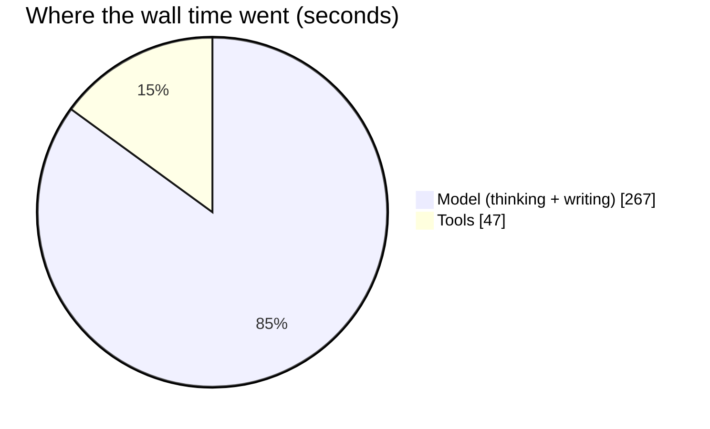

# corporate-ma/draft-markup-of-stock-purchase-agreement-provisions · run4 (`hv-mixed200-lunahigh-r4-20261116T164249Z`)

Result: **all-pass** 59/59 criteria · 5.3 min · 22 model calls · 36 tool calls (1 errors or timeouts) · ending `completed` · started 11-16 23:04:08 IST

## Overview

One box per stretch of steps that used the same kind of tool (blue: looking/searching/reading, purple: writing or editing files, yellow: a message with no tool call, red border: a tool error or timeout inside the box).

```mermaid
flowchart TD
    T(["Task prompt"])
    P0["<b>Step 1</b> · 0.1 min<br/>todo_write"]
    T --> P0
    class P0 look
    P1["<b>Step 2</b> · 0.0 min<br/>glob<br/><i>*</i>"]
    P0 --> P1
    class P1 look
    P2["<b>Steps 3-4</b> · 0.5 min<br/>bash x6<br/><i>parse-doc docx documents/buyer-ma-pla…, parse-doc docx documents/sellers-draf…, parse-doc docx documents/environmenta… +2</i>"]
    P1 --> P2
    class P2 look
    P3["<b>Step 5</b> · 0.2 min<br/>grep x6<br/><i>seller.txt</i>"]
    P2 --> P3
    class P3 look
    P4["<b>Steps 6-7</b> · 0.1 min<br/>read x8<br/><i>seller.txt</i>"]
    P3 --> P4
    class P4 look
    P5["<b>Step 8</b> · 0.2 min<br/>todo_write"]
    P4 --> P5
    class P5 look
    P6["<b>Step 9</b> · 1.2 min<br/>read<br/><i>seller.txt</i>"]
    P5 --> P6
    class P6 look
    P7["<b>Steps 10-11</b> · 2.0 min<br/>bash x2<br/><i>cat #gt; build_memo.py #lt;#lt;'PY' from docx …, parse-doc docx output/spa-markup-memo…</i>"]
    P6 --> P7
    class P7 look
    P8["<b>Step 12</b> · 0.1 min<br/>edit<br/><i>build_memo.py</i>"]
    P7 --> P8
    class P8 err
    P9["<b>Step 13</b> · 0.1 min<br/>grep<br/><i>build_memo.py</i>"]
    P8 --> P9
    class P9 look
    P10["<b>Steps 14-17</b> · 0.3 min<br/>read x2<br/>edit x2<br/><i>build_memo.py</i>"]
    P9 --> P10
    class P10 write
    P11["<b>Steps 18-19</b> · 0.2 min<br/>bash x2<br/><i>python build_memo.py && rm -f output_…, mkdir -p /tmp/spa-check && libreoffic…</i>"]
    P10 --> P11
    class P11 look
    P12["<b>Step 20</b> · 0.1 min<br/>todo_write"]
    P11 --> P12
    class P12 look
    P13["<b>Step 21</b> · 0.1 min<br/>glob<br/><i>output/*</i>"]
    P12 --> P13
    class P13 look
    P14["<b>Step 22</b> · 0.1 min<br/>final message"]
    P13 --> P14
    class P14 ans
    R(["ALL PASS: 59/59 criteria"])
    P14 --> R
    class R pass
    classDef look fill:#e8f0fe,stroke:#4a6fa5,color:#111
    classDef write fill:#f3e8fd,stroke:#7b1fa2,color:#111
    classDef ans fill:#fff8e1,stroke:#b58900,color:#111
    classDef err fill:#e8f0fe,stroke:#c62828,stroke-width:3px,color:#111
    classDef pass fill:#e6f4ea,stroke:#2e7d32,color:#111
    classDef fail fill:#fce8e6,stroke:#c62828,color:#111
```





One row per model call:

| Step | Started (IST) | Model s | Tools s | Tool calls | Tools | Output chars |
|---|---|---|---|---|---|---|
| 1 | 23:04:08 | 3 | 0 | 1 | todo_write | 57 |
| 2 | 23:04:12 | 1 | 2 | 1 | glob | 179 |
| 3 | 23:04:15 | 3 | 13 | 5 | bash x5 | 213,918 |
| 4 | 23:04:30 | 3 | 9 | 1 | bash | 1,469 |
| 5 | 23:04:43 | 4 | 8 | 6 | grep x6 | 77,199 |
| 6 | 23:04:55 | 4 | 0 | 7 | read x7 | 56,223 |
| 7 | 23:04:59 | 2 | 0 | 1 | read | 12,840 |
| 8 | 23:05:01 | 11 | 0 | 1 | todo_write | 57 |
| 9 | 23:05:12 | 74 | 0 | 1 | read | 5,076 |
| 10 | 23:06:26 | 112 | 1 | 1 | bash | 130 |
| 11 | 23:08:19 | 4 | 4 | 1 | bash | 18,640 |
| 12 | 23:08:27 | 7 | 0 | 1 | edit ⚠ | 250 |
| 13 | 23:08:34 | 3 | 1 | 1 | grep | 1,118 |
| 14 | 23:08:38 | 1 | 0 | 1 | read | 4,478 |
| 15 | 23:08:39 | 4 | 0 | 1 | edit | 215 |
| 16 | 23:08:43 | 5 | 0 | 1 | read | 6,615 |
| 17 | 23:08:48 | 8 | 0 | 1 | edit | 215 |
| 18 | 23:08:56 | 2 | 6 | 1 | bash | 8,265 |
| 19 | 23:09:04 | 4 | 2 | 1 | bash | 60 |
| 20 | 23:09:10 | 3 | 0 | 1 | todo_write | 57 |
| 21 | 23:09:14 | 3 | 1 | 1 | glob | 33 |
| 22 | 23:09:18 | 5 | 0 | 0 | (message only) | 0 |

## Task prompt

```text
Review the seller's draft SPA against the buyer's playbook, executed term sheet, and diligence materials, and prepare a detailed markup memorandum with draft-ready redline language. Output: `spa-markup-memorandum.docx`.
```

## Rubric

| # | Criterion | Verdict |
|---|---|---|
| C-001 | ISSUE_001: Identifies overbroad MAE carve-outs for environmental industry/regulations | pass |
| C-002 | ISSUE_001: Proposes adding disproportionate impact qualifier to MAE carve-outs | pass |
| C-003 | ISSUE_001: Provides actual revised contract language for MAE definition | pass |
| C-004 | ISSUE_001: Explains rationale — environmental company needs MAE protection | pass |
| C-005 | ISSUE_002: Identifies missing interim covenant restricting affiliate transactions | pass |
| C-006 | ISSUE_002: Proposes covenant requiring Buyer consent for affiliate transactions | pass |
| C-007 | ISSUE_002: References the above-market rent to Seller affiliate as rationale | pass |
| C-008 | ISSUE_003: Identifies indemnification cap discrepancy (20% vs. 12.5%) | pass |
| C-009 | ISSUE_003: Proposes redline reducing cap to 12.5% / $26,875,000 | pass |
| C-010 | ISSUE_003: References the term sheet as basis for cap correction | pass |
| C-011 | ISSUE_004: Identifies that environmental reps survival period is too short | pass |
| C-012 | ISSUE_004: Proposes extending environmental reps survival to at least 36 months | pass |
| C-013 | ISSUE_004: References CERCLA/Dalton Creek exposure as rationale for longer survival | pass |
| C-014 | ISSUE_005: Identifies anti-sandbagging provision in Section 9.06 | pass |
| C-015 | ISSUE_005: Proposes replacing with pro-sandbagging language | pass |
| C-016 | ISSUE_005: Provides actual pro-sandbagging contract text | pass |
| C-017 | ISSUE_006: Identifies need for Special Indemnity for Dalton Creek CERCLA matter | pass |
| C-018 | ISSUE_006: Special Indemnity survival of 72 months | pass |
| C-019 | ISSUE_006: Special Indemnity not subject to basket or cap | pass |
| C-020 | ISSUE_006: References Dalton Creek liability range ($1.5M-$6M) | pass |
| C-021 | ISSUE_007: Identifies problematic earnout operational covenant | pass |
| C-022 | ISSUE_007: Proposes limiting earnout covenant to no-frustration standard | pass |
| C-023 | ISSUE_007: Explains rationale — Buyer integration/restructuring flexibility | pass |
| C-024 | ISSUE_008: Identifies missing payoff letter requirement | pass |
| C-025 | ISSUE_008: Proposes payoff letters at least 3 business days pre-closing | pass |
| C-026 | ISSUE_008: Proposes simultaneous repayment at closing through funds flow | pass |
| C-027 | ISSUE_008: Proposes payoff letter delivery as a condition to closing | pass |
| C-028 | ISSUE_009: Identifies missing government contract anti-assignment/novation requirement | pass |
| C-029 | ISSUE_009: References specific government contracts requiring novation | pass |
| C-030 | ISSUE_009: Proposes closing condition or covenant for government contract novation | pass |
| C-031 | ISSUE_009: References Anti-Assignment Act or FAR provisions | pass |
| C-032 | ISSUE_010: Identifies missing environmental permit transfer/notification covenant | pass |
| C-033 | ISSUE_010: Proposes cooperation covenant for environmental permit transfers | pass |
| C-034 | ISSUE_010: Notes that permits may require notification even in a stock deal | pass |
| C-035 | ISSUE_011: Identifies missing R&W Insurance subrogation waiver | pass |
| C-036 | ISSUE_011: Proposes subrogation waiver provision with fraud exception | pass |
| C-037 | ISSUE_011: References R&W Insurance policy / Granite Ridge Underwriters | pass |
| C-038 | ISSUE_012: Identifies non-compete scope exceeds term sheet (duration) | pass |
| C-039 | ISSUE_012: Identifies non-compete scope exceeds term sheet (geographic) | pass |
| C-040 | ISSUE_012: Identifies non-compete scope exceeds term sheet (activity) | pass |
| C-041 | ISSUE_012: Proposes narrowing non-compete duration to 3 years | pass |
| C-042 | ISSUE_012: Proposes narrowing non-compete geographic scope to OR, WA, CA, NV | pass |
| C-043 | ISSUE_012: Proposes narrowing non-compete activity scope to environmental remediation and hazardous waste management | pass |
| C-044 | ISSUE_012: Notes enforceability risk of overbroad non-compete | pass |
| C-045 | Indemnification cap issue rated as Critical or High priority | pass |
| C-046 | Anti-sandbagging issue rated as Critical or High priority | pass |
| C-047 | Memorandum identifies provisions acceptable as drafted | pass |
| C-048 | Memorandum flags items for partner/client discussion | pass |
| C-049 | Escrow amount correctly stated as $16,125,000 (7.5% of EV) | pass |
| C-050 | ISSUE_006: Proposes 36-month escrow holdback for Special Indemnity | pass |
| C-051 | Earnout maximum correctly referenced as $25,000,000 | pass |
| C-052 | Earnout Adjusted EBITDA threshold correctly referenced as $38,000,000 | pass |
| C-053 | Earnout floor correctly referenced as $32,000,000 | pass |
| C-054 | References playbook as authority for at least 3 markup positions | pass |
| C-055 | References term sheet as authority for at least 3 markup positions | pass |
| C-056 | References environmental DD memo for at least one markup position | pass |
| C-057 | Memorandum identifies specific SPA section numbers for issues | pass |
| C-058 | Proposed redline language is actual contract text for at least 8 issues | pass |
| C-059 | ISSUE_008: Identifies all three sources of Target indebtedness | pass |

Judge's reasoning:

**C-001 (pass):** ISSUE_001: Identifies overbroad MAE carve-outs for environmental industry/regulations

```text
The memorandum expressly identifies that the MAE carve-outs for conditions affecting the environmental services industry and changes in Environmental Laws lack disproportionate-impact qualifiers, and proposes adding those qualifiers to both carve-outs.
```

**C-002 (pass):** ISSUE_001: Proposes adding disproportionate impact qualifier to MAE carve-outs

```text
The memorandum expressly proposes revising both the environmental-services industry and Environmental Law/regulatory carve-outs to apply “except to the extent such changes disproportionately affect the Company relative to other participants in the environmental services industry.”
```

**C-003 (pass):** ISSUE_001: Provides actual revised contract language for MAE definition

```text
The memorandum provides draft-ready replacement language for clauses (ii) and (iii) of the MAE definition, expressly adding exceptions where industry or Environmental Law changes disproportionately affect the Company relative to other industry participants.
```

**C-004 (pass):** ISSUE_001: Explains rationale — environmental company needs MAE protection

```text
The memorandum expressly explains that the target is an environmental-services business and that blanket carve-outs for environmental industry conditions and Environmental Law changes could exclude the risks most relevant to the company’s value and operating model from the MAE analysis. This satisfies the required rationale that the carve-outs could effectively undermine MAE protection for this target.
```

**C-005 (pass):** ISSUE_002: Identifies missing interim covenant restricting affiliate transactions

```text
The memorandum expressly identifies that Section 6.01(b)'s interim operating covenants lack a restriction on transactions with Seller or Seller affiliates and proposes a new consent requirement covering entry into, amendment, extension, renewal, termination, waiver, or modification of affiliate arrangements between signing and closing.
```

**C-006 (pass):** ISSUE_002: Proposes covenant requiring Buyer consent for affiliate transactions

```text
The memorandum proposes new Section 6.01(b)(xiv), which prohibits the Company from entering into, amending, extending, renewing, terminating, waiving, or otherwise modifying agreements or transactions with Seller or any Seller affiliate without Buyer's prior written consent.
```

**C-007 (pass):** ISSUE_002: References the above-market rent to Seller affiliate as rationale

```text
The memorandum expressly ties the affiliate-transaction covenant to the affiliate lease, stating that it carries $1.6 million in annual rent and is relevant to Adjusted EBITDA, and uses that fact to justify requiring Buyer consent for changes to affiliate arrangements.
```

**C-008 (pass):** ISSUE_003: Identifies indemnification cap discrepancy (20% vs. 12.5%)

```text
The memorandum expressly identifies that the Seller draft sets the general indemnification cap at 20% of the $215 million base enterprise value ($43 million), while the binding term sheet requires 12.5% ($26.875 million), and proposes conforming the cap accordingly.
```

**C-009 (pass):** ISSUE_003: Proposes redline reducing cap to 12.5% / $26,875,000

```text
The memorandum expressly proposes replacing the $43,000,000 / 20% indemnification cap with $26,875,000, equal to 12.5% of the $215,000,000 Base Enterprise Value, including conforming revisions to the cap definition and Section 9.04(b).
```

**C-010 (pass):** ISSUE_003: References the term sheet as basis for cap correction

```text
The memorandum expressly cites the executed Binding Term Sheet as the source of the 12.5% indemnification cap, including in the cap-definition markup and supporting comment referencing “Term Sheet §8 (General Indemnification Cap).”
```

**C-011 (pass):** ISSUE_004: Identifies that environmental reps survival period is too short

```text
The memorandum expressly identifies that the seller draft gives all non-Fundamental representations, including environmental representations, only 12 months of survival and states this is inadequate. It proposes a separate 36-month survival period for Section 4.15 Environmental Matters, including environmental compliance and permits, and explains that environmental liabilities may not crystallize within 12 months.
```

**C-012 (pass):** ISSUE_004: Proposes extending environmental reps survival to at least 36 months

```text
The memorandum expressly proposes that the defined Environmental Representations survive for 36 months after closing and also reserves the right to seek survival through the full applicable statute of limitations.
```

**C-013 (pass):** ISSUE_004: References CERCLA/Dalton Creek exposure as rationale for longer survival

```text
The memorandum expressly ties the longer survival period to environmental exposure, stating that Dalton Creek may not crystallize within 12 months and that Hargrove remediation will continue for 18–24+ months post-Closing. It therefore supports 36-month survival for environmental representations and separately proposes 72-month survival for the Dalton Creek CERCLA special indemnity.
```

**C-014 (pass):** ISSUE_005: Identifies anti-sandbagging provision in Section 9.06

```text
The memorandum expressly identifies Section 9.06 as an anti-sandbagging provision and quotes the language barring Buyer from indemnification for breaches or inaccuracies of which Buyer or its Representatives had Knowledge as of the Closing Date.
```

**C-015 (pass):** ISSUE_005: Proposes replacing with pro-sandbagging language

```text
The memorandum expressly proposes replacing Section 9.06’s anti-sandbagging provision with an affirmative pro-sandbagging clause stating that Buyer’s indemnification and other remedies are not affected, defeated, or diminished by any investigation or knowledge acquired before or after execution or Closing.
```

**C-016 (pass):** ISSUE_005: Provides actual pro-sandbagging contract text

```text
The memorandum provides actual proposed contract language in Section 9.06 titled “Pro-Sandbagging,” stating that indemnification and other remedies are unaffected by Buyer’s investigation or knowledge and that claims cannot be defeated or diminished based on such knowledge.
```

**C-017 (pass):** ISSUE_006: Identifies need for Special Indemnity for Dalton Creek CERCLA matter

```text
The memorandum expressly proposes a standalone “Dalton Creek Special Indemnity” in new Section 9.02(e), covering the EPA CERCLA §104(e) matter independently of any representation breach and outside the general basket and indemnification cap.
```

**C-018 (pass):** ISSUE_006: Special Indemnity survival of 72 months

```text
The memorandum expressly states that the Dalton Creek Special Indemnity survives for seventy-two (72) months following the Closing Date, including in proposed Section 9.01(e).
```

**C-019 (pass):** ISSUE_006: Special Indemnity not subject to basket or cap

```text
The memorandum expressly excludes the Dalton Creek Special Indemnity from both limitations. Proposed Section 9.04(a) states the basket does not apply to it, and Section 9.04(b) states the General Cap does not apply and that the indemnity is an independent obligation in addition to the General Cap.
```

**C-020 (pass):** ISSUE_006: References Dalton Creek liability range ($1.5M-$6M)

```text
The memorandum expressly cites Dalton Creek's estimated exposure as $1,500,000–$6,000,000 in the Special Indemnity schedule and uses that range to justify the standalone indemnity for the known CERCLA risk.
```

**C-021 (pass):** ISSUE_007: Identifies problematic earnout operational covenant

```text
The memorandum expressly identifies Section 2.05(d) as problematic because it requires operation consistent with past practice and in good faith to maximize the earnout, characterizes those obligations as overly restrictive, and proposes replacing them with a narrow primary-purpose covenant.
```

**C-022 (pass):** ISSUE_007: Proposes limiting earnout covenant to no-frustration standard

```text
The memorandum replaces the seller’s affirmative past-practice, earnout-maximization, resource-maintenance, and anti-diversion obligations with a narrow covenant prohibiting actions taken with the primary purpose of reducing or avoiding the earnout payment. It also expressly preserves Buyer’s discretion to operate and integrate the business.
```

**C-023 (pass):** ISSUE_007: Explains rationale — Buyer integration/restructuring flexibility

```text
The memorandum expressly explains that the seller’s broad earnout covenant would “handcuff Buyer’s platform integration and operational judgment” and create exposure over ordinary-course decisions. It also proposes language preserving Buyer’s discretion to integrate, restructure, reorganize, make strategic investments, change personnel, and otherwise manage the Company post-closing.
```

**C-024 (pass):** ISSUE_008: Identifies missing payoff letter requirement

```text
The memorandum expressly identifies that Section 2.03(d) permits repayment “at or promptly following the Closing” and that Section 7.02 lacks a requirement to deliver payoff letters before closing. It proposes executed payoff letters from each indebtedness holder at least three Business Days before closing, simultaneous payoff, lien releases, and a corresponding buyer closing condition.
```

**C-025 (pass):** ISSUE_008: Proposes payoff letters at least 3 business days pre-closing

```text
The memorandum expressly requires Seller to deliver executed payoff letters at least three Business Days before Closing, and specifies that they include wire instructions and provide for lien releases, UCC termination statements, and other lien-release documents.
```

**C-026 (pass):** ISSUE_008: Proposes simultaneous repayment at closing through funds flow

```text
The memorandum expressly replaces the 'at or promptly following' mechanic with a requirement that all Closing Indebtedness be paid simultaneously at Closing through the funds flow, with none remaining outstanding after Closing.
```

**C-027 (pass):** ISSUE_008: Proposes payoff letter delivery as a condition to closing

```text
The memorandum expressly proposes adding Section 7.02(h) as a Buyer closing condition requiring receipt of executed payoff letters at least three Business Days before Closing, along with lien releases and termination documents.
```

**C-028 (pass):** ISSUE_009: Identifies missing government contract anti-assignment/novation requirement

```text
The memorandum expressly identifies that the Seller's draft lacks a government-contract novation/recognition mechanism, discusses Anti-Assignment Act and FAR Part 42 concerns, and proposes representations, covenants, and closing protections for the U.S. Army Corps of Engineers and Bureau of Land Management contracts, as well as state contracts.
```

**C-029 (pass):** ISSUE_009: References specific government contracts requiring novation

```text
The memorandum specifically identifies two active government contracts—the U.S. Army Corps of Engineers contract (No. W912DR-21-D-0045) and the Bureau of Land Management contract (No. L23PX-00412)—as requiring FAR Part 42 novation requests. This satisfies the requirement to identify at least two of the four contracts.
```

**C-030 (pass):** ISSUE_009: Proposes closing condition or covenant for government contract novation

```text
The memorandum expressly proposes new Section 6.12 requiring Seller and the Company to prepare and submit novation and recognition requests, including FAR Part 42 novation requests for identified federal contracts, and to use commercially reasonable efforts to obtain the agreements before closing. It also proposes a related closing condition in Section 7.02(i).
```

**C-031 (pass):** ISSUE_009: References Anti-Assignment Act or FAR provisions

```text
The memorandum expressly cites both the Anti-Assignment Act and FAR 42.12/FAR Part 42 as the legal basis for federal government-contract novation requirements, including in the proposed Section 6.12 and related commentary.
```

**C-032 (pass):** ISSUE_010: Identifies missing environmental permit transfer/notification covenant

```text
The memorandum expressly identifies that the seller draft lacks a covenant addressing change-of-control filings, notices, approvals, transfer, or re-issuance for the Target’s 23 environmental permits. It proposes new Section 6.13 requiring pre-closing identification and submissions, commercially reasonable efforts to obtain approvals, and post-closing cooperation for notification, transfer, re-issuance, amendment, or approval processes.
```

**C-033 (pass):** ISSUE_010: Proposes cooperation covenant for environmental permit transfers

```text
The memorandum proposes new Section 6.13 requiring pre-closing identification and submission of environmental permit notices and approval requests, commercially reasonable efforts to obtain approvals, and post-closing Seller cooperation for notifications, transfers, re-issuances, amendments, and approvals under applicable state requirements.
```

**C-034 (pass):** ISSUE_010: Notes that permits may require notification even in a stock deal

```text
The memorandum expressly states that the stock structure does not eliminate change-of-control risk and that state agencies may require notification or approval even in a stock deal. It also identifies permits in Oregon, Washington, California, and Nevada and proposes related notice and approval covenants.
```

**C-035 (pass):** ISSUE_011: Identifies missing R&W Insurance subrogation waiver

```text
The memorandum expressly states that the Seller's draft contains no provision addressing subrogation by Buyer's R&W insurer and proposes a fraud-only subrogation waiver in new Section 10.13.
```

**C-036 (pass):** ISSUE_011: Proposes subrogation waiver provision with fraud exception

```text
The memorandum proposes a new Section 10.13 requiring the R&W insurer to waive subrogation and other recourse rights against Seller and related parties, with an express exception for claims arising from Seller's actual fraud. It also identifies Granite Ridge Underwriters in the related commentary.
```

**C-037 (pass):** ISSUE_011: References R&W Insurance policy / Granite Ridge Underwriters

```text
The memorandum expressly states that Buyer is obtaining an R&W Insurance policy, identifies Granite Ridge Underwriters, and links that policy to the need for a fraud-only subrogation waiver in proposed Section 10.13 and its commentary.
```

**C-038 (pass):** ISSUE_012: Identifies non-compete scope exceeds term sheet (duration)

```text
The memorandum expressly identifies that the Seller draft imposes a five-year non-compete and states that the binding term sheet requires a three-year period, then proposes revising the covenant to three years.
```

**C-039 (pass):** ISSUE_012: Identifies non-compete scope exceeds term sheet (geographic)

```text
The memorandum expressly identifies that the Seller draft imposes a nationwide U.S. non-compete and states that the term sheet limits the geographic scope to Oregon, Washington, California, and Nevada, with conforming replacement language.
```

**C-040 (pass):** ISSUE_012: Identifies non-compete scope exceeds term sheet (activity)

```text
The memorandum expressly identifies that the Seller draft's non-compete applies to “any business,” while the binding term sheet limits the restricted activity to environmental remediation and hazardous waste management services. It also proposes replacement language conforming to that narrower activity scope.
```

**C-041 (pass):** ISSUE_012: Proposes narrowing non-compete duration to 3 years

```text
The proposed replacement for Section 6.09(a) expressly narrows the non-compete period from five years to three years following the Closing Date, matching the term sheet.
```

**C-042 (pass):** ISSUE_012: Proposes narrowing non-compete geographic scope to OR, WA, CA, NV

```text
The proposed replacement for Section 6.09(a) limits the non-compete to environmental remediation and hazardous waste management businesses in Oregon, Washington, California, and Nevada, expressly matching the term sheet’s four-state geographic scope.
```

**C-043 (pass):** ISSUE_012: Proposes narrowing non-compete activity scope to environmental remediation and hazardous waste management

```text
The proposed replacement for Section 6.09(a) expressly narrows the restricted activity to businesses engaged in environmental remediation services or hazardous waste management services, matching the term sheet’s activity scope.
```

**C-044 (pass):** ISSUE_012: Notes enforceability risk of overbroad non-compete

```text
The memorandum expressly states that the five-year, nationwide, “any business” non-compete would sweep in Seller’s legitimate construction and timber operations and creates enforceability risk. It also proposes narrowing the restriction and carving out those existing businesses.
```

**C-045 (pass):** Indemnification cap issue rated as Critical or High priority

```text
The output assigns the indemnification cap discrepancy (20% / $43 million versus 12.5% / $26.875 million) a “High” priority in the executive summary and related markup commentary, satisfying the criterion.
```

**C-046 (pass):** Anti-sandbagging issue rated as Critical or High priority

```text
Section 9.06 is expressly labeled “CRITICAL” in both the executive summary and the detailed markup commentary, satisfying the required priority level.
```

**C-047 (pass):** Memorandum identifies provisions acceptable as drafted

```text
The memorandum includes a dedicated “Items Reviewed and Left Unchanged” section identifying multiple provisions as acceptable as drafted, with brief explanations. These include the 1.0% true-deductible basket, actual knowledge of the CEO/CFO, 10-day good-standing certificates, Delaware governing law/forum, earnout economics, and escrow amount/general release mechanics.
```

**C-048 (pass):** Memorandum flags items for partner/client discussion

```text
The memorandum expressly flags issues for partner/client discussion. For example, Section VIII includes a boxed “Partner/client discussion — government-contract condition” and asks Elena to confirm Marcus’s preferred risk allocation regarding completed novations versus covenant/no-adverse-action protection. It also flags confirmation of Dalton Creek details and PE-licensed personnel retention considerations before finalizing the markup.
```

**C-049 (pass):** Escrow amount correctly stated as $16,125,000 (7.5% of EV)

```text
The memorandum correctly states the escrow amount as $16,125,000 and identifies it as 7.5% of the $215,000,000 Base Enterprise Value. Its later escrow provisions consistently refer to that defined Escrow Amount without using an incorrect figure.
```

**C-050 (pass):** ISSUE_006: Proposes 36-month escrow holdback for Special Indemnity

```text
The memorandum expressly proposes that at least $1.5 million of the escrow be designated for the Dalton Creek Special Indemnity and held until 36 months after closing, separate from the 18-month general escrow release. It also revises Section 9.08 and Exhibit A to preserve the Special Indemnity escrow through that 36-month period.
```

**C-051 (pass):** Earnout maximum correctly referenced as $25,000,000

```text
The memorandum expressly states that the earnout economics include a "$25M maximum," correctly referencing the maximum earnout payment as $25,000,000.
```

**C-052 (pass):** Earnout Adjusted EBITDA threshold correctly referenced as $38,000,000

```text
The memorandum correctly states in the earnout economics discussion that the full-earnout Adjusted EBITDA threshold is $38 million.
```

**C-053 (pass):** Earnout floor correctly referenced as $32,000,000

```text
The memorandum expressly states that the earnout economics include a $32 million floor, a $38 million full-earnout threshold, and linear interpolation between them, which correctly reflects pro-rata payment between the floor and threshold.
```

**C-054 (pass):** References playbook as authority for at least 3 markup positions

```text
The memorandum cites the Buyer's M&A Playbook as authority for well over three distinct markup positions, including the MAE disproportionate-impact qualifiers, earnout covenant revision, environmental representation survival, Dalton Creek special indemnity, pro-sandbagging provision, government-contract protections, and escrow mechanics.
```

**C-055 (pass):** References term sheet as authority for at least 3 markup positions

```text
The memorandum cites the executed Term Sheet as authority for numerous distinct markup positions, including the indemnification cap, earnout covenant, non-compete/non-solicit scope, payoff-letter mechanics, survival periods, Dalton Creek special indemnity, escrow terms, and R&W insurance protections. This exceeds the requirement of at least three positions.
```

**C-056 (pass):** References environmental DD memo for at least one markup position

```text
The memorandum repeatedly cites the Environmental Due Diligence Summary/DD Memo as support for markup positions, including the Dalton Creek special indemnity, government-contract novation provisions, environmental permit change-of-control covenants, and environmental representation survival.
```

**C-057 (pass):** Memorandum identifies specific SPA section numbers for issues

```text
The memorandum ties well over 8 planted issues to specific SPA sections, including Sections 1.01, 2.03(d), 2.05(d), 4.15, 4.16, 6.01(b), 6.09, 7.02, 9.01(b), 9.02(e), 9.04, 9.06, 9.08, and 10.13.
```

**C-058 (pass):** Proposed redline language is actual contract text for at least 8 issues

```text
The memorandum provides draft-ready contractual language for well over 8 planted issues, including the MAE qualifiers, indemnification cap, earnout covenant, government-contract protections, environmental permit covenants, payoff mechanics, survival periods, Dalton Creek special indemnity, pro-sandbagging, escrow provisions, non-compete, and R&W insurance provisions.
```

**C-059 (pass):** ISSUE_008: Identifies all three sources of Target indebtedness

```text
The payoff-letter discussion expressly identifies all three sources/holders of Target indebtedness: Cascade Mutual Bank, Pacific Lease Corp., and Evergreen Holdings Group, Inc. It also references the corresponding $28 million senior loan, $9.8 million equipment financing, and $4.5 million seller note, totaling $42.3 million.
```

## Delivered files (output/)

- `spa-markup-memorandum.docx` (57,319 bytes)

## Trajectory

### Step 1: 1 tool call

_Started 11-16 23:04:08 IST · model 3 s · tools 0 s_

**Reasoning summary:**

```text
**Determining file manipulations**

I need to manipulate files and create a DOCX document. It's important to inspect these documents first. I wonder if my skills will match the task at hand, especially since "Review ... SPA..." sounds like it could be legal-related. However, I don't have the explicit skill catalog available to me right now. So, I'll first check through the files and plan a multi-step approach to proceed effectively.
```

**Call `todo_write`** (0.1 s)

```json
{
 "todos": [
  {
   "content": "Inspect available transaction documents and identify governing deal terms",
   "status": "in_progress"
  },
  {
   "content": "Compare seller SPA provisions against buyer playbook, term sheet, and diligence materials",
   "status": "pending"
  },
  {
   "content": "Draft detailed markup memorandum with draft-ready redline language",
   "status": "pending"
  },
  {
   "content": "Generate and validate spa-markup-memorandum.docx in output",
   "status": "pending"
  }
 ]
}
```

Output (57 chars):

```text
Updated todo list: 3 pending, 1 in progress, 0 completed.
```

**Todo list now:**

- [~] Inspect available transaction documents and identify governing deal terms
- [ ] Compare seller SPA provisions against buyer playbook, term sheet, and diligence materials
- [ ] Draft detailed markup memorandum with draft-ready redline language
- [ ] Generate and validate spa-markup-memorandum.docx in output

### Step 2: 1 tool call

_Started 11-16 23:04:12 IST · model 1 s · tools 2 s_

**Call `glob`** (1.8 s)

```json
{
 "pattern": "*"
}
```

Output (179 chars):

```text
documents/buyer-ma-playbook.docx
documents/sellers-draft-spa.docx
documents/environmental-dd-memo.docx
documents/executed-term-sheet.docx
documents/partner-markup-instructions.eml
```

### Step 3: 5 tool calls

_Started 11-16 23:04:15 IST · model 3 s · tools 13 s_

**Reasoning summary:**

```text
**Considering parsing options**

I need to read the documentation using a parse-doc command in bash. It seems like it might be efficient to run the parsing in parallel if that’s an option. I’m curious about how effective that will be for processing the documents quickly. There’s definitely a strategy here. I’ll need to check to ensure the commands are working as expected and that the parallel parsing yields the best results possible.
```

**Call `bash`** (2.3 s)

```json
{
 "command": "parse-doc docx documents/buyer-ma-playbook.docx",
 "description": "Extract buyer playbook text"
}
```

Output (49,999 chars):

```text
tner. This is a **Critical** priority item.

For example, if the term sheet specifies a general indemnification cap of 12.5% of enterprise value for a transaction with a \$200 million enterprise value, the SPA\'s general indemnification cap should be \$25,000,000. If the seller\'s draft sets the cap at \$20,000,000 (10% of enterprise value), the associate must flag this as a deviation from the term sheet and mark up the draft to reflect the agreed \$25,000,000 cap.

**R&W Insurance Considerations.** In transactions where the buyer is obtaining representations and warranties insurance (see Section 8), the indemnification cap may be subject to additional negotiation dynamics. The R&W insurer may require a certain retention level (the amount of loss the buyer must bear before the policy responds), which interacts with the SPA\'s basket/deductible and cap structure. However, the SPA cap itself must conform to the term sheet regardless of the R&W Insurance structure. The R&W Insurance policy supplements the seller\'s indemnification obligations --- it does not replace them, and the availability of insurance does not justify a reduction in the SPA cap below the term sheet level.

**Market Data.** In recent environmental services transactions handled by the firm, general indemnification caps have ranged from 10% to 15% of enterprise value. The 12.5% figure is squarely within the market range and represents the firm\'s standard recommendation for PE buyers in this sector. Caps below 
… [48,499 more chars]
```

**Call `bash`** (4.2 s)

```json
{
 "command": "parse-doc docx documents/sellers-draft-spa.docx",
 "description": "Extract seller SPA text"
}
```

Output (49,998 chars):

```text
and Seller;

**(b)** by either Buyer or Seller, by written notice to the other Party, if the Closing shall not have occurred on or before the Outside Date (February 28, 2026); *provided* that the right to terminate this Agreement under this Section 8.01(b) shall not be available to any Party whose breach of any representation, warranty, covenant, or agreement set forth in this Agreement has been the primary cause of, or has primarily resulted in, the failure of the Closing to occur on or before the Outside Date;

**(c)** by either Buyer or Seller, by written notice to the other Party, if any Governmental Authority shall have enacted, issued, promulgated, enforced, or entered any final and non-appealable Law, order, injunction, judgment, decree, ruling, or other legally binding action that permanently restrains, enjoins, or otherwise prohibits the consummation of the transactions contemplated by this Agreement;

**(d)** by Buyer, by written notice to Seller, if there shall have been a breach by Seller of any representation, warranty, covenant, or agreement contained in this Agreement that would cause the conditions set forth in Section 7.02(a) or Section 7.02(b) not to be satisfied, and such breach shall not have been cured by Seller within thirty (30) days after receipt of written notice of such breach from Buyer (or, if earlier, by the Outside Date); *provided* that Buyer shall not have the right to terminate this Agreement under this Section 8.01(d) if Buyer is then in mate
… [48,498 more chars]
```

**Call `bash`** (3.3 s)

```json
{
 "command": "parse-doc docx documents/environmental-dd-memo.docx",
 "description": "Extract diligence memo text"
}
```

Output (47,133 chars):

```text
**ASHFORD, PENNINGTON & YATES LLP** *Attorneys at Law* 71 South Wacker Drive, Suite 4500 Chicago, Illinois 60606

**PRIVILEGED AND CONFIDENTIAL --- ATTORNEY WORK PRODUCT** This memorandum is protected by the attorney-client privilege and the work product doctrine. It is intended solely for use by the attorneys and professionals of Ashford, Pennington & Yates LLP and the client to whom it is addressed. Any unauthorized disclosure, reproduction, or distribution is strictly prohibited.

**MEMORANDUM**

**TO:** Elena Vasquez-Moreno, Partner, M&A Group Jonathan Kreider, Senior Associate, M&A Group

**FROM:** Environmental Practice Group, Ashford, Pennington & Yates LLP

**DATE:** October 18, 2025

**RE:** Environmental Due Diligence Summary --- Acquisition of Cascadia Environmental Solutions, Inc. by Whitmore Capital Partners LLC

**PROJECT:** Project Cascade --- Whitmore Capital Partners LLC Fund III Platform Acquisition

This memorandum summarizes the findings and recommendations of the Environmental Practice Group arising from our environmental due diligence review of Cascadia Environmental Solutions, Inc. in connection with the proposed acquisition by Whitmore Capital Partners LLC. This memo is intended to inform the deal team\'s review of the Seller\'s Stock Purchase Agreement draft, which we understand will be circulated on or about October 22, 2025. All findings and recommendations set forth herein should be incorporated into the firm\'s SPA markup and negotiation strategy.
… [45,632 more chars]
```

**Call `bash`** (2.2 s)

```json
{
 "command": "parse-doc docx documents/executed-term-sheet.docx",
 "description": "Extract executed term sheet text"
}
```

Output (49,983 chars):

```text
**BINDING TERM SHEET**

**Acquisition of 100% of the Outstanding Equity Interests of** **Cascadia Environmental Solutions, Inc.**

Dated as of September 10, 2025

This Binding Term Sheet (this \"Term Sheet\") sets forth the principal terms and conditions agreed upon by the parties identified below with respect to the proposed acquisition described herein. Except as set forth in Section 18 (Binding Provisions) below, this Term Sheet is intended to be binding on the parties and shall govern the preparation of the Definitive Agreement (as defined below). This Term Sheet supersedes and replaces in its entirety the non-binding Letter of Intent dated August 15, 2025 (the \"LOI\"), previously entered into between Whitmore Capital Partners LLC and Evergreen Holdings Group, Inc. with respect to the proposed acquisition of Cascadia Environmental Solutions, Inc. Capitalized terms used but not otherwise defined herein shall have the meanings ascribed to them in the context in which they appear.

**[Section 1: Parties]{.underline}**

**Buyer:** Whitmore Capital Partners LLC, a Delaware limited liability company, with its principal offices at 200 South Wacker Drive, Suite 3100, Chicago, Illinois 60606 (referred to herein as \"Buyer\" or \"Whitmore\").

**Seller:** Evergreen Holdings Group, Inc., a Delaware corporation, with its principal offices at 1550 NW Everett Street, Suite 800, Portland, Oregon 97209 (referred to herein as \"Seller\" or \"Evergreen\").

**Target / the Company:** Casca
… [48,483 more chars]
```

**Call `bash`** (0.5 s)

```json
{
 "command": "python - <<'PY'\nfrom pathlib import Path\nprint(Path('documents/partner-markup-instructions.eml').read_text())\nPY",
 "description": "Read partner markup instructions"
}
```

Output (16,805 chars):

```text
From: Elena Vasquez-Moreno <evasquez-moreno@apylaw.com>
To: Jonathan Kreider <jkreider@apylaw.com>
Date: Thu, 23 Oct 2025 08:47:00 -0000
Subject: Re: Cascadia SPA Markup — Instructions and Priority Issues
Content-Type: text/plain; charset="utf-8"
Content-Transfer-Encoding: quoted-printable
MIME-Version: 1.0

Jonathan,

I reviewed the initial draft SPA that Douglas Renwick at Fortuna & Blake circ=
ulated yesterday. My overall impression: this is a heavily seller-favorable d=
raft in several material respects, and some of the positions directly contrad=
ict the September 10 term sheet =E2=80=94 which tells me either Doug is testi=
ng our resolve or his client gave him different instructions than what was ag=
reed at the principal level. Either way, we need a sharp, comprehensive marku=
p.

Marcus Devereaux at Whitmore Capital wants to see our redline by end of next =
week. Given the November 14 target signing date, that gives the parties rough=
ly two weeks of negotiation runway after we send our markup, which is tight. =
I need your comprehensive markup memorandum with redlined provisions and full=
 track-changes commentary.

**General Instructions**

Cross-reference every material provision against three sources: (1) the execu=
ted term sheet dated September 10, 2025, (2) the firm's M&A Playbook for envi=
ronmental services sector acquisitions, and (3) the environmental due diligen=
ce summary memo prepared by our environmental group.

For each issue you identify, I need you 
… [15,303 more chars]
```

### Step 4: 1 tool call

_Started 11-16 23:04:30 IST · model 3 s · tools 9 s_

**Reasoning summary:**

```text
**Evaluating document processing**

I’ve got mixed outputs and some are truncated. I need a complete seller SPA. I’m thinking about saving the parse outputs to files using bash redirection, where I can use a command like `parse-doc > scratch` to organize everything. After that, I can inspect key sections like seller definitions, earnout, MAE, covenants, and conditions. It seems like using `parse-doc` for redirection could be helpful!
```

**Call `bash`** (9.0 s)

```json
{
 "command": "parse-doc docx documents/sellers-draft-spa.docx > seller.txt && parse-doc docx documents/buyer-ma-playbook.docx > playbook.txt && parse-doc docx documents/executed-term-sheet.docx > term-sheet.txt && parse-doc docx documents/environmental-dd-memo.docx > dd.txt",
 "description": "Save extracted transaction texts",
 "timeoutMs": 120000
}
```

Output (1,469 chars):

```text
[stderr]
2026-11-16 17:34:35.349416921 [W:onnxruntime:Default, device_discovery.cc:95 GetPciBusId] Skipping pci_bus_id for PCI path at "/sys/devices/LNXSYSTM:00/LNXSYBUS:00/ACPI0004:00/VMBUS:00/5620e0c7-8062-4dce-aeb7-520c7ef76171" because filename "5620e0c7-8062-4dce-aeb7-520c7ef76171" did not match expected pattern of [0-9a-f]+:[0-9a-f]+:[0-9a-f]+[.][0-9a-f]+
2026-11-16 17:34:37.291864916 [W:onnxruntime:Default, device_discovery.cc:95 GetPciBusId] Skipping pci_bus_id for PCI path at "/sys/devices/LNXSYSTM:00/LNXSYBUS:00/ACPI0004:00/VMBUS:00/5620e0c7-8062-4dce-aeb7-520c7ef76171" because filename "5620e0c7-8062-4dce-aeb7-520c7ef76171" did not match expected pattern of [0-9a-f]+:[0-9a-f]+:[0-9a-f]+[.][0-9a-f]+
2026-11-16 17:34:38.938040949 [W:onnxruntime:Default, device_discovery.cc:95 GetPciBusId] Skipping pci_bus_id for PCI path at "/sys/devices/LNXSYSTM:00/LNXSYBUS:00/ACPI0004:00/VMBUS:00/5620e0c7-8062-4dce-aeb7-520c7ef76171" because filename "5620e0c7-8062-4dce-aeb7-520c7ef76171" did not match expected pattern of [0-9a-f]+:[0-9a-f]+:[0-9a-f]+[.][0-9a-f]+
2026-11-16 17:34:40.461086689 [W:onnxruntime:Default, device_discovery.cc:95 GetPciBusId] Skipping pci_bus_id for PCI path at "/sys/devices/LNXSYSTM:00/LNXSYBUS:00/ACPI0004:00/VMBUS:00/5620e0c7-8062-4dce-aeb7-520c7ef76171" because filename "5620e0c7-8062-4dce-aeb7-520c7ef76171" did not match expected pattern of [0-9a-f]+:[0-9a-f]+:[0-9a-f]+[.][0-9a-f]+
```

### Step 5: 6 tool calls

_Started 11-16 23:04:43 IST · model 4 s · tools 8 s_

**Call `grep`** (2.3 s)

```json
{
 "pattern": "Material Adverse Effect|environmental services industry generally|environmental laws or regulations",
 "path": "seller.txt"
}
```

Output (4,649 chars):

```text
Found 7 matches

seller.txt
Line 133: \"**Material Adverse Effect**\" means any event, change, effect, development, state of facts, condition, circumstance, or occurrence that, individually or in the aggregate, has had or would reasonably be expected to have a material adverse effect on (a) the business, assets, liabilities, financial condition, or results of operations of the Company, or (b) the ability of Seller to consummate the transactions contemplated by this Agreement; *provided*, *however*, that none of the following, individually or in the aggregate, shall be deemed to constitute, or shall be taken into account in determining whether there has been or would reasonably be expected to be, a Material Adverse Effect:
Line 149: > \(viii\) any failure by the Company to meet any internal or external projections, forecasts, or estimates of revenue, earnings, or other financial performance metrics for any period (provided that the underlying facts, circumstances, and causes of any such failure may be considered in determining whether a Material Adverse Effect has occurred).
Line 351: Since September 30, 2025 through the date of this Agreement, (a) the Company has conducted its business in the ordinary course of business consistent with past practice in all material respects, and (b) no event, change, effect, development, condition, or occurrence has occurred that has had or would reasonably be expected to have, individually or in the aggregate, a Material Adverse Effect.
Line
… [3,149 more chars]
```

**Call `grep`** (1.1 s)

```json
{
 "pattern": "Section 2\\.05|Earnout|past practice|maximize|Adjusted EBITDA|December 31, 2026",
 "path": "seller.txt"
}
```

Output (10,610 chars):

```text
Found 21 matches

seller.txt
Line 45: \"**Adjusted EBITDA**\" means, with respect to any period, the net income of the Company for such period, determined in accordance with GAAP applied consistently with the Company\'s past practice, plus (a) interest expense, (b) income tax expense, and (c) depreciation and amortization expense, in each case to the extent deducted in computing net income, and further adjusted to exclude (i) non-recurring transaction costs incurred in connection with the transactions contemplated by this Agreement, (ii) any purchase-price accounting adjustments arising from the consummation of the transactions contemplated hereby, (iii) any extraordinary or non-recurring items, and (iv) any management fees, monitoring fees, or similar fees charged by Buyer or any of its Affiliates to the Company, in each case as determined in accordance with GAAP applied consistently with the Company\'s past practice. The detailed calculation methodology for Adjusted EBITDA is set forth on Exhibit D.
Line 81: \"**Earnout Payment**\" has the meaning set forth in Section 2.05(a).
Line 83: \"**Earnout Period**\" means the twelve (12) month period commencing on January 1, 2026 and ending on December 31, 2026.
Line 151: \"**Maximum Earnout Payment**\" means Twenty-Five Million Dollars (\$25,000,000).
Line 201: The aggregate purchase price for the Shares (the \"Purchase Price\") shall be an amount equal to (a) the Base Enterprise Value (\$215,000,000), *plus* (b) the amount, if an
… [9,110 more chars]
```

**Call `grep`** (0.8 s)

```json
{
 "pattern": "Section 4\\.0[0-9]|affiliate|Affiliates|Seller Affiliate",
 "path": "seller.txt"
}
```

Output (18,037 chars):

```text
Found 36 matches

seller.txt
Line 45: \"**Adjusted EBITDA**\" means, with respect to any period, the net income of the Company for such period, determined in accordance with GAAP applied consistently with the Company\'s past practice, plus (a) interest expense, (b) income tax expense, and (c) depreciation and amortization expense, in each case to the extent deducted in computing net income, and further adjusted to exclude (i) non-recurring transaction costs incurred in connection with the transactions contemplated by this Agreement, (ii) any purchase-price accounting adjustments arising from the consummation of the transactions contemplated hereby, (iii) any extraordinary or non-recurring items, and (iv) any management fees, monitoring fees, or similar fees charged by Buyer or any of its Affiliates to the Company, in each case as determined in accordance with GAAP applied consistently with the Company\'s past practice. The detailed calculation methodology for Adjusted EBITDA is set forth on Exhibit D.
Line 111: \"**Financial Statements**\" has the meaning set forth in Section 4.06.
Line 113: \"**Fundamental Representations**\" means (a) the representations and warranties of Seller set forth in Section 3.01 (Organization and Good Standing), Section 3.02 (Authority; Binding Effect), and Section 3.03 (Ownership of Shares), and (b) the representations and warranties regarding the Company set forth in Section 4.01 (Organization and Qualification), Section 4.02 (Authority), Section
… [16,537 more chars]
```

**Call `grep`** (0.7 s)

```json
{
 "pattern": "Government Contract|novation|FAR|Army Corps|Bureau of Land|Department of Ecology|Oregon Department",
 "path": "seller.txt"
}
```

Output (6,342 chars):

```text
Found 15 matches

seller.txt
Line 415: **(b)** Schedule 4.13 sets forth a true and complete list of all Company Material Contracts, including, without limitation: (i) the government contracts with Oregon Department of Environmental Quality, Washington Department of Ecology, United States Army Corps of Engineers, and Bureau of Land Management; (ii) the employment agreements with Patricia Huang, Brian Kowalski, Sandra Firth, and David Alarcon; (iii) the Affiliate Lease with Parkside Realty Holdings LLC (\$1,600,000 annual rent); (iv) the subordinated seller note payable to Evergreen Holdings Group, Inc. (\$4,500,000); (v) the TerraSpatial Inc. GIS mapping software license (\$180,000 per year); (vi) the senior term loan agreement with Cascade Mutual Bank (\$28,000,000); (vii) the equipment financing facility with Pacific Lease Corp. (\$9,800,000); and (viii) the environmental liability insurance policies with Northshore Specialty Insurance Co.
Line 443: **Section 4.16 Government Contracts**
Line 445: **(a)** The Company is a party to four (4) active government contracts, each of which is listed on Schedule 4.16, with the Oregon Department of Environmental Quality, the Washington Department of Ecology, the United States Army Corps of Engineers, and the Bureau of Land Management (collectively, the \"Government Contracts\").
Line 447: **(b)** Each Government Contract is in full force and effect and constitutes a legal, valid, and binding obligation of the Company and, to the Knowle
… [4,842 more chars]
```

**Call `grep`** (2.5 s)

```json
{
 "pattern": "Section 7\\.02|Conditions to Buyer|payoff|Payoff|Indebtedness|Closing Date",
 "path": "seller.txt"
}
```

Output (27,351 chars):

```text
Found 49 matches

seller.txt
Line 63: \"**Closing Date**\" has the meaning set forth in Section 2.07.
Line 65: \"**Closing Indebtedness**\" means the Indebtedness of the Company outstanding as of the Closing, determined in accordance with the Accounting Principles.
Line 103: \"**Estimated Closing Indebtedness**\" has the meaning set forth in Section 2.03(a).
Line 123: \"**Indebtedness**\" means, with respect to any Person, without duplication, (a) all obligations for borrowed money, (b) all obligations evidenced by bonds, debentures, notes, or similar instruments, (c) all obligations under capital leases or financing leases (as determined in accordance with GAAP), (d) all obligations for the deferred purchase price of property or services (other than trade payables incurred in the ordinary course of business), (e) all obligations, contingent or otherwise, under letters of credit (including standby and commercial), to the extent drawn upon, (f) all guarantees of any of the foregoing obligations of another Person, (g) all net obligations under interest rate swap, cap, collar, or similar agreements, and (h) all accrued and unpaid interest, premiums, penalties, fees, expenses, and other amounts payable in connection with the prepayment or repayment of any of the foregoing, including breakage costs. Indebtedness of the Company as of the date hereof includes (i) the Twenty-Eight Million Dollar (\$28,000,000) senior term loan with Cascade Mutual Bank, (ii) the Nine Million Eight Hun
… [25,851 more chars]
```

**Call `grep`** (1.0 s)

```json
{
 "pattern": "Non-Competition|non-compete|Non-Solicitation|five \\(5\\)|United States|any business",
 "path": "seller.txt"
}
```

Output (10,210 chars):

```text
Found 19 matches

seller.txt
Line 115: \"**GAAP**\" means generally accepted accounting principles in the United States as in effect from time to time.
Line 135: > \(i\) changes in general economic, financial, credit, securities market, or political conditions in the United States or globally;
Line 189: Unless the context of this Agreement otherwise requires: (a) words of one gender include the other genders; (b) words using the singular or plural number also include the plural or singular number, respectively; (c) the terms \"hereof,\" \"herein,\" \"hereby,\" \"hereto,\" and derivative or similar words refer to this entire Agreement; (d) the terms \"Article,\" \"Section,\" \"Schedule,\" \"Exhibit,\" and \"Recital\" refer to the specified Article, Section, Schedule, Exhibit, or Recital of or to this Agreement, unless otherwise specified; (e) the word \"including\" and words of similar import shall mean \"including, without limitation,\" unless otherwise specified; (f) the word \"or\" is not exclusive; (g) all references to \"\$\" or \"dollars\" mean the lawful currency of the United States of America; (h) the word \"extent\" in the phrase \"to the extent\" shall mean the degree to which a subject or other thing extends, and such phrase shall not mean simply \"if\"; (i) references to a statute or regulation mean such statute or regulation as amended, modified, supplemented, or replaced from time to time (and, in the case of any statute, include any rules and regulations promul
… [8,710 more chars]
```

### Step 6: 7 tool calls

_Started 11-16 23:04:55 IST · model 4 s · tools 0 s_

**Call `read`** (0.1 s)

```json
{
 "file_path": "seller.txt",
 "offset": 125,
 "limit": 35
}
```

Output (4,386 chars):

```text
<path>/home/agarwaldi/dsh-bench-harness/runs/hv-mixed200-lunahigh-r4-20261116T164249Z/tasks/corporate-ma__draft-markup-of-stock-purchase-agreement-provisions/workspace/seller.txt</path>
<type>file</type>
<content>
125: \"**Indemnification Cap**\" means Forty-Three Million Dollars (\$43,000,000), which is equal to twenty percent (20%) of the Base Enterprise Value.
126: 
127: \"**Knowledge**\" or \"**Knowledge of the Company**\" means the actual knowledge of Patricia Huang, Chief Executive Officer of the Company, and Robert Merrill, Chief Financial Officer of the Company.
128: 
129: \"**Law**\" means any statute, law, ordinance, regulation, rule, code, executive order, injunction, judgment, decree, directive, or other legally enforceable requirement of any Governmental Authority.
130: 
131: \"**Losses**\" means any and all losses, damages, liabilities, deficiencies, judgments, interest, awards, penalties, fines, costs, and expenses (including reasonable and documented out-of-pocket attorneys\' fees, costs of investigation, and costs of enforcement of indemnification rights), but expressly excluding punitive damages (except to the extent awarded to a third party in a Third-Party Claim), consequential damages, and lost profits.
132: 
133: \"**Material Adverse Effect**\" means any event, change, effect, development, state of facts, condition, circumstance, or occurrence that, individually or in the aggregate, has had or would reasonably be expected to have a material adverse effec
… [2,886 more chars]
```

**Call `read`** (0.1 s)

```json
{
 "file_path": "seller.txt",
 "offset": 225,
 "limit": 20
}
```

Output (5,542 chars):

```text
<path>/home/agarwaldi/dsh-bench-harness/runs/hv-mixed200-lunahigh-r4-20261116T164249Z/tasks/corporate-ma__draft-markup-of-stock-purchase-agreement-provisions/workspace/seller.txt</path>
<type>file</type>
<content>
225: > \(ii\) If the Purchase Price as calculated using the Estimated Closing Statement exceeds the Purchase Price as finally determined, Seller shall pay such excess amount to Buyer (first, by instructing the Escrow Agent to release such amount from the Escrow Fund, and, to the extent the Escrow Fund is insufficient, by wire transfer of immediately available funds from Seller directly to Buyer).
226: 
227: All adjustments pursuant to this Section 2.04 shall be made on a dollar-for-dollar basis from the first dollar of any difference, without any collar, threshold, or de minimis amount. Any adjustment amounts payable under this Section 2.04 shall bear interest from the Closing Date through the date of payment at the prime rate as published in *The Wall Street Journal* on the Closing Date (or, if the Closing Date is not a Business Day, on the immediately preceding Business Day), calculated on the basis of a 365-day year and the actual number of days elapsed.
228: 
229: **Section 2.05 Earnout**
230: 
231: **(a)** *Maximum Earnout Payment.* If the Company\'s Adjusted EBITDA for the Earnout Period (the twelve (12) month period ending December 31, 2026) equals or exceeds Thirty-Eight Million Dollars (\$38,000,000), Buyer shall pay to Seller an amount equal to Twenty-Five
… [4,042 more chars]
```

**Call `read`** (0.1 s)

```json
{
 "file_path": "seller.txt",
 "offset": 425,
 "limit": 45
}
```

Output (7,865 chars):

```text
<path>/home/agarwaldi/dsh-bench-harness/runs/hv-mixed200-lunahigh-r4-20261116T164249Z/tasks/corporate-ma__draft-markup-of-stock-purchase-agreement-provisions/workspace/seller.txt</path>
<type>file</type>
<content>
425: **(c)** *Professional Licenses.* Schedule 4.14(b) sets forth a true and complete list of the twelve (12) employees of the Company who hold professional engineer (\"PE\") licenses, including the name, license number, and state of licensure of each such employee. To the Knowledge of the Company, all such PE licenses are in good standing and no Action is pending or threatened to revoke, suspend, or limit any such license.
426: 
427: **(d)** *Key Employees.* The key employees of the Company include Patricia Huang (Chief Executive Officer), Brian Kowalski (Vice President, Operations), Sandra Firth (Vice President, Business Development), and David Alarcon (Chief Safety Officer).
428: 
429: **Section 4.15 Environmental Matters**
430: 
431: **(a)** *Compliance.* The Company is, and during the past five (5) years has been, in compliance in all material respects with all Environmental Laws applicable to its business, operations, properties, and assets.
432: 
433: **(b)** *Environmental Permits.* The Company holds all Environmental Permits necessary for the conduct of its business as currently conducted, and all such Environmental Permits are in full force and effect. Schedule 4.15(b) sets forth a true and complete list of all twenty-three (23) active Environmental Permit
… [6,365 more chars]
```

**Call `read`** (0.1 s)

```json
{
 "file_path": "seller.txt",
 "offset": 515,
 "limit": 65
}
```

Output (9,584 chars):

```text
<path>/home/agarwaldi/dsh-bench-harness/runs/hv-mixed200-lunahigh-r4-20261116T164249Z/tasks/corporate-ma__draft-markup-of-stock-purchase-agreement-provisions/workspace/seller.txt</path>
<type>file</type>
<content>
515: **[ARTICLE VI]{.underline}**
516: 
517: **[COVENANTS]{.underline}**
518: 
519: **Section 6.01 Conduct of Business Prior to Closing**
520: 
521: **(a)** From the date of this Agreement until the Closing Date (or the earlier termination of this Agreement in accordance with Article VIII), except as (i) required by applicable Law, (ii) set forth on Schedule 6.01, or (iii) consented to in writing by Buyer (which consent shall not be unreasonably withheld, conditioned, or delayed), Seller shall cause the Company to:
522: 
523: > \(i\) conduct its business in the ordinary course of business consistent with past practice in all material respects;
524: >
525: > \(ii\) use commercially reasonable efforts to preserve intact its business organization, relationships with customers, suppliers, licensors, licensees, Governmental Authorities, and other Persons with whom the Company has material business relationships, and to retain its current officers, key employees, and other key personnel;
526: >
527: > \(iii\) maintain in full force and effect all insurance policies of the Company or replacement policies with comparable coverage on terms no less favorable in the aggregate; and
528: >
529: > \(iv\) maintain its books and records in accordance with past practice and in compl
… [8,084 more chars]
```

**Call `read`** (0.1 s)

```json
{
 "file_path": "seller.txt",
 "offset": 635,
 "limit": 45
}
```

Output (5,960 chars):

```text
<path>/home/agarwaldi/dsh-bench-harness/runs/hv-mixed200-lunahigh-r4-20261116T164249Z/tasks/corporate-ma__draft-markup-of-stock-purchase-agreement-provisions/workspace/seller.txt</path>
<type>file</type>
<content>
635: **Section 7.02 Conditions to Buyer\'s Obligations**
636: 
637: The obligations of Buyer to consummate the transactions contemplated by this Agreement shall be subject to the satisfaction (or waiver by Buyer) at or prior to the Closing of the following conditions:
638: 
639: **(a)** *Representations and Warranties.* (i) The Fundamental Representations of Seller shall be true and correct in all respects (other than de minimis inaccuracies) as of the date of this Agreement and as of the Closing Date as though made on and as of such date (except to the extent that any such representation or warranty expressly relates to an earlier date, in which case such representation or warranty shall be true and correct as of such earlier date); and (ii) each other representation and warranty of Seller and the Company contained in this Agreement (without giving effect to any qualification as to \"materiality\" or \"Material Adverse Effect\" contained therein) shall be true and correct as of the date of this Agreement and as of the Closing Date as though made on and as of such date (except to the extent that any such representation or warranty expressly relates to an earlier date), except, in the case of this clause (ii), where the failure of such representations and warranties 
… [4,460 more chars]
```

**Call `read`** (0.1 s)

```json
{
 "file_path": "seller.txt",
 "offset": 695,
 "limit": 80
}
```

Output (14,061 chars):

```text
<path>/home/agarwaldi/dsh-bench-harness/runs/hv-mixed200-lunahigh-r4-20261116T164249Z/tasks/corporate-ma__draft-markup-of-stock-purchase-agreement-provisions/workspace/seller.txt</path>
<type>file</type>
<content>
695: **[INDEMNIFICATION]{.underline}**
696: 
697: **Section 9.01 Survival**
698: 
699: **(a)** The Fundamental Representations shall survive the Closing and continue in full force and effect until the date that is sixty (60) days following the expiration of the applicable statute of limitations relating to the matters covered thereby (giving effect to any waiver, mitigation, or extension thereof).
700: 
701: **(b)** All representations and warranties contained in this Agreement (other than the Fundamental Representations) shall survive the Closing and continue in full force and effect for a period of twelve (12) months following the Closing Date, and shall thereupon expire and be of no further force or effect.
702: 
703: **(c)** All covenants and agreements of the Parties contained in this Agreement that by their terms are to be performed in whole or in part after the Closing shall survive the Closing in accordance with their terms. All covenants and agreements of the Parties that are to be performed in whole prior to or at the Closing shall survive the Closing for a period of twelve (12) months following the Closing Date.
704: 
705: **(d)** No claim for indemnification under this Article IX may be asserted by any Buyer Indemnitee or Seller Indemnitee after the expi
… [12,561 more chars]
```

**Call `read`** (0.1 s)

```json
{
 "file_path": "seller.txt",
 "offset": 835,
 "limit": 85
}
```

Output (8,825 chars):

```text
<path>/home/agarwaldi/dsh-bench-harness/runs/hv-mixed200-lunahigh-r4-20261116T164249Z/tasks/corporate-ma__draft-markup-of-stock-purchase-agreement-provisions/workspace/seller.txt</path>
<type>file</type>
<content>
835: **EACH PARTY HEREBY IRREVOCABLY AND UNCONDITIONALLY WAIVES, TO THE FULLEST EXTENT PERMITTED BY APPLICABLE LAW, ANY AND ALL RIGHT TO TRIAL BY JURY IN ANY ACTION ARISING OUT OF OR RELATING TO THIS AGREEMENT OR THE TRANSACTIONS CONTEMPLATED HEREBY. EACH PARTY CERTIFIES AND ACKNOWLEDGES THAT (A) NO REPRESENTATIVE OF ANY OTHER PARTY HAS REPRESENTED, EXPRESSLY OR OTHERWISE, THAT SUCH OTHER PARTY WOULD NOT, IN THE EVENT OF ANY SUCH ACTION, SEEK TO ENFORCE THE FOREGOING WAIVER, (B) EACH PARTY UNDERSTANDS AND HAS CONSIDERED THE IMPLICATIONS OF THIS WAIVER, (C) EACH PARTY MAKES THIS WAIVER VOLUNTARILY, AND (D) EACH PARTY HAS BEEN INDUCED TO ENTER INTO THIS AGREEMENT BY, AMONG OTHER THINGS, THE MUTUAL WAIVERS AND CERTIFICATIONS IN THIS SECTION 10.04.**
836: 
837: **Section 10.05 Entire Agreement**
838: 
839: This Agreement, together with the Disclosure Schedules, Exhibits, and the other Transaction Documents, constitutes the entire agreement among the Parties with respect to the subject matter hereof and supersedes all prior and contemporaneous agreements, understandings, negotiations, and discussions, whether written or oral, of the Parties relating thereto, including the letter of intent dated August 15, 2025 and the term sheet dated September 10, 2025 between Seller an
… [7,325 more chars]
```

### Step 7: 1 tool call

_Started 11-16 23:04:59 IST · model 2 s · tools 0 s_

**Call `read`** (0.0 s)

```json
{
 "file_path": "seller.txt",
 "offset": 577,
 "limit": 60
}
```

Output (12,840 chars):

```text
<path>/home/agarwaldi/dsh-bench-harness/runs/hv-mixed200-lunahigh-r4-20261116T164249Z/tasks/corporate-ma__draft-markup-of-stock-purchase-agreement-provisions/workspace/seller.txt</path>
<type>file</type>
<content>
577: **Section 6.05 Third-Party Consents**
578: 
579: Seller shall, and shall cause the Company to, use commercially reasonable efforts to obtain, as promptly as practicable following the date of this Agreement, all consents, waivers, approvals, authorizations, and notices required to be obtained or made in connection with the execution, delivery, and performance of this Agreement and the consummation of the transactions contemplated hereby, including those set forth on Schedule 4.05. Buyer shall use commercially reasonable efforts to cooperate with Seller and the Company in connection with obtaining such consents. Notwithstanding the foregoing, neither Seller nor the Company shall be required to pay or commit to pay any amount to (or incur any obligation in favor of) any Person from whom any such consent or waiver may be required (other than filing, application, or similar fees imposed by any Governmental Authority).
580: 
581: **Section 6.06 Public Announcements**
582: 
583: Neither Party shall, and each Party shall cause its respective Affiliates not to, issue any press release or make any public announcement relating to the subject matter of this Agreement without the prior written consent of the other Party (which consent shall not be unreasonably withheld, con
… [11,340 more chars]
```

### Step 8: 1 tool call

_Started 11-16 23:05:01 IST · model 11 s · tools 0 s_

**Reasoning summary:**

```text
**Preparing detailed memo**

I need to create a detailed memo that includes an original quote, proposed revised full text, comments, and priority organization by article/section. It looks like there will be about 12 priority issues plus additional items. I need to include the exact seller language and revised language, then polish the document. Since the user requested a docx format, I’ll probably need to use python-docx via a script. I can explore using bash to build this script carefully.

**Clarifying memo discrepancies**

I need to address the discrepancy regarding the exact dates in the memorandum: it says February 12, while the schedule mentions June 12. I also need to highlight an additional issue concerning the diligence memo, which has conflicting information about the Dalton Creek info request date and location. This material discrepancy should be confirmed and categorized as Medium/High priority. Additionally, I need to clarify terms related to exclusivity in escrow and ensure that special indemnity is preserved. There are some placeholders and missing environmental claims that need addressing as well.

**Drafting a detailed markup memo**

The user requested a detailed markup memo, and I need to capture all material issues, including an extra issues section. I’ll ensure to cite the relevant documents clearly without making false legal claims. The due diligence states that CERCLA has no statute of limitations, which might not be entirely accurate, so I’ll use appropriate sources. Special indemnity is crucial as per the playbook, and I’ll categorize various issues by priority based on partner input, labeling them as Critical, Medium, or High as necessary.

**Clarifying facility location**

I’m noticing a discrepancy with the facility location; there's a conflict between Lane County and Clackamas. I think it’s best to draft "Dalton Creek Disposal Facility in Oregon" to avoid confusion. We should specify the county and regulatory proceeding number if we have them, but since we don't, I could say "Lane County, Oregon, as identified on Schedule 4.15(d)"—but that might still conflict. It seems clearer to use "Oregon" and reference the EPA request while marking any drafts. I'll also need to prepare a document of about 15-20 pages with headings and tables, possibly using color coding for clarity.
```

**Call `todo_write`** (0.0 s)

```json
{
 "todos": [
  {
   "content": "Inspect available transaction documents and identify governing deal terms",
   "status": "completed"
  },
  {
   "content": "Compare seller SPA provisions against buyer playbook, term sheet, and diligence materials",
   "status": "completed"
  },
  {
   "content": "Draft detailed markup memorandum with draft-ready redline language",
   "status": "in_progress"
  },
  {
   "content": "Generate and validate spa-markup-memorandum.docx in output",
   "status": "pending"
  }
 ]
}
```

Output (57 chars):

```text
Updated todo list: 1 pending, 1 in progress, 2 completed.
```

**Todo list now:**

- [x] Inspect available transaction documents and identify governing deal terms
- [x] Compare seller SPA provisions against buyer playbook, term sheet, and diligence materials
- [~] Draft detailed markup memorandum with draft-ready redline language
- [ ] Generate and validate spa-markup-memorandum.docx in output

### Step 9: 1 tool call

_Started 11-16 23:05:12 IST · model 74 s · tools 0 s_

**Call `read`** (0.0 s)

```json
{
 "file_path": "seller.txt",
 "offset": 247,
 "limit": 42
}
```

Output (5,076 chars):

```text
<path>/home/agarwaldi/dsh-bench-harness/runs/hv-mixed200-lunahigh-r4-20261116T164249Z/tasks/corporate-ma__draft-markup-of-stock-purchase-agreement-provisions/workspace/seller.txt</path>
<type>file</type>
<content>
247: The closing of the transactions contemplated by this Agreement (the \"Closing\") shall take place remotely via the electronic exchange of documents and signatures on the date that is three (3) Business Days after the date on which all of the conditions set forth in Article VII have been satisfied or waived (other than those conditions that by their nature are to be satisfied at the Closing, but subject to the satisfaction or waiver of such conditions at the Closing), or at such other time, date, and place as the Parties may mutually agree in writing (the \"Closing Date\"). The Parties anticipate that the Closing will occur in mid-January 2026. The Closing shall be deemed to be effective as of 12:01 a.m. Eastern Time on the Closing Date.
248: 
249: **Section 2.08 Closing Deliverables**
250: 
251: **(a)** *Seller Deliverables.* At the Closing, Seller shall deliver, or cause to be delivered, to Buyer the following:
252: 
253: > \(i\) stock certificates representing all of the Shares, duly endorsed in blank or accompanied by duly executed stock powers, with all required transfer stamps affixed, sufficient to transfer to Buyer good and valid title to all of the Shares, free and clear of all Encumbrances;
254: >
255: > \(ii\) a certificate of good standing (or equiva
… [3,576 more chars]
```

### Step 10: 1 tool call

_Started 11-16 23:06:26 IST · model 112 s · tools 1 s_

**Call `bash`** (1.4 s)

```json
{
 "command": "cat > build_memo.py <<'PY'\nfrom docx import Document\nfrom docx.shared import Inches, Pt, RGBColor\nfrom docx.enum.text import WD_ALIGN_PARAGRAPH\nfrom docx.enum.table import WD_TABLE_ALIGNMENT, WD_CELL_VERTICAL_ALIGNMENT\nfrom docx.enum.section import WD_SECTION\nfrom docx.oxml import OxmlElement\nfrom docx.oxml.ns import qn\nfrom docx.enum.style import WD_STYLE_TYPE\nfrom docx.enum.text import WD_BREAK\nfrom pathlib import Path\n\nOUT = Path('output/spa-markup-memorandum.docx')\nOUT.parent.mkdir(exist_ok=True)\n\ndef shade(cell, fill):\n    tcPr = cell._tc.get_or_add_tcPr()\n    shd = tcPr.find(qn('w:shd'))\n    if shd is None:\n        shd = OxmlElement('w:shd'); tcPr.append(shd)\n    shd.set(qn('w:fill'), fill)\n\ndef set_cell_text(cell, text, bold=False, color=None, size=9):\n    cell.text = ''\n    p = cell.paragraphs[0]\n    r = p.add_run(text)\n    r.bold = bold\n    r.font.size = Pt(size)\n    if color: r.font.color.rgb = RGBColor(*color)\n    cell.vertical_alignment = WD_CELL_VERTICAL_ALIGNMENT.TOP\n\ndef set_repeat_table_header(row):\n    trPr = row._tr.get_or_add_trPr()\n    tblHeader = OxmlElement('w:tblHeader'); tblHeader.set(qn('w:val'), 'true'); trPr
… [64,110 more chars]
```

Output (130 chars):

```text
output/spa-markup-memorandum.docx
-rw-r--r-- 1 agarwaldi@microsoft.com users 57177 Nov 16 17:38 output/spa-markup-memorandum.docx
```

### Step 11: 1 tool call

_Started 11-16 23:08:19 IST · model 4 s · tools 4 s_

**Reasoning summary:**

```text
**Validating parse-doc output**

I need to check the parse-doc output to ensure it's correct. I might also want to take a closer look at the docx file itself to see if everything lines up as it should. It’s important to confirm that the parsing process has worked properly, so I’m going to focus on validating those details. I wonder if there are specific areas in the docx I should pay more attention to during this process.
```

**Call `bash`** (3.6 s)

```json
{
 "command": "parse-doc docx output/spa-markup-memorandum.docx > output_validation.txt && wc -l output_validation.txt && grep -n \"CRITICAL\\|HIGH\\|MEDIUM\\|Dalton Creek\\|MAE\\|pro-sandbagging\" output_validation.txt | head -40",
 "description": "Validate generated memorandum text",
 "timeoutMs": 120000
}
```

Output (18,640 chars):

```text
505 output_validation.txt
38:- Known environmental matters: Dalton Creek CERCLA § 104(e) exposure estimated at \$1,500,000--\$6,000,000; Hargrove remediation with approximately \$4,200,000 remaining cost and a \$10,000,000 site-specific policy.
49:  **Critical**      §1.01 --- MAE                        Industry and Environmental Law carve-outs lack disproportionate-impact qualifiers.           Revise both carve-outs.
55:  **Critical**      §9.06 --- Knowledge                  Express anti-sandbagging clause.                                                             Delete and replace with affirmative pro-sandbagging language.
61:  **Critical**      Article IX --- new                   No Dalton Creek Special Indemnity.                                                           Add 72-month, dollar-one, outside-general-cap indemnity; hold \$1.5M+ in escrow through 36 months.
100:> **Track-changes comment --- CRITICAL:** The target is itself an environmental-services business. A blanket carve-out for industry conditions and Environmental Law changes could exclude from the MAE analysis precisely the risks most relevant to the Company's value and operating model. The qualifier is the firm's non-negotiable Playbook position and preserves the customary industry-wide risk allocation while protecting Buyer from target-specific impact. Source: Term Sheet §12 (MAE closing condition); Playbook §2.1; Partner Instructions ¶1.
112:> **Track-changes comment --- HIGH:** The seller draft de
… [17,139 more chars]
```

### Step 12: 1 tool call

_Started 11-16 23:08:27 IST · model 7 s · tools 0 s_

**Reasoning summary:**

```text
**Evaluating environmental clauses**

I need to inspect the document content to ensure everything's valid. There's a potential issue with Section 9.01 regarding environmental representations, as it includes Section 4.16 but requires a minimum of 36 months, while the government contract mentions 18 months. I also need to address the missing 72-month special indemnity clause, which should be added explicitly. Oh no, I see that proposed 9.01(b) doesn't include this. I might update the build script to accommodate these changes and adjust Section 9.02 as necessary. Fixing this is essential!
```

**Call `edit`** (0.0 s · **error/timeout**)

```json
{
 "file_path": "build_memo.py",
 "old_string": "“(b) All representations and warranties contained in this Agreement (other than the Fundamental Representations and the Environmental Representations) shall survive the Closing and continue in full force and effect for eighteen (18) months following the Closing Date, and shall thereupon expire, except with respect to claims properly asserted in accordance with Section 9.05 before expiration. The representations and warranties set forth in Section 4.15 (Environmental Matters), Section 4.16 (Government Contracts) to the extent relating to environmental or regulatory compliance, and Section 4.17 (Insurance) to the extent relating to environmental insurance (collectively, the ‘Environmental Representations’) shall survive the Closing for thirty-six (36) months following the Closing Date, and any claim based on an Environmental Representation properly asserted in accordance with Section 9.05 before expiration shall survive until finally resolved. Buyer reserves the right to seek survival through the full applicable statute of limitations for environmental claims.”",
 "new_string": "“(b) All representations and warranties contained in this
… [1,327 more chars]
```

Output (250 chars):

```text
Error: cannot modify "/home/agarwaldi/dsh-bench-harness/runs/hv-mixed200-lunahigh-r4-20261116T164249Z/tasks/corporate-ma__draft-markup-of-stock-purchase-agreement-provisions/workspace/build_memo.py": file has not been read — read the file, then retry
```

### Step 13: 1 tool call

_Started 11-16 23:08:34 IST · model 3 s · tools 1 s_

**Reasoning summary:**

```text
**Considering script reading**

I have a task of reading a build script that might be large, but it seems the target search isn’t possible on some lines. I’m thinking of using grep, but does it not mark as read? There might be some instructions I need to check. Should I consider using a read offset? I want to make sure I tackle this correctly, but it feels a bit complicated to figure out the best approach.
```

**Call `grep`** (0.8 s)

```json
{
 "pattern": "Buyer reserves the right to seek survival",
 "path": "build_memo.py"
}
```

Output (1,118 chars):

```text
Found 1 match

build_memo.py
Line 336: “(b) All representations and warranties contained in this Agreement (other than the Fundamental Representations and the Environmental Representations) shall survive the Closing and continue in full force and effect for eighteen (18) months following the Closing Date, and shall thereupon expire, except with respect to claims properly asserted in accordance with Section 9.05 before expiration. The representations and warranties set forth in Section 4.15 (Environmental Matters), Section 4.16 (Government Contracts) to the extent relating to environmental or regulatory compliance, and Section 4.17 (Insurance) to the extent relating to environmental insurance (collectively, the ‘Environmental Representations’) shall survive the Closing for thirty-six (36) months following the Closing Date, and any claim based on an Environmental Representation properly asserted in accordance with Section 9.05 before expiration shall survive until finally resolved. Buyer reserves the right to seek survival through the full applicable statute of limitations for environmental claims.”''',
```

### Step 14: 1 tool call

_Started 11-16 23:08:38 IST · model 1 s · tools 0 s_

**Call `read`** (0.0 s)

```json
{
 "file_path": "build_memo.py",
 "offset": 328,
 "limit": 18
}
```

Output (4,478 chars):

```text
<path>/home/agarwaldi/dsh-bench-harness/runs/hv-mixed200-lunahigh-r4-20261116T164249Z/tasks/corporate-ma__draft-markup-of-stock-purchase-agreement-provisions/workspace/build_memo.py</path>
<type>file</type>
<content>
328: 'Term Sheet §10; Playbook §13.1(l) and §8.2')
329: 
330: # Article IX
331: add_para(doc,'VI. ARTICLE IX — INDEMNIFICATION',style='Heading 1')
332: add_issue(doc,'14. Section 9.01(b) — separate environmental representation survival','HIGH',
333: '''(b) All representations and warranties contained in this Agreement (other than the Fundamental Representations) shall survive the Closing and continue in full force and effect for a period of twelve (12) months following the Closing Date, and shall thereupon expire and be of no further force or effect.''',
334: '''Replace Section 9.01(b) with:
335: 
336: “(b) All representations and warranties contained in this Agreement (other than the Fundamental Representations and the Environmental Representations) shall survive the Closing and continue in full force and effect for eighteen (18) months following the Closing Date, and shall thereupon expire, except with respect to claims properly asserted in accordance with Section 9.05 before expiration. The representations and warranties set forth in Section 4.15 (Environmental Matters), Section 4.16 (Government Contracts) to the extent relating to environmental or regulatory compliance, and Section 4.17 (Insurance) to the extent relating to environmental insurance (collective
… [2,978 more chars]
```

### Step 15: 1 tool call

_Started 11-16 23:08:39 IST · model 4 s · tools 0 s_

**Call `edit`** (0.0 s)

```json
{
 "file_path": "build_memo.py",
 "old_string": "“(b) All representations and warranties contained in this Agreement (other than the Fundamental Representations and the Environmental Representations) shall survive the Closing and continue in full force and effect for eighteen (18) months following the Closing Date, and shall thereupon expire, except with respect to claims properly asserted in accordance with Section 9.05 before expiration. The representations and warranties set forth in Section 4.15 (Environmental Matters), Section 4.16 (Government Contracts) to the extent relating to environmental or regulatory compliance, and Section 4.17 (Insurance) to the extent relating to environmental insurance (collectively, the ‘Environmental Representations’) shall survive the Closing for thirty-six (36) months following the Closing Date, and any claim based on an Environmental Representation properly asserted in accordance with Section 9.05 before expiration shall survive until finally resolved. Buyer reserves the right to seek survival through the full applicable statute of limitations for environmental claims.”''',",
 "new_string": "“(b) All representations and warranties contained in 
… [1,335 more chars]
```

Output (215 chars):

```text
The file /home/agarwaldi/dsh-bench-harness/runs/hv-mixed200-lunahigh-r4-20261116T164249Z/tasks/corporate-ma__draft-markup-of-stock-purchase-agreement-provisions/workspace/build_memo.py has been updated successfully.
```

### Step 16: 1 tool call

_Started 11-16 23:08:43 IST · model 5 s · tools 0 s_

**Call `read`** (0.0 s)

```json
{
 "file_path": "build_memo.py",
 "offset": 348,
 "limit": 27
}
```

Output (6,615 chars):

```text
<path>/home/agarwaldi/dsh-bench-harness/runs/hv-mixed200-lunahigh-r4-20261116T164249Z/tasks/corporate-ma__draft-markup-of-stock-purchase-agreement-provisions/workspace/build_memo.py</path>
<type>file</type>
<content>
348: Schedule 9.02(e) — Scheduled Environmental Matter: Dalton Creek Disposal Facility, Oregon; EPA CERCLA §104(e) information request concerning former Company operations and waste disposal activities; estimated exposure $1,500,000–$6,000,000; regulatory reference number: none provided as of the date of this Agreement.”''',
349: '''This is a required deal term, not a minor drafting point. The Dalton Creek matter is a known, disclosed environmental liability with a $1.5M–$6M estimated range and a long-tail CERCLA risk. Because it is disclosed, it may not support a general rep claim; it therefore needs a standalone indemnity covering investigation, defense, remediation, response costs and enforcement, with no dependence on breach, schedule disclosure, or ultimate PRP designation.''',
350: 'Term Sheet §9; Playbook §6; DD Memo §§III.A–C and VIII; Partner Instructions ¶7')
351: 
352: add_issue(doc,'16. Section 9.04 — cap, escrow and insurance mechanics','HIGH',
353: '''(b) The aggregate liability of Seller for all Losses arising under Section 9.02(a) (other than Losses arising from breaches of Fundamental Representations) shall not exceed the Indemnification Cap ($43,000,000), which is equal to twenty percent (20%) of the Base Enterprise Value.
354: 
355: (d) ... the
… [5,115 more chars]
```

### Step 17: 1 tool call

_Started 11-16 23:08:48 IST · model 8 s · tools 0 s_

**Call `edit`** (0.0 s)

```json
{
 "file_path": "build_memo.py",
 "old_string": "'''Replace Sections 9.04(b), 9.04(d), and 9.04(e) with:\n\n“(b) Cap. The aggregate liability of Seller for all Losses arising under Section 9.02(a), other than Losses arising from breaches of Fundamental Representations, Environmental Representations, or the Dalton Creek Special Indemnity, shall not exceed Twenty-Six Million Eight Hundred Seventy-Five Thousand Dollars ($26,875,000), equal to 12.5% of the Base Enterprise Value (the ‘General Cap’). The General Cap shall not apply to the Dalton Creek Special Indemnity, which is an independent obligation in addition to the General Cap.\n\n(d) Escrow as Source of Recovery; No Limitation. The Escrow Fund is a source of security and recovery and is not a limitation on Buyer’s indemnification rights. For non-Fundamental Representation claims, the Escrow Fund shall be the first source of recovery up to the Escrow Amount. If Losses exceed the then-available Escrow Fund, Buyer may pursue Seller directly for the excess, subject only to the applicable limitations in this Article IX. The Dalton Creek Special Indemnity shall be supported by a designated portion of the Escrow Fund of not less than $
… [3,636 more chars]
```

Output (215 chars):

```text
The file /home/agarwaldi/dsh-bench-harness/runs/hv-mixed200-lunahigh-r4-20261116T164249Z/tasks/corporate-ma__draft-markup-of-stock-purchase-agreement-provisions/workspace/build_memo.py has been updated successfully.
```

### Step 18: 1 tool call

_Started 11-16 23:08:56 IST · model 2 s · tools 6 s_

**Call `bash`** (6.1 s)

```json
{
 "command": "python build_memo.py && rm -f output_validation.txt && parse-doc docx output/spa-markup-memorandum.docx > output_validation.txt && grep -n \"seventy-two\\|Replace Sections 9.04(a)\\|Special Indemnity\" output_validation.txt | head -20",
 "description": "Regenerate and revalidate memorandum",
 "timeoutMs": 120000
}
```

Output (8,265 chars):

```text
output/spa-markup-memorandum.docx
36:- Escrow: \$16,125,000 (7.5% of Base Enterprise Value) with Pinnacle Trust Company; general release at 18 months and Fundamental/Special Indemnity holdback at 36 months.
61:  **Critical**      Article IX --- new                   No Dalton Creek Special Indemnity.                                                           Add 72-month, dollar-one, outside-general-cap indemnity; hold \$1.5M+ in escrow through 36 months.
333:> "(e) Dalton Creek Special Indemnity. The Dalton Creek Special Indemnity set forth in Section 9.02(e) shall survive the Closing for seventy-two (72) months following the Closing Date, and any claim properly asserted in accordance with Section 9.05 before expiration shall survive until finally resolved."
337:### **15. New Section 9.02(e) --- Dalton Creek Special Indemnity**
347:> "(e) Dalton Creek Special Indemnity. Seller shall indemnify, defend, and hold harmless the Buyer Indemnitees from and against any and all Losses arising out of, resulting from, or relating to (i) the EPA information request under Section 104(e) of CERCLA concerning the Company's former operations at the Dalton Creek Disposal Facility in Oregon, (ii) any investigation, inquiry, claim, notice of potential responsibility, designation as a potentially responsible party, enforcement action, administrative order, consent decree, lawsuit, contribution claim, or other proceeding relating to the Dalton Creek Disposal Facility, and (iii) any contamination,
… [6,764 more chars]
```

### Step 19: 1 tool call

_Started 11-16 23:09:04 IST · model 4 s · tools 2 s_

**Reasoning summary:**

```text
**Considering document conversion**

I’m thinking about visually inspecting the pages, which might not be absolutely necessary but could be helpful. It seems like converting the document to PDF might be a good idea. I need to check if the DOCX opens without any weird issues and if the parsing works fine. I could use LibreOffice in headless mode for PDF conversion and pdfinfo to check the number of pages. All right, let’s see how that goes!
```

**Call `bash`** (2.3 s)

```json
{
 "command": "mkdir -p /tmp/spa-check && libreoffice --headless --convert-to pdf --outdir /tmp/spa-check output/spa-markup-memorandum.docx >/tmp/spa-check/lo.txt 2>&1 && pdfinfo /tmp/spa-check/spa-markup-memorandum.pdf | grep -E 'Pages|Page size' && test -s /tmp/spa-check/spa-markup-memorandum.pdf",
 "description": "Render DOCX to check pagination",
 "timeoutMs": 120000
}
```

Output (60 chars):

```text
Pages:           16
Page size:       612 x 792 pts (letter)
```

### Step 20: 1 tool call

_Started 11-16 23:09:10 IST · model 3 s · tools 0 s_

**Reasoning summary:**

```text
**Deciding on response format**

I'm wondering if I need to create a response.md file since the user only asked for a .docx format. The output folder might not require a response at all, so that could simplify things. I want to make sure I don't generate anything unnecessary. I should also update my to-do list after completing this task to keep everything organized and ensure nothing gets overlooked.
```

**Call `todo_write`** (0.0 s)

```json
{
 "todos": [
  {
   "content": "Inspect available transaction documents and identify governing deal terms",
   "status": "completed"
  },
  {
   "content": "Compare seller SPA provisions against buyer playbook, term sheet, and diligence materials",
   "status": "completed"
  },
  {
   "content": "Draft detailed markup memorandum with draft-ready redline language",
   "status": "completed"
  },
  {
   "content": "Generate and validate spa-markup-memorandum.docx in output",
   "status": "completed"
  }
 ]
}
```

Output (57 chars):

```text
Updated todo list: 0 pending, 0 in progress, 4 completed.
```

**Todo list now:**

- [x] Inspect available transaction documents and identify governing deal terms
- [x] Compare seller SPA provisions against buyer playbook, term sheet, and diligence materials
- [x] Draft detailed markup memorandum with draft-ready redline language
- [x] Generate and validate spa-markup-memorandum.docx in output

### Step 21: 1 tool call

_Started 11-16 23:09:14 IST · model 3 s · tools 1 s_

**Call `glob`** (0.6 s)

```json
{
 "pattern": "output/*"
}
```

Output (33 chars):

```text
output/spa-markup-memorandum.docx
```

### Step 22: 0 tool calls

_Started 11-16 23:09:18 IST · model 5 s · tools 0 s_

**Text:**

```markdown
Completed the detailed buyer-side markup memorandum with draft-ready redline language and source citations.

Deliverable: [spa-markup-memorandum.docx](sandbox:/mnt/data/output/spa-markup-memorandum.docx)
```

