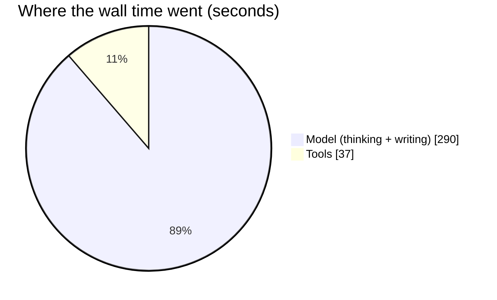

# corporate-ma/draft-markup-of-stock-purchase-agreement-provisions · run5 (`hv-mixed200-lunahigh-r5-20261116T164249Z`)

Result: **all-pass** 59/59 criteria · 5.5 min · 26 model calls · 32 tool calls (1 errors or timeouts) · ending `completed` · started 11-16 23:04:16 IST

## Overview

One box per stretch of steps that used the same kind of tool (blue: looking/searching/reading, purple: writing or editing files, yellow: a message with no tool call, red border: a tool error or timeout inside the box).

```mermaid
flowchart TD
    T(["Task prompt"])
    P0["<b>Step 1</b> · 0.0 min<br/>create_goal"]
    T --> P0
    class P0 look
    P1["<b>Step 2</b> · 0.0 min<br/>todo_write"]
    P0 --> P1
    class P1 look
    P2["<b>Step 3</b> · 0.0 min<br/>glob<br/><i>*</i>"]
    P1 --> P2
    class P2 look
    P3["<b>Step 4</b> · 0.2 min<br/>bash x3<br/>read<br/><i>parse-doc docx documents/buyer-ma-pla…, parse-doc docx documents/sellers-draf…, parse-doc docx documents/environmenta… +1</i>"]
    P2 --> P3
    class P3 look
    P4["<b>Steps 5-8</b> · 0.2 min<br/>read x6<br/><i>playbook.txt, spa.txt, envmemo.txt</i>"]
    P3 --> P4
    class P4 err
    P5["<b>Step 9</b> · 0.1 min<br/>bash<br/><i>parse-doc docx documents/executed-ter…</i>"]
    P4 --> P5
    class P5 look
    P6["<b>Steps 10-12</b> · 3.5 min<br/>read x2<br/>write<br/><i>termsheet.txt, playbook.txt, memo.md</i>"]
    P5 --> P6
    class P6 write
    P7["<b>Step 13</b> · 0.1 min<br/>bash<br/>read<br/><i>command -v pandoc || true; python - #lt;…, memo.md</i>"]
    P6 --> P7
    class P7 look
    P8["<b>Steps 14-15</b> · 0.2 min<br/>bash x2<br/><i>command -v pandoc || true; python - #lt;…, pandoc output/memo.md -o output/spa-m…</i>"]
    P7 --> P8
    class P8 look
    P9["<b>Step 16</b> · 0.2 min<br/>bash<br/>glob<br/><i>parse-doc docx output/spa-markup-memo…, output/*</i>"]
    P8 --> P9
    class P9 look
    P10["<b>Steps 17-18</b> · 0.1 min<br/>read x2<br/><i>memo-check.txt</i>"]
    P9 --> P10
    class P10 look
    P11["<b>Steps 19-20</b> · 0.5 min<br/>bash x2<br/><i>python - #lt;#lt;'PY' from docx import Docu…</i>"]
    P10 --> P11
    class P11 look
    P12["<b>Step 21</b> · 0.1 min<br/>glob<br/><i>output/*</i>"]
    P11 --> P12
    class P12 look
    P13["<b>Step 22</b> · 0.1 min<br/>bash<br/><i>unzip -t output/spa-markup-memorandum…</i>"]
    P12 --> P13
    class P13 look
    P14["<b>Step 23</b> · 0.1 min<br/>todo_write"]
    P13 --> P14
    class P14 look
    P15["<b>Step 24</b> · 0.0 min<br/>get_goal"]
    P14 --> P15
    class P15 look
    P16["<b>Step 25</b> · 0.1 min<br/>update_goal"]
    P15 --> P16
    class P16 look
    P17["<b>Step 26</b> · 0.0 min<br/>final message"]
    P16 --> P17
    class P17 ans
    R(["ALL PASS: 59/59 criteria"])
    P17 --> R
    class R pass
    classDef look fill:#e8f0fe,stroke:#4a6fa5,color:#111
    classDef write fill:#f3e8fd,stroke:#7b1fa2,color:#111
    classDef ans fill:#fff8e1,stroke:#b58900,color:#111
    classDef err fill:#e8f0fe,stroke:#c62828,stroke-width:3px,color:#111
    classDef pass fill:#e6f4ea,stroke:#2e7d32,color:#111
    classDef fail fill:#fce8e6,stroke:#c62828,color:#111
```





One row per model call:

| Step | Started (IST) | Model s | Tools s | Tool calls | Tools | Output chars |
|---|---|---|---|---|---|---|
| 1 | 23:04:16 | 2 | 0 | 1 | create_goal | 380 |
| 2 | 23:04:19 | 3 | 0 | 1 | todo_write | 57 |
| 3 | 23:04:22 | 1 | 1 | 1 | glob | 179 |
| 4 | 23:04:24 | 4 | 8 | 4 | bash x3, read | 19,721 |
| 5 | 23:04:35 | 2 | 0 | 3 | read x3 ⚠ | 101,210 |
| 6 | 23:04:37 | 3 | 0 | 1 | read | 52,800 |
| 7 | 23:04:40 | 2 | 0 | 1 | read | 52,885 |
| 8 | 23:04:42 | 2 | 0 | 1 | read | 53,806 |
| 9 | 23:04:45 | 2 | 3 | 1 | bash | 374 |
| 10 | 23:04:50 | 1 | 0 | 1 | read | 53,449 |
| 11 | 23:04:51 | 3 | 0 | 1 | read | 53,045 |
| 12 | 23:04:54 | 204 | 0 | 1 | write | 241 |
| 13 | 23:08:18 | 3 | 0 | 2 | bash, read | 30,141 |
| 14 | 23:08:22 | 4 | 3 | 1 | bash | 39 |
| 15 | 23:08:29 | 3 | 2 | 1 | bash | 11 |
| 16 | 23:08:34 | 3 | 7 | 2 | bash, glob | 444 |
| 17 | 23:08:43 | 3 | 0 | 1 | read | 34,337 |
| 18 | 23:08:46 | 3 | 0 | 1 | read | 35,677 |
| 19 | 23:08:49 | 14 | 4 | 1 | bash | 1,689 |
| 20 | 23:09:07 | 10 | 4 | 1 | bash | 409 |
| 21 | 23:09:21 | 2 | 2 | 1 | glob | 33 |
| 22 | 23:09:26 | 5 | 3 | 1 | bash | 391 |
| 23 | 23:09:33 | 4 | 0 | 1 | todo_write | 57 |
| 24 | 23:09:37 | 2 | 0 | 1 | get_goal | 380 |
| 25 | 23:09:39 | 3 | 0 | 1 | update_goal | 385 |
| 26 | 23:09:42 | 2 | 0 | 0 | (message only) | 0 |

## Task prompt

```text
Review the seller's draft SPA against the buyer's playbook, executed term sheet, and diligence materials, and prepare a detailed markup memorandum with draft-ready redline language. Output: `spa-markup-memorandum.docx`.
```

## Rubric

| # | Criterion | Verdict |
|---|---|---|
| C-001 | ISSUE_001: Identifies overbroad MAE carve-outs for environmental industry/regulations | pass |
| C-002 | ISSUE_001: Proposes adding disproportionate impact qualifier to MAE carve-outs | pass |
| C-003 | ISSUE_001: Provides actual revised contract language for MAE definition | pass |
| C-004 | ISSUE_001: Explains rationale — environmental company needs MAE protection | pass |
| C-005 | ISSUE_002: Identifies missing interim covenant restricting affiliate transactions | pass |
| C-006 | ISSUE_002: Proposes covenant requiring Buyer consent for affiliate transactions | pass |
| C-007 | ISSUE_002: References the above-market rent to Seller affiliate as rationale | pass |
| C-008 | ISSUE_003: Identifies indemnification cap discrepancy (20% vs. 12.5%) | pass |
| C-009 | ISSUE_003: Proposes redline reducing cap to 12.5% / $26,875,000 | pass |
| C-010 | ISSUE_003: References the term sheet as basis for cap correction | pass |
| C-011 | ISSUE_004: Identifies that environmental reps survival period is too short | pass |
| C-012 | ISSUE_004: Proposes extending environmental reps survival to at least 36 months | pass |
| C-013 | ISSUE_004: References CERCLA/Dalton Creek exposure as rationale for longer survival | pass |
| C-014 | ISSUE_005: Identifies anti-sandbagging provision in Section 9.06 | pass |
| C-015 | ISSUE_005: Proposes replacing with pro-sandbagging language | pass |
| C-016 | ISSUE_005: Provides actual pro-sandbagging contract text | pass |
| C-017 | ISSUE_006: Identifies need for Special Indemnity for Dalton Creek CERCLA matter | pass |
| C-018 | ISSUE_006: Special Indemnity survival of 72 months | pass |
| C-019 | ISSUE_006: Special Indemnity not subject to basket or cap | pass |
| C-020 | ISSUE_006: References Dalton Creek liability range ($1.5M-$6M) | pass |
| C-021 | ISSUE_007: Identifies problematic earnout operational covenant | pass |
| C-022 | ISSUE_007: Proposes limiting earnout covenant to no-frustration standard | pass |
| C-023 | ISSUE_007: Explains rationale — Buyer integration/restructuring flexibility | pass |
| C-024 | ISSUE_008: Identifies missing payoff letter requirement | pass |
| C-025 | ISSUE_008: Proposes payoff letters at least 3 business days pre-closing | pass |
| C-026 | ISSUE_008: Proposes simultaneous repayment at closing through funds flow | pass |
| C-027 | ISSUE_008: Proposes payoff letter delivery as a condition to closing | pass |
| C-028 | ISSUE_009: Identifies missing government contract anti-assignment/novation requirement | pass |
| C-029 | ISSUE_009: References specific government contracts requiring novation | pass |
| C-030 | ISSUE_009: Proposes closing condition or covenant for government contract novation | pass |
| C-031 | ISSUE_009: References Anti-Assignment Act or FAR provisions | pass |
| C-032 | ISSUE_010: Identifies missing environmental permit transfer/notification covenant | pass |
| C-033 | ISSUE_010: Proposes cooperation covenant for environmental permit transfers | pass |
| C-034 | ISSUE_010: Notes that permits may require notification even in a stock deal | pass |
| C-035 | ISSUE_011: Identifies missing R&W Insurance subrogation waiver | pass |
| C-036 | ISSUE_011: Proposes subrogation waiver provision with fraud exception | pass |
| C-037 | ISSUE_011: References R&W Insurance policy / Granite Ridge Underwriters | pass |
| C-038 | ISSUE_012: Identifies non-compete scope exceeds term sheet (duration) | pass |
| C-039 | ISSUE_012: Identifies non-compete scope exceeds term sheet (geographic) | pass |
| C-040 | ISSUE_012: Identifies non-compete scope exceeds term sheet (activity) | pass |
| C-041 | ISSUE_012: Proposes narrowing non-compete duration to 3 years | pass |
| C-042 | ISSUE_012: Proposes narrowing non-compete geographic scope to OR, WA, CA, NV | pass |
| C-043 | ISSUE_012: Proposes narrowing non-compete activity scope to environmental remediation and hazardous waste management | pass |
| C-044 | ISSUE_012: Notes enforceability risk of overbroad non-compete | pass |
| C-045 | Indemnification cap issue rated as Critical or High priority | pass |
| C-046 | Anti-sandbagging issue rated as Critical or High priority | pass |
| C-047 | Memorandum identifies provisions acceptable as drafted | pass |
| C-048 | Memorandum flags items for partner/client discussion | pass |
| C-049 | Escrow amount correctly stated as $16,125,000 (7.5% of EV) | pass |
| C-050 | ISSUE_006: Proposes 36-month escrow holdback for Special Indemnity | pass |
| C-051 | Earnout maximum correctly referenced as $25,000,000 | pass |
| C-052 | Earnout Adjusted EBITDA threshold correctly referenced as $38,000,000 | pass |
| C-053 | Earnout floor correctly referenced as $32,000,000 | pass |
| C-054 | References playbook as authority for at least 3 markup positions | pass |
| C-055 | References term sheet as authority for at least 3 markup positions | pass |
| C-056 | References environmental DD memo for at least one markup position | pass |
| C-057 | Memorandum identifies specific SPA section numbers for issues | pass |
| C-058 | Proposed redline language is actual contract text for at least 8 issues | pass |
| C-059 | ISSUE_008: Identifies all three sources of Target indebtedness | pass |

Judge's reasoning:

**C-001 (pass):** ISSUE_001: Identifies overbroad MAE carve-outs for environmental industry/regulations

```text
The memorandum expressly identifies the environmental-services industry and Environmental Law carve-outs as problematic and proposes a disproportionate-impact qualifier applying to those carve-outs.
```

**C-002 (pass):** ISSUE_001: Proposes adding disproportionate impact qualifier to MAE carve-outs

```text
The proposed MAE definition adds an express disproportionate-impact exception applying to clauses (i) through (v), including the environmental-services industry carve-out and changes in Environmental Laws, where the Company is disproportionately affected relative to other industry participants.
```

**C-003 (pass):** ISSUE_001: Provides actual revised contract language for MAE definition

```text
The memorandum includes a full proposed replacement MAE definition as draft contract text, including a disproportionate-impact proviso applying to specified carve-outs relative to other industry participants.
```

**C-004 (pass):** ISSUE_001: Explains rationale — environmental company needs MAE protection

```text
The memorandum expressly explains that the environmental-services industry and Environmental Law carve-outs remove from the MAE analysis the risks most likely to affect Cascadia’s value, noting that environmental-industry downturns and regulatory changes are core platform risks for a permit-dependent environmental services company. This directly satisfies the criterion.
```

**C-005 (pass):** ISSUE_002: Identifies missing interim covenant restricting affiliate transactions

```text
The memorandum expressly identifies that the interim covenants lack a restriction on transactions with Seller or Seller affiliates and proposes a new Section 6.01(b)(xiv) restricting entry into, amendment, extension, renewal, supplementation, or termination of such affiliate transactions between signing and closing.
```

**C-006 (pass):** ISSUE_002: Proposes covenant requiring Buyer consent for affiliate transactions

```text
The memorandum proposes new Section 6.01(b)(xiv), which prohibits the Company from entering into, amending, modifying, extending, renewing, supplementing, or terminating any contract, transaction, or arrangement with Seller or any Seller affiliate without Buyer's prior written consent.
```

**C-007 (pass):** ISSUE_002: References the above-market rent to Seller affiliate as rationale

```text
The memorandum expressly connects the affiliate-transaction covenant to the identified “$1,600,000 Affiliate Lease,” describing it as an above-market EBITDA adjustment and explaining that the covenant prevents Seller from expanding or amending value-leaking affiliate arrangements before closing.
```

**C-008 (pass):** ISSUE_003: Identifies indemnification cap discrepancy (20% vs. 12.5%)

```text
The memorandum expressly identifies the Seller draft’s general indemnification cap as 20%/$43,000,000 and contrasts it with the term sheet’s agreed 12.5%/$26,875,000 cap, including proposed replacement language.
```

**C-009 (pass):** ISSUE_003: Proposes redline reducing cap to 12.5% / $26,875,000

```text
The memorandum expressly proposes replacing the 20%/$43 million cap with a 12.5% cap equal to $26,875,000, based on the $215 million Base Enterprise Value.
```

**C-010 (pass):** ISSUE_003: References the term sheet as basis for cap correction

```text
The memorandum expressly cites the executed September 10, 2025 Term Sheet as the basis for correcting the indemnification cap. In Section 18, it states that the draft's 20%/$43 million cap contradicts Term Sheet §8, which fixes the cap at 12.5% of the $215 million Base Enterprise Value, or $26.875 million.
```

**C-011 (pass):** ISSUE_004: Identifies that environmental reps survival period is too short

```text
The memorandum expressly identifies the Seller's 12-month blanket survival period as inadequate for environmental risks and proposes a separate 36-month survival period for environmental representations, including Environmental Laws and Environmental Permits, while flagging full-statute survival as a preferred alternative.
```

**C-012 (pass):** ISSUE_004: Proposes extending environmental reps survival to at least 36 months

```text
The memorandum expressly proposes that the Environmental Representations survive for 36 months following closing and also reserves the option to seek survival for the full applicable statute of limitations.
```

**C-013 (pass):** ISSUE_004: References CERCLA/Dalton Creek exposure as rationale for longer survival

```text
The memorandum expressly connects longer environmental survival to known environmental risks. In the Section 9.01 commentary, it cites the DD Memo’s “long-tail Dalton Creek CERCLA exposure” and the Hargrove remediation project’s 18–24-month timeline to justify at least 36 months of survival, while also flagging full-statute survival as the preferred alternative.
```

**C-014 (pass):** ISSUE_005: Identifies anti-sandbagging provision in Section 9.06

```text
The memorandum expressly identifies Section 9.06 as an anti-sandbagging provision and quotes its language barring Buyer from indemnification for breaches or inaccuracies of which Buyer or its Representatives had Knowledge as of the Closing Date.
```

**C-015 (pass):** ISSUE_005: Proposes replacing with pro-sandbagging language

```text
The memorandum expressly strikes the anti-sandbagging provision and replaces it with Section 9.06 stating that Buyer's indemnification and other remedies are not limited, diminished, or otherwise affected by any investigation or knowledge acquired before or after execution or Closing.
```

**C-016 (pass):** ISSUE_005: Provides actual pro-sandbagging contract text

```text
The memorandum includes actual proposed pro-sandbagging contract language in Section 9.06, expressly stating that Buyer's indemnification and other remedies are not affected by investigations, knowledge, or notice before or after signing or closing.
```

**C-017 (pass):** ISSUE_006: Identifies need for Special Indemnity for Dalton Creek CERCLA matter

```text
The memorandum expressly proposes a separate “Dalton Creek Special Indemnity” in Section 9.02(e), covering the EPA CERCLA Section 104(e) request and related investigation, remediation, enforcement, contribution, and cost-recovery liabilities. It also states that relying only on general environmental representation indemnity would be inadequate.
```

**C-018 (pass):** ISSUE_006: Special Indemnity survival of 72 months

```text
The memorandum expressly states that the Dalton Creek Special Indemnity survives for seventy-two (72) months following the Closing Date, including in proposed Sections 9.01(d) and 9.02(e).
```

**C-019 (pass):** ISSUE_006: Special Indemnity not subject to basket or cap

```text
The memorandum expressly states that the Dalton Creek Special Indemnity is not subject to the Basket Amount or the Indemnification Cap, provides first-dollar recovery, and includes conforming carve-outs in the proposed basket and cap provisions.
```

**C-020 (pass):** ISSUE_006: References Dalton Creek liability range ($1.5M-$6M)

```text
The memorandum expressly states in the proposed Dalton Creek schedule: “Current estimated exposure: $1,500,000–$6,000,000,” and uses that exposure to support the Dalton Creek Special Indemnity and related escrow protections.
```

**C-021 (pass):** ISSUE_007: Identifies problematic earnout operational covenant

```text
The memorandum expressly identifies Section 2.05's requirement to operate consistently with past practice and in good faith to maximize the earnout as overly restrictive, recommends deleting those affirmative operating obligations, and replaces them with a narrow primary-purpose restriction.
```

**C-022 (pass):** ISSUE_007: Proposes limiting earnout covenant to no-frustration standard

```text
The memorandum expressly replaces the affirmative past-practice and earnout-maximization obligations with a narrow covenant prohibiting actions taken with the primary purpose of reducing or avoiding the earnout payment. It also preserves Buyer's discretion to operate, integrate, and restructure the business absent that prohibited purpose.
```

**C-023 (pass):** ISSUE_007: Explains rationale — Buyer integration/restructuring flexibility

```text
The memorandum expressly explains that the seller’s broad earnout covenant should be deleted because it would constrain Buyer’s post-closing discretion. It states that Buyer must retain the right to operate, integrate, restructure, allocate resources, and make other operational or strategic decisions in its sole discretion, subject only to a narrow primary-purpose restriction.
```

**C-024 (pass):** ISSUE_008: Identifies missing payoff letter requirement

```text
The memorandum expressly identifies that the draft permits repayment “at or promptly following the Closing” and lacks a payoff-letter deliverable or closing condition. It proposes requiring executed payoff letters from each holder of Closing Indebtedness at least three Business Days before closing, with simultaneous payoff through the funds flow.
```

**C-025 (pass):** ISSUE_008: Proposes payoff letters at least 3 business days pre-closing

```text
The memorandum expressly requires executed payoff letters no later than three Business Days before closing. It also requires each letter to include wiring instructions and commitments to provide lien releases, UCC termination statements, and related release documentation.
```

**C-026 (pass):** ISSUE_008: Proposes simultaneous repayment at closing through funds flow

```text
The memorandum expressly proposes in Section 2.03(d) that all Closing Indebtedness be repaid simultaneously at the Closing through the funds flow, with no Closing Indebtedness remaining outstanding afterward. It also adds a funds flow agreement covering the exact payoff amounts and wiring instructions.
```

**C-027 (pass):** ISSUE_008: Proposes payoff letter delivery as a condition to closing

```text
The memorandum expressly proposes a Buyer closing condition in Section 7.02(h) requiring Seller to deliver the payoff letters at least three Business Days before closing, in full force and effect and reasonably satisfactory to Buyer.
```

**C-028 (pass):** ISSUE_009: Identifies missing government contract anti-assignment/novation requirement

```text
The memorandum expressly identifies that the Seller's draft lacks specific government-contract anti-assignment, novation, and recognition protections. It discusses the Oregon DEQ, Washington Ecology, U.S. Army Corps of Engineers, and Bureau of Land Management contracts; cites the Anti-Assignment Act and FAR Part 42.12; and proposes related representations, covenants, and closing conditions.
```

**C-029 (pass):** ISSUE_009: References specific government contracts requiring novation

```text
The memorandum specifically identifies the U.S. Army Corps of Engineers and Bureau of Land Management contracts as subject to FAR Part 42, Subpart 42.12 novation requirements, satisfying the requirement to identify at least two specific active government contracts requiring novation or recognition.
```

**C-030 (pass):** ISSUE_009: Proposes closing condition or covenant for government contract novation

```text
The memorandum proposes a specific pre-closing covenant in Section 6.12 requiring Seller and the Company to notify contracting officers, submit all required novation and recognition requests, and use commercially reasonable efforts to obtain the relevant agreements and approvals. It also proposes a Section 7.02 closing condition requiring submission of those requests and no adverse agency response.
```

**C-031 (pass):** ISSUE_009: References Anti-Assignment Act or FAR provisions

```text
The memorandum expressly cites both the Anti-Assignment Act, 41 U.S.C. § 6305, and FAR Part 42, Subpart 42.12 as the legal basis for government-contract novation, recognition, notice, and approval requirements.
```

**C-032 (pass):** ISSUE_010: Identifies missing environmental permit transfer/notification covenant

```text
The memorandum expressly identifies that the draft lacks a pre- or post-closing covenant addressing the 23-permit portfolio and change-of-control notices or approvals. It proposes Section 6.13 requiring identification and submission of required notices/applications, efforts to obtain approvals, and post-closing cooperation on permit transfers, reissuances, amendments, and approvals.
```

**C-033 (pass):** ISSUE_010: Proposes cooperation covenant for environmental permit transfers

```text
The memorandum proposes new Section 6.13, requiring Seller to assist both before and after closing with identifying permit requirements, preparing and submitting environmental permit notices and applications, obtaining approvals, and cooperating on permit transfers, re-issuances, amendments, and approvals under applicable state requirements.
```

**C-034 (pass):** ISSUE_010: Notes that permits may require notification even in a stock deal

```text
The memorandum expressly identifies Oregon, Washington, California, and Nevada permit requirements triggered by a change in ownership or control and proposes notice, approval, and cooperation provisions for the contemplated stock purchase. This captures that permit notifications or approvals may be required despite the permit-holding entity remaining in place.
```

**C-035 (pass):** ISSUE_011: Identifies missing R&W Insurance subrogation waiver

```text
The memorandum expressly states that the Seller's draft contains no reference to R&W Insurance, Granite Ridge Underwriters, or the insurer's subrogation rights, and proposes a new Section 10.13 requiring a subrogation waiver against Seller and related parties, subject to an actual-fraud exception.
```

**C-036 (pass):** ISSUE_011: Proposes subrogation waiver provision with fraud exception

```text
The memorandum proposes new Section 10.13 requiring the R&W insurer to irrevocably waive subrogation and other recovery rights against Seller and related parties, with an express exception for claims arising from actual fraud by Seller. Although Granite Ridge Underwriters is not named in the provision itself, the memorandum identifies Granite Ridge as the relevant insurer elsewhere and satisfies the substantive criterion.
```

**C-037 (pass):** ISSUE_011: References R&W Insurance policy / Granite Ridge Underwriters

```text
The memorandum expressly states that Buyer will obtain an R&W Insurance policy and adds a proposed Section 10.13 requiring the insurer to waive subrogation against Seller except for actual fraud. It also references Granite Ridge Underwriters in the priority matrix and notes the need to coordinate the policy with the subrogation waiver.
```

**C-038 (pass):** ISSUE_012: Identifies non-compete scope exceeds term sheet (duration)

```text
The memorandum expressly identifies that the Seller's draft imposes a five-year non-compete and states that it must be conformed to the term sheet's three-year period, including proposed replacement language using three years.
```

**C-039 (pass):** ISSUE_012: Identifies non-compete scope exceeds term sheet (geographic)

```text
The memorandum expressly identifies that the Seller’s draft imposes a nationwide restriction and proposes conforming it to the term sheet’s four-state scope: Oregon, Washington, California, and Nevada.
```

**C-040 (pass):** ISSUE_012: Identifies non-compete scope exceeds term sheet (activity)

```text
The memorandum expressly identifies that the Seller's five-year nationwide restriction covering “any business” is overbroad and states that the term sheet limits the activity scope to environmental remediation and hazardous waste management services. It also proposes replacement language conforming to that narrower scope.
```

**C-041 (pass):** ISSUE_012: Proposes narrowing non-compete duration to 3 years

```text
The memorandum expressly proposes replacing the five-year non-compete with a three-year non-compete in Section 6.09(a), matching the term sheet.
```

**C-042 (pass):** ISSUE_012: Proposes narrowing non-compete geographic scope to OR, WA, CA, NV

```text
The proposed replacement for Section 6.09(a) expressly limits the non-compete to the States of Oregon, Washington, California, and Nevada, matching the term sheet and replacing the seller draft’s nationwide scope.
```

**C-043 (pass):** ISSUE_012: Proposes narrowing non-compete activity scope to environmental remediation and hazardous waste management

```text
The proposed replacement for Section 6.09(a) expressly limits the non-compete to businesses engaged in “environmental remediation services or hazardous waste management services,” matching the term sheet’s activity scope.
```

**C-044 (pass):** ISSUE_012: Notes enforceability risk of overbroad non-compete

```text
The memorandum expressly states that the five-year nationwide restriction covering “any business” improperly sweeps in Evergreen’s unrelated construction and timber operations and “creates enforceability risk.” It also proposes carve-outs preserving those legitimate businesses.
```

**C-045 (pass):** Indemnification cap issue rated as Critical or High priority

```text
The indemnification cap discrepancy is expressly assigned High priority in both the priority matrix and Section 18, where the draft's 20%/$43 million cap is corrected to 12.5%/$26.875 million.
```

**C-046 (pass):** Anti-sandbagging issue rated as Critical or High priority

```text
Section 9.06 (sandbagging) is expressly assigned “Priority: CRITICAL,” which is the highest priority tier and satisfies the criterion.
```

**C-047 (pass):** Memorandum identifies provisions acceptable as drafted

```text
The memorandum includes a dedicated “Provisions intentionally not marked up” section identifying multiple provisions as acceptable as drafted, including the basket, knowledge qualifier, good-standing certificates, Delaware governing law, escrow amount and agent, and certain core economic terms. It also briefly explains why each conforms to the term sheet or playbook.
```

**C-048 (pass):** Memorandum flags items for partner/client discussion

```text
The memorandum expressly includes Section 23, “Additional items requiring partner/client discussion,” identifying multiple issues for Marcus Devereaux to decide or confirm, including whether completed government-contract novation should be a hard closing condition, whether to seek environmental survival for the full statute of limitations, and the Dalton Creek escrow structure. It also flags discussion points elsewhere in the markup.
```

**C-049 (pass):** Escrow amount correctly stated as $16,125,000 (7.5% of EV)

```text
The memorandum correctly states the escrow amount as $16,125,000 and expressly identifies it as 7.5% of the $215,000,000 base enterprise value, including in the escrow mechanics discussion.
```

**C-050 (pass):** ISSUE_006: Proposes 36-month escrow holdback for Special Indemnity

```text
The memorandum expressly distinguishes the 18-month general escrow release from a 36-month holdback for Fundamental Representations and Special Indemnities, including Dalton Creek. Section 9.08(b) requires the Dalton Creek-allocated escrow portion (at least $1.5 million) to remain available through the 36th month post-closing.
```

**C-051 (pass):** Earnout maximum correctly referenced as $25,000,000

```text
The memorandum correctly states that the maximum earnout payment is $25,000,000 in the proposed Section 2.05 language and accompanying commentary.
```

**C-052 (pass):** Earnout Adjusted EBITDA threshold correctly referenced as $38,000,000

```text
The memorandum correctly states that the maximum $25,000,000 earnout is payable if Adjusted EBITDA equals or exceeds $38,000,000, and repeatedly identifies $38,000,000 as the full-payment threshold.
```

**C-053 (pass):** Earnout floor correctly referenced as $32,000,000

```text
The memorandum correctly states a $32,000,000 earnout floor and provides for linear pro-rata payment between $32,000,000 and the $38,000,000 full-payment threshold, with no payment below $32,000,000.
```

**C-054 (pass):** References playbook as authority for at least 3 markup positions

```text
The memorandum cites the Buyer's M&A Playbook as authority for well over three distinct markup positions, including the MAE disproportionate-impact qualifier, earnout covenant and EBITDA definition, debt payoff mechanics, affiliate and environmental interim covenants, environmental survival, indemnification cap, pro-sandbagging, escrow coordination, R&W insurance provisions, and restrictive covenants.
```

**C-055 (pass):** References term sheet as authority for at least 3 markup positions

```text
The memorandum cites the executed term sheet as authority for well over three distinct markup positions, including the earnout covenant and mechanics, debt payoff letters and funds flow, absence-of-MAE lookback, non-compete scope, indemnification survival and cap, Dalton Creek special indemnity, closing conditions, R&W insurance provisions, escrow mechanics, and books-and-records access.
```

**C-056 (pass):** References environmental DD memo for at least one markup position

```text
The memorandum repeatedly cites the Environmental Due Diligence Summary (defined as the “DD Memo”) to support markup positions, including the Dalton Creek special indemnity, government-contract novation provisions, permit-transfer covenants, and environmental representation survival.
```

**C-057 (pass):** Memorandum identifies specific SPA section numbers for issues

```text
The memorandum ties well over 8 issues to specific SPA section numbers, including Sections 1.01, 2.03, 2.05, 2.08, 4.08, 4.15, 4.16, 6.01, 6.09, 7.02, 9.01, 9.02, 9.04, 9.06, 9.08, 10.13, and 10.14.
```

**C-058 (pass):** Proposed redline language is actual contract text for at least 8 issues

```text
The memorandum provides draft-ready contract text for well over 8 planted issues, including MAE, earnout mechanics and operating covenants, debt payoff letters/funds flow, government contracts, permit cooperation, affiliate transactions, non-compete, closing conditions, survival, Dalton Creek indemnity, the indemnification cap, sandbagging, escrow releases, and R&W insurance subrogation.
```

**C-059 (pass):** ISSUE_008: Identifies all three sources of Target indebtedness

```text
The payoff-letter provision expressly identifies all three sources of Target indebtedness: Cascade Mutual Bank's $28.0 million senior term loan, Pacific Lease Corp.'s $9.8 million equipment financing, and Evergreen Holdings Group, Inc.'s $4.5 million subordinated seller note.
```

## Delivered files (output/)

- `spa-markup-memorandum.docx` (35,594 bytes)

## Trajectory

### Step 1: 1 tool call

_Started 11-16 23:04:16 IST · model 2 s · tools 0 s_

**Call `create_goal`** (0.0 s)

```json
{
 "objective": "Review the seller's draft SPA against the buyer's playbook, executed term sheet, and diligence materials, then produce a detailed markup memorandum with draft-ready redline language in output/spa-markup-memorandum.docx.",
 "max_goal_rounds": 3
}
```

Output (380 chars):

```text
{"goal":{"id":"goal-935c1d14-7a5c-4ef9-836d-ebd27a27c6be","revision":1,"objective":"Review the seller's draft SPA against the buyer's playbook, executed term sheet, and diligence materials, then produce a detailed markup memorandum with draft-ready redline language in output/spa-markup-memorandum.docx.","phase":"active","roundsStarted":0,"maxGoalRounds":3},"activation":"armed"}
```

### Step 2: 1 tool call

_Started 11-16 23:04:19 IST · model 3 s · tools 0 s_

**Call `todo_write`** (0.0 s)

```json
{
 "todos": [
  {
   "content": "Inventory and read the SPA, playbook, term sheet, and diligence materials",
   "status": "in_progress"
  },
  {
   "content": "Analyze conflicts and draft section-by-section buyer-favorable redline language",
   "status": "pending"
  },
  {
   "content": "Generate and quality-check the DOCX memorandum",
   "status": "pending"
  }
 ]
}
```

Output (57 chars):

```text
Updated todo list: 2 pending, 1 in progress, 0 completed.
```

**Todo list now:**

- [~] Inventory and read the SPA, playbook, term sheet, and diligence materials
- [ ] Analyze conflicts and draft section-by-section buyer-favorable redline language
- [ ] Generate and quality-check the DOCX memorandum

### Step 3: 1 tool call

_Started 11-16 23:04:22 IST · model 1 s · tools 1 s_

**Call `glob`** (0.9 s)

```json
{
 "pattern": "*"
}
```

Output (179 chars):

```text
documents/buyer-ma-playbook.docx
documents/sellers-draft-spa.docx
documents/environmental-dd-memo.docx
documents/executed-term-sheet.docx
documents/partner-markup-instructions.eml
```

### Step 4: 4 tool calls

_Started 11-16 23:04:24 IST · model 4 s · tools 8 s_

**Reasoning summary:**

```text
**Planning document conversion**

I need to convert documents to text using bash and the `parse-doc` command. It looks like I can run this in parallel, which is great. For emails, I can use the `read` command, but I definitely shouldn't use `cat`. I'll redirect the output to a scratch space, maybe something in `/tmp`. Then, I want to create a final document in DOCX format using `python-docx`, assuming it's installed. So, the first step is parsing the documents into text files.
```

**Call `bash`** (2.9 s)

```json
{
 "command": "parse-doc docx documents/buyer-ma-playbook.docx > playbook.txt",
 "description": "Convert buyer playbook to text",
 "workdir": "/home/agarwaldi/dsh-bench-harness/runs/hv-mixed200-lunahigh-r5-20261116T164249Z/tasks/corporate-ma__draft-markup-of-stock-purchase-agreement-provisions/workspace"
}
```

Output (374 chars):

```text
[stderr]
2026-11-16 17:34:29.749037531 [W:onnxruntime:Default, device_discovery.cc:95 GetPciBusId] Skipping pci_bus_id for PCI path at "/sys/devices/LNXSYSTM:00/LNXSYBUS:00/ACPI0004:00/VMBUS:00/5620e0c7-8062-4dce-aeb7-520c7ef76171" because filename "5620e0c7-8062-4dce-aeb7-520c7ef76171" did not match expected pattern of [0-9a-f]+:[0-9a-f]+:[0-9a-f]+[.][0-9a-f]+
```

**Call `bash`** (2.5 s)

```json
{
 "command": "parse-doc docx documents/sellers-draft-spa.docx > spa.txt",
 "description": "Convert seller SPA to text",
 "workdir": "/home/agarwaldi/dsh-bench-harness/runs/hv-mixed200-lunahigh-r5-20261116T164249Z/tasks/corporate-ma__draft-markup-of-stock-purchase-agreement-provisions/workspace"
}
```

Output (374 chars):

```text
[stderr]
2026-11-16 17:34:32.285604964 [W:onnxruntime:Default, device_discovery.cc:95 GetPciBusId] Skipping pci_bus_id for PCI path at "/sys/devices/LNXSYSTM:00/LNXSYBUS:00/ACPI0004:00/VMBUS:00/5620e0c7-8062-4dce-aeb7-520c7ef76171" because filename "5620e0c7-8062-4dce-aeb7-520c7ef76171" did not match expected pattern of [0-9a-f]+:[0-9a-f]+:[0-9a-f]+[.][0-9a-f]+
```

**Call `bash`** (2.1 s)

```json
{
 "command": "parse-doc docx documents/environmental-dd-memo.docx > envmemo.txt",
 "description": "Convert environmental memo to text",
 "workdir": "/home/agarwaldi/dsh-bench-harness/runs/hv-mixed200-lunahigh-r5-20261116T164249Z/tasks/corporate-ma__draft-markup-of-stock-purchase-agreement-provisions/workspace"
}
```

Output (374 chars):

```text
[stderr]
2026-11-16 17:34:34.782922509 [W:onnxruntime:Default, device_discovery.cc:95 GetPciBusId] Skipping pci_bus_id for PCI path at "/sys/devices/LNXSYSTM:00/LNXSYBUS:00/ACPI0004:00/VMBUS:00/5620e0c7-8062-4dce-aeb7-520c7ef76171" because filename "5620e0c7-8062-4dce-aeb7-520c7ef76171" did not match expected pattern of [0-9a-f]+:[0-9a-f]+:[0-9a-f]+[.][0-9a-f]+
```

**Call `read`** (0.0 s)

```json
{
 "file_path": "documents/partner-markup-instructions.eml"
}
```

Output (18,599 chars):

```text
<path>/home/agarwaldi/dsh-bench-harness/runs/hv-mixed200-lunahigh-r5-20261116T164249Z/tasks/corporate-ma__draft-markup-of-stock-purchase-agreement-provisions/workspace/documents/partner-markup-instructions.eml</path>
<type>file</type>
<content>
1: From: Elena Vasquez-Moreno <evasquez-moreno@apylaw.com>
2: To: Jonathan Kreider <jkreider@apylaw.com>
3: Date: Thu, 23 Oct 2025 08:47:00 -0000
4: Subject: Re: Cascadia SPA Markup — Instructions and Priority Issues
5: Content-Type: text/plain; charset="utf-8"
6: Content-Transfer-Encoding: quoted-printable
7: MIME-Version: 1.0
8: 
9: Jonathan,
10: 
11: I reviewed the initial draft SPA that Douglas Renwick at Fortuna & Blake circ=
12: ulated yesterday. My overall impression: this is a heavily seller-favorable d=
13: raft in several material respects, and some of the positions directly contrad=
14: ict the September 10 term sheet =E2=80=94 which tells me either Doug is testi=
15: ng our resolve or his client gave him different instructions than what was ag=
16: reed at the principal level. Either way, we need a sharp, comprehensive marku=
17: p.
18: 
19: Marcus Devereaux at Whitmore Capital wants to see our redline by end of next =
20: week. Given the November 14 target signing date, that gives the parties rough=
21: ly two weeks of negotiation runway after we send our markup, which is tight. =
22: I need your comprehensive markup memorandum with redlined provisions and full=
23:  track-changes commentary.
24: 
25: **General Instruction
… [17,099 more chars]
```

### Step 5: 3 tool calls

_Started 11-16 23:04:35 IST · model 2 s · tools 0 s_

**Call `read`** (0.1 s)

```json
{
 "file_path": "playbook.txt",
 "offset": 1,
 "limit": 2000
}
```

Output (52,859 chars):

```text
<path>/home/agarwaldi/dsh-bench-harness/runs/hv-mixed200-lunahigh-r5-20261116T164249Z/tasks/corporate-ma__draft-markup-of-stock-purchase-agreement-provisions/workspace/playbook.txt</path>
<type>file</type>
<content>
1: **[ASHFORD, PENNINGTON & YATES LLP]{.underline}**
2: 
3: 71 South Wacker Drive, Suite 4500 Chicago, Illinois 60606
4: 
5: **[M&A PLAYBOOK --- ENVIRONMENTAL SERVICES SECTOR ACQUISITIONS]{.underline}**
6: 
7: **[Internal Guidance for Associates Reviewing Stock Purchase Agreements and Asset Purchase Agreements on Behalf of Private Equity Buyer Clients]{.underline}**
8: 
9: **Prepared by:** M&A Practice Group Ashford, Pennington & Yates LLP 71 South Wacker Drive, Suite 4500 Chicago, Illinois 60606
10: 
11: **Version:** 4.2 (Revised October 2025)
12: 
13: **Distribution:** CONFIDENTIAL --- For Internal Use Only --- Attorney Work Product
14: 
15: **Primary Authors:**
16: 
17: Elena Vasquez-Moreno, Partner, M&A Practice Group
18: 
19: With contributions from the Environmental Regulatory Practice Group and the Government Contracts Practice Group
20: 
21: **NOTE:** This playbook supplements the Firm\'s General M&A Playbook (v.7.1) and should be read in conjunction with it. Where this sector-specific playbook addresses a topic also covered in the General Playbook, this playbook governs for environmental services transactions. In the event of any inconsistency between this playbook and the General M&A Playbook with respect to an environmental services acquisition, the gui
… [51,359 more chars]
```

**Call `read`** (0.1 s · **error/timeout**)

```json
{
 "file_path": "spa.txt",
 "offset": 1,
 "limit": 3000
}
```

Output (47 chars):

```text
Error: limit must be less than or equal to 2000
```

**Call `read`** (0.1 s)

```json
{
 "file_path": "envmemo.txt",
 "offset": 1,
 "limit": 2000
}
```

Output (48,304 chars):

```text
<path>/home/agarwaldi/dsh-bench-harness/runs/hv-mixed200-lunahigh-r5-20261116T164249Z/tasks/corporate-ma__draft-markup-of-stock-purchase-agreement-provisions/workspace/envmemo.txt</path>
<type>file</type>
<content>
1: **ASHFORD, PENNINGTON & YATES LLP** *Attorneys at Law* 71 South Wacker Drive, Suite 4500 Chicago, Illinois 60606
2: 
3: **PRIVILEGED AND CONFIDENTIAL --- ATTORNEY WORK PRODUCT** This memorandum is protected by the attorney-client privilege and the work product doctrine. It is intended solely for use by the attorneys and professionals of Ashford, Pennington & Yates LLP and the client to whom it is addressed. Any unauthorized disclosure, reproduction, or distribution is strictly prohibited.
4: 
5: **MEMORANDUM**
6: 
7: **TO:** Elena Vasquez-Moreno, Partner, M&A Group Jonathan Kreider, Senior Associate, M&A Group
8: 
9: **FROM:** Environmental Practice Group, Ashford, Pennington & Yates LLP
10: 
11: **DATE:** October 18, 2025
12: 
13: **RE:** Environmental Due Diligence Summary --- Acquisition of Cascadia Environmental Solutions, Inc. by Whitmore Capital Partners LLC
14: 
15: **PROJECT:** Project Cascade --- Whitmore Capital Partners LLC Fund III Platform Acquisition
16: 
17: This memorandum summarizes the findings and recommendations of the Environmental Practice Group arising from our environmental due diligence review of Cascadia Environmental Solutions, Inc. in connection with the proposed acquisition by Whitmore Capital Partners LLC. This memo is intended to i
… [46,804 more chars]
```

### Step 6: 1 tool call

_Started 11-16 23:04:37 IST · model 3 s · tools 0 s_

**Call `read`** (0.0 s)

```json
{
 "file_path": "spa.txt",
 "offset": 1,
 "limit": 2000
}
```

Output (52,800 chars):

```text
<path>/home/agarwaldi/dsh-bench-harness/runs/hv-mixed200-lunahigh-r5-20261116T164249Z/tasks/corporate-ma__draft-markup-of-stock-purchase-agreement-provisions/workspace/spa.txt</path>
<type>file</type>
<content>
1: **[STOCK PURCHASE AGREEMENT]{.underline}**
2: 
3: **by and among**
4: 
5: **EVERGREEN HOLDINGS GROUP, INC.,** as Seller,
6: 
7: **WHITMORE CAPITAL PARTNERS LLC,** as Buyer,
8: 
9: and solely for purposes of Sections 4.01 through 4.21, Section 6.01, Section 6.02, and Section 6.03,
10: 
11: **CASCADIA ENVIRONMENTAL SOLUTIONS, INC.,** the Company
12: 
13: Dated as of \[●\], 2025
14: 
15: Right-click to update Table of Contents
16: 
17: **[STOCK PURCHASE AGREEMENT]{.underline}**
18: 
19: This **STOCK PURCHASE AGREEMENT** (this \"Agreement\") is made and entered into as of \[●\], 2025, by and among **Evergreen Holdings Group, Inc.**, a Delaware corporation (\"Seller\"), **Whitmore Capital Partners LLC**, a Delaware limited liability company (\"Buyer\"), and, solely for the purposes of Sections 4.01 through 4.21, Section 6.01, Section 6.02, and Section 6.03, **Cascadia Environmental Solutions, Inc.**, an Oregon corporation (the \"Company\"). Seller, Buyer, and the Company are each referred to herein individually as a \"Party\" and collectively as the \"Parties.\"
20: 
21: **[RECITALS]{.underline}**
22: 
23: **A.** Seller is the record and beneficial owner of 1,000,000 shares of common stock, par value \$0.01 per share, of the Company (the \"Shares\"), which Shares constit
… [51,300 more chars]
```

### Step 7: 1 tool call

_Started 11-16 23:04:40 IST · model 2 s · tools 0 s_

**Call `read`** (0.1 s)

```json
{
 "file_path": "spa.txt",
 "offset": 339,
 "limit": 2000
}
```

Output (52,885 chars):

```text
<path>/home/agarwaldi/dsh-bench-harness/runs/hv-mixed200-lunahigh-r5-20261116T164249Z/tasks/corporate-ma__draft-markup-of-stock-purchase-agreement-provisions/workspace/spa.txt</path>
<type>file</type>
<content>
339: The execution, delivery, and performance by the Company of this Agreement (to the extent it is a party hereto), and the consummation of the transactions contemplated by this Agreement, do not and will not (a) conflict with or violate the articles of incorporation or bylaws (or other organizational documents) of the Company, (b) conflict with or violate any Law or order applicable to the Company or by which any property or asset of the Company is bound or affected, or (c) result in any breach of or constitute a default (or an event that, with the giving of notice or lapse of time, or both, would become a default) under, give rise to a right of termination, cancellation, modification, or acceleration of, or result in the creation of any Encumbrance upon any of the properties or assets of the Company under, any contract, agreement, instrument, Permit, or other arrangement to which the Company is a party or by which the Company or any of its properties or assets is bound or affected, except, in each case of clauses (b) and (c), where such conflict, violation, breach, or default would not, individually or in the aggregate, be material to the Company. Schedule 4.05 sets forth a true and complete list of all consents, waivers, approvals, authorizations, and notices requi
… [51,385 more chars]
```

### Step 8: 1 tool call

_Started 11-16 23:04:42 IST · model 2 s · tools 0 s_

**Call `read`** (0.0 s)

```json
{
 "file_path": "spa.txt",
 "offset": 633,
 "limit": 2000
}
```

Output (53,806 chars):

```text
<path>/home/agarwaldi/dsh-bench-harness/runs/hv-mixed200-lunahigh-r5-20261116T164249Z/tasks/corporate-ma__draft-markup-of-stock-purchase-agreement-provisions/workspace/spa.txt</path>
<type>file</type>
<content>
633: **(c)** No Action by any Governmental Authority shall be pending that seeks to (i) restrain, enjoin, prevent, prohibit, or make illegal the consummation of the transactions contemplated by this Agreement, (ii) impose limitations on the ability of Buyer to effectively exercise full rights of ownership of the Shares, or (iii) compel Buyer or any of its Affiliates to dispose of or hold separate all or a material portion of the business or assets of the Company.
634: 
635: **Section 7.02 Conditions to Buyer\'s Obligations**
636: 
637: The obligations of Buyer to consummate the transactions contemplated by this Agreement shall be subject to the satisfaction (or waiver by Buyer) at or prior to the Closing of the following conditions:
638: 
639: **(a)** *Representations and Warranties.* (i) The Fundamental Representations of Seller shall be true and correct in all respects (other than de minimis inaccuracies) as of the date of this Agreement and as of the Closing Date as though made on and as of such date (except to the extent that any such representation or warranty expressly relates to an earlier date, in which case such representation or warranty shall be true and correct as of such earlier date); and (ii) each other representation and warranty of Seller and the Compa
… [52,306 more chars]
```

### Step 9: 1 tool call

_Started 11-16 23:04:45 IST · model 2 s · tools 3 s_

**Call `bash`** (3.3 s)

```json
{
 "command": "parse-doc docx documents/executed-term-sheet.docx > termsheet.txt",
 "description": "Convert executed term sheet to text",
 "workdir": "/home/agarwaldi/dsh-bench-harness/runs/hv-mixed200-lunahigh-r5-20261116T164249Z/tasks/corporate-ma__draft-markup-of-stock-purchase-agreement-provisions/workspace"
}
```

Output (374 chars):

```text
[stderr]
2026-11-16 17:34:49.239175505 [W:onnxruntime:Default, device_discovery.cc:95 GetPciBusId] Skipping pci_bus_id for PCI path at "/sys/devices/LNXSYSTM:00/LNXSYBUS:00/ACPI0004:00/VMBUS:00/5620e0c7-8062-4dce-aeb7-520c7ef76171" because filename "5620e0c7-8062-4dce-aeb7-520c7ef76171" did not match expected pattern of [0-9a-f]+:[0-9a-f]+:[0-9a-f]+[.][0-9a-f]+
```

### Step 10: 1 tool call

_Started 11-16 23:04:50 IST · model 1 s · tools 0 s_

**Call `read`** (0.0 s)

```json
{
 "file_path": "termsheet.txt",
 "offset": 1,
 "limit": 2000
}
```

Output (53,449 chars):

```text
<path>/home/agarwaldi/dsh-bench-harness/runs/hv-mixed200-lunahigh-r5-20261116T164249Z/tasks/corporate-ma__draft-markup-of-stock-purchase-agreement-provisions/workspace/termsheet.txt</path>
<type>file</type>
<content>
1: **BINDING TERM SHEET**
2: 
3: **Acquisition of 100% of the Outstanding Equity Interests of** **Cascadia Environmental Solutions, Inc.**
4: 
5: Dated as of September 10, 2025
6: 
7: This Binding Term Sheet (this \"Term Sheet\") sets forth the principal terms and conditions agreed upon by the parties identified below with respect to the proposed acquisition described herein. Except as set forth in Section 18 (Binding Provisions) below, this Term Sheet is intended to be binding on the parties and shall govern the preparation of the Definitive Agreement (as defined below). This Term Sheet supersedes and replaces in its entirety the non-binding Letter of Intent dated August 15, 2025 (the \"LOI\"), previously entered into between Whitmore Capital Partners LLC and Evergreen Holdings Group, Inc. with respect to the proposed acquisition of Cascadia Environmental Solutions, Inc. Capitalized terms used but not otherwise defined herein shall have the meanings ascribed to them in the context in which they appear.
8: 
9: **[Section 1: Parties]{.underline}**
10: 
11: **Buyer:** Whitmore Capital Partners LLC, a Delaware limited liability company, with its principal offices at 200 South Wacker Drive, Suite 3100, Chicago, Illinois 60606 (referred to herein as \"Buyer\" or \"Whi
… [51,949 more chars]
```

### Step 11: 1 tool call

_Started 11-16 23:04:51 IST · model 3 s · tools 0 s_

**Call `read`** (0.1 s)

```json
{
 "file_path": "playbook.txt",
 "offset": 321,
 "limit": 1800
}
```

Output (53,045 chars):

```text
<path>/home/agarwaldi/dsh-bench-harness/runs/hv-mixed200-lunahigh-r5-20261116T164249Z/tasks/corporate-ma__draft-markup-of-stock-purchase-agreement-provisions/workspace/playbook.txt</path>
<type>file</type>
<content>
321: The Special Indemnity is a distinct indemnification mechanism that operates separately from and in addition to the general representation and warranty indemnification. Its parameters are as follows:
322: 
323: **Survival.** The Special Indemnity must survive for seventy-two (72) months (six years) post-closing. This extended survival period reflects the long-tail nature of CERCLA and environmental enforcement actions, which --- as discussed in Section 4.2 --- often take years to progress from initial inquiry to resolution. A seventy-two month survival period provides the buyer with a meaningful window within which to assert claims as the environmental matter develops and the buyer\'s actual losses become ascertainable.
324: 
325: **Not Subject to the Basket/Deductible.** The Special Indemnity is a dollar-one indemnification obligation. It is not subject to the general deductible described in Section 5.2. The rationale is straightforward: the basket/deductible is designed to filter out immaterial or de minimis claims arising from general representation breaches. A known environmental liability with an estimated exposure of \$1,000,000 or more is, by definition, not immaterial --- it is a specifically identified risk that has been factored into the purchase pri
… [51,545 more chars]
```

### Step 12: 1 tool call

_Started 11-16 23:04:54 IST · model 204 s · tools 0 s_

**Reasoning summary:**

```text
**Reviewing contract sections**

I need to include specific details under Section 2.05. For the non-solicit duration, I'm thinking of marking it as two years on the term sheet and three years for the SPA. I'll also clarify that the partner priority only relates to the non-compete scope and ensure to add an employee-initiated carve-out. 

Next, I need to include a subrogation waiver for the buyer to get the insurer's agreement. Additionally, it looks like some government contract representations are missing, like termination and novation notices, which I need to address in Section 4.16. I’ll consider including Dalton Creek in the environmental representations as well.

**Clarifying time frames and priorities**

I need to consider marking 9.01(b) for non-environmental terms as 12 to 18 months while environmental terms could be set at 36 months. I wonder how to prioritize these, as in should it be high or medium? Also, I’m not entirely sure about the implications of the term sheet being binding here. Do I need to clarify if Section 8 regarding non-fundamental survival over 18 months is binding or not? It’s a bit unclear.

**Evaluating potential errors**

I'm considering the proposed full language that might include term sheet carve-outs. For the R&W Insurance, I could add a new Section 10.13 or maybe utilize the existing 10.12.

Hmm, I noticed a potential error with term sheet dates regarding the loan — executed commitment on September 3, and the SPA has some details.

There's also a concern that the purchase price formula in Section 2.02 might be malformed, as it outlines Base plus an amount if NWC exceeds Target, minus an amount if Target exceeds Estimated.

**Exploring document generation options**

I’m thinking about generating content in Markdown first, then using a Python script to parse it, but the final output needs to be in DOCX format. I wonder if I can create a script using bash's `cat`, but it's probably better to avoid that and use `read` instead to inspect the text. Maybe using a here-doc is allowed? I could use `functions.write` to create "memo.md," then have Python read it. That could work!

**Planning document creation**

I'm considering using Python to create a DOCX document by reading from a memo file. The final output should only be the DOCX, while it's okay to keep the memo for notes. I might need to write in detail, so using automation with `python-docx` sounds good. To avoid formatting glitches, I could write the memo in Markdown first, and then consider using Pandoc to convert it to DOCX. This could streamline the process, especially for professional formatting like TOC and cover pages.

**Creating a detailed legal memo**

I need to make sure to include a table of contents, title, and possibly headers and footers in the DOCX using Pandoc. I should feature both the original and proposed text and might use Markdown code fences for clarity. After writing the Markdown, I can run a Pandoc command to create the DOCX, ensuring it includes necessary legal formatting like privileged notes and exact citations. Using Python's `python-docx` might give me better control for headings and formatting, rather than relying on default styles. Redline language might be included as well.

**Ensuring precise contract details**

I need to include the full contract text without placeholders, so I should use exact section numbers instead of something generic like "Section [__]." For new sections, I can continue with existing numbers like 6.12, 6.13, 9.02(e), 9.08(c), and 10.13. If I reference special indemnity in Section 9.02(e) and Schedule 9.02(e), I should ensure that if no schedule is attached, I describe everything clearly within the text without placeholders.

**Considering schedule updates**

I'm looking at Schedule 4.15(g), which lists 23 items and identifies all required notices and approvals. Since the original already contains 23 items from 4.15(b), I might add 4.15(g) to reflect the known change-of-control requirements. Additionally, I should consider that government contracts utilize Schedule 4.16, so it’s possible that there’s only existing listings there. I'll need to double-check this to ensure everything is accurate!

**Defining environmental representations**

I need to define "Environmental Representations" specifically for section 4.15. My goal is to ensure clarity in how it's used throughout that section. I'll focus on precisely what this term implies and how it fits within the context provided. Understanding its purpose will guide how I frame the definition, making sure it aligns effectively with the content of section 4.15. I should keep it clear and concise to avoid any confusion.
```

**Call `write`** (0.1 s)

```json
{
 "file_path": "memo.md",
 "content": "# MARKUP MEMORANDUM\n\n## Project Cascade — Cascadia Environmental Solutions, Inc.\n\n**Privileged and Confidential — Attorney Work Product**  \n**To:** Elena Vasquez-Moreno, Partner; Jonathan Kreider, Senior Associate  \n**From:** M&A Review Team  \n**Date:** October 29, 2025  \n**Re:** Buyer-side review of Seller’s draft Stock Purchase Agreement against the September 10, 2025 executed term sheet, APY Environmental Services M&A Playbook (v4.2), environmental due diligence summary, and partner instructions\n\n## 1. Executive summary\n\nSeller’s October 22 draft is materially seller-favorable and departs from the executed term sheet and buyer playbook on the items that matter most to Whitmore: the MAE carve-outs, earnout operating covenant, government-contract novation/recognition, general indemnification cap, environmental survival, Dalton Creek protection, affiliate transactions, debt payoff mechanics, R&W-insurance subrogation, and non-compete scope. The draft also omits several diligence-driven protections for the 23-permit portfolio, four government contracts, the Hargrove remediation project, and the known Dalton Creek CERCLA exposure.\n
… [65,281 more chars]
```

Output (241 chars):

```text
<path>/home/agarwaldi/dsh-bench-harness/runs/hv-mixed200-lunahigh-r5-20261116T164249Z/tasks/corporate-ma__draft-markup-of-stock-purchase-agreement-provisions/workspace/output/memo.md</path>
<type>file</type>
<content>
Created file
</content>
```

### Step 13: 2 tool calls

_Started 11-16 23:08:18 IST · model 3 s · tools 0 s_

**Call `bash`** (0.4 s)

```json
{
 "command": "command -v pandoc || true; python - <<'PY'\ntry:\n import docx\n print('python-docx: yes')\nexcept Exception as e:\n print('python-docx: no', e)\nPY",
 "description": "Check document generation tools",
 "workdir": "/home/agarwaldi/dsh-bench-harness/runs/hv-mixed200-lunahigh-r5-20261116T164249Z/workspace"
}
```

Output (308 chars):

```text
[stderr]
Error: runc: exec failed: unable to start container process: chdir to cwd ("/home/agarwaldi/dsh-bench-harness/runs/hv-mixed200-lunahigh-r5-20261116T164249Z/workspace") set in config.json failed: no such file or directory: OCI runtime attempted to invoke a command that was not found
[exit code: 127]
```

**Call `read`** (0.0 s)

```json
{
 "file_path": "output/memo.md",
 "offset": 1,
 "limit": 200
}
```

Output (29,833 chars):

```text
<path>/home/agarwaldi/dsh-bench-harness/runs/hv-mixed200-lunahigh-r5-20261116T164249Z/tasks/corporate-ma__draft-markup-of-stock-purchase-agreement-provisions/workspace/output/memo.md</path>
<type>file</type>
<content>
1: # MARKUP MEMORANDUM
2: 
3: ## Project Cascade — Cascadia Environmental Solutions, Inc.
4: 
5: **Privileged and Confidential — Attorney Work Product**  
6: **To:** Elena Vasquez-Moreno, Partner; Jonathan Kreider, Senior Associate  
7: **From:** M&A Review Team  
8: **Date:** October 29, 2025  
9: **Re:** Buyer-side review of Seller’s draft Stock Purchase Agreement against the September 10, 2025 executed term sheet, APY Environmental Services M&A Playbook (v4.2), environmental due diligence summary, and partner instructions
10: 
11: ## 1. Executive summary
12: 
13: Seller’s October 22 draft is materially seller-favorable and departs from the executed term sheet and buyer playbook on the items that matter most to Whitmore: the MAE carve-outs, earnout operating covenant, government-contract novation/recognition, general indemnification cap, environmental survival, Dalton Creek protection, affiliate transactions, debt payoff mechanics, R&W-insurance subrogation, and non-compete scope. The draft also omits several diligence-driven protections for the 23-permit portfolio, four government contracts, the Hargrove remediation project, and the known Dalton Creek CERCLA exposure.
14: 
15: The recommended markup below is organized by SPA article/section. Each issue includ
… [28,333 more chars]
```

### Step 14: 1 tool call

_Started 11-16 23:08:22 IST · model 4 s · tools 3 s_

**Reasoning summary:**

```text
**Correcting work directory**

I've realized I've got the wrong working directory; the actual path should include tasks/.../workspace. I need to continue with the build using Python. It might be useful to use Pandoc as a simple solution, but it needs to be available first. So, I’ll go ahead and call the correct working directory to ensure everything is set up properly. I really want to make sure I get this right!
```

**Call `bash`** (2.8 s)

```json
{
 "command": "command -v pandoc || true; python - <<'PY'\ntry:\n import docx\n print('python-docx: yes')\nexcept Exception as e:\n print('python-docx: no', e)\nPY",
 "description": "Check document generation tools",
 "workdir": "/home/agarwaldi/dsh-bench-harness/runs/hv-mixed200-lunahigh-r5-20261116T164249Z/tasks/corporate-ma__draft-markup-of-stock-purchase-agreement-provisions/workspace"
}
```

Output (39 chars):

```text
/usr/local/bin/pandoc
python-docx: yes
```

### Step 15: 1 tool call

_Started 11-16 23:08:29 IST · model 3 s · tools 2 s_

**Reasoning summary:**

```text
**Generating with Pandoc**

I think I'll start by generating a document with Pandoc. It seems like a good approach! I’ll want to ensure I read the output from memo.md later. Using the command `pandoc --toc` will help create a table of contents. After that, I might modify the styles with Python to add headers and footers. So, let’s focus on getting the Pandoc part done first.
```

**Call `bash`** (1.5 s)

```json
{
 "command": "pandoc output/memo.md -o output/spa-markup-memorandum.docx --toc --metadata title='SPA Markup Memorandum — Project Cascade' --metadata author='Ashford, Pennington & Yates LLP'",
 "description": "Build markup memorandum DOCX",
 "workdir": "/home/agarwaldi/dsh-bench-harness/runs/hv-mixed200-lunahigh-r5-20261116T164249Z/tasks/corporate-ma__draft-markup-of-stock-purchase-agreement-provisions/workspace"
}
```

Output (11 chars):

```text
(no output)
```

### Step 16: 2 tool calls

_Started 11-16 23:08:34 IST · model 3 s · tools 7 s_

**Reasoning summary:**

```text
**Checking document output**

I need to do a quality check on the parsing of a docx file. I'll inspect if the output exists and check the parsing of the text. Additionally, I’m wondering if the pandoc rendering worked properly, so I’ll make sure to use the parse-doc tool. It's important that everything is functioning as expected, so I’ll pay close attention to these details!
```

**Call `bash`** (2.2 s)

```json
{
 "command": "parse-doc docx output/spa-markup-memorandum.docx > output/memo-check.txt",
 "description": "Parse generated memorandum for QA",
 "workdir": "/home/agarwaldi/dsh-bench-harness/runs/hv-mixed200-lunahigh-r5-20261116T164249Z/tasks/corporate-ma__draft-markup-of-stock-purchase-agreement-provisions/workspace"
}
```

Output (374 chars):

```text
[stderr]
2026-11-16 17:38:38.529410746 [W:onnxruntime:Default, device_discovery.cc:95 GetPciBusId] Skipping pci_bus_id for PCI path at "/sys/devices/LNXSYSTM:00/LNXSYBUS:00/ACPI0004:00/VMBUS:00/5620e0c7-8062-4dce-aeb7-520c7ef76171" because filename "5620e0c7-8062-4dce-aeb7-520c7ef76171" did not match expected pattern of [0-9a-f]+:[0-9a-f]+:[0-9a-f]+[.][0-9a-f]+
```

**Call `glob`** (4.4 s)

```json
{
 "pattern": "output/*"
}
```

Output (70 chars):

```text
output/memo.md
output/spa-markup-memorandum.docx
output/memo-check.txt
```

### Step 17: 1 tool call

_Started 11-16 23:08:43 IST · model 3 s · tools 0 s_

**Reasoning summary:**

```text
**Reviewing memo contents**

I'm realizing I need to carefully read through the memo and check key chunks to ensure everything is accurate and relevant. It's important that I don't miss any significant details, so I'll take my time to go through it thoroughly. I want to make sure I'm capturing the essence of what needs to be communicated. Let's dive in and see what needs more attention!
```

**Call `read`** (0.0 s)

```json
{
 "file_path": "output/memo-check.txt",
 "offset": 1,
 "limit": 240
}
```

Output (34,337 chars):

```text
<path>/home/agarwaldi/dsh-bench-harness/runs/hv-mixed200-lunahigh-r5-20261116T164249Z/tasks/corporate-ma__draft-markup-of-stock-purchase-agreement-provisions/workspace/output/memo-check.txt</path>
<type>file</type>
<content>
1: # Table of Contents {#table-of-contents .TOC-Heading}
2: 
3: # MARKUP MEMORANDUM
4: 
5: ## Project Cascade --- Cascadia Environmental Solutions, Inc.
6: 
7: **Privileged and Confidential --- Attorney Work Product**\
8: **To:** Elena Vasquez-Moreno, Partner; Jonathan Kreider, Senior Associate\
9: **From:** M&A Review Team\
10: **Date:** October 29, 2025\
11: **Re:** Buyer-side review of Seller's draft Stock Purchase Agreement against the September 10, 2025 executed term sheet, APY Environmental Services M&A Playbook (v4.2), environmental due diligence summary, and partner instructions
12: 
13: ## 1. Executive summary
14: 
15: Seller's October 22 draft is materially seller-favorable and departs from the executed term sheet and buyer playbook on the items that matter most to Whitmore: the MAE carve-outs, earnout operating covenant, government-contract novation/recognition, general indemnification cap, environmental survival, Dalton Creek protection, affiliate transactions, debt payoff mechanics, R&W-insurance subrogation, and non-compete scope. The draft also omits several diligence-driven protections for the 23-permit portfolio, four government contracts, the Hargrove remediation project, and the known Dalton Creek CERCLA exposure.
16: 
17: The recommend
… [32,837 more chars]
```

### Step 18: 1 tool call

_Started 11-16 23:08:46 IST · model 3 s · tools 0 s_

**Reasoning summary:**

```text
**Reviewing seller draft**

I'm noticing a quality issue with the "seller draft" in Section 4.15. The quote is shortened with ellipsis, which may not reflect the exact language but could still be acceptable? I realize the instructions indicate quoting the original Seller's draft language, although not every sentence needs to be included. I need to inspect the remainder carefully to check for any serious errors that could be impactful. This feels like it’s a critical step.
```

**Call `read`** (0.0 s)

```json
{
 "file_path": "output/memo-check.txt",
 "offset": 241,
 "limit": 300
}
```

Output (35,677 chars):

```text
<path>/home/agarwaldi/dsh-bench-harness/runs/hv-mixed200-lunahigh-r5-20261116T164249Z/tasks/corporate-ma__draft-markup-of-stock-purchase-agreement-provisions/workspace/output/memo-check.txt</path>
<type>file</type>
<content>
241: > **(c)** From and after the Closing, Seller shall continue to cooperate with Buyer and the Company for the longer of twelve (12) months following the Closing Date or until all required novation, recognition, consent, and approval processes have been completed, including by executing documents, providing historical information, and participating in meetings with contracting officers as reasonably requested by Buyer.
242: >
243: > **(d)** Seller shall not, and shall cause the Company not to, agree to any amendment, waiver, termination, or material modification of a Government Contract, or make any representation to a contracting officer concerning the transactions contemplated hereby, without Buyer's prior written consent, except as required by applicable Law.
244: 
245: ### Track-changes comment
246: 
247: **Comment:** Replace the generic consent covenant with a contract-specific process. The DD Memo §§VI.B--C identifies FAR 42.1204 novation risk and recommends pre-closing submissions plus a post-closing cooperation tail. The Term Sheet §13 requires customary pre-closing covenants, while the DD Memo notes that full novation may take 60--120 days and could run beyond the February 28, 2026 outside date. We recommend the balanced approach in the propose
… [34,177 more chars]
```

### Step 19: 1 tool call

_Started 11-16 23:08:49 IST · model 14 s · tools 4 s_

**Reasoning summary:**

```text
**Considering table formatting**

I’m thinking about the table having wide text that could overflow, but I guess that might be acceptable. Perhaps I could add line spacing and color to indicate priority, utilizing Pandoc's default options. I need to make sure I use Python effectively for this. Ensuring there are no errors in the process is definitely a priority! I’ll keep these adjustments in mind as I work on the formatting.
```

**Call `bash`** (4.3 s)

```json
{
 "command": "python - <<'PY'\nfrom docx import Document\nfrom docx.shared import Inches, Pt, RGBColor\nfrom docx.enum.text import WD_ALIGN_PARAGRAPH\nfrom docx.enum.section import WD_SECTION\nfrom docx.oxml import OxmlElement\nfrom docx.oxml.ns import qn\nfrom docx.enum.table import WD_TABLE_ALIGNMENT, WD_CELL_VERTICAL_ALIGNMENT\n\npath='output/spa-markup-memorandum.docx'\ndoc=Document(path)\n\n# Page setup and typography.\nfor sec in doc.sections:\n    sec.top_margin=Inches(0.75)\n    sec.bottom_margin=Inches(0.72)\n    sec.left_margin=Inches(0.85)\n    sec.right_margin=Inches(0.75)\n    sec.header_distance=Inches(0.35)\n    sec.footer_distance=Inches(0.35)\n    # Header\n    hp=sec.header.paragraphs[0]\n    hp.text='CONFIDENTIAL — ATTORNEY WORK PRODUCT | PROJECT CASCADE'\n    hp.alignment=WD_ALIGN_PARAGRAPH.RIGHT\n    for r in hp.runs:\n        r.font.name='Arial'; r.font.size=Pt(8); r.font.color.rgb=RGBColor(90,90,90)\n    # Footer with page field.\n    fp=sec.footer.paragraphs[0]\n    fp.alignment=WD_ALIGN_PARAGRAPH.CENTER\n    fp.text='SPA Markup Memorandum  •  '\n    run=fp.add_run()\n    fld=OxmlElement('w:fldSimple')\n    fld.set(qn('w:instr'),'PAGE')\n    run._r.addnext(
… [3,202 more chars]
```

Output (1,689 chars):

```text
528 /tmp/spa-final-check.txt
-rw-r--r-- 1 agarwaldi@microsoft.com users 33706 Nov 16 17:38 output/spa-markup-memorandum.docx
[stderr]
Traceback (most recent call last):
  File "<stdin>", line 55, in <module>
  File "/usr/local/lib/python3.12/site-packages/docx/table.py", line 137, in style
    style_id = self.part.get_style_id(style_or_name, WD_STYLE_TYPE.TABLE)
               ^^^^^^^^^^^^^^^^^^^^^^^^^^^^^^^^^^^^^^^^^^^^^^^^^^^^^^^^^^
  File "/usr/local/lib/python3.12/site-packages/docx/parts/document.py", line 87, in get_style_id
    return self.styles.get_style_id(style_or_name, style_type)
           ^^^^^^^^^^^^^^^^^^^^^^^^^^^^^^^^^^^^^^^^^^^^^^^^^^^
  File "/usr/local/lib/python3.12/site-packages/docx/styles/styles.py", line 98, in get_style_id
    return self._get_style_id_from_name(style_or_name, style_type)
           ^^^^^^^^^^^^^^^^^^^^^^^^^^^^^^^^^^^^^^^^^^^^^^^^^^^^^^^
  File "/usr/local/lib/python3.12/site-packages/docx/styles/styles.py", line 125, in _get_style_id_from_name
    return self._get_style_id_from_style(self[style_name], style_type)
                                         ~~~~^^^^^^^^^^^^
  File "/usr/local/lib/python3.12/site-packages/docx/styles/styles.py", line 47, in __getitem__
    raise KeyError("no style with name '%s'" % key)
KeyError: "no style with name 'Table Grid'"
2026-11-16 17:39:07.129035644 [W:onnxruntime:Default, device_discovery.cc:95 GetPciBusId] Skipping pci_bus_id for PCI path at "/sys/devices/LNXSYSTM:00/LNXSYBUS:00/ACPI0
… [188 more chars]
```

### Step 20: 1 tool call

_Started 11-16 23:09:07 IST · model 10 s · tools 4 s_

**Call `bash`** (4.2 s)

```json
{
 "command": "python - <<'PY'\nfrom docx import Document\nfrom docx.shared import Inches, Pt, RGBColor\nfrom docx.enum.text import WD_ALIGN_PARAGRAPH\nfrom docx.oxml import OxmlElement\nfrom docx.oxml.ns import qn\nfrom docx.enum.table import WD_TABLE_ALIGNMENT, WD_CELL_VERTICAL_ALIGNMENT\n\npath='output/spa-markup-memorandum.docx'\ndoc=Document(path)\nfor sec in doc.sections:\n    sec.top_margin=Inches(0.75); sec.bottom_margin=Inches(0.72); sec.left_margin=Inches(0.85); sec.right_margin=Inches(0.75)\n    sec.header_distance=Inches(0.35); sec.footer_distance=Inches(0.35)\n    hp=sec.header.paragraphs[0]; hp.text='CONFIDENTIAL — ATTORNEY WORK PRODUCT | PROJECT CASCADE'; hp.alignment=WD_ALIGN_PARAGRAPH.RIGHT\n    for r in hp.runs:\n        r.font.name='Arial'; r.font.size=Pt(8); r.font.color.rgb=RGBColor(90,90,90)\n    fp=sec.footer.paragraphs[0]; fp.alignment=WD_ALIGN_PARAGRAPH.CENTER; fp.text='SPA Markup Memorandum  •  '\n    run=fp.add_run(); fld=OxmlElement('w:fldSimple'); fld.set(qn('w:instr'),'PAGE'); run._r.addnext(fld)\n    for r in fp.runs:\n        r.font.name='Arial'; r.font.size=Pt(8); r.font.color.rgb=RGBColor(90,90,90)\nstyles=doc.styles\nfor name in ['Normal','Body Te
… [2,577 more chars]
```

Output (409 chars):

```text
parsed-lines=528
output-size=35594
[stderr]
2026-11-16 17:39:19.898290443 [W:onnxruntime:Default, device_discovery.cc:95 GetPciBusId] Skipping pci_bus_id for PCI path at "/sys/devices/LNXSYSTM:00/LNXSYBUS:00/ACPI0004:00/VMBUS:00/5620e0c7-8062-4dce-aeb7-520c7ef76171" because filename "5620e0c7-8062-4dce-aeb7-520c7ef76171" did not match expected pattern of [0-9a-f]+:[0-9a-f]+:[0-9a-f]+[.][0-9a-f]+
```

### Step 21: 1 tool call

_Started 11-16 23:09:21 IST · model 2 s · tools 2 s_

**Call `glob`** (2.0 s)

```json
{
 "pattern": "output/*"
}
```

Output (33 chars):

```text
output/spa-markup-memorandum.docx
```

### Step 22: 1 tool call

_Started 11-16 23:09:26 IST · model 5 s · tools 3 s_

**Reasoning summary:**

```text
**Evaluating document conversion**

I need to figure out whether I really need to inspect the final DOCX using a read parse or if I could just render it as a PDF or DOCX. If I use `libreoffice --headless --convert-to pdf`, I should check for any errors. Maybe it’s better to convert to PDF in a temporary location without outputting anything. I also want to verify headings with `unzip -t` and `python-docx`. There shouldn’t be any errors in this process!
```

**Call `bash`** (2.6 s)

```json
{
 "command": "unzip -t output/spa-markup-memorandum.docx >/tmp/docx-zip-check.txt && (libreoffice --headless --convert-to pdf --outdir /tmp output/spa-markup-memorandum.docx >/tmp/lo-check.txt 2>&1 || true) && if [ -f /tmp/spa-markup-memorandum.pdf ]; then pdfinfo /tmp/spa-markup-memorandum.pdf | sed -n '1,12p'; else printf '%s\\n' 'PDF conversion not available'; fi",
 "description": "Validate DOCX package and rendering",
 "workdir": "/home/agarwaldi/dsh-bench-harness/runs/hv-mixed200-lunahigh-r5-20261116T164249Z/tasks/corporate-ma__draft-markup-of-stock-purchase-agreement-provisions/workspace"
}
```

Output (391 chars):

```text
Title:           SPA Markup Memorandum — Project Cascade
Author:          Ashford, Pennington & Yates LLP
Creator:         Writer
Producer:        LibreOffice 25.2.3.2 (X86_64) / LibreOffice Community
CreationDate:    Mon Nov 16 17:39:33 2026 UTC
Custom Metadata: no
Metadata Stream: yes
Tagged:          yes
UserProperties:  no
Suspects:        no
Form:            none
JavaScript:      no
```

### Step 23: 1 tool call

_Started 11-16 23:09:33 IST · model 4 s · tools 0 s_

**Reasoning summary:**

```text
**Checking progress on tasks**

I’m considering whether the page count needs to be noted if it’s not within the first 12 lines. It might not be necessary to read the file at /tmp/lo-check. I need to update my to-do list to ensure everything is complete. Before finalizing, I should probably call `get_goal` and ensure that my goal is met. But I might need to utilize the to-do for full clarity.
```

**Call `todo_write`** (0.0 s)

```json
{
 "todos": [
  {
   "content": "Inventory and read the SPA, playbook, term sheet, and diligence materials",
   "status": "completed"
  },
  {
   "content": "Analyze conflicts and draft section-by-section buyer-favorable redline language",
   "status": "completed"
  },
  {
   "content": "Generate and quality-check the DOCX memorandum",
   "status": "completed"
  }
 ]
}
```

Output (57 chars):

```text
Updated todo list: 0 pending, 0 in progress, 3 completed.
```

**Todo list now:**

- [x] Inventory and read the SPA, playbook, term sheet, and diligence materials
- [x] Analyze conflicts and draft section-by-section buyer-favorable redline language
- [x] Generate and quality-check the DOCX memorandum

### Step 24: 1 tool call

_Started 11-16 23:09:37 IST · model 2 s · tools 0 s_

**Call `get_goal`** (0.0 s)

```json
{}
```

Output (380 chars):

```text
{"goal":{"id":"goal-935c1d14-7a5c-4ef9-836d-ebd27a27c6be","revision":1,"objective":"Review the seller's draft SPA against the buyer's playbook, executed term sheet, and diligence materials, then produce a detailed markup memorandum with draft-ready redline language in output/spa-markup-memorandum.docx.","phase":"active","roundsStarted":0,"maxGoalRounds":3},"activation":"armed"}
```

### Step 25: 1 tool call

_Started 11-16 23:09:39 IST · model 3 s · tools 0 s_

**Call `update_goal`** (0.1 s)

```json
{
 "goal_id": "goal-935c1d14-7a5c-4ef9-836d-ebd27a27c6be",
 "revision": 1,
 "action": "complete"
}
```

Output (385 chars):

```text
{"goal":{"id":"goal-935c1d14-7a5c-4ef9-836d-ebd27a27c6be","revision":2,"objective":"Review the seller's draft SPA against the buyer's playbook, executed term sheet, and diligence materials, then produce a detailed markup memorandum with draft-ready redline language in output/spa-markup-memorandum.docx.","phase":"complete","roundsStarted":0,"maxGoalRounds":3},"activation":"disarmed"}
```

### Step 26: 0 tool calls

_Started 11-16 23:09:42 IST · model 2 s · tools 0 s_

**Text:**

```markdown
Prepared the detailed buyer-side markup memorandum with draft-ready redline language and source-based comments.

[Download the SPA markup memorandum](sandbox:/mnt/data/output/spa-markup-memorandum.docx)
```

