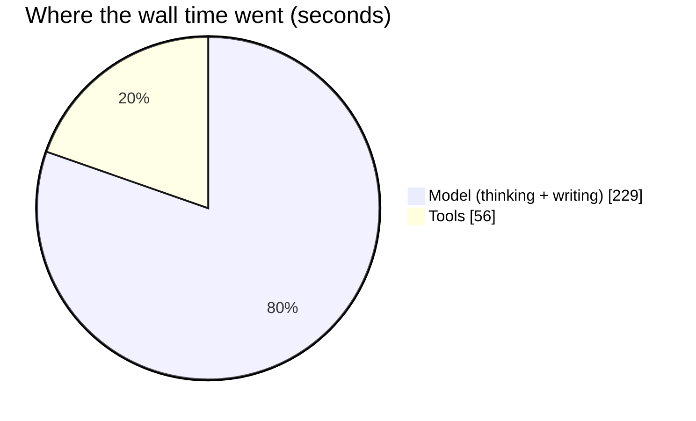

# corporate-ma/draft-markup-of-stock-purchase-agreement-provisions · run6 (`hv-mixed200-lunahigh-flip-r6-20261118T030322Z`)

Result: **all-pass** 59/59 criteria · 4.8 min · 24 model calls · 38 tool calls (0 errors or timeouts) · ending `completed` · started 11-18 08:34:07 IST

## Overview

One box per stretch of steps that used the same kind of tool (blue: looking/searching/reading, purple: writing or editing files, yellow: a message with no tool call, red border: a tool error or timeout inside the box).

```mermaid
flowchart TD
    T(["Task prompt"])
    P0["<b>Step 1</b> · 0.0 min<br/>create_goal"]
    T --> P0
    class P0 look
    P1["<b>Step 2</b> · 0.0 min<br/>todo_write"]
    P0 --> P1
    class P1 look
    P2["<b>Step 3</b> · 0.1 min<br/>glob<br/><i>*</i>"]
    P1 --> P2
    class P2 look
    P3["<b>Step 4</b> · 0.4 min<br/>bash x4<br/>read<br/><i>parse-doc docx documents/buyer-ma-pla…, parse-doc docx documents/sellers-draf…, parse-doc docx documents/environmenta… +2</i>"]
    P2 --> P3
    class P3 look
    P4["<b>Step 5</b> · 0.3 min<br/>bash x4<br/><i>parse-doc docx documents/sellers-draf…, parse-doc docx documents/buyer-ma-pla…, parse-doc docx documents/executed-ter… +1</i>"]
    P3 --> P4
    class P4 look
    P5["<b>Step 6</b> · 0.1 min<br/>grep<br/><i>spa.txt</i>"]
    P4 --> P5
    class P5 look
    P6["<b>Step 7</b> · 0.1 min<br/>read x6<br/><i>spa.txt</i>"]
    P5 --> P6
    class P6 look
    P7["<b>Step 8</b> · 0.0 min<br/>grep<br/><i>spa.txt</i>"]
    P6 --> P7
    class P7 look
    P8["<b>Steps 9-10</b> · 0.1 min<br/>read x4<br/><i>spa.txt</i>"]
    P7 --> P8
    class P8 look
    P9["<b>Step 11</b> · 0.1 min<br/>grep<br/><i>playbook.txt</i>"]
    P8 --> P9
    class P9 look
    P10["<b>Step 12</b> · 2.4 min<br/>write<br/><i>markup-memo.md</i>"]
    P9 --> P10
    class P10 write
    P11["<b>Steps 13-15</b> · 0.3 min<br/>bash x3<br/><i>command -v pandoc && pandoc --version…, mkdir -p output && pandoc markup-memo…, parse-doc docx output/spa-markup-memo…</i>"]
    P10 --> P11
    class P11 look
    P12["<b>Step 16</b> · 0.1 min<br/>read<br/>grep<br/><i>memo-validate.txt</i>"]
    P11 --> P12
    class P12 look
    P13["<b>Step 17</b> · 0.1 min<br/>edit<br/><i>markup-memo.md</i>"]
    P12 --> P13
    class P13 write
    P14["<b>Step 18</b> · 0.2 min<br/>bash<br/><i>pandoc markup-memo.md --from gfm --to…</i>"]
    P13 --> P14
    class P14 look
    P15["<b>Step 19</b> · 0.0 min<br/>read<br/><i>memo-validate.err</i>"]
    P14 --> P15
    class P15 look
    P16["<b>Step 20</b> · 0.1 min<br/>todo_write"]
    P15 --> P16
    class P16 look
    P17["<b>Step 21</b> · 0.0 min<br/>get_goal"]
    P16 --> P17
    class P17 look
    P18["<b>Step 22</b> · 0.0 min<br/>update_goal"]
    P17 --> P18
    class P18 look
    P19["<b>Step 23</b> · 0.1 min<br/>glob<br/><i>output/*</i>"]
    P18 --> P19
    class P19 look
    P20["<b>Step 24</b> · 0.1 min<br/>final message"]
    P19 --> P20
    class P20 ans
    R(["ALL PASS: 59/59 criteria"])
    P20 --> R
    class R pass
    classDef look fill:#e8f0fe,stroke:#4a6fa5,color:#111
    classDef write fill:#f3e8fd,stroke:#7b1fa2,color:#111
    classDef ans fill:#fff8e1,stroke:#b58900,color:#111
    classDef err fill:#e8f0fe,stroke:#c62828,stroke-width:3px,color:#111
    classDef pass fill:#e6f4ea,stroke:#2e7d32,color:#111
    classDef fail fill:#fce8e6,stroke:#c62828,color:#111
```





One row per model call:

| Step | Started (IST) | Model s | Tools s | Tool calls | Tools | Output chars |
|---|---|---|---|---|---|---|
| 1 | 08:34:07 | 3 | 0 | 1 | create_goal | 396 |
| 2 | 08:34:10 | 2 | 0 | 1 | todo_write | 57 |
| 3 | 08:34:11 | 2 | 5 | 1 | glob | 179 |
| 4 | 08:34:19 | 2 | 20 | 5 | bash x4, read | 215,717 |
| 5 | 08:34:41 | 5 | 14 | 4 | bash x4 | 141 |
| 6 | 08:35:00 | 2 | 4 | 1 | grep | 49,994 |
| 7 | 08:35:07 | 4 | 0 | 6 | read x6 | 45,841 |
| 8 | 08:35:10 | 2 | 1 | 1 | grep | 12,690 |
| 9 | 08:35:13 | 2 | 0 | 3 | read x3 | 49,170 |
| 10 | 08:35:16 | 4 | 0 | 1 | read | 3,385 |
| 11 | 08:35:20 | 4 | 1 | 1 | grep | 31,403 |
| 12 | 08:35:24 | 145 | 0 | 1 | write | 246 |
| 13 | 08:37:50 | 3 | 1 | 1 | bash | 57 |
| 14 | 08:37:54 | 9 | 1 | 1 | bash | 96 |
| 15 | 08:38:04 | 4 | 2 | 1 | bash | 36 |
| 16 | 08:38:10 | 3 | 1 | 2 | read, grep | 21,969 |
| 17 | 08:38:14 | 8 | 0 | 1 | edit | 221 |
| 18 | 08:38:22 | 7 | 5 | 1 | bash | 60 |
| 19 | 08:38:34 | 3 | 0 | 1 | read | 635 |
| 20 | 08:38:37 | 3 | 0 | 1 | todo_write | 57 |
| 21 | 08:38:41 | 3 | 0 | 1 | get_goal | 396 |
| 22 | 08:38:43 | 2 | 0 | 1 | update_goal | 401 |
| 23 | 08:38:45 | 3 | 1 | 1 | glob | 33 |
| 24 | 08:38:49 | 4 | 0 | 0 | (message only) | 0 |

## Task prompt

```text
Review the seller's draft SPA against the buyer's playbook, executed term sheet, and diligence materials, and prepare a detailed markup memorandum with draft-ready redline language. Output: `spa-markup-memorandum.docx`.
```

## Rubric

| # | Criterion | Verdict |
|---|---|---|
| C-001 | ISSUE_001: Identifies overbroad MAE carve-outs for environmental industry/regulations | pass |
| C-002 | ISSUE_001: Proposes adding disproportionate impact qualifier to MAE carve-outs | pass |
| C-003 | ISSUE_001: Provides actual revised contract language for MAE definition | pass |
| C-004 | ISSUE_001: Explains rationale — environmental company needs MAE protection | pass |
| C-005 | ISSUE_002: Identifies missing interim covenant restricting affiliate transactions | pass |
| C-006 | ISSUE_002: Proposes covenant requiring Buyer consent for affiliate transactions | pass |
| C-007 | ISSUE_002: References the above-market rent to Seller affiliate as rationale | pass |
| C-008 | ISSUE_003: Identifies indemnification cap discrepancy (20% vs. 12.5%) | pass |
| C-009 | ISSUE_003: Proposes redline reducing cap to 12.5% / $26,875,000 | pass |
| C-010 | ISSUE_003: References the term sheet as basis for cap correction | pass |
| C-011 | ISSUE_004: Identifies that environmental reps survival period is too short | pass |
| C-012 | ISSUE_004: Proposes extending environmental reps survival to at least 36 months | pass |
| C-013 | ISSUE_004: References CERCLA/Dalton Creek exposure as rationale for longer survival | pass |
| C-014 | ISSUE_005: Identifies anti-sandbagging provision in Section 9.06 | pass |
| C-015 | ISSUE_005: Proposes replacing with pro-sandbagging language | pass |
| C-016 | ISSUE_005: Provides actual pro-sandbagging contract text | pass |
| C-017 | ISSUE_006: Identifies need for Special Indemnity for Dalton Creek CERCLA matter | pass |
| C-018 | ISSUE_006: Special Indemnity survival of 72 months | pass |
| C-019 | ISSUE_006: Special Indemnity not subject to basket or cap | pass |
| C-020 | ISSUE_006: References Dalton Creek liability range ($1.5M-$6M) | pass |
| C-021 | ISSUE_007: Identifies problematic earnout operational covenant | pass |
| C-022 | ISSUE_007: Proposes limiting earnout covenant to no-frustration standard | pass |
| C-023 | ISSUE_007: Explains rationale — Buyer integration/restructuring flexibility | pass |
| C-024 | ISSUE_008: Identifies missing payoff letter requirement | pass |
| C-025 | ISSUE_008: Proposes payoff letters at least 3 business days pre-closing | pass |
| C-026 | ISSUE_008: Proposes simultaneous repayment at closing through funds flow | pass |
| C-027 | ISSUE_008: Proposes payoff letter delivery as a condition to closing | pass |
| C-028 | ISSUE_009: Identifies missing government contract anti-assignment/novation requirement | pass |
| C-029 | ISSUE_009: References specific government contracts requiring novation | pass |
| C-030 | ISSUE_009: Proposes closing condition or covenant for government contract novation | pass |
| C-031 | ISSUE_009: References Anti-Assignment Act or FAR provisions | pass |
| C-032 | ISSUE_010: Identifies missing environmental permit transfer/notification covenant | pass |
| C-033 | ISSUE_010: Proposes cooperation covenant for environmental permit transfers | pass |
| C-034 | ISSUE_010: Notes that permits may require notification even in a stock deal | pass |
| C-035 | ISSUE_011: Identifies missing R&W Insurance subrogation waiver | pass |
| C-036 | ISSUE_011: Proposes subrogation waiver provision with fraud exception | pass |
| C-037 | ISSUE_011: References R&W Insurance policy / Granite Ridge Underwriters | pass |
| C-038 | ISSUE_012: Identifies non-compete scope exceeds term sheet (duration) | pass |
| C-039 | ISSUE_012: Identifies non-compete scope exceeds term sheet (geographic) | pass |
| C-040 | ISSUE_012: Identifies non-compete scope exceeds term sheet (activity) | pass |
| C-041 | ISSUE_012: Proposes narrowing non-compete duration to 3 years | pass |
| C-042 | ISSUE_012: Proposes narrowing non-compete geographic scope to OR, WA, CA, NV | pass |
| C-043 | ISSUE_012: Proposes narrowing non-compete activity scope to environmental remediation and hazardous waste management | pass |
| C-044 | ISSUE_012: Notes enforceability risk of overbroad non-compete | pass |
| C-045 | Indemnification cap issue rated as Critical or High priority | pass |
| C-046 | Anti-sandbagging issue rated as Critical or High priority | pass |
| C-047 | Memorandum identifies provisions acceptable as drafted | pass |
| C-048 | Memorandum flags items for partner/client discussion | pass |
| C-049 | Escrow amount correctly stated as $16,125,000 (7.5% of EV) | pass |
| C-050 | ISSUE_006: Proposes 36-month escrow holdback for Special Indemnity | pass |
| C-051 | Earnout maximum correctly referenced as $25,000,000 | pass |
| C-052 | Earnout Adjusted EBITDA threshold correctly referenced as $38,000,000 | pass |
| C-053 | Earnout floor correctly referenced as $32,000,000 | pass |
| C-054 | References playbook as authority for at least 3 markup positions | pass |
| C-055 | References term sheet as authority for at least 3 markup positions | pass |
| C-056 | References environmental DD memo for at least one markup position | pass |
| C-057 | Memorandum identifies specific SPA section numbers for issues | pass |
| C-058 | Proposed redline language is actual contract text for at least 8 issues | pass |
| C-059 | ISSUE_008: Identifies all three sources of Target indebtedness | pass |

Judge's reasoning:

**C-001 (pass):** ISSUE_001: Identifies overbroad MAE carve-outs for environmental industry/regulations

```text
The memorandum expressly identifies the environmental-services-industry and Environmental Laws carve-outs as overbroad because they lack disproportionate-impact qualifiers, and proposes adding such qualifiers to both carve-outs.
```

**C-002 (pass):** ISSUE_001: Proposes adding disproportionate impact qualifier to MAE carve-outs

```text
The memorandum expressly adds disproportionate-impact exceptions to both the environmental-services-industry carve-out and the Environmental Laws/regulatory carve-out, using the required formulation that the changes disproportionately affect the Company relative to other industry participants.
```

**C-003 (pass):** ISSUE_001: Provides actual revised contract language for MAE definition

```text
The memorandum includes a full proposed replacement MAE definition with actual contract language, expressly adding disproportionate-impact exceptions to both the environmental-services-industry and Environmental Laws carve-outs.
```

**C-004 (pass):** ISSUE_001: Explains rationale — environmental company needs MAE protection

```text
The memorandum expressly explains that the unqualified industry and Environmental Laws carve-outs remove from the MAE analysis the two categories most likely to affect this environmental-services target—industry economics and environmental regulation—and therefore recommends disproportionate-impact qualifiers for both.
```

**C-005 (pass):** ISSUE_002: Identifies missing interim covenant restricting affiliate transactions

```text
The memorandum expressly identifies that Section 6.01(b) lacks an interim restriction on transactions with Seller or Seller affiliates and proposes a consent requirement covering entry into, amendment, extension, renewal, termination, waiver, or modification of such affiliate transactions between signing and closing.
```

**C-006 (pass):** ISSUE_002: Proposes covenant requiring Buyer consent for affiliate transactions

```text
The memorandum proposes new Section 6.01(b)(xiv), which prohibits the Company from entering into, amending, modifying, extending, renewing, or terminating any agreement or transaction with Seller or any Seller affiliate without Buyer's prior written consent.
```

**C-007 (pass):** ISSUE_002: References the above-market rent to Seller affiliate as rationale

```text
The memorandum expressly ties the affiliate transaction restriction to the affiliate lease, stating that the Company pays $1,600,000 in annual rent to a Seller affiliate and that the interim covenant must prevent changes to such arrangements without Buyer consent.
```

**C-008 (pass):** ISSUE_003: Identifies indemnification cap discrepancy (20% vs. 12.5%)

```text
The memorandum expressly identifies the Seller draft’s $43,000,000 cap as 20% of the $215,000,000 base enterprise value and contrasts it with the binding term sheet’s 12.5% cap of $26,875,000, proposing the required correction.
```

**C-009 (pass):** ISSUE_003: Proposes redline reducing cap to 12.5% / $26,875,000

```text
The memorandum expressly proposes replacing the $43,000,000 / 20% indemnification cap with $26,875,000, equal to 12.5% of the $215,000,000 base enterprise value, in both the executive summary and the proposed redline to Sections 1.01 and 9.04(b).
```

**C-010 (pass):** ISSUE_003: References the term sheet as basis for cap correction

```text
The memorandum expressly states that the $43 million cap deviates from the binding term sheet and that the term sheet fixes the general cap at 12.5% of the $215 million Base Enterprise Value ($26.875 million). It cites Term Sheet § 8 and identifies the executed term sheet as dated September 10, 2025 in the materials reviewed.
```

**C-011 (pass):** ISSUE_004: Identifies that environmental reps survival period is too short

```text
The memorandum expressly identifies the Seller's 12-month blanket survival period as inadequate for environmental representations, including Section 4.15 environmental compliance and permit matters, and proposes a 36-month survival period while reserving a longer limitations-period position.
```

**C-012 (pass):** ISSUE_004: Proposes extending environmental reps survival to at least 36 months

```text
The memorandum expressly proposes that the Environmental Representations survive for 36 months after closing in revised Section 9.01(c), and also reserves the option to seek survival through the full applicable statute of limitations.
```

**C-013 (pass):** ISSUE_004: References CERCLA/Dalton Creek exposure as rationale for longer survival

```text
The memorandum expressly connects the requested longer survival period for environmental representations to the Dalton Creek CERCLA exposure and the ongoing Hargrove remediation project, noting that these liabilities may develop over several years.
```

**C-014 (pass):** ISSUE_005: Identifies anti-sandbagging provision in Section 9.06

```text
The memorandum expressly identifies Section 9.06 as an anti-sandbagging provision and quotes the language barring Buyer from indemnification for breaches or inaccuracies of which Buyer or its representatives had Knowledge as of the Closing Date.
```

**C-015 (pass):** ISSUE_005: Proposes replacing with pro-sandbagging language

```text
The memorandum expressly replaces Section 9.06’s anti-sandbagging provision with pro-sandbagging language stating that Buyer’s indemnification and other remedies are not affected, limited, diminished, or impaired by any investigation or knowledge acquired before or after signing or Closing.
```

**C-016 (pass):** ISSUE_005: Provides actual pro-sandbagging contract text

```text
The memorandum includes actual proposed pro-sandbagging contract language in the replacement for Section 9.06, stating that Buyer's indemnification and other remedies are not affected by investigations or knowledge acquired before or after signing or Closing.
```

**C-017 (pass):** ISSUE_006: Identifies need for Special Indemnity for Dalton Creek CERCLA matter

```text
The memorandum expressly proposes a separate Dalton Creek Special Indemnity in new Section 9.09, stating that the known EPA/CERCLA exposure should not be treated solely as a general environmental representation claim and should be outside the general basket and cap.
```

**C-018 (pass):** ISSUE_006: Special Indemnity survival of 72 months

```text
The memorandum expressly states in proposed Section 9.09(c) that the Dalton Creek Special Indemnity will survive the Closing for seventy-two (72) months, with claims permitted through that date.
```

**C-019 (pass):** ISSUE_006: Special Indemnity not subject to basket or cap

```text
The memorandum expressly states in proposed Section 9.09(d) that the Dalton Creek Special Indemnity is not subject to the Basket Amount or the general Indemnification Cap. It also separately carves Special Indemnities out of the basket in Section 9.04(a) and the general cap in Section 9.04(b).
```

**C-020 (pass):** ISSUE_006: References Dalton Creek liability range ($1.5M-$6M)

```text
The memorandum expressly cites Dalton Creek's estimated potential liability range of $1,500,000 to $6,000,000 in both Schedule 9.09 and the rationale supporting the proposed Special Indemnity.
```

**C-021 (pass):** ISSUE_007: Identifies problematic earnout operational covenant

```text
The memorandum expressly identifies Section 2.05(d) as problematic because it requires Buyer to operate consistently with past practice and in good faith to maximize the earnout. It recommends deleting those affirmative operational restrictions and replacing them with a narrow primary-purpose covenant.
```

**C-022 (pass):** ISSUE_007: Proposes limiting earnout covenant to no-frustration standard

```text
The memorandum expressly replaces the seller’s affirmative past-practice and earnout-maximization obligations with a narrow covenant prohibiting actions taken with the primary purpose of reducing or avoiding the earnout payment, while preserving Buyer’s operational discretion.
```

**C-023 (pass):** ISSUE_007: Explains rationale — Buyer integration/restructuring flexibility

```text
The memorandum expressly explains that the seller’s broad earnout covenant would restrict Buyer’s platform integration and restructuring plans and create litigation risk over ordinary post-closing business decisions. It also states that the replacement preserves Buyer’s operational flexibility to integrate, restructure, consolidate, and make strategic changes.
```

**C-024 (pass):** ISSUE_008: Identifies missing payoff letter requirement

```text
The memorandum expressly identifies that Section 2.03(d) permits repayment “at or promptly following the Closing” and that the Seller’s closing deliverables do not require payoff letters. It then proposes requiring executed payoff letters from each holder of Closing Indebtedness at least three business days before Closing.
```

**C-025 (pass):** ISSUE_008: Proposes payoff letters at least 3 business days pre-closing

```text
The memorandum expressly requires executed payoff letters at least three Business Days before Closing. It also requires each payoff letter to include wire instructions and provides for delivery of lien-release documents, including UCC termination statements.
```

**C-026 (pass):** ISSUE_008: Proposes simultaneous repayment at closing through funds flow

```text
The memorandum expressly replaces the “at or promptly following” mechanic with repayment of all Closing Indebtedness simultaneously at Closing through the agreed funds flow, and adds a corresponding closing condition.
```

**C-027 (pass):** ISSUE_008: Proposes payoff letter delivery as a condition to closing

```text
The memorandum expressly proposes a new Section 7.02(h) making Seller's delivery of payoff letters and related lien-release documentation a condition to Buyer's obligation to close.
```

**C-028 (pass):** ISSUE_009: Identifies missing government contract anti-assignment/novation requirement

```text
The memorandum expressly identifies that the Seller's draft lacks specific government-contract anti-assignment, novation, and recognition provisions. It discusses the Anti-Assignment Act and FAR Part 42.12, names the Oregon DEQ, Washington Ecology, Army Corps of Engineers, and BLM contracts, and proposes related representations, covenants, and closing conditions.
```

**C-029 (pass):** ISSUE_009: References specific government contracts requiring novation

```text
The memorandum specifically identifies the U.S. Army Corps of Engineers Contract No. W912DR-21-D-0045 and Bureau of Land Management Contract No. L23PX-00412 as requiring novation or recognition packages. It also addresses corresponding approval or notification requests for the Oregon DEQ and Washington Ecology contracts.
```

**C-030 (pass):** ISSUE_009: Proposes closing condition or covenant for government contract novation

```text
The memorandum expressly proposes new Section 6.12 requiring Seller and the Company to notify contracting officers, prepare and submit federal and state novation/recognition packages, and use commercially reasonable efforts to obtain the required agreements before Closing. It also proposes a related closing condition in Section 7.02(i).
```

**C-031 (pass):** ISSUE_009: References Anti-Assignment Act or FAR provisions

```text
The memorandum expressly cites the Anti-Assignment Act, 41 U.S.C. § 6305, and FAR Part 42, Subpart 42.12 as the legal basis for government-contract novation, recognition, and related notice requirements.
```

**C-032 (pass):** ISSUE_010: Identifies missing environmental permit transfer/notification covenant

```text
The memorandum expressly identifies that the Seller’s draft lacks a covenant addressing change-of-control notifications, approvals, transfers, or reissuance of the 23 environmental permits. It proposes new Section 6.13 requiring pre-closing submissions and post-closing cooperation for permit transfer, reissuance, amendment, notification, and approval processes.
```

**C-033 (pass):** ISSUE_010: Proposes cooperation covenant for environmental permit transfers

```text
The memorandum proposes new Section 6.13, requiring Seller to assist both before and after closing with environmental permit notifications, applications, transfers, re-issuances, amendments, approvals, agency inquiries, and related documentation under applicable state requirements.
```

**C-034 (pass):** ISSUE_010: Notes that permits may require notification even in a stock deal

```text
The memorandum expressly states in the environmental permit covenant commentary that “A stock transaction does not eliminate change-of-control requirements” and discusses required notifications, consents, approvals, transfers, or reissuance for permits in Oregon, Washington, California, and Nevada.
```

**C-035 (pass):** ISSUE_011: Identifies missing R&W Insurance subrogation waiver

```text
The memorandum expressly states in Section 19 that the Seller's draft contains no provision addressing Buyer's R&W Insurance policy or the insurer's subrogation rights, and it proposes a fraud-only subrogation waiver.
```

**C-036 (pass):** ISSUE_011: Proposes subrogation waiver provision with fraud exception

```text
The memorandum proposes new Section 10.13 requiring the R&W Insurance Policy to waive the insurer’s subrogation and recovery rights against Seller and related parties, expressly excepting claims arising from or relating to Seller fraud. It also identifies Granite Ridge Underwriters as the expected insurer.
```

**C-037 (pass):** ISSUE_011: References R&W Insurance policy / Granite Ridge Underwriters

```text
The memorandum expressly states that Buyer expects to obtain buy-side R&W Insurance from Granite Ridge Underwriters and connects that policy to a required insurer subrogation waiver, except for Seller fraud.
```

**C-038 (pass):** ISSUE_012: Identifies non-compete scope exceeds term sheet (duration)

```text
The memorandum expressly identifies that the Seller's draft imposes a five-year non-compete and states that this exceeds the binding term sheet. It proposes replacing it with a three-year non-compete to conform to the term sheet.
```

**C-039 (pass):** ISSUE_012: Identifies non-compete scope exceeds term sheet (geographic)

```text
The memorandum expressly identifies the Seller draft's five-year nationwide prohibition as exceeding the term sheet and replaces the geographic scope with Oregon, Washington, California, and Nevada.
```

**C-040 (pass):** ISSUE_012: Identifies non-compete scope exceeds term sheet (activity)

```text
The memorandum expressly identifies that the Seller’s draft imposes a five-year nationwide prohibition on “any business,” states that this exceeds the term sheet, and proposes limiting the activity scope to environmental remediation services and hazardous waste management services.
```

**C-041 (pass):** ISSUE_012: Proposes narrowing non-compete duration to 3 years

```text
The proposed replacement for Section 6.09(a) expressly narrows the non-compete period from five years to three years following the Closing Date, matching the term sheet.
```

**C-042 (pass):** ISSUE_012: Proposes narrowing non-compete geographic scope to OR, WA, CA, NV

```text
The proposed replacement for Section 6.09(a) limits the non-compete to the States of Oregon, Washington, California, and Nevada, matching the term sheet.
```

**C-043 (pass):** ISSUE_012: Proposes narrowing non-compete activity scope to environmental remediation and hazardous waste management

```text
The proposed replacement for Section 6.09(a) narrows the non-compete from engaging in “any business” nationwide to businesses providing environmental remediation services or hazardous waste management services, expressly matching the required activity scope.
```

**C-044 (pass):** ISSUE_012: Notes enforceability risk of overbroad non-compete

```text
The memorandum expressly states that the five-year nationwide prohibition on “any business” would sweep in Seller’s legitimate construction and timber operations, and the proposed replacement carves out those existing operations. This satisfies the criterion even though it does not separately analyze enforceability.
```

**C-045 (pass):** Indemnification cap issue rated as Critical or High priority

```text
The 20% versus 12.5% general indemnification cap discrepancy is expressly rated “High” priority in both the executive summary and Section 14, satisfying the criterion.
```

**C-046 (pass):** Anti-sandbagging issue rated as Critical or High priority

```text
Section 9.06 (anti-sandbagging) is expressly assigned a priority of Critical, which is the highest tier and satisfies the criterion.
```

**C-047 (pass):** Memorandum identifies provisions acceptable as drafted

```text
The memorandum includes a dedicated “Provisions to Leave Unchanged” section identifying multiple acceptable provisions and briefly explaining why they conform to the playbook or term sheet, including the basket amount and structure, knowledge definition, good-standing certificates, Delaware governing law, escrow amount, and purchase price/NWC mechanics.
```

**C-048 (pass):** Memorandum flags items for partner/client discussion

```text
The memorandum expressly flags multiple issues for further partner/client discussion, including the government-contract novation closing condition, environmental-representation survival period, Dalton Creek factual inconsistencies and indemnity sub-cap, and permit-condition strategy. It also identifies Whitmore Capital/Marcus Devereaux and partner/client confirmation before finalizing positions.
```

**C-049 (pass):** Escrow amount correctly stated as $16,125,000 (7.5% of EV)

```text
The memorandum consistently states the escrow amount as $16,125,000 and expressly identifies it as 7.5% of the $215,000,000 Base Enterprise Value, which is mathematically correct.
```

**C-050 (pass):** ISSUE_006: Proposes 36-month escrow holdback for Special Indemnity

```text
The memorandum expressly provides a 36-month post-closing escrow holdback for Special Indemnities, distinct from the 18-month release for general indemnification claims. It specifically applies this 36-month holdback to the Dalton Creek Special Indemnity in Sections 9.04(e), 9.09(e), and the proposed Escrow Agreement terms.
```

**C-051 (pass):** Earnout maximum correctly referenced as $25,000,000

```text
The memorandum expressly states in the earnout discussion that the term sheet requires a "$25,000,000 maximum," so the maximum earnout payment is correctly referenced.
```

**C-052 (pass):** Earnout Adjusted EBITDA threshold correctly referenced as $38,000,000

```text
The memorandum expressly states in the earnout discussion that the term sheet requires a $38,000,000 full-payment Adjusted EBITDA threshold. The threshold is correctly referenced and not materially misstated.
```

**C-053 (pass):** Earnout floor correctly referenced as $32,000,000

```text
The memorandum expressly states that the earnout has a $32,000,000 floor and uses linear interpolation between that floor and the $38,000,000 full-payment threshold, satisfying the required pro-rata structure.
```

**C-054 (pass):** References playbook as authority for at least 3 markup positions

```text
The memorandum cites the Buyer's M&A Playbook as authority for well over three distinct markup positions, including the MAE qualifiers, earnout covenant, debt payoff mechanics, government-contract protections, environmental permits, indemnification cap/survival, anti-sandbagging, Dalton Creek Special Indemnity, and R&W insurance.
```

**C-055 (pass):** References term sheet as authority for at least 3 markup positions

```text
The memorandum cites the executed term sheet as authority for well over three distinct markup positions, including the 12.5% indemnification cap, earnout operating covenant and timing, debt payoff letters, restrictive covenants, survival periods, escrow mechanics, Dalton Creek Special Indemnity, and R&W insurance subrogation waiver.
```

**C-056 (pass):** References environmental DD memo for at least one markup position

```text
The memorandum repeatedly cites the Environmental Due Diligence Summary / DD Memo as support for markup positions, including the Dalton Creek special indemnity, environmental representation survival, permit-transfer covenants, and government-contract protections.
```

**C-057 (pass):** Memorandum identifies specific SPA section numbers for issues

```text
The memorandum ties well over 8 issues to specific SPA section numbers, including Sections 2.05, 2.03, 2.08, 4.15, 4.16, 4.17, 6.01, 6.09, 6.12, 6.13, 7.02, 9.01, 9.04, 9.06, 9.09, and 10.13.
```

**C-058 (pass):** Proposed redline language is actual contract text for at least 8 issues

```text
The memorandum provides insertion-ready proposed contract text for well over 8 issues, including the MAE definition, earnout covenant and mechanics, debt payoff, government contract representations and covenants, environmental permits, affiliate transactions, restrictive covenants, closing conditions, indemnification cap and survival, anti-sandbagging, the Dalton Creek Special Indemnity, and R&W insurance.
```

**C-059 (pass):** ISSUE_008: Identifies all three sources of Target indebtedness

```text
The payoff-letter discussion expressly identifies all three indebtedness sources: Cascade Mutual Bank's senior term loan, Pacific Lease Corp.'s equipment financing, and Evergreen Holdings/Seller's subordinated seller note. It also references the $42.3 million illustrative Closing Indebtedness elsewhere.
```

## Delivered files (output/)

- `spa-markup-memorandum.docx` (35,183 bytes)

## Trajectory

### Step 1: 1 tool call

_Started 11-18 08:34:07 IST · model 3 s · tools 0 s_

**Reasoning summary:**

```text
**Planning task execution**

I need to execute a task, which involves inspecting files. It makes sense to create a goal for this long-running objective. I should utilize specific skills related to the task, but I don't have a list of available skills. I can inspect files using something like glob while avoiding any files named task.json. Plus, creating a to-do list could help keep things organized as I go along!
```

**Call `create_goal`** (0.0 s)

```json
{
 "objective": "Review the seller's draft SPA against the buyer's playbook, executed term sheet, and diligence materials, then produce the final deliverable spa-markup-memorandum.docx in the output directory with detailed draft-ready redline language.",
 "max_goal_rounds": 3
}
```

Output (396 chars):

```text
{"goal":{"id":"goal-12f346bd-17be-419b-968a-4896e106e918","revision":1,"objective":"Review the seller's draft SPA against the buyer's playbook, executed term sheet, and diligence materials, then produce the final deliverable spa-markup-memorandum.docx in the output directory with detailed draft-ready redline language.","phase":"active","roundsStarted":0,"maxGoalRounds":3},"activation":"armed"}
```

### Step 2: 1 tool call

_Started 11-18 08:34:10 IST · model 2 s · tools 0 s_

**Call `todo_write`** (0.0 s)

```json
{
 "todos": [
  {
   "content": "Inventory and read all transaction source materials",
   "status": "in_progress"
  },
  {
   "content": "Extract buyer positions and compare against SPA provisions",
   "status": "pending"
  },
  {
   "content": "Draft detailed markup memorandum with redline language",
   "status": "pending"
  },
  {
   "content": "Generate and validate spa-markup-memorandum.docx",
   "status": "pending"
  }
 ]
}
```

Output (57 chars):

```text
Updated todo list: 3 pending, 1 in progress, 0 completed.
```

**Todo list now:**

- [~] Inventory and read all transaction source materials
- [ ] Extract buyer positions and compare against SPA provisions
- [ ] Draft detailed markup memorandum with redline language
- [ ] Generate and validate spa-markup-memorandum.docx

### Step 3: 1 tool call

_Started 11-18 08:34:11 IST · model 2 s · tools 5 s_

**Reasoning summary:**

```text
**Searching for files**

I need to list files, and I'm thinking I could use glob patterns, possibly something like "*". This seems straightforward enough, but I want to ensure I cover all variations I might need. I'll have to check how specific I need to be with my patterns to include hidden files if necessary. Okay, I'm feeling on the right track here and just need to make sure I implement this correctly!
```

**Call `glob`** (5.2 s)

```json
{
 "pattern": "*"
}
```

Output (179 chars):

```text
documents/buyer-ma-playbook.docx
documents/sellers-draft-spa.docx
documents/environmental-dd-memo.docx
documents/executed-term-sheet.docx
documents/partner-markup-instructions.eml
```

### Step 4: 5 tool calls

_Started 11-18 08:34:19 IST · model 2 s · tools 20 s_

**Reasoning summary:**

```text
**Exploring document parsing**

I'm thinking about how to read documents using a parse-doc bash command. It seems possible to parse multiple documents at once since the commands could be independent. I’m considering using multi_tool parallel bash calls to handle this efficiently. It's a bit technical, but I think this approach might speed up the process of getting all the information I need from the documents. Let’s see how it goes!
```

**Call `bash`** (5.0 s)

```json
{
 "command": "parse-doc docx documents/buyer-ma-playbook.docx",
 "description": "Parse buyer playbook"
}
```

Output (49,999 chars):

```text
tner. This is a **Critical** priority item.

For example, if the term sheet specifies a general indemnification cap of 12.5% of enterprise value for a transaction with a \$200 million enterprise value, the SPA\'s general indemnification cap should be \$25,000,000. If the seller\'s draft sets the cap at \$20,000,000 (10% of enterprise value), the associate must flag this as a deviation from the term sheet and mark up the draft to reflect the agreed \$25,000,000 cap.

**R&W Insurance Considerations.** In transactions where the buyer is obtaining representations and warranties insurance (see Section 8), the indemnification cap may be subject to additional negotiation dynamics. The R&W insurer may require a certain retention level (the amount of loss the buyer must bear before the policy responds), which interacts with the SPA\'s basket/deductible and cap structure. However, the SPA cap itself must conform to the term sheet regardless of the R&W Insurance structure. The R&W Insurance policy supplements the seller\'s indemnification obligations --- it does not replace them, and the availability of insurance does not justify a reduction in the SPA cap below the term sheet level.

**Market Data.** In recent environmental services transactions handled by the firm, general indemnification caps have ranged from 10% to 15% of enterprise value. The 12.5% figure is squarely within the market range and represents the firm\'s standard recommendation for PE buyers in this sector. Caps below 
… [48,499 more chars]
```

**Call `bash`** (8.1 s)

```json
{
 "command": "parse-doc docx documents/sellers-draft-spa.docx",
 "description": "Parse seller SPA draft"
}
```

Output (49,998 chars):

```text
and Seller;

**(b)** by either Buyer or Seller, by written notice to the other Party, if the Closing shall not have occurred on or before the Outside Date (February 28, 2026); *provided* that the right to terminate this Agreement under this Section 8.01(b) shall not be available to any Party whose breach of any representation, warranty, covenant, or agreement set forth in this Agreement has been the primary cause of, or has primarily resulted in, the failure of the Closing to occur on or before the Outside Date;

**(c)** by either Buyer or Seller, by written notice to the other Party, if any Governmental Authority shall have enacted, issued, promulgated, enforced, or entered any final and non-appealable Law, order, injunction, judgment, decree, ruling, or other legally binding action that permanently restrains, enjoins, or otherwise prohibits the consummation of the transactions contemplated by this Agreement;

**(d)** by Buyer, by written notice to Seller, if there shall have been a breach by Seller of any representation, warranty, covenant, or agreement contained in this Agreement that would cause the conditions set forth in Section 7.02(a) or Section 7.02(b) not to be satisfied, and such breach shall not have been cured by Seller within thirty (30) days after receipt of written notice of such breach from Buyer (or, if earlier, by the Outside Date); *provided* that Buyer shall not have the right to terminate this Agreement under this Section 8.01(d) if Buyer is then in mate
… [48,498 more chars]
```

**Call `bash`** (4.1 s)

```json
{
 "command": "parse-doc docx documents/environmental-dd-memo.docx",
 "description": "Parse environmental diligence memo"
}
```

Output (47,133 chars):

```text
**ASHFORD, PENNINGTON & YATES LLP** *Attorneys at Law* 71 South Wacker Drive, Suite 4500 Chicago, Illinois 60606

**PRIVILEGED AND CONFIDENTIAL --- ATTORNEY WORK PRODUCT** This memorandum is protected by the attorney-client privilege and the work product doctrine. It is intended solely for use by the attorneys and professionals of Ashford, Pennington & Yates LLP and the client to whom it is addressed. Any unauthorized disclosure, reproduction, or distribution is strictly prohibited.

**MEMORANDUM**

**TO:** Elena Vasquez-Moreno, Partner, M&A Group Jonathan Kreider, Senior Associate, M&A Group

**FROM:** Environmental Practice Group, Ashford, Pennington & Yates LLP

**DATE:** October 18, 2025

**RE:** Environmental Due Diligence Summary --- Acquisition of Cascadia Environmental Solutions, Inc. by Whitmore Capital Partners LLC

**PROJECT:** Project Cascade --- Whitmore Capital Partners LLC Fund III Platform Acquisition

This memorandum summarizes the findings and recommendations of the Environmental Practice Group arising from our environmental due diligence review of Cascadia Environmental Solutions, Inc. in connection with the proposed acquisition by Whitmore Capital Partners LLC. This memo is intended to inform the deal team\'s review of the Seller\'s Stock Purchase Agreement draft, which we understand will be circulated on or about October 22, 2025. All findings and recommendations set forth herein should be incorporated into the firm\'s SPA markup and negotiation strategy.
… [45,632 more chars]
```

**Call `bash`** (2.4 s)

```json
{
 "command": "parse-doc docx documents/executed-term-sheet.docx",
 "description": "Parse executed term sheet"
}
```

Output (49,983 chars):

```text
**BINDING TERM SHEET**

**Acquisition of 100% of the Outstanding Equity Interests of** **Cascadia Environmental Solutions, Inc.**

Dated as of September 10, 2025

This Binding Term Sheet (this \"Term Sheet\") sets forth the principal terms and conditions agreed upon by the parties identified below with respect to the proposed acquisition described herein. Except as set forth in Section 18 (Binding Provisions) below, this Term Sheet is intended to be binding on the parties and shall govern the preparation of the Definitive Agreement (as defined below). This Term Sheet supersedes and replaces in its entirety the non-binding Letter of Intent dated August 15, 2025 (the \"LOI\"), previously entered into between Whitmore Capital Partners LLC and Evergreen Holdings Group, Inc. with respect to the proposed acquisition of Cascadia Environmental Solutions, Inc. Capitalized terms used but not otherwise defined herein shall have the meanings ascribed to them in the context in which they appear.

**[Section 1: Parties]{.underline}**

**Buyer:** Whitmore Capital Partners LLC, a Delaware limited liability company, with its principal offices at 200 South Wacker Drive, Suite 3100, Chicago, Illinois 60606 (referred to herein as \"Buyer\" or \"Whitmore\").

**Seller:** Evergreen Holdings Group, Inc., a Delaware corporation, with its principal offices at 1550 NW Everett Street, Suite 800, Portland, Oregon 97209 (referred to herein as \"Seller\" or \"Evergreen\").

**Target / the Company:** Casca
… [48,483 more chars]
```

**Call `read`** (0.0 s)

```json
{
 "file_path": "documents/partner-markup-instructions.eml"
}
```

Output (18,604 chars):

```text
<path>/home/agarwaldi/dsh-bench-harness/runs/hv-mixed200-lunahigh-flip-r6-20261118T030322Z/tasks/corporate-ma__draft-markup-of-stock-purchase-agreement-provisions/workspace/documents/partner-markup-instructions.eml</path>
<type>file</type>
<content>
1: From: Elena Vasquez-Moreno <evasquez-moreno@apylaw.com>
2: To: Jonathan Kreider <jkreider@apylaw.com>
3: Date: Thu, 23 Oct 2025 08:47:00 -0000
4: Subject: Re: Cascadia SPA Markup — Instructions and Priority Issues
5: Content-Type: text/plain; charset="utf-8"
6: Content-Transfer-Encoding: quoted-printable
7: MIME-Version: 1.0
8: 
9: Jonathan,
10: 
11: I reviewed the initial draft SPA that Douglas Renwick at Fortuna & Blake circ=
12: ulated yesterday. My overall impression: this is a heavily seller-favorable d=
13: raft in several material respects, and some of the positions directly contrad=
14: ict the September 10 term sheet =E2=80=94 which tells me either Doug is testi=
15: ng our resolve or his client gave him different instructions than what was ag=
16: reed at the principal level. Either way, we need a sharp, comprehensive marku=
17: p.
18: 
19: Marcus Devereaux at Whitmore Capital wants to see our redline by end of next =
20: week. Given the November 14 target signing date, that gives the parties rough=
21: ly two weeks of negotiation runway after we send our markup, which is tight. =
22: I need your comprehensive markup memorandum with redlined provisions and full=
23:  track-changes commentary.
24: 
25: **General Instru
… [17,104 more chars]
```

### Step 5: 4 tool calls

_Started 11-18 08:34:41 IST · model 5 s · tools 14 s_

**Call `bash`** (4.2 s)

```json
{
 "command": "parse-doc docx documents/sellers-draft-spa.docx > spa.txt 2> spa.err; printf 'spa chars: '; wc -c < spa.txt; printf 'spa lines: '; wc -l < spa.txt",
 "description": "Save parsed SPA text",
 "timeoutMs": 120000
}
```

Output (34 chars):

```text
spa chars: 171052
spa lines: 1230
```

**Call `bash`** (5.5 s)

```json
{
 "command": "parse-doc docx documents/buyer-ma-playbook.docx > playbook.txt 2> playbook.err; printf 'playbook chars: '; wc -c < playbook.txt; printf 'playbook lines: '; wc -l < playbook.txt",
 "description": "Save parsed playbook text",
 "timeoutMs": 120000
}
```

Output (43 chars):

```text
playbook chars: 103361
playbook lines: 673
```

**Call `bash`** (2.1 s)

```json
{
 "command": "parse-doc docx documents/executed-term-sheet.docx > term-sheet.txt 2> term-sheet.err; printf 'term chars: '; wc -c < term-sheet.txt; printf 'term lines: '; wc -l < term-sheet.txt",
 "description": "Save parsed term sheet text",
 "timeoutMs": 120000
}
```

Output (34 chars):

```text
term chars: 51863
term lines: 435
```

**Call `bash`** (2.3 s)

```json
{
 "command": "parse-doc docx documents/environmental-dd-memo.docx > dd-memo.txt 2> dd-memo.err; printf 'dd chars: '; wc -c < dd-memo.txt; printf 'dd lines: '; wc -l < dd-memo.txt",
 "description": "Save parsed diligence memo",
 "timeoutMs": 120000
}
```

Output (30 chars):

```text
dd chars: 46832
dd lines: 279
```

### Step 6: 1 tool call

_Started 11-18 08:35:00 IST · model 2 s · tools 4 s_

**Reasoning summary:**

```text
**Inspecting text tools**

I need to use read and grep tools, but not the shell version. It looks like I have access to a grep tool over text, which can help me inspect key sections in the SPA. I should focus on using this grep functionality for headings so I can pinpoint the information more easily. It feels like a straightforward approach to ensure I'm gathering the right details!
```

**Call `grep`** (4.0 s)

```json
{
 "pattern": "^\u001b?\\*\\*\\[?(ARTICLE|Section|SCHEDULE)|MAE|Material Adverse|Earnout|Government|Indebtedness|Payoff|Affiliate|Environmental|Permit|Non-Compete|non-compete|R&W|subrogation|Knowledge|survive|Survival|Escrow|Indemnification",
 "path": "spa.txt"
}
```

Output (49,994 chars):

```text
Found 250 of 284 matches

spa.txt
Line 19: This **STOCK PURCHASE AGREEMENT** (this \"Agreement\") is made and entered into as of \[●\], 2025, by and among **Evergreen Holdings Group, Inc.**, a Delaware corporation (\"Seller\"), **Whitmore Capital Partners LLC**, a Delaware limited liability company (\"Buyer\"), and, solely for the purposes of Sections 4.01 through 4.21, Section 6.01, Section 6.02, and Section 6.03, **Cascadia Environmental Solutions, Inc.**, an Oregon corporation (the \"Company\"). Seller, Buyer, and the Company are each referred to herein individually as a \"Party\" and collectively as the \"Parties.\"
Line 29: **D.** Concurrently with the execution and delivery of this Agreement, the Parties are entering into, or will enter into, certain ancillary agreements as further described herein, including the Escrow Agreement and the other Transaction Documents.
Line 33: **[ARTICLE I]{.underline}**
Line 37: **Section 1.01 Defined Terms**
Line 41: \"**Action**\" means any claim, action, suit, proceeding, arbitration, mediation, investigation, inquiry, hearing, charge, complaint, demand, or notice by or before any Governmental Authority or arbitration tribunal.
Line 45: \"**Adjusted EBITDA**\" means, with respect to any period, the net income of the Company for such period, determined in accordance with GAAP applied consistently with the Company\'s past practice, plus (a) interest expense, (b) income tax expense, and (c) depreciation and amortization expense, in each 
… [48,494 more chars]
```

### Step 7: 6 tool calls

_Started 11-18 08:35:07 IST · model 4 s · tools 0 s_

**Reasoning summary:**

```text
**Extracting data ranges**

I need to extract specific lines using read ranges. I’m focusing on relevant sections, like 125-151, 199-239, and 249-283, and possibly also 381. I have to determine which sections to grab via grep tool, particularly around the lines 130, 229, 249, and others like 400-620, 635-665, 697-767, and 905. Figuring out these ranges is key to getting the right data!
```

**Call `read`** (0.1 s)

```json
{
 "file_path": "spa.txt",
 "offset": 125,
 "limit": 35
}
```

Output (4,388 chars):

```text
<path>/home/agarwaldi/dsh-bench-harness/runs/hv-mixed200-lunahigh-flip-r6-20261118T030322Z/tasks/corporate-ma__draft-markup-of-stock-purchase-agreement-provisions/workspace/spa.txt</path>
<type>file</type>
<content>
125: \"**Indemnification Cap**\" means Forty-Three Million Dollars (\$43,000,000), which is equal to twenty percent (20%) of the Base Enterprise Value.
126: 
127: \"**Knowledge**\" or \"**Knowledge of the Company**\" means the actual knowledge of Patricia Huang, Chief Executive Officer of the Company, and Robert Merrill, Chief Financial Officer of the Company.
128: 
129: \"**Law**\" means any statute, law, ordinance, regulation, rule, code, executive order, injunction, judgment, decree, directive, or other legally enforceable requirement of any Governmental Authority.
130: 
131: \"**Losses**\" means any and all losses, damages, liabilities, deficiencies, judgments, interest, awards, penalties, fines, costs, and expenses (including reasonable and documented out-of-pocket attorneys\' fees, costs of investigation, and costs of enforcement of indemnification rights), but expressly excluding punitive damages (except to the extent awarded to a third party in a Third-Party Claim), consequential damages, and lost profits.
132: 
133: \"**Material Adverse Effect**\" means any event, change, effect, development, state of facts, condition, circumstance, or occurrence that, individually or in the aggregate, has had or would reasonably be expected to have a material adverse eff
… [2,888 more chars]
```

**Call `read`** (0.1 s)

```json
{
 "file_path": "spa.txt",
 "offset": 199,
 "limit": 48
}
```

Output (14,040 chars):

```text
<path>/home/agarwaldi/dsh-bench-harness/runs/hv-mixed200-lunahigh-flip-r6-20261118T030322Z/tasks/corporate-ma__draft-markup-of-stock-purchase-agreement-provisions/workspace/spa.txt</path>
<type>file</type>
<content>
199: **Section 2.02 Purchase Price**
200: 
201: The aggregate purchase price for the Shares (the \"Purchase Price\") shall be an amount equal to (a) the Base Enterprise Value (\$215,000,000), *plus* (b) the amount, if any, by which the Estimated Closing NWC exceeds the Target NWC, *minus* (c) the amount, if any, by which the Target NWC exceeds the Estimated Closing NWC, *minus* (d) the Estimated Closing Indebtedness, *minus* (e) the Estimated Transaction Expenses. For illustrative purposes only, based on preliminary estimates, the Purchase Price would be calculated as follows: \$215,000,000 + \$18,200,000 (Estimated Closing NWC at Target) -- \$42,300,000 (Estimated Closing Indebtedness) -- \$3,900,000 (Estimated Transaction Expenses) = \$187,000,000. The Purchase Price shall be subject to adjustment as provided in Sections 2.03 and 2.04. The Purchase Price does not include any Earnout Payment that may become payable pursuant to Section 2.05, which shall be in addition to the Purchase Price.
202: 
203: **Section 2.03 Closing Payment and Estimates**
204: 
205: **(a)** *Pre-Closing Estimate.* Not later than three (3) Business Days prior to the Closing Date, Seller shall prepare and deliver to Buyer a written statement (the \"Estimated Closing Statement\") setting for
… [12,540 more chars]
```

**Call `read`** (0.1 s)

```json
{
 "file_path": "spa.txt",
 "offset": 249,
 "limit": 42
}
```

Output (4,383 chars):

```text
<path>/home/agarwaldi/dsh-bench-harness/runs/hv-mixed200-lunahigh-flip-r6-20261118T030322Z/tasks/corporate-ma__draft-markup-of-stock-purchase-agreement-provisions/workspace/spa.txt</path>
<type>file</type>
<content>
249: **Section 2.08 Closing Deliverables**
250: 
251: **(a)** *Seller Deliverables.* At the Closing, Seller shall deliver, or cause to be delivered, to Buyer the following:
252: 
253: > \(i\) stock certificates representing all of the Shares, duly endorsed in blank or accompanied by duly executed stock powers, with all required transfer stamps affixed, sufficient to transfer to Buyer good and valid title to all of the Shares, free and clear of all Encumbrances;
254: >
255: > \(ii\) a certificate of good standing (or equivalent certificate) for the Company issued by the Secretary of State of the State of Oregon, and certificates of good standing (or equivalent certificates) for the Company issued by the Secretaries of State of each of the States of Washington, California, and Nevada, in each case dated not more than ten (10) days prior to the Closing Date;
256: >
257: > \(iii\) certified copies of the resolutions duly adopted by the board of directors of Seller authorizing the execution, delivery, and performance by Seller of this Agreement and the Transaction Documents and the consummation of the transactions contemplated hereby and thereby;
258: >
259: > \(iv\) a certificate of non-foreign status of Seller, executed pursuant to Treasury Regulation Section 1.1445-
… [2,883 more chars]
```

**Call `read`** (0.1 s)

```json
{
 "file_path": "spa.txt",
 "offset": 635,
 "limit": 32
}
```

Output (4,765 chars):

```text
<path>/home/agarwaldi/dsh-bench-harness/runs/hv-mixed200-lunahigh-flip-r6-20261118T030322Z/tasks/corporate-ma__draft-markup-of-stock-purchase-agreement-provisions/workspace/spa.txt</path>
<type>file</type>
<content>
635: **Section 7.02 Conditions to Buyer\'s Obligations**
636: 
637: The obligations of Buyer to consummate the transactions contemplated by this Agreement shall be subject to the satisfaction (or waiver by Buyer) at or prior to the Closing of the following conditions:
638: 
639: **(a)** *Representations and Warranties.* (i) The Fundamental Representations of Seller shall be true and correct in all respects (other than de minimis inaccuracies) as of the date of this Agreement and as of the Closing Date as though made on and as of such date (except to the extent that any such representation or warranty expressly relates to an earlier date, in which case such representation or warranty shall be true and correct as of such earlier date); and (ii) each other representation and warranty of Seller and the Company contained in this Agreement (without giving effect to any qualification as to \"materiality\" or \"Material Adverse Effect\" contained therein) shall be true and correct as of the date of this Agreement and as of the Closing Date as though made on and as of such date (except to the extent that any such representation or warranty expressly relates to an earlier date), except, in the case of this clause (ii), where the failure of such representations and warrantie
… [3,265 more chars]
```

**Call `read`** (0.1 s)

```json
{
 "file_path": "spa.txt",
 "offset": 697,
 "limit": 72
}
```

Output (13,580 chars):

```text
<path>/home/agarwaldi/dsh-bench-harness/runs/hv-mixed200-lunahigh-flip-r6-20261118T030322Z/tasks/corporate-ma__draft-markup-of-stock-purchase-agreement-provisions/workspace/spa.txt</path>
<type>file</type>
<content>
697: **Section 9.01 Survival**
698: 
699: **(a)** The Fundamental Representations shall survive the Closing and continue in full force and effect until the date that is sixty (60) days following the expiration of the applicable statute of limitations relating to the matters covered thereby (giving effect to any waiver, mitigation, or extension thereof).
700: 
701: **(b)** All representations and warranties contained in this Agreement (other than the Fundamental Representations) shall survive the Closing and continue in full force and effect for a period of twelve (12) months following the Closing Date, and shall thereupon expire and be of no further force or effect.
702: 
703: **(c)** All covenants and agreements of the Parties contained in this Agreement that by their terms are to be performed in whole or in part after the Closing shall survive the Closing in accordance with their terms. All covenants and agreements of the Parties that are to be performed in whole prior to or at the Closing shall survive the Closing for a period of twelve (12) months following the Closing Date.
704: 
705: **(d)** No claim for indemnification under this Article IX may be asserted by any Buyer Indemnitee or Seller Indemnitee after the expiration of the applicable survival period se
… [12,080 more chars]
```

**Call `read`** (0.1 s)

```json
{
 "file_path": "spa.txt",
 "offset": 905,
 "limit": 27
}
```

Output (4,685 chars):

```text
<path>/home/agarwaldi/dsh-bench-harness/runs/hv-mixed200-lunahigh-flip-r6-20261118T030322Z/tasks/corporate-ma__draft-markup-of-stock-purchase-agreement-provisions/workspace/spa.txt</path>
<type>file</type>
<content>
905: **EXHIBIT A --- Form of Escrow Agreement**
906: 
907: *\[To be attached.\]*
908: 
909: The Escrow Agreement shall be entered into by and among Evergreen Holdings Group, Inc., as Seller, Whitmore Capital Partners LLC, as Buyer, and Pinnacle Trust Company, a New York trust company, as Escrow Agent. The Escrow Agreement shall provide for (a) the deposit of the Escrow Amount (\$16,125,000) with the Escrow Agent at the Closing, (b) the investment of the Escrow Fund in permitted investments as directed by the Parties, (c) the release of amounts from the Escrow Fund in accordance with the escrow release schedule set forth in Section 9.08 of this Agreement (eighteen (18) months for general release; thirty-six (36) months for amounts subject to pending claims relating to Fundamental Representations), (d) the procedures for submitting joint instructions and resolving disputes regarding disbursements, and (e) such other customary terms and conditions as are reasonably appropriate for a New York trust company escrow arrangement.
910: 
911: **EXHIBIT B --- Form of Employment Agreement (Patricia Huang)**
912: 
913: *\[To be negotiated separately.\]*
914: 
915: The Employment Agreement for Patricia Huang shall provide for her continued service as Chief Executive Officer of 
… [3,185 more chars]
```

### Step 8: 1 tool call

_Started 11-18 08:35:10 IST · model 2 s · tools 1 s_

**Call `grep`** (0.7 s)

```json
{
 "pattern": "Section 4\\.|Section 5\\.|Section 6\\.|Environmental Matters|Government Contracts|Affiliate Transactions|Ordinary Course|R&W Insurance|Non-Competition|Non-Solicitation|restrictive covenants|Payoff",
 "path": "spa.txt"
}
```

Output (12,690 chars):

```text
Found 61 matches

spa.txt
Line 9: and solely for purposes of Sections 4.01 through 4.21, Section 6.01, Section 6.02, and Section 6.03,
Line 19: This **STOCK PURCHASE AGREEMENT** (this \"Agreement\") is made and entered into as of \[●\], 2025, by and among **Evergreen Holdings Group, Inc.**, a Delaware corporation (\"Seller\"), **Whitmore Capital Partners LLC**, a Delaware limited liability company (\"Buyer\"), and, solely for the purposes of Sections 4.01 through 4.21, Section 6.01, Section 6.02, and Section 6.03, **Cascadia Environmental Solutions, Inc.**, an Oregon corporation (the \"Company\"). Seller, Buyer, and the Company are each referred to herein individually as a \"Party\" and collectively as the \"Parties.\"
Line 77: \"**Company Material Contracts**\" has the meaning set forth in Section 4.13.
Line 111: \"**Financial Statements**\" has the meaning set forth in Section 4.06.
Line 113: \"**Fundamental Representations**\" means (a) the representations and warranties of Seller set forth in Section 3.01 (Organization and Good Standing), Section 3.02 (Authority; Binding Effect), and Section 3.03 (Ownership of Shares), and (b) the representations and warranties regarding the Company set forth in Section 4.01 (Organization and Qualification), Section 4.02 (Authority), Section 4.03 (Capitalization), and Section 4.20 (Brokers).
Line 321: **Section 4.01 Organization and Qualification**
Line 325: **Section 4.02 Authority**
Line 329: **Section 4.03 Capitalization**
Line 333: **
… [11,190 more chars]
```

### Step 9: 3 tool calls

_Started 11-18 08:35:13 IST · model 2 s · tools 0 s_

**Call `read`** (0.0 s)

```json
{
 "file_path": "spa.txt",
 "offset": 321,
 "limit": 158
}
```

Output (27,706 chars):

```text
<path>/home/agarwaldi/dsh-bench-harness/runs/hv-mixed200-lunahigh-flip-r6-20261118T030322Z/tasks/corporate-ma__draft-markup-of-stock-purchase-agreement-provisions/workspace/spa.txt</path>
<type>file</type>
<content>
321: **Section 4.01 Organization and Qualification**
322: 
323: The Company is a corporation duly organized, validly existing, and in good standing under the laws of the State of Oregon. The Company has full corporate power and authority to own, lease, and operate its properties and assets and to carry on its business as currently conducted. The Company is duly qualified or licensed to do business and is in good standing in each jurisdiction where the character of its properties owned or leased or the nature of its business makes such qualification or licensing necessary, including the States of Oregon, Washington, California, and Nevada. Seller has made available to Buyer true, correct, and complete copies of the articles of incorporation and bylaws of the Company, as currently in effect.
324: 
325: **Section 4.02 Authority**
326: 
327: The Company has full corporate power and authority to execute and deliver this Agreement to the extent it is a party hereto and to perform its obligations hereunder. The execution, delivery, and performance of this Agreement by the Company (to the extent it is a party hereto) have been duly and validly authorized by all necessary corporate action on the part of the Company.
328: 
329: **Section 4.03 Capitalization**
330: 
331: The
… [26,206 more chars]
```

**Call `read`** (0.0 s)

```json
{
 "file_path": "spa.txt",
 "offset": 519,
 "limit": 96
}
```

Output (18,323 chars):

```text
<path>/home/agarwaldi/dsh-bench-harness/runs/hv-mixed200-lunahigh-flip-r6-20261118T030322Z/tasks/corporate-ma__draft-markup-of-stock-purchase-agreement-provisions/workspace/spa.txt</path>
<type>file</type>
<content>
519: **Section 6.01 Conduct of Business Prior to Closing**
520: 
521: **(a)** From the date of this Agreement until the Closing Date (or the earlier termination of this Agreement in accordance with Article VIII), except as (i) required by applicable Law, (ii) set forth on Schedule 6.01, or (iii) consented to in writing by Buyer (which consent shall not be unreasonably withheld, conditioned, or delayed), Seller shall cause the Company to:
522: 
523: > \(i\) conduct its business in the ordinary course of business consistent with past practice in all material respects;
524: >
525: > \(ii\) use commercially reasonable efforts to preserve intact its business organization, relationships with customers, suppliers, licensors, licensees, Governmental Authorities, and other Persons with whom the Company has material business relationships, and to retain its current officers, key employees, and other key personnel;
526: >
527: > \(iii\) maintain in full force and effect all insurance policies of the Company or replacement policies with comparable coverage on terms no less favorable in the aggregate; and
528: >
529: > \(iv\) maintain its books and records in accordance with past practice and in compliance with applicable Laws.
530: 
531: **(b)** Without limiting the generalit
… [16,823 more chars]
```

**Call `read`** (0.0 s)

```json
{
 "file_path": "spa.txt",
 "offset": 605,
 "limit": 9
}
```

Output (3,141 chars):

```text
<path>/home/agarwaldi/dsh-bench-harness/runs/hv-mixed200-lunahigh-flip-r6-20261118T030322Z/tasks/corporate-ma__draft-markup-of-stock-purchase-agreement-provisions/workspace/spa.txt</path>
<type>file</type>
<content>
605: **Section 6.09 Non-Competition; Non-Solicitation**
606: 
607: **(a)** *Non-Competition.* For a period of five (5) years following the Closing Date, Seller shall not, and shall cause its Affiliates not to, directly or indirectly, engage in, own, manage, operate, control, participate in, consult with, render services for, or in any manner be connected with any business anywhere in the United States; *provided* that the foregoing shall not restrict Seller or its Affiliates from (i) owning, directly or indirectly, solely as a passive investment, securities of any Person that are traded on a national securities exchange if Seller and its Affiliates do not, directly or indirectly, beneficially own five percent (5%) or more of any class of securities of such Person, or (ii) performing its obligations under this Agreement and the other Transaction Documents.
608: 
609: **(b)** *Non-Solicitation.* For a period of three (3) years following the Closing Date, Seller shall not, and shall cause its Affiliates not to, directly or indirectly, (i) solicit, recruit, hire, or engage (or attempt to solicit, recruit, hire, or engage) any employee of the Company, or (ii) solicit or encourage (or attempt to solicit or encourage) any customer, supplier, licensee, licensor, or other 
… [1,641 more chars]
```

### Step 10: 1 tool call

_Started 11-18 08:35:16 IST · model 4 s · tools 0 s_

**Reasoning summary:**

```text
**Drafting a detailed memo**

I need to create a detailed markup memo addressing all issues, including the 12 priorities plus "other" concerns. I'll also look for additional issues that might not be included in my list. For instance, I'm noticing some vagueness in the payoff mechanics in Section 2.03(d) compared to the term sheet. Section 4.05 might be missing scheduled government consents, and Section 6.05 lacks specificity around general consents. Lastly, I need to review Sections 7.01 and 7.02 for possible HSR implications.
```

**Call `read`** (0.0 s)

```json
{
 "file_path": "spa.txt",
 "offset": 625,
 "limit": 18
}
```

Output (3,385 chars):

```text
<path>/home/agarwaldi/dsh-bench-harness/runs/hv-mixed200-lunahigh-flip-r6-20261118T030322Z/tasks/corporate-ma__draft-markup-of-stock-purchase-agreement-provisions/workspace/spa.txt</path>
<type>file</type>
<content>
625: **Section 7.01 Conditions to Each Party\'s Obligations**
626: 
627: The respective obligations of each Party to consummate the transactions contemplated by this Agreement shall be subject to the satisfaction (or, to the extent permitted by applicable Law, waiver by each Party) at or prior to the Closing of the following conditions:
628: 
629: **(a)** No Governmental Authority shall have enacted, issued, promulgated, enforced, or entered any Law, order, injunction, judgment, decree, ruling, or other legally binding action (whether temporary, preliminary, or permanent) that is then in effect and that has the effect of making the transactions contemplated by this Agreement illegal or otherwise preventing or prohibiting the consummation of such transactions.
630: 
631: **(b)** The applicable waiting period (and any extension thereof) under the HSR Act in respect of the transactions contemplated by this Agreement shall have expired or been terminated.
632: 
633: **(c)** No Action by any Governmental Authority shall be pending that seeks to (i) restrain, enjoin, prevent, prohibit, or make illegal the consummation of the transactions contemplated by this Agreement, (ii) impose limitations on the ability of Buyer to effectively exercise full rights of ownership of th
… [1,885 more chars]
```

### Step 11: 1 tool call

_Started 11-18 08:35:20 IST · model 4 s · tools 1 s_

**Reasoning summary:**

```text
**Reviewing playbook standards**

I need to check the exact standards for R&W and see if I can read the headings around the key sections. Using grep could help me search through the documents efficiently to find what I need. I'm curious to see how the headings are structured and if they follow a specific format. That might make it easier to locate the information quickly. I'll get started on that!
```

**Call `grep`** (0.5 s)

```json
{
 "pattern": "^\\*\\*\\[?(Section|\\d+\\.)|MAE|Indemnification Cap|Environmental Representation|R&W Insurance|subrogation|Government Contract|Permit|Affiliate Transaction|Survival|Special Indemnity|Non-Compete",
 "path": "playbook.txt"
}
```

Output (31,403 chars):

```text
Found 106 matches

playbook.txt
Line 19: With contributions from the Environmental Regulatory Practice Group and the Government Contracts Practice Group
Line 25: **[Section 1: Introduction and Scope]{.underline}**
Line 27: **[1.1 Purpose]{.underline}**
Line 45: **[1.2 Typical Deal Parameters]{.underline}**
Line 63: **[1.3 How to Use This Playbook]{.underline}**
Line 75: **[Section 2: Material Adverse Effect Definition]{.underline}**
Line 77: **[2.1 Firm Standard on MAE Definitions]{.underline}**
Line 79: The Material Adverse Effect (\"MAE\") definition is one of the most heavily negotiated provisions in any acquisition agreement and is critical to the buyer\'s closing conditions and representation structure. The MAE definition determines whether an adverse development at the target between signing and closing constitutes a material adverse change that would permit the buyer to decline to close, and it also qualifies many of the seller\'s representations and warranties (e.g., \"no events have occurred that have had or would reasonably be expected to have a Material Adverse Effect\"). Because of the MAE definition\'s outsized impact on the buyer\'s rights, associates must review it with extreme care.
Line 83: The MAE definition should be narrowly tailored to capture genuine, target-specific material adverse changes in the business, operations, financial condition, assets, liabilities, or results of operations of the target company. The definition should be broad enough to encom
… [29,903 more chars]
```

### Step 12: 1 tool call

_Started 11-18 08:35:24 IST · model 145 s · tools 0 s_

**Reasoning summary:**

```text
**Planning document creation**

I need to read specific sections from a playbook to gather standards—sections 75-113, 167-193, 207-245, 249-351, 355-435, 451-479, 481-499, and 529-565. I’m considering whether I need to quote them in a memo, but cross-referencing sounds helpful. I’ll generate a document, likely using python-docx, and check the output directory. This should be a professional-looking document of around 20-30 pages, including original and proposed texts for each issue and organized by section.

**Setting issue priorities**

I’m organizing priority assignments for several issues based on partner communications and the playbook. For example, the Earnout should be marked as Critical; the government contract novation is also Critical per the partner's guidance. The special indemnity seems High according to the partner but labeled Critical in the playbook, so I’ll note that. I need to ensure I mirror the partner’s priorities accurately while still following the playbook. I’ll keep things straightforward, assigning priorities without overcomplicating the process.

**Reviewing insurance and contract sections**

I’m looking at Section 4.15(f) regarding environmental insurance representation. It seems to lack provisions for no cancellation or material modification, although Section 4.17 generally covers all insurance, which might be enough. Still, I could consider adding Hargrove as an ongoing concern, even though it’s not listed as an issue. Next, I notice that the government contract representations are missing crucial points. Specifically, there’s no mention of pending termination or novation status, and I’ll need to clarify that there’s no intent to terminate or breach.

**Clarifying payment terms**

I’m reviewing the adjustment of section 2.05(c) regarding the timing of calculations and payments. The term sheet says the calculation should occur within 45 days, but the seller's draft mentions 60 days for that and 10 business days for payment after the final determination. I need to flag the timing discrepancies between the term sheet and the SPA. To align things, we'll clarify that the buyer must deliver calculations within 45 days, and payments are due 60 days after the Measurement Period ends, but disputes might complicate things.

**Reviewing draft adjustments**

I’m considering a draft that needs to clarify the timeline. I think we should propose a timeline wording of “within 60 days after the end, or if disputed, 10 business days after the final determination,” ensuring it ends appropriately. I need to raise the issue of “Earnout timing/definition mechanics,” which seems medium in importance. There's also an Adjusted EBITDA definition that excludes management fees but doesn’t mention add-backs for costs important to the integration. I'll need to include a proposal for those adjustments in the redline too. Lastly, I note the general cap should be adjusted from 43M to 26.875M for consistency with the term sheet.

**Clarifying economic terms**

I need to explain that we should conform to the agreed economic terms and not accept anything "better" that could be nonbinding, as the seller might use it to their advantage. The term sheet is binding concerning the cap. The basket set at 2.15M is a true deductible, but I need to emphasize that it shouldn’t be marked up. Also, the 9.04 basket carve-outs are lacking coverage for fraud and willful misconduct. I'll consider revising 9.04(a) to include those exclusions, as the term sheet indicates that baskets should exclude fraud or willful actions.

**Reviewing contract details**

I’m examining the term sheet and the playbook, noticing that the escrow is a sole source up to a stated amount, but not capped. I need to make revisions, particularly for special references and a few incomplete exhibits. There are specific sections to carve out regarding environmental reps, and I might need to redefine certain terms to clarify the relationship with environmental insurance. Additionally, the survival requirements must be adjusted to align with the term sheet and playbook. I should also address the non-compete terms as they differ in duration.

**Planning document creation**

I need to make sure I deliver what the user asked for — a .docx file only. Even though I could also produce a summary in .md, the main focus here is to create the .docx. I’ll use the python-docx library to build it. 

For content, I could draft it as a Python data structure in a script, then convert it to .docx. The instructions mention including headings, tables, styled quotes, and page breaks, so I’ll keep that in mind!

**Deciding on document creation**

I need to follow the tool policy, which says to use reading functions rather than shell commands like cat. Creating files with bash might be okay, but I should stick to using functions.write for memo.md in plain markdown. It helps to avoid unwanted deliverables since the output includes all files.

To ensure clarity, I can write the memo.md under the workspace using an absolute path. After that, I'll script the conversion to the desired format!

**Planning document generation**

I need to check if pandoc is installed before converting a file to docx. While generating docx with python-docx is an option, using pandoc from markdown seems easier and supports features like bold headings and blockquotes. I might write a markdown file, then use pandoc to create the document. I should consider adding headers, footers, and a table of contents. The goal is to create a comprehensive memo that covers all issues thoroughly, aiming for around 15-20 pages.

**Organizing memo structure**

I’m working on cross-references for a memo, citing various sections from the Term Sheet, Playbook, and DD Memo while noting that I don't need outside legal advice citations aside from terms. I'll include mentions of "reviewed docs" and "assumptions/defined terms." The memo will follow a structured format with a title, privileges, and sender/receiver details. I'll open with an executive summary, incorporating a 12-issue matrix and definitions like MAE, ensuring I quote the full definition clearly and precisely.

**Clarifying Adjusted EBITDA definition**

I’m considering the Adjusted EBITDA definition and whether it should fall under Article I or Article II. I need to reference the original definition and the revised version that includes add-backs. It’s important to note any adjustments for affiliate leases. I can refer to Draft Exhibit D, which shows a $1.6M adjustment for above-market rent, while the term sheet mentions historical practices. I want to present this clearly to ensure all relevant details are included.

**Revising language clarity**

I need to clarify the redline language, suggesting something like: "as identified in the EPA Section 104(e) information request delivered to the Company on June 12, 2025." I want to ensure the date is correct and avoid any uncertainty. It might be wise to say, "Do not finalize until the environmental group confirms." Yet, my partner prefers not to use placeholders, and it seems I can't avoid them here.
```

**Call `write`** (0.1 s)

```json
{
 "file_path": "/home/agarwaldi/dsh-bench-harness/runs/hv-mixed200-lunahigh-flip-r6-20261118T030322Z/tasks/corporate-ma__draft-markup-of-stock-purchase-agreement-provisions/workspace/markup-memo.md",
 "content": "# PRIVILEGED AND CONFIDENTIAL — ATTORNEY WORK PRODUCT\n\n## SPA MARKUP MEMORANDUM\n\n**Project Cascade — Acquisition of Cascadia Environmental Solutions, Inc.**  \n**Buyer:** Whitmore Capital Partners LLC  \n**Seller:** Evergreen Holdings Group, Inc.  \n**Target:** Cascadia Environmental Solutions, Inc.  \n**Date:** October 29, 2025  \n**To:** Elena Vasquez-Moreno, Partner, M&A Practice Group  \n**From:** Jonathan Kreider, Senior Associate, M&A Practice Group  \n**Re:** Buyer-side review of Seller’s Stock Purchase Agreement draft\n\n---\n\n## Executive Summary\n\nThe Seller’s draft is materially seller-favorable and requires a focused buyer markup. The draft departs from the executed September 10, 2025 term sheet on the general indemnification cap, omits the agreed Dalton Creek Special Indemnity, and uses an anti-sandbagging clause and an affirmative earnout operating covenant that are inconsistent with the buyer playbook. It also does not address the federal and state go
… [67,192 more chars]
```

Output (246 chars):

```text
<path>/home/agarwaldi/dsh-bench-harness/runs/hv-mixed200-lunahigh-flip-r6-20261118T030322Z/tasks/corporate-ma__draft-markup-of-stock-purchase-agreement-provisions/workspace/markup-memo.md</path>
<type>file</type>
<content>
Created file
</content>
```

### Step 13: 1 tool call

_Started 11-18 08:37:50 IST · model 3 s · tools 1 s_

**Reasoning summary:**

```text
**Generating docx file**

I need to create a docx file, so I’m checking on pandoc to see if it's the right tool for the job. I’ve heard good things about it for document conversion. I wonder if I’ll have to format everything just right to get the output I want. It's always a bit of a balancing act, making sure all my content looks polished! Let’s see how I can get it set up correctly.
```

**Call `bash`** (0.7 s)

```json
{
 "command": "command -v pandoc && pandoc --version | head -n 2",
 "description": "Check document converter"
}
```

Output (57 chars):

```text
/usr/local/bin/pandoc
pandoc 3.11
Features: +server +lua
```

### Step 14: 1 tool call

_Started 11-18 08:37:54 IST · model 9 s · tools 1 s_

**Reasoning summary:**

```text
**Creating a document with formatting**

I need to generate a document that includes nice margins, a title, and page number footers. I’m considering using Pandoc with a table of contents, but I might skip the manual TOC. I’ll use the command `pandoc --from gfm --to docx --output output/spa-markup-memorandum.docx`, and then post-process using `python-docx` to set margins, header/footer, and fonts. I’ll set up a Bash script to streamline this, ensuring the output directory is created.
```

**Call `bash`** (1.0 s)

```json
{
 "command": "mkdir -p output && pandoc markup-memo.md --from gfm --to docx --output output/spa-markup-memorandum.docx --metadata title='SPA Markup Memorandum — Project Cascade' && python3 - <<'PY'\nfrom docx import Document\nfrom docx.shared import Inches, Pt\nfrom docx.enum.text import WD_ALIGN_PARAGRAPH\nfrom docx.oxml import OxmlElement\nfrom docx.oxml.ns import qn\n\npath='output/spa-markup-memorandum.docx'\ndoc=Document(path)\nsec=doc.sections[0]\nsec.top_margin=Inches(0.7)\nsec.bottom_margin=Inches(0.7)\nsec.left_margin=Inches(0.8)\nsec.right_margin=Inches(0.8)\n# Base font and paragraph spacing.\nstyles=doc.styles\nstyles['Normal'].font.name='Arial'\nstyles['Normal']._element.rPr.rFonts.set(qn('w:eastAsia'),'Arial')\nstyles['Normal'].font.size=Pt(9.5)\nstyles['Normal'].paragraph_format.space_after=Pt(4)\nstyles['Normal'].paragraph_format.line_spacing=1.05\nfor name,size in [('Title',18),('Heading 1',14),('Heading 2',11.5),('Heading 3',10.5)]:\n    if name in styles:\n        st=styles[name]\n        st.font.name='Arial'\n        st._element.rPr.rFonts.set(qn('w:eastAsia'),'Arial')\n        st.font.size=Pt(size)\n        st.font.bold=True\n        st.paragraph_format.space_
… [2,036 more chars]
```

Output (96 chars):

```text
-rw-r--r-- 1 agarwaldi@microsoft.com users 35191 Nov 18 03:08 output/spa-markup-memorandum.docx
```

### Step 15: 1 tool call

_Started 11-18 08:38:04 IST · model 4 s · tools 2 s_

**Call `bash`** (2.2 s)

```json
{
 "command": "parse-doc docx output/spa-markup-memorandum.docx > memo-validate.txt 2> memo-validate.err; printf 'chars: '; wc -c < memo-validate.txt; printf 'lines: '; wc -l < memo-validate.txt; printf 'errors: '; wc -c < memo-validate.err",
 "description": "Validate generated memorandum DOCX",
 "timeoutMs": 120000
}
```

Output (36 chars):

```text
chars: 69799
lines: 561
errors: 365
```

### Step 16: 2 tool calls

_Started 11-18 08:38:10 IST · model 3 s · tools 1 s_

**Call `read`** (0.0 s)

```json
{
 "file_path": "memo-validate.txt",
 "offset": 1,
 "limit": 40
}
```

Output (3,876 chars):

```text
<path>/home/agarwaldi/dsh-bench-harness/runs/hv-mixed200-lunahigh-flip-r6-20261118T030322Z/tasks/corporate-ma__draft-markup-of-stock-purchase-agreement-provisions/workspace/memo-validate.txt</path>
<type>file</type>
<content>
1: # **PRIVILEGED AND CONFIDENTIAL --- ATTORNEY WORK PRODUCT**
2: 
3: ## SPA MARKUP MEMORANDUM
4: 
5: **Project Cascade --- Acquisition of Cascadia Environmental Solutions, Inc.**\
6: **Buyer:** Whitmore Capital Partners LLC\
7: **Seller:** Evergreen Holdings Group, Inc.\
8: **Target:** Cascadia Environmental Solutions, Inc.\
9: **Date:** October 29, 2025\
10: **To:** Elena Vasquez-Moreno, Partner, M&A Practice Group\
11: **From:** Jonathan Kreider, Senior Associate, M&A Practice Group\
12: **Re:** Buyer-side review of Seller's Stock Purchase Agreement draft
13: 
14: ------------------------------------------------------------------------
15: 
16: ## Executive Summary
17: 
18: The Seller's draft is materially seller-favorable and requires a focused buyer markup. The draft departs from the executed September 10, 2025 term sheet on the general indemnification cap, omits the agreed Dalton Creek Special Indemnity, and uses an anti-sandbagging clause and an affirmative earnout operating covenant that are inconsistent with the buyer playbook. It also does not address the federal and state government-contract novation/recognition process or change-of-control environmental-permit notifications with the specificity warranted by the diligence findings.
19: 
20: Th
… [2,376 more chars]
```

**Call `grep`** (1.3 s)

```json
{
 "pattern": "Material Adverse Effect|primary purpose|Dalton Creek Special Indemnity|Indemnification Cap|pro-sandbagging|payoff letters|Government Contract Novation|Environmental Permit Notifications|subrogation|do not mark up|Clackamas|Lane County",
 "path": "memo-validate.txt"
}
```

Output (18,093 chars):

```text
Found 40 matches

memo-validate.txt
Line 18: The Seller's draft is materially seller-favorable and requires a focused buyer markup. The draft departs from the executed September 10, 2025 term sheet on the general indemnification cap, omits the agreed Dalton Creek Special Indemnity, and uses an anti-sandbagging clause and an affirmative earnout operating covenant that are inconsistent with the buyer playbook. It also does not address the federal and state government-contract novation/recognition process or change-of-control environmental-permit notifications with the specificity warranted by the diligence findings.
Line 33:   Critical             Section 9.06 --- Sandbagging                          Delete the anti-sandbagging provision and replace it with express pro-sandbagging language.
Line 41:   High                 Sections 2.03(d), 2.08, 7.02 --- Debt payoff          Require executed payoff letters at least three business days before Closing and simultaneous payoff through the funds flow as a closing condition.
Line 45:   Medium               Section 10.13 / Section 7.02 --- R&W insurance        Add a fraud-only subrogation waiver and a closing deliverable confirming the policy is bound and effective.
Line 54: 3.  Confirm the county and date of the Dalton Creek EPA Section 104(e) request. The DD memo identifies Clackamas County and a February 12, 2025 request, while the Seller's Schedule 4.15(d) identifies Lane County and June 12, 2025. The Special Indemnity schedule mu
… [16,593 more chars]
```

### Step 17: 1 tool call

_Started 11-18 08:38:14 IST · model 8 s · tools 0 s_

**Call `edit`** (0.1 s)

```json
{
 "file_path": "/home/agarwaldi/dsh-bench-harness/runs/hv-mixed200-lunahigh-flip-r6-20261118T030322Z/tasks/corporate-ma__draft-markup-of-stock-purchase-agreement-provisions/workspace/markup-memo.md",
 "old_string": "Seller shall not be obligated to indemnify any Buyer Indemnitee for Losses arising under Section 9.02(a) until the aggregate amount of all such Losses exceeds the Basket Amount ($2,150,000), and then only for Losses in excess of the Basket Amount; provided that the Basket Amount shall not apply to Losses arising from (i) breaches of Fundamental Representations, (ii) breaches of the Environmental Representations, (iii) any Special Indemnity, or (iv) Fraud or Willful Misconduct. The Basket Amount shall operate as a true deductible and not as a tipping or first-dollar basket.",
 "new_string": "Seller shall not be obligated to indemnify any Buyer Indemnitee for Losses arising under Section 9.02(a) until the aggregate amount of all such Losses exceeds the Basket Amount ($2,150,000), and then only for Losses in excess of the Basket Amount; provided that the Basket Amount shall not apply to Losses arising from (i) breaches of Fundamental Representations, (ii) any Special Inde
… [145 more chars]
```

Output (221 chars):

```text
The file /home/agarwaldi/dsh-bench-harness/runs/hv-mixed200-lunahigh-flip-r6-20261118T030322Z/tasks/corporate-ma__draft-markup-of-stock-purchase-agreement-provisions/workspace/markup-memo.md has been updated successfully.
```

### Step 18: 1 tool call

_Started 11-18 08:38:22 IST · model 7 s · tools 5 s_

**Call `bash`** (5.1 s)

```json
{
 "command": "pandoc markup-memo.md --from gfm --to docx --output output/spa-markup-memorandum.docx --metadata title='SPA Markup Memorandum — Project Cascade' && python3 - <<'PY'\nfrom docx import Document\nfrom docx.shared import Inches, Pt\nfrom docx.enum.text import WD_ALIGN_PARAGRAPH\nfrom docx.oxml import OxmlElement\nfrom docx.oxml.ns import qn\npath='output/spa-markup-memorandum.docx'\ndoc=Document(path)\nsec=doc.sections[0]\nfor attr,val in [('top_margin',0.7),('bottom_margin',0.7),('left_margin',0.8),('right_margin',0.8)]: setattr(sec,attr,Inches(val))\nstyles=doc.styles\nstyles['Normal'].font.name='Arial'; styles['Normal']._element.rPr.rFonts.set(qn('w:eastAsia'),'Arial'); styles['Normal'].font.size=Pt(9.5); styles['Normal'].paragraph_format.space_after=Pt(4); styles['Normal'].paragraph_format.line_spacing=1.05\nfor name,size in [('Title',18),('Heading 1',14),('Heading 2',11.5),('Heading 3',10.5)]:\n    if name in styles:\n        st=styles[name]; st.font.name='Arial'; st._element.rPr.rFonts.set(qn('w:eastAsia'),'Arial'); st.font.size=Pt(size); st.font.bold=True; st.paragraph_format.space_before=Pt(10 if name!='Title' else 0); st.paragraph_format.space_after=Pt(5)\nheade
… [1,844 more chars]
```

Output (60 chars):

```text
docx bytes: 35183
parsed lines: 561
parse stderr bytes: 365
```

### Step 19: 1 tool call

_Started 11-18 08:38:34 IST · model 3 s · tools 0 s_

**Reasoning summary:**

```text
**Inspecting errors**

I'm considering whether I need to inspect errors, as the stderr might just contain warnings related to ONNX. It seems like I might need to read the output, but I'm not totally sure. It's text, so I should be able to look through it for any relevant details. It’s a bit unclear what to prioritize, but I want to resolve any issues effectively. I'll decide on the next steps based on what I find in the text.
```

**Call `read`** (0.0 s)

```json
{
 "file_path": "memo-validate.err",
 "offset": 1,
 "limit": 20
}
```

Output (635 chars):

```text
<path>/home/agarwaldi/dsh-bench-harness/runs/hv-mixed200-lunahigh-flip-r6-20261118T030322Z/tasks/corporate-ma__draft-markup-of-stock-purchase-agreement-provisions/workspace/memo-validate.err</path>
<type>file</type>
<content>
1: 2026-11-18 03:08:31.487647178 [W:onnxruntime:Default, device_discovery.cc:95 GetPciBusId] Skipping pci_bus_id for PCI path at "/sys/devices/LNXSYSTM:00/LNXSYBUS:00/ACPI0004:00/VMBUS:00/5620e0c7-8062-4dce-aeb7-520c7ef76171" because filename "5620e0c7-8062-4dce-aeb7-520c7ef76171" did not match expected pattern of [0-9a-f]+:[0-9a-f]+:[0-9a-f]+[.][0-9a-f]+

(End of file - total 1 lines)
</content>
```

### Step 20: 1 tool call

_Started 11-18 08:38:37 IST · model 3 s · tools 0 s_

**Reasoning summary:**

```text
**Updating deliverables**

I think I might need to check if the source document output in .docx format is acceptable. Before I mark the task as completed, I should also update the goal to reflect that it’s complete. It seems important to ensure that the final deliverable exists as well. I’ll look into any glob outputs that are available. This all feels essential to keep everything organized!
```

**Call `todo_write`** (0.0 s)

```json
{
 "todos": [
  {
   "content": "Inventory and read all transaction source materials",
   "status": "completed"
  },
  {
   "content": "Extract buyer positions and compare against SPA provisions",
   "status": "completed"
  },
  {
   "content": "Draft detailed markup memorandum with redline language",
   "status": "completed"
  },
  {
   "content": "Generate and validate spa-markup-memorandum.docx",
   "status": "completed"
  }
 ]
}
```

Output (57 chars):

```text
Updated todo list: 0 pending, 0 in progress, 4 completed.
```

**Todo list now:**

- [x] Inventory and read all transaction source materials
- [x] Extract buyer positions and compare against SPA provisions
- [x] Draft detailed markup memorandum with redline language
- [x] Generate and validate spa-markup-memorandum.docx

### Step 21: 1 tool call

_Started 11-18 08:38:41 IST · model 3 s · tools 0 s_

**Call `get_goal`** (0.0 s)

```json
{}
```

Output (396 chars):

```text
{"goal":{"id":"goal-12f346bd-17be-419b-968a-4896e106e918","revision":1,"objective":"Review the seller's draft SPA against the buyer's playbook, executed term sheet, and diligence materials, then produce the final deliverable spa-markup-memorandum.docx in the output directory with detailed draft-ready redline language.","phase":"active","roundsStarted":0,"maxGoalRounds":3},"activation":"armed"}
```

### Step 22: 1 tool call

_Started 11-18 08:38:43 IST · model 2 s · tools 0 s_

**Call `update_goal`** (0.0 s)

```json
{
 "goal_id": "goal-12f346bd-17be-419b-968a-4896e106e918",
 "revision": 1,
 "action": "complete"
}
```

Output (401 chars):

```text
{"goal":{"id":"goal-12f346bd-17be-419b-968a-4896e106e918","revision":2,"objective":"Review the seller's draft SPA against the buyer's playbook, executed term sheet, and diligence materials, then produce the final deliverable spa-markup-memorandum.docx in the output directory with detailed draft-ready redline language.","phase":"complete","roundsStarted":0,"maxGoalRounds":3},"activation":"disarmed"}
```

### Step 23: 1 tool call

_Started 11-18 08:38:45 IST · model 3 s · tools 1 s_

**Reasoning summary:**

```text
**Verifying final output**

I need to ensure that my final answer is concise and clearly outlines the deliverable path with all necessary details. It’s crucial to verify everything before I finalize it and present it. I want to make sure nothing is overlooked, and everything is accurate. I’m checking that I have covered all bases to provide the best response possible. Let’s double-check the output to ensure it reflects what’s needed!
```

**Call `glob`** (0.8 s)

```json
{
 "pattern": "output/*"
}
```

Output (33 chars):

```text
output/spa-markup-memorandum.docx
```

### Step 24: 0 tool calls

_Started 11-18 08:38:49 IST · model 4 s · tools 0 s_

**Text:**

```markdown
Completed the buyer-side SPA review and prepared the detailed markup memorandum with draft-ready redline language, source citations, priorities, and escalation items.

Deliverable: [spa-markup-memorandum.docx](workspace/output/spa-markup-memorandum.docx)
```

