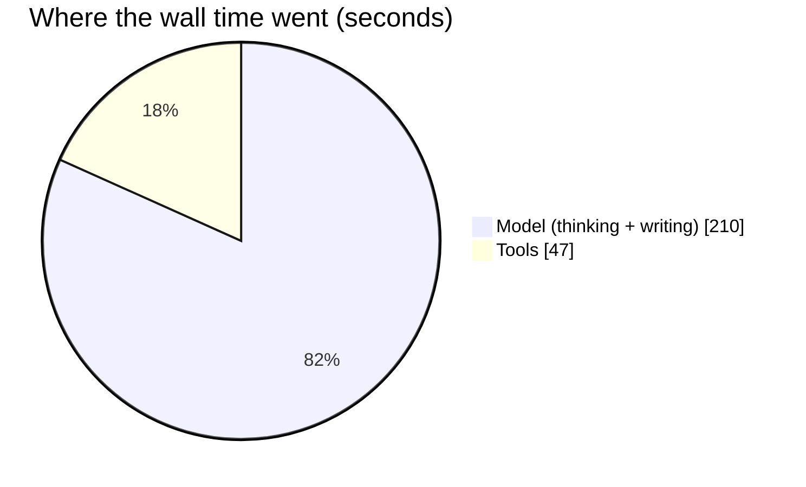

# corporate-ma/draft-markup-of-stock-purchase-agreement-provisions · run7 (`hv-mixed200-lunahigh-flip-r7-20261118T030322Z`)

Result: **all-pass** 59/59 criteria · 4.3 min · 23 model calls · 38 tool calls (1 errors or timeouts) · ending `completed` · started 11-18 08:34:13 IST

## Overview

One box per stretch of steps that used the same kind of tool (blue: looking/searching/reading, purple: writing or editing files, yellow: a message with no tool call, red border: a tool error or timeout inside the box).

```mermaid
flowchart TD
    T(["Task prompt"])
    P0["<b>Step 1</b> · 0.1 min<br/>create_goal"]
    T --> P0
    class P0 look
    P1["<b>Step 2</b> · 0.0 min<br/>todo_write"]
    P0 --> P1
    class P1 look
    P2["<b>Step 3</b> · 0.0 min<br/>skill"]
    P1 --> P2
    class P2 err
    P3["<b>Step 4</b> · 0.2 min<br/>glob<br/><i>*</i>"]
    P2 --> P3
    class P3 look
    P4["<b>Step 5</b> · 0.3 min<br/>bash x4<br/>read<br/><i>parse-doc docx documents/buyer-ma-pla…, parse-doc docx documents/sellers-draf…, parse-doc docx documents/environmenta… +2</i>"]
    P3 --> P4
    class P4 look
    P5["<b>Step 6</b> · 0.3 min<br/>bash x4<br/><i>parse-doc docx documents/sellers-draf…, parse-doc docx documents/buyer-ma-pla…, parse-doc docx documents/executed-ter… +1</i>"]
    P4 --> P5
    class P5 look
    P6["<b>Step 7</b> · 0.1 min<br/>grep x3<br/><i>seller-spa.txt, playbook.txt</i>"]
    P5 --> P6
    class P6 look
    P7["<b>Steps 8-10</b> · 0.2 min<br/>read x9<br/><i>seller-spa.txt, playbook.txt</i>"]
    P6 --> P7
    class P7 look
    P8["<b>Step 11</b> · 0.3 min<br/>bash<br/><i>python - #lt;#lt;'PY' import docx print('py…</i>"]
    P7 --> P8
    class P8 look
    P9["<b>Step 12</b> · 0.1 min<br/>grep<br/><i>dd-memo.txt</i>"]
    P8 --> P9
    class P9 look
    P10["<b>Step 13</b> · 1.8 min<br/>write<br/><i>memo.md</i>"]
    P9 --> P10
    class P10 write
    P11["<b>Steps 14-16</b> · 0.5 min<br/>bash x3<br/><i>python - #lt;#lt;'PY' try: import markdown …, cat #gt; build_doc.py #lt;#lt;'PY' from docx i…, parse-doc docx output/spa-markup-memo…</i>"]
    P10 --> P11
    class P11 look
    P12["<b>Step 17</b> · 0.1 min<br/>read<br/><i>memo.md</i>"]
    P11 --> P12
    class P12 look
    P13["<b>Steps 18-19</b> · 0.2 min<br/>bash x3<br/><i>rm -f output/memo.md && ls -l output, python - #lt;#lt;'PY' from docx import Docu…, unzip -t output/spa-markup-memorandum…</i>"]
    P12 --> P13
    class P13 look
    P14["<b>Step 20</b> · 0.1 min<br/>todo_write"]
    P13 --> P14
    class P14 look
    P15["<b>Step 21</b> · 0.0 min<br/>get_goal"]
    P14 --> P15
    class P15 look
    P16["<b>Step 22</b> · 0.0 min<br/>update_goal"]
    P15 --> P16
    class P16 look
    P17["<b>Step 23</b> · 0.0 min<br/>final message"]
    P16 --> P17
    class P17 ans
    R(["ALL PASS: 59/59 criteria"])
    P17 --> R
    class R pass
    classDef look fill:#e8f0fe,stroke:#4a6fa5,color:#111
    classDef write fill:#f3e8fd,stroke:#7b1fa2,color:#111
    classDef ans fill:#fff8e1,stroke:#b58900,color:#111
    classDef err fill:#e8f0fe,stroke:#c62828,stroke-width:3px,color:#111
    classDef pass fill:#e6f4ea,stroke:#2e7d32,color:#111
    classDef fail fill:#fce8e6,stroke:#c62828,color:#111
```





One row per model call:

| Step | Started (IST) | Model s | Tools s | Tool calls | Tools | Output chars |
|---|---|---|---|---|---|---|
| 1 | 08:34:13 | 3 | 0 | 1 | create_goal | 409 |
| 2 | 08:34:17 | 2 | 0 | 1 | todo_write | 57 |
| 3 | 08:34:19 | 2 | 0 | 1 | skill ⚠ | 53 |
| 4 | 08:34:21 | 2 | 11 | 1 | glob | 179 |
| 5 | 08:34:33 | 3 | 13 | 5 | bash x4, read | 215,717 |
| 6 | 08:34:49 | 4 | 12 | 4 | bash x4 | 1,496 |
| 7 | 08:35:05 | 4 | 2 | 3 | grep x3 | 61,582 |
| 8 | 08:35:11 | 3 | 0 | 7 | read x7 | 187,826 |
| 9 | 08:35:14 | 4 | 0 | 1 | read | 32,241 |
| 10 | 08:35:17 | 3 | 0 | 1 | read | 14,097 |
| 11 | 08:35:21 | 16 | 1 | 1 | bash | 15 |
| 12 | 08:35:38 | 8 | 1 | 1 | grep | 10,924 |
| 13 | 08:35:46 | 107 | 0 | 1 | write | 246 |
| 14 | 08:37:34 | 5 | 1 | 1 | bash | 54 |
| 15 | 08:37:39 | 18 | 1 | 1 | bash | 207 |
| 16 | 08:37:58 | 2 | 2 | 1 | bash | 9,230 |
| 17 | 08:38:03 | 4 | 0 | 1 | read | 3,114 |
| 18 | 08:38:06 | 6 | 1 | 1 | bash | 98 |
| 19 | 08:38:13 | 5 | 2 | 2 | bash x2 | 164 |
| 20 | 08:38:20 | 4 | 0 | 1 | todo_write | 57 |
| 21 | 08:38:24 | 2 | 0 | 1 | get_goal | 409 |
| 22 | 08:38:26 | 2 | 0 | 1 | update_goal | 414 |
| 23 | 08:38:29 | 2 | 0 | 0 | (message only) | 0 |

## Task prompt

```text
Review the seller's draft SPA against the buyer's playbook, executed term sheet, and diligence materials, and prepare a detailed markup memorandum with draft-ready redline language. Output: `spa-markup-memorandum.docx`.
```

## Rubric

| # | Criterion | Verdict |
|---|---|---|
| C-001 | ISSUE_001: Identifies overbroad MAE carve-outs for environmental industry/regulations | pass |
| C-002 | ISSUE_001: Proposes adding disproportionate impact qualifier to MAE carve-outs | pass |
| C-003 | ISSUE_001: Provides actual revised contract language for MAE definition | pass |
| C-004 | ISSUE_001: Explains rationale — environmental company needs MAE protection | pass |
| C-005 | ISSUE_002: Identifies missing interim covenant restricting affiliate transactions | pass |
| C-006 | ISSUE_002: Proposes covenant requiring Buyer consent for affiliate transactions | pass |
| C-007 | ISSUE_002: References the above-market rent to Seller affiliate as rationale | pass |
| C-008 | ISSUE_003: Identifies indemnification cap discrepancy (20% vs. 12.5%) | pass |
| C-009 | ISSUE_003: Proposes redline reducing cap to 12.5% / $26,875,000 | pass |
| C-010 | ISSUE_003: References the term sheet as basis for cap correction | pass |
| C-011 | ISSUE_004: Identifies that environmental reps survival period is too short | pass |
| C-012 | ISSUE_004: Proposes extending environmental reps survival to at least 36 months | pass |
| C-013 | ISSUE_004: References CERCLA/Dalton Creek exposure as rationale for longer survival | pass |
| C-014 | ISSUE_005: Identifies anti-sandbagging provision in Section 9.06 | pass |
| C-015 | ISSUE_005: Proposes replacing with pro-sandbagging language | pass |
| C-016 | ISSUE_005: Provides actual pro-sandbagging contract text | pass |
| C-017 | ISSUE_006: Identifies need for Special Indemnity for Dalton Creek CERCLA matter | pass |
| C-018 | ISSUE_006: Special Indemnity survival of 72 months | pass |
| C-019 | ISSUE_006: Special Indemnity not subject to basket or cap | pass |
| C-020 | ISSUE_006: References Dalton Creek liability range ($1.5M-$6M) | pass |
| C-021 | ISSUE_007: Identifies problematic earnout operational covenant | pass |
| C-022 | ISSUE_007: Proposes limiting earnout covenant to no-frustration standard | pass |
| C-023 | ISSUE_007: Explains rationale — Buyer integration/restructuring flexibility | pass |
| C-024 | ISSUE_008: Identifies missing payoff letter requirement | pass |
| C-025 | ISSUE_008: Proposes payoff letters at least 3 business days pre-closing | pass |
| C-026 | ISSUE_008: Proposes simultaneous repayment at closing through funds flow | pass |
| C-027 | ISSUE_008: Proposes payoff letter delivery as a condition to closing | pass |
| C-028 | ISSUE_009: Identifies missing government contract anti-assignment/novation requirement | pass |
| C-029 | ISSUE_009: References specific government contracts requiring novation | pass |
| C-030 | ISSUE_009: Proposes closing condition or covenant for government contract novation | pass |
| C-031 | ISSUE_009: References Anti-Assignment Act or FAR provisions | pass |
| C-032 | ISSUE_010: Identifies missing environmental permit transfer/notification covenant | pass |
| C-033 | ISSUE_010: Proposes cooperation covenant for environmental permit transfers | pass |
| C-034 | ISSUE_010: Notes that permits may require notification even in a stock deal | pass |
| C-035 | ISSUE_011: Identifies missing R&W Insurance subrogation waiver | pass |
| C-036 | ISSUE_011: Proposes subrogation waiver provision with fraud exception | pass |
| C-037 | ISSUE_011: References R&W Insurance policy / Granite Ridge Underwriters | pass |
| C-038 | ISSUE_012: Identifies non-compete scope exceeds term sheet (duration) | pass |
| C-039 | ISSUE_012: Identifies non-compete scope exceeds term sheet (geographic) | pass |
| C-040 | ISSUE_012: Identifies non-compete scope exceeds term sheet (activity) | pass |
| C-041 | ISSUE_012: Proposes narrowing non-compete duration to 3 years | pass |
| C-042 | ISSUE_012: Proposes narrowing non-compete geographic scope to OR, WA, CA, NV | pass |
| C-043 | ISSUE_012: Proposes narrowing non-compete activity scope to environmental remediation and hazardous waste management | pass |
| C-044 | ISSUE_012: Notes enforceability risk of overbroad non-compete | pass |
| C-045 | Indemnification cap issue rated as Critical or High priority | pass |
| C-046 | Anti-sandbagging issue rated as Critical or High priority | pass |
| C-047 | Memorandum identifies provisions acceptable as drafted | pass |
| C-048 | Memorandum flags items for partner/client discussion | pass |
| C-049 | Escrow amount correctly stated as $16,125,000 (7.5% of EV) | pass |
| C-050 | ISSUE_006: Proposes 36-month escrow holdback for Special Indemnity | pass |
| C-051 | Earnout maximum correctly referenced as $25,000,000 | pass |
| C-052 | Earnout Adjusted EBITDA threshold correctly referenced as $38,000,000 | pass |
| C-053 | Earnout floor correctly referenced as $32,000,000 | pass |
| C-054 | References playbook as authority for at least 3 markup positions | pass |
| C-055 | References term sheet as authority for at least 3 markup positions | pass |
| C-056 | References environmental DD memo for at least one markup position | pass |
| C-057 | Memorandum identifies specific SPA section numbers for issues | pass |
| C-058 | Proposed redline language is actual contract text for at least 8 issues | pass |
| C-059 | ISSUE_008: Identifies all three sources of Target indebtedness | pass |

Judge's reasoning:

**C-001 (pass):** ISSUE_001: Identifies overbroad MAE carve-outs for environmental industry/regulations

```text
The memorandum expressly identifies the environmental services industry and Environmental Law carve-outs as problematic because they lack disproportionate-impact qualifiers, and it proposes adding such a qualifier to the MAE definition.
```

**C-002 (pass):** ISSUE_001: Proposes adding disproportionate impact qualifier to MAE carve-outs

```text
The memorandum expressly proposes a disproportionate-impact proviso to the MAE carve-outs, including the industry-specific and Environmental Law/regulatory carve-outs, for effects that disproportionately affect the Company relative to comparable industry participants.
```

**C-003 (pass):** ISSUE_001: Provides actual revised contract language for MAE definition

```text
The memorandum includes complete proposed replacement contract language for the Material Adverse Effect definition, including an express disproportionate-impact proviso applicable to the listed carve-outs.
```

**C-004 (pass):** ISSUE_001: Explains rationale — environmental company needs MAE protection

```text
The memorandum explains that unqualified environmental-industry and Environmental Law carve-outs could exclude the developments most likely to harm Cascadia because it is a highly regulated environmental-services company. It further notes that these carve-outs could improperly exclude target-specific regulatory developments or enforcement initiatives, thereby materially weakening the MAE protection.
```

**C-005 (pass):** ISSUE_002: Identifies missing interim covenant restricting affiliate transactions

```text
The memorandum expressly identifies in Section 10 that the interim operating covenants omit a restriction on affiliate transactions and proposes a new covenant requiring Buyer consent for transactions or arrangements between the Company and Seller, Seller affiliates, and related persons between signing and closing.
```

**C-006 (pass):** ISSUE_002: Proposes covenant requiring Buyer consent for affiliate transactions

```text
Section 10 proposes a new interim covenant prohibiting the Company from entering into, amending, modifying, extending, renewing, supplementing, or terminating agreements or transactions with Seller or Seller affiliates without Buyer's prior written consent.
```

**C-007 (pass):** ISSUE_002: References the above-market rent to Seller affiliate as rationale

```text
In Section 10’s affiliate transaction restriction commentary, the memorandum expressly states that the missing covenant is material because Cascadia pays $1,600,000 in annual rent to a Seller affiliate under the Affiliate Lease. This directly connects the affiliate lease/rent issue to the need for the covenant.
```

**C-008 (pass):** ISSUE_003: Identifies indemnification cap discrepancy (20% vs. 12.5%)

```text
The memorandum expressly identifies the Seller’s 20% ($43,000,000) general indemnification cap as inconsistent with the term sheet’s agreed 12.5% cap ($26,875,000) and proposes conforming revisions.
```

**C-009 (pass):** ISSUE_003: Proposes redline reducing cap to 12.5% / $26,875,000

```text
The memorandum expressly proposes replacing the $43,000,000 (20%) indemnification cap with $26,875,000, equal to 12.5% of the $215,000,000 Base Enterprise Value, and includes conforming language for Section 9.04(b).
```

**C-010 (pass):** ISSUE_003: References the term sheet as basis for cap correction

```text
The memorandum expressly states that the $43 million cap departs from the binding term sheet’s 12.5% cap and cites “Term Sheet §§8 and 18(iv)” as the source for the correction to $26,875,000. The memorandum identifies the executed term sheet as dated September 10, 2025 elsewhere in the document.
```

**C-011 (pass):** ISSUE_004: Identifies that environmental reps survival period is too short

```text
The memorandum expressly identifies the Seller’s 12-month survival period for all non-fundamental representations as inadequate for environmental representations, including Section 4.15 environmental matters and Environmental Permits, and proposes a separate 36-month survival period.
```

**C-012 (pass):** ISSUE_004: Proposes extending environmental reps survival to at least 36 months

```text
The memorandum expressly proposes that environmental representations survive until 36 months after closing in proposed Section 9.01(d), and it also reserves the option to seek survival through the full applicable statute of limitations.
```

**C-013 (pass):** ISSUE_004: References CERCLA/Dalton Creek exposure as rationale for longer survival

```text
The memorandum expressly connects the longer 36-month survival period for environmental representations to the Dalton Creek CERCLA exposure and Hargrove remediation. Section 14 states that the separate 36-month environmental period is warranted by the Dalton Creek and Hargrove exposures, with full limitations-period survival preserved as an alternative.
```

**C-014 (pass):** ISSUE_005: Identifies anti-sandbagging provision in Section 9.06

```text
The memorandum expressly identifies Section 9.06 as an anti-sandbagging provision, quotes the language barring Buyer indemnification for breaches known as of the Closing Date, and proposes replacing it with a pro-sandbagging clause.
```

**C-015 (pass):** ISSUE_005: Proposes replacing with pro-sandbagging language

```text
Section 17 expressly deletes the anti-sandbagging clause and replaces it with a pro-sandbagging provision stating that Buyer’s indemnification and other remedies are not affected, limited, diminished, or impaired by any investigation or knowledge acquired or capable of being acquired before or after Closing.
```

**C-016 (pass):** ISSUE_005: Provides actual pro-sandbagging contract text

```text
The memorandum includes actual proposed pro-sandbagging contract language in Section 17, replacing the anti-sandbagging provision with a detailed “Effect of Investigation and Knowledge” clause stating that Buyer’s indemnification and other remedies are not impaired by investigation, knowledge, notice, or diligence disclosures.
```

**C-017 (pass):** ISSUE_006: Identifies need for Special Indemnity for Dalton Creek CERCLA matter

```text
The memorandum expressly proposes a separate “Dalton Creek Special Indemnity” in new Section 9.02(e), covering the EPA CERCLA §104(e) request and related Dalton Creek liabilities. It also states that this protection is separate from general indemnification and is not subject to the general deductible or indemnification cap.
```

**C-018 (pass):** ISSUE_006: Special Indemnity survival of 72 months

```text
The memorandum expressly states that the Dalton Creek Special Indemnity survives for 72 months following the Closing Date, including in proposed Sections 9.01(g) and 9.02(e).
```

**C-019 (pass):** ISSUE_006: Special Indemnity not subject to basket or cap

```text
The memorandum expressly states that the Dalton Creek Special Indemnity is a dollar-one obligation not subject to the Deductible or the general Indemnification Cap. It also includes conforming basket and cap carve-outs in Sections 9.04(a) and 9.04(b).
```

**C-020 (pass):** ISSUE_006: References Dalton Creek liability range ($1.5M-$6M)

```text
The memorandum expressly cites the Dalton Creek estimated potential CERCLA liability range of $1,500,000 to $6,000,000 in the proposed Schedule 9.02(e) and uses that range to justify the Special Indemnity and its proposed $7,500,000 sub-cap.
```

**C-021 (pass):** ISSUE_007: Identifies problematic earnout operational covenant

```text
The memorandum expressly identifies Section 2.05’s requirement to operate consistently with past practice and in good faith to maximize the Earnout Payment as overly restrictive. It recommends striking that affirmative covenant and replacing it with a narrow prohibition on actions taken with the primary purpose of reducing or avoiding the earnout.
```

**C-022 (pass):** ISSUE_007: Proposes limiting earnout covenant to no-frustration standard

```text
The memorandum expressly replaces the affirmative past-practice/maximization covenant with a narrow no-frustration standard: Buyer may not take actions with the primary purpose of reducing or avoiding the earnout. It also states that Buyer has no obligation to operate consistently with past practice, maximize the earnout, or maintain particular resources, personnel, customers, or revenues.
```

**C-023 (pass):** ISSUE_007: Explains rationale — Buyer integration/restructuring flexibility

```text
The memorandum expressly explains that the Seller’s broad earnout covenant would constrain Buyer’s post-closing integration, restructuring, pricing, personnel, capital allocation, and bolt-on strategy. It also proposes language preserving Buyer’s discretion to integrate, restructure, and otherwise manage the business, subject only to a primary-purpose anti-avoidance standard.
```

**C-024 (pass):** ISSUE_008: Identifies missing payoff letter requirement

```text
The memorandum expressly identifies that the Seller's draft permits repayment “at or promptly following the Closing” and lacks a requirement to deliver payoff letters before closing. It proposes delivery of executed payoff letters from each holder of Closing Indebtedness at least three Business Days before the scheduled Closing Date.
```

**C-025 (pass):** ISSUE_008: Proposes payoff letters at least 3 business days pre-closing

```text
The memorandum expressly requires executed payoff letters no later than three Business Days before Closing, including wire transfer instructions and commitments/documentation for lien releases such as UCC-3 termination statements.
```

**C-026 (pass):** ISSUE_008: Proposes simultaneous repayment at closing through funds flow

```text
The memorandum expressly proposes in Section 2.03(d) that all Closing Indebtedness be repaid simultaneously at Closing through the funds flow, and that no Closing Indebtedness remain outstanding after Closing, replacing the seller’s “at or promptly following” mechanic.
```

**C-027 (pass):** ISSUE_008: Proposes payoff letter delivery as a condition to closing

```text
The memorandum expressly proposes adding Section 7.02(h) as a Buyer closing condition requiring all payoff letters to be delivered at least three Business Days before Closing and remain effective at Closing.
```

**C-028 (pass):** ISSUE_009: Identifies missing government contract anti-assignment/novation requirement

```text
The memorandum expressly identifies that the Seller's draft lacks specific government-contract anti-assignment, novation, and recognition provisions. It discusses the Oregon DEQ, Washington Ecology, USACE, and BLM contracts, cites the Anti-Assignment Act and FAR 42.12, and proposes related representations, covenants, and closing conditions.
```

**C-029 (pass):** ISSUE_009: References specific government contracts requiring novation

```text
The memorandum specifically identifies all four active government contracts—Oregon DEQ, Washington Ecology, USACE, and BLM—and discusses novation, recognition, consent, or notification requirements applicable to those contracts.
```

**C-030 (pass):** ISSUE_009: Proposes closing condition or covenant for government contract novation

```text
The memorandum proposes both a specific pre-closing covenant requiring Seller and the Company to notify contracting officers and seek novation, recognition, change-of-name, consent, or similar approvals (new Section 6.06(c)), and closing conditions addressing submission or receipt of those approvals and no adverse agency action (Sections 7.02(f) and 7.02(i)).
```

**C-031 (pass):** ISSUE_009: References Anti-Assignment Act or FAR provisions

```text
The memorandum expressly cites the Anti-Assignment Act, 41 U.S.C. § 6305, and FAR Part 42, Subpart 42.12 as the legal basis for government-contract novation, recognition, and related closing requirements.
```

**C-032 (pass):** ISSUE_010: Identifies missing environmental permit transfer/notification covenant

```text
The memorandum expressly identifies that the Seller’s draft has environmental permit representations but lacks a dedicated covenant addressing permit change-of-control notices, approvals, transfers, reissuance, and cooperation. It proposes Section 6.06(a) requiring pre-closing identification and submission of required notices/applications and Section 6.06(b) requiring post-closing cooperation for permit notification, transfer, reissuance, amendment, or approval processes.
```

**C-033 (pass):** ISSUE_010: Proposes cooperation covenant for environmental permit transfers

```text
The memorandum proposes both pre-closing and post-closing environmental permit cooperation covenants in new Section 6.06. It requires Seller to identify and submit required permit notices, applications, and approval requests, and to assist after closing with permit notifications, transfers, reissuances, amendments, and approvals under applicable law.
```

**C-034 (pass):** ISSUE_010: Notes that permits may require notification even in a stock deal

```text
The memorandum expressly notes that environmental permits may have change-of-control notification, consent, or approval requirements and explains that regulators may treat an ultimate change of control as a trigger even though Cascadia remains the permit-holding entity in the stock purchase structure.
```

**C-035 (pass):** ISSUE_011: Identifies missing R&W Insurance subrogation waiver

```text
The memorandum expressly states in Section 20 that the Seller's draft contains no R&W Insurance or subrogation waiver provision, and it proposes a new Section 9.09 requiring the insurer to waive subrogation rights against Seller and related parties, subject to a fraud exception.
```

**C-036 (pass):** ISSUE_011: Proposes subrogation waiver provision with fraud exception

```text
The memorandum proposes new Section 9.09 requiring the R&W Insurance Policy to waive the insurer’s subrogation and recovery rights against Seller and related parties, with an express exception for losses arising from actual fraud by Seller.
```

**C-037 (pass):** ISSUE_011: References R&W Insurance policy / Granite Ridge Underwriters

```text
The memorandum states that Buyer is obtaining an R&W Insurance policy, identifies Granite Ridge Underwriters as the carrier, and expressly links that policy to the need for a subrogation waiver in proposed Section 9.09.
```

**C-038 (pass):** ISSUE_012: Identifies non-compete scope exceeds term sheet (duration)

```text
The memorandum expressly identifies that the Seller's draft imposes a five-year non-compete and states that this is inconsistent with the term sheet's agreed three-year period, proposing a three-year replacement.
```

**C-039 (pass):** ISSUE_012: Identifies non-compete scope exceeds term sheet (geographic)

```text
The memorandum expressly identifies that the Seller's draft imposes a nationwide non-compete and proposes narrowing it to Oregon, Washington, California, and Nevada to match the term sheet.
```

**C-040 (pass):** ISSUE_012: Identifies non-compete scope exceeds term sheet (activity)

```text
The memorandum expressly identifies that the Seller's five-year nationwide restriction covering “any business” exceeds the term sheet and proposes narrowing the prohibited activity to environmental remediation and hazardous waste management services actually conducted by Cascadia.
```

**C-041 (pass):** ISSUE_012: Proposes narrowing non-compete duration to 3 years

```text
The proposed replacement for Section 6.09(a) expressly narrows the non-compete period from five years to three years following the Closing Date, matching the term sheet.
```

**C-042 (pass):** ISSUE_012: Proposes narrowing non-compete geographic scope to OR, WA, CA, NV

```text
The proposed replacement for Section 6.09(a) expressly limits the non-compete to businesses operating in Oregon, Washington, California, or Nevada, matching the term sheet’s geographic scope.
```

**C-043 (pass):** ISSUE_012: Proposes narrowing non-compete activity scope to environmental remediation and hazardous waste management

```text
The proposed replacement for Section 6.09(a) expressly narrows the non-compete to businesses engaged in “environmental remediation services or hazardous waste management services,” matching the term-sheet scope.
```

**C-044 (pass):** ISSUE_012: Notes enforceability risk of overbroad non-compete

```text
The memorandum expressly states that the five-year, nationwide, “any business” non-compete would sweep in Evergreen’s unrelated construction and timber operations and notes that the proposed narrower scope is more likely to be enforceable across the relevant jurisdictions.
```

**C-045 (pass):** Indemnification cap issue rated as Critical or High priority

```text
The output explicitly labels the indemnification cap discrepancy—$43 million (20%) versus $26.875 million (12.5%)—as “Priority: Critical” in Section 5 and again treats the cap correction as Critical in Section 16.
```

**C-046 (pass):** Anti-sandbagging issue rated as Critical or High priority

```text
Section 9.06, addressing deletion of the anti-sandbagging clause and addition of pro-sandbagging language, is expressly assigned “Priority: Critical,” the highest tier.
```

**C-047 (pass):** Memorandum identifies provisions acceptable as drafted

```text
The memorandum includes a separate section titled “Issues that should not be marked up” identifying several provisions as acceptable, with brief explanations: the 1% true-deductible basket, the knowledge qualifier, good-standing certificate timing, Delaware governing law, and NWC true-up mechanics.
```

**C-048 (pass):** Memorandum flags items for partner/client discussion

```text
The memorandum expressly includes an “Additional Material Issues for Partner Discussion” section and identifies multiple open issues requiring partner/client direction, including government-contract novation closing conditions, environmental-representation survival, Dalton Creek escrow structure, and Affiliate Lease treatment involving Marcus Devereaux and the client.
```

**C-049 (pass):** Escrow amount correctly stated as $16,125,000 (7.5% of EV)

```text
The memorandum correctly states the Escrow Amount as $16,125,000 and identifies it as 7.5% of the $215,000,000 Base Enterprise Value in its escrow and indemnification discussion.
```

**C-050 (pass):** ISSUE_006: Proposes 36-month escrow holdback for Special Indemnity

```text
The memorandum expressly provides in proposed Section 9.08(b) that the escrow portion allocated to the Dalton Creek Special Indemnity and other specified claims is retained until 36 months after closing, distinct from the general claims escrow release at 18 months. It also reiterates the 36-month Special Indemnity/environmental holdback in the environmental escrow discussion.
```

**C-051 (pass):** Earnout maximum correctly referenced as $25,000,000

```text
The memorandum’s earnout discussion expressly states that the financial thresholds remain unchanged, including a “$25,000,000 maximum,” correctly referencing the maximum earnout payment.
```

**C-052 (pass):** Earnout Adjusted EBITDA threshold correctly referenced as $38,000,000

```text
The earnout discussion expressly states that the full-payment Adjusted EBITDA threshold is $38,000,000, so the threshold is correctly referenced.
```

**C-053 (pass):** Earnout floor correctly referenced as $32,000,000

```text
The memorandum expressly states that the earnout has a $32,000,000 floor and uses linear interpolation between that floor and the $38,000,000 full-payment threshold, satisfying the required pro-rata structure.
```

**C-054 (pass):** References playbook as authority for at least 3 markup positions

```text
The memorandum cites the Buyer M&A Playbook as authority for well over three distinct markup positions, including the MAE disproportionate-impact qualifier, earnout covenant, indemnification cap, payoff mechanics, government-contract provisions, environmental covenants, survival periods, anti-sandbagging, and restrictive covenants.
```

**C-055 (pass):** References term sheet as authority for at least 3 markup positions

```text
The memorandum cites the executed term sheet as authority for well over three distinct markup positions, including the 12.5% indemnification cap, earnout covenant and timing, payoff-letter mechanics, environmental survival, Dalton Creek Special Indemnity, R&W insurance/subrogation, and restrictive-covenant scope.
```

**C-056 (pass):** References environmental DD memo for at least one markup position

```text
The memorandum repeatedly cites the environmental DD memo as support for markup positions, including the Dalton Creek special indemnity, environmental representation survival, permit change-of-control covenants, government-contract novation provisions, and environmental insurance language.
```

**C-057 (pass):** Memorandum identifies specific SPA section numbers for issues

```text
The memorandum ties well over 8 issues to specific SPA section numbers, including Sections 1.01, 2.03(d), 2.05, 2.08, 4.15, 4.16, 6.01, 6.05/6.06, 7.02, 9.01, 9.02, 9.04, 9.06, 9.07, 9.09, 6.09, and 10.05.
```

**C-058 (pass):** Proposed redline language is actual contract text for at least 8 issues

```text
The memorandum provides draft-ready contract text for well over 8 issues, including MAE qualifiers, the indemnification cap, earnout covenants and mechanics, payoff letters, government-contract representations and closing conditions, environmental representations and covenants, survival periods, the Dalton Creek special indemnity, escrow mechanics, pro-sandbagging, R&W insurance, and restrictive covenants.
```

**C-059 (pass):** ISSUE_008: Identifies all three sources of Target indebtedness

```text
The payoff-letter discussion identifies all three sources of Target indebtedness: Cascade Mutual Bank, Pacific Lease Corp., and Evergreen Holdings Group, Inc., including their respective amounts ($28.0M, $9.8M, and $4.5M). This exceeds the criterion’s requirement to mention at least two sources or the $42.3M total.
```

## Delivered files (output/)

- `spa-markup-memorandum.docx` (58,597 bytes)

## Trajectory

### Step 1: 1 tool call

_Started 11-18 08:34:13 IST · model 3 s · tools 0 s_

**Reasoning summary:**

```text
**Preparing document tasks**

I need to produce a docx and inspect documents, which means using my skills to determine which task matches the relevant docs. I'll list files using glob and read the docs via parse-doc bash. Maybe I should create a goal for this process? It sounds like a long objective, but probably necessary. I’ll use the create_goal function as part of my todo list to keep everything organized!
```

**Call `create_goal`** (0.1 s)

```json
{
 "objective": "Review the seller's draft SPA against the buyer's playbook, executed term sheet, and diligence materials, then prepare and deliver a detailed markup memorandum with draft-ready redline language as spa-markup-memorandum.docx in the output directory.",
 "max_goal_rounds": 3
}
```

Output (409 chars):

```text
{"goal":{"id":"goal-a1e64421-f7a3-493e-81e0-0f12cfab2c9c","revision":1,"objective":"Review the seller's draft SPA against the buyer's playbook, executed term sheet, and diligence materials, then prepare and deliver a detailed markup memorandum with draft-ready redline language as spa-markup-memorandum.docx in the output directory.","phase":"active","roundsStarted":0,"maxGoalRounds":3},"activation":"armed"}
```

### Step 2: 1 tool call

_Started 11-18 08:34:17 IST · model 2 s · tools 0 s_

**Call `todo_write`** (0.3 s)

```json
{
 "todos": [
  {
   "content": "Inventory and read all transaction source materials",
   "status": "in_progress"
  },
  {
   "content": "Extract buyer positions and compare against seller draft SPA",
   "status": "pending"
  },
  {
   "content": "Draft detailed markup memorandum with proposed redline language",
   "status": "pending"
  },
  {
   "content": "Generate and validate spa-markup-memorandum.docx",
   "status": "pending"
  }
 ]
}
```

Output (57 chars):

```text
Updated todo list: 3 pending, 1 in progress, 0 completed.
```

**Todo list now:**

- [~] Inventory and read all transaction source materials
- [ ] Extract buyer positions and compare against seller draft SPA
- [ ] Draft detailed markup memorandum with proposed redline language
- [ ] Generate and validate spa-markup-memorandum.docx

### Step 3: 1 tool call

_Started 11-18 08:34:19 IST · model 2 s · tools 0 s_

**Call `skill`** (0.0 s · **error/timeout**)

```json
{
 "name": "docs"
}
```

Output (53 chars):

```text
Error: skill "docs" is unknown or no longer available
```

### Step 4: 1 tool call

_Started 11-18 08:34:21 IST · model 2 s · tools 11 s_

**Call `glob`** (10.7 s)

```json
{
 "pattern": "*"
}
```

Output (179 chars):

```text
documents/buyer-ma-playbook.docx
documents/sellers-draft-spa.docx
documents/environmental-dd-memo.docx
documents/executed-term-sheet.docx
documents/partner-markup-instructions.eml
```

### Step 5: 5 tool calls

_Started 11-18 08:34:33 IST · model 3 s · tools 13 s_

**Call `bash`** (3.6 s)

```json
{
 "command": "parse-doc docx documents/buyer-ma-playbook.docx",
 "description": "Extract buyer playbook text"
}
```

Output (49,999 chars):

```text
tner. This is a **Critical** priority item.

For example, if the term sheet specifies a general indemnification cap of 12.5% of enterprise value for a transaction with a \$200 million enterprise value, the SPA\'s general indemnification cap should be \$25,000,000. If the seller\'s draft sets the cap at \$20,000,000 (10% of enterprise value), the associate must flag this as a deviation from the term sheet and mark up the draft to reflect the agreed \$25,000,000 cap.

**R&W Insurance Considerations.** In transactions where the buyer is obtaining representations and warranties insurance (see Section 8), the indemnification cap may be subject to additional negotiation dynamics. The R&W insurer may require a certain retention level (the amount of loss the buyer must bear before the policy responds), which interacts with the SPA\'s basket/deductible and cap structure. However, the SPA cap itself must conform to the term sheet regardless of the R&W Insurance structure. The R&W Insurance policy supplements the seller\'s indemnification obligations --- it does not replace them, and the availability of insurance does not justify a reduction in the SPA cap below the term sheet level.

**Market Data.** In recent environmental services transactions handled by the firm, general indemnification caps have ranged from 10% to 15% of enterprise value. The 12.5% figure is squarely within the market range and represents the firm\'s standard recommendation for PE buyers in this sector. Caps below 
… [48,499 more chars]
```

**Call `bash`** (4.1 s)

```json
{
 "command": "parse-doc docx documents/sellers-draft-spa.docx",
 "description": "Extract seller SPA text"
}
```

Output (49,998 chars):

```text
and Seller;

**(b)** by either Buyer or Seller, by written notice to the other Party, if the Closing shall not have occurred on or before the Outside Date (February 28, 2026); *provided* that the right to terminate this Agreement under this Section 8.01(b) shall not be available to any Party whose breach of any representation, warranty, covenant, or agreement set forth in this Agreement has been the primary cause of, or has primarily resulted in, the failure of the Closing to occur on or before the Outside Date;

**(c)** by either Buyer or Seller, by written notice to the other Party, if any Governmental Authority shall have enacted, issued, promulgated, enforced, or entered any final and non-appealable Law, order, injunction, judgment, decree, ruling, or other legally binding action that permanently restrains, enjoins, or otherwise prohibits the consummation of the transactions contemplated by this Agreement;

**(d)** by Buyer, by written notice to Seller, if there shall have been a breach by Seller of any representation, warranty, covenant, or agreement contained in this Agreement that would cause the conditions set forth in Section 7.02(a) or Section 7.02(b) not to be satisfied, and such breach shall not have been cured by Seller within thirty (30) days after receipt of written notice of such breach from Buyer (or, if earlier, by the Outside Date); *provided* that Buyer shall not have the right to terminate this Agreement under this Section 8.01(d) if Buyer is then in mate
… [48,498 more chars]
```

**Call `bash`** (2.7 s)

```json
{
 "command": "parse-doc docx documents/environmental-dd-memo.docx",
 "description": "Extract environmental diligence text"
}
```

Output (47,133 chars):

```text
**ASHFORD, PENNINGTON & YATES LLP** *Attorneys at Law* 71 South Wacker Drive, Suite 4500 Chicago, Illinois 60606

**PRIVILEGED AND CONFIDENTIAL --- ATTORNEY WORK PRODUCT** This memorandum is protected by the attorney-client privilege and the work product doctrine. It is intended solely for use by the attorneys and professionals of Ashford, Pennington & Yates LLP and the client to whom it is addressed. Any unauthorized disclosure, reproduction, or distribution is strictly prohibited.

**MEMORANDUM**

**TO:** Elena Vasquez-Moreno, Partner, M&A Group Jonathan Kreider, Senior Associate, M&A Group

**FROM:** Environmental Practice Group, Ashford, Pennington & Yates LLP

**DATE:** October 18, 2025

**RE:** Environmental Due Diligence Summary --- Acquisition of Cascadia Environmental Solutions, Inc. by Whitmore Capital Partners LLC

**PROJECT:** Project Cascade --- Whitmore Capital Partners LLC Fund III Platform Acquisition

This memorandum summarizes the findings and recommendations of the Environmental Practice Group arising from our environmental due diligence review of Cascadia Environmental Solutions, Inc. in connection with the proposed acquisition by Whitmore Capital Partners LLC. This memo is intended to inform the deal team\'s review of the Seller\'s Stock Purchase Agreement draft, which we understand will be circulated on or about October 22, 2025. All findings and recommendations set forth herein should be incorporated into the firm\'s SPA markup and negotiation strategy.
… [45,632 more chars]
```

**Call `bash`** (2.8 s)

```json
{
 "command": "parse-doc docx documents/executed-term-sheet.docx",
 "description": "Extract executed term sheet text"
}
```

Output (49,983 chars):

```text
**BINDING TERM SHEET**

**Acquisition of 100% of the Outstanding Equity Interests of** **Cascadia Environmental Solutions, Inc.**

Dated as of September 10, 2025

This Binding Term Sheet (this \"Term Sheet\") sets forth the principal terms and conditions agreed upon by the parties identified below with respect to the proposed acquisition described herein. Except as set forth in Section 18 (Binding Provisions) below, this Term Sheet is intended to be binding on the parties and shall govern the preparation of the Definitive Agreement (as defined below). This Term Sheet supersedes and replaces in its entirety the non-binding Letter of Intent dated August 15, 2025 (the \"LOI\"), previously entered into between Whitmore Capital Partners LLC and Evergreen Holdings Group, Inc. with respect to the proposed acquisition of Cascadia Environmental Solutions, Inc. Capitalized terms used but not otherwise defined herein shall have the meanings ascribed to them in the context in which they appear.

**[Section 1: Parties]{.underline}**

**Buyer:** Whitmore Capital Partners LLC, a Delaware limited liability company, with its principal offices at 200 South Wacker Drive, Suite 3100, Chicago, Illinois 60606 (referred to herein as \"Buyer\" or \"Whitmore\").

**Seller:** Evergreen Holdings Group, Inc., a Delaware corporation, with its principal offices at 1550 NW Everett Street, Suite 800, Portland, Oregon 97209 (referred to herein as \"Seller\" or \"Evergreen\").

**Target / the Company:** Casca
… [48,483 more chars]
```

**Call `read`** (0.1 s)

```json
{
 "file_path": "documents/partner-markup-instructions.eml"
}
```

Output (18,604 chars):

```text
<path>/home/agarwaldi/dsh-bench-harness/runs/hv-mixed200-lunahigh-flip-r7-20261118T030322Z/tasks/corporate-ma__draft-markup-of-stock-purchase-agreement-provisions/workspace/documents/partner-markup-instructions.eml</path>
<type>file</type>
<content>
1: From: Elena Vasquez-Moreno <evasquez-moreno@apylaw.com>
2: To: Jonathan Kreider <jkreider@apylaw.com>
3: Date: Thu, 23 Oct 2025 08:47:00 -0000
4: Subject: Re: Cascadia SPA Markup — Instructions and Priority Issues
5: Content-Type: text/plain; charset="utf-8"
6: Content-Transfer-Encoding: quoted-printable
7: MIME-Version: 1.0
8: 
9: Jonathan,
10: 
11: I reviewed the initial draft SPA that Douglas Renwick at Fortuna & Blake circ=
12: ulated yesterday. My overall impression: this is a heavily seller-favorable d=
13: raft in several material respects, and some of the positions directly contrad=
14: ict the September 10 term sheet =E2=80=94 which tells me either Doug is testi=
15: ng our resolve or his client gave him different instructions than what was ag=
16: reed at the principal level. Either way, we need a sharp, comprehensive marku=
17: p.
18: 
19: Marcus Devereaux at Whitmore Capital wants to see our redline by end of next =
20: week. Given the November 14 target signing date, that gives the parties rough=
21: ly two weeks of negotiation runway after we send our markup, which is tight. =
22: I need your comprehensive markup memorandum with redlined provisions and full=
23:  track-changes commentary.
24: 
25: **General Instru
… [17,104 more chars]
```

### Step 6: 4 tool calls

_Started 11-18 08:34:49 IST · model 4 s · tools 12 s_

**Call `bash`** (3.1 s)

```json
{
 "command": "parse-doc docx documents/sellers-draft-spa.docx > seller-spa.txt",
 "description": "Save seller SPA text for review"
}
```

Output (374 chars):

```text
[stderr]
2026-11-18 03:04:55.573022965 [W:onnxruntime:Default, device_discovery.cc:95 GetPciBusId] Skipping pci_bus_id for PCI path at "/sys/devices/LNXSYSTM:00/LNXSYBUS:00/ACPI0004:00/VMBUS:00/5620e0c7-8062-4dce-aeb7-520c7ef76171" because filename "5620e0c7-8062-4dce-aeb7-520c7ef76171" did not match expected pattern of [0-9a-f]+:[0-9a-f]+:[0-9a-f]+[.][0-9a-f]+
```

**Call `bash`** (2.3 s)

```json
{
 "command": "parse-doc docx documents/buyer-ma-playbook.docx > playbook.txt",
 "description": "Save playbook text for review"
}
```

Output (374 chars):

```text
[stderr]
2026-11-18 03:04:58.174902864 [W:onnxruntime:Default, device_discovery.cc:95 GetPciBusId] Skipping pci_bus_id for PCI path at "/sys/devices/LNXSYSTM:00/LNXSYBUS:00/ACPI0004:00/VMBUS:00/5620e0c7-8062-4dce-aeb7-520c7ef76171" because filename "5620e0c7-8062-4dce-aeb7-520c7ef76171" did not match expected pattern of [0-9a-f]+:[0-9a-f]+:[0-9a-f]+[.][0-9a-f]+
```

**Call `bash`** (3.0 s)

```json
{
 "command": "parse-doc docx documents/executed-term-sheet.docx > term-sheet.txt",
 "description": "Save term sheet text for review"
}
```

Output (374 chars):

```text
[stderr]
2026-11-18 03:05:01.083812617 [W:onnxruntime:Default, device_discovery.cc:95 GetPciBusId] Skipping pci_bus_id for PCI path at "/sys/devices/LNXSYSTM:00/LNXSYBUS:00/ACPI0004:00/VMBUS:00/5620e0c7-8062-4dce-aeb7-520c7ef76171" because filename "5620e0c7-8062-4dce-aeb7-520c7ef76171" did not match expected pattern of [0-9a-f]+:[0-9a-f]+:[0-9a-f]+[.][0-9a-f]+
```

**Call `bash`** (3.7 s)

```json
{
 "command": "parse-doc docx documents/environmental-dd-memo.docx > dd-memo.txt",
 "description": "Save diligence memo text for review"
}
```

Output (374 chars):

```text
[stderr]
2026-11-18 03:05:04.967729299 [W:onnxruntime:Default, device_discovery.cc:95 GetPciBusId] Skipping pci_bus_id for PCI path at "/sys/devices/LNXSYSTM:00/LNXSYBUS:00/ACPI0004:00/VMBUS:00/5620e0c7-8062-4dce-aeb7-520c7ef76171" because filename "5620e0c7-8062-4dce-aeb7-520c7ef76171" did not match expected pattern of [0-9a-f]+:[0-9a-f]+:[0-9a-f]+[.][0-9a-f]+
```

### Step 7: 3 tool calls

_Started 11-18 08:35:05 IST · model 4 s · tools 2 s_

**Reasoning summary:**

```text
**Using grep for sections**

I need to read through the seller information and identify specific sections. My plan is to utilize the grep tool to search within text files for those sections I need. This should help me efficiently locate the information I'm looking for. Keeping things organized is important, so I want to make sure I'm following through properly with this approach. It seems straightforward, but I hope I don't miss anything important while using the tool!
```

**Call `grep`** (0.8 s)

```json
{
 "pattern": "Section 2\\.05|Section 3\\.|Section 4\\.|Section 6\\.|Section 7\\.|Section 9\\.|Section 10\\.|ARTICLE II|ARTICLE III|ARTICLE IV|ARTICLE VI|ARTICLE VII|ARTICLE IX|ARTICLE X|Material Adverse|affiliate|government contract|Environmental Permit|non-compete|R&W|subrogation|payoff|novation|earnout",
 "path": "seller-spa.txt"
}
```

Output (31,268 chars):

```text
Found 120 matches

seller-spa.txt
Line 9: and solely for purposes of Sections 4.01 through 4.21, Section 6.01, Section 6.02, and Section 6.03,
Line 19: This **STOCK PURCHASE AGREEMENT** (this \"Agreement\") is made and entered into as of \[●\], 2025, by and among **Evergreen Holdings Group, Inc.**, a Delaware corporation (\"Seller\"), **Whitmore Capital Partners LLC**, a Delaware limited liability company (\"Buyer\"), and, solely for the purposes of Sections 4.01 through 4.21, Section 6.01, Section 6.02, and Section 6.03, **Cascadia Environmental Solutions, Inc.**, an Oregon corporation (the \"Company\"). Seller, Buyer, and the Company are each referred to herein individually as a \"Party\" and collectively as the \"Parties.\"
Line 59: \"**Buyer Indemnitees**\" has the meaning set forth in Section 9.02.
Line 77: \"**Company Material Contracts**\" has the meaning set forth in Section 4.13.
Line 81: \"**Earnout Payment**\" has the meaning set forth in Section 2.05(a).
Line 91: \"**Environmental Permits**\" means all Permits required under Environmental Laws for the conduct of the business of the Company as currently conducted.
Line 111: \"**Financial Statements**\" has the meaning set forth in Section 4.06.
Line 113: \"**Fundamental Representations**\" means (a) the representations and warranties of Seller set forth in Section 3.01 (Organization and Good Standing), Section 3.02 (Authority; Binding Effect), and Section 3.03 (Ownership of Shares), and (b) the representations and 
… [29,768 more chars]
```

**Call `grep`** (0.7 s)

```json
{
 "pattern": "Section 2\\.1|Section 3\\.2|Section 4\\.2|Section 5\\.1|Section 5\\.2|Section 5\\.3|Section 6|Section 7\\.2|Section 8\\.2|Section 9\\.2|Section 10\\.1|Section 12\\.1|Section 12\\.2|Section 13\\.1|Section 14",
 "path": "playbook.txt"
}
```

Output (11,717 chars):

```text
Found 34 matches

playbook.txt
Line 119: Beyond the general requirement for the disproportionate impact qualifier addressed in Section 2.1, associates must be attentive to several additional MAE issues that are unique to environmental services acquisitions.
Line 163: For environmental services targets, additional sector-specific covenants are required, as set forth in Section 3.3 below. Additionally, affiliate transaction restrictions --- which are critically important in this sector --- are addressed separately in Section 3.2 below.
Line 191: In addition to the general interim operating covenants set forth in Section 3.1 and the affiliate transaction restrictions set forth in Section 3.2, the SPA for an environmental services acquisition must include the following sector-specific interim covenants:
Line 219: **General Representations.** All other representations and warranties (other than Fundamental Representations, Tax Representations, and Environmental Representations, which are addressed in Section 4.2 below) should survive for a period of eighteen (18) to twenty-four (24) months post-closing. The market range for general representation survival in middle-market PE transactions is fifteen (15) to twenty-four (24) months. A survival period within this range is acceptable. A survival period below fifteen (15) months should be pushed back, as it provides the buyer with insufficient time to discover breaches, particularly breaches that may not become apparent until the buyer
… [10,217 more chars]
```

**Call `grep`** (0.5 s)

```json
{
 "pattern": "Section 2\\.05|Section 9\\.04|Section 9\\.06|Section 9\\.08|Section 6\\.02|Section 6\\.03|Section 7\\.02|Section 2\\.04|Section 2\\.05|Section 4\\.15|Section 4\\.16|Section 4\\.21|Section 6\\.0",
 "path": "seller-spa.txt"
}
```

Output (18,597 chars):

```text
Found 46 matches

seller-spa.txt
Line 9: and solely for purposes of Sections 4.01 through 4.21, Section 6.01, Section 6.02, and Section 6.03,
Line 19: This **STOCK PURCHASE AGREEMENT** (this \"Agreement\") is made and entered into as of \[●\], 2025, by and among **Evergreen Holdings Group, Inc.**, a Delaware corporation (\"Seller\"), **Whitmore Capital Partners LLC**, a Delaware limited liability company (\"Buyer\"), and, solely for the purposes of Sections 4.01 through 4.21, Section 6.01, Section 6.02, and Section 6.03, **Cascadia Environmental Solutions, Inc.**, an Oregon corporation (the \"Company\"). Seller, Buyer, and the Company are each referred to herein individually as a \"Party\" and collectively as the \"Parties.\"
Line 71: \"**Closing Statement**\" has the meaning set forth in Section 2.04(a).
Line 81: \"**Earnout Payment**\" has the meaning set forth in Section 2.05(a).
Line 201: The aggregate purchase price for the Shares (the \"Purchase Price\") shall be an amount equal to (a) the Base Enterprise Value (\$215,000,000), *plus* (b) the amount, if any, by which the Estimated Closing NWC exceeds the Target NWC, *minus* (c) the amount, if any, by which the Target NWC exceeds the Estimated Closing NWC, *minus* (d) the Estimated Closing Indebtedness, *minus* (e) the Estimated Transaction Expenses. For illustrative purposes only, based on preliminary estimates, the Purchase Price would be calculated as follows: \$215,000,000 + \$18,200,000 (Estimated Closing NWC at Tar
… [17,097 more chars]
```

### Step 8: 7 tool calls

_Started 11-18 08:35:11 IST · model 3 s · tools 0 s_

**Call `read`** (0.1 s)

```json
{
 "file_path": "seller-spa.txt",
 "offset": 125,
 "limit": 145
}
```

Output (29,113 chars):

```text
<path>/home/agarwaldi/dsh-bench-harness/runs/hv-mixed200-lunahigh-flip-r7-20261118T030322Z/tasks/corporate-ma__draft-markup-of-stock-purchase-agreement-provisions/workspace/seller-spa.txt</path>
<type>file</type>
<content>
125: \"**Indemnification Cap**\" means Forty-Three Million Dollars (\$43,000,000), which is equal to twenty percent (20%) of the Base Enterprise Value.
126: 
127: \"**Knowledge**\" or \"**Knowledge of the Company**\" means the actual knowledge of Patricia Huang, Chief Executive Officer of the Company, and Robert Merrill, Chief Financial Officer of the Company.
128: 
129: \"**Law**\" means any statute, law, ordinance, regulation, rule, code, executive order, injunction, judgment, decree, directive, or other legally enforceable requirement of any Governmental Authority.
130: 
131: \"**Losses**\" means any and all losses, damages, liabilities, deficiencies, judgments, interest, awards, penalties, fines, costs, and expenses (including reasonable and documented out-of-pocket attorneys\' fees, costs of investigation, and costs of enforcement of indemnification rights), but expressly excluding punitive damages (except to the extent awarded to a third party in a Third-Party Claim), consequential damages, and lost profits.
132: 
133: \"**Material Adverse Effect**\" means any event, change, effect, development, state of facts, condition, circumstance, or occurrence that, individually or in the aggregate, has had or would reasonably be expected to have a material adve
… [27,613 more chars]
```

**Call `read`** (0.1 s)

```json
{
 "file_path": "seller-spa.txt",
 "offset": 225,
 "limit": 70
}
```

Output (10,987 chars):

```text
<path>/home/agarwaldi/dsh-bench-harness/runs/hv-mixed200-lunahigh-flip-r7-20261118T030322Z/tasks/corporate-ma__draft-markup-of-stock-purchase-agreement-provisions/workspace/seller-spa.txt</path>
<type>file</type>
<content>
225: > \(ii\) If the Purchase Price as calculated using the Estimated Closing Statement exceeds the Purchase Price as finally determined, Seller shall pay such excess amount to Buyer (first, by instructing the Escrow Agent to release such amount from the Escrow Fund, and, to the extent the Escrow Fund is insufficient, by wire transfer of immediately available funds from Seller directly to Buyer).
226: 
227: All adjustments pursuant to this Section 2.04 shall be made on a dollar-for-dollar basis from the first dollar of any difference, without any collar, threshold, or de minimis amount. Any adjustment amounts payable under this Section 2.04 shall bear interest from the Closing Date through the date of payment at the prime rate as published in *The Wall Street Journal* on the Closing Date (or, if the Closing Date is not a Business Day, on the immediately preceding Business Day), calculated on the basis of a 365-day year and the actual number of days elapsed.
228: 
229: **Section 2.05 Earnout**
230: 
231: **(a)** *Maximum Earnout Payment.* If the Company\'s Adjusted EBITDA for the Earnout Period (the twelve (12) month period ending December 31, 2026) equals or exceeds Thirty-Eight Million Dollars (\$38,000,000), Buyer shall pay to Seller an amount equal to Tw
… [9,487 more chars]
```

**Call `read`** (0.1 s)

```json
{
 "file_path": "seller-spa.txt",
 "offset": 425,
 "limit": 155
}
```

Output (26,005 chars):

```text
<path>/home/agarwaldi/dsh-bench-harness/runs/hv-mixed200-lunahigh-flip-r7-20261118T030322Z/tasks/corporate-ma__draft-markup-of-stock-purchase-agreement-provisions/workspace/seller-spa.txt</path>
<type>file</type>
<content>
425: **(c)** *Professional Licenses.* Schedule 4.14(b) sets forth a true and complete list of the twelve (12) employees of the Company who hold professional engineer (\"PE\") licenses, including the name, license number, and state of licensure of each such employee. To the Knowledge of the Company, all such PE licenses are in good standing and no Action is pending or threatened to revoke, suspend, or limit any such license.
426: 
427: **(d)** *Key Employees.* The key employees of the Company include Patricia Huang (Chief Executive Officer), Brian Kowalski (Vice President, Operations), Sandra Firth (Vice President, Business Development), and David Alarcon (Chief Safety Officer).
428: 
429: **Section 4.15 Environmental Matters**
430: 
431: **(a)** *Compliance.* The Company is, and during the past five (5) years has been, in compliance in all material respects with all Environmental Laws applicable to its business, operations, properties, and assets.
432: 
433: **(b)** *Environmental Permits.* The Company holds all Environmental Permits necessary for the conduct of its business as currently conducted, and all such Environmental Permits are in full force and effect. Schedule 4.15(b) sets forth a true and complete list of all twenty-three (23) active Environment
… [24,505 more chars]
```

**Call `read`** (0.1 s)

```json
{
 "file_path": "seller-spa.txt",
 "offset": 515,
 "limit": 145
}
```

Output (25,034 chars):

```text
<path>/home/agarwaldi/dsh-bench-harness/runs/hv-mixed200-lunahigh-flip-r7-20261118T030322Z/tasks/corporate-ma__draft-markup-of-stock-purchase-agreement-provisions/workspace/seller-spa.txt</path>
<type>file</type>
<content>
515: **[ARTICLE VI]{.underline}**
516: 
517: **[COVENANTS]{.underline}**
518: 
519: **Section 6.01 Conduct of Business Prior to Closing**
520: 
521: **(a)** From the date of this Agreement until the Closing Date (or the earlier termination of this Agreement in accordance with Article VIII), except as (i) required by applicable Law, (ii) set forth on Schedule 6.01, or (iii) consented to in writing by Buyer (which consent shall not be unreasonably withheld, conditioned, or delayed), Seller shall cause the Company to:
522: 
523: > \(i\) conduct its business in the ordinary course of business consistent with past practice in all material respects;
524: >
525: > \(ii\) use commercially reasonable efforts to preserve intact its business organization, relationships with customers, suppliers, licensors, licensees, Governmental Authorities, and other Persons with whom the Company has material business relationships, and to retain its current officers, key employees, and other key personnel;
526: >
527: > \(iii\) maintain in full force and effect all insurance policies of the Company or replacement policies with comparable coverage on terms no less favorable in the aggregate; and
528: >
529: > \(iv\) maintain its books and records in accordance with past practice and
… [23,534 more chars]
```

**Call `read`** (0.1 s)

```json
{
 "file_path": "seller-spa.txt",
 "offset": 625,
 "limit": 145
}
```

Output (23,822 chars):

```text
<path>/home/agarwaldi/dsh-bench-harness/runs/hv-mixed200-lunahigh-flip-r7-20261118T030322Z/tasks/corporate-ma__draft-markup-of-stock-purchase-agreement-provisions/workspace/seller-spa.txt</path>
<type>file</type>
<content>
625: **Section 7.01 Conditions to Each Party\'s Obligations**
626: 
627: The respective obligations of each Party to consummate the transactions contemplated by this Agreement shall be subject to the satisfaction (or, to the extent permitted by applicable Law, waiver by each Party) at or prior to the Closing of the following conditions:
628: 
629: **(a)** No Governmental Authority shall have enacted, issued, promulgated, enforced, or entered any Law, order, injunction, judgment, decree, ruling, or other legally binding action (whether temporary, preliminary, or permanent) that is then in effect and that has the effect of making the transactions contemplated by this Agreement illegal or otherwise preventing or prohibiting the consummation of such transactions.
630: 
631: **(b)** The applicable waiting period (and any extension thereof) under the HSR Act in respect of the transactions contemplated by this Agreement shall have expired or been terminated.
632: 
633: **(c)** No Action by any Governmental Authority shall be pending that seeks to (i) restrain, enjoin, prevent, prohibit, or make illegal the consummation of the transactions contemplated by this Agreement, (ii) impose limitations on the ability of Buyer to effectively exercise full rights of ownershi
… [22,322 more chars]
```

**Call `read`** (0.1 s)

```json
{
 "file_path": "playbook.txt",
 "offset": 95,
 "limit": 175
}
```

Output (32,348 chars):

```text
<path>/home/agarwaldi/dsh-bench-harness/runs/hv-mixed200-lunahigh-flip-r7-20261118T030322Z/tasks/corporate-ma__draft-markup-of-stock-purchase-agreement-provisions/workspace/playbook.txt</path>
<type>file</type>
<content>
95: > \(e\) Changes in applicable law or GAAP (or authoritative interpretations thereof);
96: >
97: > \(f\) Changes affecting the industries in which the Company operates generally; and
98: >
99: > \(g\) Changes resulting from the announcement or pendency of the transactions contemplated by the agreement.
100: 
101: **These carve-outs are acceptable only if they include a \"disproportionate impact\" qualifier.**
102: 
103: **THIS IS A CRITICAL REQUIREMENT.** All industry-specific carve-outs and regulatory carve-outs in the MAE definition MUST include a \"disproportionate impact\" exception. This is a firm-wide requirement and is non-negotiable for environmental services transactions. The standard formulation the firm requires is:
104: 
105: > *\"\...provided, however, that any change, effect, event, or development referred to in clauses (a) through (f) above shall be taken into account in determining whether a Material Adverse Effect has occurred or would reasonably be expected to occur to the extent such change, effect, event, or development disproportionately affects the Company and its Subsidiaries, taken as a whole, relative to other participants in the industries in which the Company and its Subsidiaries operate.\"*
106: 
107: **Rationale.** Without the 
… [30,848 more chars]
```

**Call `read`** (0.1 s)

```json
{
 "file_path": "playbook.txt",
 "offset": 215,
 "limit": 220
}
```

Output (40,517 chars):

```text
<path>/home/agarwaldi/dsh-bench-harness/runs/hv-mixed200-lunahigh-flip-r7-20261118T030322Z/tasks/corporate-ma__draft-markup-of-stock-purchase-agreement-provisions/workspace/playbook.txt</path>
<type>file</type>
<content>
215: **Fundamental Representations.** Representations relating to organization and existence, authority and enforceability, capitalization and equity ownership, no conflicts with organizational documents, and brokers and finders fees (collectively, \"Fundamental Representations\") must survive for the longer of (a) the full applicable statute of limitations (including any extensions or tolling periods) or (b) six (6) years post-closing. This survival period is non-negotiable. Fundamental Representations go to the core of the transaction --- whether the seller has the authority to sell what it purports to sell, and whether the buyer is getting what it is paying for. Abbreviated survival periods for Fundamental Representations are never acceptable.
216: 
217: **Tax Representations.** Representations relating to tax matters must survive until sixty (60) days after the expiration of the applicable statute of limitations for the assessment of the relevant tax (including any extensions, waivers, or tolling periods). This extended survival period reflects the fact that tax authorities may audit and assess additional taxes well beyond the typical representation survival period. This survival period is non-negotiable and should not be shortened.
218: 
219: **General R
… [39,017 more chars]
```

### Step 9: 1 tool call

_Started 11-18 08:35:14 IST · model 4 s · tools 0 s_

**Reasoning summary:**

```text
**Considering memo construction**

I'm thinking I need to create a detailed memo. It seems I might need additional sections in the playbook, specifically regarding government processes, permits, closing procedures, ensuring there’s no markup, and addressing non-compete clauses. Each of these aspects requires careful consideration to ensure clarity and compliance, so I'm definitely being thorough about what to include. It’s important to get this right!
```

**Call `read`** (0.0 s)

```json
{
 "file_path": "playbook.txt",
 "offset": 435,
 "limit": 210
}
```

Output (32,241 chars):

```text
<path>/home/agarwaldi/dsh-bench-harness/runs/hv-mixed200-lunahigh-flip-r7-20261118T030322Z/tasks/corporate-ma__draft-markup-of-stock-purchase-agreement-provisions/workspace/playbook.txt</path>
<type>file</type>
<content>
435: **Coordination with Other Provisions.** The availability of R&W Insurance does not change the SPA\'s indemnification cap, escrow requirements, or other indemnification terms. The R&W Insurance policy is a supplement to the seller\'s direct indemnification obligations, not a substitute for them. Associates should resist any seller argument that the availability of R&W Insurance justifies a lower SPA indemnification cap or a smaller escrow.
436: 
437: **[Section 9: Purchase Price Mechanics and Debt Payoff]{.underline}**
438: 
439: **[9.1 Net Working Capital Adjustment]{.underline}**
440: 
441: The SPA must include a standard net working capital (\"NWC\") true-up mechanism to ensure that the target is delivered to the buyer at closing with a normalized level of working capital. The firm\'s standard NWC adjustment mechanics are as follows:
442: 
443: **Dollar-for-Dollar True-Up.** The NWC adjustment should be a dollar-for-dollar true-up from the first dollar --- i.e., no collar or threshold amount. If the actual NWC at closing exceeds the Target NWC, the purchase price is increased dollar-for-dollar by the excess. If the actual NWC at closing is less than the Target NWC, the purchase price is decreased dollar-for-dollar by the shortfall.
444: 
445: **Target 
… [30,741 more chars]
```

### Step 10: 1 tool call

_Started 11-18 08:35:17 IST · model 3 s · tools 0 s_

**Reasoning summary:**

```text
**Checking Adjusted EBITDA**

I need to include a clear definition of adjusted EBITDA and consider any potential discrepancies. I think it’s a good idea to inspect the initial definitions carefully because maybe the draft omits some important adjustments. I’ll start by reviewing lines 1 to 125 to get a clearer understanding. It's essential to ensure that everything is accurate and comprehensive for the user. Let's see what I find in those lines!
```

**Call `read`** (0.0 s)

```json
{
 "file_path": "seller-spa.txt",
 "offset": 1,
 "limit": 125
}
```

Output (14,097 chars):

```text
<path>/home/agarwaldi/dsh-bench-harness/runs/hv-mixed200-lunahigh-flip-r7-20261118T030322Z/tasks/corporate-ma__draft-markup-of-stock-purchase-agreement-provisions/workspace/seller-spa.txt</path>
<type>file</type>
<content>
1: **[STOCK PURCHASE AGREEMENT]{.underline}**
2: 
3: **by and among**
4: 
5: **EVERGREEN HOLDINGS GROUP, INC.,** as Seller,
6: 
7: **WHITMORE CAPITAL PARTNERS LLC,** as Buyer,
8: 
9: and solely for purposes of Sections 4.01 through 4.21, Section 6.01, Section 6.02, and Section 6.03,
10: 
11: **CASCADIA ENVIRONMENTAL SOLUTIONS, INC.,** the Company
12: 
13: Dated as of \[●\], 2025
14: 
15: Right-click to update Table of Contents
16: 
17: **[STOCK PURCHASE AGREEMENT]{.underline}**
18: 
19: This **STOCK PURCHASE AGREEMENT** (this \"Agreement\") is made and entered into as of \[●\], 2025, by and among **Evergreen Holdings Group, Inc.**, a Delaware corporation (\"Seller\"), **Whitmore Capital Partners LLC**, a Delaware limited liability company (\"Buyer\"), and, solely for the purposes of Sections 4.01 through 4.21, Section 6.01, Section 6.02, and Section 6.03, **Cascadia Environmental Solutions, Inc.**, an Oregon corporation (the \"Company\"). Seller, Buyer, and the Company are each referred to herein individually as a \"Party\" and collectively as the \"Parties.\"
20: 
21: **[RECITALS]{.underline}**
22: 
23: **A.** Seller is the record and beneficial owner of 1,000,000 shares of common stock, par value \$0.01 per share, of the Company (the \"Shares\"), which Sh
… [12,597 more chars]
```

### Step 11: 1 tool call

_Started 11-18 08:35:21 IST · model 16 s · tools 1 s_

**Call `bash`** (1.2 s)

```json
{
 "command": "python - <<'PY'\nimport docx\nprint('python-docx ok')\nPY",
 "description": "Check DOCX generation library"
}
```

Output (15 chars):

```text
python-docx ok
```

### Step 12: 1 tool call

_Started 11-18 08:35:38 IST · model 8 s · tools 1 s_

**Reasoning summary:**

```text
**Exploring file conversion**

I'm considering using Pandoc to convert Markdown to DOCX since it seems easier, but I might run into styling and table issues. The command looks like `pandoc memo.md -o output/spa-markup-memorandum.docx`, but I wonder about the level of control I’ll have. 

I could write a custom Python script to handle formatting by interpreting the Markdown. I’ll start by creating `memo.md` and ensuring the content has the right quotes and language, avoiding placeholders and defining sections properly to create a clear draft.

**Drafting permit covenants**

I'm thinking about inserting a new Section 6.06, titled "Environmental Permits; Government Contracts," but it feels a bit awkward. I want to ensure I renumber subsequent sections properly afterward. I'll need to have the original seller’s quotes from the draft to ensure accuracy for each issue.

It seems important to compose around 20 sections, while also reading the due diligence memo closely for any inaccuracies or dates. I want to provide enough context for clarity.
```

**Call `grep`** (0.6 s)

```json
{
 "pattern": "February 12|June 12|Clackamas|Lane County|EPA information request|340|Hargrove|4,200,000|1,500,000|6,000,000",
 "path": "dd-memo.txt"
}
```

Output (10,924 chars):

```text
Found 21 matches

dd-memo.txt
Line 21: Ashford, Pennington & Yates LLP\'s Environmental Practice Group has completed its environmental due diligence review of Cascadia Environmental Solutions, Inc. (\"Cascadia\" or the \"Company\"), an Oregon corporation headquartered at 8700 SW Tualatin-Sherwood Road, Suite 200, Tualatin, Oregon 97062. Cascadia provides environmental remediation, hazardous waste management, and environmental consulting services, operating through seven offices located in Oregon, Washington, California, and Nevada. The Company employs approximately 340 full-time employees across these operations.
Line 27: 1\. **Dalton Creek CERCLA Exposure (HIGH RISK).** The U.S. Environmental Protection Agency has issued an information request under CERCLA § 104(e) to Cascadia regarding the Company\'s former operations at the Dalton Creek disposal facility. Although no formal enforcement action or PRP designation has been issued to date, the § 104(e) letter is a well-recognized precursor to potential enforcement activity. We estimate Cascadia\'s potential liability exposure in the range of \$1,500,000 to \$6,000,000, depending upon EPA\'s cost allocation approach and the solvency of other potentially responsible parties.
Line 29: 2\. **Hargrove Industrial Site Remediation (MODERATE RISK).** Cascadia is actively performing environmental remediation at the former Hargrove Industrial Site in Milwaukie, Oregon, under contract with the Oregon Department of Environmental Quality. 
… [9,424 more chars]
```

### Step 13: 1 tool call

_Started 11-18 08:35:46 IST · model 107 s · tools 0 s_

**Call `write`** (0.0 s)

```json
{
 "file_path": "memo.md",
 "content": "# PRIVILEGED AND CONFIDENTIAL — ATTORNEY WORK PRODUCT\n\n## Markup Memorandum — Cascadia Environmental Solutions, Inc. Stock Purchase Agreement\n\n**To:** Elena Vasquez-Moreno, Partner, M&A Group; Jonathan Kreider, Senior Associate, M&A Group  \n**From:** Buyer-side deal team  \n**Date:** October 29, 2025  \n**Re:** Whitmore Capital Partners LLC acquisition of Cascadia Environmental Solutions, Inc. — review of Seller's draft SPA  \n**Status:** Buyer-side markup memorandum; draft-ready language for negotiation with Fortuna & Blake LLP\n\n## 1. Executive summary\n\nSeller's October 22, 2025 draft is materially seller-favorable and departs from the September 10, 2025 executed term sheet in several binding economic and risk-allocation provisions. The most important changes are: (i) adding the required disproportionate-impact qualifiers to the MAE carve-outs; (ii) removing the anti-sandbagging clause; (iii) replacing the affirmative earnout operating covenant with the agreed primary-purpose standard; (iv) adding a Dalton Creek Special Indemnity; (v) correcting the general indemnification cap from $43,000,000 (20%) to $26,875,000 (12.5%); (vi) exte
… [66,151 more chars]
```

Output (246 chars):

```text
<path>/home/agarwaldi/dsh-bench-harness/runs/hv-mixed200-lunahigh-flip-r7-20261118T030322Z/tasks/corporate-ma__draft-markup-of-stock-purchase-agreement-provisions/workspace/output/memo.md</path>
<type>file</type>
<content>
Created file
</content>
```

### Step 14: 1 tool call

_Started 11-18 08:37:34 IST · model 5 s · tools 1 s_

**Reasoning summary:**

```text
**Writing script for document conversion**

I realized I'm saving a memo file in an output directory, which might complicate things if every deliverable is supposed to be in the output. That's okay for now; I could just have the document as a final .docx file and maybe remove the memo later. I need to write a Python script using python-docx to parse the markdown and ensure I handle various elements like headings, bullets, and bold text correctly. I'll check if markdown2 is installed for this!
```

**Call `bash`** (0.6 s)

```json
{
 "command": "python - <<'PY'\ntry:\n import markdown\n print('markdown installed')\nexcept Exception as e:\n print('no markdown',e)\ntry:\n import docx\n print('docx installed')\nexcept Exception as e: print(e)\nPY",
 "description": "Check markdown conversion dependencies"
}
```

Output (54 chars):

```text
no markdown No module named 'markdown'
docx installed
```

### Step 15: 1 tool call

_Started 11-18 08:37:39 IST · model 18 s · tools 1 s_

**Reasoning summary:**

```text
**Planning document formatting**

I need to create a parsed document with specific formatting, like bold paragraphs, using regex for styling. I'll consider using basic elements like blockquotes and headings, maybe even page breaks. Although preserving tables isn’t necessary, I have to deliver the output as a Word document. I’m planning to write a script for this in my workspace. I’ll use Python and the python-docx library for formatting, ensuring to add titles, footers, and keep the structure clean while avoiding any unnecessary complexity.
```

**Call `bash`** (1.1 s)

```json
{
 "command": "cat > build_doc.py <<'PY'\nfrom docx import Document\nfrom docx.shared import Inches, Pt, RGBColor\nfrom docx.enum.text import WD_ALIGN_PARAGRAPH\nfrom docx.enum.section import WD_SECTION\nfrom docx.enum.style import WD_STYLE_TYPE\nfrom docx.oxml import OxmlElement\nfrom docx.oxml.ns import qn\nimport re, os\n\nsrc = os.path.join('output','memo.md')\nout = os.path.join('output','spa-markup-memorandum.docx')\n\ndoc = Document()\nsec = doc.sections[0]\nsec.top_margin = Inches(0.7)\nsec.bottom_margin = Inches(0.65)\nsec.left_margin = Inches(0.85)\nsec.right_margin = Inches(0.85)\n\nstyles = doc.styles\nstyles['Normal'].font.name = 'Aptos'\nstyles['Normal']._element.rPr.rFonts.set(qn('w:eastAsia'), 'Aptos')\nstyles['Normal'].font.size = Pt(9.5)\nfor name, size, color in [('Title', 20, '17365D'),('Heading 1',15,'17365D'),('Heading 2',12,'1F4E79'),('Heading 3',10.5,'1F4E79')]:\n    st=styles[name]\n    st.font.name='Aptos Display' if name!='Normal' else 'Aptos'\n    st._element.rPr.rFonts.set(qn('w:eastAsia'), st.font.name)\n    st.font.size=Pt(size)\n    st.font.bold=True\n    st.font.color.rgb=RGBColor.from_string(color)\n# custom styles\nfor name, base, size, italic, co
… [5,496 more chars]
```

Output (207 chars):

```text
output/spa-markup-memorandum.docx
-rw------- 1 agarwaldi@microsoft.com users 67255 Nov 18 03:07 output/memo.md
-rw-r--r-- 1 agarwaldi@microsoft.com users 58597 Nov 18 03:07 output/spa-markup-memorandum.docx
```

### Step 16: 1 tool call

_Started 11-18 08:37:58 IST · model 2 s · tools 2 s_

**Call `bash`** (2.0 s)

```json
{
 "command": "parse-doc docx output/spa-markup-memorandum.docx > validation.txt && wc -l validation.txt && grep -n \"Dalton Creek Special Indemnity\\|pro-sandbagging\\|Indemnification Cap\\|Government Contracts\\|non-compete\" validation.txt | head -20",
 "description": "Validate generated memorandum content"
}
```

Output (9,230 chars):

```text
611 validation.txt
15:Seller\'s October 22, 2025 draft is materially seller-favorable and departs from the September 10, 2025 executed term sheet in several binding economic and risk-allocation provisions. The most important changes are: (i) adding the required disproportionate-impact qualifiers to the MAE carve-outs; (ii) removing the anti-sandbagging clause; (iii) replacing the affirmative earnout operating covenant with the agreed primary-purpose standard; (iv) adding a Dalton Creek Special Indemnity; (v) correcting the general indemnification cap from \$43,000,000 (20%) to \$26,875,000 (12.5%); (vi) extending environmental representation survival to at least 36 months; (vii) adding government-contract novation/recognition covenants and an appropriately calibrated closing condition; (viii) adding environmental permit change-of-control cooperation; (ix) making payoff letters and simultaneous debt payoff a closing condition/mechanic; (x) adding the R&W insurance subrogation waiver; and (xi) narrowing the non-compete and non-solicitation covenants to the term-sheet scope.
87:## 5. Section 1.01 --- Indemnification Cap
93:> "Indemnification Cap" means Forty-Three Million Dollars (\$43,000,000), which is equal to twenty percent (20%) of the Base Enterprise Value.
97:> "Indemnification Cap" means Twenty-Six Million Eight Hundred Seventy-Five Thousand Dollars (\$26,875,000), which is equal to twelve and one-half percent (12.5%) of the Base Enterprise Value. For the avoidance of do
… [7,729 more chars]
```

### Step 17: 1 tool call

_Started 11-18 08:38:03 IST · model 4 s · tools 0 s_

**Reasoning summary:**

```text
**Analyzing parsing issues**

I'm parsing blockquotes that have newlines, and I'm noticing the output shows backslashes from markdown line breaks. Is that because I'm writing escaped newlines? I think the content of memo.md uses `\n` literally for blockquote lines, while in the write content, I used normal `\n`. The output shows these line endings with backslashes, possibly from memo.md, so I should check around line 179 to understand why that backslash is there.
```

**Call `read`** (0.0 s)

```json
{
 "file_path": "output/memo.md",
 "offset": 175,
 "limit": 25
}
```

Output (3,114 chars):

```text
<path>/home/agarwaldi/dsh-bench-harness/runs/hv-mixed200-lunahigh-flip-r7-20261118T030322Z/tasks/corporate-ma__draft-markup-of-stock-purchase-agreement-provisions/workspace/output/memo.md</path>
<type>file</type>
<content>
175: > **(f)** The Company has identified all notices, consents, approvals, novation agreements, recognition agreements, change-of-name agreements, or other submissions required under the Anti-Assignment Act, 41 U.S.C. §6305, FAR Part 42, Subpart 42.12, applicable state procurement Laws, or the Government Contracts in connection with the change of control contemplated hereby.
176: >
177: > **(g)** Neither the Company nor any of its directors, officers, or employees is subject to debarment, suspension, proposed debarment, or proposed suspension by any Governmental Authority, and no such proceeding is pending or, to the Knowledge of the Company, threatened.
178: 
179: ### Track-changes comment
180: 
181: The current representation addresses contract status and debarment but not the change-of-control/novation risk identified in the DD memo. Cascadia has four material government contracts: Oregon DEQ ($12,500,000 annual value), Washington Ecology ($8,200,000), USACE ($6,800,000 historical task-order volume), and BLM ($4,100,000). The federal contracts require analysis under the Anti-Assignment Act and FAR 42.12; the state contracts require analogous consent/notification analysis.
182: 
183: **Sources:** DD Memo §§VI.A–C and Schedule 4.16; Playbook §12.2 and che
… [1,614 more chars]
```

### Step 18: 1 tool call

_Started 11-18 08:38:06 IST · model 6 s · tools 1 s_

**Call `bash`** (0.9 s)

```json
{
 "command": "rm -f output/memo.md && ls -l output",
 "description": "Clean intermediate memorandum source"
}
```

Output (98 chars):

```text
total 60
-rw-r--r-- 1 agarwaldi@microsoft.com users 58597 Nov 18 03:07 spa-markup-memorandum.docx
```

### Step 19: 2 tool calls

_Started 11-18 08:38:13 IST · model 5 s · tools 2 s_

**Reasoning summary:**

```text
**Inspecting document fields**

I need to consider parsing the output after removing the source, and it should still work fine. I'll run a Python zip test to see if everything's in order. It might also be helpful to inspect the docx XML to check for page fields. This could give me a clearer view of how the document is structured and if any adjustments are needed. I'm curious to see what I discover through this process!
```

**Call `bash`** (1.1 s)

```json
{
 "command": "python - <<'PY'\nfrom docx import Document\np='output/spa-markup-memorandum.docx'\nd=Document(p)\nprint('paragraphs', len(d.paragraphs))\nprint('sections', len(d.sections))\nfor phrase in ['Executive summary','Dalton Creek Special Indemnity','Effect of Investigation and Knowledge','Non-Competition']:\n print(phrase, any(phrase in p.text for p in d.paragraphs))\nPY",
 "description": "Check DOCX structure and key sections"
}
```

Output (149 chars):

```text
paragraphs 285
sections 1
Executive summary True
Dalton Creek Special Indemnity True
Effect of Investigation and Knowledge True
Non-Competition True
```

**Call `bash`** (0.9 s)

```json
{
 "command": "unzip -t output/spa-markup-memorandum.docx >/dev/null && echo 'DOCX zip valid'",
 "description": "Verify DOCX package integrity"
}
```

Output (15 chars):

```text
DOCX zip valid
```

### Step 20: 1 tool call

_Started 11-18 08:38:20 IST · model 4 s · tools 0 s_

**Reasoning summary:**

```text
**Considering task completion**

I need to focus on generating a good "Output docx" file. There are some updates on my to-dos that I need to complete, so it seems there's a bit of organization required here. I think the first step should be to write out my initial to-do. I want to ensure everything is in order as I move forward with this task!
```

**Call `todo_write`** (0.0 s)

```json
{
 "todos": [
  {
   "content": "Inventory and read all transaction source materials",
   "status": "completed"
  },
  {
   "content": "Extract buyer positions and compare against seller draft SPA",
   "status": "completed"
  },
  {
   "content": "Draft detailed markup memorandum with proposed redline language",
   "status": "completed"
  },
  {
   "content": "Generate and validate spa-markup-memorandum.docx",
   "status": "completed"
  }
 ]
}
```

Output (57 chars):

```text
Updated todo list: 0 pending, 0 in progress, 4 completed.
```

**Todo list now:**

- [x] Inventory and read all transaction source materials
- [x] Extract buyer positions and compare against seller draft SPA
- [x] Draft detailed markup memorandum with proposed redline language
- [x] Generate and validate spa-markup-memorandum.docx

### Step 21: 1 tool call

_Started 11-18 08:38:24 IST · model 2 s · tools 0 s_

**Call `get_goal`** (0.0 s)

```json
{}
```

Output (409 chars):

```text
{"goal":{"id":"goal-a1e64421-f7a3-493e-81e0-0f12cfab2c9c","revision":1,"objective":"Review the seller's draft SPA against the buyer's playbook, executed term sheet, and diligence materials, then prepare and deliver a detailed markup memorandum with draft-ready redline language as spa-markup-memorandum.docx in the output directory.","phase":"active","roundsStarted":0,"maxGoalRounds":3},"activation":"armed"}
```

### Step 22: 1 tool call

_Started 11-18 08:38:26 IST · model 2 s · tools 0 s_

**Call `update_goal`** (0.0 s)

```json
{
 "goal_id": "goal-a1e64421-f7a3-493e-81e0-0f12cfab2c9c",
 "revision": 1,
 "action": "complete"
}
```

Output (414 chars):

```text
{"goal":{"id":"goal-a1e64421-f7a3-493e-81e0-0f12cfab2c9c","revision":2,"objective":"Review the seller's draft SPA against the buyer's playbook, executed term sheet, and diligence materials, then prepare and deliver a detailed markup memorandum with draft-ready redline language as spa-markup-memorandum.docx in the output directory.","phase":"complete","roundsStarted":0,"maxGoalRounds":3},"activation":"disarmed"}
```

### Step 23: 0 tool calls

_Started 11-18 08:38:29 IST · model 2 s · tools 0 s_

**Text:**

```markdown
Prepared and validated the requested deliverable:

[Download the SPA markup memorandum](sandbox:/home/agarwaldi/dsh-bench-harness/runs/hv-mixed200-lunahigh-flip-r7-20261118T030322Z/tasks/corporate-ma__draft-markup-of-stock-purchase-agreement-provisions/workspace/output/spa-markup-memorandum.docx)

The memorandum includes article-by-article issue analysis, Seller draft quotations, draft-ready replacement language, source-based comments, priority levels, and additional diligence inconsistencies requiring partner/client review.
```

