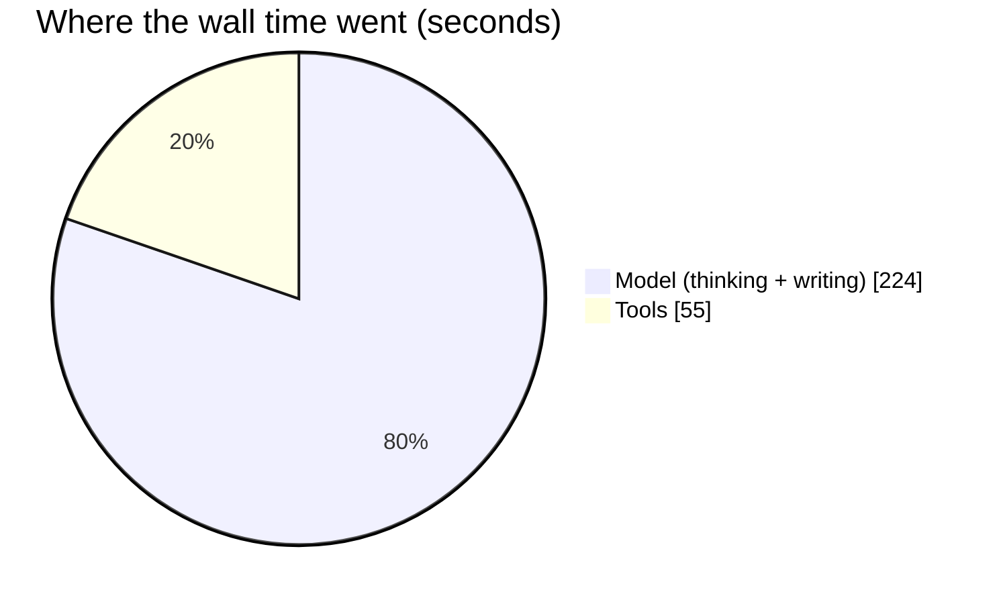

# corporate-ma/draft-markup-of-stock-purchase-agreement-provisions · run8 (`hv-mixed200-lunahigh-flip-r8-20261118T030322Z`)

Result: **all-pass** 59/59 criteria · 4.7 min · 23 model calls · 41 tool calls (0 errors or timeouts) · ending `completed` · started 11-18 08:34:10 IST

## Overview

One box per stretch of steps that used the same kind of tool (blue: looking/searching/reading, purple: writing or editing files, yellow: a message with no tool call, red border: a tool error or timeout inside the box).

```mermaid
flowchart TD
    T(["Task prompt"])
    P0["<b>Step 1</b> · 0.1 min<br/>create_goal"]
    T --> P0
    class P0 look
    P1["<b>Step 2</b> · 0.0 min<br/>todo_write"]
    P0 --> P1
    class P1 look
    P2["<b>Step 3</b> · 0.1 min<br/>glob<br/><i>*</i>"]
    P1 --> P2
    class P2 look
    P3["<b>Step 4</b> · 0.4 min<br/>bash x4<br/>read<br/><i>parse-doc docx documents/buyer-ma-pla…, parse-doc docx documents/sellers-draf…, parse-doc docx documents/environmenta… +2</i>"]
    P2 --> P3
    class P3 look
    P4["<b>Step 5</b> · 0.4 min<br/>bash x4<br/><i>parse-doc docx documents/sellers-draf…, parse-doc docx documents/buyer-ma-pla…, parse-doc docx documents/executed-ter… +1</i>"]
    P3 --> P4
    class P4 look
    P5["<b>Step 6</b> · 0.1 min<br/>grep x4<br/><i>seller-spa.txt, playbook.txt, term-sheet.txt +1</i>"]
    P4 --> P5
    class P5 look
    P6["<b>Step 7</b> · 0.1 min<br/>read x7<br/><i>seller-spa.txt</i>"]
    P5 --> P6
    class P6 look
    P7["<b>Step 8</b> · 0.1 min<br/>grep<br/><i>seller-spa.txt</i>"]
    P6 --> P7
    class P7 look
    P8["<b>Steps 9-12</b> · 0.4 min<br/>read x4<br/><i>seller-spa.txt</i>"]
    P7 --> P8
    class P8 look
    P9["<b>Step 13</b> · 0.5 min<br/>todo_write"]
    P8 --> P9
    class P9 look
    P10["<b>Step 14</b> · 1.9 min<br/>bash<br/><i>python - #lt;#lt;'PY' from docx import Docu…</i>"]
    P9 --> P10
    class P10 look
    P11["<b>Step 15</b> · 0.1 min<br/>bash<br/>glob<br/><i>parse-doc docx output/spa-markup-memo…, output/*</i>"]
    P10 --> P11
    class P11 look
    P12["<b>Step 16</b> · 0.1 min<br/>grep x2<br/>read<br/><i>qa-memo.txt</i>"]
    P11 --> P12
    class P12 look
    P13["<b>Step 17</b> · 0.1 min<br/>bash<br/><i>python - #lt;#lt;'PY' from pathlib import P…</i>"]
    P12 --> P13
    class P13 look
    P14["<b>Step 18</b> · 0.1 min<br/>read<br/><i>qa-memo.txt</i>"]
    P13 --> P14
    class P14 look
    P15["<b>Step 19</b> · 0.1 min<br/>bash<br/><i>unzip -t output/spa-markup-memorandum…</i>"]
    P14 --> P15
    class P15 look
    P16["<b>Step 20</b> · 0.1 min<br/>todo_write"]
    P15 --> P16
    class P16 look
    P17["<b>Step 21</b> · 0.0 min<br/>get_goal"]
    P16 --> P17
    class P17 look
    P18["<b>Step 22</b> · 0.0 min<br/>update_goal"]
    P17 --> P18
    class P18 look
    P19["<b>Step 23</b> · 0.1 min<br/>final message"]
    P18 --> P19
    class P19 ans
    R(["ALL PASS: 59/59 criteria"])
    P19 --> R
    class R pass
    classDef look fill:#e8f0fe,stroke:#4a6fa5,color:#111
    classDef write fill:#f3e8fd,stroke:#7b1fa2,color:#111
    classDef ans fill:#fff8e1,stroke:#b58900,color:#111
    classDef err fill:#e8f0fe,stroke:#c62828,stroke-width:3px,color:#111
    classDef pass fill:#e6f4ea,stroke:#2e7d32,color:#111
    classDef fail fill:#fce8e6,stroke:#c62828,color:#111
```





One row per model call:

| Step | Started (IST) | Model s | Tools s | Tool calls | Tools | Output chars |
|---|---|---|---|---|---|---|
| 1 | 08:34:10 | 4 | 0 | 1 | create_goal | 406 |
| 2 | 08:34:14 | 2 | 0 | 1 | todo_write | 57 |
| 3 | 08:34:16 | 3 | 2 | 1 | glob | 179 |
| 4 | 08:34:21 | 3 | 21 | 5 | bash x4, read | 215,717 |
| 5 | 08:34:45 | 5 | 17 | 4 | bash x4 | 1,496 |
| 6 | 08:35:07 | 4 | 4 | 4 | grep x4 | 112,392 |
| 7 | 08:35:15 | 4 | 0 | 7 | read x7 | 66,002 |
| 8 | 08:35:19 | 3 | 1 | 1 | grep | 36,404 |
| 9 | 08:35:23 | 5 | 0 | 1 | read | 11,268 |
| 10 | 08:35:28 | 11 | 0 | 1 | read | 10,761 |
| 11 | 08:35:39 | 6 | 0 | 1 | read | 6,523 |
| 12 | 08:35:45 | 3 | 0 | 1 | read | 10,272 |
| 13 | 08:35:47 | 30 | 0 | 1 | todo_write | 57 |
| 14 | 08:36:17 | 111 | 1 | 1 | bash | 34 |
| 15 | 08:38:09 | 3 | 3 | 2 | bash, glob | 407 |
| 16 | 08:38:16 | 3 | 3 | 3 | grep x2, read | 53,170 |
| 17 | 08:38:22 | 6 | 1 | 1 | bash | 12 |
| 18 | 08:38:29 | 5 | 0 | 1 | read | 21,971 |
| 19 | 08:38:34 | 4 | 1 | 1 | bash | 159 |
| 20 | 08:38:39 | 3 | 0 | 1 | todo_write | 57 |
| 21 | 08:38:42 | 2 | 0 | 1 | get_goal | 406 |
| 22 | 08:38:44 | 2 | 0 | 1 | update_goal | 411 |
| 23 | 08:38:46 | 3 | 0 | 0 | (message only) | 0 |

## Task prompt

```text
Review the seller's draft SPA against the buyer's playbook, executed term sheet, and diligence materials, and prepare a detailed markup memorandum with draft-ready redline language. Output: `spa-markup-memorandum.docx`.
```

## Rubric

| # | Criterion | Verdict |
|---|---|---|
| C-001 | ISSUE_001: Identifies overbroad MAE carve-outs for environmental industry/regulations | pass |
| C-002 | ISSUE_001: Proposes adding disproportionate impact qualifier to MAE carve-outs | pass |
| C-003 | ISSUE_001: Provides actual revised contract language for MAE definition | pass |
| C-004 | ISSUE_001: Explains rationale — environmental company needs MAE protection | pass |
| C-005 | ISSUE_002: Identifies missing interim covenant restricting affiliate transactions | pass |
| C-006 | ISSUE_002: Proposes covenant requiring Buyer consent for affiliate transactions | pass |
| C-007 | ISSUE_002: References the above-market rent to Seller affiliate as rationale | pass |
| C-008 | ISSUE_003: Identifies indemnification cap discrepancy (20% vs. 12.5%) | pass |
| C-009 | ISSUE_003: Proposes redline reducing cap to 12.5% / $26,875,000 | pass |
| C-010 | ISSUE_003: References the term sheet as basis for cap correction | pass |
| C-011 | ISSUE_004: Identifies that environmental reps survival period is too short | pass |
| C-012 | ISSUE_004: Proposes extending environmental reps survival to at least 36 months | pass |
| C-013 | ISSUE_004: References CERCLA/Dalton Creek exposure as rationale for longer survival | pass |
| C-014 | ISSUE_005: Identifies anti-sandbagging provision in Section 9.06 | pass |
| C-015 | ISSUE_005: Proposes replacing with pro-sandbagging language | pass |
| C-016 | ISSUE_005: Provides actual pro-sandbagging contract text | pass |
| C-017 | ISSUE_006: Identifies need for Special Indemnity for Dalton Creek CERCLA matter | pass |
| C-018 | ISSUE_006: Special Indemnity survival of 72 months | pass |
| C-019 | ISSUE_006: Special Indemnity not subject to basket or cap | pass |
| C-020 | ISSUE_006: References Dalton Creek liability range ($1.5M-$6M) | pass |
| C-021 | ISSUE_007: Identifies problematic earnout operational covenant | pass |
| C-022 | ISSUE_007: Proposes limiting earnout covenant to no-frustration standard | pass |
| C-023 | ISSUE_007: Explains rationale — Buyer integration/restructuring flexibility | pass |
| C-024 | ISSUE_008: Identifies missing payoff letter requirement | pass |
| C-025 | ISSUE_008: Proposes payoff letters at least 3 business days pre-closing | pass |
| C-026 | ISSUE_008: Proposes simultaneous repayment at closing through funds flow | pass |
| C-027 | ISSUE_008: Proposes payoff letter delivery as a condition to closing | pass |
| C-028 | ISSUE_009: Identifies missing government contract anti-assignment/novation requirement | pass |
| C-029 | ISSUE_009: References specific government contracts requiring novation | pass |
| C-030 | ISSUE_009: Proposes closing condition or covenant for government contract novation | pass |
| C-031 | ISSUE_009: References Anti-Assignment Act or FAR provisions | pass |
| C-032 | ISSUE_010: Identifies missing environmental permit transfer/notification covenant | pass |
| C-033 | ISSUE_010: Proposes cooperation covenant for environmental permit transfers | pass |
| C-034 | ISSUE_010: Notes that permits may require notification even in a stock deal | pass |
| C-035 | ISSUE_011: Identifies missing R&W Insurance subrogation waiver | pass |
| C-036 | ISSUE_011: Proposes subrogation waiver provision with fraud exception | pass |
| C-037 | ISSUE_011: References R&W Insurance policy / Granite Ridge Underwriters | pass |
| C-038 | ISSUE_012: Identifies non-compete scope exceeds term sheet (duration) | pass |
| C-039 | ISSUE_012: Identifies non-compete scope exceeds term sheet (geographic) | pass |
| C-040 | ISSUE_012: Identifies non-compete scope exceeds term sheet (activity) | pass |
| C-041 | ISSUE_012: Proposes narrowing non-compete duration to 3 years | pass |
| C-042 | ISSUE_012: Proposes narrowing non-compete geographic scope to OR, WA, CA, NV | pass |
| C-043 | ISSUE_012: Proposes narrowing non-compete activity scope to environmental remediation and hazardous waste management | pass |
| C-044 | ISSUE_012: Notes enforceability risk of overbroad non-compete | pass |
| C-045 | Indemnification cap issue rated as Critical or High priority | pass |
| C-046 | Anti-sandbagging issue rated as Critical or High priority | pass |
| C-047 | Memorandum identifies provisions acceptable as drafted | pass |
| C-048 | Memorandum flags items for partner/client discussion | pass |
| C-049 | Escrow amount correctly stated as $16,125,000 (7.5% of EV) | pass |
| C-050 | ISSUE_006: Proposes 36-month escrow holdback for Special Indemnity | pass |
| C-051 | Earnout maximum correctly referenced as $25,000,000 | pass |
| C-052 | Earnout Adjusted EBITDA threshold correctly referenced as $38,000,000 | pass |
| C-053 | Earnout floor correctly referenced as $32,000,000 | pass |
| C-054 | References playbook as authority for at least 3 markup positions | pass |
| C-055 | References term sheet as authority for at least 3 markup positions | pass |
| C-056 | References environmental DD memo for at least one markup position | pass |
| C-057 | Memorandum identifies specific SPA section numbers for issues | pass |
| C-058 | Proposed redline language is actual contract text for at least 8 issues | pass |
| C-059 | ISSUE_008: Identifies all three sources of Target indebtedness | pass |

Judge's reasoning:

**C-001 (pass):** ISSUE_001: Identifies overbroad MAE carve-outs for environmental industry/regulations

```text
The memorandum expressly identifies the environmental-services industry and Environmental Laws carve-outs as overbroad because they lack disproportionate-impact qualifiers, and proposes adding such qualifiers to both clauses.
```

**C-002 (pass):** ISSUE_001: Proposes adding disproportionate impact qualifier to MAE carve-outs

```text
The memorandum expressly proposes replacing both the environmental-services industry carve-out and the Environmental Laws/regulations carve-out with language excepting changes that disproportionately affect the Company relative to other industry participants.
```

**C-003 (pass):** ISSUE_001: Provides actual revised contract language for MAE definition

```text
The memorandum provides draft-ready replacement text for clauses (ii) and (iii) of the MAE definition, expressly adding exceptions where industry or Environmental Law changes disproportionately affect the Company relative to other industry participants.
```

**C-004 (pass):** ISSUE_001: Explains rationale — environmental company needs MAE protection

```text
The memorandum expressly explains that the Target is an environmental-services business and that blanket carve-outs for environmental-industry downturns or changes in Environmental Laws would shift the sector-specific risks central to the valuation and diligence to Buyer. It further explains that disproportionate-impact qualifiers are needed to preserve MAE protection for target-specific effects.
```

**C-005 (pass):** ISSUE_002: Identifies missing interim covenant restricting affiliate transactions

```text
The memorandum expressly identifies in Item 3 that Section 6.01's interim covenants lack an affiliate-transaction restriction and proposes requiring Buyer consent for Company transactions with Seller or Seller affiliates between signing and closing.
```

**C-006 (pass):** ISSUE_002: Proposes covenant requiring Buyer consent for affiliate transactions

```text
Item 3 proposes adding Section 6.01(b)(xiv), which prohibits the Company from entering into, renewing, extending, amending, modifying, waiving rights under, terminating, or otherwise altering any agreement or transaction with Seller or any Seller affiliate without Buyer's prior written consent.
```

**C-007 (pass):** ISSUE_002: References the above-market rent to Seller affiliate as rationale

```text
In Item 3, the memorandum uses Schedule 4.21’s “$1.6 million annual affiliate lease” as part of the rationale for requiring Buyer consent over affiliate transactions. This expressly notes the Seller-affiliate lease arrangement in connection with the covenant, satisfying the criterion even though it does not label the rent as above-market.
```

**C-008 (pass):** ISSUE_003: Identifies indemnification cap discrepancy (20% vs. 12.5%)

```text
The memorandum expressly identifies that the Seller draft uses a 20% cap ($43,000,000) and states that the binding term sheet requires a 12.5% cap ($26,875,000), with proposed replacement language conforming the cap accordingly.
```

**C-009 (pass):** ISSUE_003: Proposes redline reducing cap to 12.5% / $26,875,000

```text
The memorandum expressly proposes replacing the indemnification cap with $26,875,000, equal to 12.5% of the $215,000,000 base enterprise value, in the executive summary and Item 6 redline.
```

**C-010 (pass):** ISSUE_003: References the term sheet as basis for cap correction

```text
The memorandum expressly states that the $43 million/20% cap conflicts with the binding executed term sheet, which sets the general cap at 12.5% of the $215 million Base Enterprise Value ($26.875 million), and cites Executed Term Sheet §§4 and 8 as sources.
```

**C-011 (pass):** ISSUE_004: Identifies that environmental reps survival period is too short

```text
The memorandum expressly identifies that the Seller draft gives all non-Fundamental representations, including environmental representations, only 12 months of survival and states that this is inadequate for the target's environmental remediation and hazardous-waste business. It proposes 36-month survival for Environmental Representations and coordinates the escrow period accordingly.
```

**C-012 (pass):** ISSUE_004: Proposes extending environmental reps survival to at least 36 months

```text
The memorandum expressly proposes that Environmental Representations survive for 36 months post-closing in revised Section 9.01(b), and also notes the option of seeking the full applicable statute-of-limitations period.
```

**C-013 (pass):** ISSUE_004: References CERCLA/Dalton Creek exposure as rationale for longer survival

```text
The memorandum expressly connects environmental exposure to longer survival. In Item 7, it argues that 12 months is inadequate because the Hargrove remediation project has 18–24 months remaining and the Dalton Creek matter may not crystallize into a formal claim for years, supporting 36-month survival for Environmental Representations. It also identifies Dalton Creek as a long-tail CERCLA exposure elsewhere in the memorandum.
```

**C-014 (pass):** ISSUE_005: Identifies anti-sandbagging provision in Section 9.06

```text
The memorandum expressly identifies Section 9.06 as an anti-sandbagging provision and quotes its language barring Buyer from indemnification for breaches or inaccuracies of which Buyer or its representatives had Knowledge as of the Closing Date.
```

**C-015 (pass):** ISSUE_005: Proposes replacing with pro-sandbagging language

```text
The memorandum expressly proposes replacing Section 9.06’s anti-sandbagging provision with a pro-sandbagging clause stating that Buyer’s indemnification and other remedies are not affected, limited, diminished, or impaired by any investigation or knowledge obtained before or after execution or Closing.
```

**C-016 (pass):** ISSUE_005: Provides actual pro-sandbagging contract text

```text
The memorandum includes actual proposed pro-sandbagging contract language in Item 9, replacing Section 9.06 and expressly providing that indemnification and other remedies are not affected by Buyer's investigation, knowledge, or notice.
```

**C-017 (pass):** ISSUE_006: Identifies need for Special Indemnity for Dalton Creek CERCLA matter

```text
The memorandum expressly proposes a separate Dalton Creek Special Environmental Indemnity in new Section 9.02(e), covering the EPA CERCLA §104(e) request and related liabilities. It also specifies separate survival, basket, cap, escrow, and direct-recovery treatment rather than relying solely on general environmental representations.
```

**C-018 (pass):** ISSUE_006: Special Indemnity survival of 72 months

```text
The memorandum expressly states that the Dalton Creek Special Environmental Indemnity survives until 72 months following the Closing Date, including in proposed Section 9.04(i).
```

**C-019 (pass):** ISSUE_006: Special Indemnity not subject to basket or cap

```text
The memorandum expressly states in proposed Section 9.04(i) that the Dalton Creek Special Environmental Indemnity is a dollar-one obligation and is not subject to the Basket Amount, Deductible, or Indemnification Cap. It also states that these losses do not count toward or reduce the general cap.
```

**C-020 (pass):** ISSUE_006: References Dalton Creek liability range ($1.5M-$6M)

```text
The memorandum expressly cites Dalton Creek's estimated exposure of $1.5 million to $6 million in the rationale for the Special Environmental Indemnity and includes the same range in proposed Schedule 9.02(e).
```

**C-021 (pass):** ISSUE_007: Identifies problematic earnout operational covenant

```text
The memorandum expressly identifies Section 2.05's requirement to operate consistently with past practice and in good faith to maximize the earnout as overly restrictive, explains that it would constrain integration and other operational decisions, and proposes replacing it with a narrow primary-purpose anti-avoidance covenant.
```

**C-022 (pass):** ISSUE_007: Proposes limiting earnout covenant to no-frustration standard

```text
The memorandum expressly replaces the affirmative past-practice/maximization covenant with a narrow no-frustration standard: Buyer may not take action with the primary purpose of reducing or avoiding the earnout. It also preserves Buyer's discretion to operate, integrate, restructure, and manage the business without affirmative operating obligations.
```

**C-023 (pass):** ISSUE_007: Explains rationale — Buyer integration/restructuring flexibility

```text
The memorandum expressly explains that the Seller’s broad earnout covenant would restrict Buyer’s post-closing integration, restructuring, pricing, personnel, capital-allocation, and bolt-on strategies. It also proposes language preserving Buyer’s discretion to integrate, restructure, and otherwise manage the Company, subject only to a narrow primary-purpose restriction.
```

**C-024 (pass):** ISSUE_008: Identifies missing payoff letter requirement

```text
The memorandum expressly identifies that the Seller draft permits repayment “at or promptly following the Closing” and lacks a pre-closing payoff-letter requirement. It proposes delivery of executed payoff letters from each indebtedness holder at least three Business Days before closing, with lien-release commitments and simultaneous payoff through the closing funds flow.
```

**C-025 (pass):** ISSUE_008: Proposes payoff letters at least 3 business days pre-closing

```text
The proposed Section 2.03(d) requires executed payoff letters from each holder of Closing Indebtedness no later than three Business Days before Closing, and requires each letter to include wire instructions and commitments and documentation for lien releases, including UCC termination statements and other release instruments.
```

**C-026 (pass):** ISSUE_008: Proposes simultaneous repayment at closing through funds flow

```text
The memorandum expressly replaces the “at or promptly following” mechanic with a requirement that all Closing Indebtedness be repaid simultaneously at Closing through the funds flow, with no indebtedness remaining outstanding after Closing.
```

**C-027 (pass):** ISSUE_008: Proposes payoff letter delivery as a condition to closing

```text
The memorandum expressly proposes adding new Section 7.02(i), under Buyer’s closing conditions, requiring Buyer to have received the specified payoff letters, lien-release commitments, and wire instructions. It also states that the term sheet makes delivery a Buyer closing condition.
```

**C-028 (pass):** ISSUE_009: Identifies missing government contract anti-assignment/novation requirement

```text
The memorandum expressly identifies that the Seller draft omits government-contract novation/consent protections and does not address FAR 42.12, the Anti-Assignment Act, or analogous state requirements. It proposes targeted representations, covenants, and closing conditions for federal and state government contracts, including specified US Army Corps and BLM contracts.
```

**C-029 (pass):** ISSUE_009: References specific government contracts requiring novation

```text
The memorandum specifically identifies two federal government contracts by contract number—W912DR-21-D-0045 and L23PX-00412—as requiring FAR 42.12 novation requests, corresponding to the US Army Corps of Engineers and Bureau of Land Management contracts.
```

**C-030 (pass):** ISSUE_009: Proposes closing condition or covenant for government contract novation

```text
The memorandum proposes both a specific pre-closing covenant requiring Seller and the Company to prepare and submit government-contract novation and recognition packages and use commercially reasonable efforts to obtain them, and a closing condition addressing submission, non-denial, and interim-performance approval where required.
```

**C-031 (pass):** ISSUE_009: References Anti-Assignment Act or FAR provisions

```text
The memorandum expressly references FAR Part 42, Subpart 42.12 and the Anti-Assignment Act as the legal basis for government-contract novation and change-of-control requirements.
```

**C-032 (pass):** ISSUE_010: Identifies missing environmental permit transfer/notification covenant

```text
The memorandum expressly identifies this gap in Item 12, noting that the Seller draft represents the Company holds 23 environmental permits but lacks a covenant addressing change-of-control notices, approvals, transfers, or post-closing cooperation. It also proposes a pre- and post-closing cooperation covenant covering notification, transfer, reissuance, amendment, and approval requirements.
```

**C-033 (pass):** ISSUE_010: Proposes cooperation covenant for environmental permit transfers

```text
Item 12 proposes new Section 6.06A requiring pre-closing identification and submission of environmental permit change-of-control notices, applications, and approval requests, plus Seller cooperation for at least 12 months post-closing with transfers, reissuances, amendments, and approvals under applicable agency requirements.
```

**C-034 (pass):** ISSUE_010: Notes that permits may require notification even in a stock deal

```text
The memorandum expressly states that the diligence memo identifies Oregon, Washington, California, and Nevada environmental permit change-of-control requirements “even in a stock transaction,” and proposes notice, approval, and cooperation covenants for those permits.
```

**C-035 (pass):** ISSUE_011: Identifies missing R&W Insurance subrogation waiver

```text
The memorandum expressly identifies in Item 11 that the Seller draft contains no provision addressing R&W insurance or insurer subrogation rights and proposes a waiver of subrogation against Seller, subject to a fraud exception.
```

**C-036 (pass):** ISSUE_011: Proposes subrogation waiver provision with fraud exception

```text
The memorandum proposes new Section 10.11 requiring the R&W insurer to waive subrogation, contribution, recourse, and related claims against Seller and its affiliates, with an express exception for claims arising from Seller's actual fraud. It also identifies Granite Ridge Underwriters as the insurer and calls for policy consistency.
```

**C-037 (pass):** ISSUE_011: References R&W Insurance policy / Granite Ridge Underwriters

```text
The memorandum expressly states that Whitmore is obtaining R&W insurance from Granite Ridge Underwriters and connects that policy to the need for a subrogation waiver, including proposed waiver language and a recommendation to confirm the binder and policy are consistent.
```

**C-038 (pass):** ISSUE_012: Identifies non-compete scope exceeds term sheet (duration)

```text
The memorandum expressly identifies the Seller draft's five-year non-compete and proposes replacing it with the term sheet's agreed three-year period, noting that the term sheet fixes the duration.
```

**C-039 (pass):** ISSUE_012: Identifies non-compete scope exceeds term sheet (geographic)

```text
The memorandum expressly identifies the Seller draft’s nationwide non-compete as overbroad and proposes limiting the covenant to Oregon, Washington, California, and Nevada in accordance with the term sheet.
```

**C-040 (pass):** ISSUE_012: Identifies non-compete scope exceeds term sheet (activity)

```text
The memorandum expressly identifies that the Seller draft’s five-year nationwide restriction covering “any business” is overbroad and revises it to the term-sheet scope of environmental remediation services and hazardous waste management services.
```

**C-041 (pass):** ISSUE_012: Proposes narrowing non-compete duration to 3 years

```text
The proposed replacement for Section 6.09(a) expressly narrows the non-compete period to three years following the Closing Date, matching the term sheet.
```

**C-042 (pass):** ISSUE_012: Proposes narrowing non-compete geographic scope to OR, WA, CA, NV

```text
The proposed replacement for Section 6.09(a) expressly limits the non-compete to environmental remediation or hazardous waste management services in Oregon, Washington, California, and Nevada, matching the term sheet.
```

**C-043 (pass):** ISSUE_012: Proposes narrowing non-compete activity scope to environmental remediation and hazardous waste management

```text
The proposed replacement for Section 6.09(a) expressly limits the non-compete to businesses providing “environmental remediation services or hazardous waste management services,” matching the required term-sheet scope.
```

**C-044 (pass):** ISSUE_012: Notes enforceability risk of overbroad non-compete

```text
Item 10 expressly states that the five-year, nationwide, “any business” restriction would sweep in Evergreen’s unrelated construction and timber operations and raises enforceability concerns. It also proposes carve-outs for those legitimate businesses.
```

**C-045 (pass):** Indemnification cap issue rated as Critical or High priority

```text
The indemnification cap discrepancy is expressly rated High priority in both the executive summary (Item 6) and the detailed markup section, satisfying the requirement that it be Critical or High.
```

**C-046 (pass):** Anti-sandbagging issue rated as Critical or High priority

```text
Section 9.06's anti-sandbagging issue is expressly labeled “Priority: CRITICAL,” which is the highest tier and satisfies the criterion.
```

**C-047 (pass):** Memorandum identifies provisions acceptable as drafted

```text
The memorandum includes a dedicated Section IV, “Provisions to Leave as Drafted,” identifying the basket/deductible, knowledge qualifier, good-standing certificates, Delaware governing law, and escrow amount as acceptable, with brief explanations tying them to the playbook or term sheet.
```

**C-048 (pass):** Memorandum flags items for partner/client discussion

```text
The memorandum includes a dedicated “Open Items for Partner / Client Decision” section flagging multiple issues for Elena, Marcus, and the client team to resolve before finalizing the markup, including the government-contract closing condition, environmental survival period, Dalton Creek escrow sizing and facts, and R&W insurance terms.
```

**C-049 (pass):** Escrow amount correctly stated as $16,125,000 (7.5% of EV)

```text
The memorandum correctly states the escrow amount as $16,125,000 and identifies it as 7.5% of the $215 million base enterprise value in its indemnification discussion and no-markup summary.
```

**C-050 (pass):** ISSUE_006: Proposes 36-month escrow holdback for Special Indemnity

```text
The memorandum expressly provides that the escrow portion allocated to the Dalton Creek Special Environmental Indemnity must remain available through 36 months after closing, while direct recovery continues through the 72-month survival period. It also calls for revising the escrow exhibit to reflect the 36-month Special Indemnity reserve.
```

**C-051 (pass):** Earnout maximum correctly referenced as $25,000,000

```text
The earnout discussion expressly states that the term sheet confirms a $25 million maximum earnout payment, correctly referencing the required $25,000,000 amount.
```

**C-052 (pass):** Earnout Adjusted EBITDA threshold correctly referenced as $38,000,000

```text
In the earnout discussion, the memorandum expressly states that the term sheet confirms a $38 million full-payment Adjusted EBITDA threshold.
```

**C-053 (pass):** Earnout floor correctly referenced as $32,000,000

```text
The earnout discussion correctly identifies the $32,000,000 floor, the $38,000,000 full-payment threshold, and linear interpolation between them, which satisfies the pro-rata requirement.
```

**C-054 (pass):** References playbook as authority for at least 3 markup positions

```text
The memorandum cites the Buyer M&A Playbook as authority for well over three distinct markup positions, including the MAE qualifiers, earnout covenant and EBITDA adjustments, affiliate transactions, indemnification and escrow mechanics, environmental survival, special environmental indemnity, pro-sandbagging, restrictive covenants, R&W insurance, permit cooperation, and government-contract protections.
```

**C-055 (pass):** References term sheet as authority for at least 3 markup positions

```text
The memorandum cites the executed term sheet as authority for well over three distinct markup positions, including the earnout mechanics (Item 2), debt payoff mechanics (Item 5), indemnification cap and escrow (Item 6), environmental-representation survival (Item 7), Dalton Creek Special Indemnity (Item 8), restrictive covenants (Item 10), and R&W insurance subrogation waiver (Item 11).
```

**C-056 (pass):** References environmental DD memo for at least one markup position

```text
The memorandum repeatedly cites the Environmental DD Memo as support for markup positions, including government-contract novation provisions, environmental representation survival, the Dalton Creek special indemnity, permit change-of-control cooperation, and disclosure-schedule corrections.
```

**C-057 (pass):** Memorandum identifies specific SPA section numbers for issues

```text
The memorandum ties well over 8 issues to specific SPA section numbers, including Sections 1.01, 2.05, 6.01, 4.16, 6.05, 7.02, 2.03, 9.04, 9.08, 9.01, 9.02, 9.06, 6.09, 4.14, and proposed new sections.
```

**C-058 (pass):** Proposed redline language is actual contract text for at least 8 issues

```text
The memorandum provides draft-ready contract text for well over 8 issues, including MAE qualifiers, earnout covenants and mechanics, affiliate transactions, government contracts, debt payoff, indemnification cap and escrow, environmental survival, the Dalton Creek special indemnity, pro-sandbagging, restrictive covenants, R&W insurance, and permit cooperation.
```

**C-059 (pass):** ISSUE_008: Identifies all three sources of Target indebtedness

```text
The payoff-letter markup expressly identifies all three debt holders: Cascade Mutual Bank, Pacific Lease Corp., and Evergreen Holdings Group, Inc. (the subordinated seller note). This exceeds the requirement to mention at least two sources or the total indebtedness figure.
```

## Delivered files (output/)

- `spa-markup-memorandum.docx` (58,115 bytes)

## Trajectory

### Step 1: 1 tool call

_Started 11-18 08:34:10 IST · model 4 s · tools 0 s_

**Reasoning summary:**

```text
**Preparing for document manipulation**

I need to manipulate some documents for a legal review. First, I'll inspect the files and prepare a docx. I want to ensure that my skills align with the specific document tasks. There’s also the option to inspect the skill catalog and possibly call for glob files first. Since this task is multi-step, I think I should create a clear goal and to-do list. I'll also need to list the workspace using bash commands!
```

**Call `create_goal`** (0.0 s)

```json
{
 "objective": "Review the seller's draft SPA against the buyer's playbook, executed term sheet, and diligence materials, then prepare and save a detailed markup memorandum with draft-ready redline language as spa-markup-memorandum.docx in the output directory.",
 "max_goal_rounds": 3
}
```

Output (406 chars):

```text
{"goal":{"id":"goal-01803424-dd64-473b-8e49-63db448a99d0","revision":1,"objective":"Review the seller's draft SPA against the buyer's playbook, executed term sheet, and diligence materials, then prepare and save a detailed markup memorandum with draft-ready redline language as spa-markup-memorandum.docx in the output directory.","phase":"active","roundsStarted":0,"maxGoalRounds":3},"activation":"armed"}
```

### Step 2: 1 tool call

_Started 11-18 08:34:14 IST · model 2 s · tools 0 s_

**Call `todo_write`** (0.1 s)

```json
{
 "todos": [
  {
   "content": "Inventory and read the seller draft, buyer playbook, term sheet, and diligence materials",
   "status": "in_progress"
  },
  {
   "content": "Analyze conflicts and draft issue-by-issue redline language and rationale",
   "status": "pending"
  },
  {
   "content": "Create and quality-check the final spa-markup-memorandum.docx deliverable",
   "status": "pending"
  }
 ]
}
```

Output (57 chars):

```text
Updated todo list: 2 pending, 1 in progress, 0 completed.
```

**Todo list now:**

- [~] Inventory and read the seller draft, buyer playbook, term sheet, and diligence materials
- [ ] Analyze conflicts and draft issue-by-issue redline language and rationale
- [ ] Create and quality-check the final spa-markup-memorandum.docx deliverable

### Step 3: 1 tool call

_Started 11-18 08:34:16 IST · model 3 s · tools 2 s_

**Reasoning summary:**

```text
**Evaluating skill access**

I need to find out more about the unavailable skill catalog. It might help if I ask for the exact skill the user is looking for. Maybe we can explore the files that are accessible. Collaborating on what specific skills the user wants could lead me in the right direction! Let's try to clarify what skills they're after so we can navigate this effectively.
```

**Call `glob`** (2.1 s)

```json
{
 "pattern": "*"
}
```

Output (179 chars):

```text
documents/buyer-ma-playbook.docx
documents/sellers-draft-spa.docx
documents/environmental-dd-memo.docx
documents/executed-term-sheet.docx
documents/partner-markup-instructions.eml
```

### Step 4: 5 tool calls

_Started 11-18 08:34:21 IST · model 3 s · tools 21 s_

**Call `bash`** (9.9 s)

```json
{
 "command": "parse-doc docx documents/buyer-ma-playbook.docx",
 "description": "Parse buyer playbook text"
}
```

Output (49,999 chars):

```text
tner. This is a **Critical** priority item.

For example, if the term sheet specifies a general indemnification cap of 12.5% of enterprise value for a transaction with a \$200 million enterprise value, the SPA\'s general indemnification cap should be \$25,000,000. If the seller\'s draft sets the cap at \$20,000,000 (10% of enterprise value), the associate must flag this as a deviation from the term sheet and mark up the draft to reflect the agreed \$25,000,000 cap.

**R&W Insurance Considerations.** In transactions where the buyer is obtaining representations and warranties insurance (see Section 8), the indemnification cap may be subject to additional negotiation dynamics. The R&W insurer may require a certain retention level (the amount of loss the buyer must bear before the policy responds), which interacts with the SPA\'s basket/deductible and cap structure. However, the SPA cap itself must conform to the term sheet regardless of the R&W Insurance structure. The R&W Insurance policy supplements the seller\'s indemnification obligations --- it does not replace them, and the availability of insurance does not justify a reduction in the SPA cap below the term sheet level.

**Market Data.** In recent environmental services transactions handled by the firm, general indemnification caps have ranged from 10% to 15% of enterprise value. The 12.5% figure is squarely within the market range and represents the firm\'s standard recommendation for PE buyers in this sector. Caps below 
… [48,499 more chars]
```

**Call `bash`** (5.2 s)

```json
{
 "command": "parse-doc docx documents/sellers-draft-spa.docx",
 "description": "Parse seller SPA text"
}
```

Output (49,998 chars):

```text
and Seller;

**(b)** by either Buyer or Seller, by written notice to the other Party, if the Closing shall not have occurred on or before the Outside Date (February 28, 2026); *provided* that the right to terminate this Agreement under this Section 8.01(b) shall not be available to any Party whose breach of any representation, warranty, covenant, or agreement set forth in this Agreement has been the primary cause of, or has primarily resulted in, the failure of the Closing to occur on or before the Outside Date;

**(c)** by either Buyer or Seller, by written notice to the other Party, if any Governmental Authority shall have enacted, issued, promulgated, enforced, or entered any final and non-appealable Law, order, injunction, judgment, decree, ruling, or other legally binding action that permanently restrains, enjoins, or otherwise prohibits the consummation of the transactions contemplated by this Agreement;

**(d)** by Buyer, by written notice to Seller, if there shall have been a breach by Seller of any representation, warranty, covenant, or agreement contained in this Agreement that would cause the conditions set forth in Section 7.02(a) or Section 7.02(b) not to be satisfied, and such breach shall not have been cured by Seller within thirty (30) days after receipt of written notice of such breach from Buyer (or, if earlier, by the Outside Date); *provided* that Buyer shall not have the right to terminate this Agreement under this Section 8.01(d) if Buyer is then in mate
… [48,498 more chars]
```

**Call `bash`** (3.3 s)

```json
{
 "command": "parse-doc docx documents/environmental-dd-memo.docx",
 "description": "Parse environmental diligence memo"
}
```

Output (47,133 chars):

```text
**ASHFORD, PENNINGTON & YATES LLP** *Attorneys at Law* 71 South Wacker Drive, Suite 4500 Chicago, Illinois 60606

**PRIVILEGED AND CONFIDENTIAL --- ATTORNEY WORK PRODUCT** This memorandum is protected by the attorney-client privilege and the work product doctrine. It is intended solely for use by the attorneys and professionals of Ashford, Pennington & Yates LLP and the client to whom it is addressed. Any unauthorized disclosure, reproduction, or distribution is strictly prohibited.

**MEMORANDUM**

**TO:** Elena Vasquez-Moreno, Partner, M&A Group Jonathan Kreider, Senior Associate, M&A Group

**FROM:** Environmental Practice Group, Ashford, Pennington & Yates LLP

**DATE:** October 18, 2025

**RE:** Environmental Due Diligence Summary --- Acquisition of Cascadia Environmental Solutions, Inc. by Whitmore Capital Partners LLC

**PROJECT:** Project Cascade --- Whitmore Capital Partners LLC Fund III Platform Acquisition

This memorandum summarizes the findings and recommendations of the Environmental Practice Group arising from our environmental due diligence review of Cascadia Environmental Solutions, Inc. in connection with the proposed acquisition by Whitmore Capital Partners LLC. This memo is intended to inform the deal team\'s review of the Seller\'s Stock Purchase Agreement draft, which we understand will be circulated on or about October 22, 2025. All findings and recommendations set forth herein should be incorporated into the firm\'s SPA markup and negotiation strategy.
… [45,632 more chars]
```

**Call `bash`** (2.6 s)

```json
{
 "command": "parse-doc docx documents/executed-term-sheet.docx",
 "description": "Parse executed term sheet"
}
```

Output (49,983 chars):

```text
**BINDING TERM SHEET**

**Acquisition of 100% of the Outstanding Equity Interests of** **Cascadia Environmental Solutions, Inc.**

Dated as of September 10, 2025

This Binding Term Sheet (this \"Term Sheet\") sets forth the principal terms and conditions agreed upon by the parties identified below with respect to the proposed acquisition described herein. Except as set forth in Section 18 (Binding Provisions) below, this Term Sheet is intended to be binding on the parties and shall govern the preparation of the Definitive Agreement (as defined below). This Term Sheet supersedes and replaces in its entirety the non-binding Letter of Intent dated August 15, 2025 (the \"LOI\"), previously entered into between Whitmore Capital Partners LLC and Evergreen Holdings Group, Inc. with respect to the proposed acquisition of Cascadia Environmental Solutions, Inc. Capitalized terms used but not otherwise defined herein shall have the meanings ascribed to them in the context in which they appear.

**[Section 1: Parties]{.underline}**

**Buyer:** Whitmore Capital Partners LLC, a Delaware limited liability company, with its principal offices at 200 South Wacker Drive, Suite 3100, Chicago, Illinois 60606 (referred to herein as \"Buyer\" or \"Whitmore\").

**Seller:** Evergreen Holdings Group, Inc., a Delaware corporation, with its principal offices at 1550 NW Everett Street, Suite 800, Portland, Oregon 97209 (referred to herein as \"Seller\" or \"Evergreen\").

**Target / the Company:** Casca
… [48,483 more chars]
```

**Call `read`** (0.0 s)

```json
{
 "file_path": "documents/partner-markup-instructions.eml"
}
```

Output (18,604 chars):

```text
<path>/home/agarwaldi/dsh-bench-harness/runs/hv-mixed200-lunahigh-flip-r8-20261118T030322Z/tasks/corporate-ma__draft-markup-of-stock-purchase-agreement-provisions/workspace/documents/partner-markup-instructions.eml</path>
<type>file</type>
<content>
1: From: Elena Vasquez-Moreno <evasquez-moreno@apylaw.com>
2: To: Jonathan Kreider <jkreider@apylaw.com>
3: Date: Thu, 23 Oct 2025 08:47:00 -0000
4: Subject: Re: Cascadia SPA Markup — Instructions and Priority Issues
5: Content-Type: text/plain; charset="utf-8"
6: Content-Transfer-Encoding: quoted-printable
7: MIME-Version: 1.0
8: 
9: Jonathan,
10: 
11: I reviewed the initial draft SPA that Douglas Renwick at Fortuna & Blake circ=
12: ulated yesterday. My overall impression: this is a heavily seller-favorable d=
13: raft in several material respects, and some of the positions directly contrad=
14: ict the September 10 term sheet =E2=80=94 which tells me either Doug is testi=
15: ng our resolve or his client gave him different instructions than what was ag=
16: reed at the principal level. Either way, we need a sharp, comprehensive marku=
17: p.
18: 
19: Marcus Devereaux at Whitmore Capital wants to see our redline by end of next =
20: week. Given the November 14 target signing date, that gives the parties rough=
21: ly two weeks of negotiation runway after we send our markup, which is tight. =
22: I need your comprehensive markup memorandum with redlined provisions and full=
23:  track-changes commentary.
24: 
25: **General Instru
… [17,104 more chars]
```

### Step 5: 4 tool calls

_Started 11-18 08:34:45 IST · model 5 s · tools 17 s_

**Call `bash`** (6.5 s)

```json
{
 "command": "parse-doc docx documents/sellers-draft-spa.docx > seller-spa.txt",
 "description": "Save parsed seller SPA text"
}
```

Output (374 chars):

```text
[stderr]
2026-11-18 03:04:54.792474427 [W:onnxruntime:Default, device_discovery.cc:95 GetPciBusId] Skipping pci_bus_id for PCI path at "/sys/devices/LNXSYSTM:00/LNXSYBUS:00/ACPI0004:00/VMBUS:00/5620e0c7-8062-4dce-aeb7-520c7ef76171" because filename "5620e0c7-8062-4dce-aeb7-520c7ef76171" did not match expected pattern of [0-9a-f]+:[0-9a-f]+:[0-9a-f]+[.][0-9a-f]+
```

**Call `bash`** (3.0 s)

```json
{
 "command": "parse-doc docx documents/buyer-ma-playbook.docx > playbook.txt",
 "description": "Save parsed playbook text"
}
```

Output (374 chars):

```text
[stderr]
2026-11-18 03:04:58.066411549 [W:onnxruntime:Default, device_discovery.cc:95 GetPciBusId] Skipping pci_bus_id for PCI path at "/sys/devices/LNXSYSTM:00/LNXSYBUS:00/ACPI0004:00/VMBUS:00/5620e0c7-8062-4dce-aeb7-520c7ef76171" because filename "5620e0c7-8062-4dce-aeb7-520c7ef76171" did not match expected pattern of [0-9a-f]+:[0-9a-f]+:[0-9a-f]+[.][0-9a-f]+
```

**Call `bash`** (2.6 s)

```json
{
 "command": "parse-doc docx documents/executed-term-sheet.docx > term-sheet.txt",
 "description": "Save parsed term sheet text"
}
```

Output (374 chars):

```text
[stderr]
2026-11-18 03:05:01.278785460 [W:onnxruntime:Default, device_discovery.cc:95 GetPciBusId] Skipping pci_bus_id for PCI path at "/sys/devices/LNXSYSTM:00/LNXSYBUS:00/ACPI0004:00/VMBUS:00/5620e0c7-8062-4dce-aeb7-520c7ef76171" because filename "5620e0c7-8062-4dce-aeb7-520c7ef76171" did not match expected pattern of [0-9a-f]+:[0-9a-f]+:[0-9a-f]+[.][0-9a-f]+
```

**Call `bash`** (5.0 s)

```json
{
 "command": "parse-doc docx documents/environmental-dd-memo.docx > diligence-memo.txt",
 "description": "Save parsed diligence memo text"
}
```

Output (374 chars):

```text
[stderr]
2026-11-18 03:05:04.967757141 [W:onnxruntime:Default, device_discovery.cc:95 GetPciBusId] Skipping pci_bus_id for PCI path at "/sys/devices/LNXSYSTM:00/LNXSYBUS:00/ACPI0004:00/VMBUS:00/5620e0c7-8062-4dce-aeb7-520c7ef76171" because filename "5620e0c7-8062-4dce-aeb7-520c7ef76171" did not match expected pattern of [0-9a-f]+:[0-9a-f]+:[0-9a-f]+[.][0-9a-f]+
```

### Step 6: 4 tool calls

_Started 11-18 08:35:07 IST · model 4 s · tools 4 s_

**Reasoning summary:**

```text
**Considering seller inspection**

I need to inspect the seller fully and possibly read with offsets. It seems like only relevant sections of the playbook are needed, not all of them. I could consider using the grep tool on the scratch area for this task. It’s a handy way to search and filter information, so I’ll keep that in mind as I proceed. Let’s make sure I cover all the necessary details while staying focused!
```

**Call `grep`** (2.2 s)

```json
{
 "pattern": "MAE|Material Adverse|environmental services industry|environmental laws|Section 2\\.05|Earnout|operate the business|maximize|in a manner consistent|affiliate|Indemnification Cap|Cap|Survival|Environmental|Knowledge|Effect of Knowledge|Escrow|Payoff|Government Contract|novat|permit|Non-Compete|non-compete|R&W|subrogation|Closing Conditions|Good Standing",
 "path": "seller-spa.txt"
}
```

Output (49,992 chars):

```text
Found 133 matches

seller-spa.txt
Line 19: This **STOCK PURCHASE AGREEMENT** (this \"Agreement\") is made and entered into as of \[●\], 2025, by and among **Evergreen Holdings Group, Inc.**, a Delaware corporation (\"Seller\"), **Whitmore Capital Partners LLC**, a Delaware limited liability company (\"Buyer\"), and, solely for the purposes of Sections 4.01 through 4.21, Section 6.01, Section 6.02, and Section 6.03, **Cascadia Environmental Solutions, Inc.**, an Oregon corporation (the \"Company\"). Seller, Buyer, and the Company are each referred to herein individually as a \"Party\" and collectively as the \"Parties.\"
Line 29: **D.** Concurrently with the execution and delivery of this Agreement, the Parties are entering into, or will enter into, certain ancillary agreements as further described herein, including the Escrow Agreement and the other Transaction Documents.
Line 67: \"**Closing NWC**\" means the Net Working Capital of the Company as of the Closing, determined in accordance with the Accounting Principles and the illustrative calculation set forth on Exhibit C.
Line 81: \"**Earnout Payment**\" has the meaning set forth in Section 2.05(a).
Line 83: \"**Earnout Period**\" means the twelve (12) month period commencing on January 1, 2026 and ending on December 31, 2026.
Line 89: \"**Environmental Laws**\" means all federal, state, and local Laws, and all judicial and administrative orders and decrees, relating to pollution, the protection of the environment or natura
… [48,492 more chars]
```

**Call `grep`** (0.9 s)

```json
{
 "pattern": "Section 2\\.1|Section 3\\.2|Section 4\\.2|Section 5\\.1|Section 5\\.3|Section 5\\.4|Section 6|Section 8\\.2|Section 9\\.2|Section 10\\.1|Section 12\\.1|Section 12\\.2|Section 14",
 "path": "playbook.txt"
}
```

Output (11,554 chars):

```text
Found 31 matches

playbook.txt
Line 119: Beyond the general requirement for the disproportionate impact qualifier addressed in Section 2.1, associates must be attentive to several additional MAE issues that are unique to environmental services acquisitions.
Line 163: For environmental services targets, additional sector-specific covenants are required, as set forth in Section 3.3 below. Additionally, affiliate transaction restrictions --- which are critically important in this sector --- are addressed separately in Section 3.2 below.
Line 191: In addition to the general interim operating covenants set forth in Section 3.1 and the affiliate transaction restrictions set forth in Section 3.2, the SPA for an environmental services acquisition must include the following sector-specific interim covenants:
Line 219: **General Representations.** All other representations and warranties (other than Fundamental Representations, Tax Representations, and Environmental Representations, which are addressed in Section 4.2 below) should survive for a period of eighteen (18) to twenty-four (24) months post-closing. The market range for general representation survival in middle-market PE transactions is fifteen (15) to twenty-four (24) months. A survival period within this range is acceptable. A survival period below fifteen (15) months should be pushed back, as it provides the buyer with insufficient time to discover breaches, particularly breaches that may not become apparent until the buyer
… [10,054 more chars]
```

**Call `grep`** (0.5 s)

```json
{
 "pattern": "Special Indemnity|General Indemnification Cap|Basket|Survival|Escrow|Earnout|Payoff Letters|Subrogation|Non-Competition|Government|Environmental Permit|Affiliate|MAE|12\\.5|1\\.0%|18 months|36 months|72 months",
 "path": "term-sheet.txt"
}
```

Output (15,271 chars):

```text
Found 41 matches

term-sheet.txt
Line 23: **Definitive Agreement.** The transaction shall be documented in a definitive Stock Purchase Agreement (the \"Definitive Agreement\" or the \"SPA\"), which shall be prepared in the first instance by Seller\'s counsel, Fortuna & Blake LLP, and delivered to Buyer\'s counsel, Ashford, Pennington & Yates LLP, for review and negotiation. The Definitive Agreement shall contain the terms and conditions set forth in this Term Sheet, together with such additional terms and conditions as are customary for transactions of this nature and as may be mutually agreed by the parties. The Definitive Agreement shall be consistent with the terms of this Term Sheet in all material respects. In the event of a conflict between this Term Sheet and the Definitive Agreement, the parties shall negotiate in good faith to resolve such conflict; provided, however, that the economic terms set forth herein (including without limitation the Base Enterprise Value, the purchase price formula, the indemnification cap and basket, the Special Indemnity terms, the escrow terms, and the earnout terms) shall control until expressly superseded by a mutually executed Definitive Agreement.
Line 73: **[Section 4: Escrow]{.underline}**
Line 75: **Escrow Amount.** At the Closing, Buyer shall deposit Sixteen Million One Hundred Twenty-Five Thousand Dollars (\$16,125,000) (the \"Escrow Amount\"), which is equal to seven and one-half percent (7.5%) of the Base Enterprise Value (\$21
… [13,771 more chars]
```

**Call `grep`** (0.6 s)

```json
{
 "pattern": "Dalton Creek|Hargrove|permit|Government Contract|novation|CERCLA|insurance|4\\.2|1,500,000|6,000,000|23|PE|340",
 "path": "diligence-memo.txt"
}
```

Output (35,575 chars):

```text
Found 84 matches

diligence-memo.txt
Line 1: **ASHFORD, PENNINGTON & YATES LLP** *Attorneys at Law* 71 South Wacker Drive, Suite 4500 Chicago, Illinois 60606
Line 21: Ashford, Pennington & Yates LLP\'s Environmental Practice Group has completed its environmental due diligence review of Cascadia Environmental Solutions, Inc. (\"Cascadia\" or the \"Company\"), an Oregon corporation headquartered at 8700 SW Tualatin-Sherwood Road, Suite 200, Tualatin, Oregon 97062. Cascadia provides environmental remediation, hazardous waste management, and environmental consulting services, operating through seven offices located in Oregon, Washington, California, and Nevada. The Company employs approximately 340 full-time employees across these operations.
Line 27: 1\. **Dalton Creek CERCLA Exposure (HIGH RISK).** The U.S. Environmental Protection Agency has issued an information request under CERCLA § 104(e) to Cascadia regarding the Company\'s former operations at the Dalton Creek disposal facility. Although no formal enforcement action or PRP designation has been issued to date, the § 104(e) letter is a well-recognized precursor to potential enforcement activity. We estimate Cascadia\'s potential liability exposure in the range of \$1,500,000 to \$6,000,000, depending upon EPA\'s cost allocation approach and the solvency of other potentially responsible parties.
Line 29: 2\. **Hargrove Industrial Site Remediation (MODERATE RISK).** Cascadia is actively performing environmental remediation a
… [34,075 more chars]
```

### Step 7: 7 tool calls

_Started 11-18 08:35:15 IST · model 4 s · tools 0 s_

**Call `read`** (0.0 s)

```json
{
 "file_path": "seller-spa.txt",
 "offset": 125,
 "limit": 55
}
```

Output (7,683 chars):

```text
<path>/home/agarwaldi/dsh-bench-harness/runs/hv-mixed200-lunahigh-flip-r8-20261118T030322Z/tasks/corporate-ma__draft-markup-of-stock-purchase-agreement-provisions/workspace/seller-spa.txt</path>
<type>file</type>
<content>
125: \"**Indemnification Cap**\" means Forty-Three Million Dollars (\$43,000,000), which is equal to twenty percent (20%) of the Base Enterprise Value.
126: 
127: \"**Knowledge**\" or \"**Knowledge of the Company**\" means the actual knowledge of Patricia Huang, Chief Executive Officer of the Company, and Robert Merrill, Chief Financial Officer of the Company.
128: 
129: \"**Law**\" means any statute, law, ordinance, regulation, rule, code, executive order, injunction, judgment, decree, directive, or other legally enforceable requirement of any Governmental Authority.
130: 
131: \"**Losses**\" means any and all losses, damages, liabilities, deficiencies, judgments, interest, awards, penalties, fines, costs, and expenses (including reasonable and documented out-of-pocket attorneys\' fees, costs of investigation, and costs of enforcement of indemnification rights), but expressly excluding punitive damages (except to the extent awarded to a third party in a Third-Party Claim), consequential damages, and lost profits.
132: 
133: \"**Material Adverse Effect**\" means any event, change, effect, development, state of facts, condition, circumstance, or occurrence that, individually or in the aggregate, has had or would reasonably be expected to have a material adve
… [6,183 more chars]
```

**Call `read`** (0.0 s)

```json
{
 "file_path": "seller-spa.txt",
 "offset": 229,
 "limit": 55
}
```

Output (9,282 chars):

```text
<path>/home/agarwaldi/dsh-bench-harness/runs/hv-mixed200-lunahigh-flip-r8-20261118T030322Z/tasks/corporate-ma__draft-markup-of-stock-purchase-agreement-provisions/workspace/seller-spa.txt</path>
<type>file</type>
<content>
229: **Section 2.05 Earnout**
230: 
231: **(a)** *Maximum Earnout Payment.* If the Company\'s Adjusted EBITDA for the Earnout Period (the twelve (12) month period ending December 31, 2026) equals or exceeds Thirty-Eight Million Dollars (\$38,000,000), Buyer shall pay to Seller an amount equal to Twenty-Five Million Dollars (\$25,000,000) (the \"Maximum Earnout Payment\").
232: 
233: **(b)** *Pro-Rata Earnout.* If the Company\'s Adjusted EBITDA for the Earnout Period is at least Thirty-Two Million Dollars (\$32,000,000) but less than Thirty-Eight Million Dollars (\$38,000,000), Buyer shall pay to Seller an amount (the \"Earnout Payment\") equal to: (\$25,000,000 ÷ (\$38,000,000 -- \$32,000,000)) × (Actual Adjusted EBITDA -- \$32,000,000). For the avoidance of doubt, this formula results in a linear interpolation, such that the Earnout Payment increases by approximately Four Million One Hundred Sixty-Six Thousand Six Hundred Sixty-Seven Dollars (\$4,166,667) for each One Million Dollars (\$1,000,000) of Adjusted EBITDA in excess of \$32,000,000. If the Company\'s Adjusted EBITDA for the Earnout Period is less than \$32,000,000, no Earnout Payment shall be due or payable.
234: 
235: **(c)** *Earnout Calculation and Dispute Resolution.* Within sixty (60) days a
… [7,782 more chars]
```

**Call `read`** (0.0 s)

```json
{
 "file_path": "seller-spa.txt",
 "offset": 429,
 "limit": 65
}
```

Output (12,153 chars):

```text
<path>/home/agarwaldi/dsh-bench-harness/runs/hv-mixed200-lunahigh-flip-r8-20261118T030322Z/tasks/corporate-ma__draft-markup-of-stock-purchase-agreement-provisions/workspace/seller-spa.txt</path>
<type>file</type>
<content>
429: **Section 4.15 Environmental Matters**
430: 
431: **(a)** *Compliance.* The Company is, and during the past five (5) years has been, in compliance in all material respects with all Environmental Laws applicable to its business, operations, properties, and assets.
432: 
433: **(b)** *Environmental Permits.* The Company holds all Environmental Permits necessary for the conduct of its business as currently conducted, and all such Environmental Permits are in full force and effect. Schedule 4.15(b) sets forth a true and complete list of all twenty-three (23) active Environmental Permits held by the Company, including a description of each permit, the issuing Governmental Authority, the permit number, and the expiration date. The Company is in compliance in all material respects with the terms and conditions of all Environmental Permits. No Action is pending or, to the Knowledge of the Company, threatened to revoke, suspend, cancel, terminate, modify, or not renew any Environmental Permit.
434: 
435: **(c)** *No Releases.* Except as disclosed on Schedule 4.15(c), there has been no Release of any Hazardous Substance at, on, under, or from any property currently or formerly owned, operated, or leased by the Company, or at any location to which the Company has
… [10,653 more chars]
```

**Call `read`** (0.0 s)

```json
{
 "file_path": "seller-spa.txt",
 "offset": 525,
 "limit": 60
}
```

Output (9,840 chars):

```text
<path>/home/agarwaldi/dsh-bench-harness/runs/hv-mixed200-lunahigh-flip-r8-20261118T030322Z/tasks/corporate-ma__draft-markup-of-stock-purchase-agreement-provisions/workspace/seller-spa.txt</path>
<type>file</type>
<content>
525: > \(ii\) use commercially reasonable efforts to preserve intact its business organization, relationships with customers, suppliers, licensors, licensees, Governmental Authorities, and other Persons with whom the Company has material business relationships, and to retain its current officers, key employees, and other key personnel;
526: >
527: > \(iii\) maintain in full force and effect all insurance policies of the Company or replacement policies with comparable coverage on terms no less favorable in the aggregate; and
528: >
529: > \(iv\) maintain its books and records in accordance with past practice and in compliance with applicable Laws.
530: 
531: **(b)** Without limiting the generality of Section 6.01(a), from the date of this Agreement until the Closing Date (or the earlier termination of this Agreement in accordance with Article VIII), except as (i) required by applicable Law, (ii) set forth on Schedule 6.01, or (iii) consented to in writing by Buyer (which consent shall not be unreasonably withheld, conditioned, or delayed), Seller shall not permit the Company to:
532: 
533: > \(i\) amend, modify, or restate the articles of incorporation, bylaws, or other organizational documents of the Company;
534: >
535: > \(ii\) issue, sell, transfer, pled
… [8,340 more chars]
```

**Call `read`** (0.0 s)

```json
{
 "file_path": "seller-spa.txt",
 "offset": 627,
 "limit": 70
}
```

Output (10,425 chars):

```text
<path>/home/agarwaldi/dsh-bench-harness/runs/hv-mixed200-lunahigh-flip-r8-20261118T030322Z/tasks/corporate-ma__draft-markup-of-stock-purchase-agreement-provisions/workspace/seller-spa.txt</path>
<type>file</type>
<content>
627: The respective obligations of each Party to consummate the transactions contemplated by this Agreement shall be subject to the satisfaction (or, to the extent permitted by applicable Law, waiver by each Party) at or prior to the Closing of the following conditions:
628: 
629: **(a)** No Governmental Authority shall have enacted, issued, promulgated, enforced, or entered any Law, order, injunction, judgment, decree, ruling, or other legally binding action (whether temporary, preliminary, or permanent) that is then in effect and that has the effect of making the transactions contemplated by this Agreement illegal or otherwise preventing or prohibiting the consummation of such transactions.
630: 
631: **(b)** The applicable waiting period (and any extension thereof) under the HSR Act in respect of the transactions contemplated by this Agreement shall have expired or been terminated.
632: 
633: **(c)** No Action by any Governmental Authority shall be pending that seeks to (i) restrain, enjoin, prevent, prohibit, or make illegal the consummation of the transactions contemplated by this Agreement, (ii) impose limitations on the ability of Buyer to effectively exercise full rights of ownership of the Shares, or (iii) compel Buyer or any of its Affiliates to d
… [8,925 more chars]
```

**Call `read`** (0.0 s)

```json
{
 "file_path": "seller-spa.txt",
 "offset": 697,
 "limit": 75
}
```

Output (13,661 chars):

```text
<path>/home/agarwaldi/dsh-bench-harness/runs/hv-mixed200-lunahigh-flip-r8-20261118T030322Z/tasks/corporate-ma__draft-markup-of-stock-purchase-agreement-provisions/workspace/seller-spa.txt</path>
<type>file</type>
<content>
697: **Section 9.01 Survival**
698: 
699: **(a)** The Fundamental Representations shall survive the Closing and continue in full force and effect until the date that is sixty (60) days following the expiration of the applicable statute of limitations relating to the matters covered thereby (giving effect to any waiver, mitigation, or extension thereof).
700: 
701: **(b)** All representations and warranties contained in this Agreement (other than the Fundamental Representations) shall survive the Closing and continue in full force and effect for a period of twelve (12) months following the Closing Date, and shall thereupon expire and be of no further force or effect.
702: 
703: **(c)** All covenants and agreements of the Parties contained in this Agreement that by their terms are to be performed in whole or in part after the Closing shall survive the Closing in accordance with their terms. All covenants and agreements of the Parties that are to be performed in whole prior to or at the Closing shall survive the Closing for a period of twelve (12) months following the Closing Date.
704: 
705: **(d)** No claim for indemnification under this Article IX may be asserted by any Buyer Indemnitee or Seller Indemnitee after the expiration of the applicable survival pe
… [12,161 more chars]
```

**Call `read`** (0.1 s)

```json
{
 "file_path": "seller-spa.txt",
 "offset": 865,
 "limit": 55
}
```

Output (2,958 chars):

```text
<path>/home/agarwaldi/dsh-bench-harness/runs/hv-mixed200-lunahigh-flip-r8-20261118T030322Z/tasks/corporate-ma__draft-markup-of-stock-purchase-agreement-provisions/workspace/seller-spa.txt</path>
<type>file</type>
<content>
865: **Section 10.12 Expenses**
866: 
867: Except as otherwise expressly provided in this Agreement, the provisions regarding the allocation of costs, fees, and expenses set forth in Section 8.03 shall apply with respect to the transactions contemplated hereby.
868: 
869: *\[Remainder of this page intentionally left blank. Signature pages follow.\]*
870: 
871: **IN WITNESS WHEREOF**, the Parties have caused this Stock Purchase Agreement to be executed as of the date first written above.
872: 
873: **SELLER:**
874: 
875: EVERGREEN HOLDINGS GROUP, INC.
876: 
877: By: **\_\_\_\_\_\_\_\_**
878: 
879: Name: Harold T. Lindquist
880: 
881: Title: Chief Executive Officer
882: 
883: **BUYER:**
884: 
885: WHITMORE CAPITAL PARTNERS LLC
886: 
887: By: **\_\_\_\_\_\_\_\_**
888: 
889: Name: Marcus Devereaux
890: 
891: Title: Managing Director
892: 
893: **THE COMPANY (solely for purposes of Sections 4.01 through 4.21, Section 6.01, Section 6.02, and Section 6.03):**
894: 
895: CASCADIA ENVIRONMENTAL SOLUTIONS, INC.
896: 
897: By: **\_\_\_\_\_\_\_\_**
898: 
899: Name: Patricia Huang
900: 
901: Title: Chief Executive Officer
902: 
903: **[EXHIBITS]{.underline}**
904: 
905: **EXHIBIT A --- Form of Escrow Agreement**
906: 
907: *\[To be attached.\]*
908: 
909: The Escrow Agr
… [1,458 more chars]
```

### Step 8: 1 tool call

_Started 11-18 08:35:19 IST · model 3 s · tools 1 s_

**Reasoning summary:**

```text
**Exploring non-compete issues**

I’m considering the potential absence of a non-compete clause, which might be an additional issue not on the list. My partner mentioned that the seller's draft has an overbroad non-compete, but my search didn’t find it. I wonder if the draft is 1230 lines long and the clause simply isn’t there. I’ll search for "competition" throughout the entire document to double-check this concern!
```

**Call `grep`** (0.6 s)

```json
{
 "pattern": "[Cc]ompet|[Ss]olicit|[Rr]&W|insurance|Subrog|[Gg]overnment|[Nn]ovation|[Pp]ermit|[Pp]ayoff|Indebtedness shall be repaid|promptly following",
 "path": "seller-spa.txt"
}
```

Output (36,404 chars):

```text
Found 89 matches

seller-spa.txt
Line 41: \"**Action**\" means any claim, action, suit, proceeding, arbitration, mediation, investigation, inquiry, hearing, charge, complaint, demand, or notice by or before any Governmental Authority or arbitration tribunal.
Line 85: \"**Employee Benefit Plan**\" means each \"employee benefit plan\" (as defined in Section 3(3) of ERISA), and each other plan, program, policy, agreement, or arrangement providing compensation, severance, retention, change of control, deferred compensation, equity-based compensation, fringe benefits, insurance (including self-insured arrangements), medical, hospital, dental, vision, prescription drug, disability, supplemental unemployment benefits, profit-sharing, pension, retirement benefits, or post-employment or post-retirement benefits, in each case that is sponsored, maintained, contributed to, or required to be contributed to by the Company for the benefit of any current or former employee, officer, director, consultant, or independent contractor of the Company, or with respect to which the Company has or could have any liability.
Line 91: \"**Environmental Permits**\" means all Permits required under Environmental Laws for the conduct of the business of the Company as currently conducted.
Line 117: \"**Governmental Authority**\" means any federal, state, local, municipal, foreign, or other government or governmental department, commission, board, bureau, agency, authority, instrumentality, or body, or any 
… [34,904 more chars]
```

### Step 9: 1 tool call

_Started 11-18 08:35:23 IST · model 5 s · tools 0 s_

**Call `read`** (0.0 s)

```json
{
 "file_path": "seller-spa.txt",
 "offset": 45,
 "limit": 85
}
```

Output (11,268 chars):

```text
<path>/home/agarwaldi/dsh-bench-harness/runs/hv-mixed200-lunahigh-flip-r8-20261118T030322Z/tasks/corporate-ma__draft-markup-of-stock-purchase-agreement-provisions/workspace/seller-spa.txt</path>
<type>file</type>
<content>
45: \"**Adjusted EBITDA**\" means, with respect to any period, the net income of the Company for such period, determined in accordance with GAAP applied consistently with the Company\'s past practice, plus (a) interest expense, (b) income tax expense, and (c) depreciation and amortization expense, in each case to the extent deducted in computing net income, and further adjusted to exclude (i) non-recurring transaction costs incurred in connection with the transactions contemplated by this Agreement, (ii) any purchase-price accounting adjustments arising from the consummation of the transactions contemplated hereby, (iii) any extraordinary or non-recurring items, and (iv) any management fees, monitoring fees, or similar fees charged by Buyer or any of its Affiliates to the Company, in each case as determined in accordance with GAAP applied consistently with the Company\'s past practice. The detailed calculation methodology for Adjusted EBITDA is set forth on Exhibit D.
46: 
47: \"**Affiliate**\" means, with respect to any Person, any other Person that directly or indirectly controls, is controlled by, or is under common control with, such Person. For purposes of this definition, \"control\" (including the terms \"controlled by\" and \"under common control wi
… [9,768 more chars]
```

### Step 10: 1 tool call

_Started 11-18 08:35:28 IST · model 11 s · tools 0 s_

**Reasoning summary:**

```text
**Evaluating priorities**

I see that I received an email from a partner marking something as "HIGH," but the playbook designates it as "critical." The user is asking about the priority. I think it's best to follow the playbook, which explicitly labels it as critical, since it's a high-risk term. However, I note that the partner marked it as "HIGH." I might lean towards "critical" because of the binding term sheet and the higher level of risk involved.
```

**Call `read`** (0.0 s)

```json
{
 "file_path": "seller-spa.txt",
 "offset": 195,
 "limit": 38
}
```

Output (10,761 chars):

```text
<path>/home/agarwaldi/dsh-bench-harness/runs/hv-mixed200-lunahigh-flip-r8-20261118T030322Z/tasks/corporate-ma__draft-markup-of-stock-purchase-agreement-provisions/workspace/seller-spa.txt</path>
<type>file</type>
<content>
195: **Section 2.01 Purchase and Sale of Shares**
196: 
197: Upon the terms and subject to the conditions of this Agreement, at the Closing, Seller shall sell, assign, transfer, convey, and deliver to Buyer, and Buyer shall purchase, acquire, and accept from Seller, all of the Shares, constituting 1,000,000 shares of common stock, par value \$0.01 per share, of the Company, which represent all of the issued and outstanding shares of capital stock of the Company, free and clear of all Encumbrances (other than restrictions arising under applicable securities Laws), for the Purchase Price, payable as provided in Sections 2.02 and 2.03.
198: 
199: **Section 2.02 Purchase Price**
200: 
201: The aggregate purchase price for the Shares (the \"Purchase Price\") shall be an amount equal to (a) the Base Enterprise Value (\$215,000,000), *plus* (b) the amount, if any, by which the Estimated Closing NWC exceeds the Target NWC, *minus* (c) the amount, if any, by which the Target NWC exceeds the Estimated Closing NWC, *minus* (d) the Estimated Closing Indebtedness, *minus* (e) the Estimated Transaction Expenses. For illustrative purposes only, based on preliminary estimates, the Purchase Price would be calculated as follows: \$215,000,000 + \$18,200,000 (Estimated Closin
… [9,261 more chars]
```

### Step 11: 1 tool call

_Started 11-18 08:35:39 IST · model 6 s · tools 0 s_

**Reasoning summary:**

```text
**Analyzing non-compete terms**

I’m looking at a non-compete agreement that binds the seller for five years across the US, while the term sheet shows a three-year limit for specific states and services. There appears to be a conflict between the term sheet, which specifies a two-year non-solicit for employees, but the playbook suggests including customers/suppliers. I need to prioritize the term sheet, which seems binding, and preserve the two-year employee clause while noting the playbook's recommendations.  

I'm also considering the R&W insurance subrogation waiver.

**Considering email priorities**

I need to address the priorities in the email, which indicates a Medium urgency, but the playbook checklist suggests High. Then, my partner also mentions Medium, which makes me wonder if I should just lean towards High. 

The term sheet is reporting a weird source for Section 10, so I need to verify that against the actual term sheet. I’ll also need to look at Article X sections around 840 and see if Section 10.11 exists. This seems a bit complicated!
```

**Call `read`** (0.0 s)

```json
{
 "file_path": "seller-spa.txt",
 "offset": 835,
 "limit": 35
}
```

Output (6,523 chars):

```text
<path>/home/agarwaldi/dsh-bench-harness/runs/hv-mixed200-lunahigh-flip-r8-20261118T030322Z/tasks/corporate-ma__draft-markup-of-stock-purchase-agreement-provisions/workspace/seller-spa.txt</path>
<type>file</type>
<content>
835: **EACH PARTY HEREBY IRREVOCABLY AND UNCONDITIONALLY WAIVES, TO THE FULLEST EXTENT PERMITTED BY APPLICABLE LAW, ANY AND ALL RIGHT TO TRIAL BY JURY IN ANY ACTION ARISING OUT OF OR RELATING TO THIS AGREEMENT OR THE TRANSACTIONS CONTEMPLATED HEREBY. EACH PARTY CERTIFIES AND ACKNOWLEDGES THAT (A) NO REPRESENTATIVE OF ANY OTHER PARTY HAS REPRESENTED, EXPRESSLY OR OTHERWISE, THAT SUCH OTHER PARTY WOULD NOT, IN THE EVENT OF ANY SUCH ACTION, SEEK TO ENFORCE THE FOREGOING WAIVER, (B) EACH PARTY UNDERSTANDS AND HAS CONSIDERED THE IMPLICATIONS OF THIS WAIVER, (C) EACH PARTY MAKES THIS WAIVER VOLUNTARILY, AND (D) EACH PARTY HAS BEEN INDUCED TO ENTER INTO THIS AGREEMENT BY, AMONG OTHER THINGS, THE MUTUAL WAIVERS AND CERTIFICATIONS IN THIS SECTION 10.04.**
836: 
837: **Section 10.05 Entire Agreement**
838: 
839: This Agreement, together with the Disclosure Schedules, Exhibits, and the other Transaction Documents, constitutes the entire agreement among the Parties with respect to the subject matter hereof and supersedes all prior and contemporaneous agreements, understandings, negotiations, and discussions, whether written or oral, of the Parties relating thereto, including the letter of intent dated August 15, 2025 and the term sheet dated September 10, 2025 between 
… [5,023 more chars]
```

### Step 12: 1 tool call

_Started 11-18 08:35:45 IST · model 3 s · tools 0 s_

**Call `read`** (0.0 s)

```json
{
 "file_path": "seller-spa.txt",
 "offset": 585,
 "limit": 45
}
```

Output (10,272 chars):

```text
<path>/home/agarwaldi/dsh-bench-harness/runs/hv-mixed200-lunahigh-flip-r8-20261118T030322Z/tasks/corporate-ma__draft-markup-of-stock-purchase-agreement-provisions/workspace/seller-spa.txt</path>
<type>file</type>
<content>
585: **Section 6.07 Tax Matters**
586: 
587: **(a)** *Pre-Closing Tax Returns.* Seller shall prepare and timely file (or cause to be prepared and timely filed) all Tax Returns of the Company for any Pre-Closing Tax Period that are due (taking into account any valid extensions) after the Closing Date. All such Tax Returns shall be prepared in a manner consistent with past practice (unless otherwise required by applicable Law). Seller shall provide drafts of such Tax Returns to Buyer for its review and comment at least thirty (30) days prior to the due date for filing (or, if such Tax Return is due less than forty-five (45) days after the Closing Date, as soon as reasonably practicable). Seller shall consider in good faith any reasonable comments provided by Buyer. Seller shall timely pay or cause to be paid all Taxes shown as due and payable on such Tax Returns.
588: 
589: **(b)** *Straddle Period Tax Returns.* For any taxable period that includes, but does not end on, the Closing Date (each, a \"Straddle Period\"), the Taxes of the Company attributable to the portion of such Straddle Period ending on and including the Closing Date (the \"Pre-Closing Straddle Amount\") shall be determined using a \"closing-of-the-books\" methodology as of the end of the Clos
… [8,772 more chars]
```

### Step 13: 1 tool call

_Started 11-18 08:35:47 IST · model 30 s · tools 0 s_

**Reasoning summary:**

```text
**Evaluating indemnity losses**

I might be overanalyzing here, but the DD recommendation on indemnity losses is worth discussing. The definition specifically excludes consequential and lost profits. It seems the DD memo indicates risks related to lost revenue under government contracts, while the term sheet has a broad "Losses" definition without explicit exclusions. However, the seller’s draft does exclude consequential damages. I'll need to consider if the term sheet defines "Losses" sufficiently and potentially flag risks related to this exclusion.

**Identifying risks in contract terms**

The due diligence memo points out an important recommendation regarding government contract terminations. If ownership changes, any resulting losses—including lost revenue—should be allocated to the seller, but the seller's definition of losses excludes consequential damages and lost profits. This creates a significant mismatch. I think I should flag this as a high-issue risk. Additionally, the representations in Section 4.16 should clarify that there should be no termination or debarment related to government contracts.

**Planning document formatting**

I need to consider adding headers or footers and page numbers. I’m thinking about using python-docx for this! I could create styles and tables to format it. To make redline language visually clear, I'll use the "Original seller draft" in red or orange text with italics; for the "Proposed buyer markup," I’m imagining blue text with light blue shading. It might work well to organize everything using table rows, too!

**Preparing for script creation**

I need to consider using a helper for adding paragraphs and tables, and ensure the output directory is set up correctly. I might need to run Python with the `docx` library, while ensuring the text is properly escaped. It seems like I can create scripts using bash and some here-doc features. However, the developer advised against using the write tool for anything other than plain markdown, so I’ll be cautious with that approach.

**Planning document creation**

I could use `python-docx` for this task, which sounds good! I’ll need to include elements like true en dashes and section symbols (§), so I'll remember to use Python raw strings for that. Formulating the content in the script carefully is essential, and I’ll focus on generating a docx file only. Using bullet points or numbering will help with organization, and I should update my to-do list once the analysis is complete.
```

**Call `todo_write`** (0.0 s)

```json
{
 "todos": [
  {
   "content": "Inventory and read the seller draft, buyer playbook, term sheet, and diligence materials",
   "status": "completed"
  },
  {
   "content": "Analyze conflicts and draft issue-by-issue redline language and rationale",
   "status": "in_progress"
  },
  {
   "content": "Create and quality-check the final spa-markup-memorandum.docx deliverable",
   "status": "pending"
  }
 ]
}
```

Output (57 chars):

```text
Updated todo list: 1 pending, 1 in progress, 1 completed.
```

**Todo list now:**

- [x] Inventory and read the seller draft, buyer playbook, term sheet, and diligence materials
- [~] Analyze conflicts and draft issue-by-issue redline language and rationale
- [ ] Create and quality-check the final spa-markup-memorandum.docx deliverable

### Step 14: 1 tool call

_Started 11-18 08:36:17 IST · model 111 s · tools 1 s_

**Reasoning summary:**

```text
**Crafting a script**

I need to write a script, and using docx seems like the easiest option. I plan to include a summary table with 15 rows and a detail section that covers 15 issues. I'll have to ensure I quote the original text exactly, using text paragraphs. There’s a helper function called `add_issue` that will help with the structure. It looks like I need to generate a page break after the executive summary and the "read me" section, aiming for 30+ pages overall. Alright, let’s get started on writing the script!
```

**Call `bash`** (1.4 s)

```json
{
 "command": "python - <<'PY'\nfrom docx import Document\nfrom docx.shared import Inches, Pt, RGBColor\nfrom docx.enum.text import WD_ALIGN_PARAGRAPH, WD_BREAK\nfrom docx.enum.table import WD_TABLE_ALIGNMENT, WD_CELL_VERTICAL_ALIGNMENT\nfrom docx.oxml import OxmlElement\nfrom docx.oxml.ns import qn\nfrom docx.enum.section import WD_SECTION\nfrom docx.enum.style import WD_STYLE_TYPE\nfrom docx.enum.text import WD_LINE_SPACING\nfrom docx.enum.table import WD_ROW_HEIGHT_RULE\nfrom pathlib import Path\n\nout = Path('output/spa-markup-memorandum.docx')\nout.parent.mkdir(parents=True, exist_ok=True)\n\ndoc = Document()\nsec = doc.sections[0]\nsec.top_margin = Inches(0.65)\nsec.bottom_margin = Inches(0.65)\nsec.left_margin = Inches(0.75)\nsec.right_margin = Inches(0.75)\n\n# Color palette\nNAVY = RGBColor(31, 55, 85)\nBLUE = RGBColor(0, 79, 159)\nRED = RGBColor(156, 0, 6)\nGRAY = RGBColor(89, 89, 89)\nDARK = RGBColor(35, 35, 35)\nWHITE = RGBColor(255,255,255)\nLIGHT_BLUE = 'EAF3FF'\nLIGHT_GRAY = 'F2F2F2'\nLIGHT_YELLOW = 'FFF2CC'\nLIGHT_RED = 'FCE4D6'\n\nstyles = doc.styles\nstyles['Normal'].font.name = 'Aptos'\nstyles['Normal']._element.rPr.rFonts.set(qn('w:eastAsia'), 'Aptos')\nstyles['
… [61,156 more chars]
```

Output (34 chars):

```text
output/spa-markup-memorandum.docx
```

### Step 15: 2 tool calls

_Started 11-18 08:38:09 IST · model 3 s · tools 3 s_

**Reasoning summary:**

```text
**Evaluating document quality**

I need to perform a quality check on the parsed document. First, I should inspect the headings to ensure there are no odd missing sections. I plan to use the parse-doc output in a QA text file for review, so I’ll read through that as well. Additionally, I need to check if the files exist using glob. It looks like I have a clear plan, and I’m excited to get started on this!
```

**Call `bash`** (2.6 s)

```json
{
 "command": "parse-doc docx output/spa-markup-memorandum.docx > qa-memo.txt",
 "description": "Parse generated memorandum for QA"
}
```

Output (374 chars):

```text
[stderr]
2026-11-18 03:08:14.435514098 [W:onnxruntime:Default, device_discovery.cc:95 GetPciBusId] Skipping pci_bus_id for PCI path at "/sys/devices/LNXSYSTM:00/LNXSYBUS:00/ACPI0004:00/VMBUS:00/5620e0c7-8062-4dce-aeb7-520c7ef76171" because filename "5620e0c7-8062-4dce-aeb7-520c7ef76171" did not match expected pattern of [0-9a-f]+:[0-9a-f]+:[0-9a-f]+[.][0-9a-f]+
```

**Call `glob`** (0.7 s)

```json
{
 "pattern": "output/*"
}
```

Output (33 chars):

```text
output/spa-markup-memorandum.docx
```

### Step 16: 3 tool calls

_Started 11-18 08:38:16 IST · model 3 s · tools 3 s_

**Reasoning summary:**

```text
**Inspecting text with grep**

I need to read a potentially lengthy QA document, maybe around 200 lines, which means I'll need to inspect it carefully. Using grep sounds like a good idea to help me find headings quickly and parse the important parts. It's all about making the reading process more efficient! I want to ensure I'm getting through this effectively without missing crucial information. Let's see how it goes!
```

**Call `read`** (0.0 s)

```json
{
 "file_path": "qa-memo.txt",
 "offset": 1,
 "limit": 240
}
```

Output (52,115 chars):

```text
<path>/home/agarwaldi/dsh-bench-harness/runs/hv-mixed200-lunahigh-flip-r8-20261118T030322Z/tasks/corporate-ma__draft-markup-of-stock-purchase-agreement-provisions/workspace/qa-memo.txt</path>
<type>file</type>
<content>
1: **Acquisition of Cascadia Environmental Solutions, Inc.**
2: 
3: Buyer: Whitmore Capital Partners LLC \| Seller: Evergreen Holdings Group, Inc.
4: 
5:   ----------------------------------------------------------------------------------------------------------------------------------------------------------------------------------------------------------
6:   **To:**                             Elena Vasquez-Moreno, Partner; Jonathan Kreider, Senior Associate
7:   ----------------------------------- ----------------------------------------------------------------------------------------------------------------------------------------------------------------------
8:   **From:**                           Buyer-side M&A team
9: 
10:   **Date:**                           October 29, 2025
11: 
12:   **Re:**                             Review of Seller\'s Draft Stock Purchase Agreement against the September 10, 2025 executed term sheet, Buyer M&A Playbook, and environmental due diligence materials
13: 
14:   **Status:**                         Privileged and confidential --- prepared for internal deal-team review
15:   --------------------------------------------------------------------------------------------------------------------------------------------------
… [50,615 more chars]
```

**Call `grep`** (0.8 s)

```json
{
 "pattern": "TODO|placeholder|\\[●\\]|None|TBD|\\[.*\\]",
 "path": "qa-memo.txt"
}
```

Output (642 chars):

```text
Found 1 match

qa-memo.txt
Line 143: | "Without limiting the generality of Section 6.01(a), from the date of this Agreement until the Closing Date \... Seller shall not permit the Company to: \... \[clauses (i)--(xiii)\]."                                                                                                                                                                                                                                                                                                                                                                                                                                   |
```

**Call `grep`** (2.4 s)

```json
{
 "pattern": "SPA MARKUP MEMORANDUM|EXECUTIVE SUMMARY|DETAILED MARKUP|CONCLUSION|1\\. MAE|2\\. Earnout|15\\. Disclosure",
 "path": "qa-memo.txt"
}
```

Output (413 chars):

```text
Found 6 matches

qa-memo.txt
Line 26: # I. EXECUTIVE SUMMARY
Line 76: # III. DETAILED MARKUP ITEMS
Line 78: ## 1. MAE definition --- add disproportionate-impact qualifiers
Line 102: ## 2. Earnout --- eliminate affirmative operating obligations and conform mechanics
Line 444: ## 15. Disclosure schedules --- correct Dalton Creek factual inconsistencies and prevent narrowing by schedule
Line 494: # VI. CONCLUSION
```

### Step 17: 1 tool call

_Started 11-18 08:38:22 IST · model 6 s · tools 1 s_

**Reasoning summary:**

```text
**Examining indemnity clauses**

I'm noticing some potential issues in Section 9.02(e), as it mentions Clackamas/Feb, but there's a mismatch flag in the schedule. Then, I see that the clause about buyer knowledge seems fine regarding sandbagging. However, in section 9.04(i), there's no cap on buyer knowledge which could be a concern. I should check if the new Schedule 9.02(e) is standard. I might need to provide track changes commentary and consider using a .docx inspector for output. Converting to PDF could also be necessary.
```

**Call `bash`** (0.5 s)

```json
{
 "command": "python - <<'PY'\nfrom pathlib import Path\np=Path('output/spa-markup-memorandum.docx')\nprint('bytes', p.stat().st_size)\nPY",
 "description": "Check memorandum file size"
}
```

Output (12 chars):

```text
bytes 58115
```

### Step 18: 1 tool call

_Started 11-18 08:38:29 IST · model 5 s · tools 0 s_

**Reasoning summary:**

```text
**Inspecting sections carefully**

I need to check the tail to make sure all sections are accounted for. It’s crucial to ensure completeness here, so I’ll take my time to look over everything thoroughly. I don’t want to miss anything important! Each section should align properly and function as intended. I’m thinking about possible gaps or discrepancies, and I want to ensure that everything is in order. It’s best to double-check to avoid issues later on!
```

**Call `read`** (0.0 s)

```json
{
 "file_path": "qa-memo.txt",
 "offset": 430,
 "limit": 110
}
```

Output (21,971 chars):

```text
<path>/home/agarwaldi/dsh-bench-harness/runs/hv-mixed200-lunahigh-flip-r8-20261118T030322Z/tasks/corporate-ma__draft-markup-of-stock-purchase-agreement-provisions/workspace/qa-memo.txt</path>
<type>file</type>
<content>
430: |                                                                                                                                                                                                                                                                                                                                                                                                                                                                                                                                                                                                                                                                                        |
431: | "Losses" means any and all losses, damages, liabilities, deficiencies, judgments, interest, awards, penalties, fines, costs, and expenses (including reasonable and documented out-of-pocket attorneys' fees, costs of investigation, and costs of enforcement of indemnification rights), but expressly excluding punitive damages (except to the extent awarded to a third party in a Third-Party Claim), consequential damages, and lost profits.                                                                                                                                                                     
… [20,471 more chars]
```

### Step 19: 1 tool call

_Started 11-18 08:38:34 IST · model 4 s · tools 1 s_

**Reasoning summary:**

```text
**Evaluating document edits**

I’m considering how to replace Section 6.05 with a proposed additional paragraph. It feels a bit awkward, but it seems okay. Maybe I could improve it by simply saying “Add new paragraph.” I think I also need to check if the file is open and if the .docx zip is valid. I might want to try using a shell command like “unzip -t” since I can't read the text directly.
```

**Call `bash`** (0.6 s)

```json
{
 "command": "unzip -t output/spa-markup-memorandum.docx | tail -n 3",
 "description": "Validate DOCX package integrity"
}
```

Output (159 chars):

```text
testing: word/footer1.xml         OK
    testing: docProps/thumbnail.jpeg   OK
No errors detected in compressed data of output/spa-markup-memorandum.docx.
```

### Step 20: 1 tool call

_Started 11-18 08:38:39 IST · model 3 s · tools 0 s_

**Reasoning summary:**

```text
**Organizing tasks effectively**

I need to focus on ensuring the output only includes what's deliverable, and it seems like the globe is confirming that. I'll mark todos as complete and also consider whether I need to update the goal as complete. But wait, I must get the goal first before making any updates. So, it looks like I need to prioritize completing the first todo on my list. Let’s keep this organized!
```

**Call `todo_write`** (0.0 s)

```json
{
 "todos": [
  {
   "content": "Inventory and read the seller draft, buyer playbook, term sheet, and diligence materials",
   "status": "completed"
  },
  {
   "content": "Analyze conflicts and draft issue-by-issue redline language and rationale",
   "status": "completed"
  },
  {
   "content": "Create and quality-check the final spa-markup-memorandum.docx deliverable",
   "status": "completed"
  }
 ]
}
```

Output (57 chars):

```text
Updated todo list: 0 pending, 0 in progress, 3 completed.
```

**Todo list now:**

- [x] Inventory and read the seller draft, buyer playbook, term sheet, and diligence materials
- [x] Analyze conflicts and draft issue-by-issue redline language and rationale
- [x] Create and quality-check the final spa-markup-memorandum.docx deliverable

### Step 21: 1 tool call

_Started 11-18 08:38:42 IST · model 2 s · tools 0 s_

**Call `get_goal`** (0.0 s)

```json
{}
```

Output (406 chars):

```text
{"goal":{"id":"goal-01803424-dd64-473b-8e49-63db448a99d0","revision":1,"objective":"Review the seller's draft SPA against the buyer's playbook, executed term sheet, and diligence materials, then prepare and save a detailed markup memorandum with draft-ready redline language as spa-markup-memorandum.docx in the output directory.","phase":"active","roundsStarted":0,"maxGoalRounds":3},"activation":"armed"}
```

### Step 22: 1 tool call

_Started 11-18 08:38:44 IST · model 2 s · tools 0 s_

**Call `update_goal`** (0.1 s)

```json
{
 "goal_id": "goal-01803424-dd64-473b-8e49-63db448a99d0",
 "revision": 1,
 "action": "complete"
}
```

Output (411 chars):

```text
{"goal":{"id":"goal-01803424-dd64-473b-8e49-63db448a99d0","revision":2,"objective":"Review the seller's draft SPA against the buyer's playbook, executed term sheet, and diligence materials, then prepare and save a detailed markup memorandum with draft-ready redline language as spa-markup-memorandum.docx in the output directory.","phase":"complete","roundsStarted":0,"maxGoalRounds":3},"activation":"disarmed"}
```

### Step 23: 0 tool calls

_Started 11-18 08:38:46 IST · model 3 s · tools 0 s_

**Text:**

```markdown
Completed the detailed buyer-side SPA markup memorandum with:

- Issue-by-issue review organized by SPA section
- Original Seller draft language
- Draft-ready replacement/insertion language
- Track-changes-style rationale and source citations
- Priority designations
- Coverage of MAE, earnout, affiliate transactions, government contracts, payoff mechanics, indemnification, environmental survival, Dalton Creek Special Indemnity, sandbagging, restrictive covenants, R&W insurance, permits, PE licenses, and schedule discrepancies
- “Do not mark up” provisions and partner/client decision items

Deliverable: [spa-markup-memorandum.docx](output/spa-markup-memorandum.docx)
```

