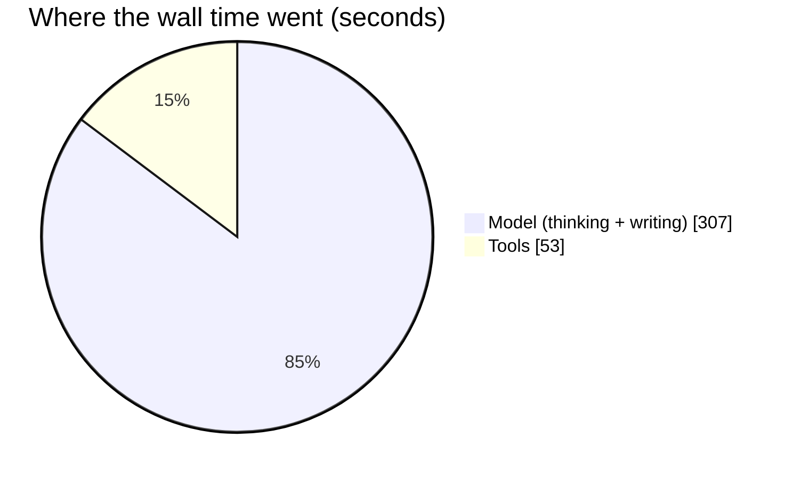

# corporate-ma/draft-markup-of-stock-purchase-agreement-provisions · run9 (`hv-mixed200-lunahigh-flip-r9-20261118T030322Z`)

Result: **all-pass** 59/59 criteria · 6.0 min · 37 model calls · 51 tool calls (3 errors or timeouts) · ending `completed` · started 11-18 08:34:08 IST

## Overview

One box per stretch of steps that used the same kind of tool (blue: looking/searching/reading, purple: writing or editing files, yellow: a message with no tool call, red border: a tool error or timeout inside the box).

```mermaid
flowchart TD
    T(["Task prompt"])
    P0["<b>Step 1</b> · 0.1 min<br/>todo_write"]
    T --> P0
    class P0 look
    P1["<b>Step 2</b> · 0.0 min<br/>create_goal"]
    P0 --> P1
    class P1 look
    P2["<b>Step 3</b> · 0.3 min<br/>glob x3<br/><i>*, documents/**/*, output/*</i>"]
    P1 --> P2
    class P2 look
    P3["<b>Step 4</b> · 0.3 min<br/>bash x4<br/>read<br/><i>parse-doc docx documents/buyer-ma-pla…, parse-doc docx documents/sellers-draf…, parse-doc docx documents/environmenta… +2</i>"]
    P2 --> P3
    class P3 look
    P4["<b>Steps 5-7</b> · 0.1 min<br/>read x9<br/><i>playbook.txt, termsheet.txt, diligence.txt +2</i>"]
    P3 --> P4
    class P4 err
    P5["<b>Step 8</b> · 0.1 min<br/>bash<br/><i>sed -n '633,836p' spa.txt #gt; spa_middl…</i>"]
    P4 --> P5
    class P5 look
    P6["<b>Step 9</b> · 0.0 min<br/>read<br/><i>spa_middle.txt</i>"]
    P5 --> P6
    class P6 look
    P7["<b>Step 10</b> · 0.5 min<br/>bash<br/><i>python - #lt;#lt;'PY' import docx print('py…</i>"]
    P6 --> P7
    class P7 look
    P8["<b>Step 11</b> · 0.1 min<br/>todo_write"]
    P7 --> P8
    class P8 look
    P9["<b>Step 12</b> · 2.3 min<br/>bash<br/><i>cat #gt; build_memo.py #lt;#lt;'PY' from docx …</i>"]
    P8 --> P9
    class P9 look
    P10["<b>Step 13</b> · 0.1 min<br/>todo_write"]
    P9 --> P10
    class P10 look
    P11["<b>Step 14</b> · 0.1 min<br/>bash x2<br/>glob<br/><i>test -s output/spa-markup-memorandum.…, parse-doc docx output/spa-markup-memo…, output/*</i>"]
    P10 --> P11
    class P11 look
    P12["<b>Steps 15-16</b> · 0.1 min<br/>read x2<br/><i>validated-memo.txt</i>"]
    P11 --> P12
    class P12 look
    P13["<b>Step 17</b> · 0.2 min<br/>grep<br/><i>build_memo.py</i>"]
    P12 --> P13
    class P13 look
    P14["<b>Steps 18-24</b> · 0.5 min<br/>edit x4<br/>read x3<br/><i>build_memo.py</i>"]
    P13 --> P14
    class P14 err
    P15["<b>Steps 25-29</b> · 0.5 min<br/>bash x5<br/><i>python build_memo.py && parse-doc doc…, which libreoffice || which soffice ||…, mkdir -p rendercheck && libreoffice -… +2</i>"]
    P14 --> P15
    class P15 look
    P16["<b>Step 30</b> · 0.1 min<br/>read_image x2<br/><i>page-01.png, page-02.png</i>"]
    P15 --> P16
    class P16 look
    P17["<b>Step 31</b> · 0.1 min<br/>bash<br/><i>pdftoppm -f 17 -l 17 -png -r 110 rend…</i>"]
    P16 --> P17
    class P17 look
    P18["<b>Steps 32-33</b> · 0.2 min<br/>read_image<br/>read<br/><i>last-17.png, build_memo.py</i>"]
    P17 --> P18
    class P18 look
    P19["<b>Step 34</b> · 0.2 min<br/>todo_write"]
    P18 --> P19
    class P19 look
    P20["<b>Step 35</b> · 0.0 min<br/>get_goal"]
    P19 --> P20
    class P20 look
    P21["<b>Step 36</b> · 0.0 min<br/>update_goal"]
    P20 --> P21
    class P21 look
    P22["<b>Step 37</b> · 0.1 min<br/>final message"]
    P21 --> P22
    class P22 ans
    R(["ALL PASS: 59/59 criteria"])
    P22 --> R
    class R pass
    classDef look fill:#e8f0fe,stroke:#4a6fa5,color:#111
    classDef write fill:#f3e8fd,stroke:#7b1fa2,color:#111
    classDef ans fill:#fff8e1,stroke:#b58900,color:#111
    classDef err fill:#e8f0fe,stroke:#c62828,stroke-width:3px,color:#111
    classDef pass fill:#e6f4ea,stroke:#2e7d32,color:#111
    classDef fail fill:#fce8e6,stroke:#c62828,color:#111
```





One row per model call:

| Step | Started (IST) | Model s | Tools s | Tool calls | Tools | Output chars |
|---|---|---|---|---|---|---|
| 1 | 08:34:08 | 4 | 0 | 1 | todo_write | 57 |
| 2 | 08:34:12 | 3 | 0 | 1 | create_goal | 378 |
| 3 | 08:34:15 | 2 | 18 | 3 | glob x3 | 372 |
| 4 | 08:34:34 | 5 | 12 | 5 | bash x4, read | 20,100 |
| 5 | 08:34:51 | 2 | 0 | 4 | read x4 | 207,434 |
| 6 | 08:34:53 | 3 | 0 | 4 | read x4 ⚠ | 150,961 |
| 7 | 08:34:57 | 2 | 0 | 1 | read ⚠ | 63 |
| 8 | 08:34:59 | 3 | 3 | 1 | bash | 11 |
| 9 | 08:35:05 | 1 | 0 | 1 | read | 27,904 |
| 10 | 08:35:07 | 32 | 1 | 1 | bash | 21 |
| 11 | 08:35:40 | 3 | 0 | 1 | todo_write | 57 |
| 12 | 08:35:43 | 135 | 1 | 1 | bash | 34 |
| 13 | 08:37:58 | 4 | 0 | 1 | todo_write | 57 |
| 14 | 08:38:02 | 3 | 5 | 3 | bash x2, glob | 501 |
| 15 | 08:38:10 | 2 | 0 | 1 | read | 53,170 |
| 16 | 08:38:12 | 3 | 0 | 1 | read | 18,828 |
| 17 | 08:38:15 | 12 | 1 | 1 | grep | 2,039 |
| 18 | 08:38:28 | 6 | 0 | 1 | edit ⚠ | 255 |
| 19 | 08:38:34 | 2 | 0 | 1 | read | 6,946 |
| 20 | 08:38:36 | 5 | 0 | 1 | edit | 220 |
| 21 | 08:38:42 | 2 | 0 | 1 | read | 10,297 |
| 22 | 08:38:44 | 4 | 0 | 1 | edit | 220 |
| 23 | 08:38:48 | 5 | 0 | 1 | read | 5,276 |
| 24 | 08:38:53 | 4 | 0 | 1 | edit | 220 |
| 25 | 08:38:57 | 3 | 4 | 1 | bash | 507 |
| 26 | 08:39:05 | 3 | 1 | 1 | bash | 21 |
| 27 | 08:39:09 | 4 | 2 | 1 | bash | 1,064 |
| 28 | 08:39:15 | 6 | 2 | 1 | bash | 90 |
| 29 | 08:39:23 | 4 | 1 | 1 | bash | 48 |
| 30 | 08:39:29 | 3 | 0 | 2 | read_image x2 | 588 |
| 31 | 08:39:32 | 4 | 1 | 1 | bash | 24 |
| 32 | 08:39:38 | 2 | 0 | 1 | read_image | 294 |
| 33 | 08:39:40 | 9 | 0 | 1 | read | 13,866 |
| 34 | 08:39:49 | 10 | 0 | 1 | todo_write | 57 |
| 35 | 08:39:59 | 2 | 0 | 1 | get_goal | 378 |
| 36 | 08:40:01 | 3 | 0 | 1 | update_goal | 383 |
| 37 | 08:40:04 | 5 | 0 | 0 | (message only) | 0 |

## Task prompt

```text
Review the seller's draft SPA against the buyer's playbook, executed term sheet, and diligence materials, and prepare a detailed markup memorandum with draft-ready redline language. Output: `spa-markup-memorandum.docx`.
```

## Rubric

| # | Criterion | Verdict |
|---|---|---|
| C-001 | ISSUE_001: Identifies overbroad MAE carve-outs for environmental industry/regulations | pass |
| C-002 | ISSUE_001: Proposes adding disproportionate impact qualifier to MAE carve-outs | pass |
| C-003 | ISSUE_001: Provides actual revised contract language for MAE definition | pass |
| C-004 | ISSUE_001: Explains rationale — environmental company needs MAE protection | pass |
| C-005 | ISSUE_002: Identifies missing interim covenant restricting affiliate transactions | pass |
| C-006 | ISSUE_002: Proposes covenant requiring Buyer consent for affiliate transactions | pass |
| C-007 | ISSUE_002: References the above-market rent to Seller affiliate as rationale | pass |
| C-008 | ISSUE_003: Identifies indemnification cap discrepancy (20% vs. 12.5%) | pass |
| C-009 | ISSUE_003: Proposes redline reducing cap to 12.5% / $26,875,000 | pass |
| C-010 | ISSUE_003: References the term sheet as basis for cap correction | pass |
| C-011 | ISSUE_004: Identifies that environmental reps survival period is too short | pass |
| C-012 | ISSUE_004: Proposes extending environmental reps survival to at least 36 months | pass |
| C-013 | ISSUE_004: References CERCLA/Dalton Creek exposure as rationale for longer survival | pass |
| C-014 | ISSUE_005: Identifies anti-sandbagging provision in Section 9.06 | pass |
| C-015 | ISSUE_005: Proposes replacing with pro-sandbagging language | pass |
| C-016 | ISSUE_005: Provides actual pro-sandbagging contract text | pass |
| C-017 | ISSUE_006: Identifies need for Special Indemnity for Dalton Creek CERCLA matter | pass |
| C-018 | ISSUE_006: Special Indemnity survival of 72 months | pass |
| C-019 | ISSUE_006: Special Indemnity not subject to basket or cap | pass |
| C-020 | ISSUE_006: References Dalton Creek liability range ($1.5M-$6M) | pass |
| C-021 | ISSUE_007: Identifies problematic earnout operational covenant | pass |
| C-022 | ISSUE_007: Proposes limiting earnout covenant to no-frustration standard | pass |
| C-023 | ISSUE_007: Explains rationale — Buyer integration/restructuring flexibility | pass |
| C-024 | ISSUE_008: Identifies missing payoff letter requirement | pass |
| C-025 | ISSUE_008: Proposes payoff letters at least 3 business days pre-closing | pass |
| C-026 | ISSUE_008: Proposes simultaneous repayment at closing through funds flow | pass |
| C-027 | ISSUE_008: Proposes payoff letter delivery as a condition to closing | pass |
| C-028 | ISSUE_009: Identifies missing government contract anti-assignment/novation requirement | pass |
| C-029 | ISSUE_009: References specific government contracts requiring novation | pass |
| C-030 | ISSUE_009: Proposes closing condition or covenant for government contract novation | pass |
| C-031 | ISSUE_009: References Anti-Assignment Act or FAR provisions | pass |
| C-032 | ISSUE_010: Identifies missing environmental permit transfer/notification covenant | pass |
| C-033 | ISSUE_010: Proposes cooperation covenant for environmental permit transfers | pass |
| C-034 | ISSUE_010: Notes that permits may require notification even in a stock deal | pass |
| C-035 | ISSUE_011: Identifies missing R&W Insurance subrogation waiver | pass |
| C-036 | ISSUE_011: Proposes subrogation waiver provision with fraud exception | pass |
| C-037 | ISSUE_011: References R&W Insurance policy / Granite Ridge Underwriters | pass |
| C-038 | ISSUE_012: Identifies non-compete scope exceeds term sheet (duration) | pass |
| C-039 | ISSUE_012: Identifies non-compete scope exceeds term sheet (geographic) | pass |
| C-040 | ISSUE_012: Identifies non-compete scope exceeds term sheet (activity) | pass |
| C-041 | ISSUE_012: Proposes narrowing non-compete duration to 3 years | pass |
| C-042 | ISSUE_012: Proposes narrowing non-compete geographic scope to OR, WA, CA, NV | pass |
| C-043 | ISSUE_012: Proposes narrowing non-compete activity scope to environmental remediation and hazardous waste management | pass |
| C-044 | ISSUE_012: Notes enforceability risk of overbroad non-compete | pass |
| C-045 | Indemnification cap issue rated as Critical or High priority | pass |
| C-046 | Anti-sandbagging issue rated as Critical or High priority | pass |
| C-047 | Memorandum identifies provisions acceptable as drafted | pass |
| C-048 | Memorandum flags items for partner/client discussion | pass |
| C-049 | Escrow amount correctly stated as $16,125,000 (7.5% of EV) | pass |
| C-050 | ISSUE_006: Proposes 36-month escrow holdback for Special Indemnity | pass |
| C-051 | Earnout maximum correctly referenced as $25,000,000 | pass |
| C-052 | Earnout Adjusted EBITDA threshold correctly referenced as $38,000,000 | pass |
| C-053 | Earnout floor correctly referenced as $32,000,000 | pass |
| C-054 | References playbook as authority for at least 3 markup positions | pass |
| C-055 | References term sheet as authority for at least 3 markup positions | pass |
| C-056 | References environmental DD memo for at least one markup position | pass |
| C-057 | Memorandum identifies specific SPA section numbers for issues | pass |
| C-058 | Proposed redline language is actual contract text for at least 8 issues | pass |
| C-059 | ISSUE_008: Identifies all three sources of Target indebtedness | pass |

Judge's reasoning:

**C-001 (pass):** ISSUE_001: Identifies overbroad MAE carve-outs for environmental industry/regulations

```text
The memorandum expressly identifies that the MAE carve-outs for conditions generally affecting the environmental services industry and changes in Environmental Laws lack a disproportionate-impact exception. It proposes adding a qualifier so those matters remain relevant to the extent they disproportionately affect the Company relative to industry participants.
```

**C-002 (pass):** ISSUE_001: Proposes adding disproportionate impact qualifier to MAE carve-outs

```text
The proposed MAE definition adds an explicit disproportionate-impact proviso covering clauses (i) through (vi), including the industry-specific and Environmental Law/regulatory carve-outs, relative to other industry participants.
```

**C-003 (pass):** ISSUE_001: Provides actual revised contract language for MAE definition

```text
The memorandum includes full proposed replacement contract language for the Material Adverse Effect definition in Section 1.01, including an express disproportionate-impact exception applicable to clauses (i) through (vi).
```

**C-004 (pass):** ISSUE_001: Explains rationale — environmental company needs MAE protection

```text
The memorandum expressly ties the concern to Target’s environmental remediation, hazardous-waste, permit, and government-contract business, explaining that industry-wide or Environmental Law developments could materially and disproportionately harm Target. It also states that the seller’s carve-outs could insulate such target-specific regulatory harm, adequately explaining why the carve-outs are especially problematic for this environmental services company.
```

**C-005 (pass):** ISSUE_002: Identifies missing interim covenant restricting affiliate transactions

```text
The memorandum expressly identifies that Section 6.01's interim operating covenants lack a specific restriction on transactions with Seller or Seller affiliates and proposes a new consent-based covenant covering entry into, amendment, renewal, termination, payment under, or acceleration of affiliate arrangements between signing and closing.
```

**C-006 (pass):** ISSUE_002: Proposes covenant requiring Buyer consent for affiliate transactions

```text
The memorandum proposes new Section 6.01(b)(xiv), which prohibits the Company from entering into, amending, modifying, extending, renewing, or terminating transactions or agreements with Seller or Seller affiliates without Buyer's prior written consent, subject to limited specified exceptions.
```

**C-007 (pass):** ISSUE_002: References the above-market rent to Seller affiliate as rationale

```text
The affiliate-transactions covenant rationale expressly cites “$1.6 million of above-market annual rent under the Affiliate Lease” as a diligence concern supporting the specific consent right over affiliate arrangements.
```

**C-008 (pass):** ISSUE_003: Identifies indemnification cap discrepancy (20% vs. 12.5%)

```text
The memorandum expressly identifies that the Seller's draft uses a 20% cap ($43,000,000) and contrasts it with the term sheet's agreed 12.5% cap ($26,875,000), including proposed replacement language.
```

**C-009 (pass):** ISSUE_003: Proposes redline reducing cap to 12.5% / $26,875,000

```text
The memorandum expressly proposes replacing the 20% / $43,000,000 indemnification cap with 12.5% of the $215,000,000 Base Enterprise Value, equal to $26,875,000.
```

**C-010 (pass):** ISSUE_003: References the term sheet as basis for cap correction

```text
The memorandum expressly cites “Executed Term Sheet §8” as a source for the cap correction and states that the executed term sheet fixes the general indemnification cap at 12.5% of the $215 million Base Enterprise Value ($26.875 million). It also identifies the executed term sheet as dated September 10, 2025.
```

**C-011 (pass):** ISSUE_004: Identifies that environmental reps survival period is too short

```text
The memorandum expressly identifies the Seller's uniform 12-month survival period as inadequate for environmental representations, including Section 4.15 Environmental Matters and Environmental Permits, and proposes extending survival to 36 months.
```

**C-012 (pass):** ISSUE_004: Proposes extending environmental reps survival to at least 36 months

```text
The memorandum expressly proposes that Environmental Representations survive until 36 months after Closing in revised Section 9.01(c), and also reserves the option to seek survival through the full applicable statute of limitations.
```

**C-013 (pass):** ISSUE_004: References CERCLA/Dalton Creek exposure as rationale for longer survival

```text
The memorandum expressly ties the proposed 36-month survival period for environmental representations to the Dalton Creek CERCLA exposure and the active Hargrove remediation project, noting that Dalton Creek liability may take years to crystallize and Hargrove has an 18–24 month remaining timeline.
```

**C-014 (pass):** ISSUE_005: Identifies anti-sandbagging provision in Section 9.06

```text
The memorandum expressly identifies Section 9.06 as an anti-sandbagging provision and quotes its restriction that Buyer cannot obtain indemnification for breaches or inaccuracies of which Buyer or its Representatives had Knowledge as of the Closing Date.
```

**C-015 (pass):** ISSUE_005: Proposes replacing with pro-sandbagging language

```text
The memorandum expressly deletes the anti-sandbagging provision and replaces it with a pro-sandbagging clause stating that Buyer's indemnification rights are not affected, defeated, or diminished by any investigation or knowledge obtained before or after Closing.
```

**C-016 (pass):** ISSUE_005: Provides actual pro-sandbagging contract text

```text
The memorandum includes actual proposed pro-sandbagging contract language in the replacement Section 9.06, stating that indemnification and other remedies are not affected by Buyer's investigation, knowledge, notice, or available information.
```

**C-017 (pass):** ISSUE_006: Identifies need for Special Indemnity for Dalton Creek CERCLA matter

```text
The memorandum expressly identifies the Dalton Creek EPA CERCLA §104(e) matter as requiring a separate Special Indemnity. It proposes a dedicated Section 9.02(e) with 72-month survival, first-dollar recovery, no basket or general cap, and 36 months of escrow support, distinct from general environmental representation indemnification.
```

**C-018 (pass):** ISSUE_006: Special Indemnity survival of 72 months

```text
The memorandum expressly states that the Dalton Creek Special Indemnity survives until 72 months following the Closing Date, including in the proposed Section 9.02(e).
```

**C-019 (pass):** ISSUE_006: Special Indemnity not subject to basket or cap

```text
The memorandum expressly states that the Dalton Creek Special Indemnity is first-dollar and “shall not be subject to the Basket Amount or the Indemnification Cap,” and it also proposes conforming language excluding it from the basket and general cap.
```

**C-020 (pass):** ISSUE_006: References Dalton Creek liability range ($1.5M-$6M)

```text
The memorandum expressly states in the Dalton Creek Special Indemnity rationale that the diligence memo estimates exposure at $1.5 million to $6 million, using that range to justify the proposed special indemnity.
```

**C-021 (pass):** ISSUE_007: Identifies problematic earnout operational covenant

```text
The memorandum expressly identifies Section 2.05(d)'s requirement to operate consistently with past practice and in good faith to maximize the earnout as overly restrictive, explaining that it would constrain Buyer's integration, restructuring, personnel, and capital-allocation decisions. It proposes replacing that covenant with a narrow prohibition on actions taken primarily to avoid or reduce the earnout.
```

**C-022 (pass):** ISSUE_007: Proposes limiting earnout covenant to no-frustration standard

```text
The memorandum expressly replaces the seller’s affirmative past-practice and earnout-maximization obligations with a narrow covenant prohibiting actions taken with the primary purpose of avoiding or reducing the earnout. It also states that Buyer has no affirmative obligation to operate in any particular manner or maximize the earnout.
```

**C-023 (pass):** ISSUE_007: Explains rationale — Buyer integration/restructuring flexibility

```text
The earnout commentary expressly explains that the seller’s affirmative operating covenants could constrain Buyer’s platform integration, restructuring, personnel decisions, capital allocation, and bolt-on strategy, and states that the proposed language restores Buyer’s post-closing operational flexibility.
```

**C-024 (pass):** ISSUE_008: Identifies missing payoff letter requirement

```text
The memorandum expressly identifies that the draft permits repayment “at or promptly following the Closing” and omits payoff letters from Seller’s closing deliverables and Buyer’s closing conditions. It proposes requiring executed payoff letters from each holder of Closing Indebtedness at least three business days before Closing.
```

**C-025 (pass):** ISSUE_008: Proposes payoff letters at least 3 business days pre-closing

```text
The memorandum expressly requires executed payoff letters from each holder of Closing Indebtedness no later than three Business Days before Closing. It also requires each letter to include wire transfer instructions and provide for lien releases, including UCC-3 termination statements and other lien-release instruments.
```

**C-026 (pass):** ISSUE_008: Proposes simultaneous repayment at closing through funds flow

```text
The memorandum expressly replaces the seller’s “at or promptly following” mechanic with a requirement that all Closing Indebtedness be repaid, discharged, and satisfied in full at Closing through the closing funds flow. It also requires a funds flow agreement covering repayment of all Closing Indebtedness.
```

**C-027 (pass):** ISSUE_008: Proposes payoff letter delivery as a condition to closing

```text
The memorandum expressly proposes adding Section 7.02(h) as a Buyer closing condition requiring Seller to deliver the payoff letters specified in Section 2.03(d), and also adds them as closing deliverables under Section 2.08(a)(x).
```

**C-028 (pass):** ISSUE_009: Identifies missing government contract anti-assignment/novation requirement

```text
The memorandum expressly identifies that the Seller's draft lacks specific government-contract anti-assignment, novation, and recognition provisions for the Oregon DEQ, Washington Ecology, U.S. Army Corps of Engineers, and Bureau of Land Management contracts. It also proposes representations and covenants addressing the Anti-Assignment Act, FAR Part 42.12, novation/recognition submissions, agency notices, and post-closing cooperation.
```

**C-029 (pass):** ISSUE_009: References specific government contracts requiring novation

```text
The memorandum identifies all four active government contracts by agency and specifically states that the two federal contracts—U.S. Army Corps of Engineers and Bureau of Land Management—may require novation or recognition under FAR 42.1204.
```

**C-030 (pass):** ISSUE_009: Proposes closing condition or covenant for government contract novation

```text
The memorandum proposes a specific pre-closing covenant in new Section 6.05A requiring Seller and the Company to notify relevant agencies, submit required government contract novation or recognition requests, and use commercially reasonable efforts to obtain the agreements. It also proposes a related closing condition addressing those submissions and adverse agency indications.
```

**C-031 (pass):** ISSUE_009: References Anti-Assignment Act or FAR provisions

```text
The memorandum expressly cites the Anti-Assignment Act, 41 U.S.C. § 6305, and FAR Part 42, Subpart 42.12 as legal bases for government-contract novation, recognition, and related notice requirements.
```

**C-032 (pass):** ISSUE_010: Identifies missing environmental permit transfer/notification covenant

```text
The memorandum expressly identifies that the Seller's draft lacks a pre- or post-closing covenant addressing environmental permit change-of-control notifications, approvals, transfers, or re-issuances. It proposes new Section 6.05B requiring pre-closing identification and submissions, commercially reasonable efforts to obtain approvals, and post-closing cooperation for pending permit transfers, re-issuances, amendments, and approvals.
```

**C-033 (pass):** ISSUE_010: Proposes cooperation covenant for environmental permit transfers

```text
The memorandum proposes new Section 6.05B, requiring Seller to assist before Closing with identifying and submitting required environmental permit notifications, applications, and approval requests, and to provide post-Closing cooperation for permit transfers, reissuances, amendments, and approvals.
```

**C-034 (pass):** ISSUE_010: Notes that permits may require notification even in a stock deal

```text
The memorandum expressly states that environmental permits in Oregon, Washington, California, and Nevada may require change-of-control notification or approval even though the transaction is structured as a stock purchase and the permit-holding entity remains unchanged.
```

**C-035 (pass):** ISSUE_011: Identifies missing R&W Insurance subrogation waiver

```text
The memorandum expressly identifies that the Seller's draft contains no provision addressing Buyer's R&W insurance policy or waiver of the insurer's subrogation rights against Seller and its affiliates, and proposes a new Section 10.13 to add that waiver subject to a fraud exception.
```

**C-036 (pass):** ISSUE_011: Proposes subrogation waiver provision with fraud exception

```text
The memorandum proposes new Section 10.13 requiring the R&W insurer to waive subrogation and other recovery rights against Seller and related parties, with an express exception for claims arising from or relating to actual fraud by Seller.
```

**C-037 (pass):** ISSUE_011: References R&W Insurance policy / Granite Ridge Underwriters

```text
The memorandum expressly states that Buyer is obtaining/placing an R&W Insurance policy, identifies Granite Ridge Underwriters, and connects the policy to the need for an insurer subrogation waiver in favor of Seller and its affiliates, except for Seller fraud.
```

**C-038 (pass):** ISSUE_012: Identifies non-compete scope exceeds term sheet (duration)

```text
The memorandum expressly identifies that the Seller's draft imposes a five-year non-compete while the term sheet agreed to a three-year period, and proposes replacing the duration with three years.
```

**C-039 (pass):** ISSUE_012: Identifies non-compete scope exceeds term sheet (geographic)

```text
The memorandum expressly identifies that the Seller's draft applies nationwide and states that the term sheet limits the non-compete geography to Oregon, Washington, California, and Nevada. It also proposes replacement language using only those four states.
```

**C-040 (pass):** ISSUE_012: Identifies non-compete scope exceeds term sheet (activity)

```text
The memorandum expressly identifies that the draft restricts Seller from engaging in “any business,” while the term sheet limits the restricted activities to environmental remediation and hazardous waste management services. It also proposes replacement language conforming to that narrower scope.
```

**C-041 (pass):** ISSUE_012: Proposes narrowing non-compete duration to 3 years

```text
The proposed replacement for Section 6.09(a) expressly narrows the non-compete period from five years to three years following the Closing Date, matching the term sheet.
```

**C-042 (pass):** ISSUE_012: Proposes narrowing non-compete geographic scope to OR, WA, CA, NV

```text
The proposed replacement for Section 6.09(a) limits the non-compete to environmental remediation or hazardous waste management businesses in Oregon, Washington, California, and Nevada, matching the term sheet.
```

**C-043 (pass):** ISSUE_012: Proposes narrowing non-compete activity scope to environmental remediation and hazardous waste management

```text
The proposed replacement for Section 6.09(a) expressly narrows the restricted business activities to the provision of “environmental remediation services or hazardous waste management services,” matching the term sheet’s required scope.
```

**C-044 (pass):** ISSUE_012: Notes enforceability risk of overbroad non-compete

```text
The memorandum expressly states that the five-year nationwide restriction covering “any business” would sweep in Evergreen’s unrelated construction and timber operations and raises enforceability concerns. It also proposes carve-outs preserving those legitimate businesses.
```

**C-045 (pass):** Indemnification cap issue rated as Critical or High priority

```text
The indemnification cap discrepancy (20% / $43 million versus 12.5% / $26.875 million) is expressly rated HIGH in both the Priority Matrix and the detailed Section 1.01 discussion.
```

**C-046 (pass):** Anti-sandbagging issue rated as Critical or High priority

```text
Section 9.06 (sandbagging) is expressly assigned CRITICAL priority in both the Priority Matrix and the detailed markup, satisfying the criterion.
```

**C-047 (pass):** Memorandum identifies provisions acceptable as drafted

```text
The memorandum includes a separate “Items Intentionally Left Unchanged” section identifying several acceptable provisions and briefly explaining why, including the 1% true-deductible basket, actual-knowledge qualifier, 10-business-day good-standing certificate timing, and Delaware governing law.
```

**C-048 (pass):** Memorandum flags items for partner/client discussion

```text
The memorandum expressly flags multiple issues for further partner/client discussion before finalizing positions. Examples include whether completed government-contract novations should be a closing condition, whether environmental representations should survive for the full statute of limitations, the dedicated Dalton Creek escrow allocation, and whether to narrow the non-solicit. It also includes a dedicated “Negotiation Roadmap and Open Decisions” section.
```

**C-049 (pass):** Escrow amount correctly stated as $16,125,000 (7.5% of EV)

```text
The memorandum correctly references the escrow as $16.125 million in the Dalton Creek Special Indemnity implementation note. This equals 7.5% of the $215 million base enterprise value, and no conflicting escrow amount is stated.
```

**C-050 (pass):** ISSUE_006: Proposes 36-month escrow holdback for Special Indemnity

```text
The memorandum expressly provides that the escrow portion designated for the Dalton Creek Special Indemnity remains available until 36 months after closing, distinct from the general 18-month escrow release. It also conforms Section 9.08 to retain Special Indemnity reserves for that 36-month period.
```

**C-051 (pass):** Earnout maximum correctly referenced as $25,000,000

```text
The earnout discussion expressly states that the economic thresholds are correct, including a "$25 million maximum," which correctly references the maximum earnout payment as $25,000,000.
```

**C-052 (pass):** Earnout Adjusted EBITDA threshold correctly referenced as $38,000,000

```text
The earnout discussion expressly states that the full-payment Adjusted EBITDA threshold is $38 million, which correctly corresponds to $38,000,000.
```

**C-053 (pass):** Earnout floor correctly referenced as $32,000,000

```text
The earnout discussion expressly states that the economic thresholds are correct, including a $32 million floor, a $38 million full-payment threshold, and linear interpolation between them, which reflects pro-rata payment between the floor and threshold.
```

**C-054 (pass):** References playbook as authority for at least 3 markup positions

```text
The memorandum cites the Buyer's M&A Playbook as authority for well over three distinct markup positions, including the MAE disproportionate-impact qualifier, earnout operating covenant, indemnification cap, environmental survival, pro-sandbagging, debt payoff mechanics, government-contract novation, permit cooperation, affiliate transactions, and non-compete scope.
```

**C-055 (pass):** References term sheet as authority for at least 3 markup positions

```text
The memorandum cites the executed term sheet as authority for well over three distinct markup positions, including the indemnification cap, earnout mechanics, debt payoff requirements, environmental survival, Dalton Creek Special Indemnity, R&W insurance waiver, non-compete scope, and closing conditions.
```

**C-056 (pass):** References environmental DD memo for at least one markup position

```text
The memorandum repeatedly cites the Environmental DD Summary dated October 18, 2025 as support for markup positions, including the Dalton Creek Special Indemnity, environmental representation survival, government contract novation, and environmental permit cooperation.
```

**C-057 (pass):** Memorandum identifies specific SPA section numbers for issues

```text
The memorandum ties well over 8 of the 12 planted issues to specific SPA sections. Examples include MAE (§1.01), earnout (§2.05), government contracts (§§4.16, 6.05, 7.02), environmental survival (§9.01), affiliate transactions (§6.01), debt payoff (§§2.03, 2.08, 7.02), indemnification cap (§§1.01, 9.04), permit cooperation (§§4.15, 6.05), non-compete (§6.09), and sandbagging (§9.06).
```

**C-058 (pass):** Proposed redline language is actual contract text for at least 8 issues

```text
The memorandum provides draft-ready contract text for well over 8 of the 12 planted issues, including MAE, earnout, government contracts/novation, environmental survival, Dalton Creek indemnity, affiliate transactions, debt payoff, indemnification cap, permit cooperation, R&W insurance subrogation, non-compete, and sandbagging.
```

**C-059 (pass):** ISSUE_008: Identifies all three sources of Target indebtedness

```text
The payoff-letter discussion identifies all three sources of Target indebtedness: Cascade Mutual Bank's $28.0 million senior term loan, Pacific Lease Corp.'s $9.8 million equipment financing, and Evergreen Holdings Group, Inc.'s $4.5 million subordinated seller note.
```

## Delivered files (output/)

- `spa-markup-memorandum.docx` (60,807 bytes)

## Trajectory

### Step 1: 1 tool call

_Started 11-18 08:34:08 IST · model 4 s · tools 0 s_

**Reasoning summary:**

```text
**Creating document goals**

I need to produce a DOCX file and inspect some files. It seems I need some document editing skills. It’s unclear if I need to list unavailable items explicitly, but I have a tool for that. I’ll need to discover files with a glob search and might use a to-do list for multiple steps. Creating a long-term goal could be helpful, even if the goal tool is looking for current requests. So, I’ll go ahead and create a to-do and a goal!
```

**Call `todo_write`** (0.0 s)

```json
{
 "todos": [
  {
   "content": "Inventory and read the SPA, playbook, term sheet, and diligence materials",
   "status": "in_progress"
  },
  {
   "content": "Analyze conflicts and draft buyer-favorable redline positions with supporting rationale",
   "status": "pending"
  },
  {
   "content": "Create and format the detailed markup memorandum as a DOCX",
   "status": "pending"
  },
  {
   "content": "Validate the DOCX content and deliver the final file",
   "status": "pending"
  }
 ]
}
```

Output (57 chars):

```text
Updated todo list: 3 pending, 1 in progress, 0 completed.
```

**Todo list now:**

- [~] Inventory and read the SPA, playbook, term sheet, and diligence materials
- [ ] Analyze conflicts and draft buyer-favorable redline positions with supporting rationale
- [ ] Create and format the detailed markup memorandum as a DOCX
- [ ] Validate the DOCX content and deliver the final file

### Step 2: 1 tool call

_Started 11-18 08:34:12 IST · model 3 s · tools 0 s_

**Call `create_goal`** (0.0 s)

```json
{
 "objective": "Review the seller's draft SPA against the buyer's playbook, executed term sheet, and diligence materials, then prepare and validate the detailed markup memorandum as spa-markup-memorandum.docx in the output directory.",
 "max_goal_rounds": 3
}
```

Output (378 chars):

```text
{"goal":{"id":"goal-3c620ac8-f2f3-4f35-ab4c-865b4c853871","revision":1,"objective":"Review the seller's draft SPA against the buyer's playbook, executed term sheet, and diligence materials, then prepare and validate the detailed markup memorandum as spa-markup-memorandum.docx in the output directory.","phase":"active","roundsStarted":0,"maxGoalRounds":3},"activation":"armed"}
```

### Step 3: 3 tool calls

_Started 11-18 08:34:15 IST · model 2 s · tools 18 s_

**Call `glob`** (2.3 s)

```json
{
 "pattern": "*"
}
```

Output (179 chars):

```text
documents/buyer-ma-playbook.docx
documents/sellers-draft-spa.docx
documents/environmental-dd-memo.docx
documents/executed-term-sheet.docx
documents/partner-markup-instructions.eml
```

**Call `glob`** (8.5 s)

```json
{
 "pattern": "documents/**/*"
}
```

Output (179 chars):

```text
documents/buyer-ma-playbook.docx
documents/sellers-draft-spa.docx
documents/environmental-dd-memo.docx
documents/executed-term-sheet.docx
documents/partner-markup-instructions.eml
```

**Call `glob`** (7.3 s)

```json
{
 "pattern": "output/*"
}
```

Output (14 chars):

```text
No files found
```

### Step 4: 5 tool calls

_Started 11-18 08:34:34 IST · model 5 s · tools 12 s_

**Call `bash`** (3.3 s)

```json
{
 "command": "parse-doc docx documents/buyer-ma-playbook.docx > playbook.txt",
 "workdir": "/home/agarwaldi/dsh-bench-harness/runs/hv-mixed200-lunahigh-flip-r9-20261118T030322Z/tasks/corporate-ma__draft-markup-of-stock-purchase-agreement-provisions/workspace",
 "description": "Parse buyer playbook to text"
}
```

Output (374 chars):

```text
[stderr]
2026-11-18 03:04:41.930383487 [W:onnxruntime:Default, device_discovery.cc:95 GetPciBusId] Skipping pci_bus_id for PCI path at "/sys/devices/LNXSYSTM:00/LNXSYBUS:00/ACPI0004:00/VMBUS:00/5620e0c7-8062-4dce-aeb7-520c7ef76171" because filename "5620e0c7-8062-4dce-aeb7-520c7ef76171" did not match expected pattern of [0-9a-f]+:[0-9a-f]+:[0-9a-f]+[.][0-9a-f]+
```

**Call `bash`** (3.2 s)

```json
{
 "command": "parse-doc docx documents/sellers-draft-spa.docx > spa.txt",
 "workdir": "/home/agarwaldi/dsh-bench-harness/runs/hv-mixed200-lunahigh-flip-r9-20261118T030322Z/tasks/corporate-ma__draft-markup-of-stock-purchase-agreement-provisions/workspace",
 "description": "Parse seller SPA to text"
}
```

Output (374 chars):

```text
[stderr]
2026-11-18 03:04:44.558792339 [W:onnxruntime:Default, device_discovery.cc:95 GetPciBusId] Skipping pci_bus_id for PCI path at "/sys/devices/LNXSYSTM:00/LNXSYBUS:00/ACPI0004:00/VMBUS:00/5620e0c7-8062-4dce-aeb7-520c7ef76171" because filename "5620e0c7-8062-4dce-aeb7-520c7ef76171" did not match expected pattern of [0-9a-f]+:[0-9a-f]+:[0-9a-f]+[.][0-9a-f]+
```

**Call `bash`** (3.1 s)

```json
{
 "command": "parse-doc docx documents/environmental-dd-memo.docx > diligence.txt",
 "workdir": "/home/agarwaldi/dsh-bench-harness/runs/hv-mixed200-lunahigh-flip-r9-20261118T030322Z/tasks/corporate-ma__draft-markup-of-stock-purchase-agreement-provisions/workspace",
 "description": "Parse diligence memo to text"
}
```

Output (374 chars):

```text
[stderr]
2026-11-18 03:04:47.458137775 [W:onnxruntime:Default, device_discovery.cc:95 GetPciBusId] Skipping pci_bus_id for PCI path at "/sys/devices/LNXSYSTM:00/LNXSYBUS:00/ACPI0004:00/VMBUS:00/5620e0c7-8062-4dce-aeb7-520c7ef76171" because filename "5620e0c7-8062-4dce-aeb7-520c7ef76171" did not match expected pattern of [0-9a-f]+:[0-9a-f]+:[0-9a-f]+[.][0-9a-f]+
```

**Call `read`** (0.1 s)

```json
{
 "file_path": "documents/partner-markup-instructions.eml"
}
```

Output (18,604 chars):

```text
<path>/home/agarwaldi/dsh-bench-harness/runs/hv-mixed200-lunahigh-flip-r9-20261118T030322Z/tasks/corporate-ma__draft-markup-of-stock-purchase-agreement-provisions/workspace/documents/partner-markup-instructions.eml</path>
<type>file</type>
<content>
1: From: Elena Vasquez-Moreno <evasquez-moreno@apylaw.com>
2: To: Jonathan Kreider <jkreider@apylaw.com>
3: Date: Thu, 23 Oct 2025 08:47:00 -0000
4: Subject: Re: Cascadia SPA Markup — Instructions and Priority Issues
5: Content-Type: text/plain; charset="utf-8"
6: Content-Transfer-Encoding: quoted-printable
7: MIME-Version: 1.0
8: 
9: Jonathan,
10: 
11: I reviewed the initial draft SPA that Douglas Renwick at Fortuna & Blake circ=
12: ulated yesterday. My overall impression: this is a heavily seller-favorable d=
13: raft in several material respects, and some of the positions directly contrad=
14: ict the September 10 term sheet =E2=80=94 which tells me either Doug is testi=
15: ng our resolve or his client gave him different instructions than what was ag=
16: reed at the principal level. Either way, we need a sharp, comprehensive marku=
17: p.
18: 
19: Marcus Devereaux at Whitmore Capital wants to see our redline by end of next =
20: week. Given the November 14 target signing date, that gives the parties rough=
21: ly two weeks of negotiation runway after we send our markup, which is tight. =
22: I need your comprehensive markup memorandum with redlined provisions and full=
23:  track-changes commentary.
24: 
25: **General Instru
… [17,104 more chars]
```

**Call `bash`** (2.4 s)

```json
{
 "command": "parse-doc docx documents/executed-term-sheet.docx > termsheet.txt",
 "workdir": "/home/agarwaldi/dsh-bench-harness/runs/hv-mixed200-lunahigh-flip-r9-20261118T030322Z/tasks/corporate-ma__draft-markup-of-stock-purchase-agreement-provisions/workspace",
 "description": "Parse executed term sheet to text"
}
```

Output (374 chars):

```text
[stderr]
2026-11-18 03:04:50.845474021 [W:onnxruntime:Default, device_discovery.cc:95 GetPciBusId] Skipping pci_bus_id for PCI path at "/sys/devices/LNXSYSTM:00/LNXSYBUS:00/ACPI0004:00/VMBUS:00/5620e0c7-8062-4dce-aeb7-520c7ef76171" because filename "5620e0c7-8062-4dce-aeb7-520c7ef76171" did not match expected pattern of [0-9a-f]+:[0-9a-f]+:[0-9a-f]+[.][0-9a-f]+
```

### Step 5: 4 tool calls

_Started 11-18 08:34:51 IST · model 2 s · tools 0 s_

**Call `read`** (0.1 s)

```json
{
 "file_path": "playbook.txt"
}
```

Output (52,864 chars):

```text
<path>/home/agarwaldi/dsh-bench-harness/runs/hv-mixed200-lunahigh-flip-r9-20261118T030322Z/tasks/corporate-ma__draft-markup-of-stock-purchase-agreement-provisions/workspace/playbook.txt</path>
<type>file</type>
<content>
1: **[ASHFORD, PENNINGTON & YATES LLP]{.underline}**
2: 
3: 71 South Wacker Drive, Suite 4500 Chicago, Illinois 60606
4: 
5: **[M&A PLAYBOOK --- ENVIRONMENTAL SERVICES SECTOR ACQUISITIONS]{.underline}**
6: 
7: **[Internal Guidance for Associates Reviewing Stock Purchase Agreements and Asset Purchase Agreements on Behalf of Private Equity Buyer Clients]{.underline}**
8: 
9: **Prepared by:** M&A Practice Group Ashford, Pennington & Yates LLP 71 South Wacker Drive, Suite 4500 Chicago, Illinois 60606
10: 
11: **Version:** 4.2 (Revised October 2025)
12: 
13: **Distribution:** CONFIDENTIAL --- For Internal Use Only --- Attorney Work Product
14: 
15: **Primary Authors:**
16: 
17: Elena Vasquez-Moreno, Partner, M&A Practice Group
18: 
19: With contributions from the Environmental Regulatory Practice Group and the Government Contracts Practice Group
20: 
21: **NOTE:** This playbook supplements the Firm\'s General M&A Playbook (v.7.1) and should be read in conjunction with it. Where this sector-specific playbook addresses a topic also covered in the General Playbook, this playbook governs for environmental services transactions. In the event of any inconsistency between this playbook and the General M&A Playbook with respect to an environmental services acquisition, th
… [51,364 more chars]
```

**Call `read`** (0.1 s)

```json
{
 "file_path": "termsheet.txt"
}
```

Output (53,454 chars):

```text
<path>/home/agarwaldi/dsh-bench-harness/runs/hv-mixed200-lunahigh-flip-r9-20261118T030322Z/tasks/corporate-ma__draft-markup-of-stock-purchase-agreement-provisions/workspace/termsheet.txt</path>
<type>file</type>
<content>
1: **BINDING TERM SHEET**
2: 
3: **Acquisition of 100% of the Outstanding Equity Interests of** **Cascadia Environmental Solutions, Inc.**
4: 
5: Dated as of September 10, 2025
6: 
7: This Binding Term Sheet (this \"Term Sheet\") sets forth the principal terms and conditions agreed upon by the parties identified below with respect to the proposed acquisition described herein. Except as set forth in Section 18 (Binding Provisions) below, this Term Sheet is intended to be binding on the parties and shall govern the preparation of the Definitive Agreement (as defined below). This Term Sheet supersedes and replaces in its entirety the non-binding Letter of Intent dated August 15, 2025 (the \"LOI\"), previously entered into between Whitmore Capital Partners LLC and Evergreen Holdings Group, Inc. with respect to the proposed acquisition of Cascadia Environmental Solutions, Inc. Capitalized terms used but not otherwise defined herein shall have the meanings ascribed to them in the context in which they appear.
8: 
9: **[Section 1: Parties]{.underline}**
10: 
11: **Buyer:** Whitmore Capital Partners LLC, a Delaware limited liability company, with its principal offices at 200 South Wacker Drive, Suite 3100, Chicago, Illinois 60606 (referred to herein as \"Buyer\" or 
… [51,954 more chars]
```

**Call `read`** (0.1 s)

```json
{
 "file_path": "diligence.txt"
}
```

Output (48,311 chars):

```text
<path>/home/agarwaldi/dsh-bench-harness/runs/hv-mixed200-lunahigh-flip-r9-20261118T030322Z/tasks/corporate-ma__draft-markup-of-stock-purchase-agreement-provisions/workspace/diligence.txt</path>
<type>file</type>
<content>
1: **ASHFORD, PENNINGTON & YATES LLP** *Attorneys at Law* 71 South Wacker Drive, Suite 4500 Chicago, Illinois 60606
2: 
3: **PRIVILEGED AND CONFIDENTIAL --- ATTORNEY WORK PRODUCT** This memorandum is protected by the attorney-client privilege and the work product doctrine. It is intended solely for use by the attorneys and professionals of Ashford, Pennington & Yates LLP and the client to whom it is addressed. Any unauthorized disclosure, reproduction, or distribution is strictly prohibited.
4: 
5: **MEMORANDUM**
6: 
7: **TO:** Elena Vasquez-Moreno, Partner, M&A Group Jonathan Kreider, Senior Associate, M&A Group
8: 
9: **FROM:** Environmental Practice Group, Ashford, Pennington & Yates LLP
10: 
11: **DATE:** October 18, 2025
12: 
13: **RE:** Environmental Due Diligence Summary --- Acquisition of Cascadia Environmental Solutions, Inc. by Whitmore Capital Partners LLC
14: 
15: **PROJECT:** Project Cascade --- Whitmore Capital Partners LLC Fund III Platform Acquisition
16: 
17: This memorandum summarizes the findings and recommendations of the Environmental Practice Group arising from our environmental due diligence review of Cascadia Environmental Solutions, Inc. in connection with the proposed acquisition by Whitmore Capital Partners LLC. This memo is intend
… [46,811 more chars]
```

**Call `read`** (0.1 s)

```json
{
 "file_path": "spa.txt"
}
```

Output (52,805 chars):

```text
<path>/home/agarwaldi/dsh-bench-harness/runs/hv-mixed200-lunahigh-flip-r9-20261118T030322Z/tasks/corporate-ma__draft-markup-of-stock-purchase-agreement-provisions/workspace/spa.txt</path>
<type>file</type>
<content>
1: **[STOCK PURCHASE AGREEMENT]{.underline}**
2: 
3: **by and among**
4: 
5: **EVERGREEN HOLDINGS GROUP, INC.,** as Seller,
6: 
7: **WHITMORE CAPITAL PARTNERS LLC,** as Buyer,
8: 
9: and solely for purposes of Sections 4.01 through 4.21, Section 6.01, Section 6.02, and Section 6.03,
10: 
11: **CASCADIA ENVIRONMENTAL SOLUTIONS, INC.,** the Company
12: 
13: Dated as of \[●\], 2025
14: 
15: Right-click to update Table of Contents
16: 
17: **[STOCK PURCHASE AGREEMENT]{.underline}**
18: 
19: This **STOCK PURCHASE AGREEMENT** (this \"Agreement\") is made and entered into as of \[●\], 2025, by and among **Evergreen Holdings Group, Inc.**, a Delaware corporation (\"Seller\"), **Whitmore Capital Partners LLC**, a Delaware limited liability company (\"Buyer\"), and, solely for the purposes of Sections 4.01 through 4.21, Section 6.01, Section 6.02, and Section 6.03, **Cascadia Environmental Solutions, Inc.**, an Oregon corporation (the \"Company\"). Seller, Buyer, and the Company are each referred to herein individually as a \"Party\" and collectively as the \"Parties.\"
20: 
21: **[RECITALS]{.underline}**
22: 
23: **A.** Seller is the record and beneficial owner of 1,000,000 shares of common stock, par value \$0.01 per share, of the Company (the \"Shares\"), which Shares co
… [51,305 more chars]
```

### Step 6: 4 tool calls

_Started 11-18 08:34:53 IST · model 3 s · tools 0 s_

**Reasoning summary:**

```text
**Checking SPA and playbook lines**

I realize I need to gather more SPA lines beyond 338 and also find playbook lines that go beyond 320. This seems crucial for a comprehensive overview. I might have to use read offsets to ensure I'm capturing all the necessary information. Let me figure out how to expand this without missing any key details. I want to make sure I've got everything covered!
```

**Call `read`** (0.0 s)

```json
{
 "file_path": "spa.txt",
 "offset": 337,
 "limit": 500
}
```

Output (52,941 chars):

```text
<path>/home/agarwaldi/dsh-bench-harness/runs/hv-mixed200-lunahigh-flip-r9-20261118T030322Z/tasks/corporate-ma__draft-markup-of-stock-purchase-agreement-provisions/workspace/spa.txt</path>
<type>file</type>
<content>
337: **Section 4.05 No Conflicts; Consents**
338: 
339: The execution, delivery, and performance by the Company of this Agreement (to the extent it is a party hereto), and the consummation of the transactions contemplated by this Agreement, do not and will not (a) conflict with or violate the articles of incorporation or bylaws (or other organizational documents) of the Company, (b) conflict with or violate any Law or order applicable to the Company or by which any property or asset of the Company is bound or affected, or (c) result in any breach of or constitute a default (or an event that, with the giving of notice or lapse of time, or both, would become a default) under, give rise to a right of termination, cancellation, modification, or acceleration of, or result in the creation of any Encumbrance upon any of the properties or assets of the Company under, any contract, agreement, instrument, Permit, or other arrangement to which the Company is a party or by which the Company or any of its properties or assets is bound or affected, except, in each case of clauses (b) and (c), where such conflict, violation, breach, or default would not, individually or in the aggregate, be material to the Company. Schedule 4.05 sets forth a true and complete list of all consent
… [51,441 more chars]
```

**Call `read`** (0.1 s)

```json
{
 "file_path": "spa.txt",
 "offset": 837,
 "limit": 500
}
```

Output (44,739 chars):

```text
<path>/home/agarwaldi/dsh-bench-harness/runs/hv-mixed200-lunahigh-flip-r9-20261118T030322Z/tasks/corporate-ma__draft-markup-of-stock-purchase-agreement-provisions/workspace/spa.txt</path>
<type>file</type>
<content>
837: **Section 10.05 Entire Agreement**
838: 
839: This Agreement, together with the Disclosure Schedules, Exhibits, and the other Transaction Documents, constitutes the entire agreement among the Parties with respect to the subject matter hereof and supersedes all prior and contemporaneous agreements, understandings, negotiations, and discussions, whether written or oral, of the Parties relating thereto, including the letter of intent dated August 15, 2025 and the term sheet dated September 10, 2025 between Seller and Buyer.
840: 
841: **Section 10.06 Amendments and Waivers**
842: 
843: No amendment, modification, or supplement to this Agreement shall be effective unless it is in writing and signed by Buyer and Seller. No waiver of any provision of this Agreement shall be effective unless it is in writing and signed by the Party or Parties against whom enforcement of the waiver is sought. No waiver by any Party of any breach or violation of, default under, or inaccuracy in any representation, warranty, covenant, or agreement contained in this Agreement, whether intentional or not, shall be deemed to extend to any prior or subsequent breach, violation, default, or inaccuracy, or affect in any way any rights arising by virtue of any prior or subsequent such occurre
… [43,239 more chars]
```

**Call `read`** (0.1 s)

```json
{
 "file_path": "playbook.txt",
 "offset": 321,
 "limit": 500
}
```

Output (53,050 chars):

```text
<path>/home/agarwaldi/dsh-bench-harness/runs/hv-mixed200-lunahigh-flip-r9-20261118T030322Z/tasks/corporate-ma__draft-markup-of-stock-purchase-agreement-provisions/workspace/playbook.txt</path>
<type>file</type>
<content>
321: The Special Indemnity is a distinct indemnification mechanism that operates separately from and in addition to the general representation and warranty indemnification. Its parameters are as follows:
322: 
323: **Survival.** The Special Indemnity must survive for seventy-two (72) months (six years) post-closing. This extended survival period reflects the long-tail nature of CERCLA and environmental enforcement actions, which --- as discussed in Section 4.2 --- often take years to progress from initial inquiry to resolution. A seventy-two month survival period provides the buyer with a meaningful window within which to assert claims as the environmental matter develops and the buyer\'s actual losses become ascertainable.
324: 
325: **Not Subject to the Basket/Deductible.** The Special Indemnity is a dollar-one indemnification obligation. It is not subject to the general deductible described in Section 5.2. The rationale is straightforward: the basket/deductible is designed to filter out immaterial or de minimis claims arising from general representation breaches. A known environmental liability with an estimated exposure of \$1,000,000 or more is, by definition, not immaterial --- it is a specifically identified risk that has been factored into the purchas
… [51,550 more chars]
```

**Call `read`** (0.1 s · **error/timeout**)

```json
{
 "file_path": "playbook.txt",
 "offset": 821,
 "limit": 500
}
```

Output (231 chars):

```text
Error: offset 821 is out of range for "/home/agarwaldi/dsh-bench-harness/runs/hv-mixed200-lunahigh-flip-r9-20261118T030322Z/tasks/corporate-ma__draft-markup-of-stock-purchase-agreement-provisions/workspace/playbook.txt" (673 lines)
```

### Step 7: 1 tool call

_Started 11-18 08:34:57 IST · model 2 s · tools 0 s_

**Call `read`** (0.0 s · **error/timeout**)

```json
{
 "command": "sed -n '633,836p' spa.txt > spa_middle.txt",
 "workdir": "/home/agarwaldi/dsh-bench-harness/runs/hv-mixed200-lunahigh-flip-r9-20261118T030322Z/tasks/corporate-ma__draft-markup-of-stock-purchase-agreement-provisions/workspace",
 "description": "Extract remaining SPA provisions"
}
```

Output (63 chars):

```text
Error: invalid arguments: missing required property "file_path"
```

### Step 8: 1 tool call

_Started 11-18 08:34:59 IST · model 3 s · tools 3 s_

**Reasoning summary:**

```text
**Recognizing tool usage error**

Uh-oh, it looks like I mistakenly tried to use the bash tool namespace without the correct command. The error message mentioned something about a missing file_path, which means I probably routed it incorrectly. I need to be mindful of how I set up the command and make sure to use bash properly. Let’s fix this and try again!
```

**Call `bash`** (2.6 s)

```json
{
 "command": "sed -n '633,836p' spa.txt > spa_middle.txt",
 "workdir": "/home/agarwaldi/dsh-bench-harness/runs/hv-mixed200-lunahigh-flip-r9-20261118T030322Z/tasks/corporate-ma__draft-markup-of-stock-purchase-agreement-provisions/workspace",
 "description": "Extract remaining SPA provisions"
}
```

Output (11 chars):

```text
(no output)
```

### Step 9: 1 tool call

_Started 11-18 08:35:05 IST · model 1 s · tools 0 s_

**Call `read`** (0.0 s)

```json
{
 "file_path": "spa_middle.txt"
}
```

Output (27,904 chars):

```text
<path>/home/agarwaldi/dsh-bench-harness/runs/hv-mixed200-lunahigh-flip-r9-20261118T030322Z/tasks/corporate-ma__draft-markup-of-stock-purchase-agreement-provisions/workspace/spa_middle.txt</path>
<type>file</type>
<content>
1: **(c)** No Action by any Governmental Authority shall be pending that seeks to (i) restrain, enjoin, prevent, prohibit, or make illegal the consummation of the transactions contemplated by this Agreement, (ii) impose limitations on the ability of Buyer to effectively exercise full rights of ownership of the Shares, or (iii) compel Buyer or any of its Affiliates to dispose of or hold separate all or a material portion of the business or assets of the Company.
2: 
3: **Section 7.02 Conditions to Buyer\'s Obligations**
4: 
5: The obligations of Buyer to consummate the transactions contemplated by this Agreement shall be subject to the satisfaction (or waiver by Buyer) at or prior to the Closing of the following conditions:
6: 
7: **(a)** *Representations and Warranties.* (i) The Fundamental Representations of Seller shall be true and correct in all respects (other than de minimis inaccuracies) as of the date of this Agreement and as of the Closing Date as though made on and as of such date (except to the extent that any such representation or warranty expressly relates to an earlier date, in which case such representation or warranty shall be true and correct as of such earlier date); and (ii) each other representation and warranty of Seller and the Company
… [26,404 more chars]
```

### Step 10: 1 tool call

_Started 11-18 08:35:07 IST · model 32 s · tools 1 s_

**Reasoning summary:**

```text
**Clarifying section 2.02**

I’m examining section 2.02, which seems equivalent due to the equation involving excess and shortfall. I'm trying to see if the illustrative calculation matches what’s stated since it mentions plus 18.2 at the target. I'm pondering the term sheet formula — it includes "Base EV + Estimated Closing NWC" and not subtracting Target NWC. Should I flag section 2.02? Maybe I need to extract useful references for clarity. I'll arrange the citations distinctly in the document.

**Considering contract clauses**

I need to quote the original relevant clauses from Section 2.05, specifically (a) through (e). Including the actual text in my memo could be helpful. I’m thinking about proposing a revised version of Section 2.05 as well. It might be a bit lengthy, but it could provide clarity and context. Using the precise contract language seems essential to ensure everything is accurate and well-supported in my revisions.
```

**Call `bash`** (0.8 s)

```json
{
 "command": "python - <<'PY'\nimport docx\nprint('python-docx ok', docx.__version__)\nPY",
 "workdir": "/home/agarwaldi/dsh-bench-harness/runs/hv-mixed200-lunahigh-flip-r9-20261118T030322Z/tasks/corporate-ma__draft-markup-of-stock-purchase-agreement-provisions/workspace",
 "description": "Check DOCX generation library"
}
```

Output (21 chars):

```text
python-docx ok 1.2.0
```

### Step 11: 1 tool call

_Started 11-18 08:35:40 IST · model 3 s · tools 0 s_

**Reasoning summary:**

```text
**Tracking inventory progress**

I need to mark off the first inventory as complete since that part is done. Now it’s time to focus on the analysis, which is still in progress. I wonder if I've captured everything I needed or if there's more detail. I want to ensure I thoroughly understand what’s being analyzed before moving forward. It's important to keep everything organized, so I don’t miss anything crucial. I'll keep track of this!
```

**Call `todo_write`** (0.0 s)

```json
{
 "todos": [
  {
   "content": "Inventory and read the SPA, playbook, term sheet, and diligence materials",
   "status": "completed"
  },
  {
   "content": "Analyze conflicts and draft buyer-favorable redline positions with supporting rationale",
   "status": "in_progress"
  },
  {
   "content": "Create and format the detailed markup memorandum as a DOCX",
   "status": "pending"
  },
  {
   "content": "Validate the DOCX content and deliver the final file",
   "status": "pending"
  }
 ]
}
```

Output (57 chars):

```text
Updated todo list: 2 pending, 1 in progress, 1 completed.
```

**Todo list now:**

- [x] Inventory and read the SPA, playbook, term sheet, and diligence materials
- [~] Analyze conflicts and draft buyer-favorable redline positions with supporting rationale
- [ ] Create and format the detailed markup memorandum as a DOCX
- [ ] Validate the DOCX content and deliver the final file

### Step 12: 1 tool call

_Started 11-18 08:35:43 IST · model 135 s · tools 1 s_

**Call `bash`** (1.0 s)

```json
{
 "command": "cat > build_memo.py <<'PY'\nfrom docx import Document\nfrom docx.shared import Inches, Pt, RGBColor\nfrom docx.enum.text import WD_ALIGN_PARAGRAPH, WD_BREAK\nfrom docx.enum.section import WD_SECTION\nfrom docx.enum.table import WD_TABLE_ALIGNMENT, WD_CELL_VERTICAL_ALIGNMENT\nfrom docx.oxml import OxmlElement\nfrom docx.oxml.ns import qn\nfrom docx.enum.style import WD_STYLE_TYPE\nfrom docx.enum.text import WD_LINE_SPACING\n\nOUT = 'output/spa-markup-memorandum.docx'\n\ndoc = Document()\nsec = doc.sections[0]\nsec.top_margin = Inches(0.7)\nsec.bottom_margin = Inches(0.65)\nsec.left_margin = Inches(0.8)\nsec.right_margin = Inches(0.8)\n\n# ---------- helpers ----------\ndef set_cell_shading(cell, fill):\n    tcPr = cell._tc.get_or_add_tcPr()\n    shd = tcPr.find(qn('w:shd'))\n    if shd is None:\n        shd = OxmlElement('w:shd')\n        tcPr.append(shd)\n    shd.set(qn('w:fill'), fill)\n\ndef set_cell_border(cell, **kwargs):\n    tc = cell._tc\n    tcPr = tc.get_or_add_tcPr()\n    tcBorders = tcPr.first_child_found_in('w:tcBorders')\n    if tcBorders is None:\n        tcBorders = OxmlElement('w:tcBorders')\n        tcPr.append(tcBorders)\n    for edge in ('top', 'le
… [75,360 more chars]
```

Output (34 chars):

```text
output/spa-markup-memorandum.docx
```

### Step 13: 1 tool call

_Started 11-18 08:37:58 IST · model 4 s · tools 0 s_

**Reasoning summary:**

```text
**Validating and parsing files**

I need to validate and parse the output document from a DOCX file into text, possibly looking at each page. I'll use the parse-doc output for this. It’s important to check that the file exists and that there are no errors before I proceed. Inspecting the output will help ensure everything is in order. So, I’ll go through this step by step!
```

**Call `todo_write`** (0.0 s)

```json
{
 "todos": [
  {
   "content": "Inventory and read the SPA, playbook, term sheet, and diligence materials",
   "status": "completed"
  },
  {
   "content": "Analyze conflicts and draft buyer-favorable redline positions with supporting rationale",
   "status": "completed"
  },
  {
   "content": "Create and format the detailed markup memorandum as a DOCX",
   "status": "completed"
  },
  {
   "content": "Validate the DOCX content and deliver the final file",
   "status": "in_progress"
  }
 ]
}
```

Output (57 chars):

```text
Updated todo list: 0 pending, 1 in progress, 3 completed.
```

**Todo list now:**

- [x] Inventory and read the SPA, playbook, term sheet, and diligence materials
- [x] Analyze conflicts and draft buyer-favorable redline positions with supporting rationale
- [x] Create and format the detailed markup memorandum as a DOCX
- [~] Validate the DOCX content and deliver the final file

### Step 14: 3 tool calls

_Started 11-18 08:38:02 IST · model 3 s · tools 5 s_

**Call `bash`** (2.2 s)

```json
{
 "command": "test -s output/spa-markup-memorandum.docx && ls -lh output/spa-markup-memorandum.docx",
 "workdir": "/home/agarwaldi/dsh-bench-harness/runs/hv-mixed200-lunahigh-flip-r9-20261118T030322Z/tasks/corporate-ma__draft-markup-of-stock-purchase-agreement-provisions/workspace",
 "description": "Check generated DOCX file"
}
```

Output (94 chars):

```text
-rw-r--r-- 1 agarwaldi@microsoft.com users 60K Nov 18 03:07 output/spa-markup-memorandum.docx
```

**Call `bash`** (2.1 s)

```json
{
 "command": "parse-doc docx output/spa-markup-memorandum.docx > validated-memo.txt",
 "workdir": "/home/agarwaldi/dsh-bench-harness/runs/hv-mixed200-lunahigh-flip-r9-20261118T030322Z/tasks/corporate-ma__draft-markup-of-stock-purchase-agreement-provisions/workspace",
 "description": "Parse generated memo for validation"
}
```

Output (374 chars):

```text
[stderr]
2026-11-18 03:08:08.877097685 [W:onnxruntime:Default, device_discovery.cc:95 GetPciBusId] Skipping pci_bus_id for PCI path at "/sys/devices/LNXSYSTM:00/LNXSYBUS:00/ACPI0004:00/VMBUS:00/5620e0c7-8062-4dce-aeb7-520c7ef76171" because filename "5620e0c7-8062-4dce-aeb7-520c7ef76171" did not match expected pattern of [0-9a-f]+:[0-9a-f]+:[0-9a-f]+[.][0-9a-f]+
```

**Call `glob`** (0.5 s)

```json
{
 "pattern": "output/*"
}
```

Output (33 chars):

```text
output/spa-markup-memorandum.docx
```

### Step 15: 1 tool call

_Started 11-18 08:38:10 IST · model 2 s · tools 0 s_

**Call `read`** (0.0 s)

```json
{
 "file_path": "validated-memo.txt",
 "offset": 1,
 "limit": 1000
}
```

Output (53,170 chars):

```text
<path>/home/agarwaldi/dsh-bench-harness/runs/hv-mixed200-lunahigh-flip-r9-20261118T030322Z/tasks/corporate-ma__draft-markup-of-stock-purchase-agreement-provisions/workspace/validated-memo.txt</path>
<type>file</type>
<content>
1: **ASHFORD, PENNINGTON & YATES LLP**
2: 
3: **PRIVILEGED & CONFIDENTIAL --- ATTORNEY WORK PRODUCT**
4: 
5: **MARKUP MEMORANDUM**
6: 
7: **Seller's Draft Stock Purchase Agreement**
8: 
9: *Acquisition of Cascadia Environmental Solutions, Inc.*
10: 
11:   ------------------------------------------------------------------------------------------------------------------------------------------------------------------------------------------------------------------------------------------------
12:   **To**                              Elena Vasquez-Moreno, Partner; Jonathan Kreider, Senior Associate
13:   ----------------------------------- ------------------------------------------------------------------------------------------------------------------------------------------------------------------------------------------------------------
14:   **From**                            Buyer's deal team --- SPA review memorandum
15: 
16:   **Date**                            October 29, 2025
17: 
18:   **Transaction**                     Whitmore Capital Partners LLC / Cascadia Environmental Solutions, Inc.
19: 
20:   **Documents reviewed**              Seller's draft SPA dated October 22, 2025; executed term sheet dated September 10, 2025; M&A Playbook (v4.
… [51,670 more chars]
```

### Step 16: 1 tool call

_Started 11-18 08:38:12 IST · model 3 s · tools 0 s_

**Reasoning summary:**

```text
**Inspecting file output**

It seems like there’s a truncation issue where I’m only reading the cap and not the actual file content. The parse-doc output suggests that line 93 is truncated due to tool limits. I’ll need to check the rest of the document, specifically sections 14-17, to ensure everything is complete and there aren’t any odd missing parts. I plan to read from line 403 onwards to verify this.
```

**Call `read`** (0.0 s)

```json
{
 "file_path": "validated-memo.txt",
 "offset": 403,
 "limit": 500
}
```

Output (18,828 chars):

```text
<path>/home/agarwaldi/dsh-bench-harness/runs/hv-mixed200-lunahigh-flip-r9-20261118T030322Z/tasks/corporate-ma__draft-markup-of-stock-purchase-agreement-provisions/workspace/validated-memo.txt</path>
<type>file</type>
<content>
403: **Negotiation / implementation note:** Confirm the dedicated escrow allocation with the client. The term sheet requires that a portion of the \$16.125 million escrow be available for Dalton Creek claims and held for 36 months, but does not state the exact allocation. The playbook suggests sizing dedicated support at least to the low end of the estimate (\$1.5 million); separate escrow is preferable if administratively feasible.
404: 
405: ## 14. Section 9.06 --- Pro-sandbagging provision (CRITICAL)
406: 
407: **Sources:** Executed Term Sheet §8; Playbook §5.3; Environmental DD §III; partner instructions ¶¶69--86
408: 
409: **Seller's draft language:**
410: 
411: > "Buyer shall not be entitled to indemnification under this Article IX with respect to any breach or inaccuracy of any representation or warranty of Seller or the Company of which Buyer or any of its Representatives had Knowledge as of the Closing Date."
412: 
413: **Proposed buyer redline / replacement language:**
414: 
415: > Delete Section 9.06 in its entirety and replace it with:
416: >
417: > Section 9.06 Effect of Investigation and Knowledge. The right to indemnification or any other remedy based on the representations, warranties, covenants, and obligations set forth in this Agreeme
… [17,328 more chars]
```

### Step 17: 1 tool call

_Started 11-18 08:38:15 IST · model 12 s · tools 1 s_

**Reasoning summary:**

```text
**Evaluating content quality**

I need to assess the content in proposed Section 2.05(c). It mentions that the seller has 30 days for disputes that may extend past the 60-day payment period stated in the term sheet. This might create confusion since payments depend on final determinations, which could delay payments beyond 60 days. I think it would be clearer to specify that any undisputed amount will be paid within 60 days, while disputes get resolved afterward. It's important to ensure the draft accurately reflects this.

**Revising proposed language**

I need to revise the proposed language regarding the buyer obtaining and maintaining an R&W policy. The term sheet notes that it suggests reasonable efforts, not an absolute requirement. The playbook and partner instructions differ slightly, indicating that the buyer should add a provision for the policy obtained. It might be clearer to say, “If the buyer obtains,” or, “The buyer shall use commercially reasonable efforts to bind...” 

To meet the partner's instruction, I should state that any policy obtained won’t provide subrogation rights except in cases of fraud. This revision helps avoid overpromising.

**Aligning contract terms**

The playbook suggests that the buyer "shall obtain and maintain" the policy, but the term sheet states it's based on intentions and efforts. This could favor the buyer but might misalign with the executed terms, so it’s best to conform with the term sheet. The current memo mentions a requirement for a subrogation waiver, assuming the policy exists. I think "Buyer shall obtain and maintain" is acceptable for implementation. 

However, the representation related to "audit findings" in Article IV could be too broad and needs clarity on materiality, although it is buyer-friendly. The partner is looking for actual contract text for reference.

**Updating the script**

I need to update the script and make some corrections since the user asked for details. It's definitely worth it to make those adjustments. I’ll start by using the edit function, but I should read the existing script first. Although I just created it, the developer advises that it's a good practice to review before editing. I might skip reading the whole thing, focusing instead on relevant parts. Let's proceed with that!
```

**Call `grep`** (0.5 s)

```json
{
 "pattern": "Any dispute not resolved|Section 6.05A Government|Buyer shall obtain and maintain",
 "path": "build_memo.py"
}
```

Output (2,039 chars):

```text
Found 3 matches

build_memo.py
Line 302: (c) Within forty-five (45) days following the end of the Earnout Period, Buyer shall prepare and deliver to Seller a written statement (the “Earnout Statement”) setting forth Buyer’s good-faith calculation of Adjusted EBITDA for the Earnout Period and the resulting Earnout Payment, if any, together with reasonable supporting detail. Seller shall have thirty (30) days following receipt of the Earnout Statement to review the Earnout Statement and deliver a written notice of objection specifying in reasonable detail each disputed item and the amount Seller believes to be correct. Any dispute not resolved by the Parties within twenty (20) Business Days after delivery of such notice shall be submitted to the Independent Accountant under Section 2.04(c), whose determination shall be final and binding absent manifest error.
Line 391: Section 6.05A Government Contract Notifications, Novations, and Recognition.
Line 521: Section 10.13 R&W Insurance; Subrogation Waiver. Buyer shall obtain and maintain a representations and warranties insurance policy in connection with the transactions contemplated by this Agreement (the “R&W Insurance Policy”) and shall cause the R&W Insurance Policy to provide that the insurer thereunder irrevocably waives, and shall not exercise or pursue, any right of subrogation or other right of recovery against Seller or any of Seller’s Affiliates, directors, officers, employees, agents, or Representatives with respect to
… [539 more chars]
```

### Step 18: 1 tool call

_Started 11-18 08:38:28 IST · model 6 s · tools 0 s_

**Reasoning summary:**

```text
**Editing earnout text**

I think I need to use the edit function to modify the earnout text and include timing. Maybe I could replace the exact line in the script to make it more accurate. It might be useful to read around the line and grep the output to ensure correctness. I believe I should use functions.edit to specify the exact old text that needs to be replaced. Let's see how this goes!
```

**Call `edit`** (0.0 s · **error/timeout**)

```json
{
 "file_path": "build_memo.py",
 "old_string": "(c) Within forty-five (45) days following the end of the Earnout Period, Buyer shall prepare and deliver to Seller a written statement (the “Earnout Statement”) setting forth Buyer’s good-faith calculation of Adjusted EBITDA for the Earnout Period and the resulting Earnout Payment, if any, together with reasonable supporting detail. Seller shall have thirty (30) days following receipt of the Earnout Statement to review the Earnout Statement and deliver a written notice of objection specifying in reasonable detail each disputed item and the amount Seller believes to be correct. Any dispute not resolved by the Parties within twenty (20) Business Days after delivery of such notice shall be submitted to the Independent Accountant under Section 2.04(c), whose determination shall be final and binding absent manifest error.\n\n(d) Following the Closing, Buyer shall not, and shall cause the Company not to, take any action with the primary purpose of avoiding or reducing the Earnout Payment.",
 "new_string": "(c) Within forty-five (45) days following the end of the Earnout Period, Buyer shall prepare and deliver to Seller a written statement 
… [1,103 more chars]
```

Output (255 chars):

```text
Error: cannot modify "/home/agarwaldi/dsh-bench-harness/runs/hv-mixed200-lunahigh-flip-r9-20261118T030322Z/tasks/corporate-ma__draft-markup-of-stock-purchase-agreement-provisions/workspace/build_memo.py": file has not been read — read the file, then retry
```

### Step 19: 1 tool call

_Started 11-18 08:38:34 IST · model 2 s · tools 0 s_

**Call `read`** (0.0 s)

```json
{
 "file_path": "build_memo.py",
 "offset": 285,
 "limit": 35
}
```

Output (6,946 chars):

```text
<path>/home/agarwaldi/dsh-bench-harness/runs/hv-mixed200-lunahigh-flip-r9-20261118T030322Z/tasks/corporate-ma__draft-markup-of-stock-purchase-agreement-provisions/workspace/build_memo.py</path>
<type>file</type>
<content>
285:     'Executed Term Sheet §8; Playbook §5.1; partner instructions ¶¶143–155',
286:     '“Indemnification Cap” means Forty-Three Million Dollars ($43,000,000), which is equal to twenty percent (20%) of the Base Enterprise Value.',
287:     '“Indemnification Cap” means Twenty-Six Million Eight Hundred Seventy-Five Thousand Dollars ($26,875,000), which is equal to twelve and one-half percent (12.5%) of the Base Enterprise Value.',
288:     'The seller’s 20% / $43 million cap directly contradicts the executed term sheet, which fixes the general cap at 12.5% of the $215 million Base Enterprise Value, or $26.875 million. The playbook instructs that the executed term sheet controls economic terms and that a deviation must be corrected without treating it as a drafting gray area.',
289:     'The cap is for Losses arising from breaches of non-Fundamental Representations. Fundamental Representation liability remains subject to the Purchase Price cap, and the Dalton Creek Special Indemnity must remain outside the general cap.'
290: )
291: 
292: add_heading('Article II — Purchase and Sale; Purchase Price', level=2)
293: add_issue(3, 'Section 2.05', 'Earnout covenant and financial mechanics', 'CRITICAL',
294:     'Executed Term Sheet §5; Playbook §§7.1–7.2; partner i
… [5,446 more chars]
```

### Step 20: 1 tool call

_Started 11-18 08:38:36 IST · model 5 s · tools 0 s_

**Call `edit`** (0.0 s)

```json
{
 "file_path": "build_memo.py",
 "old_string": "(c) Within forty-five (45) days following the end of the Earnout Period, Buyer shall prepare and deliver to Seller a written statement (the “Earnout Statement”) setting forth Buyer’s good-faith calculation of Adjusted EBITDA for the Earnout Period and the resulting Earnout Payment, if any, together with reasonable supporting detail. Seller shall have thirty (30) days following receipt of the Earnout Statement to review the Earnout Statement and deliver a written notice of objection specifying in reasonable detail each disputed item and the amount Seller believes to be correct. Any dispute not resolved by the Parties within twenty (20) Business Days after delivery of such notice shall be submitted to the Independent Accountant under Section 2.04(c), whose determination shall be final and binding absent manifest error.\n\n(d) Following the Closing, Buyer shall not, and shall cause the Company not to, take any action with the primary purpose of avoiding or reducing the Earnout Payment.",
 "new_string": "(c) Within forty-five (45) days following the end of the Earnout Period, Buyer shall prepare and deliver to Seller a written statement 
… [1,103 more chars]
```

Output (220 chars):

```text
The file /home/agarwaldi/dsh-bench-harness/runs/hv-mixed200-lunahigh-flip-r9-20261118T030322Z/tasks/corporate-ma__draft-markup-of-stock-purchase-agreement-provisions/workspace/build_memo.py has been updated successfully.
```

### Step 21: 1 tool call

_Started 11-18 08:38:42 IST · model 2 s · tools 0 s_

**Call `read`** (0.0 s)

```json
{
 "file_path": "build_memo.py",
 "offset": 380,
 "limit": 48
}
```

Output (10,297 chars):

```text
<path>/home/agarwaldi/dsh-bench-harness/runs/hv-mixed200-lunahigh-flip-r9-20261118T030322Z/tasks/corporate-ma__draft-markup-of-stock-purchase-agreement-provisions/workspace/build_memo.py</path>
<type>file</type>
<content>
380: 
381: (xiv) enter into, amend, modify, extend, renew, supplement, terminate, waive any rights under, make any payment or transfer any asset pursuant to, or otherwise modify or accelerate the performance of any Contract, transaction, or arrangement with Seller, any Affiliate of Seller, or any officer, director, manager, shareholder, member, partner, or family member of Seller or any Affiliate of Seller, other than (A) compensation payments to employees in the ordinary course of business consistent with past practice and (B) the repayment and termination at Closing of the subordinated seller note, the Management Services Agreement, and the Tax Sharing Agreement, in each case without the prior written consent of Buyer, which consent shall not be unreasonably withheld, conditioned, or delayed. For the avoidance of doubt, this clause includes the Affiliate Lease and prohibits any increase in rent, extension, renewal, amendment, prepayment, or other modification of the Affiliate Lease without Buyer’s prior written consent.''',
382:     'The draft permits value leakage through Seller-affiliated arrangements during the interim period. The diligence materials identify $1.6 million of above-market annual rent under the Affiliate Lease, a $4.5 million seller note,
… [8,797 more chars]
```

### Step 22: 1 tool call

_Started 11-18 08:38:44 IST · model 4 s · tools 0 s_

**Reasoning summary:**

```text
**Editing a proposal**

I see that I need to edit the document by adding a new paragraph after section (d), possibly before the closing triple quotes. I want to include "Add Section 7.02(j)" and maintain the original text of "(d) Following..." to ensure clarity. It's important for me to get this right in order to keep the structure organized and understandable. Let me finalize those edits!
```

**Call `edit`** (0.0 s)

```json
{
 "file_path": "build_memo.py",
 "old_string": "(d) Following the Closing, Seller shall continue to provide reasonable cooperation, information, records, personnel access, and executed documents reasonably requested by Buyer or the Company in connection with any pending novation, recognition, change-of-control notification, or related agency process, including participation in meetings with contracting officers, until all such processes have been completed or the applicable Governmental Authority has confirmed that no further action is required.''',",
 "new_string": "(d) Following the Closing, Seller shall continue to provide reasonable cooperation, information, records, personnel access, and executed documents reasonably requested by Buyer or the Company in connection with any pending novation, recognition, change-of-control notification, or related agency process, including participation in meetings with contracting officers, until all such processes have been completed or the applicable Governmental Authority has confirmed that no further action is required.\n\nAdd the following as new Section 7.02(j):\n\n(j) The conditions set forth in Section 6.05A(c) shall have been satisfie
… [9 more chars]
```

Output (220 chars):

```text
The file /home/agarwaldi/dsh-bench-harness/runs/hv-mixed200-lunahigh-flip-r9-20261118T030322Z/tasks/corporate-ma__draft-markup-of-stock-purchase-agreement-provisions/workspace/build_memo.py has been updated successfully.
```

### Step 23: 1 tool call

_Started 11-18 08:38:48 IST · model 5 s · tools 0 s_

**Reasoning summary:**

```text
**Updating rationale**

I’m considering updating the proposed idea and thinking I should include a rationale for it. The rationale should clarify the reasoning behind the proposal, perhaps by highlighting potential outcomes or benefits. I want to phrase it thoughtfully, so it clearly communicates the underlying logic. It’s important to make sure that the proposal resonates well and is easy for others to understand, so I’ll focus on that as I work on this update.
```

**Call `read`** (0.0 s)

```json
{
 "file_path": "build_memo.py",
 "offset": 510,
 "limit": 25
}
```

Output (5,276 chars):

```text
<path>/home/agarwaldi/dsh-bench-harness/runs/hv-mixed200-lunahigh-flip-r9-20261118T030322Z/tasks/corporate-ma__draft-markup-of-stock-purchase-agreement-provisions/workspace/build_memo.py</path>
<type>file</type>
<content>
510: (b) Final Release … retained as a Pending Claims Reserve … until final resolution or the date that is thirty-six (36) months following the Closing Date with respect to claims relating to Fundamental Representations.''',
511:     '''Replace Section 9.08(b) with:
512: 
513: (b) Final Release. With respect to any portion of the Escrow Fund retained as a Pending Claims Reserve, including any portion designated for claims under the Dalton Creek Special Indemnity, such amounts shall continue to be held in the Escrow Fund until (i) final resolution of the applicable pending claim in accordance with this Article IX or (ii) the date that is thirty-six (36) months following the Closing Date with respect to claims relating to Fundamental Representations or the Dalton Creek Special Indemnity. Upon the final resolution of each pending claim, the Escrow Agent shall promptly release (A) to Buyer, the amount of Losses finally determined to be payable to Buyer Indemnitees with respect to such claim, and (B) to Seller, the excess, if any, of the Pending Claims Reserve attributable to such claim over the amount released to Buyer under clause (A). For the avoidance of doubt, release of any Escrow Fund after the applicable release date shall not limit any Buyer Indemnitee’s
… [3,776 more chars]
```

### Step 24: 1 tool call

_Started 11-18 08:38:53 IST · model 4 s · tools 0 s_

**Call `edit`** (0.0 s)

```json
{
 "file_path": "build_memo.py",
 "old_string": "Section 10.13 R&W Insurance; Subrogation Waiver. Buyer shall obtain and maintain a representations and warranties insurance policy in connection with the transactions contemplated by this Agreement (the “R&W Insurance Policy”) and shall cause the R&W Insurance Policy to provide that the insurer thereunder irrevocably waives, and shall not exercise or pursue, any right of subrogation or other right of recovery against Seller or any of Seller’s Affiliates, directors, officers, employees, agents, or Representatives with respect to any claim made by Buyer or any Buyer Indemnitee under the R&W Insurance Policy, except to the extent such claim arises from or relates to actual Fraud by Seller. Buyer shall not amend, modify, terminate, or waive the R&W Insurance Policy in a manner that would adversely affect Seller’s rights under this Section 10.13 without Seller’s prior written consent, not to be unreasonably withheld, conditioned, or delayed. The obligations of Buyer under this Section 10.13 shall survive the Closing for the term of the R&W Insurance Policy.''',",
 "new_string": "Section 10.13 R&W Insurance; Subrogation Waiver. Buyer shall
… [1,141 more chars]
```

Output (220 chars):

```text
The file /home/agarwaldi/dsh-bench-harness/runs/hv-mixed200-lunahigh-flip-r9-20261118T030322Z/tasks/corporate-ma__draft-markup-of-stock-purchase-agreement-provisions/workspace/build_memo.py has been updated successfully.
```

### Step 25: 1 tool call

_Started 11-18 08:38:57 IST · model 3 s · tools 4 s_

**Call `bash`** (4.4 s)

```json
{
 "command": "python build_memo.py && parse-doc docx output/spa-markup-memorandum.docx > validated-memo.txt && python - <<'PY'\nfrom docx import Document\np='output/spa-markup-memorandum.docx'\nd=Document(p)\nprint('paragraphs', len(d.paragraphs), 'tables', len(d.tables), 'sections', len(d.sections))\nprint('title:', d.core_properties.title)\nPY",
 "workdir": "/home/agarwaldi/dsh-bench-harness/runs/hv-mixed200-lunahigh-flip-r9-20261118T030322Z/tasks/corporate-ma__draft-markup-of-stock-purchase-agreement-provisions/workspace",
 "description": "Regenerate and validate final memorandum",
 "timeoutMs": 120000
}
```

Output (507 chars):

```text
output/spa-markup-memorandum.docx
paragraphs 315 tables 2 sections 1
title: SPA Markup Memorandum — Cascadia Environmental Solutions
[stderr]
2026-11-18 03:09:04.156539469 [W:onnxruntime:Default, device_discovery.cc:95 GetPciBusId] Skipping pci_bus_id for PCI path at "/sys/devices/LNXSYSTM:00/LNXSYBUS:00/ACPI0004:00/VMBUS:00/5620e0c7-8062-4dce-aeb7-520c7ef76171" because filename "5620e0c7-8062-4dce-aeb7-520c7ef76171" did not match expected pattern of [0-9a-f]+:[0-9a-f]+:[0-9a-f]+[.][0-9a-f]+
```

### Step 26: 1 tool call

_Started 11-18 08:39:05 IST · model 3 s · tools 1 s_

**Reasoning summary:**

```text
**Considering PDF conversion**

I might need to convert the document to PDF to check the visual layout. I’m thinking about using LibreOffice for this task. It's a popular choice for handling document formats, and it should work fine for my purposes. Let me make sure I'm doing this right and ensure the layout looks good in the final PDF. I want everything to come together nicely!
```

**Call `bash`** (1.2 s)

```json
{
 "command": "which libreoffice || which soffice || true",
 "workdir": "/home/agarwaldi/dsh-bench-harness/runs/hv-mixed200-lunahigh-flip-r9-20261118T030322Z/tasks/corporate-ma__draft-markup-of-stock-purchase-agreement-provisions/workspace",
 "description": "Check office renderer availability"
}
```

Output (21 chars):

```text
/usr/bin/libreoffice
```

### Step 27: 1 tool call

_Started 11-18 08:39:09 IST · model 4 s · tools 2 s_

**Reasoning summary:**

```text
**Exploring PDF conversion**

I see that I can convert files to PDF in the workspace scratch. I also think about using pdfinfo for some information extraction. It seems straightforward. The functionality is there, which is great! I'm just considering all the details I might need to keep in mind when handling file formats during this process. It should be a smooth operation overall! Let's see how I can get started on this.
```

**Call `bash`** (2.2 s)

```json
{
 "command": "mkdir -p rendercheck && libreoffice --headless --convert-to pdf --outdir rendercheck output/spa-markup-memorandum.docx >/tmp/lo.txt 2>&1; rc=$?; cat /tmp/lo.txt; test $rc -eq 0; pdfinfo rendercheck/spa-markup-memorandum.pdf | sed -n '1,12p'",
 "workdir": "/home/agarwaldi/dsh-bench-harness/runs/hv-mixed200-lunahigh-flip-r9-20261118T030322Z/tasks/corporate-ma__draft-markup-of-stock-purchase-agreement-provisions/workspace",
 "description": "Render DOCX to PDF for layout check",
 "timeoutMs": 120000
}
```

Output (1,064 chars):

```text
Warning: failed to launch javaldx - java may not function correctly
convert /home/agarwaldi/dsh-bench-harness/runs/hv-mixed200-lunahigh-flip-r9-20261118T030322Z/tasks/corporate-ma__draft-markup-of-stock-purchase-agreement-provisions/workspace/output/spa-markup-memorandum.docx as a Writer document -> /home/agarwaldi/dsh-bench-harness/runs/hv-mixed200-lunahigh-flip-r9-20261118T030322Z/tasks/corporate-ma__draft-markup-of-stock-purchase-agreement-provisions/workspace/rendercheck/spa-markup-memorandum.pdf using filter : writer_pdf_Export
Title:           SPA Markup Memorandum — Cascadia Environmental Solutions
Subject:         Buyer-side markup memorandum with draft-ready redline language
Keywords:        Project, Cascade, SPA, Cascadia, Whitmore, markup, memorandum
Author:          Ashford, Pennington & Yates LLP
Creator:         Writer
Producer:        LibreOffice 25.2.3.2 (X86_64) / LibreOffice Community
CreationDate:    Wed Nov 18 03:09:15 2026 UTC
Custom Metadata: no
Metadata Stream: yes
Tagged:          yes
UserProperties:  no
Suspects:        no
```

### Step 28: 1 tool call

_Started 11-18 08:39:15 IST · model 6 s · tools 2 s_

**Reasoning summary:**

```text
**Checking PDF page info**

I’m considering whether I need to use pdfinfo since the output shows no pages due to the first 12 lines not including them. It seems like pdfinfo typically lists page info around line 15. I'll double-check this output to confirm if I should just specify pdfinfo. It looks like there might be some confusion, but I want to make sure I get the right page count from the PDF.
```

**Call `bash`** (2.2 s)

```json
{
 "command": "pdfinfo rendercheck/spa-markup-memorandum.pdf | grep -E 'Pages|Page size|File size'",
 "workdir": "/home/agarwaldi/dsh-bench-harness/runs/hv-mixed200-lunahigh-flip-r9-20261118T030322Z/tasks/corporate-ma__draft-markup-of-stock-purchase-agreement-provisions/workspace",
 "description": "Check rendered PDF page count"
}
```

Output (90 chars):

```text
Pages:           17
Page size:       612 x 792 pts (letter)
File size:       242365 bytes
```

### Step 29: 1 tool call

_Started 11-18 08:39:23 IST · model 4 s · tools 1 s_

**Reasoning summary:**

```text
**Checking document imagery**

I need to visually inspect the first page and possibly the table pages. I think about using pdftoppm to convert to low resolution first. Since our deliverable is in docx, we have already validated the PDF render. It's a good idea to check the image of the first page to make sure there are no unusual issues. I could use pdftoppm to convert pages 1, 2, and maybe 17 to PNG and utilize read_image for that purpose.
```

**Call `bash`** (1.4 s)

```json
{
 "command": "pdftoppm -f 1 -l 2 -png -r 110 rendercheck/spa-markup-memorandum.pdf rendercheck/page >/dev/null 2>&1 && ls rendercheck/page-*.png",
 "workdir": "/home/agarwaldi/dsh-bench-harness/runs/hv-mixed200-lunahigh-flip-r9-20261118T030322Z/tasks/corporate-ma__draft-markup-of-stock-purchase-agreement-provisions/workspace",
 "description": "Render opening pages as images"
}
```

Output (48 chars):

```text
rendercheck/page-01.png
rendercheck/page-02.png
```

### Step 30: 2 tool calls

_Started 11-18 08:39:29 IST · model 3 s · tools 0 s_

**Call `read_image`** (0.3 s)

```json
{
 "file_path": "rendercheck/page-01.png"
}
```

Output (294 chars):

```text
<path>/home/agarwaldi/dsh-bench-harness/runs/hv-mixed200-lunahigh-flip-r9-20261118T030322Z/tasks/corporate-ma__draft-markup-of-stock-purchase-agreement-provisions/workspace/rendercheck/page-01.png</path>
<type>image</type>
<content>
image/png image, 935x1210 px, 157758 bytes
</content>
[image]
```

**Call `read_image`** (0.3 s)

```json
{
 "file_path": "rendercheck/page-02.png"
}
```

Output (294 chars):

```text
<path>/home/agarwaldi/dsh-bench-harness/runs/hv-mixed200-lunahigh-flip-r9-20261118T030322Z/tasks/corporate-ma__draft-markup-of-stock-purchase-agreement-provisions/workspace/rendercheck/page-02.png</path>
<type>image</type>
<content>
image/png image, 935x1210 px, 226433 bytes
</content>
[image]
```

### Step 31: 1 tool call

_Started 11-18 08:39:32 IST · model 4 s · tools 1 s_

**Reasoning summary:**

```text
**Checking PDF layout issues**

I'm noticing that the priority table has a page break, but there's no repeated header. I think it would be better if the header repeated on the next page. I should also check if there's any text cut off or anything on the remaining pages. It feels crucial to inspect page 17 to ensure the PDF renderer is handling the layout correctly. Let's see what I find.
```

**Call `bash`** (0.9 s)

```json
{
 "command": "pdftoppm -f 17 -l 17 -png -r 110 rendercheck/spa-markup-memorandum.pdf rendercheck/last >/dev/null 2>&1 && ls rendercheck/last-17.png",
 "workdir": "/home/agarwaldi/dsh-bench-harness/runs/hv-mixed200-lunahigh-flip-r9-20261118T030322Z/tasks/corporate-ma__draft-markup-of-stock-purchase-agreement-provisions/workspace",
 "description": "Render final page for layout check"
}
```

Output (24 chars):

```text
rendercheck/last-17.png
```

### Step 32: 1 tool call

_Started 11-18 08:39:38 IST · model 2 s · tools 0 s_

**Call `read_image`** (0.1 s)

```json
{
 "file_path": "rendercheck/last-17.png"
}
```

Output (294 chars):

```text
<path>/home/agarwaldi/dsh-bench-harness/runs/hv-mixed200-lunahigh-flip-r9-20261118T030322Z/tasks/corporate-ma__draft-markup-of-stock-purchase-agreement-provisions/workspace/rendercheck/last-17.png</path>
<type>image</type>
<content>
image/png image, 935x1210 px, 260763 bytes
</content>
[image]
```

### Step 33: 1 tool call

_Started 11-18 08:39:40 IST · model 9 s · tools 0 s_

**Reasoning summary:**

```text
**Considering heading placement**

I could insert a heading for "Article VI — Covenants (continued)" before the existing section heading, but that would still keep Article X in front. The issue remains under Article X. Maybe I should think about moving the Article X heading later, but editing that could get complex. It might not be critical, though, so I’m weighing whether it’d be better to just leave it as is or adjust. I'll decide on the best approach!
```

**Call `read`** (0.0 s)

```json
{
 "file_path": "build_memo.py",
 "offset": 518,
 "limit": 75
}
```

Output (13,866 chars):

```text
<path>/home/agarwaldi/dsh-bench-harness/runs/hv-mixed200-lunahigh-flip-r9-20261118T030322Z/tasks/corporate-ma__draft-markup-of-stock-purchase-agreement-provisions/workspace/build_memo.py</path>
<type>file</type>
<content>
518: # ---------- Article X and Section VI noncompete ----------
519: add_heading('Article X — Miscellaneous', level=2)
520: add_issue(16, 'New Section 10.13', 'R&W insurance subrogation waiver', 'MEDIUM',
521:     'Executed Term Sheet §10; Playbook §§8.1–8.2; partner instructions ¶¶223–235',
522:     'The draft contains no provision addressing Buyer’s representations and warranties insurance policy, Granite Ridge Underwriters, or waiver of insurer subrogation rights against Seller and its affiliates.',
523:     '''Add the following as new Section 10.13:
524: 
525: Section 10.13 R&W Insurance; Subrogation Waiver. Buyer shall use commercially reasonable efforts to bind a representations and warranties insurance policy on or prior to the Closing Date in connection with the transactions contemplated by this Agreement (the “R&W Insurance Policy”). If Buyer or any of its Affiliates obtains an R&W Insurance Policy, Buyer shall cause the R&W Insurance Policy to provide that the insurer thereunder irrevocably waives, and shall not exercise or pursue, any right of subrogation or other right of recovery against Seller or any of Seller’s Affiliates, directors, officers, employees, agents, or Representatives with respect to any claim made by Buyer or any Buyer Indemnite
… [12,366 more chars]
```

### Step 34: 1 tool call

_Started 11-18 08:39:49 IST · model 10 s · tools 0 s_

**Reasoning summary:**

```text
**Revising article headings**

I want to make the document more coherent by renaming the header for Article X to something like "Article VI / Article X — Covenants and Miscellaneous." It might reduce confusion. I’m considering labeling the sections as "Supplemental SPA Sections," but since the user wants it organized by article, using issue labels should be sufficient. I think I don't need to over-optimize. I might still need to complete my to-do list once I've finalized everything.

**Finalizing task completion**

I'm thinking about the final steps to complete my task. I need to update the goal using `get_goal` and then mark it as complete. It might be helpful to check for any background jobs, but maybe that's not necessary. I should focus on getting the job list, and it may not be needed this time either. I'll proceed with updating the goal before wrapping everything up.
```

**Call `todo_write`** (0.0 s)

```json
{
 "todos": [
  {
   "content": "Inventory and read the SPA, playbook, term sheet, and diligence materials",
   "status": "completed"
  },
  {
   "content": "Analyze conflicts and draft buyer-favorable redline positions with supporting rationale",
   "status": "completed"
  },
  {
   "content": "Create and format the detailed markup memorandum as a DOCX",
   "status": "completed"
  },
  {
   "content": "Validate the DOCX content and deliver the final file",
   "status": "completed"
  }
 ]
}
```

Output (57 chars):

```text
Updated todo list: 0 pending, 0 in progress, 4 completed.
```

**Todo list now:**

- [x] Inventory and read the SPA, playbook, term sheet, and diligence materials
- [x] Analyze conflicts and draft buyer-favorable redline positions with supporting rationale
- [x] Create and format the detailed markup memorandum as a DOCX
- [x] Validate the DOCX content and deliver the final file

### Step 35: 1 tool call

_Started 11-18 08:39:59 IST · model 2 s · tools 0 s_

**Call `get_goal`** (0.0 s)

```json
{}
```

Output (378 chars):

```text
{"goal":{"id":"goal-3c620ac8-f2f3-4f35-ab4c-865b4c853871","revision":1,"objective":"Review the seller's draft SPA against the buyer's playbook, executed term sheet, and diligence materials, then prepare and validate the detailed markup memorandum as spa-markup-memorandum.docx in the output directory.","phase":"active","roundsStarted":0,"maxGoalRounds":3},"activation":"armed"}
```

### Step 36: 1 tool call

_Started 11-18 08:40:01 IST · model 3 s · tools 0 s_

**Call `update_goal`** (0.0 s)

```json
{
 "goal_id": "goal-3c620ac8-f2f3-4f35-ab4c-865b4c853871",
 "revision": 1,
 "action": "complete"
}
```

Output (383 chars):

```text
{"goal":{"id":"goal-3c620ac8-f2f3-4f35-ab4c-865b4c853871","revision":2,"objective":"Review the seller's draft SPA against the buyer's playbook, executed term sheet, and diligence materials, then prepare and validate the detailed markup memorandum as spa-markup-memorandum.docx in the output directory.","phase":"complete","roundsStarted":0,"maxGoalRounds":3},"activation":"disarmed"}
```

### Step 37: 0 tool calls

_Started 11-18 08:40:04 IST · model 5 s · tools 0 s_

**Reasoning summary:**

```text
**Finalizing document output**

I need to create a concise final document link. It should only be in .docx format and include detailed redline language along with source citations. I think I can reference the sandbox path for linkage. Typically, it would look like `[Download the completed memorandum](sandbox:/mnt/data/...)`, but I could also use something like `sandbox:/home/.../workspace/output/spa-markup-memorandum.docx`. I want to ensure I clearly state the filename in the output without extra info.
```

**Text:**

```markdown
Completed and validated the detailed buyer-side SPA markup memorandum, including:

- Article-by-article review against the executed term sheet, M&A playbook, diligence memo, and partner instructions.
- Draft-ready replacement language for all critical, high, and medium-priority issues.
- Track-changes-style rationale and source citations.
- Additional factual discrepancies and open negotiation points.

[Download `spa-markup-memorandum.docx`](sandbox:/home/agarwaldi/dsh-bench-harness/runs/hv-mixed200-lunahigh-flip-r9-20261118T030322Z/tasks/corporate-ma__draft-markup-of-stock-purchase-agreement-provisions/workspace/output/spa-markup-memorandum.docx)
```

