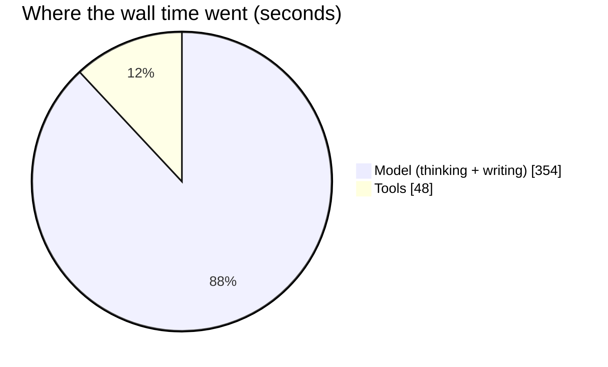

# corporate-ma/draft-markup-of-transition-services-agreement-tsa · run1 (`hv-mixed200-lunahigh-r1-20261116T093818Z`)

Result: **all-pass** 56/56 criteria · 6.7 min · 41 model calls · 52 tool calls (3 errors or timeouts) · ending `completed` · started 11-16 16:27:42 IST

## Overview

One box per stretch of steps that used the same kind of tool (blue: looking/searching/reading, purple: writing or editing files, yellow: a message with no tool call, red border: a tool error or timeout inside the box).

```mermaid
flowchart TD
    T(["Task prompt"])
    P0["<b>Step 1</b> · 0.1 min<br/>create_goal"]
    T --> P0
    class P0 look
    P1["<b>Step 2</b> · 0.0 min<br/>todo_write"]
    P0 --> P1
    class P1 look
    P2["<b>Step 3</b> · 0.0 min<br/>glob<br/><i>**/*</i>"]
    P1 --> P2
    class P2 look
    P3["<b>Step 4</b> · 0.2 min<br/>bash x3<br/>read<br/><i>parse-doc docx documents/trident-draf…, parse-doc docx documents/polaris-tsa-…, parse-doc docx documents/apa-excerpts… +1</i>"]
    P2 --> P3
    class P3 look
    P4["<b>Step 5</b> · 0.2 min<br/>bash x3<br/><i>parse-doc docx documents/trident-draf…, parse-doc docx documents/polaris-tsa-…, parse-doc docx documents/apa-excerpts…</i>"]
    P3 --> P4
    class P4 look
    P5["<b>Step 6</b> · 0.1 min<br/>grep x3<br/><i>draft.txt, playbook.txt, apa.txt</i>"]
    P4 --> P5
    class P5 look
    P6["<b>Steps 7-8</b> · 0.3 min<br/>bash x3<br/><i>python - #lt;#lt;'PY' from docx import Docu…</i>"]
    P5 --> P6
    class P6 look
    P7["<b>Steps 9-13</b> · 0.5 min<br/>read x5<br/><i>draft.txt, playbook.txt</i>"]
    P6 --> P7
    class P7 look
    P8["<b>Steps 14-16</b> · 2.8 min<br/>bash x3<br/><i>python - #lt;#lt;'PY' from docx import Docu…, cat #gt; build_deliverables.py #lt;#lt;'PY' fr…</i>"]
    P7 --> P8
    class P8 look
    P9["<b>Step 17</b> · 0.1 min<br/>grep<br/><i>build_deliverables.py</i>"]
    P8 --> P9
    class P9 look
    P10["<b>Steps 18-22</b> · 0.5 min<br/>edit x6<br/>read x2<br/><i>build_deliverables.py</i>"]
    P9 --> P10
    class P10 err
    P11["<b>Steps 23-24</b> · 0.2 min<br/>bash x2<br/><i>python - #lt;#lt;'PY' p='build_deliverables…, python - #lt;#lt;'PY' from docx import Docu…</i>"]
    P10 --> P11
    class P11 look
    P12["<b>Steps 25-26</b> · 0.2 min<br/>read<br/>edit<br/><i>build_deliverables.py</i>"]
    P11 --> P12
    class P12 write
    P13["<b>Step 27</b> · 0.1 min<br/>bash<br/><i>python build_deliverables.py</i>"]
    P12 --> P13
    class P13 look
    P14["<b>Step 28</b> · 0.1 min<br/>edit<br/><i>build_deliverables.py</i>"]
    P13 --> P14
    class P14 write
    P15["<b>Steps 29-32</b> · 0.6 min<br/>bash x5<br/><i>python build_deliverables.py, ls -lh output/tsa-markup-redline.docx…, parse-doc docx output/tsa-markup-redl… +1</i>"]
    P14 --> P15
    class P15 look
    P16["<b>Step 33</b> · 0.1 min<br/>grep<br/><i>redline_check.txt</i>"]
    P15 --> P16
    class P16 look
    P17["<b>Steps 34-35</b> · 0.2 min<br/>bash x2<br/><i>mkdir -p /tmp/tsa_pdf_check && libreo…, pdfinfo /tmp/tsa_pdf_check/tsa-markup…</i>"]
    P16 --> P17
    class P17 look
    P18["<b>Step 36</b> · 0.1 min<br/>read<br/><i>memo_check.txt</i>"]
    P17 --> P18
    class P18 look
    P19["<b>Step 37</b> · 0.1 min<br/>glob<br/><i>output/*</i>"]
    P18 --> P19
    class P19 look
    P20["<b>Step 38</b> · 0.0 min<br/>todo_write"]
    P19 --> P20
    class P20 look
    P21["<b>Step 39</b> · 0.1 min<br/>get_goal"]
    P20 --> P21
    class P21 look
    P22["<b>Step 40</b> · 0.0 min<br/>update_goal"]
    P21 --> P22
    class P22 look
    P23["<b>Step 41</b> · 0.1 min<br/>final message"]
    P22 --> P23
    class P23 ans
    R(["ALL PASS: 56/56 criteria"])
    P23 --> R
    class R pass
    classDef look fill:#e8f0fe,stroke:#4a6fa5,color:#111
    classDef write fill:#f3e8fd,stroke:#7b1fa2,color:#111
    classDef ans fill:#fff8e1,stroke:#b58900,color:#111
    classDef err fill:#e8f0fe,stroke:#c62828,stroke-width:3px,color:#111
    classDef pass fill:#e6f4ea,stroke:#2e7d32,color:#111
    classDef fail fill:#fce8e6,stroke:#c62828,color:#111
```





One row per model call:

| Step | Started (IST) | Model s | Tools s | Tool calls | Tools | Output chars |
|---|---|---|---|---|---|---|
| 1 | 16:27:42 | 3 | 0 | 1 | create_goal | 403 |
| 2 | 16:27:45 | 2 | 0 | 1 | todo_write | 57 |
| 3 | 16:27:47 | 1 | 1 | 1 | glob | 132 |
| 4 | 16:27:49 | 2 | 7 | 4 | bash x3, read | 161,896 |
| 5 | 16:27:58 | 6 | 7 | 3 | bash x3 | 1,122 |
| 6 | 16:28:11 | 4 | 2 | 3 | grep x3 | 42,421 |
| 7 | 16:28:16 | 8 | 2 | 2 | bash x2 | 2,456 |
| 8 | 16:28:27 | 5 | 1 | 1 | bash | 21,690 |
| 9 | 16:28:34 | 3 | 0 | 1 | read | 13,674 |
| 10 | 16:28:36 | 8 | 0 | 1 | read | 15,054 |
| 11 | 16:28:45 | 2 | 0 | 1 | read | 52,989 |
| 12 | 16:28:47 | 4 | 0 | 1 | read | 32,665 |
| 13 | 16:28:50 | 14 | 0 | 1 | read | 14,251 |
| 14 | 16:29:04 | 13 | 1 | 1 | bash | 12,094 |
| 15 | 16:29:18 | 6 | 1 | 1 | bash | 7,338 |
| 16 | 16:29:26 | 146 | 1 | 1 | bash | 806 |
| 17 | 16:31:53 | 5 | 4 | 1 | grep | 11,265 |
| 18 | 16:32:02 | 12 | 0 | 1 | edit ⚠ | 256 |
| 19 | 16:32:14 | 3 | 0 | 1 | read | 26,039 |
| 20 | 16:32:17 | 8 | 0 | 4 | edit x4 ⚠ | 881 |
| 21 | 16:32:25 | 3 | 0 | 1 | read | 10,732 |
| 22 | 16:32:28 | 4 | 0 | 1 | edit ⚠ | 218 |
| 23 | 16:32:32 | 7 | 2 | 1 | bash | 656 |
| 24 | 16:32:41 | 5 | 1 | 1 | bash | 3,008 |
| 25 | 16:32:47 | 4 | 0 | 1 | read | 4,057 |
| 26 | 16:32:52 | 5 | 0 | 1 | edit | 221 |
| 27 | 16:32:56 | 3 | 2 | 1 | bash | 631 |
| 28 | 16:33:00 | 5 | 0 | 1 | edit | 221 |
| 29 | 16:33:05 | 4 | 2 | 1 | bash | 59 |
| 30 | 16:33:10 | 4 | 5 | 2 | bash x2 | 6,952 |
| 31 | 16:33:20 | 14 | 1 | 1 | bash | 59 |
| 32 | 16:33:35 | 4 | 4 | 1 | bash | 1,247 |
| 33 | 16:33:43 | 4 | 0 | 1 | grep | 6,330 |
| 34 | 16:33:48 | 4 | 4 | 1 | bash | 841 |
| 35 | 16:33:57 | 5 | 1 | 1 | bash | 165 |
| 36 | 16:34:03 | 3 | 0 | 1 | read | 20,697 |
| 37 | 16:34:06 | 6 | 1 | 1 | glob | 58 |
| 38 | 16:34:13 | 2 | 0 | 1 | todo_write | 57 |
| 39 | 16:34:15 | 3 | 0 | 1 | get_goal | 403 |
| 40 | 16:34:19 | 2 | 0 | 1 | update_goal | 408 |
| 41 | 16:34:21 | 4 | 0 | 0 | (message only) | 0 |

## Task prompt

```text
Review the attached draft TSA from the seller's perspective using our playbook, APA excerpts, and client instructions; produce a redline with annotated comments and a priority-tiered cover memo. Output: `tsa-markup-redline.docx` and `tsa-review-memo.docx`.
```

## Rubric

| # | Criterion | Verdict |
|---|---|---|
| C-001 | ISSUE_001a: Identifies 24-month lookback deviation in service standard | pass |
| C-002 | ISSUE_001b: Identifies 'or better than' qualifier in service standard | pass |
| C-003 | ISSUE_001c: Identifies undefined 'industry best practices' benchmark | pass |
| C-004 | ISSUE_001d: Proposes redline conforming service standard to playbook | pass |
| C-005 | ISSUE_002a: Identifies liability cap as 200% of total fees vs. APA's trailing 12-month cap | pass |
| C-006 | ISSUE_002b: Quantifies liability cap exposure difference | pass |
| C-007 | ISSUE_002c: Redlines liability cap to conform to APA Section 7.12(d) | pass |
| C-008 | ISSUE_003a: Identifies non-mutual consequential damages waiver | pass |
| C-009 | ISSUE_003b: Redlines to make consequential damages waiver mutual | pass |
| C-010 | ISSUE_004a: Identifies automatic renewal extending TSA beyond 18 months | pass |
| C-011 | ISSUE_004b: Redlines to delete auto-renewal and impose hard 18-month stop | pass |
| C-012 | ISSUE_005a: Identifies 120-day termination notice exceeding APA's 90 days | pass |
| C-013 | ISSUE_005b: Redlines termination notice to 90 days per APA | pass |
| C-014 | ISSUE_006a: Identifies Key Personnel consent right overriding Polaris staffing discretion | pass |
| C-015 | ISSUE_006b: Proposes compromise on Key Personnel (notice + qualified replacement) | pass |
| C-016 | ISSUE_007a: Identifies IT services 15% markup exceeding APA 10% cap | pass |
| C-017 | ISSUE_007b: Correctly computes IT fee difference | pass |
| C-018 | ISSUE_007c: Notes APA compliance risk even though overcharge benefits Polaris | pass |
| C-019 | ISSUE_008a: Identifies audit frequency deviation (twice/year vs. once/12 months) | pass |
| C-020 | ISSUE_008b: Identifies audit cost allocation deviation (Seller's vs. Buyer's expense) | pass |
| C-021 | ISSUE_008c: Identifies audit notice period deviation (10 vs. 30 business days) | pass |
| C-022 | ISSUE_009a: Identifies Ohio governing law vs. playbook's Pennsylvania law | pass |
| C-023 | ISSUE_009b: Identifies Cuyahoga County litigation vs. playbook's AAA arbitration in Pittsburgh | pass |
| C-024 | ISSUE_009c: Explains strategic importance of home-state law and arbitration for Polaris | pass |
| C-025 | ISSUE_010a: Identifies overbroad perpetual IP license grant | pass |
| C-026 | ISSUE_010b: Redlines to delete IP license and confirm Polaris sole ownership | pass |
| C-027 | ISSUE_011a: Identifies missing non-solicitation provision | pass |
| C-028 | ISSUE_011b: Drafts non-solicitation provision with 12-month post-service tail | pass |
| C-029 | ISSUE_012a: Identifies CGL insurance reduction ($2M vs. $5M playbook) | pass |
| C-030 | ISSUE_012b: Identifies missing umbrella coverage requirement | pass |
| C-031 | ISSUE_012c: Identifies missing additional insured endorsement | pass |
| C-032 | ISSUE_013a: Flags missing IMMEX program provisions for Monterrey facility | pass |
| C-033 | ISSUE_013b: Flags missing Mexican data privacy (LFPDPPP) provisions | pass |
| C-034 | ISSUE_014a: Identifies missing termination assistance/wind-down provisions | pass |
| C-035 | ISSUE_014b: Proposes termination assistance at cost-plus-15% for up to 60 days | pass |
| C-036 | ISSUE_015a: Identifies missing change order procedure | pass |
| C-037 | ISSUE_015b: Proposes change order procedure with cost-plus-15% pricing | pass |
| C-038 | ISSUE_016a: Identifies vague payment terms ('commercially reasonable time') | pass |
| C-039 | ISSUE_016b: Redlines payment terms to Net 30 days | pass |
| C-040 | ISSUE_016c: Adds late payment interest at 1.5%/month or max legal rate | pass |
| C-041 | ISSUE_017a: Identifies missing force majeure 90-day termination trigger | pass |
| C-042 | ISSUE_017b: Proposes 90-day force majeure termination right | pass |
| C-043 | Cover memo produced as a deliverable | pass |
| C-044 | Cover memo organizes issues by priority tiers (Critical/Significant/Minor) | pass |
| C-045 | APA-conflict issues classified as highest priority in cover memo | pass |
| C-046 | Cover memo includes negotiation strategy distinguishing firm vs. flexible positions | pass |
| C-047 | Redline markup includes proposed edits to the TSA | pass |
| C-048 | Redline markup includes explanatory comments for changes | pass |
| C-049 | Correctly identifies Polaris as Service Provider / Seller throughout | pass |
| C-050 | References APA Section 7.12 when flagging APA-conflict issues | pass |
| C-051 | Fee escalation provision addressed (playbook: greater of 3% or CPI-U) | pass |
| C-052 | Indemnification provision addressed (Buyer indemnifies for third-party claims) | pass |
| C-053 | Both deliverable files are produced | pass |
| C-054 | Correct total monthly service cost baseline ($1,020,000) referenced | pass |
| C-055 | Playbook's dispute escalation to senior executives referenced | pass |
| C-056 | Redline comments explain specific risk to Polaris for at least five changes | pass |

Judge's reasoning:

**C-001 (pass):** ISSUE_001a: Identifies 24-month lookback deviation in service standard

```text
The output expressly identifies the draft's 24-month service-standard lookback as a deviation and replaces it with a 12-month lookback. Both the redline comment C-01 and review memo C1 cite the APA/playbook basis and propose the required change.
```

**C-002 (pass):** ISSUE_001b: Identifies 'or better than' qualifier in service standard

```text
The agent expressly flags the draft’s “equal to or better than” language as creating a ratcheting standard, deletes it, and replaces it with a “substantially consistent” historical-performance standard. The review memo likewise identifies “equal to or better than” as a deviation requiring removal.
```

**C-003 (pass):** ISSUE_001c: Identifies undefined 'industry best practices' benchmark

```text
The agent expressly flags the “industry best practices” overlay in Section 3.1 as an expansive standard exceeding the APA benchmark and deletes it, replacing it with a 12-month historical “substantially consistent” standard. The memo likewise identifies the language as a deviation and recommends no external benchmark.
```

**C-004 (pass):** ISSUE_001d: Proposes redline conforming service standard to playbook

```text
Section 3.1 includes corrective replacement language requiring each Service to be provided “in a manner substantially consistent with the manner and quality at which such Service was provided to or on behalf of the Business during the twelve (12) months immediately preceding the Closing Date,” which conforms to the specified playbook standard.
```

**C-005 (pass):** ISSUE_002a: Identifies liability cap as 200% of total fees vs. APA's trailing 12-month cap

```text
The output expressly identifies that draft Section 10.1 caps liability at 200% of total Service Charges paid, contrasts it with APA Section 7.12(d)'s rolling cap based on fees actually paid during the 12 months preceding the claim, and quantifies the resulting exposure difference.
```

**C-006 (pass):** ISSUE_002b: Quantifies liability cap exposure difference

```text
The output expressly quantifies the cap exposure: approximately $41.004 million under the draft versus $13.464 million under the APA trailing-12-month cap, yielding an approximately $27.540 million gap (about 3.05x). These calculations are shown in both the markup and review memorandum and are in the required ballpark.
```

**C-007 (pass):** ISSUE_002c: Redlines liability cap to conform to APA Section 7.12(d)

```text
Section 10.1 proposes corrective redline language capping aggregate liability at total TSA fees actually paid during the 12 months immediately preceding the date the applicable claim is first asserted, expressly aligning the cap with APA Section 7.12(d).
```

**C-008 (pass):** ISSUE_003a: Identifies non-mutual consequential damages waiver

```text
The agent expressly identifies that Section 10.2 is one-way: Polaris waives consequential-damages claims against Trident, while Trident does not reciprocally waive such claims against Polaris, leaving Polaris exposed. It also proposes a mutual waiver.
```

**C-009 (pass):** ISSUE_003b: Redlines to make consequential damages waiver mutual

```text
Section 10.2 replaces the one-way waiver with an express mutual waiver stating that each party waives claims against the other for consequential, incidental, special, punitive, exemplary, or indirect damages, consistent with the criterion.
```

**C-010 (pass):** ISSUE_004a: Identifies automatic renewal extending TSA beyond 18 months

```text
The output flags Section 5.2’s two automatic six-month renewals after the 18-month initial term as extending the TSA beyond the APA’s 18-month hard stop, and deletes automatic renewal. Although it does not expressly state “30 months,” the maximum extension is clearly identified from the quoted terms.
```

**C-011 (pass):** ISSUE_004b: Redlines to delete auto-renewal and impose hard 18-month stop

```text
The markup deletes the automatic-renewal mechanism, provides that the Agreement expires after the 18-month Initial Term, and requires any individual-Service extension to be documented in a mutually signed written amendment. It also caps extensions at six months and applies cost-plus-15% pricing.
```

**C-012 (pass):** ISSUE_005a: Identifies 120-day termination notice exceeding APA's 90 days

```text
The agent expressly flags Section 5.3's 120-day notice requirement as conflicting with APA Section 7.12(c), states that the APA requires 90 days, and revises the provision accordingly.
```

**C-013 (pass):** ISSUE_005b: Redlines termination notice to 90 days per APA

```text
Section 5.3 redlines the individual-service termination notice period from 120 days to 90 days and expressly identifies APA Section 7.12(c) as the basis for the correction.
```

**C-014 (pass):** ISSUE_006a: Identifies Key Personnel consent right overriding Polaris staffing discretion

```text
The agent expressly flags the Key Personnel consent right in Section 4.3 and Schedule H as problematic because it gives Trident approval over reassignment and replacement of named employees, conflicting with Polaris’s sole staffing discretion under the playbook. It deletes the consent requirement, preserves Polaris’s discretion, and reiterates the issue in the review memo.
```

**C-015 (pass):** ISSUE_006b: Proposes compromise on Key Personnel (notice + qualified replacement)

```text
Section 4.3 restores Polaris’s sole discretion over staffing and removes Trident’s consent right, while offering the required compromise: where practicable, Polaris must provide 15 Business Days’ advance notice of planned reassignments or replacements and use commercially reasonable efforts to provide a reasonably qualified replacement.
```

**C-016 (pass):** ISSUE_007a: Identifies IT services 15% markup exceeding APA 10% cap

```text
The agent expressly flags the IT Services markup as 15% ($391,000/month) instead of the APA-compliant 10% ($374,000/month), cites APA Section 7.12(b), and corrects the fee schedule accordingly.
```

**C-017 (pass):** ISSUE_007b: Correctly computes IT fee difference

```text
The output correctly calculates the IT fee difference as $17,000 per month ($391,000 minus $374,000) and $306,000 over 18 months.
```

**C-018 (pass):** ISSUE_007c: Notes APA compliance risk even though overcharge benefits Polaris

```text
The agent expressly acknowledges that the erroneous 15% IT markup benefits Polaris but still must be corrected for APA compliance and credibility. Comment C-31 states Polaris should not retain the favorable miscalculation because APA compliance and credibility are more important, and the memo likewise identifies it as a seller-benefiting error requiring correction to the APA-compliant 10% markup.
```

**C-019 (pass):** ISSUE_008a: Identifies audit frequency deviation (twice/year vs. once/12 months)

```text
The agent expressly flags that draft Section 14.1 permits audits twice per calendar year, cites the playbook's once-per-12-month limit, and redlines the provision to allow no more than one audit in any 12-month period.
```

**C-020 (pass):** ISSUE_008b: Identifies audit cost allocation deviation (Seller's vs. Buyer's expense)

```text
The agent expressly flags that draft Section 14.1 places audits at Polaris’s expense, cites the playbook deviation, and redlines the provision so audits are conducted at Service Recipient’s (Buyer’s) sole expense. The review memo likewise identifies “seller pays” as a problem and proposes “buyer expense.”
```

**C-021 (pass):** ISSUE_008c: Identifies audit notice period deviation (10 vs. 30 business days)

```text
The agent expressly flags that draft Section 14.1 permits audits on 10 Business Days' notice, cites Playbook §9.1, and redlines the notice period to at least 30 Business Days. The review memo also repeats the 10-day deviation and proposed 30-day requirement.
```

**C-022 (pass):** ISSUE_009a: Identifies Ohio governing law vs. playbook's Pennsylvania law

```text
The agent expressly flags draft Section 15.1 as using Ohio law, cites the Polaris Playbook, and proposes replacing it with Pennsylvania law. The review memo likewise identifies Ohio law as the problem and Pennsylvania law as the seller position.
```

**C-023 (pass):** ISSUE_009b: Identifies Cuyahoga County litigation vs. playbook's AAA arbitration in Pittsburgh

```text
The agent expressly flags §15.2's Cuyahoga County, Ohio litigation provision as a playbook deviation and replaces it with executive escalation, optional mediation, and confidential binding arbitration administered by the AAA under its Commercial Arbitration Rules in Pittsburgh, Pennsylvania. The review memo repeats this issue and proposed change.
```

**C-024 (pass):** ISSUE_009c: Explains strategic importance of home-state law and arbitration for Polaris

```text
The output explains the strategic rationale: it notes that Ohio law and Cuyahoga County litigation give Trident a home-state advantage, while Pennsylvania aligns with Polaris’s headquarters, personnel, and counsel. It also identifies arbitration benefits, including confidentiality, avoiding public dockets and broad discovery, and using Pittsburgh as Polaris’s home forum.
```

**C-025 (pass):** ISSUE_010a: Identifies overbroad perpetual IP license grant

```text
The agent expressly flags Section 7.1’s perpetual, irrevocable, worldwide, royalty-free, sublicensable license covering Polaris tools, methodologies, templates, software, processes, and know-how as a critical, board-level departure from the playbook. It identifies the risk of proprietary operational IP leakage and competitive harm, and replaces the grant with a strict no-license reservation requiring any post-TSA use to be separately negotiated.
```

**C-026 (pass):** ISSUE_010b: Redlines to delete IP license and confirm Polaris sole ownership

```text
Section 7.1 deletes the perpetual, irrevocable, royalty-free license in full and replaces it with language confirming Polaris and its affiliates retain all right, title, and interest in Service Provider Materials. It expressly grants no license or other IP interest, while permitting only limited access and use necessary to receive services during the applicable TSA service period, ending upon expiration or termination.
```

**C-027 (pass):** ISSUE_011a: Identifies missing non-solicitation provision

```text
The agent expressly flags that the draft lacks protection against Trident hiring TSA personnel, identifies the non-solicitation provision as absent, and adds Section 15.12 restricting Trident from soliciting, recruiting, hiring, or engaging Polaris personnel who provided services.
```

**C-028 (pass):** ISSUE_011b: Drafts non-solicitation provision with 12-month post-service tail

```text
Section 15.12 restricts Trident from soliciting, recruiting, hiring, or engaging Polaris service personnel during the Term and for 12 months thereafter without Polaris’s prior written consent. This satisfies the required consent protection and 12-month post-service tail.
```

**C-029 (pass):** ISSUE_012a: Identifies CGL insurance reduction ($2M vs. $5M playbook)

```text
The agent expressly flags that the draft requires only $2 million in Buyer CGL coverage, cites the playbook, and proposes increasing the requirement to $5 million per occurrence and aggregate.
```

**C-030 (pass):** ISSUE_012b: Identifies missing umbrella coverage requirement

```text
The agent expressly flags that the draft omits umbrella coverage and proposes adding at least $5 million of umbrella or excess liability insurance in revised Section 13.1. The review memo also identifies the omission and recommends “$5M CGL + $5M umbrella.”
```

**C-031 (pass):** ISSUE_012c: Identifies missing additional insured endorsement

```text
The agent expressly flags that the draft omits additional-insured protection and revises Section 13.1 to require Polaris and its Affiliates to be named as additional insureds under the Buyer's CGL and umbrella/excess policies, with delivery of applicable endorsements.
```

**C-032 (pass):** ISSUE_013a: Flags missing IMMEX program provisions for Monterrey facility

```text
The agent expressly flags the missing IMMEX provisions for the Monterrey facility and adds Schedule E, Section 6A allocating post-Closing responsibility to Trident for obtaining, maintaining, renewing, and complying with its IMMEX certification, while defining Polaris's transition assistance, notice duties, costs, and limitations. The review memo also identifies the omission as a critical issue.
```

**C-033 (pass):** ISSUE_013b: Flags missing Mexican data privacy (LFPDPPP) provisions

```text
The agent expressly flags that the draft covers only U.S. privacy law despite processing Mexican employees’ HR and payroll data, identifies the LFPDPPP by name, and adds substantive provisions addressing controller/processor roles, privacy notices, required consents and cross-border transfer authorizations, safeguards, incident notification, data-subject requests, return/deletion, and a supplemental data-processing addendum. The review memo also identifies this as a critical issue requiring Mexico/LatAm counsel confirmation.
```

**C-034 (pass):** ISSUE_014a: Identifies missing termination assistance/wind-down provisions

```text
The agent expressly flags that the draft is silent on termination assistance/wind-down support and adds Section 5.5(e) providing up to 60 days of defined, compensated termination assistance. The review memo likewise identifies the absence and cites the Polaris Playbook §3.4.
```

**C-035 (pass):** ISSUE_014b: Proposes termination assistance at cost-plus-15% for up to 60 days

```text
The agent inserted Section 5.5(e), requiring reasonable termination assistance for a period not exceeding 60 days and pricing it at Service Provider's Fully-Loaded Cost plus 15%. This satisfies both required elements.
```

**C-036 (pass):** ISSUE_015a: Identifies missing change order procedure

```text
The agent expressly flags the absence of a change-order mechanism in both the markup and review memo, noting that there is no formal process for additional services, material volume increases, or scope changes. It also adds a written, signed change-order procedure in Section 6.7, consistent with the playbook requirement.
```

**C-037 (pass):** ISSUE_015b: Proposes change order procedure with cost-plus-15% pricing

```text
Proposed Section 6.7 requires a written change order signed by authorized representatives of both parties for additional services, material volume increases, or material scope changes, and specifies cost-plus-15% pricing unless otherwise agreed in writing.
```

**C-038 (pass):** ISSUE_016a: Identifies vague payment terms ('commercially reasonable time')

```text
The agent expressly flags “commercially reasonable time” in Section 6.3 as vague and replaces it with a defined payment period of 30 days after the invoice date. The review memo also identifies the issue and recommends Net 30, with Net 45 as a fallback.
```

**C-039 (pass):** ISSUE_016b: Redlines payment terms to Net 30 days

```text
Section 6.3 replaces the vague “commercially reasonable time” standard with payment of each undisputed invoice within thirty (30) days after the invoice date, expressly implementing Net 30 terms.
```

**C-040 (pass):** ISSUE_016c: Adds late payment interest at 1.5%/month or max legal rate

```text
Section 6.3 adds that late amounts accrue interest at the lesser of 1.5% per month or the maximum rate permitted by applicable law, exactly satisfying the criterion.
```

**C-041 (pass):** ISSUE_017a: Identifies missing force majeure 90-day termination trigger

```text
The agent expressly flags that the draft force majeure clause lacks a termination trigger and adds a provision allowing either party to terminate the affected service without penalty after a force majeure event continues for 90 consecutive days. The review memo also identifies this gap and cites the playbook.
```

**C-042 (pass):** ISSUE_017b: Proposes 90-day force majeure termination right

```text
Section 12.1 proposes that if a Force Majeure Event continues for 90 consecutive days and materially prevents performance, either party may terminate the affected service by written notice without penalty.
```

**C-043 (pass):** Cover memo produced as a deliverable

```text
The agent produced a seller-side TSA review memorandum that summarizes the key issues, priorities, quantified exposure, negotiation strategy, and related markup deliverable. This satisfies the requirement to produce a cover memorandum summarizing the TSA review.
```

**C-044 (pass):** Cover memo organizes issues by priority tiers (Critical/Significant/Minor)

```text
The cover memo clearly organizes issues into three expressly labeled priority tiers: Tier 1 — Critical, Tier 2 — Significant, and Tier 3 — Minor / cleanup.
```

**C-045 (pass):** APA-conflict issues classified as highest priority in cover memo

```text
The cover memo places all specified direct APA conflicts in Priority Tier 1—Critical: automatic renewal (C2), 120-day termination notice (C3), IT markup above 10% (C4), and the 200% liability cap (C5). It separately places pure playbook deviations in Priority Tier 2—Significant, clearly distinguishing their priority.
```

**C-046 (pass):** Cover memo includes negotiation strategy distinguishing firm vs. flexible positions

```text
The memo clearly distinguishes firm and flexible positions for well over three key issues and explains the basis. For example, the APA-mandated service standard, renewal, liability cap, indemnity, cross-border, and precedence provisions are labeled “Must change” or “Non-negotiable,” while significant playbook items include express fallbacks such as 90 days/cost-plus-10% for termination assistance, Net 45/1.0% for payment terms, and 120 days for force majeure. The negotiation sequence also directs the seller to preserve structural protections and trade only on identified timing, notice, or pricing details.
```

**C-047 (pass):** Redline markup includes proposed edits to the TSA

```text
The output provides a full marked-up TSA with numerous explicit deletions, additions, and substituted provisions throughout the agreement and schedules, rather than merely listing issues.
```

**C-048 (pass):** Redline markup includes explanatory comments for changes

```text
The redline includes numerous annotated comments (e.g., C-01 through C-31) explaining the basis, Polaris risk, and negotiation position for proposed changes, with references to APA provisions, the TSA Playbook, and client instructions. This satisfies the requirement for explanatory comments accompanying the edits.
```

**C-049 (pass):** Correctly identifies Polaris as Service Provider / Seller throughout

```text
The output consistently identifies Polaris Industrial Holdings, Inc. as the Seller and Service Provider and Trident as the Buyer and Service Recipient. The markup, comments, and review memorandum are framed throughout from Polaris’s perspective, emphasizing service-provider protections such as limiting liability, preserving IP and staffing discretion, controlling scope and renewals, and ensuring payment and audit protections.
```

**C-050 (pass):** References APA Section 7.12 when flagging APA-conflict issues

```text
The agent repeatedly cites APA Section 7.12 and relevant subsections when flagging APA conflicts, including §7.12(a) for term/renewal, §7.12(c) for the termination notice period, §7.12(b) for fee methodology and markup, and §7.12(d) for the liability cap and consequential-damages provisions.
```

**C-051 (pass):** Fee escalation provision addressed (playbook: greater of 3% or CPI-U)

```text
The agent expressly addresses fee escalation in Section 6.4, proposing annual adjustment by the greater of 3% or the CPI-U increase, and cites Playbook §4.2. The review memo also identifies this mechanism as the seller position.
```

**C-052 (pass):** Indemnification provision addressed (Buyer indemnifies for third-party claims)

```text
The output expressly addresses indemnification in Sections 9.1–9.3 and the review memo. It revises Buyer’s indemnity to cover third-party claims arising from Buyer’s use of or reliance on the Services, subject to an exception for claims resulting from Seller’s gross negligence, fraud, or willful misconduct, consistent with the criterion.
```

**C-053 (pass):** Both deliverable files are produced

```text
The output includes two clearly distinct deliverables: (1) a marked-up/redlined TSA identified as “tsa-markup-redline.docx” and (2) a separate partner cover memorandum identified as “tsa-review-memo.docx.”
```

**C-054 (pass):** Correct total monthly service cost baseline ($1,020,000) referenced

```text
The output correctly references the $1,020,000 total monthly base cost in Schedule G and repeatedly identifies the corrected total monthly fee at a uniform 10% markup as $1,122,000, including in the review memo's fee calculations.
```

**C-055 (pass):** Playbook's dispute escalation to senior executives referenced

```text
Section 15.2 expressly requires disputes to be escalated first to the parties’ CFO- or General Counsel-level representatives for a 15-business-day resolution period before mediation or binding arbitration. The review memo also references executive escalation before AAA arbitration.
```

**C-056 (pass):** Redline comments explain specific risk to Polaris for at least five changes

```text
The redline includes well over five comments identifying concrete adverse consequences to Polaris. Examples include over-resourcing and prioritization burdens from the service standard (C-01), loss of staffing flexibility and employment-law complications (C-02), open-ended service obligations from automatic renewal (C-03), IP leakage and competitive harm from the perpetual license (C-11), Mexico privacy enforcement and employee-claim exposure (C-13/C-14), materially increased and quantified liability exposure under the 200% cap (C-17), and operational/customs penalties from omitted IMMEX allocation (C-29). These comments go beyond mechanical APA or playbook references and expressly explain Polaris-specific risks.
```

## Delivered files (output/)

- `tsa-markup-redline.docx` (88,035 bytes)
- `tsa-review-memo.docx` (43,578 bytes)

## Trajectory

### Step 1: 1 tool call

_Started 11-16 16:27:42 IST · model 3 s · tools 0 s_

**Reasoning summary:**

```text
**Setting up document tasks**

I need to manipulate some documents and inspect files. It looks like I should load skills, especially if the task involves editing or legal documents. I can’t find the skill catalog right now. I might need to create a specific goal for this long-running objective. Also, I shouldn't read from task.json. So, I’ll get started on creating that goal and globbing the files for review.
```

**Call `create_goal`** (0.0 s)

```json
{
 "objective": "Review the draft TSA and supporting seller playbook, APA excerpts, and client instructions; produce a seller-side redline with annotated comments and a priority-tiered cover memo as tsa-markup-redline.docx and tsa-review-memo.docx in output.",
 "max_goal_rounds": 10
}
```

Output (403 chars):

```text
{"goal":{"id":"goal-ed5d9ee8-0a4e-44ca-9a16-5d44778cae57","revision":1,"objective":"Review the draft TSA and supporting seller playbook, APA excerpts, and client instructions; produce a seller-side redline with annotated comments and a priority-tiered cover memo as tsa-markup-redline.docx and tsa-review-memo.docx in output.","phase":"active","roundsStarted":0,"maxGoalRounds":10},"activation":"armed"}
```

### Step 2: 1 tool call

_Started 11-16 16:27:45 IST · model 2 s · tools 0 s_

**Call `todo_write`** (0.0 s)

```json
{
 "todos": [
  {
   "content": "Inventory and inspect the draft TSA and supporting materials",
   "status": "in_progress"
  },
  {
   "content": "Analyze seller positions and identify required redlines and comments",
   "status": "pending"
  },
  {
   "content": "Create the annotated seller-side redline DOCX",
   "status": "pending"
  },
  {
   "content": "Create the priority-tiered cover memo DOCX",
   "status": "pending"
  },
  {
   "content": "Validate both deliverables and finalize",
   "status": "pending"
  }
 ]
}
```

Output (57 chars):

```text
Updated todo list: 4 pending, 1 in progress, 0 completed.
```

**Todo list now:**

- [~] Inventory and inspect the draft TSA and supporting materials
- [ ] Analyze seller positions and identify required redlines and comments
- [ ] Create the annotated seller-side redline DOCX
- [ ] Create the priority-tiered cover memo DOCX
- [ ] Validate both deliverables and finalize

### Step 3: 1 tool call

_Started 11-16 16:27:47 IST · model 1 s · tools 1 s_

**Call `glob`** (0.6 s)

```json
{
 "pattern": "**/*"
}
```

Output (132 chars):

```text
documents/andersen-instructions.eml
documents/trident-draft-tsa.docx
documents/polaris-tsa-playbook.docx
documents/apa-excerpts.docx
```

### Step 4: 4 tool calls

_Started 11-16 16:27:49 IST · model 2 s · tools 7 s_

**Reasoning summary:**

```text
**Inspecting with parsing tools**

I need to inspect something, and I’m thinking about using document parsing tools. Maybe I should call them concurrently instead of just doing everything sequentially. I wonder if using bash calls would be the most efficient way to handle this? It seems like a good approach, but I need to ensure that I have everything set up right. I’ll investigate further to determine if this plan will work effectively.
```

**Call `bash`** (2.3 s)

```json
{
 "command": "parse-doc docx documents/trident-draft-tsa.docx",
 "description": "Extract draft TSA text"
}
```

Output (49,993 chars):

```text
ing to:

> \(a\) any gross negligence or willful misconduct of Service Provider, its Affiliates, or their respective employees, agents, or contractors in performing the Services;
>
> \(b\) any breach by Service Provider of any representation, warranty, covenant, or obligation under this Agreement; or
>
> \(c\) any violation of Applicable Law by Service Provider, its Affiliates, or their respective employees, agents, or contractors in performing the Services.

**Section 9.3** *Indemnification Procedures.* The following procedures shall apply to any claim for indemnification under this Article 9:

> \(a\) **Notice.** The Party seeking indemnification (the \"**Indemnified Party**\") shall promptly notify the other Party (the \"**Indemnifying Party**\") in writing of any claim, demand, suit, action, or proceeding for which indemnification is sought (a \"**Claim**\"), specifying in reasonable detail the nature of the Claim and the amount of Losses incurred or expected to be incurred (to the extent then known). The failure by the Indemnified Party to give timely notice shall not relieve the Indemnifying Party of its indemnification obligations except to the extent that the Indemnifying Party is actually and materially prejudiced by such failure.
>
> \(b\) **Defense of Third-Party Claims.** Upon receipt of notice of a Claim involving a third-party claim, the Indemnifying Party shall have the right, but not the obligation, to assume the defense of such third-party claim, including th
… [48,493 more chars]
```

**Call `bash`** (2.4 s)

```json
{
 "command": "parse-doc docx documents/polaris-tsa-playbook.docx",
 "description": "Extract TSA playbook text"
}
```

Output (49,959 chars):

```text
such as *\"equal to or better than,\"* *\"at least equal to,\"* or *\"no less favorable than.\"* These formulations impose a floor that ratchets upward and does not permit any reduction or variation, however reasonable.
>
> • **Reject \"Best Practices\" and Similar Standards:** References to *\"industry best practices,\"* *\"commercially reasonable best efforts,\"* or other aspirational benchmarks must be rejected. These terms are undefined, subjective, invite disputes, and impose a standard that may materially exceed what Polaris historically provided to the divested business. Polaris is not a third-party service provider competing for business --- it is providing transitional support as an accommodation.
>
> • **Not a Guarantor:** Service Provider\'s obligation is limited to making available the same general type and level of resources as historically deployed. Service Provider does not guarantee specific outcomes, results, or service levels beyond what was historically provided.
>
> • **APA Precedence:** If the APA specifies a service standard (e.g., in the TSA covenant section or an exhibit), that APA standard controls and the TSA cannot impose a more stringent requirement.

**[2.2 Exclusions from Service Obligation]{.underline}**

Service Provider has no obligation to:

> • **(a)** Provide services not described in the applicable Service Schedules;
>
> • **(b)** Hire additional personnel or acquire additional resources beyond those in place as of the Closing Date;
>
> • 
… [48,459 more chars]
```

**Call `bash`** (2.0 s)

```json
{
 "command": "parse-doc docx documents/apa-excerpts.docx",
 "description": "Extract APA excerpts text"
}
```

Output (49,992 chars):

```text
**[EXCERPTS FROM EXECUTED ASSET PURCHASE AGREEMENT]{.underline}**

**ASSET PURCHASE AGREEMENT**

**dated as of March 14, 2025**

**by and between**

**POLARIS INDUSTRIAL HOLDINGS, INC.**

**and**

**TRIDENT MANUFACTURING GROUP, INC.**

This document contains selected excerpts from the Asset Purchase Agreement dated as of March 14, 2025, by and between Polaris Industrial Holdings, Inc. and Trident Manufacturing Group, Inc. The complete Asset Purchase Agreement is approximately 180 pages. Only the provisions relevant to the Transition Services Agreement are reproduced herein. Sections, exhibits, and schedules not reproduced are indicated by bracketed editorial notations. Defined terms used but not defined in these excerpts have the meanings given to them in the full Asset Purchase Agreement.

**APA Execution Date: March 14, 2025**

**[PREAMBLE AND RECITALS (EXCERPT)]{.underline}**

This ASSET PURCHASE AGREEMENT (this \"**Agreement**\") is entered into as of March 14, 2025, by and between:

**POLARIS INDUSTRIAL HOLDINGS, INC.**, a Delaware corporation, with its principal offices at 1200 Commonwealth Avenue, Suite 3000, Pittsburgh, PA 15222 (\"**Seller**\"),

and

**TRIDENT MANUFACTURING GROUP, INC.**, an Ohio corporation, with its principal offices at 800 Lakeside Drive, Suite 400, Cleveland, OH 44114 (\"**Buyer**\").

**RECITALS**

**WHEREAS:**

\(A\) Seller operates, among other businesses, the Specialty Coatings Division (as defined below), which is engaged in the development
… [48,492 more chars]
```

**Call `read`** (0.0 s)

```json
{
 "file_path": "documents/andersen-instructions.eml"
}
```

Output (11,952 chars):

```text
<path>/home/agarwaldi/dsh-bench-harness/runs/hv-mixed200-lunahigh-r1-20261116T093818Z/tasks/corporate-ma__draft-markup-of-transition-services-agreement-tsa/workspace/documents/andersen-instructions.eml</path>
<type>file</type>
<content>
1: From: Victoria S. Andersen (vandersen@whitfieldcrane.com)
2: To: Nathan J. Reeves (nreeves@whitfieldcrane.com)
3: Date: Tue, 29 Apr 2025 08:17:00 -0000
4: Subject: RE: Polaris / Trident — TSA Markup Assignment — Specialty Coatings
5:  Divestiture
6: Content-Type: text/plain; charset="utf-8"
7: Content-Transfer-Encoding: quoted-printable
8: MIME-Version: 1.0
9: 
10: Nathan,
11: 
12: Caldwell Briggs & Foley (Tom Graziano's team =E2=80=94 his associate Priya Ve=
13: nkatesh circulated) sent over Trident's first draft of the Transition Service=
14: s Agreement yesterday evening. I've done a quick initial skim but haven't had=
15:  time to go through it with a fine-tooth comb =E2=80=94 that's where you come=
16:  in.
17: 
18: For context, this is the TSA contemplated by Section 7.12 of the executed Ass=
19: et Purchase Agreement dated March 14, 2025, between Polaris Industrial Holdin=
20: gs, Inc. (as Seller and Service Provider) and Trident Manufacturing Group, In=
21: c. (as Buyer and Service Recipient) for the divestiture of the Specialty Coat=
22: ings Division. Expected closing is June 2, 2025, which means we need to turn =
23: around a comprehensive markup by end of next week at the latest. Sharon Petro=
24: sian wants to see our redline b
… [10,452 more chars]
```

### Step 5: 3 tool calls

_Started 11-16 16:27:58 IST · model 6 s · tools 7 s_

**Reasoning summary:**

```text
**Evaluating output processes**

I want to ensure I have enough information and a full draft, plus a playbook. I’m considering whether I can access the output path through read. The developer mentioned that plain text output is saved at a temporary location, and I’m wondering if I can read from there. I think it's best to use bash to redirect the output to my workspace. I’ll run parse-doc and save it under workspace for inspection. This approach should allow me to see the draft fully!
```

**Call `bash`** (3.1 s)

```json
{
 "command": "parse-doc docx documents/trident-draft-tsa.docx > draft.txt",
 "description": "Save draft TSA extraction"
}
```

Output (374 chars):

```text
[stderr]
2026-11-16 10:58:06.093451479 [W:onnxruntime:Default, device_discovery.cc:95 GetPciBusId] Skipping pci_bus_id for PCI path at "/sys/devices/LNXSYSTM:00/LNXSYBUS:00/ACPI0004:00/VMBUS:00/5620e0c7-8062-4dce-aeb7-520c7ef76171" because filename "5620e0c7-8062-4dce-aeb7-520c7ef76171" did not match expected pattern of [0-9a-f]+:[0-9a-f]+:[0-9a-f]+[.][0-9a-f]+
```

**Call `bash`** (1.9 s)

```json
{
 "command": "parse-doc docx documents/polaris-tsa-playbook.docx > playbook.txt",
 "description": "Save playbook extraction"
}
```

Output (374 chars):

```text
[stderr]
2026-11-16 10:58:08.324297371 [W:onnxruntime:Default, device_discovery.cc:95 GetPciBusId] Skipping pci_bus_id for PCI path at "/sys/devices/LNXSYSTM:00/LNXSYBUS:00/ACPI0004:00/VMBUS:00/5620e0c7-8062-4dce-aeb7-520c7ef76171" because filename "5620e0c7-8062-4dce-aeb7-520c7ef76171" did not match expected pattern of [0-9a-f]+:[0-9a-f]+:[0-9a-f]+[.][0-9a-f]+
```

**Call `bash`** (1.9 s)

```json
{
 "command": "parse-doc docx documents/apa-excerpts.docx > apa.txt",
 "description": "Save APA extraction"
}
```

Output (374 chars):

```text
[stderr]
2026-11-16 10:58:10.282155682 [W:onnxruntime:Default, device_discovery.cc:95 GetPciBusId] Skipping pci_bus_id for PCI path at "/sys/devices/LNXSYSTM:00/LNXSYBUS:00/ACPI0004:00/VMBUS:00/5620e0c7-8062-4dce-aeb7-520c7ef76171" because filename "5620e0c7-8062-4dce-aeb7-520c7ef76171" did not match expected pattern of [0-9a-f]+:[0-9a-f]+:[0-9a-f]+[.][0-9a-f]+
```

### Step 6: 3 tool calls

_Started 11-16 16:28:11 IST · model 4 s · tools 2 s_

**Reasoning summary:**

```text
**Exploring file reading options**

I need to read potentially large files, which brings a few considerations. I think using grep to filter for headings could be a smart approach. This way, I can quickly extract relevant sections without wading through all the text. However, I'm considering how to handle large amounts of data efficiently to make sure I don't get overwhelmed. I'll need to check how well the system handles these tasks so that I can optimize my process effectively.
```

**Call `grep`** (0.6 s)

```json
{
 "pattern": "^\\*\\*\\[?ARTICLE|^\\*\\*Section|^\\*\\*Schedule|^\\*\\*\\[SCHEDULE|^\\*\\*\\[ARTICLE|^\\*\\*\\d+\\.",
 "path": "draft.txt"
}
```

Output (38,851 chars):

```text
Found 123 matches

draft.txt
Line 211: **[ARTICLE 1 --- DEFINITIONS]{.underline}**
Line 213: **Section 1.1** *Defined Terms.* As used in this Agreement, the following terms shall have the meanings set forth below. Capitalized terms used but not otherwise defined herein shall have the meanings ascribed to such terms in the Purchase Agreement.
Line 289: **[ARTICLE 2 --- SERVICES]{.underline}**
Line 291: **Section 2.1** *Provision of Services.* Commencing on the Effective Date and continuing during the Term, Service Provider shall provide, or shall cause its Affiliates or designees to provide, to Service Recipient the Services described in the following Schedules:
Line 307: **Section 2.2** *Scope Limitations.* The Services to be provided by Service Provider under this Agreement are limited solely and exclusively to those services expressly described in Schedules A through F. Service Provider shall not be obligated to provide any service or perform any function that is not expressly described in the applicable Schedule. Without limiting the generality of the foregoing, Service Provider shall not be obligated to: (a) hire additional employees or engage additional contractors solely for the purpose of providing the Services; (b) acquire, lease, or license additional equipment, software, or other assets solely for the purpose of providing the Services; (c) maintain any third-party software license, service contract, or other agreement beyond its current term or renewal period solely
… [37,351 more chars]
```

**Call `grep`** (0.5 s)

```json
{
 "pattern": "^\\*\\*\\[?Section|^\\*\\*\\[?ARTICLE|^\\*\\*\\[Appendix|^\\*\\*\\[2|^\\*\\*\\[3|^\\*\\*\\[4|^\\*\\*\\[5|^\\*\\*\\[6|^\\*\\*\\[7|^\\*\\*\\[8|^\\*\\*\\[9|^\\*\\*\\[10|^\\*\\*\\[11|^\\*\\*\\[12|^\\*\\*\\[13",
 "path": "playbook.txt"
}
```

Output (2,624 chars):

```text
Found 43 matches

playbook.txt
Line 25: **[Section 1: Purpose and Scope of Playbook]{.underline}**
Line 45: **[Section 2: Service Standard]{.underline}**
Line 47: **[2.1 Standard of Performance]{.underline}**
Line 69: **[2.2 Exclusions from Service Obligation]{.underline}**
Line 85: **[Section 3: Term and Termination]{.underline}**
Line 87: **[3.1 Maximum Term]{.underline}**
Line 105: **[3.2 Termination of Individual Services]{.underline}**
Line 117: **[3.3 Termination for Cause]{.underline}**
Line 127: **[3.4 Termination Assistance / Wind-Down]{.underline}**
Line 139: **[Section 4: Service Fees and Payment]{.underline}**
Line 141: **[4.1 Fee Calculation Methodology]{.underline}**
Line 159: **[4.2 Fee Escalation]{.underline}**
Line 169: **[4.3 Payment Terms]{.underline}**
Line 181: **[4.4 Change Orders]{.underline}**
Line 193: **[Section 5: Liability and Indemnification]{.underline}**
Line 195: **[5.1 Limitation of Liability --- Aggregate Cap]{.underline}**
Line 219: **[5.2 Consequential Damages Waiver]{.underline}**
Line 231: **[5.3 Indemnification]{.underline}**
Line 241: **[Section 6: Intellectual Property and Data]{.underline}**
Line 243: **[6.1 IP Ownership]{.underline}**
Line 263: **[6.2 Data Ownership and Confidentiality]{.underline}**
Line 273: **[6.3 Cross-Border Data Privacy (Mexico / LFPDPPP)]{.underline}**
Line 285: **[Section 7: Personnel]{.underline}**
Line 287: **[7.1 Staffing Discretion]{.underline}**
Line 303: **[7.2 Non-Solicitation of Service Provider Perso
… [1,124 more chars]
```

**Call `grep`** (0.5 s)

```json
{
 "pattern": "^\\*\\*Section 7\\.12|^\\*\\*\\[Category|^\\*\\*\\[Summary|^\\*\\*\\[EXHIBIT|^\\*\\*\\\"",
 "path": "apa.txt"
}
```

Output (946 chars):

```text
Found 15 matches

apa.txt
Line 105: **Section 7.12(a) --- Obligation to Enter into TSA**
Line 115: **Section 7.12(b) --- Service Fees**
Line 125: **Section 7.12(c) --- Termination of Individual Services**
Line 133: **Section 7.12(d) --- Limitation of Liability**
Line 151: **Section 7.12(e) --- Cooperation**
Line 167: **Section 7.12(f) --- Service Standard; No Prioritization**
Line 175: **Section 7.12(g) --- Cross-Border Services**
Line 291: **[EXHIBIT H TO ASSET PURCHASE AGREEMENT]{.underline}**
Line 305: **[Category 1 --- Financial Reporting & Accounting]{.underline}**
Line 317: **[Category 2 --- Information Technology]{.underline}**
Line 331: **[Category 3 --- Human Resources]{.underline}**
Line 345: **[Category 4 --- Supply Chain & Procurement]{.underline}**
Line 359: **[Category 5 --- Regulatory & EHS Compliance]{.underline}**
Line 375: **[Category 6 --- Treasury & Tax]{.underline}**
Line 387: **[Summary Fee Table]{.underline}**
```

### Step 7: 2 tool calls

_Started 11-16 16:28:16 IST · model 8 s · tools 2 s_

**Reasoning summary:**

```text
**Creating a redline document**

I need to build a redline document as the user has requested, which includes annotated comments. Instead of using traditional Word tracked changes, I can make explicit blocks for deleted and added text, along with comments that stand out in color. To get this done, I can use Python's python-docx to extract the draft text and retain the full original draft with annotations. I want to ensure it's clear and well-organized, including a title page and legends for different styles.

**Drafting a full document**

I need to gather the entire draft, including schedules. I could parse the markdown-like document into docx, but I worry about how it captures tables. Instead, I might manipulate the original docx directly using python-docx, adjusting paragraphs, replacing text with bracketed markers, and adding comments. It could be simpler to create a new docx from the text while checking the original visually. I plan to inspect the document structure to list paragraph and table counts for clarity.
```

**Call `bash`** (1.3 s)

```json
{
 "command": "python - <<'PY'\nfrom docx import Document\np='documents/trident-draft-tsa.docx'\nd=Document(p)\nprint('paras',len(d.paragraphs),'tables',len(d.tables),'sections',len(d.sections))\nfor i,p in enumerate(d.paragraphs[:30]): print(i,repr(p.text[:160]))\nPY",
 "description": "Inspect draft DOCX structure"
}
```

Output (2,379 chars):

```text
paras 395 tables 16 sections 1
0 'DRAFT — APRIL 28, 2025 PRIVILEGED & CONFIDENTIAL SUBJECT TO CONTRACT'
1 'TRANSITION SERVICES AGREEMENT'
2 'by and between'
3 'POLARIS INDUSTRIAL HOLDINGS, INC.'
4 'and'
5 'TRIDENT MANUFACTURING GROUP, INC.'
6 'Dated as of [●], 2025'
7 'Prepared by Caldwell Briggs & Foley LLP'
8 ''
9 'TABLE OF CONTENTS'
10 ''
11 'SCHEDULES'
12 ''
13 ''
14 'TRANSITION SERVICES AGREEMENT'
15 'This Transition Services Agreement (this "Agreement") is entered into as of [●], 2025 (the "Effective Date"), by and between:'
16 'POLARIS INDUSTRIAL HOLDINGS, INC., a Delaware corporation, with its principal offices at 1200 Commonwealth Avenue, Suite 3000, Pittsburgh, Pennsylvania 15222 (t'
17 'and'
18 'TRIDENT MANUFACTURING GROUP, INC., an Ohio corporation, with its principal offices at 800 Lakeside Drive, Suite 400, Cleveland, Ohio 44114 (the "Service Recipie'
19 'Service Provider and Service Recipient are sometimes referred to herein individually as a "Party" and collectively as the "Parties."'
20 'RECITALS.  WHEREAS, Polaris and Trident entered into that certain Asset Purchase Agreement dated as of March 14, 2025 (as amended, restated, supplemented, or ot'
21 'WHEREAS, the Purchase Agreement contemplates that the Parties will enter into this Agreement at or prior to the Closing (as defined in the APA) in order to faci'
22 'WHEREAS, Section 7.12 of the Purchase Agreement requires the Parties to execute and deliver a transition services agreement on "commercially reasona
… [878 more chars]
```

**Call `bash`** (0.8 s)

```json
{
 "command": "python - <<'PY'\nfrom docx import Document\nfor f in ['documents/polaris-tsa-playbook.docx','documents/apa-excerpts.docx']:\n d=Document(f); print(f,len(d.paragraphs),len(d.tables))\nPY",
 "description": "Inspect supporting DOCX structures"
}
```

Output (77 chars):

```text
documents/polaris-tsa-playbook.docx 162 26
documents/apa-excerpts.docx 219 1
```

### Step 8: 1 tool call

_Started 11-16 16:28:27 IST · model 5 s · tools 1 s_

**Reasoning summary:**

```text
**Exploring document revisions**

I'm considering using the original DOCX to insert comment paragraphs right after the target clauses. For redlines, I could use python-docx formatting to mark changes, but I’ll need to split the runs. It seems better to preserve the document style for all paragraphs. I'll open the original document, locate Section 3.1, and replace text with visually formatted redlines. Plus, I'll need to handle tables, like the Schedule fee table, carefully. I'll inspect the target paragraphs and tables to ensure everything fits!
```

**Call `bash`** (1.4 s)

```json
{
 "command": "python - <<'PY'\nfrom docx import Document\nfrom docx.oxml import OxmlElement\np='documents/trident-draft-tsa.docx'; d=Document(p)\nkeys=['Section 3.1','Section 4.3','Section 5.2','Section 5.3','Section 5.5','Section 6.3','Section 6.4','Section 7.1','Section 7.2','Section 8.4','Section 10.1','Section 10.2','Section 12.1','Section 13.1','Section 13.2','Section 14.1','Section 14.2','Section 15.1','Section 15.2','Schedule H','Section 6.1','Section 6.3']\nfor i,p in enumerate(d.paragraphs):\n if any(k in p.text for k in keys):\n  print('\\nIDX',i,repr(p.text))\nprint('\\nTABLES')\nfor ti,t in enumerate(d.tables):\n print('T',ti,'rows',len(t.rows),'cols',len(t.columns))\n for r in t.rows[:4]: print(' | '.join(c.text.replace('\\n',' / ') for c in r.cells))\nPY",
 "description": "Inspect key draft clauses and tables"
}
```

Output (21,690 chars):

```text
IDX 22 'WHEREAS, Section 7.12 of the Purchase Agreement requires the Parties to execute and deliver a transition services agreement on "commercially reasonable terms" setting forth the terms and conditions upon which Polaris will continue to provide certain shared services to the Business following the Closing;'

IDX 46 '"Key Personnel" means those individuals identified on Schedule H attached hereto.'

IDX 50 '"Renewal Term" means each successive six (6)-month period following the Initial Term, as further described in Section 5.2.'

IDX 58 '"Service Recipient Materials" has the meaning set forth in Section 7.2.'

IDX 59 '"Service Standard" has the meaning set forth in Section 3.1.'

IDX 81 'Section 3.1 Standard of Performance. Service Provider shall perform, or cause to be performed, each of the Services at a level of quality, timeliness, and competence at least equal to or better than the level at which such services were provided to the Business during the twenty-four (24) month period prior to the Closing Date, and in all cases in accordance with industry best practices applicable to each such Service (the "Service Standard"). Service Provider shall allocate sufficient resources, including qualified personnel and appropriate systems, to meet the Service Standard at all times during the Term. In the event of any dispute regarding the Service Standard, the Parties shall refer the matter to the Steering Committee for resolution in accordance with Article 4.'

IDX 82 "Section
… [20,188 more chars]
```

### Step 9: 1 tool call

_Started 11-16 16:28:34 IST · model 3 s · tools 0 s_

**Reasoning summary:**

```text
**Inspecting missing details**

I notice that there are sections missing in the draft. I should look closely at lines 27-200 to figure out exactly which clauses and provisions are not included. It seems important to understand everything that's lacking so I can address it properly. I'll take the time to read through those lines carefully to ensure that I don't miss any critical information.
```

**Call `read`** (0.0 s)

```json
{
 "file_path": "draft.txt",
 "offset": 1,
 "limit": 220
}
```

Output (13,674 chars):

```text
<path>/home/agarwaldi/dsh-bench-harness/runs/hv-mixed200-lunahigh-r1-20261116T093818Z/tasks/corporate-ma__draft-markup-of-transition-services-agreement-tsa/workspace/draft.txt</path>
<type>file</type>
<content>
1: DRAFT --- APRIL 28, 2025 PRIVILEGED & CONFIDENTIAL SUBJECT TO CONTRACT
2: 
3: **[TRANSITION SERVICES AGREEMENT]{.underline}**
4: 
5: **by and between**
6: 
7: **POLARIS INDUSTRIAL HOLDINGS, INC.**
8: 
9: **and**
10: 
11: **TRIDENT MANUFACTURING GROUP, INC.**
12: 
13: Dated as of \[●\], 2025
14: 
15: Prepared by Caldwell Briggs & Foley LLP
16: 
17: **TABLE OF CONTENTS**
18: 
19:   ----------------------------------------------------------------------------------------------------------
20:                                                                                      **Page**
21:   ----------------------- ---------------------------------------------------------- -----------------------
22:   **ARTICLE 1**           **DEFINITIONS**                                            \[●\]
23: 
24:                           Section 1.1 Defined Terms                                  \[●\]
25: 
26:   **ARTICLE 2**           **SERVICES**                                               \[●\]
27: 
28:                           Section 2.1 Provision of Services                          \[●\]
29: 
30:                           Section 2.2 Scope Limitations                              \[●\]
31: 
32:                           Section 2.3 Exclusive Remedy                           
… [12,174 more chars]
```

### Step 10: 1 tool call

_Started 11-16 16:28:36 IST · model 8 s · tools 0 s_

**Reasoning summary:**

```text
**Evaluating schedule discrepancies**

I'm noticing that the current Schedule G costs are supposed to match Exhibit H, but there's an inconsistency regarding IT. The table conflicts with the APA, especially when it comes to the 6 and 15.5 provisions. The draft suggests TSA controls unless stated otherwise, but the APA specifies that there needs to be an express reference to what's being superseded. It seems like the draft language is too broad, so I'll need to revise that. Also, I'm not seeing mentions of IMMEX and LFPDPPP in the cross-border context.
```

**Call `read`** (0.0 s)

```json
{
 "file_path": "draft.txt",
 "offset": 220,
 "limit": 110
}
```

Output (15,054 chars):

```text
<path>/home/agarwaldi/dsh-bench-harness/runs/hv-mixed200-lunahigh-r1-20261116T093818Z/tasks/corporate-ma__draft-markup-of-transition-services-agreement-tsa/workspace/draft.txt</path>
<type>file</type>
<content>
220: 
221: \"**Applicable Law**\" means, with respect to any Person, any federal, state, local, municipal, foreign, international, or multinational law (including common law), statute, constitution, treaty, convention, ordinance, code, rule, regulation, order, injunction, judgment, decree, ruling, directive, guidance, or other similar requirement enacted, adopted, promulgated, or applied by a Governmental Authority that is binding upon or applicable to such Person, as amended unless expressly specified otherwise.
222: 
223: \"**Business**\" means the Specialty Coatings Division of Polaris, as further described in the APA.
224: 
225: \"**Business Day**\" means any day other than a Saturday, a Sunday, or a day on which banking institutions in Pittsburgh, Pennsylvania, or Cleveland, Ohio, are authorized or required by Applicable Law to close.
226: 
227: \"**Change in Law**\" means any change in, or enactment or promulgation of, any Applicable Law (or any binding interpretation thereof by a Governmental Authority) after the Effective Date that materially affects a Party\'s obligations or rights under this Agreement.
228: 
229: \"**Closing**\" has the meaning ascribed to such term in the APA, and is expected to occur on or about June 2, 2025.
230: 
231: \"**Closing Date**\"
… [13,554 more chars]
```

### Step 11: 1 tool call

_Started 11-16 16:28:45 IST · model 2 s · tools 0 s_

**Call `read`** (0.0 s)

```json
{
 "file_path": "playbook.txt",
 "offset": 25,
 "limit": 420
}
```

Output (52,989 chars):

```text
<path>/home/agarwaldi/dsh-bench-harness/runs/hv-mixed200-lunahigh-r1-20261116T093818Z/tasks/corporate-ma__draft-markup-of-transition-services-agreement-tsa/workspace/playbook.txt</path>
<type>file</type>
<content>
25: **[Section 1: Purpose and Scope of Playbook]{.underline}**
26: 
27: Polaris Industrial Holdings, Inc. is a diversified industrial conglomerate incorporated in Delaware, with approximately \$3.2 billion in annual revenue across four operating divisions: Advanced Materials, Specialty Coatings, Precision Components, and Industrial Automation. Polaris is headquartered in Pittsburgh, Pennsylvania, and maintains domestic and international operations including a manufacturing facility in Monterrey, Mexico.
28: 
29: Divestitures of individual business units frequently require Polaris to provide post-closing transition services to buyers. This need arises because Polaris\'s shared-services infrastructure --- encompassing IT, HR/Payroll, Finance/Accounting, Supply Chain/Procurement, Regulatory/EHS, and Treasury/Tax functions --- supports multiple divisions simultaneously through common personnel and integrated systems. Approximately 100 full-time equivalents across these service categories typically support any single division alongside other Polaris businesses. These personnel remain Polaris employees after closing, necessitating a Transition Services Agreement under which Polaris continues to perform certain functions on behalf of the buyer for a defined transition peri
… [51,489 more chars]
```

### Step 12: 1 tool call

_Started 11-16 16:28:47 IST · model 4 s · tools 0 s_

**Reasoning summary:**

```text
**Reviewing contract details**

I’m analyzing the playbook and noticing some significant deviations. For instance, Section 3.1 of the APA is already critical. However, the draft for Section 5.4 is missing important elements like immediate termination rights for nonpayment or insolvency, which could pose a reputational risk. Perhaps I should consider adding seller rights here. Plus, I need to check if termination assistance is missing in Section 5.5, specifically in lines 355-365.
```

**Call `read`** (0.1 s)

```json
{
 "file_path": "draft.txt",
 "offset": 345,
 "limit": 180
}
```

Output (32,665 chars):

```text
<path>/home/agarwaldi/dsh-bench-harness/runs/hv-mixed200-lunahigh-r1-20261116T093818Z/tasks/corporate-ma__draft-markup-of-transition-services-agreement-tsa/workspace/draft.txt</path>
<type>file</type>
<content>
345: **[ARTICLE 5 --- TERM AND TERMINATION]{.underline}**
346: 
347: **Section 5.1** *Initial Term.* This Agreement shall become effective on the Closing Date and shall continue for a period of eighteen (18) months following the Closing Date (the \"**Initial Term**\"), unless earlier terminated in accordance with this Article 5. For the avoidance of doubt, this Agreement shall have no force or effect unless and until the Closing occurs under the Purchase Agreement.
348: 
349: **Section 5.2** *Automatic Renewal.* Upon expiration of the Initial Term, this Agreement shall automatically renew for successive six (6)-month periods (each, a \"**Renewal Term**\"), unless Service Provider delivers written notice of non-renewal to Service Recipient at least one hundred twenty (120) days prior to the expiration of the then-current Initial Term or Renewal Term, as applicable. The Agreement may be renewed for up to two (2) successive Renewal Terms pursuant to this Section 5.2. During any Renewal Term, all terms and conditions of this Agreement shall continue in full force and effect, including the Fees set forth on the Fee Schedule, subject to any adjustments expressly provided for herein. For the avoidance of doubt, the burden of providing notice of non-renewal rests solely with S
… [31,165 more chars]
```

### Step 13: 1 tool call

_Started 11-16 16:28:50 IST · model 14 s · tools 0 s_

**Call `read`** (0.0 s)

```json
{
 "file_path": "draft.txt",
 "offset": 645,
 "limit": 150
}
```

Output (14,251 chars):

```text
<path>/home/agarwaldi/dsh-bench-harness/runs/hv-mixed200-lunahigh-r1-20261116T093818Z/tasks/corporate-ma__draft-markup-of-transition-services-agreement-tsa/workspace/draft.txt</path>
<type>file</type>
<content>
645: **1. Service Description**
646: 
647: Service Provider shall provide the following information technology services to Service Recipient during the applicable Service Period:
648: 
649: > \(a\) **ERP System Access and Support.** Continued access to and support of Service Provider\'s SAP S/4HANA enterprise resource planning system for the Business, including the following modules: Finance (FI/CO), Materials Management (MM), Sales and Distribution (SD), Production Planning (PP), Quality Management (QM), and Plant Maintenance (PM). Service Provider shall maintain the system in operational condition, apply necessary patches and updates in accordance with its standard maintenance schedule, and provide Tier 2 and Tier 3 SAP application support for Business users.
650: >
651: > \(b\) **Network Infrastructure Support.** Management and maintenance of the wide area network (WAN), local area network (LAN), and virtual private network (VPN) infrastructure supporting the Pittsburgh, Pennsylvania; Greenville, South Carolina; and Monterrey, Nuevo León, Mexico facilities, to the extent such infrastructure is shared with or provided by Service Provider. This includes router and switch management, bandwidth monitoring, and connectivity to Service Provider\'s data center.
652: >
653:
… [12,751 more chars]
```

### Step 14: 1 tool call

_Started 11-16 16:29:04 IST · model 13 s · tools 1 s_

**Reasoning summary:**

```text
**Calculating claim growth**

I need to note that for the first 12 months, the APA cap grows from the fees paid to the claim. Then, at month 18, it reaches $13.464 million. If I consider the draft cap for a claim made after 18 months, it comes to $41.004 million. It's interesting to see this growth trajectory based on the timeline!
```

**Call `bash`** (0.7 s)

```json
{
 "command": "python - <<'PY'\nfrom docx import Document\nd=Document('documents/trident-draft-tsa.docx')\nfor i in range(90,118): print(i, repr(d.paragraphs[i].text))\nPY",
 "description": "Inspect termination and fee paragraph layout"
}
```

Output (12,094 chars):

```text
90 '(b) For Service Recipient (Trident):'
91 '(i) Patricia N. Suresh, Chief Financial Officer; and'
92 '(ii) Robert F. Collier, General Counsel.'
93 'Either Party may replace its designees on the Steering Committee at any time upon written notice to the other Party; provided that any replacement designee shall be a senior officer of the designating Party with sufficient authority to make decisions on behalf of such Party with respect to matters arising under this Agreement. The Steering Committee shall meet at least once per calendar month (or more frequently as mutually agreed or as circumstances require) to review and discuss the status of service delivery, migration milestones, key performance metrics, open issues, and any disputes or concerns raised by either Party. Meetings may be held in person or by video or telephone conference. Each Party shall bear its own costs associated with participation in the Steering Committee. The Steering Committee shall not have the authority to amend, modify, or waive any provision of this Agreement, which may be done only in accordance with Section 15.6.'
94 'Section 4.2 Service Managers. In addition to its Steering Committee designees, each Party shall designate a Service Manager for each Service category (each, a "Service Manager") who shall serve as the primary point of contact for day-to-day operational matters relating to such Service category. Each Service Manager shall be an individual with relevant operational expertise and suffi
… [10,593 more chars]
```

### Step 15: 1 tool call

_Started 11-16 16:29:18 IST · model 6 s · tools 1 s_

**Call `bash`** (0.8 s)

```json
{
 "command": "python - <<'PY'\nfrom docx import Document\nd=Document('documents/trident-draft-tsa.docx')\nfor i in range(250,395):\n if i>=360 or 'Monterrey' in d.paragraphs[i].text or 'Schedule' in d.paragraphs[i].text and i>350:\n  print(i, repr(d.paragraphs[i].text[:300]))\nPY",
 "description": "Locate schedule and key personnel paragraphs"
}
```

Output (7,338 chars):

```text
254 '(b) Network Infrastructure Support. Management and maintenance of the wide area network (WAN), local area network (LAN), and virtual private network (VPN) infrastructure supporting the Pittsburgh, Pennsylvania; Greenville, South Carolina; and Monterrey, Nuevo León, Mexico facilities, to the extent s'
278 '(a) Payroll Processing. Processing of payroll for approximately one thousand one hundred eighty (1,180) Transferred Employees located at the Pittsburgh, Pennsylvania; Greenville, South Carolina; and Monterrey, Nuevo León, Mexico facilities, including calculation of gross and net pay, Tax withholding'
293 '6. Scope Specifics — Monterrey Employees'
294 "Payroll processing and benefits administration for employees located at the Monterrey, Nuevo León, Mexico facility shall be performed in compliance with applicable law, including Mexico's Federal Labor Law (Ley Federal del Trabajo) and applicable social security (IMSS), housing fund (INFONAVIT), and"
304 "(b) Logistics Coordination. Coordination of inbound logistics for raw materials delivered to the Pittsburgh, Greenville, and Monterrey facilities, and outbound logistics for finished goods shipped from such facilities, utilizing Service Provider's existing logistics management platform and relations"
329 '(c) EPA Reporting. Preparation and filing of reports required by the U.S. Environmental Protection Agency (EPA) for the Greenville and Monterrey facilities, including Toxics Release Inventory (TRI) reports, RCRA Biennial
… [5,837 more chars]
```

### Step 16: 1 tool call

_Started 11-16 16:29:26 IST · model 146 s · tools 1 s_

**Reasoning summary:**

```text
**Creating Bash scripts**

I'm thinking about creating a script using bash, which should work fine. I might use the write function, but that only produces plain markdown. I want to use bash for .py files. The developer suggested using read instead of shell cat for text files, so I'm considering that. I can write through a bash heredoc for the script, but the command might get long. I'll be careful with crafting this and modify the original directly.

**Implementing document modifications**

I'm working on implementing a function to clear paragraphs using the docx library. The function `clear_paragraph()` will remove content but may also need to keep some properties intact. I need to create new paragraphs with `Document.add_paragraph()`, then move them to the right position in the document, since adding them appends at the end. I wonder if the `anchor` part already has a comment inserted, which could complicate things. I'll keep track of this as I go along!

**Considering p references**

I need to use exact p references by matching text, so I can find a starting point for the process. It’s important to get the p objects before making any modifications using a list. If I insert anything, it won’t affect the original object, which is good! I’ll set p to 3.1 and proceed carefully from there. I want to ensure everything works smoothly and efficiently!
```

**Call `bash`** (1.1 s)

```json
{
 "command": "cat > build_deliverables.py <<'PY'\nfrom docx import Document\nfrom docx.shared import Inches, Pt, RGBColor\nfrom docx.enum.text import WD_ALIGN_PARAGRAPH\nfrom docx.enum.section import WD_SECTION\nfrom docx.oxml import OxmlElement\nfrom docx.oxml.ns import qn\nfrom docx.enum.table import WD_TABLE_ALIGNMENT, WD_CELL_VERTICAL_ALIGNMENT\nfrom docx.enum.style import WD_STYLE_TYPE\nfrom copy import deepcopy\nimport os, re, math\n\nSRC='documents/trident-draft-tsa.docx'\nOUT='output'\nos.makedirs(OUT, exist_ok=True)\n\n# ---------- Shared helpers ----------\ndef set_cell_shading(cell, fill):\n    tcPr=cell._tc.get_or_add_tcPr()\n    shd=tcPr.find(qn('w:shd'))\n    if shd is None:\n        shd=OxmlElement('w:shd'); tcPr.append(shd)\n    shd.set(qn('w:fill'), fill)\n\ndef set_cell_text_markup(cell, old, new):\n    p=cell.paragraphs[0]\n    for child in list(p._p):\n        if child.tag != qn('w:pPr'):\n            p._p.remove(child)\n    r=p.add_run('[DEL] '+old)\n    r.font.color.rgb=RGBColor(0xC0,0x00,0x00); r.font.strike=True; r.font.size=Pt(8)\n    r=p.add_run('  [ADD] '+new)\n    r.font.color.rgb=RGBColor(0x00,0x55,0xAA); r.font.underline=True; r.font.size=Pt(8)\n    s
… [62,189 more chars]
```

Output (806 chars):

```text
[stderr]
Traceback (most recent call last):
  File "/home/agarwaldi/dsh-bench-harness/runs/hv-mixed200-lunahigh-r1-20261116T093818Z/tasks/corporate-ma__draft-markup-of-transition-services-agreement-tsa/workspace/build_deliverables.py", line 203, in <module>
    add_comment(doc,p78,'CRITICAL — MUST CHANGE','APA §7.12(g); Playbook §6.3; Andersen instructions.','The draft references only U.S. privacy law even though Polaris will process personal data for 300+ Mexican employees; this creates LFPDPPP compliance, consent, transfer, and enforcement risk.','Firm that the TSA must expressly cover LFPDPPP. The detailed allocation below is substantive and should be validated by Mexico/LatAm counsel before execution.')
TypeError: add_comment() missing 1 required positional argument: 'posture'
[exit code: 1]
```

### Step 17: 1 tool call

_Started 11-16 16:31:53 IST · model 5 s · tools 4 s_

**Reasoning summary:**

```text
**Fixing script errors**

I see that I've missed adding the necessary code for the script. I need to fix this before I rerun anything since all the modifications are saved in memory, but there's no output yet. At page 78, I need to add a comment because the code is missing. Plus, is there a missing code at C17 for the IP? I should check the arguments at page 71 too. Looks like I need to grep all add_comment calls systematically.
```

**Call `grep`** (3.5 s)

```json
{
 "pattern": "add_comment\\(",
 "path": "build_deliverables.py"
}
```

Output (11,265 chars):

```text
Found 28 matches

build_deliverables.py
Line 56: def add_comment(doc, anchor, code, priority, basis, risk, posture):
Line 83:         add_comment(doc,p,*comment)
Line 129: add_comment(doc,p31,'C-01','CRITICAL — MUST CHANGE','APA §§7.12(a) and 7.12(f); Playbook §2.1.','The 24-month lookback, “equal to or better than,” and industry-best-practices overlay create a ratcheting standard that exceeds the APA benchmark and may require Polaris to over-resource the TSA or prioritize Trident over retained businesses.','Firm APA-compliance position. No best-practices overlay; no prioritization. “Commercially reasonable efforts” is the maximum fallback only if needed for deal resolution.')
Line 135: add_comment(doc,p43,'C-02','SIGNIFICANT','Playbook §7.1 and §7.1 Key Negotiation Points.','The buyer consent right over reassignment, termination, and replacement of named employees could lock Polaris personnel into the divested business, create employment-law complications, and impair resource allocation across four divisions.','Firm on no consent requirement and sole staffing discretion. Advance notice and a qualified replacement commitment are reasonable negotiation accommodations.')
Line 141: add_comment(doc,p52,'C-03','CRITICAL — MUST CHANGE','APA §7.12(a); Playbook §3.1.','Automatic renewal can extend the TSA beyond the APA hard stop, leaves Polaris with an open-ended service obligation unless it tracks a 120-day notice deadline, and eliminates extension-price leverage.','Firm: delete au
… [9,765 more chars]
```

### Step 18: 1 tool call

_Started 11-16 16:32:02 IST · model 12 s · tools 0 s_

**Reasoning summary:**

```text
**Considering editing tools**

I’m thinking about whether I should use the edit function one by one. Developers usually prefer targeted changes, but I could also employ bash Python for scripted replacements. I’m contemplating using the edit tool because it can manage multiple exact old strings at once. Maybe I could consider a multi-tool approach? However, for exact malformed patterns, the replace_all option with the edit function could be the way to go!
```

**Call `edit`** (0.0 s · **error/timeout**)

```json
{
 "file_path": "build_deliverables.py",
 "old_string": "add_comment(doc,p64,'SIGNIFICANT','SIGNIFICANT','Playbook §4.2; APA §7.12(b) preserved by express savings language.','Fixed fees without a cost-change mechanism create a below-market incentive for Trident to delay migration and leave Polaris carrying inflation, regulatory, and vendor-cost risk.','Target greater of 3% or CPI-U plus Escalation Event; CPI-U only is the fallback. Any increase that implicates the APA five-percent threshold requires Buyer consent.')",
 "new_string": "add_comment(doc,p64,'C-09','SIGNIFICANT','Playbook §4.2; APA §7.12(b) preserved by express savings language.','Fixed fees without a cost-change mechanism create a below-market incentive for Trident to delay migration and leave Polaris carrying inflation, regulatory, and vendor-cost risk.','Target greater of 3% or CPI-U plus Escalation Event; CPI-U only is the fallback. Any increase that implicates the APA five-percent threshold requires Buyer consent.')"
}
```

Output (256 chars):

```text
Error: cannot modify "/home/agarwaldi/dsh-bench-harness/runs/hv-mixed200-lunahigh-r1-20261116T093818Z/tasks/corporate-ma__draft-markup-of-transition-services-agreement-tsa/workspace/build_deliverables.py": file has not been read — read the file, then retry
```

### Step 19: 1 tool call

_Started 11-16 16:32:14 IST · model 3 s · tools 0 s_

**Reasoning summary:**

```text
**Figuring out script access**

I need to read the script using the correct tool, which is functions.read, instead of using grep. It seems like I jumped to the wrong method initially. I really want to get this right and make sure I use the right approach for reading the script. Okay, let's focus on the functions.read method and move forward from there!
```

**Call `read`** (0.0 s)

```json
{
 "file_path": "build_deliverables.py",
 "offset": 175,
 "limit": 100
}
```

Output (26,039 chars):

```text
<path>/home/agarwaldi/dsh-bench-harness/runs/hv-mixed200-lunahigh-r1-20261116T093818Z/tasks/corporate-ma__draft-markup-of-transition-services-agreement-tsa/workspace/build_deliverables.py</path>
<type>file</type>
<content>
175: set_markup(p63,'Section 6.3 Payment.',old63.split('. ',1)[1],new63.split('. ',1)[1])
176: add_comment(doc,p63,'C-08','SIGNIFICANT','Playbook §4.3.','“Commercially reasonable time” is vague and weakens Polaris’s cash-flow protection; the draft also lacks late interest.','Target Net 30 / 1.5% per month. Net 45 and 1.0% per month are the playbook fallback positions.')
177: 
178: p64=find_para_contains(doc,'Section 6.4 Fee Escalation.')
179: old64=p64.text
180: new64='Section 6.4 Fee Escalation and Cost Changes. Subject to APA §7.12(b), on each anniversary of the Closing Date the estimated Fees shall be adjusted by the greater of (a) three percent (3%) or (b) the increase in CPI-U over the preceding twelve (12) months. In addition, Service Provider may propose an equitable adjustment for an Escalation Event, including a material increase in costs resulting from a change in law or regulation, vendor pricing, or a material increase in volume or scope requested by Service Recipient. Any adjustment remains subject to the APA\'s actual Fully-Loaded Cost and five-percent (5%) consent limitations.'
181: set_markup(p64,'Section 6.4 Fee Escalation and Cost Changes.',old64.split('. ',1)[1],new64.split('. ',1)[1])
182: add_comment(doc,p64,'SIGNIFICANT','SIGNIFICANT',
… [24,539 more chars]
```

### Step 20: 4 tool calls

_Started 11-16 16:32:17 IST · model 8 s · tools 0 s_

**Call `edit`** (0.0 s)

```json
{
 "file_path": "build_deliverables.py",
 "old_string": "add_comment(doc,p64,'SIGNIFICANT','SIGNIFICANT','Playbook §4.2; APA §7.12(b) preserved by express savings language.','Fixed fees without a cost-change mechanism create a below-market incentive for Trident to delay migration and leave Polaris carrying inflation, regulatory, and vendor-cost risk.','Target greater of 3% or CPI-U plus Escalation Event; CPI-U only is the fallback. Any increase that implicates the APA five-percent threshold requires Buyer consent.')",
 "new_string": "add_comment(doc,p64,'C-09','SIGNIFICANT','Playbook §4.2; APA §7.12(b) preserved by express savings language.','Fixed fees without a cost-change mechanism create a below-market incentive for Trident to delay migration and leave Polaris carrying inflation, regulatory, and vendor-cost risk.','Target greater of 3% or CPI-U plus Escalation Event; CPI-U only is the fallback. Any increase that implicates the APA five-percent threshold requires Buyer consent.')"
}
```

Output (221 chars):

```text
The file /home/agarwaldi/dsh-bench-harness/runs/hv-mixed200-lunahigh-r1-20261116T093818Z/tasks/corporate-ma__draft-markup-of-transition-services-agreement-tsa/workspace/build_deliverables.py has been updated successfully.
```

**Call `edit`** (0.1 s)

```json
{
 "file_path": "build_deliverables.py",
 "old_string": "add_comment(doc,p71,'CRITICAL — MUST CHANGE','CRITICAL — MUST CHANGE','Andersen instructions; Playbook §6.1.','The draft grants a perpetual, irrevocable, royalty-free, sublicensable license to operational IP used across Polaris’s divisions, risking IP leakage and competitive harm.','Firm, board-level position: delete the license entirely. Any post-TSA tool access must be handled under a separate negotiated license with compensation and restrictions.')",
 "new_string": "add_comment(doc,p71,'C-10','CRITICAL — MUST CHANGE','Andersen instructions; Playbook §6.1.','The draft grants a perpetual, irrevocable, royalty-free, sublicensable license to operational IP used across Polaris’s divisions, risking IP leakage and competitive harm.','Firm, board-level position: delete the license entirely. Any post-TSA tool access must be handled under a separate negotiated license with compensation and restrictions.')"
}
```

Output (221 chars):

```text
The file /home/agarwaldi/dsh-bench-harness/runs/hv-mixed200-lunahigh-r1-20261116T093818Z/tasks/corporate-ma__draft-markup-of-transition-services-agreement-tsa/workspace/build_deliverables.py has been updated successfully.
```

**Call `edit`** (0.0 s)

```json
{
 "file_path": "build_deliverables.py",
 "old_string": "add_comment(doc,p72,'SIGNIFICANT','SIGNIFICANT','Playbook §6.2.','The draft treats all Trident-provided materials alike and does not reserve Polaris’s systems, pre-Closing data, system-level metadata, or proprietary information, potentially turning routine migration into a broader data-transfer obligation.','Accept reasonable Buyer Data migration, but preserve Polaris ownership and confidentiality of systems, pre-Closing data, and other-division data.')",
 "new_string": "add_comment(doc,p72,'C-11','SIGNIFICANT','Playbook §6.2.','The draft treats all Trident-provided materials alike and does not reserve Polaris’s systems, pre-Closing data, system-level metadata, or proprietary information, potentially turning routine migration into a broader data-transfer obligation.','Accept reasonable Buyer Data migration, but preserve Polaris ownership and confidentiality of systems, pre-Closing data, and other-division data.')"
}
```

Output (221 chars):

```text
The file /home/agarwaldi/dsh-bench-harness/runs/hv-mixed200-lunahigh-r1-20261116T093818Z/tasks/corporate-ma__draft-markup-of-transition-services-agreement-tsa/workspace/build_deliverables.py has been updated successfully.
```

**Call `edit`** (0.0 s · **error/timeout**)

```json
{
 "file_path": "build_deliverables.py",
 "old_string": "add_comment(doc,p78,'CRITICAL — MUST CHANGE','APA §7.12(g); Playbook §6.3; Andersen instructions.','The draft references only U.S. data privacy law even though Polaris will process personal data for 300+ Mexican employees; this creates LFPDPPP compliance, consent, transfer, and enforcement risk.','Firm that the TSA must expressly cover LFPDPPP. The detailed allocation below is substantive and should be validated by Mexico/LatAm counsel before execution.')",
 "new_string": "add_comment(doc,p78,'C-12','CRITICAL — MUST CHANGE','APA §7.12(g); Playbook §6.3; Andersen instructions.','The draft references only U.S. data privacy law even though Polaris will process personal data for 300+ Mexican employees; this creates LFPDPPP compliance, consent, transfer, and enforcement risk.','Firm that the TSA must expressly cover LFPDPPP. The detailed allocation below is substantive and should be validated by Mexico/LatAm counsel before execution.')"
}
```

Output (218 chars):

```text
Error: old_string was not found in "/home/agarwaldi/dsh-bench-harness/runs/hv-mixed200-lunahigh-r1-20261116T093818Z/tasks/corporate-ma__draft-markup-of-transition-services-agreement-tsa/workspace/build_deliverables.py"
```

### Step 21: 1 tool call

_Started 11-16 16:32:25 IST · model 3 s · tools 0 s_

**Call `read`** (0.0 s)

```json
{
 "file_path": "build_deliverables.py",
 "offset": 178,
 "limit": 35
}
```

Output (10,732 chars):

```text
<path>/home/agarwaldi/dsh-bench-harness/runs/hv-mixed200-lunahigh-r1-20261116T093818Z/tasks/corporate-ma__draft-markup-of-transition-services-agreement-tsa/workspace/build_deliverables.py</path>
<type>file</type>
<content>
178: p64=find_para_contains(doc,'Section 6.4 Fee Escalation.')
179: old64=p64.text
180: new64='Section 6.4 Fee Escalation and Cost Changes. Subject to APA §7.12(b), on each anniversary of the Closing Date the estimated Fees shall be adjusted by the greater of (a) three percent (3%) or (b) the increase in CPI-U over the preceding twelve (12) months. In addition, Service Provider may propose an equitable adjustment for an Escalation Event, including a material increase in costs resulting from a change in law or regulation, vendor pricing, or a material increase in volume or scope requested by Service Recipient. Any adjustment remains subject to the APA\'s actual Fully-Loaded Cost and five-percent (5%) consent limitations.'
181: set_markup(p64,'Section 6.4 Fee Escalation and Cost Changes.',old64.split('. ',1)[1],new64.split('. ',1)[1])
182: add_comment(doc,p64,'C-09','SIGNIFICANT','Playbook §4.2; APA §7.12(b) preserved by express savings language.','Fixed fees without a cost-change mechanism create a below-market incentive for Trident to delay migration and leave Polaris carrying inflation, regulatory, and vendor-cost risk.','Target greater of 3% or CPI-U plus Escalation Event; CPI-U only is the fallback. Any increase that implicates the APA five-percent thres
… [9,232 more chars]
```

### Step 22: 1 tool call

_Started 11-16 16:32:28 IST · model 4 s · tools 0 s_

**Call `edit`** (0.0 s · **error/timeout**)

```json
{
 "file_path": "build_deliverables.py",
 "old_string": "add_comment(doc,p78,'CRITICAL — MUST CHANGE','APA §7.12(g); Playbook §6.3; Andersen instructions.','The draft references only U.S. data privacy law even though Polaris will process personal data for 300+ Mexican employees; this creates LFPDPPP compliance, consent, transfer, and enforcement risk.','Firm that the TSA must expressly cover LFPDPPP. The detailed allocation below is substantive and should be validated by Mexico/LatAm counsel before execution.')",
 "new_string": "add_comment(doc,p78,'C-12','CRITICAL — MUST CHANGE','APA §7.12(g); Playbook §6.3; Andersen instructions.','The draft references only U.S. data privacy law even though Polaris will process personal data for 300+ Mexican employees; this creates LFPDPPP compliance, consent, transfer, and enforcement risk.','Firm that the TSA must expressly cover LFPDPPP. The detailed allocation below is substantive and should be validated by Mexico/LatAm counsel before execution.')"
}
```

Output (218 chars):

```text
Error: old_string was not found in "/home/agarwaldi/dsh-bench-harness/runs/hv-mixed200-lunahigh-r1-20261116T093818Z/tasks/corporate-ma__draft-markup-of-transition-services-agreement-tsa/workspace/build_deliverables.py"
```

### Step 23: 1 tool call

_Started 11-16 16:32:32 IST · model 7 s · tools 2 s_

**Reasoning summary:**

```text
**Considering script options**

I’m thinking about how the line may be using a different apostrophe, even though it looks the same. I could use a simple replace function in Python while working in bash, which sounds easier. I also notice some malformed lines, like p82, that I need to handle. Creating a Python script to replace by line starts seems safe since I'm just building this in a scratch environment. I’ll read and write the existing data as needed.
```

**Call `bash`** (1.5 s)

```json
{
 "command": "python - <<'PY'\np='build_deliverables.py'\ns=open(p,encoding='utf-8').read()\nrepls={\n\"add_comment(doc,p78,'CRITICAL — MUST CHANGE','APA §7.12(g); Playbook §6.3; Andersen instructions.\":\"add_comment(doc,p78,'C-12','CRITICAL — MUST CHANGE','APA §7.12(g); Playbook §6.3; Andersen instructions.\",\n\"add_comment(doc,p82,'SIGNIFICANT','SIGNIFICANT','APA §7.12(d); Playbook §5.3.\":\"add_comment(doc,p82,'C-13','SIGNIFICANT','APA §7.12(d); Playbook §5.3.\",\n\"add_comment(doc,p83,'CRITICAL — MUST CHANGE','APA §7.12(d)(iii); Playbook §5.3.\":\"add_comment(doc,p83,'C-14','CRITICAL — MUST CHANGE','APA §7.12(d)(iii); Playbook §5.3.\",\n\"add_comment(doc,p89,'CRITICAL — MUST CHANGE','APA §7.12(d); Andersen instructions; Playbook §5.1.\":\"add_comment(doc,p89,'C-15','CRITICAL — MUST CHANGE','APA §7.12(d); Andersen instructions; Playbook §5.1.\",\n\"add_comment(doc,p90,'CRITICAL — MUST CHANGE','APA §7.12(d) requires\": \"add_comment(doc,p90,'C-16','CRITICAL — MUST CHANGE','APA §7.12(d) requires\",\n\"add_comment(doc,p97,'SIGNIFICANT','SIGNIFICANT','Playbook §10.1.\":\"add_comment(doc,p97,'C-17','SIGNIFICANT','Playbook §10.1.\",\n\"add_comment(doc,p101,'SIGNIFICANT','SIGNIFICAN
… [1,064 more chars]
```

Output (656 chars):

```text
[stderr]
Traceback (most recent call last):
  File "/home/agarwaldi/dsh-bench-harness/runs/hv-mixed200-lunahigh-r1-20261116T093818Z/tasks/corporate-ma__draft-markup-of-transition-services-agreement-tsa/workspace/build_deliverables.py", line 292, in <module>
    pg=find_para_contains(doc,'5. Fee Adjustment.')
       ^^^^^^^^^^^^^^^^^^^^^^^^^^^^^^^^^^^^^^^^^^^^
  File "/home/agarwaldi/dsh-bench-harness/runs/hv-mixed200-lunahigh-r1-20261116T093818Z/tasks/corporate-ma__draft-markup-of-transition-services-agreement-tsa/workspace/build_deliverables.py", line 95, in find_para_contains
    raise KeyError(token)
KeyError: '5. Fee Adjustment.'
[exit code: 1]
```

### Step 24: 1 tool call

_Started 11-16 16:32:41 IST · model 5 s · tools 1 s_

**Call `bash`** (0.8 s)

```json
{
 "command": "python - <<'PY'\nfrom docx import Document\nd=Document('documents/trident-draft-tsa.docx')\nfor i,p in enumerate(d.paragraphs):\n if 'Fee Adjustment' in p.text or 'Fee Schedule' in p.text:\n  print(i,repr(p.text))\nPY",
 "description": "Check fee adjustment paragraph text"
}
```

Output (3,008 chars):

```text
41 '"Fee Schedule" means Schedule G attached hereto, as the same may be amended from time to time in accordance with this Agreement.'
42 '"Fees" or "Service Charges" means the fees set forth on the Fee Schedule for the performance of the Services.'
100 'Section 5.2 Automatic Renewal. Upon expiration of the Initial Term, this Agreement shall automatically renew for successive six (6)-month periods (each, a "Renewal Term"), unless Service Provider delivers written notice of non-renewal to Service Recipient at least one hundred twenty (120) days prior to the expiration of the then-current Initial Term or Renewal Term, as applicable. The Agreement may be renewed for up to two (2) successive Renewal Terms pursuant to this Section 5.2. During any Renewal Term, all terms and conditions of this Agreement shall continue in full force and effect, including the Fees set forth on the Fee Schedule, subject to any adjustments expressly provided for herein. For the avoidance of doubt, the burden of providing notice of non-renewal rests solely with Service Provider; failure by Service Provider to deliver timely notice of non-renewal shall result in automatic renewal for the next succeeding Renewal Term (subject to the two (2) Renewal Term maximum).'
111 "Section 6.1 Service Charges. In consideration for the provision of the Services, Service Recipient shall pay to Service Provider the Fees set forth on the Fee Schedule (Schedule G) for each Service during the Term. The Fees for each Service 
… [1,507 more chars]
```

### Step 25: 1 tool call

_Started 11-16 16:32:47 IST · model 4 s · tools 0 s_

**Call `read`** (0.0 s)

```json
{
 "file_path": "build_deliverables.py",
 "offset": 285,
 "limit": 25
}
```

Output (4,057 chars):

```text
<path>/home/agarwaldi/dsh-bench-harness/runs/hv-mixed200-lunahigh-r1-20261116T093818Z/tasks/corporate-ma__draft-markup-of-transition-services-agreement-tsa/workspace/build_deliverables.py</path>
<type>file</type>
<content>
285: add_comment(doc,ph,'C-22','SIGNIFICANT','Playbook §7.1.','The draft Schedule H operationalizes buyer consent over staffing and can be read as a commitment to named individuals and allocations.','Retain the schedule only as an informational planning aid; remove consent and minimum-allocation effects.')
286: 
287: # Schedule E IMMEX paragraph
288: pe=find_para_contains(doc,'Service Provider shall provide environmental and safety compliance support for the Monterrey')
289: add_insert_after(doc,pe,'Schedule E, Section 6A — IMMEX Program Allocation.', 'Service Recipient shall be primarily responsible from and after Closing for obtaining, maintaining, renewing, and complying with its own IMMEX Program certification and related customs, temporary-importation, recordkeeping, and reporting requirements for the Monterrey Facility. To the extent an existing certification remains in Service Provider\'s name or Service Provider must act during the Transition Period, Service Provider shall provide the specified transition assistance and make required filings or submissions using information timely supplied by Service Recipient, and Service Recipient shall bear incremental out-of-pocket costs. Each Party shall notify the other within two (2) Business Days after recei
… [2,557 more chars]
```

### Step 26: 1 tool call

_Started 11-16 16:32:52 IST · model 5 s · tools 0 s_

**Call `edit`** (0.0 s)

```json
{
 "file_path": "build_deliverables.py",
 "old_string": "# Schedule G fee adjustment\npg=find_para_contains(doc,'5. Fee Adjustment.')\noldg=pg.text\nnewg='5. Fee Adjustment. Fees shall be based on actual Fully-Loaded Costs incurred during the Transition Period and adjusted in accordance with Section 6.1 and APA §7.12(b). The estimates in this Schedule G may not be exceeded by more than five percent (5%) without Service Recipient\\'s prior written consent. No automatic renewal pricing applies because there is no automatic renewal; any extension must be separately documented under Section 5.2.'\nset_markup(pg,'5. Fee Adjustment.',oldg.split('. ',1)[1],newg.split('. ',1)[1])\nadd_comment(doc,pg,'C-23','CRITICAL — MUST CHANGE','APA §7.12(b); Playbook §4.1/§4.2.','The draft freezes fees and references Renewal Terms, while omitting the APA’s actual-cost adjustment and five-percent consent threshold.','Firm on APA mechanics. Separate annual escalation proposal is subject to those limits.')",
 "new_string": "# Schedule G fee adjustment\npg=find_para_contains(doc,'Fees are not subject to escalation or adjustment')\noldg=pg.text\nnewg='Fees shall be based on actual Fully-Loaded Costs incurre
… [736 more chars]
```

Output (221 chars):

```text
The file /home/agarwaldi/dsh-bench-harness/runs/hv-mixed200-lunahigh-r1-20261116T093818Z/tasks/corporate-ma__draft-markup-of-transition-services-agreement-tsa/workspace/build_deliverables.py has been updated successfully.
```

### Step 27: 1 tool call

_Started 11-16 16:32:56 IST · model 3 s · tools 2 s_

**Call `bash`** (1.6 s)

```json
{
 "command": "python build_deliverables.py",
 "description": "Build seller TSA redline and memo",
 "timeoutMs": 120000
}
```

Output (631 chars):

```text
[stderr]
Traceback (most recent call last):
  File "/home/agarwaldi/dsh-bench-harness/runs/hv-mixed200-lunahigh-r1-20261116T093818Z/tasks/corporate-ma__draft-markup-of-transition-services-agreement-tsa/workspace/build_deliverables.py", line 415, in <module>
    memo_table(['Item','Location','Action','Posture'],minor_rows)
  File "/home/agarwaldi/dsh-bench-harness/runs/hv-mixed200-lunahigh-r1-20261116T093818Z/tasks/corporate-ma__draft-markup-of-transition-services-agreement-tsa/workspace/build_deliverables.py", line 354, in memo_table
    cells[i].text=str(val)
    ~~~~~^^^
IndexError: tuple index out of range
[exit code: 1]
```

### Step 28: 1 tool call

_Started 11-16 16:33:00 IST · model 5 s · tools 0 s_

**Reasoning summary:**

```text
**Editing table structure**

I’m looking at a table here, and I see that the first row has four fields, while I need five headers. The row is `('Notices', '§15.3', 'Email...', 'Align...', 'Cleanup...')`, which is a bit off. I think I should either add a fifth header or reduce the row to match. I’ll settle on using five headers: `['Item', 'Location', 'Problem', 'Action', 'Posture']`. Time to make that edit!
```

**Call `edit`** (0.0 s)

```json
{
 "file_path": "build_deliverables.py",
 "old_string": "memo_table(['Item','Location','Action','Posture'],minor_rows)",
 "new_string": "memo_table(['Item','Location','Problem','Action','Posture'],minor_rows)"
}
```

Output (221 chars):

```text
The file /home/agarwaldi/dsh-bench-harness/runs/hv-mixed200-lunahigh-r1-20261116T093818Z/tasks/corporate-ma__draft-markup-of-transition-services-agreement-tsa/workspace/build_deliverables.py has been updated successfully.
```

### Step 29: 1 tool call

_Started 11-16 16:33:05 IST · model 4 s · tools 2 s_

**Call `bash`** (1.6 s)

```json
{
 "command": "python build_deliverables.py",
 "description": "Build seller TSA redline and memo",
 "timeoutMs": 120000
}
```

Output (59 chars):

```text
output/tsa-markup-redline.docx
output/tsa-review-memo.docx
```

### Step 30: 2 tool calls

_Started 11-16 16:33:10 IST · model 4 s · tools 5 s_

**Reasoning summary:**

```text
**Validating file outputs**

I need to ensure the files exist and validate the outputs from parsing documents. It's important to inspect the resulting redline paragraphs to make sure there aren’t any odd comments or errors. I guess checking the actual output files with a command like "ls" in bash could help too. After that, I should parse the documents to text and use grep to find any critical terms. Sounds like a solid plan!
```

**Call `bash`** (1.3 s)

```json
{
 "command": "ls -lh output/tsa-markup-redline.docx output/tsa-review-memo.docx && python - <<'PY'\nfrom docx import Document\nfor f in ['output/tsa-markup-redline.docx','output/tsa-review-memo.docx']:\n d=Document(f)\n print(f, 'paras',len(d.paragraphs),'tables',len(d.tables),'sections',len(d.sections))\nPY",
 "description": "Check deliverable files and structure"
}
```

Output (298 chars):

```text
-rw-r--r-- 1 agarwaldi@microsoft.com users 86K Nov 16 11:03 output/tsa-markup-redline.docx
-rw-r--r-- 1 agarwaldi@microsoft.com users 43K Nov 16 11:03 output/tsa-review-memo.docx
output/tsa-markup-redline.docx paras 438 tables 16 sections 1
output/tsa-review-memo.docx paras 20 tables 5 sections 1
```

**Call `bash`** (4.2 s)

```json
{
 "command": "parse-doc docx output/tsa-markup-redline.docx > redline_check.txt && parse-doc docx output/tsa-review-memo.docx > memo_check.txt && grep -E \"COMMENT C-0|IMMEX|LFPDPPP|41,004|13,464|C-24|CRITICAL|SIGNIFICANT|MINOR\" redline_check.txt memo_check.txt | head -80",
 "description": "Validate redline and memo contents",
 "timeoutMs": 120000
}
```

Output (6,654 chars):

```text
redline_check.txt:> **COMMENT C-01 \| CRITICAL --- MUST CHANGE\
redline_check.txt:> **COMMENT C-02 \| SIGNIFICANT\
redline_check.txt:> **COMMENT C-03 \| CRITICAL --- MUST CHANGE\
redline_check.txt:> **COMMENT C-04 \| CRITICAL --- MUST CHANGE\
redline_check.txt:> **COMMENT C-05 \| SIGNIFICANT\
redline_check.txt:> **COMMENT C-06 \| SIGNIFICANT\
redline_check.txt:> **COMMENT C-07 \| CRITICAL --- MUST CHANGE\
redline_check.txt:> **COMMENT C-08 \| SIGNIFICANT\
redline_check.txt:> **COMMENT C-09 \| SIGNIFICANT\
redline_check.txt:> **COMMENT C-09 \| SIGNIFICANT\
redline_check.txt:> **COMMENT C-10 \| CRITICAL --- MUST CHANGE\
redline_check.txt:> **COMMENT C-11 \| SIGNIFICANT\
redline_check.txt:\[ADDED\] Each Party shall comply with all applicable data privacy and data protection laws in connection with its performance under this Agreement, including U.S. laws and, to the extent applicable to processing involving individuals in Mexico, Mexico\'s Federal Law on Protection of Personal Data Held by Private Parties (Ley Federal de Protección de Datos Personales en Posesión de los Particulares, or LFPDPPP) and its Regulations. Each Party shall implement and maintain appropriate technical and organizational measures to protect personal data against unauthorized access, use, disclosure, alteration, or destruction.]{.underline}
redline_check.txt:> **COMMENT C-10 \| CRITICAL --- MUST CHANGE\
redline_check.txt:> **COMMENT C-12 \| CRITICAL --- MUST CHANGE\
redline_check.txt:> **Polaris risk:** T
… [5,153 more chars]
```

### Step 31: 1 tool call

_Started 11-16 16:33:20 IST · model 14 s · tools 1 s_

**Reasoning summary:**

```text
**Finding occurrences in scripts**

I’m considering using Python regex to locate occurrences of `C-\d+` in the build script. I'll map them in order of occurrence, but I need to note some in a memo. It seems there are several C issues, particularly with memo rows like `C1` that don’t have the hyphen. I’ll focus on just the redline codes for now. This should help me keep things organized!
```

**Call `bash`** (1.5 s)

```json
{
 "command": "python - <<'PY'\np='build_deliverables.py'\ns=open(p,encoding='utf-8').read()\nrepls=[\n(\"('C-09','SIGNIFICANT','Playbook §4.4.\",\"('C-10','SIGNIFICANT','Playbook §4.4.\"),\n(\"add_comment(doc,p71,'C-10'\",\"add_comment(doc,p71,'C-11'\"),\n(\"add_comment(doc,p72,'C-11'\",\"add_comment(doc,p72,'C-12'\"),\n(\"add_comment(doc,p78,'C-12'\",\"add_comment(doc,p78,'C-13'\"),\n(\"('C-10','CRITICAL — MUST CHANGE','APA §7.12(g); Playbook §6.3; client instructions.\",\"('C-14','CRITICAL — MUST CHANGE','APA §7.12(g); Playbook §6.3; client instructions.\"),\n(\"add_comment(doc,p82,'C-13'\",\"add_comment(doc,p82,'C-15'\"),\n(\"add_comment(doc,p83,'C-14'\",\"add_comment(doc,p83,'C-16'\"),\n(\"add_comment(doc,p89,'C-15'\",\"add_comment(doc,p89,'C-17'\"),\n(\"add_comment(doc,p90,'C-16'\",\"add_comment(doc,p90,'C-18'\"),\n(\"add_comment(doc,p97,'C-17'\",\"add_comment(doc,p97,'C-19'\"),\n(\"add_comment(doc,p101,'C-18'\",\"add_comment(doc,p101,'C-20'\"),\n(\"add_comment(doc,p103,'C-19'\",\"add_comment(doc,p103,'C-21'\"),\n(\"add_comment(doc,p104,'C-20'\",\"add_comment(doc,p104,'C-22'\"),\n(\"add_comment(doc,p105,'C-21'\",\"add_comment(doc,p105,'C-23'\"),\n(\"add_comment(doc,p106,'C-22
… [903 more chars]
```

Output (59 chars):

```text
output/tsa-markup-redline.docx
output/tsa-review-memo.docx
```

### Step 32: 1 tool call

_Started 11-16 16:33:35 IST · model 4 s · tools 4 s_

**Reasoning summary:**

```text
**Checking unique grep codes**

I need to check and identify unique grep codes to ensure there's no repetition in the output. The goal is to parse the results correctly, so I can deliver clear and concise information. It’s kind of tricky sometimes, but I want to make sure I get this right for the user. Let’s see what I can come up with while keeping everything organized and straightforward!
```

**Call `bash`** (3.9 s)

```json
{
 "command": "parse-doc docx output/tsa-markup-redline.docx > redline_check.txt && parse-doc docx output/tsa-review-memo.docx > memo_check.txt && python - <<'PY'\nimport re\ns=open('redline_check.txt',encoding='utf-8').read()\ncodes=re.findall(r'COMMENT (C-\\d+)',s)\nprint('comments',len(codes),'unique',len(set(codes)),sorted(set(codes), key=lambda x:int(x[2:])))\nfor f in ['redline_check.txt','memo_check.txt']:\n print(f,'bytes',len(open(f,encoding='utf-8').read()))\nPY\nls -lh output/tsa-markup-redline.docx output/tsa-review-memo.docx",
 "description": "Verify final document contents",
 "timeoutMs": 120000
}
```

Output (1,247 chars):

```text
comments 31 unique 31 ['C-01', 'C-02', 'C-03', 'C-04', 'C-05', 'C-06', 'C-07', 'C-08', 'C-09', 'C-10', 'C-11', 'C-12', 'C-13', 'C-14', 'C-15', 'C-16', 'C-17', 'C-18', 'C-19', 'C-20', 'C-21', 'C-22', 'C-23', 'C-24', 'C-25', 'C-26', 'C-27', 'C-28', 'C-29', 'C-30', 'C-31']
redline_check.txt bytes 148543
memo_check.txt bytes 19861
-rw-r--r-- 1 agarwaldi@microsoft.com users 86K Nov 16 11:03 output/tsa-markup-redline.docx
-rw-r--r-- 1 agarwaldi@microsoft.com users 43K Nov 16 11:03 output/tsa-review-memo.docx
[stderr]
2026-11-16 11:03:40.919130068 [W:onnxruntime:Default, device_discovery.cc:95 GetPciBusId] Skipping pci_bus_id for PCI path at "/sys/devices/LNXSYSTM:00/LNXSYBUS:00/ACPI0004:00/VMBUS:00/5620e0c7-8062-4dce-aeb7-520c7ef76171" because filename "5620e0c7-8062-4dce-aeb7-520c7ef76171" did not match expected pattern of [0-9a-f]+:[0-9a-f]+:[0-9a-f]+[.][0-9a-f]+
2026-11-16 11:03:42.824261074 [W:onnxruntime:Default, device_discovery.cc:95 GetPciBusId] Skipping pci_bus_id for PCI path at "/sys/devices/LNXSYSTM:00/LNXSYBUS:00/ACPI0004:00/VMBUS:00/5620e0c7-8062-4dce-aeb7-520c7ef76171" because filename "5620e0c7-8062-4dce-aeb7-520c7ef76171" did not match expected pattern of [0-9a-f]+:[0-9a-f]+:[0-9a-f]+[.][0-9a-f]+
```

### Step 33: 1 tool call

_Started 11-16 16:33:43 IST · model 4 s · tools 0 s_

**Reasoning summary:**

```text
**Checking for file integrity**

I think I might need to visually inspect the PDF using LibreOffice to make sure there isn’t any corruption. I can run it headless for efficiency. There could also be an issue with the output due to changes in the index with `p71`. We seem to be searching the text after the modifications, but the original text is visible until it’s modified. I'll need to verify the table data for accuracy and double-check the parsing for any discrepancies.
```

**Call `grep`** (0.5 s)

```json
{
 "pattern": "15%|391,000|1,139,000|374,000|1,122,000|200%|trailing twelve|automatic renewal|120 days",
 "path": "redline_check.txt"
}
```

Output (6,330 chars):

```text
Found 17 matches

redline_check.txt
Line 380: \[DELETED\] Upon expiration of the Initial Term, this Agreement shall automatically renew for successive six (6)-month periods (each, a \"Renewal Term\"), unless Service Provider delivers written notice of non-renewal to Service Recipient at least one hundred twenty (120) days prior to the expiration of the then-current Initial Term or Renewal Term, as applicable. The Agreement may be renewed for up to two (2) successive Renewal Terms pursuant to this Section 5.2. During any Renewal Term, all terms and conditions of this Agreement shall continue in full force and effect, including the Fees set forth on the Fee Schedule, subject to any adjustments expressly provided for herein. For the avoidance of doubt, the burden of providing notice of non-renewal rests solely with Service Provider; failure by Service Provider to deliver timely notice of non-renewal shall result in automatic renewal for the next succeeding Renewal Term (subject to the two (2) Renewal Term maximum).~~[\
Line 381: \[ADDED\] This Agreement shall expire at the end of the Initial Term and shall not renew automatically. The Parties may extend the term for an individual Service only by a written amendment signed by both Parties before expiration of the applicable Service, for a period not exceeding six (6) months beyond the Initial Term. Any extension shall be priced at cost plus fifteen percent (15%) and shall otherwise be on terms mutually agreed in writing. No exten
… [4,830 more chars]
```

### Step 34: 1 tool call

_Started 11-16 16:33:48 IST · model 4 s · tools 4 s_

**Reasoning summary:**

```text
**Evaluating output needs**

I’m thinking the output files from the last build at 11:03 might be fine as is. The user asked for "redline with annotated comments," which likely means they want actual tracked changes. However, our explicit markup could be sufficient. I wonder if using Word comments would improve clarity, but our annotated boxes seem clear enough. I should probably check them visually in LibreOffice to ensure no overlaps between pages, and I can use soffice to convert to PDF.
```

**Call `bash`** (4.0 s)

```json
{
 "command": "mkdir -p /tmp/tsa_pdf_check && libreoffice --headless --convert-to pdf --outdir /tmp/tsa_pdf_check output/tsa-markup-redline.docx output/tsa-review-memo.docx >/tmp/lo.out 2>/tmp/lo.err; code=$?; cat /tmp/lo.out; cat /tmp/lo.err; echo EXIT:$code; ls -lh /tmp/tsa_pdf_check",
 "description": "Render DOCX files to PDF for validation",
 "timeoutMs": 120000
}
```

Output (841 chars):

```text
convert /home/agarwaldi/dsh-bench-harness/runs/hv-mixed200-lunahigh-r1-20261116T093818Z/tasks/corporate-ma__draft-markup-of-transition-services-agreement-tsa/workspace/output/tsa-markup-redline.docx as a Writer document -> /tmp/tsa_pdf_check/tsa-markup-redline.pdf using filter : writer_pdf_Export
convert /home/agarwaldi/dsh-bench-harness/runs/hv-mixed200-lunahigh-r1-20261116T093818Z/tasks/corporate-ma__draft-markup-of-transition-services-agreement-tsa/workspace/output/tsa-review-memo.docx as a Writer document -> /tmp/tsa_pdf_check/tsa-review-memo.pdf using filter : writer_pdf_Export
Warning: failed to launch javaldx - java may not function correctly
EXIT:0
total 760K
-rw-r--r-- 1 agarwaldi@microsoft.com users 616K Nov 16 11:03 tsa-markup-redline.pdf
-rw-r--r-- 1 agarwaldi@microsoft.com users 142K Nov 16 11:03 tsa-review-memo.pdf
```

### Step 35: 1 tool call

_Started 11-16 16:33:57 IST · model 5 s · tools 1 s_

**Reasoning summary:**

```text
**Inspecting PDF details**

I’m considering my approach for checking the PDF page count and maybe capturing some screenshots. It looks like using a tool like pdfinfo would be the way to go for efficiently getting the page count. I want to make sure I’m gathering the right details. Screenshots might help too, depending on what information I need to present from the PDF. This feels like a good start!
```

**Call `bash`** (1.0 s)

```json
{
 "command": "pdfinfo /tmp/tsa_pdf_check/tsa-markup-redline.pdf | grep Pages; pdfinfo /tmp/tsa_pdf_check/tsa-review-memo.pdf | grep Pages; python - <<'PY'\nfrom docx import Document\nfor f in ['output/tsa-markup-redline.docx','output/tsa-review-memo.docx']:\n d=Document(f)\n text='\\n'.join(p.text for p in d.paragraphs)\n print(f, 'has title', 'SELLER-SIDE REDLINE' in text or 'SELLER-SIDE TSA REVIEW' in text, 'has comments', 'COMMENT C-01' in text)\nPY",
 "description": "Check rendered page counts and key text"
}
```

Output (165 chars):

```text
Pages:           56
Pages:           4
output/tsa-markup-redline.docx has title True has comments True
output/tsa-review-memo.docx has title True has comments False
```

### Step 36: 1 tool call

_Started 11-16 16:34:03 IST · model 3 s · tools 0 s_

**Reasoning summary:**

```text
**Checking memo for issues**

I need to extract the memo text to inspect it for any warnings related to the broken table. It's important that I use the memo_check to read the details carefully. I want to ensure that I gather all the necessary information about the warnings, so I can fix any issues that might have arisen. Let’s dive into the memo and get to the bottom of this!
```

**Call `read`** (0.0 s)

```json
{
 "file_path": "memo_check.txt",
 "offset": 1,
 "limit": 250
}
```

Output (20,697 chars):

```text
<path>/home/agarwaldi/dsh-bench-harness/runs/hv-mixed200-lunahigh-r1-20261116T093818Z/tasks/corporate-ma__draft-markup-of-transition-services-agreement-tsa/workspace/memo_check.txt</path>
<type>file</type>
<content>
1: **PRIVILEGED & CONFIDENTIAL --- ATTORNEY-CLIENT WORK PRODUCT**
2: 
3: **SELLER-SIDE TSA REVIEW MEMORANDUM**
4: 
5: Polaris Industrial Holdings, Inc. / Trident Manufacturing Group, Inc.
6: 
7:   -------------------------------------------------------------------------------------------------------------------------------------------------
8:   **To:**                             Victoria S. Andersen
9:   ----------------------------------- -------------------------------------------------------------------------------------------------------------
10:   **From:**                           Nathan J. Reeves
11: 
12:   **Date:**                           April 29, 2025
13: 
14:   **Re:**                             Trident draft Transition Services Agreement --- seller markup and priority review
15: 
16:   **Materials:**                      April 28 draft TSA; Polaris TSA Playbook (Jan. 15, 2025); APA excerpts (Mar. 14, 2025); client instructions
17:   -------------------------------------------------------------------------------------------------------------------------------------------------
18: 
19: # Executive Summary
20: 
21: The first draft is not ready to circulate without a seller markup. It contains multiple direct conflicts with the executed APA, inclu
… [19,197 more chars]
```

### Step 37: 1 tool call

_Started 11-16 16:34:06 IST · model 6 s · tools 1 s_

**Reasoning summary:**

```text
**Checking legal terminology and files**

I have a concern about Section 8.5 regarding the terminology for Service Recipient and Service Provider. It seems like it may not perfectly align with Mexico’s laws, so I’ll flag this for counsel. Before finalizing everything, I should check the goal statuses for updates. It might be a good idea to remove unnecessary scratch files from the workspace since they aren't delivered. I also need to verify if there are only two output files with a quick check.
```

**Call `glob`** (0.5 s)

```json
{
 "pattern": "output/*"
}
```

Output (58 chars):

```text
output/tsa-markup-redline.docx
output/tsa-review-memo.docx
```

### Step 38: 1 tool call

_Started 11-16 16:34:13 IST · model 2 s · tools 0 s_

**Call `todo_write`** (0.0 s)

```json
{
 "todos": [
  {
   "content": "Inventory and inspect the draft TSA and supporting materials",
   "status": "completed"
  },
  {
   "content": "Analyze seller positions and identify required redlines and comments",
   "status": "completed"
  },
  {
   "content": "Create the annotated seller-side redline DOCX",
   "status": "completed"
  },
  {
   "content": "Create the priority-tiered cover memo DOCX",
   "status": "completed"
  },
  {
   "content": "Validate both deliverables and finalize",
   "status": "completed"
  }
 ]
}
```

Output (57 chars):

```text
Updated todo list: 0 pending, 0 in progress, 5 completed.
```

**Todo list now:**

- [x] Inventory and inspect the draft TSA and supporting materials
- [x] Analyze seller positions and identify required redlines and comments
- [x] Create the annotated seller-side redline DOCX
- [x] Create the priority-tiered cover memo DOCX
- [x] Validate both deliverables and finalize

### Step 39: 1 tool call

_Started 11-16 16:34:15 IST · model 3 s · tools 0 s_

**Call `get_goal`** (0.0 s)

```json
{}
```

Output (403 chars):

```text
{"goal":{"id":"goal-ed5d9ee8-0a4e-44ca-9a16-5d44778cae57","revision":1,"objective":"Review the draft TSA and supporting seller playbook, APA excerpts, and client instructions; produce a seller-side redline with annotated comments and a priority-tiered cover memo as tsa-markup-redline.docx and tsa-review-memo.docx in output.","phase":"active","roundsStarted":0,"maxGoalRounds":10},"activation":"armed"}
```

### Step 40: 1 tool call

_Started 11-16 16:34:19 IST · model 2 s · tools 0 s_

**Call `update_goal`** (0.0 s)

```json
{
 "goal_id": "goal-ed5d9ee8-0a4e-44ca-9a16-5d44778cae57",
 "revision": 1,
 "action": "complete"
}
```

Output (408 chars):

```text
{"goal":{"id":"goal-ed5d9ee8-0a4e-44ca-9a16-5d44778cae57","revision":2,"objective":"Review the draft TSA and supporting seller playbook, APA excerpts, and client instructions; produce a seller-side redline with annotated comments and a priority-tiered cover memo as tsa-markup-redline.docx and tsa-review-memo.docx in output.","phase":"complete","roundsStarted":0,"maxGoalRounds":10},"activation":"disarmed"}
```

### Step 41: 0 tool calls

_Started 11-16 16:34:21 IST · model 4 s · tools 0 s_

**Reasoning summary:**

```text
**Summarizing final files**

I need to provide a concise mention of the files, focusing on their contents and validation process. There’s no need to discuss any scratch material or background jobs, since that’s irrelevant at this stage. I think including bullet points to summarize the key aspects of the files will make it clearer for the user. Overall, I need to keep it straightforward and ensure the final details are well-structured for easy understanding.
```

**Text:**

```markdown
Completed and validated both deliverables:

- [tsa-markup-redline.docx](output/tsa-markup-redline.docx)  
  Full seller-side redline with deletion/addition formatting, 31 annotated comments, APA/playbook bases, risk explanations, and negotiation postures.

- [tsa-review-memo.docx](output/tsa-review-memo.docx)  
  Priority-tiered cover memo organized into Critical, Significant, and Minor issues, including liability-cap and fee quantification.

Key issues addressed include the APA conflicts on service standards, term and termination, fee mechanics, liability cap, indemnity, APA precedence, IMMEX, and LFPDPPP; plus seller protections for IP, staffing discretion, termination assistance, change orders, insurance, audit rights, force majeure, dispute resolution, and non-solicitation.
```

