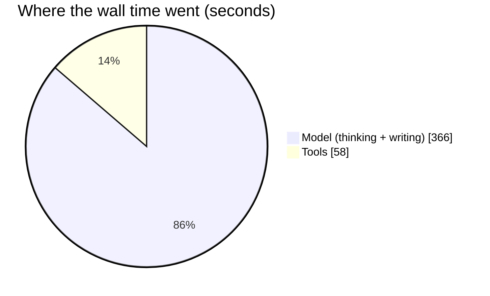

# corporate-ma/draft-markup-of-transition-services-agreement-tsa · run2 (`hv-mixed200-lunahigh-r2-20261116T093818Z`)

Result: **fail** 55/56 criteria · 7.1 min · 49 model calls · 57 tool calls (3 errors or timeouts) · ending `completed` · started 11-16 16:27:42 IST

## Overview

One box per stretch of steps that used the same kind of tool (blue: looking/searching/reading, purple: writing or editing files, yellow: a message with no tool call, red border: a tool error or timeout inside the box).

```mermaid
flowchart TD
    T(["Task prompt"])
    P0["<b>Step 1</b> · 0.1 min<br/>todo_write"]
    T --> P0
    class P0 look
    P1["<b>Steps 2-4</b> · 0.4 min<br/>bash x8<br/><i>ls -la && printf '\n-- files --\n' &&…, parse-doc docx documents/trident-draf…, parse-doc docx documents/polaris-tsa-… +2</i>"]
    P0 --> P1
    class P1 look
    P2["<b>Steps 5-7</b> · 0.1 min<br/>read x3<br/><i>draft.txt</i>"]
    P1 --> P2
    class P2 look
    P3["<b>Step 8</b> · 0.1 min<br/>grep x2<br/><i>playbook.txt, apa.txt</i>"]
    P2 --> P3
    class P3 look
    P4["<b>Steps 9-10</b> · 0.1 min<br/>read x2<br/><i>playbook.txt</i>"]
    P3 --> P4
    class P4 look
    P5["<b>Steps 11-12</b> · 0.3 min<br/>bash x2<br/><i>python - #lt;#lt;'PY' from docx import Docu…, python - #lt;#lt;'PY' import docx print(doc…</i>"]
    P4 --> P5
    class P5 look
    P6["<b>Step 13</b> · 0.2 min<br/>read<br/><i>apa.txt</i>"]
    P5 --> P6
    class P6 look
    P7["<b>Step 14</b> · 0.5 min<br/>todo_write"]
    P6 --> P7
    class P7 look
    P8["<b>Steps 15-16</b> · 2.4 min<br/>bash x2<br/><i>python - #lt;#lt;'PY' from docx import Docu…, cat #gt; build_deliverables.py #lt;#lt;'PY' fr…</i>"]
    P7 --> P8
    class P8 look
    P9["<b>Steps 17-19</b> · 0.2 min<br/>edit x2<br/>read<br/><i>build_deliverables.py</i>"]
    P8 --> P9
    class P9 err
    P10["<b>Steps 20-21</b> · 0.4 min<br/>bash x4<br/><i>python build_deliverables.py, unzip -t output/tsa-markup-redline.do…, unzip -t output/tsa-review-memo.docx … +1</i>"]
    P9 --> P10
    class P10 look
    P11["<b>Step 22</b> · 0.1 min<br/>read<br/><i>redline-parse.txt</i>"]
    P10 --> P11
    class P11 look
    P12["<b>Steps 23-24</b> · 0.1 min<br/>grep x2<br/><i>redline-parse.txt</i>"]
    P11 --> P12
    class P12 look
    P13["<b>Steps 25-27</b> · 0.3 min<br/>read x2<br/>edit<br/><i>redline-parse.txt, build_deliverables.py</i>"]
    P12 --> P13
    class P13 write
    P14["<b>Step 28</b> · 0.2 min<br/>bash<br/><i>python build_deliverables.py && parse…</i>"]
    P13 --> P14
    class P14 look
    P15["<b>Step 29</b> · 0.1 min<br/>grep<br/><i>redline-parse.txt</i>"]
    P14 --> P15
    class P15 look
    P16["<b>Steps 30-35</b> · 0.5 min<br/>edit x4<br/>read x2<br/><i>memo-parse.txt, build_deliverables.py</i>"]
    P15 --> P16
    class P16 write
    P17["<b>Step 36</b> · 0.2 min<br/>bash<br/><i>python build_deliverables.py && unzip…</i>"]
    P16 --> P17
    class P17 look
    P18["<b>Steps 37-39</b> · 0.2 min<br/>grep x3<br/><i>redline-parse.txt</i>"]
    P17 --> P18
    class P18 look
    P19["<b>Steps 40-42</b> · 0.3 min<br/>bash x3<br/><i>python - #lt;#lt;'PY' from zipfile import Z…, mkdir -p /tmp/tsa-pdfcheck && libreof…, pdftoppm -f 1 -l 2 -png -r 100 /tmp/t…</i>"]
    P18 --> P19
    class P19 look
    P20["<b>Step 43</b> · 0.0 min<br/>read_image x2<br/><i>memo-page-1.png, redline-page-01.png</i>"]
    P19 --> P20
    class P20 err
    P21["<b>Steps 44-45</b> · 0.2 min<br/>bash x2<br/><i>ls -lh output && file output/*.docx, python - #lt;#lt;'PY' from docx import Docu…</i>"]
    P20 --> P21
    class P21 look
    P22["<b>Step 46</b> · 0.1 min<br/>todo_write"]
    P21 --> P22
    class P22 look
    P23["<b>Step 47</b> · 0.1 min<br/>bash<br/><i>python - #lt;#lt;'PY' from zipfile import Z…</i>"]
    P22 --> P23
    class P23 look
    P24["<b>Step 48</b> · 0.1 min<br/>todo_write"]
    P23 --> P24
    class P24 look
    P25["<b>Step 49</b> · 0.1 min<br/>final message"]
    P24 --> P25
    class P25 ans
    R(["FAIL: 55/56 criteria"])
    P25 --> R
    class R fail
    classDef look fill:#e8f0fe,stroke:#4a6fa5,color:#111
    classDef write fill:#f3e8fd,stroke:#7b1fa2,color:#111
    classDef ans fill:#fff8e1,stroke:#b58900,color:#111
    classDef err fill:#e8f0fe,stroke:#c62828,stroke-width:3px,color:#111
    classDef pass fill:#e6f4ea,stroke:#2e7d32,color:#111
    classDef fail fill:#fce8e6,stroke:#c62828,color:#111
```





One row per model call:

| Step | Started (IST) | Model s | Tools s | Tool calls | Tools | Output chars |
|---|---|---|---|---|---|---|
| 1 | 16:27:42 | 4 | 0 | 1 | todo_write | 57 |
| 2 | 16:27:46 | 1 | 1 | 1 | bash | 429 |
| 3 | 16:27:48 | 3 | 7 | 4 | bash x4 | 160,715 |
| 4 | 16:27:59 | 5 | 6 | 3 | bash x3 | 1,122 |
| 5 | 16:28:10 | 2 | 0 | 1 | read | 52,950 |
| 6 | 16:28:12 | 2 | 0 | 1 | read | 54,090 |
| 7 | 16:28:14 | 1 | 0 | 1 | read | 10,816 |
| 8 | 16:28:15 | 3 | 1 | 2 | grep x2 | 21,037 |
| 9 | 16:28:20 | 3 | 0 | 1 | read | 52,720 |
| 10 | 16:28:22 | 3 | 0 | 1 | read | 20,551 |
| 11 | 16:28:25 | 10 | 1 | 1 | bash | 2,702 |
| 12 | 16:28:36 | 5 | 1 | 1 | bash | 12 |
| 13 | 16:28:42 | 15 | 0 | 1 | read | 6,626 |
| 14 | 16:28:57 | 27 | 0 | 1 | todo_write | 57 |
| 15 | 16:29:24 | 4 | 1 | 1 | bash | 5,433 |
| 16 | 16:29:28 | 137 | 4 | 1 | bash | 1,534 |
| 17 | 16:31:49 | 5 | 0 | 1 | edit ⚠ | 256 |
| 18 | 16:31:54 | 3 | 0 | 1 | read | 1,912 |
| 19 | 16:31:57 | 2 | 0 | 1 | edit | 221 |
| 20 | 16:32:00 | 4 | 3 | 1 | bash | 508 |
| 21 | 16:32:06 | 8 | 7 | 3 | bash x3 | 2,724 |
| 22 | 16:32:21 | 3 | 0 | 1 | read | 7,045 |
| 23 | 16:32:24 | 2 | 0 | 1 | grep | 4,991 |
| 24 | 16:32:27 | 4 | 1 | 1 | grep | 23,341 |
| 25 | 16:32:32 | 3 | 0 | 1 | read | 2,363 |
| 26 | 16:32:35 | 9 | 0 | 1 | read | 1,565 |
| 27 | 16:32:44 | 3 | 0 | 1 | edit | 221 |
| 28 | 16:32:47 | 7 | 7 | 1 | bash | 1,238 |
| 29 | 16:33:01 | 3 | 0 | 1 | grep | 4,375 |
| 30 | 16:33:04 | 3 | 0 | 1 | read | 23,686 |
| 31 | 16:33:07 | 4 | 0 | 1 | read | 12,721 |
| 32 | 16:33:11 | 5 | 0 | 1 | edit | 221 |
| 33 | 16:33:17 | 2 | 0 | 1 | edit | 221 |
| 34 | 16:33:19 | 11 | 0 | 1 | edit | 221 |
| 35 | 16:33:29 | 5 | 0 | 1 | edit | 221 |
| 36 | 16:33:35 | 4 | 6 | 1 | bash | 1,241 |
| 37 | 16:33:45 | 4 | 0 | 1 | grep | 4,808 |
| 38 | 16:33:50 | 4 | 0 | 1 | grep | 3,656 |
| 39 | 16:33:54 | 2 | 1 | 1 | grep | 1,702 |
| 40 | 16:33:57 | 4 | 1 | 1 | bash | 51 |
| 41 | 16:34:02 | 5 | 3 | 1 | bash | 842 |
| 42 | 16:34:10 | 5 | 1 | 1 | bash | 256 |
| 43 | 16:34:16 | 2 | 0 | 2 | read_image x2 ⚠ | 132 |
| 44 | 16:34:18 | 2 | 0 | 1 | bash | 282 |
| 45 | 16:34:21 | 4 | 2 | 1 | bash | 71 |
| 46 | 16:34:27 | 4 | 0 | 1 | todo_write | 57 |
| 47 | 16:34:31 | 6 | 1 | 1 | bash | 104 |
| 48 | 16:34:37 | 4 | 0 | 1 | todo_write | 57 |
| 49 | 16:34:41 | 5 | 0 | 0 | (message only) | 0 |

## Task prompt

```text
Review the attached draft TSA from the seller's perspective using our playbook, APA excerpts, and client instructions; produce a redline with annotated comments and a priority-tiered cover memo. Output: `tsa-markup-redline.docx` and `tsa-review-memo.docx`.
```

## Rubric

| # | Criterion | Verdict |
|---|---|---|
| C-001 | ISSUE_001a: Identifies 24-month lookback deviation in service standard | pass |
| C-002 | ISSUE_001b: Identifies 'or better than' qualifier in service standard | pass |
| C-003 | ISSUE_001c: Identifies undefined 'industry best practices' benchmark | pass |
| C-004 | ISSUE_001d: Proposes redline conforming service standard to playbook | pass |
| C-005 | ISSUE_002a: Identifies liability cap as 200% of total fees vs. APA's trailing 12-month cap | pass |
| C-006 | ISSUE_002b: Quantifies liability cap exposure difference | pass |
| C-007 | ISSUE_002c: Redlines liability cap to conform to APA Section 7.12(d) | pass |
| C-008 | ISSUE_003a: Identifies non-mutual consequential damages waiver | pass |
| C-009 | ISSUE_003b: Redlines to make consequential damages waiver mutual | pass |
| C-010 | ISSUE_004a: Identifies automatic renewal extending TSA beyond 18 months | pass |
| C-011 | ISSUE_004b: Redlines to delete auto-renewal and impose hard 18-month stop | pass |
| C-012 | ISSUE_005a: Identifies 120-day termination notice exceeding APA's 90 days | pass |
| C-013 | ISSUE_005b: Redlines termination notice to 90 days per APA | pass |
| C-014 | ISSUE_006a: Identifies Key Personnel consent right overriding Polaris staffing discretion | pass |
| C-015 | ISSUE_006b: Proposes compromise on Key Personnel (notice + qualified replacement) | pass |
| C-016 | ISSUE_007a: Identifies IT services 15% markup exceeding APA 10% cap | pass |
| C-017 | ISSUE_007b: Correctly computes IT fee difference | pass |
| C-018 | ISSUE_007c: Notes APA compliance risk even though overcharge benefits Polaris | pass |
| C-019 | ISSUE_008a: Identifies audit frequency deviation (twice/year vs. once/12 months) | pass |
| C-020 | ISSUE_008b: Identifies audit cost allocation deviation (Seller's vs. Buyer's expense) | pass |
| C-021 | ISSUE_008c: Identifies audit notice period deviation (10 vs. 30 business days) | pass |
| C-022 | ISSUE_009a: Identifies Ohio governing law vs. playbook's Pennsylvania law | pass |
| C-023 | ISSUE_009b: Identifies Cuyahoga County litigation vs. playbook's AAA arbitration in Pittsburgh | pass |
| C-024 | ISSUE_009c: Explains strategic importance of home-state law and arbitration for Polaris | pass |
| C-025 | ISSUE_010a: Identifies overbroad perpetual IP license grant | pass |
| C-026 | ISSUE_010b: Redlines to delete IP license and confirm Polaris sole ownership | pass |
| C-027 | ISSUE_011a: Identifies missing non-solicitation provision | pass |
| C-028 | ISSUE_011b: Drafts non-solicitation provision with 12-month post-service tail | pass |
| C-029 | ISSUE_012a: Identifies CGL insurance reduction ($2M vs. $5M playbook) | pass |
| C-030 | ISSUE_012b: Identifies missing umbrella coverage requirement | pass |
| C-031 | ISSUE_012c: Identifies missing additional insured endorsement | pass |
| C-032 | ISSUE_013a: Flags missing IMMEX program provisions for Monterrey facility | pass |
| C-033 | ISSUE_013b: Flags missing Mexican data privacy (LFPDPPP) provisions | pass |
| C-034 | ISSUE_014a: Identifies missing termination assistance/wind-down provisions | pass |
| C-035 | ISSUE_014b: Proposes termination assistance at cost-plus-15% for up to 60 days | pass |
| C-036 | ISSUE_015a: Identifies missing change order procedure | pass |
| C-037 | ISSUE_015b: Proposes change order procedure with cost-plus-15% pricing | pass |
| C-038 | ISSUE_016a: Identifies vague payment terms ('commercially reasonable time') | pass |
| C-039 | ISSUE_016b: Redlines payment terms to Net 30 days | **FAIL** |
| C-040 | ISSUE_016c: Adds late payment interest at 1.5%/month or max legal rate | pass |
| C-041 | ISSUE_017a: Identifies missing force majeure 90-day termination trigger | pass |
| C-042 | ISSUE_017b: Proposes 90-day force majeure termination right | pass |
| C-043 | Cover memo produced as a deliverable | pass |
| C-044 | Cover memo organizes issues by priority tiers (Critical/Significant/Minor) | pass |
| C-045 | APA-conflict issues classified as highest priority in cover memo | pass |
| C-046 | Cover memo includes negotiation strategy distinguishing firm vs. flexible positions | pass |
| C-047 | Redline markup includes proposed edits to the TSA | pass |
| C-048 | Redline markup includes explanatory comments for changes | pass |
| C-049 | Correctly identifies Polaris as Service Provider / Seller throughout | pass |
| C-050 | References APA Section 7.12 when flagging APA-conflict issues | pass |
| C-051 | Fee escalation provision addressed (playbook: greater of 3% or CPI-U) | pass |
| C-052 | Indemnification provision addressed (Buyer indemnifies for third-party claims) | pass |
| C-053 | Both deliverable files are produced | pass |
| C-054 | Correct total monthly service cost baseline ($1,020,000) referenced | pass |
| C-055 | Playbook's dispute escalation to senior executives referenced | pass |
| C-056 | Redline comments explain specific risk to Polaris for at least five changes | pass |

Judge's reasoning:

**C-001 (pass):** ISSUE_001a: Identifies 24-month lookback deviation in service standard

```text
The agent expressly identifies that Section 3.1 improperly uses a 24-month lookback instead of the APA/playbook-required 12-month lookback and revises the service standard to the twelve months immediately preceding Closing. The cover memo also highlights this discrepancy and proposed correction.
```

**C-002 (pass):** ISSUE_001b: Identifies 'or better than' qualifier in service standard

```text
The agent expressly flags Section 3.1's “at least equal to or better than” language as creating a ratcheting service obligation and replaces it with a “substantially consistent” historical standard that does not require performance above historical levels.
```

**C-003 (pass):** ISSUE_001c: Identifies undefined 'industry best practices' benchmark

```text
The agent expressly flags the “industry best practices” language in Section 3.1 as undefined and not required by the APA, explains that it could create an expansive service obligation, and replaces it with the APA’s 12-month historical “substantially consistent” standard. It also removes the industry-standard overlay from Schedule B and highlights the issue in the cover memo.
```

**C-004 (pass):** ISSUE_001d: Proposes redline conforming service standard to playbook

```text
The agent proposes replacement language in Section 3.1 requiring each Service to be provided “in a manner and at a level of quality substantially consistent with the manner and level of quality” provided to the Business during the twelve months immediately preceding Closing, which conforms to the playbook standard.
```

**C-005 (pass):** ISSUE_002a: Identifies liability cap as 200% of total fees vs. APA's trailing 12-month cap

```text
The agent expressly identifies that draft Section 10.1 uses a 200% cap based on total fees paid and contrasts it with APA Section 7.12(d), which requires a cap based on fees actually paid during the trailing 12-month period preceding the claim, including the first-year lookback.
```

**C-006 (pass):** ISSUE_002b: Quantifies liability cap exposure difference

```text
The cover memo expressly quantifies the gap: the draft cap is calculated at $41.004 million (or $40.392 million after correcting the IT markup), versus an APA trailing-12-month cap of $13.464 million, yielding a difference of approximately $27.54 million (or $26.928 million after correction).
```

**C-007 (pass):** ISSUE_002c: Redlines liability cap to conform to APA Section 7.12(d)

```text
Section 10.1 is redlined to cap aggregate liability at the total fees actually paid during the 12-month period immediately preceding the date the applicable claim is first asserted, with an appropriate first-year formulation. This conforms to APA Section 7.12(d).
```

**C-008 (pass):** ISSUE_003a: Identifies non-mutual consequential damages waiver

```text
The agent expressly identifies Section 10.2 as unilateral, noting that only Polaris waives consequential-damages claims against Trident and that Polaris remains exposed to such claims by Trident. It also proposes a mutual waiver.
```

**C-009 (pass):** ISSUE_003b: Redlines to make consequential damages waiver mutual

```text
The agent redlined Section 10.2 to state that “NEITHER PARTY SHALL BE LIABLE TO THE OTHER PARTY” for consequential, incidental, indirect, special, exemplary, or punitive damages, expressly making the waiver mutual and consistent with the criterion.
```

**C-010 (pass):** ISSUE_004a: Identifies automatic renewal extending TSA beyond 18 months

```text
The markup expressly states that the two automatic six-month renewal periods could extend the TSA to 30 months and identifies this as conflicting with APA Section 7.12(a)'s 18-month cap. The cover memo likewise recommends deleting automatic renewal and imposing an 18-month hard stop.
```

**C-011 (pass):** ISSUE_004b: Redlines to delete auto-renewal and impose hard 18-month stop

```text
The markup deletes the automatic-renewal mechanism and provides that the Agreement expires after the 18-month Initial Term unless the parties mutually execute a written extension. Any extension is capped at six additional months and priced at fully loaded cost plus 15%.
```

**C-012 (pass):** ISSUE_005a: Identifies 120-day termination notice exceeding APA's 90 days

```text
The agent expressly flags draft Section 5.3's 120-day notice requirement as conflicting with APA Section 7.12(c)'s 90-day period and revises it to exactly 90 days. The cover memo also identifies this as a critical APA-conforming change.
```

**C-013 (pass):** ISSUE_005b: Redlines termination notice to 90 days per APA

```text
The agent redlines Section 5.3 to replace the 120-day termination notice with exactly 90 days’ prior written notice and expressly cites APA Section 7.12(c) as the basis.
```

**C-014 (pass):** ISSUE_006a: Identifies Key Personnel consent right overriding Polaris staffing discretion

```text
The agent expressly flags Section 4.3 and Schedule H as conflicting with Polaris’s sole staffing discretion because they require Trident’s prior written consent for reassignment or replacement of the named Key Personnel. It revises the provision to preserve Polaris’s sole discretion and eliminate Trident’s consent right, and highlights the issue again in the cover memo.
```

**C-015 (pass):** ISSUE_006b: Proposes compromise on Key Personnel (notice + qualified replacement)

```text
The redline restores Polaris's sole discretion over staffing and removes Trident's consent right, while requiring reasonable efforts to give 15 Business Days' advance notice of planned changes where practicable and to designate a reasonably qualified replacement. Schedule H includes consistent notice and replacement language.
```

**C-016 (pass):** ISSUE_007a: Identifies IT services 15% markup exceeding APA 10% cap

```text
The agent expressly flags the IT Services markup as 15% on a $340,000 base, yielding $391,000 per month, and corrects it to the APA Section 7.12(b) maximum of 10%, yielding $374,000 per month. This discrepancy is identified in both the redline (C4) and the review memo.
```

**C-017 (pass):** ISSUE_007b: Correctly computes IT fee difference

```text
The agent correctly identifies the IT monthly fee as $391,000 at a 15% markup, corrects it to $374,000 at 10%, and expressly computes the monthly overcharge as $17,000.
```

**C-018 (pass):** ISSUE_007c: Notes APA compliance risk even though overcharge benefits Polaris

```text
The agent expressly notes that the 15% IT markup benefits Polaris but violates APA Section 7.12(b), and states it must be corrected to 10% to preserve APA compliance and credibility. Both the redline comment and memo characterize the correction as firm even though it reduces Polaris’s revenue.
```

**C-019 (pass):** ISSUE_008a: Identifies audit frequency deviation (twice/year vs. once/12 months)

```text
The agent expressly flags that draft Section 14.1 permits audits twice per calendar year, states the playbook limit is once per 12-month period, and redlines Section 14.1 accordingly. The cover memo also repeats this deviation and proposed correction.
```

**C-020 (pass):** ISSUE_008b: Identifies audit cost allocation deviation (Seller's vs. Buyer's expense)

```text
The agent expressly flags that draft Section 14.1 puts audits and third-party auditor costs at Polaris's expense, states the playbook requires audits at the Buyer's expense, and redlines the provision so Service Recipient conducts audits “at its sole expense,” subject to reimbursement only if overcharges exceed 5%.
```

**C-021 (pass):** ISSUE_008c: Identifies audit notice period deviation (10 vs. 30 business days)

```text
The agent expressly flags Section 14.1’s 10-business-day audit notice as a deviation from the playbook and redlines it to require at least 30 business days’ prior written notice. The cover memo also repeats this correction.
```

**C-022 (pass):** ISSUE_009a: Identifies Ohio governing law vs. playbook's Pennsylvania law

```text
The agent expressly flags Section 15.1’s Ohio governing law as inconsistent with the playbook and redlines it to Pennsylvania law. The cover memo also identifies the Ohio-law deviation and recommends Pennsylvania law.
```

**C-023 (pass):** ISSUE_009b: Identifies Cuyahoga County litigation vs. playbook's AAA arbitration in Pittsburgh

```text
The agent expressly flags Section 15.2’s exclusive Cuyahoga County, Ohio litigation provision as a playbook deviation and replaces it with confidential, binding arbitration under the AAA Commercial Arbitration Rules in Pittsburgh, Pennsylvania, after executive escalation.
```

**C-024 (pass):** ISSUE_009c: Explains strategic importance of home-state law and arbitration for Polaris

```text
The output explains the strategic rationale for Pennsylvania law and Pittsburgh arbitration: it notes that Ohio litigation gives Trident a home-forum advantage, creates public-docket exposure, and increases discovery and procedural burdens, while proposing confidential AAA arbitration in Polaris’s home forum.
```

**C-025 (pass):** ISSUE_010a: Identifies overbroad perpetual IP license grant

```text
The agent expressly flags Section 7.1’s perpetual, irrevocable, worldwide, royalty-free license covering Polaris’s tools, methodologies, templates, software, and know-how as an overbroad departure from the playbook’s firm no-license position. It identifies the risk of permanently exposing enterprise-wide proprietary operational IP and redlines the provision to reserve all Service Provider Materials to Polaris, allowing only limited access necessary to receive services during the applicable service period.
```

**C-026 (pass):** ISSUE_010b: Redlines to delete IP license and confirm Polaris sole ownership

```text
Section 7.1 deletes the perpetual, irrevocable license and replaces it with language confirming that all Service Provider Materials remain Polaris’s sole and exclusive property. It grants no license beyond Service Recipient’s limited ability to access and use the Services during the applicable service period solely to receive those Services, with access ending when the service ends.
```

**C-027 (pass):** ISSUE_011a: Identifies missing non-solicitation provision

```text
The agent expressly flags that the draft has no restriction on hiring Polaris service personnel and adds Section 15.12, a non-solicitation/non-hire covenant covering Polaris employees who provided Services.
```

**C-028 (pass):** ISSUE_011b: Drafts non-solicitation provision with 12-month post-service tail

```text
Proposed Section 15.12 restricts Trident (Service Recipient) from soliciting, recruiting, hiring, or engaging Polaris personnel who provided Services during the Term and for 12 months after expiration or termination of the applicable Service, unless Polaris gives prior written consent.
```

**C-029 (pass):** ISSUE_012a: Identifies CGL insurance reduction ($2M vs. $5M playbook)

```text
The agent expressly flags that Section 13.1 requires only $2 million in Buyer CGL coverage versus the playbook’s $5 million requirement and proposes increasing the CGL limits to $5 million per occurrence and aggregate. The cover memo repeats this issue and recommendation.
```

**C-030 (pass):** ISSUE_012b: Identifies missing umbrella coverage requirement

```text
The agent expressly flags that the draft has no umbrella coverage and proposes adding umbrella or excess liability insurance with limits of at least $5 million in revised Section 13.1. The cover memo also identifies the missing $5 million umbrella requirement.
```

**C-031 (pass):** ISSUE_012c: Identifies missing additional insured endorsement

```text
The agent expressly flags that the buyer insurance provision lacks additional-insured protection and revises Section 13.1 to require Polaris and its affiliates to be named as additional insureds under the buyer’s CGL and umbrella/excess policies, with delivery of the required endorsements.
```

**C-032 (pass):** ISSUE_013a: Flags missing IMMEX program provisions for Monterrey facility

```text
The agent expressly flags the absence of IMMEX provisions for the Monterrey facility and adds Schedule E Section 6A allocating primary responsibility and costs to Trident for maintaining, transferring, renewing, and complying with IMMEX certification and related customs requirements, while defining Polaris's transition-assistance role.
```

**C-033 (pass):** ISSUE_013b: Flags missing Mexican data privacy (LFPDPPP) provisions

```text
The agent expressly flags that Section 8.4 covers only U.S. privacy laws and adds provisions addressing Mexico’s LFPDPPP for Mexican employee payroll and HR data. The proposed language allocates controller/processor roles, requires privacy notices and consents or another lawful basis for processing and cross-border transfers, imposes safeguards and incident notification obligations, and contemplates a data-processing addendum. The cover memo also identifies this as a significant missing requirement.
```

**C-034 (pass):** ISSUE_014a: Identifies missing termination assistance/wind-down provisions

```text
The agent expressly flags that the draft has no defined termination assistance or wind-down obligation and adds Section 5.5A providing reasonable termination assistance for up to 60 days. The cover memo likewise identifies the omission and cites the playbook’s 60-day standard.
```

**C-035 (pass):** ISSUE_014b: Proposes termination assistance at cost-plus-15% for up to 60 days

```text
The agent added Section 5.5A requiring reasonable termination assistance for a period not exceeding 60 days, priced at Service Provider's Fully-Loaded Cost plus a 15% markup.
```

**C-036 (pass):** ISSUE_015a: Identifies missing change order procedure

```text
The agent expressly flags the absence of a formal change-order mechanism in the cover memo (S4) and adds Section 6.7 requiring a signed written change order for out-of-scope services, material volume increases, or material scope changes.
```

**C-037 (pass):** ISSUE_015b: Proposes change order procedure with cost-plus-15% pricing

```text
The proposed new Section 6.7 requires out-of-scope services, material volume increases, or material scope changes to be documented in a written change order signed by authorized representatives of both parties, and provides default pricing at Service Provider's Fully-Loaded Cost plus a 15% markup.
```

**C-038 (pass):** ISSUE_016a: Identifies vague payment terms ('commercially reasonable time')

```text
The agent expressly flags Section 6.3's requirement to pay within a “commercially reasonable time” as vague and replaces it with a defined 30-day payment window. The cover memo likewise identifies the issue and recommends Net 30 terms.
```

**C-039 (fail):** ISSUE_016b: Redlines payment terms to Net 30 days

```text
Section 6.3 replaces the vague standard with payment within 30 days after receipt, not Net 30 days from the invoice date as required by the criterion.
```

**C-040 (pass):** ISSUE_016c: Adds late payment interest at 1.5%/month or max legal rate

```text
The proposed revision to Section 6.3 adds interest on overdue undisputed amounts at the lesser of 1.5% per month or the maximum rate permitted by Applicable Law, satisfying the criterion.
```

**C-041 (pass):** ISSUE_017a: Identifies missing force majeure 90-day termination trigger

```text
The agent expressly flags that the draft force majeure clause lacks a termination trigger and adds a provision allowing either party to terminate an affected Service if the force majeure event materially affects it for 90 consecutive days, without further liability other than accrued fees and surviving obligations. The cover memo also identifies this as a significant gap.
```

**C-042 (pass):** ISSUE_017b: Proposes 90-day force majeure termination right

```text
The proposed revision to Section 12.1 states that if a Force Majeure Event materially affects a Service for 90 consecutive days, either party may terminate the affected Service upon written notice without further liability, except for accrued fees and surviving obligations. This satisfies the criterion.
```

**C-043 (pass):** Cover memo produced as a deliverable

```text
The output includes a clearly labeled seller-side cover memorandum summarizing the TSA review, including key issues, priorities, fee reconciliation, and negotiation recommendations.
```

**C-044 (pass):** Cover memo organizes issues by priority tiers (Critical/Significant/Minor)

```text
The cover memo expressly organizes deviations into three ranked sections: Priority Tier 1 — Critical / APA Conforming Changes, Priority Tier 2 — Significant / Playbook Deviations, and Priority Tier 3 — Minor / Cleanup and Negotiation Items.
```

**C-045 (pass):** APA-conflict issues classified as highest priority in cover memo

```text
The cover memo places all four specified APA conflicts—200% liability cap, automatic renewal beyond the 18-month cap, 120-day termination notice, and 15% IT markup—in “Priority Tier 1 — CRITICAL / APA CONFORMING CHANGES.” It separately places pure playbook deviations in Priority Tier 2, clearly distinguishing the APA conflicts as highest priority.
```

**C-046 (pass):** Cover memo includes negotiation strategy distinguishing firm vs. flexible positions

```text
The cover memo clearly distinguishes firm from flexible positions for well over three key issues and explains why. It identifies APA conflicts (including service standard, term, termination notice, IT fee, liability cap, and damages waiver) as non-negotiable conforming changes, while giving compromise positions for matters such as termination assistance, payment terms, audits, insurance, force majeure, non-solicitation, escalation, staffing notice, and Mexico implementation details. It also provides negotiation fallbacks and supporting rationales based on the APA and playbook.
```

**C-047 (pass):** Redline markup includes proposed edits to the TSA

```text
The output is a marked-up TSA containing numerous proposed redline edits, including strikethrough deletions, underlined insertions, substitutions, and added provisions embedded directly in the draft text.
```

**C-048 (pass):** Redline markup includes explanatory comments for changes

```text
The redline includes numerous bracketed comments (e.g., C1–C26) tied to proposed edits. These comments explain the basis for changes by citing specific APA provisions or playbook sections and describing the associated risk and negotiating position.
```

**C-049 (pass):** Correctly identifies Polaris as Service Provider / Seller throughout

```text
The output consistently identifies Polaris Industrial Holdings, Inc. as the Seller and Service Provider and Trident as the Service Recipient. The markup and cover memo are expressly framed from Polaris’s seller-side perspective, emphasizing protections for Polaris’s liability, fees, staffing discretion, intellectual property, audit exposure, and operational flexibility. No party-role confusion appears.
```

**C-050 (pass):** References APA Section 7.12 when flagging APA-conflict issues

```text
The output repeatedly cites APA Section 7.12 and relevant subsections for the identified conflicts: §7.12(a) for term/renewal, §7.12(c) for individual-service termination notice, §7.12(b) for the fee markup cap, and §7.12(d) for the liability cap. These citations appear in both the redline comments and the cover memo.
```

**C-051 (pass):** Fee escalation provision addressed (playbook: greater of 3% or CPI-U)

```text
The agent expressly addresses fee escalation in redlined Section 6.4, proposing annual adjustment by the greater of 3% or the trailing 12-month CPI-U increase, subject to the APA constraints. The cover memo also identifies this as the playbook position and discusses a CPI-U-only fallback.
```

**C-052 (pass):** Indemnification provision addressed (Buyer indemnifies for third-party claims)

```text
The markup includes Section 9.1, under which the Service Recipient (Buyer) indemnifies the Service Provider (Seller) for third-party claims arising from Buyer's use of the Services, except to the extent caused by Seller's gross negligence or willful misconduct. The indemnification structure is also discussed in the review memo.
```

**C-053 (pass):** Both deliverable files are produced

```text
The output includes two clearly distinct deliverables: (1) a marked-up/redlined TSA titled “tsa-markup-redline.docx” and (2) a seller-side cover memorandum titled “tsa-review-memo.docx.”
```

**C-054 (pass):** Correct total monthly service cost baseline ($1,020,000) referenced

```text
The output correctly references both the $1,020,000 total monthly base cost and the corrected $1,122,000 total monthly fee at a 10% markup in Schedule G and the review memo's fee reconciliation.
```

**C-055 (pass):** Playbook's dispute escalation to senior executives referenced

```text
Section 15.2 expressly requires disputes to be escalated first to the parties’ designated CFO or General Counsel representatives, who must attempt resolution in good faith for 15 Business Days before unresolved disputes proceed to arbitration.
```

**C-056 (pass):** Redline comments explain specific risk to Polaris for at least five changes

```text
The redline includes well over five distinct comments identifying concrete risks to Polaris, not merely playbook or APA inconsistencies. Examples include ratcheting service obligations from the heightened performance standard (C1), exposure to up to roughly $41.004 million rather than approximately $13.464 million under the liability cap (C5), permanent leakage of enterprise-wide operational IP through the broad license (C8), workforce-management and operational constraints from key-personnel consent and FTE requirements (C9), unpriced scope creep from the absence of a change-order process (C11), disruption and proprietary-information exposure from broad audit rights (C13), and Mexican regulatory and employee-data enforcement risk (C7/C22).
```

## Delivered files (output/)

- `tsa-markup-redline.docx` (86,739 bytes)
- `tsa-review-memo.docx` (45,189 bytes)

## Trajectory

### Step 1: 1 tool call

_Started 11-16 16:27:42 IST · model 4 s · tools 0 s_

**Reasoning summary:**

```text
**Planning document creation**

I need to produce a redlined document and a memo using Google Docs. It involves inspecting files, and maybe I need a specific skill for handling docx files. The user is asking for documents, and I might need to use skills listed in a catalog, though I don't see one right now. I can call the necessary skill if I know it. I'll list the workspace using a bash command, and I need to use Python libraries and tools for this process. Time to get started!
```

**Call `todo_write`** (0.0 s)

```json
{
 "todos": [
  {
   "content": "Inspect provided TSA, playbook, APA excerpts, and client instructions",
   "status": "in_progress"
  },
  {
   "content": "Analyze seller-side issues and define markup priorities/comments",
   "status": "pending"
  },
  {
   "content": "Create redline TSA DOCX with annotations",
   "status": "pending"
  },
  {
   "content": "Create priority-tiered cover memo DOCX",
   "status": "pending"
  },
  {
   "content": "Validate both deliverables and summarize completed work",
   "status": "pending"
  }
 ]
}
```

Output (57 chars):

```text
Updated todo list: 4 pending, 1 in progress, 0 completed.
```

**Todo list now:**

- [~] Inspect provided TSA, playbook, APA excerpts, and client instructions
- [ ] Analyze seller-side issues and define markup priorities/comments
- [ ] Create redline TSA DOCX with annotations
- [ ] Create priority-tiered cover memo DOCX
- [ ] Validate both deliverables and summarize completed work

### Step 2: 1 tool call

_Started 11-16 16:27:46 IST · model 1 s · tools 1 s_

**Call `bash`** (0.7 s)

```json
{
 "command": "ls -la && printf '\\n-- files --\\n' && find . -maxdepth 2 -type f ! -name task.json -print",
 "description": "List workspace files"
}
```

Output (429 chars):

```text
total 16
drwxr-xr-x 4 agarwaldi@microsoft.com users 4096 Nov 16 10:57 .
drwxr-xr-x 3 root                    root  4096 Nov 16 10:57 ..
dr-xr-xr-x 2 agarwaldi@microsoft.com users 4096 Nov  5 18:20 documents
drwxr-xr-x 2 agarwaldi@microsoft.com users 4096 Nov 16 10:57 output

-- files --
./documents/trident-draft-tsa.docx
./documents/polaris-tsa-playbook.docx
./documents/apa-excerpts.docx
./documents/andersen-instructions.eml
```

### Step 3: 4 tool calls

_Started 11-16 16:27:48 IST · model 3 s · tools 7 s_

**Reasoning summary:**

```text
**Considering command execution**

I'm thinking about needing to inspect everything through parse-doc. I'm considering running parallel bash commands, maybe using a scratch text file for outputs outside the main output. It seems logical to parse directly to stdout. It sounds good to me, so let's go ahead and execute this with multi-parallel commands! I hope this works smoothly, but I’m also ready to troubleshoot if needed. Let's get started!
```

**Call `bash`** (2.6 s)

```json
{
 "command": "parse-doc docx documents/trident-draft-tsa.docx",
 "description": "Extract draft TSA text"
}
```

Output (49,993 chars):

```text
ing to:

> \(a\) any gross negligence or willful misconduct of Service Provider, its Affiliates, or their respective employees, agents, or contractors in performing the Services;
>
> \(b\) any breach by Service Provider of any representation, warranty, covenant, or obligation under this Agreement; or
>
> \(c\) any violation of Applicable Law by Service Provider, its Affiliates, or their respective employees, agents, or contractors in performing the Services.

**Section 9.3** *Indemnification Procedures.* The following procedures shall apply to any claim for indemnification under this Article 9:

> \(a\) **Notice.** The Party seeking indemnification (the \"**Indemnified Party**\") shall promptly notify the other Party (the \"**Indemnifying Party**\") in writing of any claim, demand, suit, action, or proceeding for which indemnification is sought (a \"**Claim**\"), specifying in reasonable detail the nature of the Claim and the amount of Losses incurred or expected to be incurred (to the extent then known). The failure by the Indemnified Party to give timely notice shall not relieve the Indemnifying Party of its indemnification obligations except to the extent that the Indemnifying Party is actually and materially prejudiced by such failure.
>
> \(b\) **Defense of Third-Party Claims.** Upon receipt of notice of a Claim involving a third-party claim, the Indemnifying Party shall have the right, but not the obligation, to assume the defense of such third-party claim, including th
… [48,493 more chars]
```

**Call `bash`** (2.3 s)

```json
{
 "command": "parse-doc docx documents/polaris-tsa-playbook.docx",
 "description": "Extract TSA playbook text"
}
```

Output (49,959 chars):

```text
such as *\"equal to or better than,\"* *\"at least equal to,\"* or *\"no less favorable than.\"* These formulations impose a floor that ratchets upward and does not permit any reduction or variation, however reasonable.
>
> • **Reject \"Best Practices\" and Similar Standards:** References to *\"industry best practices,\"* *\"commercially reasonable best efforts,\"* or other aspirational benchmarks must be rejected. These terms are undefined, subjective, invite disputes, and impose a standard that may materially exceed what Polaris historically provided to the divested business. Polaris is not a third-party service provider competing for business --- it is providing transitional support as an accommodation.
>
> • **Not a Guarantor:** Service Provider\'s obligation is limited to making available the same general type and level of resources as historically deployed. Service Provider does not guarantee specific outcomes, results, or service levels beyond what was historically provided.
>
> • **APA Precedence:** If the APA specifies a service standard (e.g., in the TSA covenant section or an exhibit), that APA standard controls and the TSA cannot impose a more stringent requirement.

**[2.2 Exclusions from Service Obligation]{.underline}**

Service Provider has no obligation to:

> • **(a)** Provide services not described in the applicable Service Schedules;
>
> • **(b)** Hire additional personnel or acquire additional resources beyond those in place as of the Closing Date;
>
> • 
… [48,459 more chars]
```

**Call `bash`** (2.0 s)

```json
{
 "command": "parse-doc docx documents/apa-excerpts.docx",
 "description": "Extract APA excerpts"
}
```

Output (49,992 chars):

```text
**[EXCERPTS FROM EXECUTED ASSET PURCHASE AGREEMENT]{.underline}**

**ASSET PURCHASE AGREEMENT**

**dated as of March 14, 2025**

**by and between**

**POLARIS INDUSTRIAL HOLDINGS, INC.**

**and**

**TRIDENT MANUFACTURING GROUP, INC.**

This document contains selected excerpts from the Asset Purchase Agreement dated as of March 14, 2025, by and between Polaris Industrial Holdings, Inc. and Trident Manufacturing Group, Inc. The complete Asset Purchase Agreement is approximately 180 pages. Only the provisions relevant to the Transition Services Agreement are reproduced herein. Sections, exhibits, and schedules not reproduced are indicated by bracketed editorial notations. Defined terms used but not defined in these excerpts have the meanings given to them in the full Asset Purchase Agreement.

**APA Execution Date: March 14, 2025**

**[PREAMBLE AND RECITALS (EXCERPT)]{.underline}**

This ASSET PURCHASE AGREEMENT (this \"**Agreement**\") is entered into as of March 14, 2025, by and between:

**POLARIS INDUSTRIAL HOLDINGS, INC.**, a Delaware corporation, with its principal offices at 1200 Commonwealth Avenue, Suite 3000, Pittsburgh, PA 15222 (\"**Seller**\"),

and

**TRIDENT MANUFACTURING GROUP, INC.**, an Ohio corporation, with its principal offices at 800 Lakeside Drive, Suite 400, Cleveland, OH 44114 (\"**Buyer**\").

**RECITALS**

**WHEREAS:**

\(A\) Seller operates, among other businesses, the Specialty Coatings Division (as defined below), which is engaged in the development
… [48,492 more chars]
```

**Call `bash`** (0.6 s)

```json
{
 "command": "python - <<'PY'\nfrom pathlib import Path\nprint(Path('documents/andersen-instructions.eml').read_text())\nPY",
 "description": "Read client instructions email"
}
```

Output (10,771 chars):

```text
From: Victoria S. Andersen (vandersen@whitfieldcrane.com)
To: Nathan J. Reeves (nreeves@whitfieldcrane.com)
Date: Tue, 29 Apr 2025 08:17:00 -0000
Subject: RE: Polaris / Trident — TSA Markup Assignment — Specialty Coatings
 Divestiture
Content-Type: text/plain; charset="utf-8"
Content-Transfer-Encoding: quoted-printable
MIME-Version: 1.0

Nathan,

Caldwell Briggs & Foley (Tom Graziano's team =E2=80=94 his associate Priya Ve=
nkatesh circulated) sent over Trident's first draft of the Transition Service=
s Agreement yesterday evening. I've done a quick initial skim but haven't had=
 time to go through it with a fine-tooth comb =E2=80=94 that's where you come=
 in.

For context, this is the TSA contemplated by Section 7.12 of the executed Ass=
et Purchase Agreement dated March 14, 2025, between Polaris Industrial Holdin=
gs, Inc. (as Seller and Service Provider) and Trident Manufacturing Group, In=
c. (as Buyer and Service Recipient) for the divestiture of the Specialty Coat=
ings Division. Expected closing is June 2, 2025, which means we need to turn =
around a comprehensive markup by end of next week at the latest. Sharon Petro=
sian wants to see our redline before it goes out to Caldwell Briggs, so we ca=
n't let this slip.

**General Assignment**

I need you to do a full-document markup of the draft TSA =E2=80=94 it runs ab=
out 48 pages =E2=80=94 against two key benchmarks: (1) the Polaris TSA Playbo=
ok (last updated January 15, 2025) and (2) the relevant provisions of the 
… [9,269 more chars]
```

### Step 4: 3 tool calls

_Started 11-16 16:27:59 IST · model 5 s · tools 6 s_

**Call `bash`** (2.5 s)

```json
{
 "command": "parse-doc docx documents/trident-draft-tsa.docx > draft.txt",
 "description": "Save draft TSA extraction"
}
```

Output (374 chars):

```text
[stderr]
2026-11-16 10:58:05.687831668 [W:onnxruntime:Default, device_discovery.cc:95 GetPciBusId] Skipping pci_bus_id for PCI path at "/sys/devices/LNXSYSTM:00/LNXSYBUS:00/ACPI0004:00/VMBUS:00/5620e0c7-8062-4dce-aeb7-520c7ef76171" because filename "5620e0c7-8062-4dce-aeb7-520c7ef76171" did not match expected pattern of [0-9a-f]+:[0-9a-f]+:[0-9a-f]+[.][0-9a-f]+
```

**Call `bash`** (2.0 s)

```json
{
 "command": "parse-doc docx documents/polaris-tsa-playbook.docx > playbook.txt",
 "description": "Save playbook extraction"
}
```

Output (374 chars):

```text
[stderr]
2026-11-16 10:58:07.924748795 [W:onnxruntime:Default, device_discovery.cc:95 GetPciBusId] Skipping pci_bus_id for PCI path at "/sys/devices/LNXSYSTM:00/LNXSYBUS:00/ACPI0004:00/VMBUS:00/5620e0c7-8062-4dce-aeb7-520c7ef76171" because filename "5620e0c7-8062-4dce-aeb7-520c7ef76171" did not match expected pattern of [0-9a-f]+:[0-9a-f]+:[0-9a-f]+[.][0-9a-f]+
```

**Call `bash`** (2.0 s)

```json
{
 "command": "parse-doc docx documents/apa-excerpts.docx > apa.txt",
 "description": "Save APA extraction"
}
```

Output (374 chars):

```text
[stderr]
2026-11-16 10:58:09.933527917 [W:onnxruntime:Default, device_discovery.cc:95 GetPciBusId] Skipping pci_bus_id for PCI path at "/sys/devices/LNXSYSTM:00/LNXSYBUS:00/ACPI0004:00/VMBUS:00/5620e0c7-8062-4dce-aeb7-520c7ef76171" because filename "5620e0c7-8062-4dce-aeb7-520c7ef76171" did not match expected pattern of [0-9a-f]+:[0-9a-f]+:[0-9a-f]+[.][0-9a-f]+
```

### Step 5: 1 tool call

_Started 11-16 16:28:10 IST · model 2 s · tools 0 s_

**Call `read`** (0.0 s)

```json
{
 "file_path": "draft.txt",
 "offset": 1,
 "limit": 2000
}
```

Output (52,950 chars):

```text
<path>/home/agarwaldi/dsh-bench-harness/runs/hv-mixed200-lunahigh-r2-20261116T093818Z/tasks/corporate-ma__draft-markup-of-transition-services-agreement-tsa/workspace/draft.txt</path>
<type>file</type>
<content>
1: DRAFT --- APRIL 28, 2025 PRIVILEGED & CONFIDENTIAL SUBJECT TO CONTRACT
2: 
3: **[TRANSITION SERVICES AGREEMENT]{.underline}**
4: 
5: **by and between**
6: 
7: **POLARIS INDUSTRIAL HOLDINGS, INC.**
8: 
9: **and**
10: 
11: **TRIDENT MANUFACTURING GROUP, INC.**
12: 
13: Dated as of \[●\], 2025
14: 
15: Prepared by Caldwell Briggs & Foley LLP
16: 
17: **TABLE OF CONTENTS**
18: 
19:   ----------------------------------------------------------------------------------------------------------
20:                                                                                      **Page**
21:   ----------------------- ---------------------------------------------------------- -----------------------
22:   **ARTICLE 1**           **DEFINITIONS**                                            \[●\]
23: 
24:                           Section 1.1 Defined Terms                                  \[●\]
25: 
26:   **ARTICLE 2**           **SERVICES**                                               \[●\]
27: 
28:                           Section 2.1 Provision of Services                          \[●\]
29: 
30:                           Section 2.2 Scope Limitations                              \[●\]
31: 
32:                           Section 2.3 Exclusive Remedy                           
… [51,450 more chars]
```

### Step 6: 1 tool call

_Started 11-16 16:28:12 IST · model 2 s · tools 0 s_

**Call `read`** (0.0 s)

```json
{
 "file_path": "draft.txt",
 "offset": 439,
 "limit": 1000
}
```

Output (54,090 chars):

```text
<path>/home/agarwaldi/dsh-bench-harness/runs/hv-mixed200-lunahigh-r2-20261116T093818Z/tasks/corporate-ma__draft-markup-of-transition-services-agreement-tsa/workspace/draft.txt</path>
<type>file</type>
<content>
439: **[ARTICLE 10 --- LIMITATION OF LIABILITY]{.underline}**
440: 
441: **Section 10.1** *Aggregate Liability Cap.* Notwithstanding anything to the contrary in this Agreement, Service Provider\'s aggregate liability arising out of or related to this Agreement, whether in contract, tort (including negligence), strict liability, or any other legal or equitable theory, shall not exceed an amount equal to two hundred percent (200%) of the total Service Charges actually paid by Service Recipient to Service Provider under this Agreement as of the date of the applicable claim (the \"**Liability Cap**\"). For the avoidance of doubt, the Liability Cap shall apply to all claims in the aggregate and not on a per-claim basis. This Section 10.1 shall not limit Service Provider\'s liability for fraud, willful misconduct, or breaches of Article 8 (Confidentiality).
442: 
443: **Section 10.2** *Consequential Damages.* SERVICE PROVIDER HEREBY WAIVES, AND SHALL NOT ASSERT, ANY AND ALL CLAIMS AGAINST SERVICE RECIPIENT FOR CONSEQUENTIAL, INCIDENTAL, SPECIAL, PUNITIVE, EXEMPLARY, OR INDIRECT DAMAGES, INCLUDING LOSS OF REVENUE, LOSS OF PROFITS, LOSS OF BUSINESS OPPORTUNITY, COST OF REPLACEMENT SERVICES, DIMINUTION OF VALUE, OR LOSS OF GOODWILL, ARISING OUT OF OR RELATING TO THIS AGREEMENT,
… [52,590 more chars]
```

### Step 7: 1 tool call

_Started 11-16 16:28:14 IST · model 1 s · tools 0 s_

**Call `read`** (0.0 s)

```json
{
 "file_path": "draft.txt",
 "offset": 962,
 "limit": 1000
}
```

Output (10,816 chars):

```text
<path>/home/agarwaldi/dsh-bench-harness/runs/hv-mixed200-lunahigh-r2-20261116T093818Z/tasks/corporate-ma__draft-markup-of-transition-services-agreement-tsa/workspace/draft.txt</path>
<type>file</type>
<content>
962:   **Total**                           **7**
963:   -----------------------------------------------------------------------
964: 
965: **3. Systems and Tools**
966: 
967: The following systems and tools shall be used in the delivery of the Treasury & Tax Services: SAP S/4HANA (Treasury module), Service Provider\'s Tax preparation software (Thomson Reuters ONESOURCE or equivalent), banking platforms, and transfer pricing analysis tools.
968: 
969: **4. Service Period**
970: 
971: From the Effective Date through the earlier of: (a) termination of this Service in accordance with Article 5; or (b) expiration of the Term.
972: 
973: **5. Fees**
974: 
975:   -----------------------------------------------------------------------
976:   **Base Monthly Cost:**              **\$65,000**
977:   ----------------------------------- -----------------------------------
978:   Markup:                             10%
979: 
980:   Monthly Fee:                        \$71,500
981:   -----------------------------------------------------------------------
982: 
983: **6. Migration Milestones**
984: 
985: > \(a\) **Bank Accounts.** Service Recipient shall establish its own bank accounts within thirty (30) days of the Closing Date. Service Provider shall cooperate with the orderly trans
… [9,316 more chars]
```

### Step 8: 2 tool calls

_Started 11-16 16:28:15 IST · model 3 s · tools 1 s_

**Reasoning summary:**

```text
**Reviewing playbook details**

I have enough of a draft, but it seems I need to read the relevant sections of the playbook more thoroughly. I want to ensure that I'm covering everything important. I think it would be helpful to use the grep tool to search for key terms in the playbook and APA format. That way, I can pinpoint the information I need quickly. This feels like an efficient approach to ensure I'm thorough.
```

**Call `grep`** (0.5 s)

```json
{
 "pattern": "\\*\\*\\[Section [0-9]|Liability Cap|Consequential|IP Ownership|Data Privacy|Non-Solicitation|Insurance|Force Majeure|Change Orders|Termination Assistance|Governing Law|Audit Rights|Fee Escalation|Payment Terms|Service Standard|IMMEX|LFPDPPP|Key Personnel",
 "path": "playbook.txt"
}
```

Output (9,878 chars):

```text
Found 49 matches

playbook.txt
Line 25: **[Section 1: Purpose and Scope of Playbook]{.underline}**
Line 45: **[Section 2: Service Standard]{.underline}**
Line 85: **[Section 3: Term and Termination]{.underline}**
Line 127: **[3.4 Termination Assistance / Wind-Down]{.underline}**
Line 139: **[Section 4: Service Fees and Payment]{.underline}**
Line 159: **[4.2 Fee Escalation]{.underline}**
Line 169: **[4.3 Payment Terms]{.underline}**
Line 181: **[4.4 Change Orders]{.underline}**
Line 193: **[Section 5: Liability and Indemnification]{.underline}**
Line 219: **[5.2 Consequential Damages Waiver]{.underline}**
Line 241: **[Section 6: Intellectual Property and Data]{.underline}**
Line 243: **[6.1 IP Ownership]{.underline}**
Line 273: **[6.3 Cross-Border Data Privacy (Mexico / LFPDPPP)]{.underline}**
Line 278:   **Target**                          Where Services involve processing personal data of individuals in Mexico (e.g., payroll, HR, benefits for the Monterrey facility), the TSA must include LFPDPPP-compliant provisions addressing: (i) data controller/processor allocation (Service Recipient as controller, Service Provider as processor), (ii) data processing agreement or equivalent contractual terms, (iii) cross-border data transfer consent mechanisms (privacy notices and consent from Mexican employees), (iv) data security obligations, and (v) breach notification requirements.
Line 280:   **Fallback**                        At minimum, include a general provision requiring compl
… [8,378 more chars]
```

**Call `grep`** (0.5 s)

```json
{
 "pattern": "Section 7\\.12\\([a-g]\\)|TSA Liability Cap|No automatic renewal|shall not exceed|90 days|10%|IMMEX|LFPDPPP|Exhibit H|Governing Law",
 "path": "apa.txt"
}
```

Output (11,159 chars):

```text
Found 42 matches

apa.txt
Line 47: *\[Note: Only definitions relevant to Section 7.12 and Exhibit H are excerpted below. The full Agreement contains approximately 142 defined terms.\]*
Line 63: \"**IMMEX Program**\" means the Mexican Maquiladora and Export Services Industry Program (*Industria Manufacturera, Maquiladora y de Servicios de Exportación*) established under Mexico\'s Decree for the Promotion of the Manufacturing, Maquiladora and Export Services Industry, as amended from time to time, and all implementing rules, regulations, and official standards issued thereunder.
Line 77: \"**Transition Service**\" or \"**Transition Services**\" means the services to be provided by Seller (or its Affiliates) to Buyer (or its Affiliates) following the Closing pursuant to the Transition Services Agreement, as more particularly described in Exhibit H hereto.
Line 105: **Section 7.12(a) --- Obligation to Enter into TSA**
Line 107: At or prior to the Closing, Seller and Buyer shall negotiate in good faith and enter into a Transition Services Agreement, on commercially reasonable terms and conditions, pursuant to which Seller shall provide, or cause to be provided, to Buyer (or its applicable Affiliates) the Transition Services described in Exhibit H hereto for a transition period following the Closing Date (the \"**Transition Period**\"). The purpose of the Transition Services Agreement is to facilitate an orderly transition of the Business from Seller to Buyer and to enable Buyer to
… [9,659 more chars]
```

### Step 9: 1 tool call

_Started 11-16 16:28:20 IST · model 3 s · tools 0 s_

**Call `read`** (0.0 s)

```json
{
 "file_path": "playbook.txt",
 "offset": 1,
 "limit": 500
}
```

Output (52,720 chars):

```text
<path>/home/agarwaldi/dsh-bench-harness/runs/hv-mixed200-lunahigh-r2-20261116T093818Z/tasks/corporate-ma__draft-markup-of-transition-services-agreement-tsa/workspace/playbook.txt</path>
<type>file</type>
<content>
1: **[TRANSITION SERVICES AGREEMENT]{.underline}**
2: 
3: **[NEGOTIATION PLAYBOOK]{.underline}**
4: 
5: **Polaris Industrial Holdings, Inc. --- Service Provider Positions**
6: 
7: **PRIVILEGED AND CONFIDENTIAL --- ATTORNEY-CLIENT WORK PRODUCT**
8: 
9: This document is protected by the attorney-client privilege and the work-product doctrine. It contains the legal strategies, negotiation positions, and confidential assessments of Polaris Industrial Holdings, Inc. and its counsel. Distribution is strictly limited to authorized personnel. Any unauthorized disclosure, copying, or distribution is prohibited and may constitute a waiver of applicable privileges.
10: 
11: **Maintained by:** Legal Department, Polaris Industrial Holdings, Inc., 1200 Commonwealth Avenue, Suite 3000, Pittsburgh, PA 15222
12: 
13: **Approved by:** Sharon M. Petrosian, General Counsel
14: 
15: **Last Updated:** January 15, 2025
16: 
17: **Version:** 4.2
18: 
19: **Distribution:** Limited to Polaris Legal Department, CFO (David K. Okafor), CEO (Margaret R. Lindstrom), and outside counsel (Whitfield & Crane LLP, 600 Grant Street, Suite 4800, Pittsburgh, PA 15219; Lead Partner: Victoria S. Andersen)
20: 
21: This Playbook sets forth Polaris\'s preferred and fallback positions for any Transition Servi
… [51,220 more chars]
```

### Step 10: 1 tool call

_Started 11-16 16:28:22 IST · model 3 s · tools 0 s_

**Call `read`** (0.0 s)

```json
{
 "file_path": "playbook.txt",
 "offset": 360,
 "limit": 150
}
```

Output (20,551 chars):

```text
<path>/home/agarwaldi/dsh-bench-harness/runs/hv-mixed200-lunahigh-r2-20261116T093818Z/tasks/corporate-ma__draft-markup-of-transition-services-agreement-tsa/workspace/playbook.txt</path>
<type>file</type>
<content>
360: **[Section 10: Force Majeure]{.underline}**
361: 
362: **[10.1 Force Majeure Events]{.underline}**
363: 
364:   -------------------------------------------------------------------------------------------------------------------------------------------------------------------------------------------------------------------------------------------------------------------------------------------------------------------------------------------------------------------------------------------------------------------------------------------------------------------------------------------------------------------------------------------------------------------------------------------------------------
365:                                       **Position**
366:   ----------------------------------- ------------------------------------------------------------------------------------------------------------------------------------------------------------------------------------------------------------------------------------------------------------------------------------------------------------------------------------------------------------------------------------------------------------------------------------------------------------------------------------------------
… [19,051 more chars]
```

### Step 11: 1 tool call

_Started 11-16 16:28:25 IST · model 10 s · tools 1 s_

**Reasoning summary:**

```text
**Creating redline comments**

I need to create a redline document with annotated comments as requested by the user. The challenge is that while python-docx allows formatting, it doesn't natively support comments. I might consider using comments via XML with docxcompose for easier implementation.

I should inspect the existing docx document for its formatting and aim to create a clean redline version that includes both insertions and deletions. Ensuring the document opens correctly is essential, especially since it could be lengthy, around 50 pages. I'll produce a complete draft with redline changes and comments.

**Building a redline document**

I need to decide whether to manipulate the original docx paragraphs or create a new polished docx for the redline document structured like a lawyer's markup. I think using python-docx to build a new document is the best approach.

I'll start with a title page labeled "SELLER'S FIRST MARKUP — APRIL 29, 2025," followed by a legend. It's also essential to include the full agreement text and potentially modify the original docx while preserving formatting. The redlining should show visible deletions and insertions in relevant clauses, maintaining the original provisions for anything unchanged.

**Creating schedule tables**

I need to create formatted tables that reflect the markup changes for the schedule. An alternative is to use the original docx, editing specific paragraphs and adding comments as needed. Since the original document already contains tables, it’s important to preserve their structure. 

I should examine the document structure and count the paragraphs and tables to ensure everything aligns. I can use a script to inspect the paragraph texts and make sure I'm capturing everything accurately.
```

**Call `bash`** (0.7 s)

```json
{
 "command": "python - <<'PY'\nfrom docx import Document\np='documents/trident-draft-tsa.docx'\nd=Document(p)\nprint('paras',len(d.paragraphs),'tables',len(d.tables),'sections',len(d.sections))\nfor i,p in enumerate(d.paragraphs[:30]):\n print(i, repr(p.text[:160]))\nprint('---tables')\nfor ti,t in enumerate(d.tables): print(ti,len(t.rows),len(t.columns),repr(t.cell(0,0).text[:100]))\nPY",
 "description": "Inspect draft DOCX structure"
}
```

Output (2,702 chars):

```text
paras 395 tables 16 sections 1
0 'DRAFT — APRIL 28, 2025 PRIVILEGED & CONFIDENTIAL SUBJECT TO CONTRACT'
1 'TRANSITION SERVICES AGREEMENT'
2 'by and between'
3 'POLARIS INDUSTRIAL HOLDINGS, INC.'
4 'and'
5 'TRIDENT MANUFACTURING GROUP, INC.'
6 'Dated as of [●], 2025'
7 'Prepared by Caldwell Briggs & Foley LLP'
8 ''
9 'TABLE OF CONTENTS'
10 ''
11 'SCHEDULES'
12 ''
13 ''
14 'TRANSITION SERVICES AGREEMENT'
15 'This Transition Services Agreement (this "Agreement") is entered into as of [●], 2025 (the "Effective Date"), by and between:'
16 'POLARIS INDUSTRIAL HOLDINGS, INC., a Delaware corporation, with its principal offices at 1200 Commonwealth Avenue, Suite 3000, Pittsburgh, Pennsylvania 15222 (t'
17 'and'
18 'TRIDENT MANUFACTURING GROUP, INC., an Ohio corporation, with its principal offices at 800 Lakeside Drive, Suite 400, Cleveland, Ohio 44114 (the "Service Recipie'
19 'Service Provider and Service Recipient are sometimes referred to herein individually as a "Party" and collectively as the "Parties."'
20 'RECITALS.  WHEREAS, Polaris and Trident entered into that certain Asset Purchase Agreement dated as of March 14, 2025 (as amended, restated, supplemented, or ot'
21 'WHEREAS, the Purchase Agreement contemplates that the Parties will enter into this Agreement at or prior to the Closing (as defined in the APA) in order to faci'
22 'WHEREAS, Section 7.12 of the Purchase Agreement requires the Parties to execute and deliver a transition services agreement on "commercially reasona
… [1,201 more chars]
```

### Step 12: 1 tool call

_Started 11-16 16:28:36 IST · model 5 s · tools 1 s_

**Reasoning summary:**

```text
**Exploring document modifications**

I'm considering how to modify a Word document that includes paragraphs and tables using python-docx. I need to ensure I can change content, add comments, and handle deletions and insertions, not just replace text. I should implement a function to replace substrings with red strikethroughs for deletions and blue underlines for insertions, while keeping the surrounding text intact. I also want to create comments in XML format for the modified paragraphs. I'll need to check if the python-docx comment API is available.
```

**Call `bash`** (0.8 s)

```json
{
 "command": "python - <<'PY'\nimport docx\nprint(docx.__version__)\nfrom docx import Document\nprint(hasattr(Document,'add_comment'))\nPY",
 "description": "Check DOCX comment support"
}
```

Output (12 chars):

```text
1.2.0
False
```

### Step 13: 1 tool call

_Started 11-16 16:28:42 IST · model 15 s · tools 0 s_

**Reasoning summary:**

```text
**Considering document revisions**

I'm thinking about Section 5.2 on automatic renewal. I might need to delete the entire provision and replace it with a straightforward policy of no automatic renewal, allowing for a maximum extension of six months through written mutual consent. It feels necessary to replace the paragraph text entirely, indicating deletions by striking through the original text while inserting the new terms. I'll use python-docx to add this updated paragraph. I also want to retain the table of contents.
```

**Call `read`** (0.0 s)

```json
{
 "file_path": "apa.txt",
 "offset": 167,
 "limit": 35
}
```

Output (6,626 chars):

```text
<path>/home/agarwaldi/dsh-bench-harness/runs/hv-mixed200-lunahigh-r2-20261116T093818Z/tasks/corporate-ma__draft-markup-of-transition-services-agreement-tsa/workspace/apa.txt</path>
<type>file</type>
<content>
167: **Section 7.12(f) --- Service Standard; No Prioritization**
168: 
169: The Transition Services Agreement shall provide that Seller shall provide the Transition Services in a manner substantially consistent with the manner and quality at which such services (or substantially similar services) were provided to or on behalf of the Business during the twelve (12) months immediately preceding the Closing Date. The parties acknowledge that Seller\'s historical practices, methodologies, systems, and resource levels as applied to the Business during such twelve (12) month period shall serve as the benchmark for the required level of service under the Transition Services Agreement.
170: 
171: Nothing in the Transition Services Agreement shall obligate Seller to provide Transition Services at a level of quality, timeliness, or responsiveness that exceeds the level provided to the Business during such twelve (12) month period, or to prioritize the provision of Transition Services over services that Seller provides for its own account, for its retained business divisions, or for its other business units. Seller shall not be required to adopt new methodologies, systems, standards, or best practices in connection with the provision of Transition Services that were not in use with
… [5,126 more chars]
```

### Step 14: 1 tool call

_Started 11-16 16:28:57 IST · model 27 s · tools 0 s_

**Reasoning summary:**

```text
**Refining language compliance**

I need to make sure the language aligns properly. I should change the fixed fee clause to mention that fees can be adjusted to reflect actual Fully-Loaded Costs and can't exceed estimates by more than 5% without the buyer's consent. Each anniversary, adjustments should follow the lesser of something. But if the playbook aims for a greater 3% or CPI, it could cause issues exceeding 5%. I can't propose a direct annual escalation if the APA sets a cap, so I need to be careful here.

**Reviewing fee schedules**

I need to check all fees against Exhibit H. I've noticed that A matches, but there's a 15% mismatch with B while C through F match correctly. I also need to verify the total for Schedule G and the fee for B. Additionally, I might consider altering Schedule A to specify that any other requested reports by the Steering Committee should be within scope and shouldn't cause a material increase. It feels a bit like I'm managing potential scope creep here.
```

**Call `todo_write`** (0.0 s)

```json
{
 "todos": [
  {
   "content": "Inspect provided TSA, playbook, APA excerpts, and client instructions",
   "status": "completed"
  },
  {
   "content": "Analyze seller-side issues and define markup priorities/comments",
   "status": "in_progress"
  },
  {
   "content": "Create redline TSA DOCX with annotations",
   "status": "pending"
  },
  {
   "content": "Create priority-tiered cover memo DOCX",
   "status": "pending"
  },
  {
   "content": "Validate both deliverables and summarize completed work",
   "status": "pending"
  }
 ]
}
```

Output (57 chars):

```text
Updated todo list: 3 pending, 1 in progress, 1 completed.
```

**Todo list now:**

- [x] Inspect provided TSA, playbook, APA excerpts, and client instructions
- [~] Analyze seller-side issues and define markup priorities/comments
- [ ] Create redline TSA DOCX with annotations
- [ ] Create priority-tiered cover memo DOCX
- [ ] Validate both deliverables and summarize completed work

### Step 15: 1 tool call

_Started 11-16 16:29:24 IST · model 4 s · tools 1 s_

**Reasoning summary:**

```text
**Extracting paragraph texts**

I'm thinking about how to extract all paragraph texts with specific indices using a Python script. It seems like I need to focus on printing the indices around a section to target the right content. I want to ensure that I get everything in the correct order and format, which might require some careful coding on my part. Let’s explore how to structure the script effectively to achieve that goal!
```

**Call `bash`** (0.8 s)

```json
{
 "command": "python - <<'PY'\nfrom docx import Document\nd=Document('documents/trident-draft-tsa.docx')\nfor i,p in enumerate(d.paragraphs):\n t=p.text\n if any(x in t for x in ['Section 3.1','Section 4.3','Section 5.2','Section 5.3','Section 5.4','Section 5.5','Section 6.3','Section 6.4','Section 7.1','Section 8.4','Section 9.1','Section 9.2','Section 10.1','Section 10.2','Section 11.2','Section 12.1','Section 13.1','Section 15.1','Section 15.2','Section 15.5','SCHEDULE B','SCHEDULE E','SCHEDULE G','SCHEDULE H']):\n  print(i, t[:180])\nPY",
 "description": "Locate markup target paragraphs"
}
```

Output (5,433 chars):

```text
22 WHEREAS, Section 7.12 of the Purchase Agreement requires the Parties to execute and deliver a transition services agreement on "commercially reasonable terms" setting forth the ter
50 "Renewal Term" means each successive six (6)-month period following the Initial Term, as further described in Section 5.2.
59 "Service Standard" has the meaning set forth in Section 3.1.
81 Section 3.1 Standard of Performance. Service Provider shall perform, or cause to be performed, each of the Services at a level of quality, timeliness, and competence at least equal
82 Section 3.2 No Guarantee of Results. Notwithstanding Section 3.1 or any other provision of this Agreement, Service Provider does not guarantee any particular outcome, result, or de
95 Section 4.3 Key Personnel. Service Provider shall ensure that the individuals identified on Schedule H attached hereto (the "Key Personnel") are assigned to perform the Services du
100 Section 5.2 Automatic Renewal. Upon expiration of the Initial Term, this Agreement shall automatically renew for successive six (6)-month periods (each, a "Renewal Term"), unless S
101 Section 5.3 Termination of Individual Services. Either Party may terminate any individual Service upon not less than one hundred twenty (120) days' prior written notice to the othe
102 Section 5.4 Termination for Cause. Either Party may terminate this Agreement in whole, or with respect to any individual Service, upon written notice to the other Party if the othe
103 Section 5.5 Eff
… [3,931 more chars]
```

### Step 16: 1 tool call

_Started 11-16 16:29:28 IST · model 137 s · tools 4 s_

**Reasoning summary:**

```text
**Considering document comments**

I’m working on comments in a docx where every paragraph has comments generated. It looks like I'll want to use lxml's etree to manipulate comments effectively. I think it’s important to ensure comment markers are visible in the text, perhaps like [C1]. I need to also consider how to create a separate docx from scratch, including a formal title, memo, and other sections to ensure everything is organized. Overall, this plan seems comprehensive!
```

**Call `bash`** (4.2 s)

```json
{
 "command": "cat > build_deliverables.py <<'PY'\nfrom docx import Document\nfrom docx.shared import Inches, Pt, RGBColor\nfrom docx.enum.text import WD_ALIGN_PARAGRAPH, WD_BREAK\nfrom docx.enum.section import WD_SECTION\nfrom docx.enum.table import WD_TABLE_ALIGNMENT, WD_CELL_VERTICAL_ALIGNMENT\nfrom docx.oxml import OxmlElement, parse_xml\nfrom docx.oxml.ns import qn, nsdecls\nfrom docx.text.paragraph import Paragraph\nfrom docx.table import _Cell\nfrom copy import deepcopy\nfrom pathlib import Path\nfrom zipfile import ZipFile, ZIP_DEFLATED\nfrom lxml import etree\nfrom datetime import datetime\nimport re, shutil, os\n\nOUT = Path('output')\nOUT.mkdir(exist_ok=True)\nRED = RGBColor(0xC0,0x00,0x00)\nBLUE = RGBColor(0x00,0x33,0x99)\nGRAY = RGBColor(0x66,0x66,0x66)\nPURPLE = RGBColor(0x70,0x2F,0x8A)\n\ncomments = []\n\ndef add_comment_meta(label, tier, basis, risk, pos):\n    comments.append({'label':label,'tier':tier,'basis':basis,'risk':risk,'position':pos})\n    return len(comments)-1\n\ndef clean_text(s):\n    return s.replace('\\u2014','—').replace('\\\\\"','\"').replace('\\\\$','$')\n\ndef clear_paragraph(p):\n    p_el = p._p\n    for child in list(p_el):\n        if child.t
… [58,377 more chars]
```

Output (1,534 chars):

```text
[stderr]
/home/agarwaldi/dsh-bench-harness/runs/hv-mixed200-lunahigh-r2-20261116T093818Z/tasks/corporate-ma__draft-markup-of-transition-services-agreement-tsa/workspace/build_deliverables.py:355: SyntaxWarning: invalid escape sequence '\['
  p_sig=find_paragraph(doc,'*\[Signature Page Follows\]*') if any('*[Signature Page Follows]*' in p.text for p in get_all_paragraphs(doc)) else find_paragraph(doc,'Signature Page Follows')
Traceback (most recent call last):
  File "/home/agarwaldi/dsh-bench-harness/runs/hv-mixed200-lunahigh-r2-20261116T093818Z/tasks/corporate-ma__draft-markup-of-transition-services-agreement-tsa/workspace/build_deliverables.py", line 365, in <module>
    add_word_comments(redline_path, comments)
  File "/home/agarwaldi/dsh-bench-harness/runs/hv-mixed200-lunahigh-r2-20261116T093818Z/tasks/corporate-ma__draft-markup-of-transition-services-agreement-tsa/workspace/build_deliverables.py", line 238, in add_word_comments
    cr=etree.Element(W+'comments', nsmap={'w':W[:-1]})
       ^^^^^^^^^^^^^^^^^^^^^^^^^^^^^^^^^^^^^^^^^^^^^^^
  File "src/lxml/etree.pyx", line 3210, in lxml.etree.Element.__new__
  File "src/lxml/apihelpers.pxi", line 138, in lxml.etree._makeElement
  File "src/lxml/apihelpers.pxi", line 125, in lxml.etree._makeElement
  File "src/lxml/apihelpers.pxi", line 222, in lxml.etree._setNodeNamespaces
  File "src/lxml/apihelpers.pxi", line 1769, in lxml.etree._uriValidOrRaise
ValueError: Invalid namespace URI '{http://schemas.openxmlformats.org/wordproc
… [34 more chars]
```

### Step 17: 1 tool call

_Started 11-16 16:31:49 IST · model 5 s · tools 0 s_

**Reasoning summary:**

```text
**Fixing script errors**

I'm dealing with an issue where there's an error with the variable W. It seems like it's set with braces, but `W[:-1]` is returning an invalid value. I need to fix that. Additionally, the `redline_path` was modified but didn't save any comments due to a crash, so I have to edit the script. I wonder if I should read the file first and replace the `nsmap` accordingly.
```

**Call `edit`** (0.0 s · **error/timeout**)

```json
{
 "file_path": "build_deliverables.py",
 "old_string": "cr=etree.Element(W+'comments', nsmap={'w':W[:-1]})",
 "new_string": "cr=etree.Element(W+'comments', nsmap={'w':'http://schemas.openxmlformats.org/wordprocessingml/2006/main'})"
}
```

Output (256 chars):

```text
Error: cannot modify "/home/agarwaldi/dsh-bench-harness/runs/hv-mixed200-lunahigh-r2-20261116T093818Z/tasks/corporate-ma__draft-markup-of-transition-services-agreement-tsa/workspace/build_deliverables.py": file has not been read — read the file, then retry
```

### Step 18: 1 tool call

_Started 11-16 16:31:54 IST · model 3 s · tools 0 s_

**Call `read`** (0.2 s)

```json
{
 "file_path": "build_deliverables.py",
 "offset": 230,
 "limit": 20
}
```

Output (1,912 chars):

```text
<path>/home/agarwaldi/dsh-bench-harness/runs/hv-mixed200-lunahigh-r2-20261116T093818Z/tasks/corporate-ma__draft-markup-of-transition-services-agreement-tsa/workspace/build_deliverables.py</path>
<type>file</type>
<content>
230:         rroot.append(rel)
231:         zout.writestr('word/_rels/document.xml.rels',etree.tostring(rroot,xml_declaration=True,encoding='UTF-8',standalone='yes'))
232:         # content types
233:         ctroot=etree.fromstring(ct_xml)
234:         ct_ns='http://schemas.openxmlformats.org/package/2006/content-types'
235:         over=etree.Element('{%s}Override'%ct_ns); over.set('PartName','/word/comments.xml'); over.set('ContentType','application/vnd.openxmlformats-officedocument.wordprocessingml.comments+xml'); ctroot.append(over)
236:         zout.writestr('[Content_Types].xml',etree.tostring(ctroot,xml_declaration=True,encoding='UTF-8',standalone='yes'))
237:         # comments part
238:         cr=etree.Element(W+'comments', nsmap={'w':W[:-1]})
239:         for i,c in enumerate(comments_data):
240:             com=etree.SubElement(cr,W+'comment'); com.set(W+'id',str(i)); com.set(W+'author','Whitfield & Crane LLP'); com.set(W+'initials','W&C'); com.set(W+'date','2025-04-29T12:00:00Z')
241:             p=etree.SubElement(com,W+'p'); r=etree.SubElement(p,W+'r'); t=etree.SubElement(r,W+'t')
242:             t.text=f"{c['label']} — {c['tier']}. Basis: {c['basis']} Risk: {c['risk']} Position: {c['position']}."
243:         zout.writestr('word/comments.x
… [412 more chars]
```

### Step 19: 1 tool call

_Started 11-16 16:31:57 IST · model 2 s · tools 0 s_

**Call `edit`** (0.1 s)

```json
{
 "file_path": "build_deliverables.py",
 "old_string": "cr=etree.Element(W+'comments', nsmap={'w':W[:-1]})",
 "new_string": "cr=etree.Element(W+'comments', nsmap={'w':'http://schemas.openxmlformats.org/wordprocessingml/2006/main'})"
}
```

Output (221 chars):

```text
The file /home/agarwaldi/dsh-bench-harness/runs/hv-mixed200-lunahigh-r2-20261116T093818Z/tasks/corporate-ma__draft-markup-of-transition-services-agreement-tsa/workspace/build_deliverables.py has been updated successfully.
```

### Step 20: 1 tool call

_Started 11-16 16:32:00 IST · model 4 s · tools 3 s_

**Reasoning summary:**

```text
**Rerunning script**

I need to rerun the script and ensure the output redline is retrieved from a failed attempt, possibly zipped without comments. It seems the original might still be there since a `tmp` file was created but the process failed before I could replace it. The output redline is saved with edits and references that may have invalid references without comments in the Word document. Rerunning the script should help reset and copy the original. Good!
```

**Call `bash`** (3.1 s)

```json
{
 "command": "python build_deliverables.py",
 "description": "Rebuild DOCX deliverables",
 "timeoutMs": 120000
}
```

Output (508 chars):

```text
created output/tsa-markup-redline.docx output/tsa-review-memo.docx comments 23
[stderr]
/home/agarwaldi/dsh-bench-harness/runs/hv-mixed200-lunahigh-r2-20261116T093818Z/tasks/corporate-ma__draft-markup-of-transition-services-agreement-tsa/workspace/build_deliverables.py:355: SyntaxWarning: invalid escape sequence '\['
  p_sig=find_paragraph(doc,'*\[Signature Page Follows\]*') if any('*[Signature Page Follows]*' in p.text for p in get_all_paragraphs(doc)) else find_paragraph(doc,'Signature Page Follows')
```

### Step 21: 3 tool calls

_Started 11-16 16:32:06 IST · model 8 s · tools 7 s_

**Reasoning summary:**

```text
**Validating document parsing**

I need to validate the process of opening and parsing a docx file. I'll use `unzip -t` to test the file, and then utilize `parse-doc` to extract text and review it in a scratch file. It's important to check for comments as well as any text within the document. This way, I can ensure everything is functioning correctly! Let's make sure all aspects are covered for thorough validation.
```

**Call `bash`** (2.5 s)

```json
{
 "command": "unzip -t output/tsa-markup-redline.docx && parse-doc docx output/tsa-markup-redline.docx > redline-parse.txt",
 "description": "Validate redline DOCX"
}
```

Output (1,329 chars):

```text
Archive:  output/tsa-markup-redline.docx
    testing: _rels/.rels              OK
    testing: docProps/core.xml        OK
    testing: docProps/app.xml         OK
    testing: word/styles.xml          OK
    testing: word/stylesWithEffects.xml   OK
    testing: word/settings.xml        OK
    testing: word/webSettings.xml     OK
    testing: word/fontTable.xml       OK
    testing: word/theme/theme1.xml    OK
    testing: customXml/item1.xml      OK
    testing: customXml/_rels/item1.xml.rels   OK
    testing: customXml/itemProps1.xml   OK
    testing: word/numbering.xml       OK
    testing: word/footer1.xml         OK
    testing: word/header1.xml         OK
    testing: docProps/thumbnail.jpeg   OK
    testing: word/document.xml        OK
    testing: word/_rels/document.xml.rels   OK
    testing: [Content_Types].xml      OK
    testing: word/comments.xml        OK
No errors detected in compressed data of output/tsa-markup-redline.docx.
[stderr]
2026-11-16 11:02:15.800714980 [W:onnxruntime:Default, device_discovery.cc:95 GetPciBusId] Skipping pci_bus_id for PCI path at "/sys/devices/LNXSYSTM:00/LNXSYBUS:00/ACPI0004:00/VMBUS:00/5620e0c7-8062-4dce-aeb7-520c7ef76171" because filename "5620e0c7-8062-4dce-aeb7-520c7ef76171" did not match expected pattern of [0-9a-f]+:[0-9a-f]+:[0-9a-f]+[.][0-9a-f]+
```

**Call `bash`** (2.2 s)

```json
{
 "command": "unzip -t output/tsa-review-memo.docx && parse-doc docx output/tsa-review-memo.docx > memo-parse.txt",
 "description": "Validate memo DOCX"
}
```

Output (1,282 chars):

```text
Archive:  output/tsa-review-memo.docx
    testing: [Content_Types].xml      OK
    testing: _rels/.rels              OK
    testing: docProps/core.xml        OK
    testing: docProps/app.xml         OK
    testing: word/document.xml        OK
    testing: word/_rels/document.xml.rels   OK
    testing: word/styles.xml          OK
    testing: word/stylesWithEffects.xml   OK
    testing: word/settings.xml        OK
    testing: word/webSettings.xml     OK
    testing: word/fontTable.xml       OK
    testing: word/theme/theme1.xml    OK
    testing: customXml/item1.xml      OK
    testing: customXml/_rels/item1.xml.rels   OK
    testing: customXml/itemProps1.xml   OK
    testing: word/numbering.xml       OK
    testing: word/header1.xml         OK
    testing: word/footer1.xml         OK
    testing: docProps/thumbnail.jpeg   OK
No errors detected in compressed data of output/tsa-review-memo.docx.
[stderr]
2026-11-16 11:02:18.385263070 [W:onnxruntime:Default, device_discovery.cc:95 GetPciBusId] Skipping pci_bus_id for PCI path at "/sys/devices/LNXSYSTM:00/LNXSYBUS:00/ACPI0004:00/VMBUS:00/5620e0c7-8062-4dce-aeb7-520c7ef76171" because filename "5620e0c7-8062-4dce-aeb7-520c7ef76171" did not match expected pattern of [0-9a-f]+:[0-9a-f]+:[0-9a-f]+[.][0-9a-f]+
```

**Call `bash`** (2.1 s)

```json
{
 "command": "python - <<'PY'\nfrom zipfile import ZipFile\nfor p in ['output/tsa-markup-redline.docx','output/tsa-review-memo.docx']:\n with ZipFile(p) as z:\n  print(p, 'comments.xml' in [x.split('/')[-1] for x in z.namelist()], 'files',len(z.namelist()))\n  print([n for n in z.namelist() if 'comment' in n])\nPY",
 "description": "Check DOCX annotation parts"
}
```

Output (113 chars):

```text
output/tsa-markup-redline.docx True files 20
['word/comments.xml']
output/tsa-review-memo.docx False files 19
[]
```

### Step 22: 1 tool call

_Started 11-16 16:32:21 IST · model 3 s · tools 0 s_

**Call `read`** (0.0 s)

```json
{
 "file_path": "redline-parse.txt",
 "offset": 1,
 "limit": 140
}
```

Output (7,045 chars):

```text
<path>/home/agarwaldi/dsh-bench-harness/runs/hv-mixed200-lunahigh-r2-20261116T093818Z/tasks/corporate-ma__draft-markup-of-transition-services-agreement-tsa/workspace/redline-parse.txt</path>
<type>file</type>
<content>
1: DRAFT --- APRIL 28, 2025 PRIVILEGED & CONFIDENTIAL SUBJECT TO CONTRACT
2: 
3: [**\[NOTICE\]** SELLER'S FIRST MARKUP --- April 29, 2025. Red strikethrough = proposed deletion; blue underline = proposed insertion; purple \[C#\] = annotated comment. This markup is prepared for Polaris as Service Provider and should be read with the attached seller-side cover memo.]{.underline}
4: 
5: **[TRANSITION SERVICES AGREEMENT]{.underline}**
6: 
7: **by and between**
8: 
9: **POLARIS INDUSTRIAL HOLDINGS, INC.**
10: 
11: **and**
12: 
13: **TRIDENT MANUFACTURING GROUP, INC.**
14: 
15: Dated as of \[●\], 2025
16: 
17: Prepared by Caldwell Briggs & Foley LLP
18: 
19: **TABLE OF CONTENTS**
20: 
21:   ----------------------------------------------------------------------------------------------------
22:                                                                                   **Page**
23:   -------------------- ---------------------------------------------------------- --------------------
24:   **ARTICLE 1**        **DEFINITIONS**                                            \[●\]
25: 
26:                        Section 1.1 Defined Terms                                  \[●\]
27: 
28:   **ARTICLE 2**        **SERVICES**                                               \[●\
… [5,545 more chars]
```

### Step 23: 1 tool call

_Started 11-16 16:32:24 IST · model 2 s · tools 0 s_

**Call `grep`** (0.5 s)

```json
{
 "pattern": "\\[C[0-9]+\\]|Section 5\\.5A|IMMEX Program Allocation|No Automatic Renewal|trailing twelve|MUTUAL|No license|Section 15\\.12|48 hours",
 "path": "redline-parse.txt"
}
```

Output (4,991 chars):

```text
Found 6 matches

redline-parse.txt
Line 354: [Section 5.2 No Automatic Renewal; Extensions. This Agreement shall expire at the end of the Initial Term and shall not renew automatically. Any extension of an individual Service must be documented in a written amendment signed by both Parties before the end of the Initial Term, must not exceed six (6) months beyond the Initial Term, and shall be priced at Service Provider's Fully-Loaded Cost plus a fifteen percent (15%) markup unless the Parties expressly agree otherwise in that amendment. No extension may cause any Service to exceed twenty-four (24) months from the Closing Date.]{.underline} **\[C2\]**
Line 372: [**\[ADDED\]** Section 5.5A Termination Assistance. Upon expiration or termination of any Service, Service Provider shall provide reasonable termination assistance for a period not to exceed sixty (60) days, solely to the extent requested in writing and subject to availability of personnel and systems, at Service Provider's Fully-Loaded Cost plus a fifteen percent (15%) markup. Assistance may include knowledge transfer, data migration support, cooperation with a replacement provider, and transition documentation. Service Provider shall have no obligation to provide termination assistance while Service Recipient has any overdue undisputed amount.]{.underline} **\[C10\]**
Line 386: [Section 6.4 Fee Escalation. On each anniversary of the Closing Date, the Fees shall be adjusted by the greater of (a) three percent (3%) or (b
… [3,491 more chars]
```

### Step 24: 1 tool call

_Started 11-16 16:32:27 IST · model 4 s · tools 1 s_

**Call `grep`** (0.8 s)

```json
{
 "pattern": "Data Processing|Section 3\\.1 Standard|Section 4\\.3 Staffing|Section 5\\.3|Section 9\\.2|Section 10\\.1|Section 10\\.2|Section 13\\.1|Section 14\\.1|Section 15\\.1|Section 15\\.2|Section 15\\.5|Information Technology",
 "path": "redline-parse.txt"
}
```

Output (23,341 chars):

```text
Found 48 matches

redline-parse.txt
Line 40:                        Section 3.1 Standard of Performance                        \[●\]
Line 62:                        Section 5.3 Termination of Individual Services             \[●\]
Line 106:                        Section 9.2 Service Provider Indemnification               \[●\]
Line 112:                        Section 10.1 Aggregate Liability Cap                       \[●\]
Line 114:                        Section 10.2 Consequential Damages                         \[●\]
Line 134:                        Section 13.1 Service Recipient Insurance                   \[●\]
Line 140:                        Section 14.1 Audit Rights                                  \[●\]
Line 146:                        Section 15.1 Governing Law                                 \[●\]
Line 148:                        Section 15.2 Dispute Resolution                            \[●\]
Line 154:                        Section 15.5 Entire Agreement                              \[●\]
Line 164:                        Section 15.10 Relationship of the Parties                  \[●\]
Line 166:                        Section 15.11 Interpretation                               \[●\]
Line 174:   Schedule B                     Information Technology Services
Line 297: > \(b\) **Schedule B** --- Information Technology Services;
Line 307: The six (6) service categories set forth above correspond to the service categories identified in Exhibit H to the Purchase Agreement. 
… [21,841 more chars]
```

### Step 25: 1 tool call

_Started 11-16 16:32:32 IST · model 3 s · tools 0 s_

**Call `read`** (0.0 s)

```json
{
 "file_path": "redline-parse.txt",
 "offset": 1034,
 "limit": 25
}
```

Output (2,363 chars):

```text
<path>/home/agarwaldi/dsh-bench-harness/runs/hv-mixed200-lunahigh-r2-20261116T093818Z/tasks/corporate-ma__draft-markup-of-transition-services-agreement-tsa/workspace/redline-parse.txt</path>
<type>file</type>
<content>
1034: 
1035: The following table sets forth the monthly Fees for each Service category during the Term. All Fees are calculated on a cost-plus basis in accordance with Section 7.12(b) of the Purchase Agreement, reflecting Service Provider\'s fully-loaded cost of providing the applicable Service, plus the markup percentage indicated.
1036: 
1037:   ---------------------------------------------------------------------------------------------------------------------------------
1038:   **Service Category**               **Schedule**   **Base Monthly Cost**   **Markup (%)**   **Monthly Fee**
1039:   ---------------------------------- -------------- ----------------------- ---------------- --------------------------------------
1040:   Financial Reporting & Accounting   A              \$185,000               10%              \$203,500
1041: 
1042:   Information Technology             B              \$340,000               15%              \$391,000
1043: 
1044:   Human Resources                    C              \$125,000               10%              \$137,500
1045: 
1046:   Supply Chain & Procurement         D              \$210,000               10%              \$231,000
1047: 
1048:   Regulatory & EHS Compliance        E              \$95,000                10
… [863 more chars]
```

### Step 26: 1 tool call

_Started 11-16 16:32:35 IST · model 9 s · tools 0 s_

**Reasoning summary:**

```text
**Analyzing modifications**

I’m noticing that only the total cell was modified, not the IT markup or the IT monthly. It seems like `set_table_cell_redline` stopped at the first matching table cell. This might explain why the first 15% found in Schedule B fees didn't apply correctly. For the IT row in the Schedule G table, it looks like only the first match was processed. I need to modify all occurrences of the 15% target, which appears in both the Schedule B fee table and Schedule G.

**Planning table modifications**

I need to fix both occurrences of `$391,000` appearing in schedules B and G. I think it might be better to modify the `set_table_cell_redline` function so it loops through all matching cells and applies redlining. Currently, it stops after the first match, which isn’t ideal. The `$1,139,000` total likely only appears in Schedule G. I'll also need to address the `15%` that appears multiple times in both schedules. Lastly, I should only parse starting at line 1042 to ensure accuracy in the table rows. Let's implement this!
```

**Call `read`** (0.0 s)

```json
{
 "file_path": "build_deliverables.py",
 "offset": 80,
 "limit": 35
}
```

Output (1,565 chars):

```text
<path>/home/agarwaldi/dsh-bench-harness/runs/hv-mixed200-lunahigh-r2-20261116T093818Z/tasks/corporate-ma__draft-markup-of-transition-services-agreement-tsa/workspace/build_deliverables.py</path>
<type>file</type>
<content>
80:     return out
81: 
82: def find_paragraph(doc, needle, occurrence=1):
83:     found=[]
84:     for p in get_all_paragraphs(doc):
85:         if needle in p.text:
86:             found.append(p)
87:     if len(found)<occurrence:
88:         raise ValueError(f'not found {needle!r} ({len(found)})')
89:     return found[occurrence-1]
90: 
91: def find_cell_paragraph(doc, needle):
92:     return find_paragraph(doc, needle)
93: 
94: def set_cell_text_redline(cell, old_needle, new_text, cid):
95:     p = next(p for p in cell.paragraphs if old_needle in p.text)
96:     redline_paragraph(p, new_text, cid)
97:     return p
98: 
99: def set_table_cell_redline(doc, old_needle, new_text, cid):
100:     for t in doc.tables:
101:         for row in t.rows:
102:             for cell in row.cells:
103:                 if old_needle in cell.text:
104:                     p = cell.paragraphs[0]
105:                     redline_paragraph(p, new_text, cid)
106:                     return p
107:     raise ValueError(old_needle)
108: 
109: def set_doc_defaults(doc):
110:     styles = doc.styles
111:     normal=styles['Normal']
112:     normal.font.name='Arial'; normal.font.size=Pt(9)
113:     for sname in ['Title','Heading 1','Heading 2','Heading 3']:
114:         try:

(Sho
… [65 more chars]
```

### Step 27: 1 tool call

_Started 11-16 16:32:44 IST · model 3 s · tools 0 s_

**Call `edit`** (0.0 s)

```json
{
 "file_path": "build_deliverables.py",
 "old_string": "def set_table_cell_redline(doc, old_needle, new_text, cid):\n    for t in doc.tables:\n        for row in t.rows:\n            for cell in row.cells:\n                if old_needle in cell.text:\n                    p = cell.paragraphs[0]\n                    redline_paragraph(p, new_text, cid)\n                    return p\n    raise ValueError(old_needle)",
 "new_string": "def set_table_cell_redline(doc, old_needle, new_text, cid):\n    found=[]\n    for t in doc.tables:\n        for row in t.rows:\n            for cell in row.cells:\n                if old_needle in cell.text:\n                    p = cell.paragraphs[0]\n                    redline_paragraph(p, new_text, cid)\n                    found.append(p)\n    if not found: raise ValueError(old_needle)\n    return found[-1]"
}
```

Output (221 chars):

```text
The file /home/agarwaldi/dsh-bench-harness/runs/hv-mixed200-lunahigh-r2-20261116T093818Z/tasks/corporate-ma__draft-markup-of-transition-services-agreement-tsa/workspace/build_deliverables.py has been updated successfully.
```

### Step 28: 1 tool call

_Started 11-16 16:32:47 IST · model 7 s · tools 7 s_

**Reasoning summary:**

```text
**Revising update script**

I need to consider if I should make a second call to the same cell, or if I can alter the script to update based on the exact cell content. For instance, I could call `set_table_cell_redline` multiple times for different values in Schedule B and G. The important thing is that I'm checking if separate cells contain the values, as it's crucial for accuracy. I should also double-check the parser after rerunning it to ensure everything is validated correctly.
```

**Call `bash`** (7.3 s)

```json
{
 "command": "python build_deliverables.py && parse-doc docx output/tsa-markup-redline.docx > redline-parse.txt && parse-doc docx output/tsa-review-memo.docx > memo-parse.txt",
 "description": "Rebuild and reparse deliverables",
 "timeoutMs": 120000
}
```

Output (1,238 chars):

```text
created output/tsa-markup-redline.docx output/tsa-review-memo.docx comments 23
[stderr]
/home/agarwaldi/dsh-bench-harness/runs/hv-mixed200-lunahigh-r2-20261116T093818Z/tasks/corporate-ma__draft-markup-of-transition-services-agreement-tsa/workspace/build_deliverables.py:357: SyntaxWarning: invalid escape sequence '\['
  p_sig=find_paragraph(doc,'*\[Signature Page Follows\]*') if any('*[Signature Page Follows]*' in p.text for p in get_all_paragraphs(doc)) else find_paragraph(doc,'Signature Page Follows')
2026-11-16 11:02:58.803476333 [W:onnxruntime:Default, device_discovery.cc:95 GetPciBusId] Skipping pci_bus_id for PCI path at "/sys/devices/LNXSYSTM:00/LNXSYBUS:00/ACPI0004:00/VMBUS:00/5620e0c7-8062-4dce-aeb7-520c7ef76171" because filename "5620e0c7-8062-4dce-aeb7-520c7ef76171" did not match expected pattern of [0-9a-f]+:[0-9a-f]+:[0-9a-f]+[.][0-9a-f]+
2026-11-16 11:03:00.674258236 [W:onnxruntime:Default, device_discovery.cc:95 GetPciBusId] Skipping pci_bus_id for PCI path at "/sys/devices/LNXSYSTM:00/LNXSYBUS:00/ACPI0004:00/VMBUS:00/5620e0c7-8062-4dce-aeb7-520c7ef76171" because filename "5620e0c7-8062-4dce-aeb7-520c7ef76171" did not match expected pattern of [0-9a-f]+:[0-9a-f]+:[0-9a-f]+[.][0-9a-f]+
```

### Step 29: 1 tool call

_Started 11-16 16:33:01 IST · model 3 s · tools 0 s_

**Call `grep`** (0.5 s)

```json
{
 "pattern": "15%|391,000|1,139,000|374,000|1,122,000|10%",
 "path": "redline-parse.txt"
}
```

Output (4,375 chars):

```text
Found 22 matches

redline-parse.txt
Line 354: [Section 5.2 No Automatic Renewal; Extensions. This Agreement shall expire at the end of the Initial Term and shall not renew automatically. Any extension of an individual Service must be documented in a written amendment signed by both Parties before the end of the Initial Term, must not exceed six (6) months beyond the Initial Term, and shall be priced at Service Provider's Fully-Loaded Cost plus a fifteen percent (15%) markup unless the Parties expressly agree otherwise in that amendment. No extension may cause any Service to exceed twenty-four (24) months from the Closing Date.]{.underline} **\[C2\]**
Line 372: [**\[ADDED\]** Section 5.5A Termination Assistance. Upon expiration or termination of any Service, Service Provider shall provide reasonable termination assistance for a period not to exceed sixty (60) days, solely to the extent requested in writing and subject to availability of personnel and systems, at Service Provider's Fully-Loaded Cost plus a fifteen percent (15%) markup. Assistance may include knowledge transfer, data migration support, cooperation with a replacement provider, and transition documentation. Service Provider shall have no obligation to provide termination assistance while Service Recipient has any overdue undisputed amount.]{.underline} **\[C10\]**
Line 392: [**\[ADDED\]** Section 6.7 Change Orders and Additional Services. Any request for an out-of-scope service, material volume increase, or materi
… [2,875 more chars]
```

### Step 30: 1 tool call

_Started 11-16 16:33:04 IST · model 3 s · tools 0 s_

**Call `read`** (0.0 s)

```json
{
 "file_path": "memo-parse.txt",
 "offset": 1,
 "limit": 180
}
```

Output (23,686 chars):

```text
<path>/home/agarwaldi/dsh-bench-harness/runs/hv-mixed200-lunahigh-r2-20261116T093818Z/tasks/corporate-ma__draft-markup-of-transition-services-agreement-tsa/workspace/memo-parse.txt</path>
<type>file</type>
<content>
1: **PRIVILEGED & CONFIDENTIAL\
2: ATTORNEY-CLIENT WORK PRODUCT**
3: 
4: **SELLER-SIDE COVER MEMORANDUM**
5: 
6: **Trident Manufacturing Group, Inc. --- Draft Transition Services Agreement**
7: 
8:   -----------------------------------------------------------------------------------------------------
9:   **To**                 **From**           **Date**          **Re**
10:   ---------------------- ------------------ ----------------- -----------------------------------------
11:   Victoria S. Andersen   Nathan J. Reeves   April 29, 2025    Polaris / Trident --- TSA seller markup
12: 
13:   -----------------------------------------------------------------------------------------------------
14: 
15: # Executive Summary
16: 
17: We reviewed Trident's April 28, 2025 draft Transition Services Agreement against the Polaris TSA Negotiation Playbook (version 4.2, January 15, 2025), the relevant excerpts from the executed March 14, 2025 Asset Purchase Agreement (APA), including Section 7.12 and Exhibit H, and your instructions. The attached seller redline is a comprehensive first markup for Polaris as Service Provider.
18: 
19: The draft is not ready for execution. It contains multiple direct conflicts with the APA that should be treated as must-change items before circ
… [22,186 more chars]
```

### Step 31: 1 tool call

_Started 11-16 16:33:07 IST · model 4 s · tools 0 s_

**Call `read`** (0.0 s)

```json
{
 "file_path": "build_deliverables.py",
 "offset": 255,
 "limit": 35
}
```

Output (12,721 chars):

```text
<path>/home/agarwaldi/dsh-bench-harness/runs/hv-mixed200-lunahigh-r2-20261116T093818Z/tasks/corporate-ma__draft-markup-of-transition-services-agreement-tsa/workspace/build_deliverables.py</path>
<type>file</type>
<content>
255: c_term=add_comment_meta('C2','CRITICAL','APA §7.12(a) caps the TSA at 18 months, prohibits automatic renewal, and permits only a mutually signed extension of up to six additional months.','The draft can renew automatically for up to 30 months and leaves Polaris responsible for monitoring a 120-day non-renewal deadline.','Firm / must conform to APA; extension pricing is a seller position.')
256: c_notice=add_comment_meta('C3','CRITICAL','APA §7.12(c) establishes a 90-day minimum and maximum notice period for ending an individual service.','A 120-day notice period locks Polaris into inefficient or risky services and directly conflicts with the APA.','Firm / APA-mandated.')
257: c_fee=add_comment_meta('C4','CRITICAL','APA §7.12(b) caps each service-category markup at 10%; Exhibit H estimates IT at $340,000 cost plus 10% = $374,000.','The 15% IT markup produces a $17,000 monthly overcharge and inflates the aggregate fee table; leaving it uncorrected undermines credibility and APA compliance.','Firm / correct even though the draft benefits Polaris.')
258: c_cap=add_comment_meta('C5','CRITICAL','APA §7.12(d) requires a cap equal to TSA Fees actually paid in the trailing 12 months (first-year lookback from Closing Date).','The draft uses 200% of all fees paid
… [11,221 more chars]
```

### Step 32: 1 tool call

_Started 11-16 16:33:11 IST · model 5 s · tools 0 s_

**Call `edit`** (0.0 s)

```json
{
 "file_path": "build_deliverables.py",
 "old_string": "c_sched=add_comment_meta('C23','MINOR','Exhibit H and the service standard limit services to the described scope and historical level.','The open-ended request for any other reports and operational \"industry-standard\" language can create scope creep and a higher standard than negotiated.','Narrowing is negotiable but recommended.')",
 "new_string": "c_sched=add_comment_meta('C23','MINOR','Exhibit H and the service standard limit services to the described scope and historical level.','The open-ended request for any other reports and operational \"industry-standard\" language can create scope creep and a higher standard than negotiated.','Narrowing is negotiable but recommended.')\nc_pre=add_comment_meta('C24','CRITICAL','APA §12.5 requires a specific, express reference to the APA provision being superseded before an ancillary agreement can override it.','The draft’s general exception could create uncertainty over whether the TSA is intended to override the APA and may be ineffective as a supersession.','Conforming clarification / firm.')"
}
```

Output (221 chars):

```text
The file /home/agarwaldi/dsh-bench-harness/runs/hv-mixed200-lunahigh-r2-20261116T093818Z/tasks/corporate-ma__draft-markup-of-transition-services-agreement-tsa/workspace/build_deliverables.py has been updated successfully.
```

### Step 33: 1 tool call

_Started 11-16 16:33:17 IST · model 2 s · tools 0 s_

**Call `edit`** (0.0 s)

```json
{
 "file_path": "build_deliverables.py",
 "old_string": "''', c_service)\n# notices cleanup",
 "new_string": "''', c_pre)\n# notices cleanup"
}
```

Output (221 chars):

```text
The file /home/agarwaldi/dsh-bench-harness/runs/hv-mixed200-lunahigh-r2-20261116T093818Z/tasks/corporate-ma__draft-markup-of-transition-services-agreement-tsa/workspace/build_deliverables.py has been updated successfully.
```

### Step 34: 1 tool call

_Started 11-16 16:33:19 IST · model 11 s · tools 0 s_

**Reasoning summary:**

```text
**Ensuring correctness in document updates**

I need to make sure we've replaced the correct instances, particularly looking at Section 15.5 regarding notices cleanup. There's a potential issue with how comments are anchored, as the references might not match actual comments. In comments.xml, I see we have 24 entries, so I have to identify any missing exclusions in Section 2.2. Although I already have the first two, I need to add applicable law and third-party advice. Modifying Section 2.2 to include these seems essential. Also, I have to address prioritization in Section 3.1.

**Updating document sections and comments**

I need to modify Section 2.2 to clarify that there's no breach regarding law, third-party, or advice, and note that the service provider can adjust delivery based on internal changes. I should add a significant new comment, C25. For Section 6.1, it states that fees represent the sole compensation and lists no internal costs, which seems fine. However, the table of contents requires updating to include Sections 6.7, 5.5A, and 15.12. Section 9.1 might remain broadly favorable to Polaris, though the playbook indicates that the buyer indemnifies third-party use. I’ll also need to ensure the exclusive remedy in Section 2.3 is appropriately addressed.

**Adding comments and addressing conflicts**

I need to add a significant comment, C25, to Section 2.2 and include it in the redline. There’s also a gap with Section 6.4 regarding fee escalation, which mentions an annual increase. If it’s set at 3% based on "estimated amounts," that could lead to conflicts with the consent threshold. We’ll need to clarify this according to the APA. I also have to ensure that comment C24 isn’t listed in the memo, but since memo C8 covers it, it might be worthwhile to include C24 there as well.
```

**Call `edit`** (0.0 s)

```json
{
 "file_path": "build_deliverables.py",
 "old_string": "c_pre=add_comment_meta('C24','CRITICAL','APA §12.5 requires a specific, express reference to the APA provision being superseded before an ancillary agreement can override it.','The draft’s general exception could create uncertainty over whether the TSA is intended to override the APA and may be ineffective as a supersession.','Conforming clarification / firm.')",
 "new_string": "c_pre=add_comment_meta('C24','CRITICAL','APA §12.5 requires a specific, express reference to the APA provision being superseded before an ancillary agreement can override it.','The draft’s general exception could create uncertainty over whether the TSA is intended to override the APA and may be ineffective as a supersession.','Conforming clarification / firm.')\nc_scope=add_comment_meta('C25','SIGNIFICANT','Playbook §2.2 excludes services that would violate law or third-party agreements and excludes legal, tax, financial, and strategic advice.','Without these exclusions, Trident may argue that Polaris must provide services that are legally unavailable, contractually restricted, or advisory in nature.','Firm scope protection; implementation negotiable.
… [411 more chars]
```

Output (221 chars):

```text
The file /home/agarwaldi/dsh-bench-harness/runs/hv-mixed200-lunahigh-r2-20261116T093818Z/tasks/corporate-ma__draft-markup-of-transition-services-agreement-tsa/workspace/build_deliverables.py has been updated successfully.
```

### Step 35: 1 tool call

_Started 11-16 16:33:29 IST · model 5 s · tools 0 s_

**Call `edit`** (0.0 s)

```json
{
 "file_path": "build_deliverables.py",
 "old_string": "redline_paragraph(find_paragraph(doc,'Section 5.4 Termination for Cause.'),\n'''Section 5.4 Termination for Cause. Either Party may terminate this Agreement in whole, or with respect to an individual Service, upon written notice if the other Party materially breaches and fails to cure within thirty (30) days after receipt of notice specifying the breach. Service Provider may terminate immediately upon written notice if Service Recipient becomes insolvent or subject to bankruptcy proceedings, fails to pay an undisputed invoice for more than sixty (60) days after its due date, or engages in conduct that creates material legal, regulatory, or reputational risk for Service Provider. No cure period shall extend beyond thirty (30) days unless Service Provider expressly agrees in writing.''', c_pay)",
 "new_string": "redline_paragraph(find_paragraph(doc,'Section 5.4 Termination for Cause.'),\n'''Section 5.4 Termination for Cause. Either Party may terminate this Agreement in whole, or with respect to an individual Service, upon written notice if the other Party materially breaches and fails to cure within thirty (30) days after recei
… [1,386 more chars]
```

Output (221 chars):

```text
The file /home/agarwaldi/dsh-bench-harness/runs/hv-mixed200-lunahigh-r2-20261116T093818Z/tasks/corporate-ma__draft-markup-of-transition-services-agreement-tsa/workspace/build_deliverables.py has been updated successfully.
```

### Step 36: 1 tool call

_Started 11-16 16:33:35 IST · model 4 s · tools 6 s_

**Reasoning summary:**

```text
**Confirming scope limitations**

I need to check if "Section 2.2 Scope Limitations" appears in the Table of Contents and if the paragraph is accurate. It seems like I might have to build and validate things again to ensure everything is correct. I wonder if there’s anything else that might need adjusting. Making sure all the sections are aligned in the document is crucial for clarity! Alright, let's take that step to double-check everything.
```

**Call `bash`** (6.5 s)

```json
{
 "command": "python build_deliverables.py && unzip -t output/tsa-markup-redline.docx >/dev/null && unzip -t output/tsa-review-memo.docx >/dev/null && parse-doc docx output/tsa-markup-redline.docx > redline-parse.txt && parse-doc docx output/tsa-review-memo.docx > memo-parse.txt && echo OK",
 "description": "Finalize and validate deliverables",
 "timeoutMs": 120000
}
```

Output (1,241 chars):

```text
created output/tsa-markup-redline.docx output/tsa-review-memo.docx comments 26
OK
[stderr]
/home/agarwaldi/dsh-bench-harness/runs/hv-mixed200-lunahigh-r2-20261116T093818Z/tasks/corporate-ma__draft-markup-of-transition-services-agreement-tsa/workspace/build_deliverables.py:362: SyntaxWarning: invalid escape sequence '\['
  p_sig=find_paragraph(doc,'*\[Signature Page Follows\]*') if any('*[Signature Page Follows]*' in p.text for p in get_all_paragraphs(doc)) else find_paragraph(doc,'Signature Page Follows')
2026-11-16 11:03:43.132170704 [W:onnxruntime:Default, device_discovery.cc:95 GetPciBusId] Skipping pci_bus_id for PCI path at "/sys/devices/LNXSYSTM:00/LNXSYBUS:00/ACPI0004:00/VMBUS:00/5620e0c7-8062-4dce-aeb7-520c7ef76171" because filename "5620e0c7-8062-4dce-aeb7-520c7ef76171" did not match expected pattern of [0-9a-f]+:[0-9a-f]+:[0-9a-f]+[.][0-9a-f]+
2026-11-16 11:03:44.967913621 [W:onnxruntime:Default, device_discovery.cc:95 GetPciBusId] Skipping pci_bus_id for PCI path at "/sys/devices/LNXSYSTM:00/LNXSYBUS:00/ACPI0004:00/VMBUS:00/5620e0c7-8062-4dce-aeb7-520c7ef76171" because filename "5620e0c7-8062-4dce-aeb7-520c7ef76171" did not match expected pattern of [0-9a-f]+:[0-9a-f]+:[0-9a-f]+[.][0-9a-f]+
```

### Step 37: 1 tool call

_Started 11-16 16:33:45 IST · model 4 s · tools 0 s_

**Reasoning summary:**

```text
**Inspecting redline details**

I need to look into the redline now, especially focusing on lines around 300 and the comments present there. It's important to ensure that I have a complete understanding of what's going on in those lines. This inspection will help clarify things as I move forward. I want to make sure I'm thorough with my analysis and not missing any crucial information. Let's get to it!
```

**Call `grep`** (0.4 s)

```json
{
 "pattern": "Section 2\\.2 Scope|Section 15\\.5 Entire|\\[C24\\]|\\[C25\\]|\\[C26\\]|Mexico Data Processing|No Automatic Renewal|MUTUAL",
 "path": "redline-parse.txt"
}
```

Output (4,808 chars):

```text
Found 8 matches

redline-parse.txt
Line 32:                        Section 2.2 Scope Limitations                              \[●\]
Line 154:                        Section 15.5 Entire Agreement                              \[●\]
Line 309: ~~Section 2.2 Scope Limitations. The Services to be provided by Service Provider under this Agreement are limited solely and exclusively to those services expressly described in Schedules A through F. Service Provider shall not be obligated to provide any service or perform any function that is not expressly described in the applicable Schedule. Without limiting the generality of the foregoing, Service Provider shall not be obligated to: (a) hire additional employees or engage additional contractors solely for the purpose of providing the Services; (b) acquire, lease, or license additional equipment, software, or other assets solely for the purpose of providing the Services; (c) maintain any third-party software license, service contract, or other agreement beyond its current term or renewal period solely for the purpose of providing the Services; or (d) make any capital expenditure solely for the purpose of providing the Services. The scope of each Service is as described in the applicable Schedule as of the Effective Date, and no expansion, modification, or enhancement of any Service shall be required of Service Provider except as may be mutually agreed in writing by the Parties.~~\
Line 310: [Section 2.2 Scope Limitations. The Services a
… [3,308 more chars]
```

### Step 38: 1 tool call

_Started 11-16 16:33:50 IST · model 4 s · tools 0 s_

**Reasoning summary:**

```text
**Searching for C22 visibility**

I’m trying to figure out why C22 isn’t visible. Maybe a comment isn’t showing up? I think I should check Section 8.4 since it should contain [C22]. I’ll use grep to search for C22 to see if it pops up. This might reveal what’s going on. It feels like I’m on the right track, so I’ll keep digging! Hopefully, I’ll find the answer soon.
```

**Call `grep`** (0.4 s)

```json
{
 "pattern": "C22|Section 8\\.4 Data Privacy|Section 6A\\. IMMEX",
 "path": "redline-parse.txt"
}
```

Output (3,656 chars):

```text
Found 4 matches

redline-parse.txt
Line 100:                        Section 8.4 Data Privacy                                   \[●\]
Line 422: ~~Section 8.4 Data Privacy. Each Party shall comply with all applicable data privacy and data protection laws of the United States in connection with its performance under this Agreement, including with respect to the collection, use, processing, storage, transfer, and disposal of any personally identifiable information of employees, customers, or other individuals. Each Party shall implement and maintain appropriate technical and organizational measures to protect personal data against unauthorized access, use, disclosure, alteration, or destruction.~~\
Line 423: [Section 8.4 Data Privacy. Each Party shall comply with all applicable data privacy and data protection laws in connection with its performance under this Agreement, including applicable United States laws and, for personal data relating to individuals located in Mexico, Mexico's Federal Law on Protection of Personal Data Held by Private Parties (Ley Federal de Protección de Datos Personales en Posesión de los Particulares) and its Regulations (the "LFPDPPP"). For Mexican employee data processed in connection with payroll, HR, benefits, or related Services, Service Recipient is the data controller/responsible party and Service Provider is the processor/service provider acting only on Service Recipient's documented instructions. Service Recipient shall be responsible for provi
… [2,156 more chars]
```

### Step 39: 1 tool call

_Started 11-16 16:33:54 IST · model 2 s · tools 1 s_

**Call `grep`** (0.7 s)

```json
{
 "pattern": "C26|Section 5\\.4 Termination",
 "path": "redline-parse.txt"
}
```

Output (1,702 chars):

```text
Found 3 matches

redline-parse.txt
Line 64:                        Section 5.4 Termination for Cause                          \[●\]
Line 360: ~~Section 5.4 Termination for Cause. Either Party may terminate this Agreement in whole, or with respect to any individual Service, upon written notice to the other Party if the other Party materially breaches any provision of this Agreement and fails to cure such breach within thirty (30) days after receipt of written notice from the non-breaching Party specifying the nature of the breach in reasonable detail. If the breach is of such a nature that it cannot reasonably be cured within thirty (30) days, the breaching Party shall not be deemed in default so long as it commences cure within such thirty (30)-day period and thereafter diligently prosecutes such cure to completion; provided, however, that no cure period shall extend beyond ninety (90) days from the date of the initial notice of breach.~~\
Line 361: [Section 5.4 Termination for Cause. Either Party may terminate this Agreement in whole, or with respect to an individual Service, upon written notice if the other Party materially breaches and fails to cure within thirty (30) days after receipt of notice specifying the breach. Service Provider may terminate immediately upon written notice if Service Recipient becomes insolvent or subject to bankruptcy proceedings, fails to pay an undisputed invoice for more than sixty (60) days after its due date, or engages in conduct that create
… [202 more chars]
```

### Step 40: 1 tool call

_Started 11-16 16:33:57 IST · model 4 s · tools 1 s_

**Reasoning summary:**

```text
**Validating XML comments**

I think I need to run a simple validation to ensure that the actual XML comment IDs match the references. It's a straightforward task, but I want to make sure I double-check everything. I don't want to overlook any discrepancies that could cause issues later on. Let's see if I can efficiently pull this together and ensure that it all aligns correctly. It’s important for me to get this right!
```

**Call `bash`** (0.7 s)

```json
{
 "command": "python - <<'PY'\nfrom zipfile import ZipFile\nfrom lxml import etree\nfor p in ['output/tsa-markup-redline.docx']:\n with ZipFile(p) as z:\n  d=etree.fromstring(z.read('word/document.xml')); c=etree.fromstring(z.read('word/comments.xml'))\n  ns={'w':'http://schemas.openxmlformats.org/wordprocessingml/2006/main'}\n  refs=d.xpath('.//w:commentReference/@w:id',namespaces=ns)\n  ids=c.xpath('./w:comment/@w:id',namespaces=ns)\n  print('refs',len(refs),'unique',len(set(refs)),'comment ids',len(ids),'max',max(map(int,ids)))\n  print('missing', sorted(set(refs)-set(ids), key=int))\nPY",
 "description": "Verify Word comment references"
}
```

Output (51 chars):

```text
refs 36 unique 26 comment ids 26 max 25
missing []
```

### Step 41: 1 tool call

_Started 11-16 16:34:02 IST · model 5 s · tools 3 s_

**Reasoning summary:**

```text
**Considering document conversion**

I need to look into opening a docx file in LibreOffice, and I think I can run a command like `libreoffice --headless --convert-to pdf`. This might not be strictly necessary, but it could validate the process. I should also check if actual comment markup can be parsed, ensuring relationships in Word comments are correct. After that, I can run the command again with an output directory, just to confirm there are no errors.
```

**Call `bash`** (3.0 s)

```json
{
 "command": "mkdir -p /tmp/tsa-pdfcheck && libreoffice --headless --convert-to pdf --outdir /tmp/tsa-pdfcheck output/tsa-markup-redline.docx output/tsa-review-memo.docx >/tmp/lo.txt 2>&1; code=$?; printf 'exit=%s\\n' \"$code\"; sed -n '1,80p' /tmp/lo.txt; ls -l /tmp/tsa-pdfcheck",
 "description": "Render DOCX files for visual validation",
 "timeoutMs": 120000
}
```

Output (842 chars):

```text
exit=0
Warning: failed to launch javaldx - java may not function correctly
convert /home/agarwaldi/dsh-bench-harness/runs/hv-mixed200-lunahigh-r2-20261116T093818Z/tasks/corporate-ma__draft-markup-of-transition-services-agreement-tsa/workspace/output/tsa-markup-redline.docx as a Writer document -> /tmp/tsa-pdfcheck/tsa-markup-redline.pdf using filter : writer_pdf_Export
convert /home/agarwaldi/dsh-bench-harness/runs/hv-mixed200-lunahigh-r2-20261116T093818Z/tasks/corporate-ma__draft-markup-of-transition-services-agreement-tsa/workspace/output/tsa-review-memo.docx as a Writer document -> /tmp/tsa-pdfcheck/tsa-review-memo.pdf using filter : writer_pdf_Export
total 712
-rw-r--r-- 1 agarwaldi@microsoft.com users 590250 Nov 16 11:04 tsa-markup-redline.pdf
-rw-r--r-- 1 agarwaldi@microsoft.com users 135166 Nov 16 11:04 tsa-review-memo.pdf
```

### Step 42: 1 tool call

_Started 11-16 16:34:10 IST · model 5 s · tools 1 s_

**Reasoning summary:**

```text
**Considering PDF inspection**

I’m thinking about visually inspecting the first pages of the PDF. It seems we could convert the PDF to images using `pdftoppm` to create PNGs. We have the `read_image` function, but it's only for images. So, I’ll first use a bash command to extract the first two pages as PNGs. That way, I can then read the images and analyze them. Let’s see if this works out!
```

**Call `bash`** (1.0 s)

```json
{
 "command": "pdftoppm -f 1 -l 2 -png -r 100 /tmp/tsa-pdfcheck/tsa-review-memo.pdf /tmp/memo-page >/dev/null 2>&1 && pdftoppm -f 1 -l 1 -png -r 100 /tmp/tsa-pdfcheck/tsa-markup-redline.pdf /tmp/redline-page >/dev/null 2>&1 && ls -l /tmp/memo-page-*.png /tmp/redline-page-*.png",
 "description": "Create preview images for DOCX review"
}
```

Output (256 chars):

```text
-rw-r--r-- 1 agarwaldi@microsoft.com users 212407 Nov 16 11:04 /tmp/memo-page-1.png
-rw-r--r-- 1 agarwaldi@microsoft.com users 224381 Nov 16 11:04 /tmp/memo-page-2.png
-rw-r--r-- 1 agarwaldi@microsoft.com users  68998 Nov 16 11:04 /tmp/redline-page-01.png
```

### Step 43: 2 tool calls

_Started 11-16 16:34:16 IST · model 2 s · tools 0 s_

**Call `read_image`** (0.0 s · **error/timeout**)

```json
{
 "file_path": "/tmp/memo-page-1.png"
}
```

Output (66 chars):

```text
Error: [sandbox: file access denied under workspace-isolated mode]
```

**Call `read_image`** (0.0 s · **error/timeout**)

```json
{
 "file_path": "/tmp/redline-page-01.png"
}
```

Output (66 chars):

```text
Error: [sandbox: file access denied under workspace-isolated mode]
```

### Step 44: 1 tool call

_Started 11-16 16:34:18 IST · model 2 s · tools 0 s_

**Call `bash`** (0.5 s)

```json
{
 "command": "ls -lh output && file output/*.docx",
 "description": "Confirm deliverable files"
}
```

Output (282 chars):

```text
total 136K
-rw-r--r-- 1 agarwaldi@microsoft.com users 85K Nov 16 11:03 tsa-markup-redline.docx
-rw-r--r-- 1 agarwaldi@microsoft.com users 45K Nov 16 11:03 tsa-review-memo.docx
output/tsa-markup-redline.docx: Microsoft Word 2007+
output/tsa-review-memo.docx:    Microsoft Word 2007+
```

### Step 45: 1 tool call

_Started 11-16 16:34:21 IST · model 4 s · tools 2 s_

**Reasoning summary:**

```text
**Checking redline concerns**

I need to consider a potential serious issue with the “redline with annotated comments” within the comments.xml file. It seems like a good idea to run `python-docx` to load the redline after adding comments, just to ensure that everything loads correctly with that library. It’s important to check this to avoid any unexpected errors later!  
I’ll make sure to follow up after running the necessary commands.
```

**Call `bash`** (2.3 s)

```json
{
 "command": "python - <<'PY'\nfrom docx import Document\nfor p in ['output/tsa-markup-redline.docx','output/tsa-review-memo.docx']:\n d=Document(p)\n print(p, len(d.paragraphs), len(d.tables))\nPY",
 "description": "Load final DOCX files"
}
```

Output (71 chars):

```text
output/tsa-markup-redline.docx 401 16
output/tsa-review-memo.docx 30 6
```

### Step 46: 1 tool call

_Started 11-16 16:34:27 IST · model 4 s · tools 0 s_

**Reasoning summary:**

```text
**Updating output details**

I need to note that the output redline is now 401 paragraphs, compared to the original 395 because of insertions. That’s a bit more than I initially planned! It’s essential to keep track of progress, so maybe I should update my to-do list to reflect this change. It's like a little reminder that things are evolving, and I want to ensure everything stays organized. Let’s keep moving forward with this!
```

**Call `todo_write`** (0.0 s)

```json
{
 "todos": [
  {
   "content": "Inspect provided TSA, playbook, APA excerpts, and client instructions",
   "status": "completed"
  },
  {
   "content": "Analyze seller-side issues and define markup priorities/comments",
   "status": "completed"
  },
  {
   "content": "Create redline TSA DOCX with annotations",
   "status": "completed"
  },
  {
   "content": "Create priority-tiered cover memo DOCX",
   "status": "completed"
  },
  {
   "content": "Validate both deliverables and summarize completed work",
   "status": "in_progress"
  }
 ]
}
```

Output (57 chars):

```text
Updated todo list: 0 pending, 1 in progress, 4 completed.
```

**Todo list now:**

- [x] Inspect provided TSA, playbook, APA excerpts, and client instructions
- [x] Analyze seller-side issues and define markup priorities/comments
- [x] Create redline TSA DOCX with annotations
- [x] Create priority-tiered cover memo DOCX
- [~] Validate both deliverables and summarize completed work

### Step 47: 1 tool call

_Started 11-16 16:34:31 IST · model 6 s · tools 1 s_

**Reasoning summary:**

```text
**Checking final validation items**

I need to ensure all the necessary components are accounted for. First, I should check if the output documentation includes all the key terms by parsing it with a grep function. Also, I may want to count the comments, which I've confirmed is done. Next, I want to prioritize the cover memo by looking at the critical, significant, and minor aspects; that's done too. Lastly, I might inspect the actual comments.xml text to verify that all the bases, risks, and positions are included—using bash should work fine for that.
```

**Call `bash`** (0.7 s)

```json
{
 "command": "python - <<'PY'\nfrom zipfile import ZipFile\nfrom lxml import etree\np='output/tsa-markup-redline.docx'\nwith ZipFile(p) as z:\n r=etree.fromstring(z.read('word/comments.xml'))\n ns={'w':'http://schemas.openxmlformats.org/wordprocessingml/2006/main'}\n texts=[''.join(x.itertext()) for x in r.xpath('./w:comment',namespaces=ns)]\n print('comment_count',len(texts))\n print('tiers', {tier:sum(tier in x for x in texts) for tier in ['CRITICAL','SIGNIFICANT','MINOR']})\n print('all_have_basis_risk_position', all('Basis:' in x and 'Risk:' in x and 'Position:' in x for x in texts))\nPY",
 "description": "Check annotation completeness"
}
```

Output (104 chars):

```text
comment_count 26
tiers {'CRITICAL': 9, 'SIGNIFICANT': 13, 'MINOR': 4}
all_have_basis_risk_position True
```

### Step 48: 1 tool call

_Started 11-16 16:34:37 IST · model 4 s · tools 0 s_

**Reasoning summary:**

```text
**Updating task notes**

I need to take note of the actual parts count for the Word comments, which is 26—great! It seems I've also got to remember to update the to-do list to mark that as complete. This sounds like a simple task, but I want to make sure I don’t forget anything. Keeping track of these details seems important! Let’s ensure I do it right and not overlook it!
```

**Call `todo_write`** (0.0 s)

```json
{
 "todos": [
  {
   "content": "Inspect provided TSA, playbook, APA excerpts, and client instructions",
   "status": "completed"
  },
  {
   "content": "Analyze seller-side issues and define markup priorities/comments",
   "status": "completed"
  },
  {
   "content": "Create redline TSA DOCX with annotations",
   "status": "completed"
  },
  {
   "content": "Create priority-tiered cover memo DOCX",
   "status": "completed"
  },
  {
   "content": "Validate both deliverables and summarize completed work",
   "status": "completed"
  }
 ]
}
```

Output (57 chars):

```text
Updated todo list: 0 pending, 0 in progress, 5 completed.
```

**Todo list now:**

- [x] Inspect provided TSA, playbook, APA excerpts, and client instructions
- [x] Analyze seller-side issues and define markup priorities/comments
- [x] Create redline TSA DOCX with annotations
- [x] Create priority-tiered cover memo DOCX
- [x] Validate both deliverables and summarize completed work

### Step 49: 0 tool calls

_Started 11-16 16:34:41 IST · model 5 s · tools 0 s_

**Text:**

```markdown
Completed the seller-side TSA review and prepared both deliverables:

- [tsa-markup-redline.docx](sandbox:/mnt/data/tsa-markup-redline.docx)  
  Full-document redline with visible insertions/deletions and 26 annotated Word comments addressing basis, Polaris risk, and negotiation posture.

- [tsa-review-memo.docx](sandbox:/mnt/data/tsa-review-memo.docx)  
  Priority-tiered cover memo covering Critical, Significant, and Minor issues, including the quantified liability-cap exposure:
  - Draft cap: approximately **$41.004 million**
  - APA-required cap: approximately **$13.464 million**
  - Exposure delta: approximately **$27.540 million**

Both DOCX files were validated for package integrity, successfully loaded, and rendered through LibreOffice.
```

