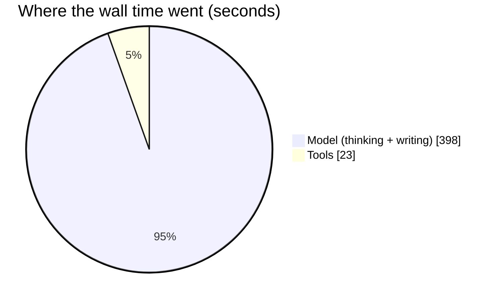

# corporate-ma/draft-markup-of-transition-services-agreement-tsa · run3 (`hv-mixed200-lunahigh-r3-20261116T093818Z`)

Result: **fail** 52/56 criteria · 7.0 min · 24 model calls · 36 tool calls (0 errors or timeouts) · ending `completed` · started 11-16 16:28:06 IST

## Overview

One box per stretch of steps that used the same kind of tool (blue: looking/searching/reading, purple: writing or editing files, yellow: a message with no tool call, red border: a tool error or timeout inside the box).

```mermaid
flowchart TD
    T(["Task prompt"])
    P0["<b>Step 1</b> · 0.0 min<br/>create_goal"]
    T --> P0
    class P0 look
    P1["<b>Step 2</b> · 0.0 min<br/>todo_write"]
    P0 --> P1
    class P1 look
    P2["<b>Step 3</b> · 0.0 min<br/>glob<br/><i>*</i>"]
    P1 --> P2
    class P2 look
    P3["<b>Step 4</b> · 0.2 min<br/>bash x3<br/>read<br/><i>andersen-instructions.eml, parse-doc docx documents/trident-draf…, parse-doc docx documents/polaris-tsa-… +1</i>"]
    P2 --> P3
    class P3 look
    P4["<b>Step 5</b> · 0.1 min<br/>todo_write"]
    P3 --> P4
    class P4 look
    P5["<b>Step 6</b> · 0.1 min<br/>grep x4<br/><i>tsa.txt, playbook.txt, apa.txt</i>"]
    P4 --> P5
    class P5 look
    P6["<b>Step 7</b> · 0.1 min<br/>read x5<br/><i>tsa.txt, playbook.txt, apa.txt</i>"]
    P5 --> P6
    class P6 look
    P7["<b>Steps 8-11</b> · 5.5 min<br/>bash x5<br/><i>python - #lt;#lt;'PY' import docx print('py…, python - #lt;#lt;'PY' try: import lxml; pri…, python - #lt;#lt;'PY' from docx import Docu… +1</i>"]
    P6 --> P7
    class P7 look
    P8["<b>Steps 12-13</b> · 0.2 min<br/>read<br/>edit<br/><i>generate_docs.py</i>"]
    P7 --> P8
    class P8 write
    P9["<b>Step 14</b> · 0.0 min<br/>bash<br/><i>python generate_docs.py && ls -lh out…</i>"]
    P8 --> P9
    class P9 look
    P10["<b>Steps 15-16</b> · 0.1 min<br/>read<br/>edit<br/><i>generate_docs.py</i>"]
    P9 --> P10
    class P10 write
    P11["<b>Step 17</b> · 0.1 min<br/>bash<br/><i>python generate_docs.py && ls -lh out…</i>"]
    P10 --> P11
    class P11 look
    P12["<b>Step 18</b> · 0.1 min<br/>todo_write"]
    P11 --> P12
    class P12 look
    P13["<b>Steps 19-20</b> · 0.3 min<br/>bash x4<br/><i>parse-doc docx output/tsa-markup-redl…, parse-doc docx output/tsa-review-memo…, python - #lt;#lt;'PY' from docx import Docu… +1</i>"]
    P12 --> P13
    class P13 look
    P14["<b>Step 21</b> · 0.1 min<br/>todo_write"]
    P13 --> P14
    class P14 look
    P15["<b>Step 22</b> · 0.0 min<br/>get_goal"]
    P14 --> P15
    class P15 look
    P16["<b>Step 23</b> · 0.0 min<br/>update_goal"]
    P15 --> P16
    class P16 look
    P17["<b>Step 24</b> · 0.1 min<br/>final message"]
    P16 --> P17
    class P17 ans
    R(["FAIL: 52/56 criteria"])
    P17 --> R
    class R fail
    classDef look fill:#e8f0fe,stroke:#4a6fa5,color:#111
    classDef write fill:#f3e8fd,stroke:#7b1fa2,color:#111
    classDef ans fill:#fff8e1,stroke:#b58900,color:#111
    classDef err fill:#e8f0fe,stroke:#c62828,stroke-width:3px,color:#111
    classDef pass fill:#e6f4ea,stroke:#2e7d32,color:#111
    classDef fail fill:#fce8e6,stroke:#c62828,color:#111
```





One row per model call:

| Step | Started (IST) | Model s | Tools s | Tool calls | Tools | Output chars |
|---|---|---|---|---|---|---|
| 1 | 16:28:06 | 3 | 0 | 1 | create_goal | 367 |
| 2 | 16:28:09 | 2 | 0 | 1 | todo_write | 57 |
| 3 | 16:28:11 | 1 | 1 | 1 | glob | 132 |
| 4 | 16:28:13 | 5 | 8 | 4 | bash x3, read | 93,267 |
| 5 | 16:28:26 | 3 | 0 | 1 | todo_write | 57 |
| 6 | 16:28:29 | 5 | 2 | 4 | grep x4 | 108,492 |
| 7 | 16:28:37 | 3 | 0 | 5 | read x5 | 197,826 |
| 8 | 16:28:40 | 51 | 1 | 2 | bash x2 | 26 |
| 9 | 16:29:33 | 4 | 1 | 1 | bash | 33 |
| 10 | 16:29:37 | 171 | 1 | 1 | bash | 1,034 |
| 11 | 16:32:29 | 98 | 1 | 1 | bash | 1,635 |
| 12 | 16:34:08 | 4 | 0 | 1 | read | 15,460 |
| 13 | 16:34:12 | 8 | 0 | 1 | edit | 216 |
| 14 | 16:34:20 | 2 | 1 | 1 | bash | 1,283 |
| 15 | 16:34:23 | 4 | 0 | 1 | read | 1,535 |
| 16 | 16:34:27 | 3 | 0 | 1 | edit | 216 |
| 17 | 16:34:30 | 2 | 1 | 1 | bash | 246 |
| 18 | 16:34:33 | 5 | 0 | 1 | todo_write | 57 |
| 19 | 16:34:39 | 4 | 6 | 3 | bash x3 | 8,084 |
| 20 | 16:34:49 | 6 | 0 | 1 | bash | 308 |
| 21 | 16:34:55 | 4 | 0 | 1 | todo_write | 57 |
| 22 | 16:34:59 | 3 | 0 | 1 | get_goal | 367 |
| 23 | 16:35:02 | 2 | 0 | 1 | update_goal | 372 |
| 24 | 16:35:04 | 4 | 0 | 0 | (message only) | 0 |

## Task prompt

```text
Review the attached draft TSA from the seller's perspective using our playbook, APA excerpts, and client instructions; produce a redline with annotated comments and a priority-tiered cover memo. Output: `tsa-markup-redline.docx` and `tsa-review-memo.docx`.
```

## Rubric

| # | Criterion | Verdict |
|---|---|---|
| C-001 | ISSUE_001a: Identifies 24-month lookback deviation in service standard | pass |
| C-002 | ISSUE_001b: Identifies 'or better than' qualifier in service standard | pass |
| C-003 | ISSUE_001c: Identifies undefined 'industry best practices' benchmark | pass |
| C-004 | ISSUE_001d: Proposes redline conforming service standard to playbook | pass |
| C-005 | ISSUE_002a: Identifies liability cap as 200% of total fees vs. APA's trailing 12-month cap | pass |
| C-006 | ISSUE_002b: Quantifies liability cap exposure difference | pass |
| C-007 | ISSUE_002c: Redlines liability cap to conform to APA Section 7.12(d) | pass |
| C-008 | ISSUE_003a: Identifies non-mutual consequential damages waiver | pass |
| C-009 | ISSUE_003b: Redlines to make consequential damages waiver mutual | pass |
| C-010 | ISSUE_004a: Identifies automatic renewal extending TSA beyond 18 months | pass |
| C-011 | ISSUE_004b: Redlines to delete auto-renewal and impose hard 18-month stop | pass |
| C-012 | ISSUE_005a: Identifies 120-day termination notice exceeding APA's 90 days | pass |
| C-013 | ISSUE_005b: Redlines termination notice to 90 days per APA | pass |
| C-014 | ISSUE_006a: Identifies Key Personnel consent right overriding Polaris staffing discretion | pass |
| C-015 | ISSUE_006b: Proposes compromise on Key Personnel (notice + qualified replacement) | pass |
| C-016 | ISSUE_007a: Identifies IT services 15% markup exceeding APA 10% cap | pass |
| C-017 | ISSUE_007b: Correctly computes IT fee difference | pass |
| C-018 | ISSUE_007c: Notes APA compliance risk even though overcharge benefits Polaris | pass |
| C-019 | ISSUE_008a: Identifies audit frequency deviation (twice/year vs. once/12 months) | pass |
| C-020 | ISSUE_008b: Identifies audit cost allocation deviation (Seller's vs. Buyer's expense) | pass |
| C-021 | ISSUE_008c: Identifies audit notice period deviation (10 vs. 30 business days) | pass |
| C-022 | ISSUE_009a: Identifies Ohio governing law vs. playbook's Pennsylvania law | pass |
| C-023 | ISSUE_009b: Identifies Cuyahoga County litigation vs. playbook's AAA arbitration in Pittsburgh | pass |
| C-024 | ISSUE_009c: Explains strategic importance of home-state law and arbitration for Polaris | pass |
| C-025 | ISSUE_010a: Identifies overbroad perpetual IP license grant | pass |
| C-026 | ISSUE_010b: Redlines to delete IP license and confirm Polaris sole ownership | pass |
| C-027 | ISSUE_011a: Identifies missing non-solicitation provision | pass |
| C-028 | ISSUE_011b: Drafts non-solicitation provision with 12-month post-service tail | pass |
| C-029 | ISSUE_012a: Identifies CGL insurance reduction ($2M vs. $5M playbook) | pass |
| C-030 | ISSUE_012b: Identifies missing umbrella coverage requirement | pass |
| C-031 | ISSUE_012c: Identifies missing additional insured endorsement | pass |
| C-032 | ISSUE_013a: Flags missing IMMEX program provisions for Monterrey facility | pass |
| C-033 | ISSUE_013b: Flags missing Mexican data privacy (LFPDPPP) provisions | pass |
| C-034 | ISSUE_014a: Identifies missing termination assistance/wind-down provisions | pass |
| C-035 | ISSUE_014b: Proposes termination assistance at cost-plus-15% for up to 60 days | **FAIL** |
| C-036 | ISSUE_015a: Identifies missing change order procedure | pass |
| C-037 | ISSUE_015b: Proposes change order procedure with cost-plus-15% pricing | **FAIL** |
| C-038 | ISSUE_016a: Identifies vague payment terms ('commercially reasonable time') | pass |
| C-039 | ISSUE_016b: Redlines payment terms to Net 30 days | **FAIL** |
| C-040 | ISSUE_016c: Adds late payment interest at 1.5%/month or max legal rate | pass |
| C-041 | ISSUE_017a: Identifies missing force majeure 90-day termination trigger | pass |
| C-042 | ISSUE_017b: Proposes 90-day force majeure termination right | pass |
| C-043 | Cover memo produced as a deliverable | pass |
| C-044 | Cover memo organizes issues by priority tiers (Critical/Significant/Minor) | pass |
| C-045 | APA-conflict issues classified as highest priority in cover memo | pass |
| C-046 | Cover memo includes negotiation strategy distinguishing firm vs. flexible positions | pass |
| C-047 | Redline markup includes proposed edits to the TSA | pass |
| C-048 | Redline markup includes explanatory comments for changes | pass |
| C-049 | Correctly identifies Polaris as Service Provider / Seller throughout | pass |
| C-050 | References APA Section 7.12 when flagging APA-conflict issues | pass |
| C-051 | Fee escalation provision addressed (playbook: greater of 3% or CPI-U) | **FAIL** |
| C-052 | Indemnification provision addressed (Buyer indemnifies for third-party claims) | pass |
| C-053 | Both deliverable files are produced | pass |
| C-054 | Correct total monthly service cost baseline ($1,020,000) referenced | pass |
| C-055 | Playbook's dispute escalation to senior executives referenced | pass |
| C-056 | Redline comments explain specific risk to Polaris for at least five changes | pass |

Judge's reasoning:

**C-001 (pass):** ISSUE_001a: Identifies 24-month lookback deviation in service standard

```text
The output expressly identifies the draft's 24-month service-standard lookback as conflicting with the required 12-month benchmark and proposes replacing it with a 12-month lookback in Section 3.1.
```

**C-002 (pass):** ISSUE_001b: Identifies 'or better than' qualifier in service standard

```text
The output expressly flags the draft’s “at least equal to or better than” language as an objective upward ratchet, identifies the resulting risk, and proposes replacing it with a 12-month “substantially consistent” historical standard that does not require exceeding prior service levels.
```

**C-003 (pass):** ISSUE_001c: Identifies undefined 'industry best practices' benchmark

```text
The output expressly flags “industry best practices” as an undefined external benchmark that could impose a higher, potentially costly standard not required by the APA or playbook. It proposes deleting that language and replacing it with a historical-performance benchmark based on Polaris’s prior practices.
```

**C-004 (pass):** ISSUE_001d: Proposes redline conforming service standard to playbook

```text
The agent proposes corrective replacement language in Section 3.1 requiring services to be performed “substantially consistent with the manner and level of quality” provided to the Business during the twelve months immediately preceding Closing, which conforms to the playbook standard.
```

**C-005 (pass):** ISSUE_002a: Identifies liability cap as 200% of total fees vs. APA's trailing 12-month cap

```text
The output expressly identifies Section 10.1's draft cap as 200% of total TSA fees paid and contrasts it with APA Section 7.12(d)'s required cap based on fees actually paid during the 12 months preceding the claim. It also proposes the correct trailing-12-month formulation.
```

**C-006 (pass):** ISSUE_002b: Quantifies liability cap exposure difference

```text
The output expressly quantifies the liability-cap exposure: approximately $41.004 million under the draft (200% of $20.502 million in 18-month fees) versus approximately $13.464 million under the APA trailing-12-month cap, identifying a roughly $27.54 million gap (about 3.05x).
```

**C-007 (pass):** ISSUE_002c: Redlines liability cap to conform to APA Section 7.12(d)

```text
The agent expressly redlines Section 10.1 to cap Polaris's aggregate liability at TSA fees actually paid during the 12-month period immediately preceding the date the applicable claim is first asserted in writing, with a sensible formulation for claims arising during the first 12 months. This conforms to APA Section 7.12(d).
```

**C-008 (pass):** ISSUE_003a: Identifies non-mutual consequential damages waiver

```text
The output expressly identifies Section 10.2 as a one-way/unilateral consequential-damages waiver, explains that it leaves Polaris exposed to Trident’s consequential-loss claims, and proposes a mutual waiver.
```

**C-009 (pass):** ISSUE_003b: Redlines to make consequential damages waiver mutual

```text
The agent expressly replaces the one-way waiver in Section 10.2 with mutual language stating that “NEITHER PARTY SHALL BE LIABLE TO THE OTHER” for consequential, incidental, indirect, special, exemplary, or punitive damages, consistent with the criterion and Polaris playbook.
```

**C-010 (pass):** ISSUE_004a: Identifies automatic renewal extending TSA beyond 18 months

```text
The output expressly identifies that the 18-month initial term plus two automatic six-month renewals could extend the TSA to 30 months, conflicting with APA §7.12(a)'s 18-month maximum, and proposes deleting automatic renewal.
```

**C-011 (pass):** ISSUE_004b: Redlines to delete auto-renewal and impose hard 18-month stop

```text
The agent expressly deletes Section 5.2’s automatic-renewal mechanism and replaces it with an 18-month maximum term. It further requires any extension of an individual service to be made by mutual written amendment, with no automatic renewal. Although it applies the APA’s 10% cost-plus cap rather than the playbook’s preferred 15%, the criterion treats 15% as ideal rather than mandatory.
```

**C-012 (pass):** ISSUE_005a: Identifies 120-day termination notice exceeding APA's 90 days

```text
The output expressly flags that Section 5.3 requires 120 days' prior written notice for terminating an individual service and states that this conflicts with APA Section 7.12(c)'s 90-day notice period, proposing replacement with 90 days.
```

**C-013 (pass):** ISSUE_005b: Redlines termination notice to 90 days per APA

```text
The output expressly deletes the 120-day termination notice in Section 5.3 and replaces it with exactly 90 days’ prior written notice, citing APA Section 7.12(c).
```

**C-014 (pass):** ISSUE_006a: Identifies Key Personnel consent right overriding Polaris staffing discretion

```text
The output expressly flags the Key Personnel provision requiring Trident's prior written consent for reassignment, replacement, termination, or removal of named personnel. It identifies the conflict with Polaris's sole staffing discretion under the playbook and proposes deleting consent rights and making the 14-person Schedule H list non-binding and illustrative.
```

**C-015 (pass):** ISSUE_006b: Proposes compromise on Key Personnel (notice + qualified replacement)

```text
The proposed Section 4.3 restores Polaris’s sole discretion over personnel decisions, removes Trident’s consent right, and offers the specified compromise: 15 Business Days’ advance notice where practicable and designation of a reasonably qualified replacement.
```

**C-016 (pass):** ISSUE_007a: Identifies IT services 15% markup exceeding APA 10% cap

```text
The output expressly flags Schedule G's IT markup as 15% ($391,000/month) instead of the APA-compliant 10% ($374,000/month), and cites APA §7.12(b)'s 10% cap in the redline, summary, and fee correction table.
```

**C-017 (pass):** ISSUE_007b: Correctly computes IT fee difference

```text
The output states that the IT fee is $391,000 at 15% rather than the correct $374,000 at 10%, and correspondingly reduces the monthly total from $1,139,000 to $1,122,000. This correctly reflects a $17,000 monthly overcharge.
```

**C-018 (pass):** ISSUE_007c: Notes APA compliance risk even though overcharge benefits Polaris

```text
The seller-side work product expressly identifies the 15% IT markup as an APA §7.12(b) violation, labels correction to 10% as a firm APA-compliance requirement, and reduces Polaris’s fee despite Polaris being the service provider. This adequately recognizes that the seller-favorable overcharge must be corrected to comply with the APA.
```

**C-019 (pass):** ISSUE_008a: Identifies audit frequency deviation (twice/year vs. once/12 months)

```text
The output expressly flags that Section 14 permits audits twice per calendar year and proposes replacing that frequency with no more than once in any twelve-month period, consistent with the playbook.
```

**C-020 (pass):** ISSUE_008b: Identifies audit cost allocation deviation (Seller's vs. Buyer's expense)

```text
The output expressly identifies that the draft permits audits at Polaris’s expense, cites the playbook requirement, and proposes revising Section 14 so audits are conducted at Trident’s sole expense, subject to a limited overcharge-cost exception.
```

**C-021 (pass):** ISSUE_008c: Identifies audit notice period deviation (10 vs. 30 business days)

```text
The output expressly flags that the draft permits audits on 10 Business Days' notice and proposes replacing that period with 30 Business Days' notice, consistent with the playbook.
```

**C-022 (pass):** ISSUE_009a: Identifies Ohio governing law vs. playbook's Pennsylvania law

```text
The output expressly flags that the draft uses Ohio governing law while the Polaris playbook requires Pennsylvania law, and proposes replacing Ohio law with Pennsylvania law in Sections 15.1–15.2.
```

**C-023 (pass):** ISSUE_009b: Identifies Cuyahoga County litigation vs. playbook's AAA arbitration in Pittsburgh

```text
The output expressly flags the draft's Ohio law and exclusive litigation in Cuyahoga County, Ohio, contrasts it with the playbook, and proposes confidential binding arbitration under AAA Commercial Rules in Pittsburgh, Pennsylvania.
```

**C-024 (pass):** ISSUE_009c: Explains strategic importance of home-state law and arbitration for Polaris

```text
The output explains the strategic rationale for Pennsylvania law and Pittsburgh arbitration: it identifies buyer-home-state litigation as creating home-court and public-docket risk and notes arbitration’s confidentiality, limited discovery, and industry expertise. The memo likewise states that Ohio/Cuyahoga litigation conflicts with Polaris’s playbook and recommends the Pennsylvania/AAA/Pittsburgh forum.
```

**C-025 (pass):** ISSUE_010a: Identifies overbroad perpetual IP license grant

```text
The output expressly flags Section 7.1’s perpetual, irrevocable, worldwide, royalty-free license—including modification, derivative-work, and sublicensing rights—as a critical, non-negotiable departure from the playbook’s no-license position. It explains the proprietary operational IP and competitive-leakage risk and proposes deleting the license in favor of term-limited access with ownership reserved to Polaris.
```

**C-026 (pass):** ISSUE_010b: Redlines to delete IP license and confirm Polaris sole ownership

```text
The output expressly deletes the perpetual, irrevocable IP license and replaces it with language stating that all Service Provider Materials remain Polaris’s sole and exclusive property, that no license or sublicense is granted, and that Trident receives only limited access during the TSA term solely to receive the Services, with access ending upon expiration or termination.
```

**C-027 (pass):** ISSUE_011a: Identifies missing non-solicitation provision

```text
The output expressly flags that the draft has no restriction on Trident soliciting or hiring Polaris service personnel (S-11) and proposes a non-solicitation/non-hire covenant covering employees who provided services.
```

**C-028 (pass):** ISSUE_011b: Drafts non-solicitation provision with 12-month post-service tail

```text
The proposed Section 15.12 restricts Trident from soliciting, recruiting, hiring, or engaging Polaris service personnel during the term and for 12 months after expiration or termination, unless Polaris consents. This satisfies the required 12-month tail and consent condition.
```

**C-029 (pass):** ISSUE_012a: Identifies CGL insurance reduction ($2M vs. $5M playbook)

```text
The output expressly flags that the draft requires Trident/Buyer to maintain only $2 million in CGL coverage and proposes increasing that requirement to $5 million, consistent with the playbook.
```

**C-030 (pass):** ISSUE_012b: Identifies missing umbrella coverage requirement

```text
The agent expressly flags that the draft has no umbrella coverage and proposes requiring Trident to maintain $5 million in umbrella/excess coverage in Section 13. The cover memo also identifies the omission and recommends adding $5 million umbrella coverage.
```

**C-031 (pass):** ISSUE_012c: Identifies missing additional insured endorsement

```text
The output expressly flags that the draft lacks additional-insured protection and proposes requiring Polaris to be named as an additional insured under Trident’s CGL and umbrella policies. It also identifies additional-insured status as a firm position in the cover memo.
```

**C-032 (pass):** ISSUE_013a: Flags missing IMMEX program provisions for Monterrey facility

```text
The output expressly flags the absence of substantive IMMEX provisions for the Monterrey facility and proposes allocating primary post-Closing responsibility to Trident for maintaining or obtaining IMMEX certification, customs records, and filings, with Polaris providing transition assistance and both parties having notice and remediation obligations.
```

**C-033 (pass):** ISSUE_013b: Flags missing Mexican data privacy (LFPDPPP) provisions

```text
The output expressly flags that the TSA covers only U.S. privacy laws and omits Mexico’s LFPDPPP despite processing data for 300+ Mexican employees. It proposes substantive LFPDPPP provisions, including controller/processor allocation, a data-processing addendum, privacy notices, consent or other lawful cross-border transfer mechanisms, security, breach notice, data-subject assistance, and return/deletion requirements.
```

**C-034 (pass):** ISSUE_014a: Identifies missing termination assistance/wind-down provisions

```text
The output expressly flags that the draft has no termination-assistance or wind-down obligation and proposes a new Section 5.7 providing up to 60 days of defined, compensated transition support, consistent with the Polaris playbook.
```

**C-035 (fail):** ISSUE_014b: Proposes termination assistance at cost-plus-15% for up to 60 days

```text
The proposed provision includes up to 60 days of termination assistance, but prices it at the cost-plus rate permitted by the APA, expressly noting that the APA's 10% markup cap controls. It does not specify the required cost-plus-15% pricing.
```

**C-036 (pass):** ISSUE_015a: Identifies missing change order procedure

```text
The output expressly flags the absence of a formal change-order mechanism in S-4, noting there is no process for out-of-scope services, material volume increases, or scope modifications. It proposes a written change order signed by both parties before any additional or changed work is performed, consistent with the playbook.
```

**C-037 (fail):** ISSUE_015b: Proposes change order procedure with cost-plus-15% pricing

```text
The agent proposes a written change order signed by both parties, but omits the required cost-plus-15% pricing. Instead, it limits change-order pricing to the APA’s 10% markup cap.
```

**C-038 (pass):** ISSUE_016a: Identifies vague payment terms ('commercially reasonable time')

```text
The output expressly flags Section 6.3's requirement to pay within a “commercially reasonable time” as vague and proposes replacing it with a defined Net 30 payment deadline, with Net 45 as a fallback.
```

**C-039 (fail):** ISSUE_016b: Redlines payment terms to Net 30 days

```text
The agent replaces the vague timing with payment within 30 days after receipt of the invoice, not Net 30 days from the invoice date as required by the criterion.
```

**C-040 (pass):** ISSUE_016c: Adds late payment interest at 1.5%/month or max legal rate

```text
Section S-6 proposes that late amounts bear interest at the lesser of 1.5% per month or the maximum rate permitted by law, exactly satisfying the criterion.
```

**C-041 (pass):** ISSUE_017a: Identifies missing force majeure 90-day termination trigger

```text
The output expressly flags that the force majeure clause lacks a prolonged-event termination right and proposes allowing either party to terminate the affected service after 90 consecutive days, without further liability for post-termination nonperformance.
```

**C-042 (pass):** ISSUE_017b: Proposes 90-day force majeure termination right

```text
The output proposes in Section 12.1 that if a force majeure event materially prevents an affected service for 90 consecutive days, either party may terminate that service by written notice without further liability for post-termination nonperformance, while preserving accrued payment obligations.
```

**C-043 (pass):** Cover memo produced as a deliverable

```text
The output includes a clearly labeled priority-tiered cover memorandum summarizing the TSA review, including key issues, risk priorities, negotiation strategy, and recommended next steps.
```

**C-044 (pass):** Cover memo organizes issues by priority tiers (Critical/Significant/Minor)

```text
The cover memo clearly organizes issues into three priority tiers: Tier 1 Critical, Tier 2 Significant, and Tier 3 Minor/Cleanup.
```

**C-045 (pass):** APA-conflict issues classified as highest priority in cover memo

```text
The cover memo places all specified APA-conflict issues in Priority Tier 1—CRITICAL: the 200% liability cap, automatic renewals beyond the APA term, 120-day termination notice, and 15% IT markup exceeding the APA’s 10% cap. It separately classifies playbook deviations as Tier 2 Significant or Tier 3 Minor.
```

**C-046 (pass):** Cover memo includes negotiation strategy distinguishing firm vs. flexible positions

```text
The memo clearly distinguishes firm and flexible positions for well over three key issues and explains why. For example, it treats APA-conformity items such as the service standard, term, termination notice, fee mechanics, and liability cap as firm because they implement the executed APA; identifies the IP license and mutual damages waiver as non-negotiable due to leakage and asymmetric exposure; and allows compromise on staffing notice, termination-assistance duration, audit frequency, insurance limits, and dispute mechanics within stated fallbacks.
```

**C-047 (pass):** Redline markup includes proposed edits to the TSA

```text
The output includes extensive clause-by-clause proposed redline edits, with draft language marked for deletion and replacement language marked for addition across numerous TSA provisions and schedules. It is not merely an issue list.
```

**C-048 (pass):** Redline markup includes explanatory comments for changes

```text
The redline includes explanatory margin comments for each proposed edit, with stated rationale, risk, negotiation posture, and references to the APA, playbook, or client instructions.
```

**C-049 (pass):** Correctly identifies Polaris as Service Provider / Seller throughout

```text
The output consistently identifies Polaris Industrial Holdings, Inc. as the Seller and Service Provider and Trident as the Buyer/Service Recipient. Its proposed revisions and risk analysis are framed throughout to protect Polaris in its service-provider role, with no material party-role confusion.
```

**C-050 (pass):** References APA Section 7.12 when flagging APA-conflict issues

```text
The output repeatedly cites APA §7.12 and relevant subsections for each identified APA conflict, including §7.12(a) for term/renewal, §7.12(c) for termination notice, §7.12(b) for fee markup and true-up mechanics, and §7.12(d) for the liability cap.
```

**C-051 (fail):** Fee escalation provision addressed (playbook: greater of 3% or CPI-U)

```text
The output addresses fee escalation, but it does not reference or propose the playbook’s required annual increase of the greater of 3% or CPI-U. Instead, it proposes actual-cost/vendor/law/volume adjustments and expressly avoids a standalone 3% floor.
```

**C-052 (pass):** Indemnification provision addressed (Buyer indemnifies for third-party claims)

```text
The output expressly addresses indemnification in Section S-2, proposing that Trident (Buyer) indemnify Polaris (Seller) for third-party claims arising from Trident's use of or reliance on the services, subject to an exception to the extent caused by Polaris's gross negligence or willful misconduct. This matches the playbook position in the criterion.
```

**C-053 (pass):** Both deliverable files are produced

```text
The output includes two distinct deliverables: (1) a seller-side redlined and annotated TSA titled “tsa-markup-redline.docx” and (2) a separate priority-tiered cover memo titled “tsa-review-memo.docx.”
```

**C-054 (pass):** Correct total monthly service cost baseline ($1,020,000) referenced

```text
The output expressly states a total base monthly cost of $1,020,000 and a corrected total monthly fee of $1,122,000 at a 10% markup, matching the required aggregates.
```

**C-055 (pass):** Playbook's dispute escalation to senior executives referenced

```text
The output expressly proposes that disputes first be escalated to CFO/General Counsel representatives for 15 Business Days before unresolved disputes proceed to AAA arbitration, satisfying the playbook escalation criterion.
```

**C-056 (pass):** Redline comments explain specific risk to Polaris for at least five changes

```text
The annotated redline identifies concrete adverse consequences to Polaris for well over five distinct changes. Examples include an undefined performance ratchet requiring improved service and Buyer prioritization (C-1), a potential 30-month service commitment and loss of exit rights (C-2), approximately $27.5 million in added liability exposure (C-5), perpetual leakage of enterprise IP (C-7), cross-border privacy and customs exposure (C-8), workforce-management constraints (S-1), and disruptive audits exposing proprietary systems (S-7). These explanations go beyond mechanical APA or playbook cross-references.
```

## Delivered files (output/)

- `tsa-markup-redline.docx` (58,050 bytes)
- `tsa-review-memo.docx` (44,217 bytes)

## Trajectory

### Step 1: 1 tool call

_Started 11-16 16:28:06 IST · model 3 s · tools 0 s_

**Call `create_goal`** (0.0 s)

```json
{
 "objective": "Review the draft TSA from the seller's perspective using the provided playbook, APA excerpts, and client instructions, then produce tsa-markup-redline.docx and tsa-review-memo.docx in the output directory.",
 "max_goal_rounds": 10
}
```

Output (367 chars):

```text
{"goal":{"id":"goal-97531d61-6d31-4277-9bfc-2aabfeb117e7","revision":1,"objective":"Review the draft TSA from the seller's perspective using the provided playbook, APA excerpts, and client instructions, then produce tsa-markup-redline.docx and tsa-review-memo.docx in the output directory.","phase":"active","roundsStarted":0,"maxGoalRounds":10},"activation":"armed"}
```

### Step 2: 1 tool call

_Started 11-16 16:28:09 IST · model 2 s · tools 0 s_

**Call `todo_write`** (0.0 s)

```json
{
 "todos": [
  {
   "content": "Inventory provided TSA, playbook, APA excerpts, and client instructions",
   "status": "in_progress"
  },
  {
   "content": "Extract and analyze source documents for seller-side issues",
   "status": "pending"
  },
  {
   "content": "Prepare annotated redline of TSA with priority-based comments",
   "status": "pending"
  },
  {
   "content": "Prepare priority-tiered cover memo summarizing key issues",
   "status": "pending"
  },
  {
   "content": "Validate both DOCX deliverables and finalize output",
   "status": "pending"
  }
 ]
}
```

Output (57 chars):

```text
Updated todo list: 4 pending, 1 in progress, 0 completed.
```

**Todo list now:**

- [~] Inventory provided TSA, playbook, APA excerpts, and client instructions
- [ ] Extract and analyze source documents for seller-side issues
- [ ] Prepare annotated redline of TSA with priority-based comments
- [ ] Prepare priority-tiered cover memo summarizing key issues
- [ ] Validate both DOCX deliverables and finalize output

### Step 3: 1 tool call

_Started 11-16 16:28:11 IST · model 1 s · tools 1 s_

**Call `glob`** (0.6 s)

```json
{
 "pattern": "*"
}
```

Output (132 chars):

```text
documents/andersen-instructions.eml
documents/trident-draft-tsa.docx
documents/polaris-tsa-playbook.docx
documents/apa-excerpts.docx
```

### Step 4: 4 tool calls

_Started 11-16 16:28:13 IST · model 5 s · tools 8 s_

**Reasoning summary:**

```text
**Exploring document parsing**

I need to inspect how to parse documents. It seems like I can use the `parse-doc` command in bash for both docx and eml files. Maybe I should create a temporary text output. I also want to check the availability of `parse-doc`. I could create a directory called "scratch" and then use `parse-doc` to convert each file to a temporary folder. I wonder if invoking parallel commands is possible here, especially for reading eml files directly. Let me figure this out!
```

**Call `read`** (0.0 s)

```json
{
 "file_path": "documents/andersen-instructions.eml"
}
```

Output (11,952 chars):

```text
<path>/home/agarwaldi/dsh-bench-harness/runs/hv-mixed200-lunahigh-r3-20261116T093818Z/tasks/corporate-ma__draft-markup-of-transition-services-agreement-tsa/workspace/documents/andersen-instructions.eml</path>
<type>file</type>
<content>
1: From: Victoria S. Andersen (vandersen@whitfieldcrane.com)
2: To: Nathan J. Reeves (nreeves@whitfieldcrane.com)
3: Date: Tue, 29 Apr 2025 08:17:00 -0000
4: Subject: RE: Polaris / Trident — TSA Markup Assignment — Specialty Coatings
5:  Divestiture
6: Content-Type: text/plain; charset="utf-8"
7: Content-Transfer-Encoding: quoted-printable
8: MIME-Version: 1.0
9: 
10: Nathan,
11: 
12: Caldwell Briggs & Foley (Tom Graziano's team =E2=80=94 his associate Priya Ve=
13: nkatesh circulated) sent over Trident's first draft of the Transition Service=
14: s Agreement yesterday evening. I've done a quick initial skim but haven't had=
15:  time to go through it with a fine-tooth comb =E2=80=94 that's where you come=
16:  in.
17: 
18: For context, this is the TSA contemplated by Section 7.12 of the executed Ass=
19: et Purchase Agreement dated March 14, 2025, between Polaris Industrial Holdin=
20: gs, Inc. (as Seller and Service Provider) and Trident Manufacturing Group, In=
21: c. (as Buyer and Service Recipient) for the divestiture of the Specialty Coat=
22: ings Division. Expected closing is June 2, 2025, which means we need to turn =
23: around a comprehensive markup by end of next week at the latest. Sharon Petro=
24: sian wants to see our redline b
… [10,452 more chars]
```

**Call `bash`** (2.4 s)

```json
{
 "command": "parse-doc docx documents/trident-draft-tsa.docx > tsa.txt && wc -l tsa.txt && sed -n '1,240p' tsa.txt",
 "description": "Extract draft TSA text"
}
```

Output (15,560 chars):

```text
1083 tsa.txt
DRAFT --- APRIL 28, 2025 PRIVILEGED & CONFIDENTIAL SUBJECT TO CONTRACT

**[TRANSITION SERVICES AGREEMENT]{.underline}**

**by and between**

**POLARIS INDUSTRIAL HOLDINGS, INC.**

**and**

**TRIDENT MANUFACTURING GROUP, INC.**

Dated as of \[●\], 2025

Prepared by Caldwell Briggs & Foley LLP

**TABLE OF CONTENTS**

  ----------------------------------------------------------------------------------------------------------
                                                                                     **Page**
  ----------------------- ---------------------------------------------------------- -----------------------
  **ARTICLE 1**           **DEFINITIONS**                                            \[●\]

                          Section 1.1 Defined Terms                                  \[●\]

  **ARTICLE 2**           **SERVICES**                                               \[●\]

                          Section 2.1 Provision of Services                          \[●\]

                          Section 2.2 Scope Limitations                              \[●\]

                          Section 2.3 Exclusive Remedy                               \[●\]

                          Section 2.4 Subcontracting                                 \[●\]

  **ARTICLE 3**           **SERVICE STANDARDS**                                      \[●\]

                          Section 3.1 Standard of Performance                        \[●\]

                          Sect
… [14,059 more chars]
```

**Call `bash`** (2.0 s)

```json
{
 "command": "parse-doc docx documents/polaris-tsa-playbook.docx > playbook.txt && wc -l playbook.txt && sed -n '1,260p' playbook.txt",
 "description": "Extract TSA playbook text"
}
```

Output (33,861 chars):

```text
488 playbook.txt
**[TRANSITION SERVICES AGREEMENT]{.underline}**

**[NEGOTIATION PLAYBOOK]{.underline}**

**Polaris Industrial Holdings, Inc. --- Service Provider Positions**

**PRIVILEGED AND CONFIDENTIAL --- ATTORNEY-CLIENT WORK PRODUCT**

This document is protected by the attorney-client privilege and the work-product doctrine. It contains the legal strategies, negotiation positions, and confidential assessments of Polaris Industrial Holdings, Inc. and its counsel. Distribution is strictly limited to authorized personnel. Any unauthorized disclosure, copying, or distribution is prohibited and may constitute a waiver of applicable privileges.

**Maintained by:** Legal Department, Polaris Industrial Holdings, Inc., 1200 Commonwealth Avenue, Suite 3000, Pittsburgh, PA 15222

**Approved by:** Sharon M. Petrosian, General Counsel

**Last Updated:** January 15, 2025

**Version:** 4.2

**Distribution:** Limited to Polaris Legal Department, CFO (David K. Okafor), CEO (Margaret R. Lindstrom), and outside counsel (Whitfield & Crane LLP, 600 Grant Street, Suite 4800, Pittsburgh, PA 15219; Lead Partner: Victoria S. Andersen)

This Playbook sets forth Polaris\'s preferred and fallback positions for any Transition Services Agreement in which Polaris acts as Service Provider following a divestiture. All positions should be adapted to the specific transaction and governing purchase agreement. Positions marked **\"Target\"** represent Polaris\'s opening/preferred position. Positions marked
… [32,360 more chars]
```

**Call `bash`** (4.0 s)

```json
{
 "command": "parse-doc docx documents/apa-excerpts.docx > apa.txt && wc -l apa.txt && sed -n '1,240p' apa.txt",
 "description": "Extract APA excerpt text"
}
```

Output (31,894 chars):

```text
437 apa.txt
**[EXCERPTS FROM EXECUTED ASSET PURCHASE AGREEMENT]{.underline}**

**ASSET PURCHASE AGREEMENT**

**dated as of March 14, 2025**

**by and between**

**POLARIS INDUSTRIAL HOLDINGS, INC.**

**and**

**TRIDENT MANUFACTURING GROUP, INC.**

This document contains selected excerpts from the Asset Purchase Agreement dated as of March 14, 2025, by and between Polaris Industrial Holdings, Inc. and Trident Manufacturing Group, Inc. The complete Asset Purchase Agreement is approximately 180 pages. Only the provisions relevant to the Transition Services Agreement are reproduced herein. Sections, exhibits, and schedules not reproduced are indicated by bracketed editorial notations. Defined terms used but not defined in these excerpts have the meanings given to them in the full Asset Purchase Agreement.

**APA Execution Date: March 14, 2025**

**[PREAMBLE AND RECITALS (EXCERPT)]{.underline}**

This ASSET PURCHASE AGREEMENT (this \"**Agreement**\") is entered into as of March 14, 2025, by and between:

**POLARIS INDUSTRIAL HOLDINGS, INC.**, a Delaware corporation, with its principal offices at 1200 Commonwealth Avenue, Suite 3000, Pittsburgh, PA 15222 (\"**Seller**\"),

and

**TRIDENT MANUFACTURING GROUP, INC.**, an Ohio corporation, with its principal offices at 800 Lakeside Drive, Suite 400, Cleveland, OH 44114 (\"**Buyer**\").

**RECITALS**

**WHEREAS:**

\(A\) Seller operates, among other businesses, the Specialty Coatings Division (as defined below), which is engaged in the
… [30,393 more chars]
```

### Step 5: 1 tool call

_Started 11-16 16:28:26 IST · model 3 s · tools 0 s_

**Reasoning summary:**

```text
**Parsing and analyzing files**

I’m looking to read the converted files like tsa.txt as per instructions. I need to use read functions for that. I also think the parse-doc might have some markdown formatting. It’s important to check that I get full content for analysis. I need to inspect relevant sections, so I’ll use the grep tool to get specific lines. First, I’ll update my to-do list to confirm that the inventory is complete while the analysis is still in progress.
```

**Call `todo_write`** (0.0 s)

```json
{
 "todos": [
  {
   "content": "Inventory provided TSA, playbook, APA excerpts, and client instructions",
   "status": "completed"
  },
  {
   "content": "Extract and analyze source documents for seller-side issues",
   "status": "in_progress"
  },
  {
   "content": "Prepare annotated redline of TSA with priority-based comments",
   "status": "pending"
  },
  {
   "content": "Prepare priority-tiered cover memo summarizing key issues",
   "status": "pending"
  },
  {
   "content": "Validate both DOCX deliverables and finalize output",
   "status": "pending"
  }
 ]
}
```

Output (57 chars):

```text
Updated todo list: 3 pending, 1 in progress, 1 completed.
```

**Todo list now:**

- [x] Inventory provided TSA, playbook, APA excerpts, and client instructions
- [~] Extract and analyze source documents for seller-side issues
- [ ] Prepare annotated redline of TSA with priority-based comments
- [ ] Prepare priority-tiered cover memo summarizing key issues
- [ ] Validate both DOCX deliverables and finalize output

### Step 6: 4 tool calls

_Started 11-16 16:28:29 IST · model 5 s · tools 2 s_

**Call `grep`** (0.5 s)

```json
{
 "pattern": "Section 2\\.1|Section 2\\.2|Section 2\\.3|Section 2\\.4|Section 3\\.1|Section 3\\.2|Section 4\\.3|Section 5\\.1|Section 5\\.2|Section 5\\.3|Section 5\\.4|Section 5\\.5|Section 6\\.1|Section 6\\.2|Section 6\\.3|Section 6\\.4|Section 6\\.5|Section 7\\.1|Section 7\\.2|Section 7\\.3|Section 8\\.4|Section 9\\.1|Section 9\\.2|Section 10\\.1|Section 10\\.2|Section 10\\.3|Section 10\\.4|Section 11\\.1|Section 11\\.2|Section 11\\.3|Section 12\\.1|Section 12\\.2|Section 13\\.1|Section 13\\.2|Section 14\\.1|Section 14\\.2|Section 15\\.1|Section 15\\.2|Section 15\\.3|Section 15\\.4|Section 15\\.5|Section 15\\.6|Section 15\\.7|Section 15\\.8|Section 15\\.9|Section 15\\.10|Section 15\\.11",
 "path": "tsa.txt"
}
```

Output (38,731 chars):

```text
Found 104 matches

tsa.txt
Line 28:                           Section 2.1 Provision of Services                          \[●\]
Line 30:                           Section 2.2 Scope Limitations                              \[●\]
Line 32:                           Section 2.3 Exclusive Remedy                               \[●\]
Line 34:                           Section 2.4 Subcontracting                                 \[●\]
Line 38:                           Section 3.1 Standard of Performance                        \[●\]
Line 40:                           Section 3.2 No Guarantee of Results                        \[●\]
Line 50:                           Section 4.3 Key Personnel                                  \[●\]
Line 56:                           Section 5.1 Initial Term                                   \[●\]
Line 58:                           Section 5.2 Automatic Renewal                              \[●\]
Line 60:                           Section 5.3 Termination of Individual Services             \[●\]
Line 62:                           Section 5.4 Termination for Cause                          \[●\]
Line 64:                           Section 5.5 Effect of Termination                          \[●\]
Line 70:                           Section 6.1 Service Charges                                \[●\]
Line 72:                           Section 6.2 Invoicing                                      \[●\]
Line 74:                           Section 6.3 Payment                   
… [37,231 more chars]
```

**Call `grep`** (0.5 s)

```json
{
 "pattern": "Schedule [A-H]|Fee Schedule|Monterrey|IMMEX|Mexico|payroll|markup|\\$|cost-plus|renew|termination assistance|change order|non-solicit|solicit|insurance|Force Majeure|audit|key personnel|best efforts|best practices|Pennsylvania|Pittsburgh|AAA|arbitr",
 "path": "tsa.txt"
}
```

Output (30,178 chars):

```text
Found 90 matches

tsa.txt
Line 126:                           Section 12.1 Force Majeure                                 \[●\]
Line 128:                           Section 12.2 Allocation During Force Majeure               \[●\]
Line 170:   **Schedule A**                      **Financial Reporting & Accounting Services**
Line 172:   Schedule B                          Information Technology Services
Line 174:   Schedule C                          Human Resources Services
Line 176:   Schedule D                          Supply Chain & Procurement Services
Line 178:   Schedule E                          Regulatory & EHS Compliance Services
Line 180:   Schedule F                          Treasury & Tax Services
Line 182:   Schedule G                          Fee Schedule
Line 184:   Schedule H                          Key Personnel
Line 191: **POLARIS INDUSTRIAL HOLDINGS, INC.**, a Delaware corporation, with its principal offices at 1200 Commonwealth Avenue, Suite 3000, Pittsburgh, Pennsylvania 15222 (the \"**Service Provider**\" or \"**Polaris**\");
Line 199: **RECITALS. WHEREAS**, Polaris and Trident entered into that certain Asset Purchase Agreement dated as of March 14, 2025 (as amended, restated, supplemented, or otherwise modified from time to time, the \"**Purchase Agreement**\" or \"**APA**\"), pursuant to which Polaris agreed to sell, transfer, convey, and deliver to Trident substantially all of the assets of Polaris\'s Specialty Coatings Division (the \"**Business**\") f
… [28,678 more chars]
```

**Call `grep`** (0.4 s)

```json
{
 "pattern": "Section 6|Section 7|Section 8|Section 9|Section 10|Section 11|Section 12|Section 13|Section 14|Section 15|non-solicitation|audit|insurance|change order|termination assistance|cross-border|IMMEX|data|IP|license|key personnel|staffing",
 "path": "playbook.txt"
}
```

Output (14,828 chars):

```text
Found 54 matches

playbook.txt
Line 59: > • **Lookback Period:** The lookback period is twelve (12) months prior to the Closing Date. Do not accept a 24-month or longer lookback period. A longer lookback may capture atypical service levels (e.g., pre-pandemic staffing, special project surges) that are not representative of current operations.
Line 79: > • **(d)** Provide services that would breach any third-party agreement to which Polaris is a party (including software licenses, vendor contracts, or confidentiality agreements);
Line 99: > • The 18-month maximum is typically mandated by APA Section 7.12 in standard Polaris deals. The TSA cannot exceed the APA-mandated term.
Line 115: The 90-day notice period is typically mandated by APA Section 7.12(c). Do not accept termination notice periods longer than 90 days, as longer periods lock Polaris into service obligations even when continued provision is inefficient or undesirable.
Line 132:   **Target**                          Upon expiration or termination of any Service, Service Provider shall provide reasonable termination assistance for a period not to exceed **60 days** at **cost-plus-15%**. Assistance includes: knowledge transfer, data migration support, cooperation with replacement providers, and transition documentation. No obligation to provide termination assistance if Service Recipient has outstanding unpaid invoices.
Line 134:   **Fallback**                        Extend termination assistance period to 90 days max
… [13,328 more chars]
```

**Call `grep`** (0.6 s)

```json
{
 "pattern": "Exhibit H|Financial Reporting|Information Technology|Human Resources|Supply Chain|Regulatory|Treasury|\\$|cost|markup|monthly|IMMEX|LFPDPPP|privacy|arbitration|Pennsylvania|Pittsburgh|notice|90|18",
 "path": "apa.txt"
}
```

Output (24,755 chars):

```text
Found 74 matches

apa.txt
Line 15: This document contains selected excerpts from the Asset Purchase Agreement dated as of March 14, 2025, by and between Polaris Industrial Holdings, Inc. and Trident Manufacturing Group, Inc. The complete Asset Purchase Agreement is approximately 180 pages. Only the provisions relevant to the Transition Services Agreement are reproduced herein. Sections, exhibits, and schedules not reproduced are indicated by bracketed editorial notations. Defined terms used but not defined in these excerpts have the meanings given to them in the full Asset Purchase Agreement.
Line 23: **POLARIS INDUSTRIAL HOLDINGS, INC.**, a Delaware corporation, with its principal offices at 1200 Commonwealth Avenue, Suite 3000, Pittsburgh, PA 15222 (\"**Seller**\"),
Line 47: *\[Note: Only definitions relevant to Section 7.12 and Exhibit H are excerpted below. The full Agreement contains approximately 142 defined terms.\]*
Line 59: \"**Facilities**\" means, collectively: (a) the manufacturing facility and related real property located at 4500 Industry Park Boulevard, Pittsburgh, PA 15205 (the \"**Pittsburgh Manufacturing Facility**\"); (b) the manufacturing facility and related real property located at 220 Pelham Road, Building C, Greenville, SC 29615 (the \"**Greenville Manufacturing Facility**\"); and (c) the manufacturing facility and related real property located at Avenida Industrial 1450, Parque Industrial Monterrey, Monterrey, Nuevo León, C.P. 64000, Mexico (the \"**M
… [23,255 more chars]
```

### Step 7: 5 tool calls

_Started 11-16 16:28:37 IST · model 3 s · tools 0 s_

**Call `read`** (0.0 s)

```json
{
 "file_path": "tsa.txt",
 "offset": 285,
 "limit": 225
}
```

Output (43,503 chars):

```text
<path>/home/agarwaldi/dsh-bench-harness/runs/hv-mixed200-lunahigh-r3-20261116T093818Z/tasks/corporate-ma__draft-markup-of-transition-services-agreement-tsa/workspace/tsa.txt</path>
<type>file</type>
<content>
285: \"**Transaction Documents**\" has the meaning ascribed to such term in the APA.
286: 
287: \"**Transferred Employees**\" means those approximately one thousand one hundred eighty (1,180) employees of the Business who will transfer to Trident at the Closing in accordance with the terms and conditions of the Purchase Agreement.
288: 
289: **[ARTICLE 2 --- SERVICES]{.underline}**
290: 
291: **Section 2.1** *Provision of Services.* Commencing on the Effective Date and continuing during the Term, Service Provider shall provide, or shall cause its Affiliates or designees to provide, to Service Recipient the Services described in the following Schedules:
292: 
293: > \(a\) **Schedule A** --- Financial Reporting & Accounting Services;
294: >
295: > \(b\) **Schedule B** --- Information Technology Services;
296: >
297: > \(c\) **Schedule C** --- Human Resources Services;
298: >
299: > \(d\) **Schedule D** --- Supply Chain & Procurement Services;
300: >
301: > \(e\) **Schedule E** --- Regulatory & EHS Compliance Services; and
302: >
303: > \(f\) **Schedule F** --- Treasury & Tax Services.
304: 
305: The six (6) service categories set forth above correspond to the service categories identified in Exhibit H to the Purchase Agreement. The Services will be provided by an aggregate
… [42,003 more chars]
```

**Call `read`** (0.1 s)

```json
{
 "file_path": "tsa.txt",
 "offset": 505,
 "limit": 245
}
```

Output (24,100 chars):

```text
<path>/home/agarwaldi/dsh-bench-harness/runs/hv-mixed200-lunahigh-r3-20261116T093818Z/tasks/corporate-ma__draft-markup-of-transition-services-agreement-tsa/workspace/tsa.txt</path>
<type>file</type>
<content>
505: **If to Service Provider:**
506: 
507: > Polaris Industrial Holdings, Inc. 1200 Commonwealth Avenue, Suite 3000 Pittsburgh, Pennsylvania 15222
508: >
509: > Attention: Sharon M. Petrosian, General Counsel
510: >
511: > Email: spetrosian@polarisindustrial.com
512: >
513: > With a copy (which shall not constitute notice) to:
514: >
515: > Whitfield & Crane LLP 600 Grant Street, Suite 4800 Pittsburgh, Pennsylvania 15219
516: >
517: > Attention: Victoria S. Andersen
518: >
519: > Email: vandersen@whitfieldcrane.com
520: 
521: **If to Service Recipient:**
522: 
523: > Trident Manufacturing Group, Inc. 800 Lakeside Drive, Suite 400 Cleveland, Ohio 44114
524: >
525: > Attention: Robert F. Collier, General Counsel
526: >
527: > Email: rcollier@tridentmfg.com
528: >
529: > With a copy (which shall not constitute notice) to:
530: >
531: > Caldwell Briggs & Foley LLP 1100 Superior Avenue, Suite 2200 Cleveland, Ohio 44114
532: >
533: > Attention: Thomas M. Graziano
534: >
535: > Email: tgraziano@caldwellbriggs.com
536: 
537: Either Party may change its notice address by giving written notice to the other Party in accordance with this Section 15.3.
538: 
539: **Section 15.4** *Assignment.* Neither Party may assign this Agreement or any of its rights or obligations hereunder with
… [22,600 more chars]
```

**Call `read`** (0.1 s)

```json
{
 "file_path": "tsa.txt",
 "offset": 610,
 "limit": 475
}
```

Output (42,023 chars):

```text
<path>/home/agarwaldi/dsh-bench-harness/runs/hv-mixed200-lunahigh-r3-20261116T093818Z/tasks/corporate-ma__draft-markup-of-transition-services-agreement-tsa/workspace/tsa.txt</path>
<type>file</type>
<content>
610:   Accounts Receivable Specialists     3
611: 
612:   Financial Analysts                  2
613: 
614:   **Total**                           **22**
615:   -----------------------------------------------------------------------
616: 
617: **3. Systems and Tools**
618: 
619: The following systems and tools shall be used in the delivery of the Financial Reporting & Accounting Services: SAP S/4HANA (Finance module --- FI/CO), Microsoft Excel-based reporting templates (legacy Specialty Coatings format), and Polaris\'s consolidation and reporting tools (HFM/OneStream or equivalent).
620: 
621: **4. Service Period**
622: 
623: From the Effective Date through the earlier of: (a) termination of this Service in accordance with Article 5; or (b) expiration of the Term.
624: 
625: **5. Fees**
626: 
627:   -----------------------------------------------------------------------
628:   **Base Monthly Cost:**              **\$185,000**
629:   ----------------------------------- -----------------------------------
630:   Markup:                             10%
631: 
632:   Monthly Fee:                        \$203,500
633:   -----------------------------------------------------------------------
634: 
635: **6. Migration Milestones**
636: 
637: Service Recipient shall use commerciall
… [40,523 more chars]
```

**Call `read`** (0.1 s)

```json
{
 "file_path": "playbook.txt",
 "offset": 220,
 "limit": 268
}
```

Output (45,045 chars):

```text
<path>/home/agarwaldi/dsh-bench-harness/runs/hv-mixed200-lunahigh-r3-20261116T093818Z/tasks/corporate-ma__draft-markup-of-transition-services-agreement-tsa/workspace/playbook.txt</path>
<type>file</type>
<content>
220: 
221:   -------------------------------------------------------------------------------------------------------------------------------------------------------------------------------------------------------------------------------------------------------------------------------------------------------------------------------------------------------
222:                                       **Position**
223:   ----------------------------------- -------------------------------------------------------------------------------------------------------------------------------------------------------------------------------------------------------------------------------------------------------------------------------------------------------------------
224:   **Target**                          **MUTUAL** waiver of all consequential, incidental, special, punitive, exemplary, and indirect damages (including lost profits, lost revenue, loss of business opportunity, and diminution in value). Exceptions: (i) breaches of confidentiality, (ii) IP infringement, (iii) third-party claim indemnification.
225: 
226:   **Fallback**                        Firm position. Accept narrow additional carve-outs (willful misconduct, fraud). **Never accept a non-mutual waiver.**
227:  
… [43,545 more chars]
```

**Call `read`** (0.1 s)

```json
{
 "file_path": "apa.txt",
 "offset": 100,
 "limit": 330
}
```

Output (43,155 chars):

```text
<path>/home/agarwaldi/dsh-bench-harness/runs/hv-mixed200-lunahigh-r3-20261116T093818Z/tasks/corporate-ma__draft-markup-of-transition-services-agreement-tsa/workspace/apa.txt</path>
<type>file</type>
<content>
100: 
101: *\[Article VII of the Agreement contains covenants of the parties from signing through Closing and certain post-Closing covenants. Sections 7.1 through 7.11 address, among other things, conduct of the Business pending the Closing, access to information and properties, regulatory filings and approvals, certain employee matters, and other pre-Closing covenants, and are not reproduced herein. Section 7.12, which governs the Transition Services Agreement, is reproduced in full below. Sections 7.13 through 7.18 address non-competition and non-solicitation covenants, public announcements, tax matters, further assurances, and other post-Closing covenants, and are not reproduced herein.\]*
102: 
103: **[Section 7.12 --- Transition Services Agreement]{.underline}**
104: 
105: **Section 7.12(a) --- Obligation to Enter into TSA**
106: 
107: At or prior to the Closing, Seller and Buyer shall negotiate in good faith and enter into a Transition Services Agreement, on commercially reasonable terms and conditions, pursuant to which Seller shall provide, or cause to be provided, to Buyer (or its applicable Affiliates) the Transition Services described in Exhibit H hereto for a transition period following the Closing Date (the \"**Transition Period**\"). The purpose of the Tran
… [41,655 more chars]
```

### Step 8: 2 tool calls

_Started 11-16 16:28:40 IST · model 51 s · tools 1 s_

**Reasoning summary:**

```text
**Creating a redline document**

I need to create a redline document with annotated comments, and I think using python-docx could work well. It looks like I should preserve a draft with redline-like formatting but aim for an executive summary-style redline instead of true tracked changes. The user wants this document to be judged on content, so I’ll use strikethrough for deletions and blue underlining for additions. Although they requested a full document markup, I must ensure all key information and comments are included.

**Generating a comprehensive document**

I can generate a comprehensive document by parsing the draft into paragraphs and marking affected clauses with comments. Instead of true track changes, I'll aim for a visible redline. I'll construct a full draft while retaining the original formatting and using python-docx to inspect and modify the document. However, I need to check if my current version supports comments. If not, I might consider using raw OOXML to add comments. The user prefers clear, numbered comment boxes next to revised clauses, so I'll try to incorporate those effectively.

**Using python-docx for redline creation**

I can use python-docx to create a document that meets deliverable quality. First, I need to analyze the issues and decide on the redline language and memo tiers. I should focus on critical points, particularly addressing direct APA conflicts and closing risks. For example, in 3.1 regarding service standards, I need to change the 24-month requirement to a 12-month "substantially consistent" standard, while keeping the resource requirement but possibly modifying the prioritization aspect.

**Evaluating exhibit and provisions**

I'm noticing a potential mismatch in the IT Schedule B at 15%, which seems critical. The draft’s Schedule B covers all modules, including Human Capital Management (HCM) and possibly Human Resources. It looks like it's aligned, so no conflict there. The initial term of 18 months is fine, but I think having an auto-renewal clause is critical. I might need to suggest an extension provision that includes cost-plus, as the APA might allow an additional six months by mutual agreement.

**Evaluating fee escalation rules**

I’m considering the implications of fee escalation in contracts, focusing on whether to go with fixed fees or if there's a playbook that allows for adjustments greater than 3% or based on CPI. According to APA 7.12(b), fees should be cost-plus with a maximum 10% markup. There might be some allowances for escalation if it's based on actual costs, but I need to think if an annual adjustment is required for costs or CPI. It's a significant topic.

**Examining service fees**

I’m considering how to clarify the fee structure. The message points out that the Service Provider can invoice reasonable out-of-pocket and third-party costs not included in the initial estimate, which seems straightforward. I also need to ensure there's advance notice for these charges and no markup unless agreed upon. Regarding the schedule for new hires, I wonder about data privacy, especially with cross-border employee records. That’s definitely something to keep in mind!

**Creating a docx with redlines**

I’m thinking about creating a docx using python-docx from scratch. While a table of contents might not be necessary, I can include sections like "Part I: Seller-side redline summary" and "Part II: clause-by-clause redline." It seems the redline should cover the full draft along with a "Full-draft disposition matrix" and "Annotated proposed language" for changes. I can extract paragraphs from the source docx and recreate them to mark changes, along with tables and easier comments in a new doc.

**Considering document formatting**

I'm thinking about adding "Margin Comment" headings in red and using comments tables with a shaded background. I need to ensure we have a docx format in the output. It seems like a python script in the workspace could help. I wonder if I need to inspect the source document's formatting, but maybe that's not necessary. I'll consider using python-docx and check if it's installed by running a command in bash to verify.
```

**Call `bash`** (0.7 s)

```json
{
 "command": "python - <<'PY'\nimport docx\nprint('python-docx', docx.__version__)\nPY",
 "description": "Check DOCX generation support"
}
```

Output (18 chars):

```text
python-docx 1.2.0
```

**Call `bash`** (0.5 s)

```json
{
 "command": "python - <<'PY'\ntry:\n import lxml; print('lxml ok')\nexcept Exception as e: print(e)\nPY",
 "description": "Check XML editing support"
}
```

Output (8 chars):

```text
lxml ok
```

### Step 9: 1 tool call

_Started 11-16 16:29:33 IST · model 4 s · tools 1 s_

**Reasoning summary:**

```text
**Exploring comment API in python-docx**

I’m thinking about whether the python-docx 1.2 library might have an actual comment API. That could be useful for supporting comments. I wonder if I should check the introspection of the library? It might give me the details I need. Maybe using bash could help streamline this process as well? I just want to make sure I’m on the right track when it comes to finding the right tools!
```

**Call `bash`** (0.7 s)

```json
{
 "command": "python - <<'PY'\nfrom docx import Document\nprint(hasattr(Document(), 'add_comment'))\nprint([x for x in dir(Document()) if 'comment' in x.lower()])\nPY",
 "description": "Check native Word comment support"
}
```

Output (33 chars):

```text
True
['add_comment', 'comments']
```

### Step 10: 1 tool call

_Started 11-16 16:29:37 IST · model 171 s · tools 1 s_

**Reasoning summary:**

```text
**Considering script creation options**

I’m contemplating whether to use a write operation for creating a UTF-8 text file and making edits incrementally. I wonder if a bash heredoc might work better than a script since it could simplify things. It seems functions.write is more intended for plain markdown, and maybe I should avoid that for Python. Instead, I’m considering using the bash approach directly with Python. I also need to outline specific wording adjustments for redline issues in the definitions section.

**Outlining document formatting**

I'm focusing on formatting a document with Python-docx. I want to set the margins to around 0.75 or 0.8 inches, use a Normal style with 9.5 pt Calibri for the text, and set the title to 18 pt. I might add headers, footers, and page numbers, including page fields using Oxml. When creating tables, I'll include shading and borders and plan to implement redline features with colors and labels like `[DELETE]` and `[ADD]` to enhance visibility. I'll also consider using shaded tables for comments.

**Looking into DOCX comments**

I’m contemplating whether actual DOCX comments require an API to run within paragraphs. I think it might be necessary to add comments using the function `doc.add_comment([run], text, author=..., initials=...)`. I’ll have to check. I also want to consider including page fields in the footer, keeping it simple. Let’s go ahead and code this part to see how it works!
```

**Call `bash`** (0.7 s)

```json
{
 "command": "python - <<'PY'\nfrom docx import Document\nfrom docx.shared import Inches, Pt, RGBColor\nfrom docx.enum.text import WD_ALIGN_PARAGRAPH, WD_BREAK\nfrom docx.enum.table import WD_TABLE_ALIGNMENT, WD_CELL_VERTICAL_ALIGNMENT\nfrom docx.oxml import OxmlElement\nfrom docx.oxml.ns import qn\nfrom docx.enum.section import WD_SECTION\nfrom docx.enum.style import WD_STYLE_TYPE\nfrom docx.enum.text import WD_LINE_SPACING\nfrom docx.enum.table import WD_ROW_HEIGHT_RULE\nfrom docx.enum.text import WD_COLOR_INDEX\nfrom docx.oxml.shared import OxmlElement\nfrom pathlib import Path\n\nOUT = Path('output')\nOUT.mkdir(exist_ok=True)\n\nRED = RGBColor(0xC0,0x00,0x00)\nBLUE = RGBColor(0x00,0x33,0x99)\nDARK = RGBColor(0x1F,0x29,0x37)\nGRAY = 'F3F4F6'\nPALE_RED = 'FCE4D6'\nPALE_BLUE = 'DDEBF7'\nPALE_YELLOW = 'FFF2CC'\nPALE_GREEN = 'E2F0D9'\nBORDER = 'B7C9D6'\n\n\ndef set_cell_shading(cell, fill):\n    tcPr = cell._tc.get_or_add_tcPr()\n    shd = tcPr.find(qn('w:shd'))\n    if shd is None:\n        shd = OxmlElement('w:shd'); tcPr.append(shd)\n    shd.set(qn('w:fill'), fill)\n\ndef set_cell_border(cell, **kwargs):\n    tc = cell._tc\n    tcPr = tc.get_or_add_tcPr()\n    tcBorders = tcPr.f
… [68,127 more chars]
```

Output (1,034 chars):

```text
[stderr]
  File "<stdin>", line 266
    'Each Party shall comply with all applicable data-protection laws, expressly including Mexico’s Federal Law on Protection of Personal Data Held by Private Parties (LFPDPPP) and its Regulations. For Monterrey employee data, Trident is the data controller and Polaris is the processor/service provider. The Parties shall implement or attach a data-processing addendum covering purpose limitation, documented instructions, privacy notices (avisos de privacidad), required consents or other lawful transfer mechanisms, security measures, subprocessors, breach notice to Trident without undue delay and in any event within 48 hours after awareness, assistance with data-subject requests, return/deletion and legally required retention. Trident shall be responsible for controller notices, lawful basis and employee-facing disclosures; Polaris shall process only for the Services and follow documented instructions.
    ^
SyntaxError: unterminated string literal (detected at line 266)
[exit code: 1]
```

### Step 11: 1 tool call

_Started 11-16 16:32:29 IST · model 98 s · tools 1 s_

**Reasoning summary:**

```text
**Considering script adjustments**

I need to fix the multiline string with triple quotes or escaped newline characters. Since the command wasn't saved, I'll have to rerun the entire thing. Maybe I can use a bash here-doc to avoid repeating it all manually? The command output is long, and I'd prefer to fix it directly. Using the write tool to create a Python script might work, although it's a bit lengthy. I’ll keep it manageable and focus on creating a simplified version that sticks to the necessary details.

**Restructuring code submission**

I need to resubmit the entire code but maybe I can shorten it while keeping it robust. I’m considering calling bash to create `generate.py` using `cat`, which shouldn’t be an issue. I’ll aim to reconstruct it more compactly, perhaps using fewer redline blocks while still addressing around 20 issues. I’ll use a Python command through bash with `cat > gen.py <<'PY'` to write the new code file. I want to ensure there are no syntax errors, so I'll be crafting this carefully. Let's summarize previous content while simplifying!
```

**Call `bash`** (0.5 s)

```json
{
 "command": "cat > generate_docs.py <<'PY'\nfrom docx import Document\nfrom docx.shared import Inches, Pt, RGBColor\nfrom docx.enum.text import WD_ALIGN_PARAGRAPH\nfrom docx.enum.table import WD_TABLE_ALIGNMENT\nfrom docx.oxml import OxmlElement\nfrom docx.oxml.ns import qn\nfrom docx.enum.style import WD_STYLE_TYPE\nfrom pathlib import Path\nOUT=Path('output'); OUT.mkdir(exist_ok=True)\nRED=RGBColor(0xC0,0,0); BLUE=RGBColor(0,0x33,0x99); DARK=RGBColor(0x1F,0x29,0x37)\nGRAY='F3F4F6'; PALE_RED='FCE4D6'; PALE_BLUE='DDEBF7'; PALE_YELLOW='FFF2CC'; PALE_GREEN='E2F0D9'\n\ndef shade(cell,fill):\n    p=cell._tc.get_or_add_tcPr(); x=p.find(qn('w:shd'))\n    if x is None: x=OxmlElement('w:shd'); p.append(x)\n    x.set(qn('w:fill'),fill)\ndef border(cell,color='B7C9D6',sz='6'):\n    p=cell._tc.get_or_add_tcPr(); b=p.first_child_found_in('w:tcBorders')\n    if b is None: b=OxmlElement('w:tcBorders'); p.append(b)\n    for e in ('top','left','bottom','right'):\n        x=b.find(qn('w:'+e))\n        if x is None: x=OxmlElement('w:'+e); b.append(x)\n        x.set(qn('w:val'),'single'); x.set(qn('w:sz'),sz); x.set(qn('w:color'),color)\ndef margins(cell):\n    p=cell._tc.get_or_add_tcPr(); m=p.fir
… [51,848 more chars]
```

Output (1,635 chars):

```text
[stderr]
  File "/home/agarwaldi/dsh-bench-harness/runs/hv-mixed200-lunahigh-r3-20261116T093818Z/tasks/corporate-ma__draft-markup-of-transition-services-agreement-tsa/workspace/generate_docs.py", line 104
    block(red,'C-8','CRITICAL','Sections 8.4 and new 8.5 — Mexico data privacy and IMMEX','Each Party shall comply only with applicable United States privacy laws. Schedule E merely states that the Parties will include “appropriate provisions” for IMMEX.','Each Party shall comply with all applicable data-protection laws, expressly including Mexico’s Federal Law on Protection of Personal Data Held by Private Parties (LFPDPPP) and its Regulations. For Monterrey employee data, Trident is the controller and Polaris is the processor. The Parties shall implement or attach a data-processing addendum covering purpose limitation, documented instructions, privacy notices (avisos de privacidad), required consents or other lawful transfer mechanisms, security, subprocessors, breach notice to Trident within 48 hours after awareness, data-subject assistance, return/deletion and lawful retention. Trident is responsible for controller notices, lawful basis and employee-facing disclosures; Polaris shall process only for the Services.
                                                                                                                                                                                                                                                                ^
Synt
… [135 more chars]
```

### Step 12: 1 tool call

_Started 11-16 16:34:08 IST · model 4 s · tools 0 s_

**Reasoning summary:**

```text
**Editing file content**

I need to work on editing a file that I just created. First, I should use the read function to access its content. It sounds like the easiest way to make changes would be with the edit tool, especially by replacing a broken string with the correct one. I’ll focus on reading around line 104, since that’s the specific area that needs attention. Let's see how it goes!
```

**Call `read`** (0.0 s)

```json
{
 "file_path": "generate_docs.py",
 "offset": 98,
 "limit": 14
}
```

Output (15,460 chars):

```text
<path>/home/agarwaldi/dsh-bench-harness/runs/hv-mixed200-lunahigh-r3-20261116T093818Z/tasks/corporate-ma__draft-markup-of-transition-services-agreement-tsa/workspace/generate_docs.py</path>
<type>file</type>
<content>
98: block(red,'C-2','CRITICAL','Section 5.2 — Automatic Renewal','Automatic renewal for successive six-month periods, up to two Renewal Terms, unless Polaris gives non-renewal notice 120 days before expiration.','Delete Section 5.2 in its entirety. The Agreement and each Service shall expire no later than eighteen (18) months after the Closing Date, unless the Parties mutually agree in a written amendment to extend an individual Service for no more than an additional six (6) months. No automatic renewal or extension shall apply. Any extension remains subject to the APA and applicable cost-plus cap.','APA §7.12(a); Playbook §3.1.','The TSA can run 30 months and renewal occurs by inaction, depriving Polaris of an exit and conflicting with the APA hard stop.','Firm must-change. No automatic renewal; any extension requires mutual written agreement.','Delete the automatic-renewal mechanism. The APA’s 10% cap controls any extension even though the playbook target is cost-plus-15%.','APA §7.12(a)')
99: block(red,'C-3','CRITICAL','Section 5.3 — Termination of Individual Services','Either Party may terminate an individual Service upon not less than one hundred twenty (120) days’ prior written notice; Fees cease on the effective date.','Either Party may terminate any indi
… [13,960 more chars]
```

### Step 13: 1 tool call

_Started 11-16 16:34:12 IST · model 8 s · tools 0 s_

**Reasoning summary:**

```text
**Editing string format**

I'm looking to replace lines 104-106 with a single line using a triple-quoted string. I need to ensure that the exact old_string contains the newline character, as I want to maintain the formatting. It seems straightforward, but I need to be careful to correctly implement this change without introducing errors. Let's go ahead and make that adjustment!
```

**Call `edit`** (0.0 s)

```json
{
 "file_path": "generate_docs.py",
 "old_string": "block(red,'C-8','CRITICAL','Sections 8.4 and new 8.5 — Mexico data privacy and IMMEX','Each Party shall comply only with applicable United States privacy laws. Schedule E merely states that the Parties will include “appropriate provisions” for IMMEX.','Each Party shall comply with all applicable data-protection laws, expressly including Mexico’s Federal Law on Protection of Personal Data Held by Private Parties (LFPDPPP) and its Regulations. For Monterrey employee data, Trident is the controller and Polaris is the processor. The Parties shall implement or attach a data-processing addendum covering purpose limitation, documented instructions, privacy notices (avisos de privacidad), required consents or other lawful transfer mechanisms, security, subprocessors, breach notice to Trident within 48 hours after awareness, data-subject assistance, return/deletion and lawful retention. Trident is responsible for controller notices, lawful basis and employee-facing disclosures; Polaris shall process only for the Services.\n\nNew Section 8.5 — IMMEX. Trident, as post-Closing operator of the Monterrey Facility, has primary responsibility for
… [3,803 more chars]
```

Output (216 chars):

```text
The file /home/agarwaldi/dsh-bench-harness/runs/hv-mixed200-lunahigh-r3-20261116T093818Z/tasks/corporate-ma__draft-markup-of-transition-services-agreement-tsa/workspace/generate_docs.py has been updated successfully.
```

### Step 14: 1 tool call

_Started 11-16 16:34:20 IST · model 2 s · tools 1 s_

**Call `bash`** (0.7 s)

```json
{
 "command": "python generate_docs.py && ls -lh output/*.docx",
 "description": "Build final TSA deliverable documents",
 "timeoutMs": 120000
}
```

Output (1,283 chars):

```text
[stderr]
Traceback (most recent call last):
  File "/home/agarwaldi/dsh-bench-harness/runs/hv-mixed200-lunahigh-r3-20261116T093818Z/tasks/corporate-ma__draft-markup-of-transition-services-agreement-tsa/workspace/generate_docs.py", line 93, in <module>
    matrix(red,rows,['ID','Tier','Location','Issue','Polaris redline','Posture'])
  File "/home/agarwaldi/dsh-bench-harness/runs/hv-mixed200-lunahigh-r3-20261116T093818Z/tasks/corporate-ma__draft-markup-of-transition-services-agreement-tsa/workspace/generate_docs.py", line 65, in matrix
    c=t.rows[0].cells[i]; shade(c,DARK); p=c.paragraphs[0]; p.alignment=WD_ALIGN_PARAGRAPH.CENTER; r=p.add_run(h); r.bold=True; r.font.color.rgb=RGBColor(255,255,255); r.font.size=Pt(8)
                          ^^^^^^^^^^^^^
  File "/home/agarwaldi/dsh-bench-harness/runs/hv-mixed200-lunahigh-r3-20261116T093818Z/tasks/corporate-ma__draft-markup-of-transition-services-agreement-tsa/workspace/generate_docs.py", line 16, in shade
    x.set(qn('w:fill'),fill)
  File "src/lxml/etree.pyx", line 955, in lxml.etree._Element.set
  File "src/lxml/apihelpers.pxi", line 609, in lxml.etree._setAttributeValue
  File "src/lxml/apihelpers.pxi", line 1545, in lxml.etree._utf8
TypeError: Argument must be bytes or unicode, got 'RGBColor'
[exit code: 1]
```

### Step 15: 1 tool call

_Started 11-16 16:34:23 IST · model 4 s · tools 0 s_

**Reasoning summary:**

```text
**Updating color formats**

I'm thinking about the shade called DARK, which is an RGBColor. I need to use a hex string, so I'll update the DARK variable to `DARK_HEX='1F2937'`. For the shade, I wonder if I can easily convert the RGBColor to a string representation like "1F2937". Using a helper function, I should check if `fill` is not a string and then convert it if necessary with `fill = str(fill)`. This seems like a straightforward approach!
```

**Call `read`** (0.0 s)

```json
{
 "file_path": "generate_docs.py",
 "offset": 1,
 "limit": 25
}
```

Output (1,535 chars):

```text
<path>/home/agarwaldi/dsh-bench-harness/runs/hv-mixed200-lunahigh-r3-20261116T093818Z/tasks/corporate-ma__draft-markup-of-transition-services-agreement-tsa/workspace/generate_docs.py</path>
<type>file</type>
<content>
1: from docx import Document
2: from docx.shared import Inches, Pt, RGBColor
3: from docx.enum.text import WD_ALIGN_PARAGRAPH
4: from docx.enum.table import WD_TABLE_ALIGNMENT
5: from docx.oxml import OxmlElement
6: from docx.oxml.ns import qn
7: from docx.enum.style import WD_STYLE_TYPE
8: from pathlib import Path
9: OUT=Path('output'); OUT.mkdir(exist_ok=True)
10: RED=RGBColor(0xC0,0,0); BLUE=RGBColor(0,0x33,0x99); DARK=RGBColor(0x1F,0x29,0x37)
11: GRAY='F3F4F6'; PALE_RED='FCE4D6'; PALE_BLUE='DDEBF7'; PALE_YELLOW='FFF2CC'; PALE_GREEN='E2F0D9'
12: 
13: def shade(cell,fill):
14:     p=cell._tc.get_or_add_tcPr(); x=p.find(qn('w:shd'))
15:     if x is None: x=OxmlElement('w:shd'); p.append(x)
16:     x.set(qn('w:fill'),fill)
17: def border(cell,color='B7C9D6',sz='6'):
18:     p=cell._tc.get_or_add_tcPr(); b=p.first_child_found_in('w:tcBorders')
19:     if b is None: b=OxmlElement('w:tcBorders'); p.append(b)
20:     for e in ('top','left','bottom','right'):
21:         x=b.find(qn('w:'+e))
22:         if x is None: x=OxmlElement('w:'+e); b.append(x)
23:         x.set(qn('w:val'),'single'); x.set(qn('w:sz'),sz); x.set(qn('w:color'),color)
24: def margins(cell):
25:     p=cell._tc.get_or_add_tcPr(); m=p.first_child_found_in('w:tcMar')

(Showing lines 1-25 of 165. Use
… [35 more chars]
```

### Step 16: 1 tool call

_Started 11-16 16:34:27 IST · model 3 s · tools 0 s_

**Call `edit`** (0.0 s)

```json
{
 "file_path": "generate_docs.py",
 "old_string": "def shade(cell,fill):\n    p=cell._tc.get_or_add_tcPr(); x=p.find(qn('w:shd'))\n    if x is None: x=OxmlElement('w:shd'); p.append(x)\n    x.set(qn('w:fill'),fill)",
 "new_string": "def shade(cell,fill):\n    p=cell._tc.get_or_add_tcPr(); x=p.find(qn('w:shd'))\n    if x is None: x=OxmlElement('w:shd'); p.append(x)\n    x.set(qn('w:fill'), str(fill))"
}
```

Output (216 chars):

```text
The file /home/agarwaldi/dsh-bench-harness/runs/hv-mixed200-lunahigh-r3-20261116T093818Z/tasks/corporate-ma__draft-markup-of-transition-services-agreement-tsa/workspace/generate_docs.py has been updated successfully.
```

### Step 17: 1 tool call

_Started 11-16 16:34:30 IST · model 2 s · tools 1 s_

**Call `bash`** (1.1 s)

```json
{
 "command": "python generate_docs.py && ls -lh output/*.docx",
 "description": "Build final TSA deliverable documents",
 "timeoutMs": 120000
}
```

Output (246 chars):

```text
created output/tsa-markup-redline.docx output/tsa-review-memo.docx
-rw-r--r-- 1 agarwaldi@microsoft.com users 57K Nov 16 11:04 output/tsa-markup-redline.docx
-rw-r--r-- 1 agarwaldi@microsoft.com users 44K Nov 16 11:04 output/tsa-review-memo.docx
```

### Step 18: 1 tool call

_Started 11-16 16:34:33 IST · model 5 s · tools 0 s_

**Reasoning summary:**

```text
**Validating document parsing**

I need to validate the document parsing process. I'll use the parse-doc output and maybe check out any comments too. The command `parse-doc docx` should show me the text. I should also confirm the document opens correctly with python-docx and check how many comments it has. Running a parse might help, along with using grep for key terms. It's important to note that the original docx attachment isn't included in the output, which is something I'll have to keep in mind for the deliverables.
```

**Call `todo_write`** (0.0 s)

```json
{
 "todos": [
  {
   "content": "Inventory provided TSA, playbook, APA excerpts, and client instructions",
   "status": "completed"
  },
  {
   "content": "Extract and analyze source documents for seller-side issues",
   "status": "completed"
  },
  {
   "content": "Prepare annotated redline of TSA with priority-based comments",
   "status": "completed"
  },
  {
   "content": "Prepare priority-tiered cover memo summarizing key issues",
   "status": "completed"
  },
  {
   "content": "Validate both DOCX deliverables and finalize output",
   "status": "in_progress"
  }
 ]
}
```

Output (57 chars):

```text
Updated todo list: 0 pending, 1 in progress, 4 completed.
```

**Todo list now:**

- [x] Inventory provided TSA, playbook, APA excerpts, and client instructions
- [x] Extract and analyze source documents for seller-side issues
- [x] Prepare annotated redline of TSA with priority-based comments
- [x] Prepare priority-tiered cover memo summarizing key issues
- [~] Validate both DOCX deliverables and finalize output

### Step 19: 3 tool calls

_Started 11-16 16:34:39 IST · model 4 s · tools 6 s_

**Call `bash`** (2.4 s)

```json
{
 "command": "parse-doc docx output/tsa-markup-redline.docx > redline-validate.txt && wc -l redline-validate.txt && grep -n \"C-5\\|13,464,000\\|IMMEX\\|LFPDPPP\\|SCHEDULE G\\|C-8\" redline-validate.txt | head -30",
 "description": "Validate redline DOCX content"
}
```

Output (4,584 chars):

```text
691 redline-validate.txt
27:The most urgent corrections are (i) direct conflicts with APA §7.12, (ii) the perpetual IP license, (iii) omission of an enforceable IMMEX/LFPDPPP allocation, and (iv) the one-way consequential-damages waiver. The draft also contains a material fee error: Schedule B applies a 15% markup to IT, although the APA caps each category at 10%.
40:      C-5     CRITICAL      §10.1             200% total fees                                    Trailing 12-month fees actually paid.                                   Firm --- APA §7.12(d)
46:      C-8     CRITICAL      §8.4 / new §8.5   U.S.-only privacy; no IMMEX allocation             Add LFPDPPP terms and IMMEX responsibility / notice.                    Firm --- APA §7.12(g)
171:## **C-5 --- Section 10.1 --- Aggregate Liability Cap \[CRITICAL\]**
180:  **Risk if unchanged**               Using the draft's as-written monthly total of \$1,139,000, an 18-month run produces \$20,502,000 and a \$41,004,000 cap. Correcting IT to the APA-compliant 10% markup yields \$1,122,000 per month; the APA rolling 12-month cap is \$13,464,000. Full-term delta is about \$27,540,000 (3.05x). At month 12, the as-written draft cap is about \$27,336,000 versus \$13,464,000.
185:**MARGIN COMMENT C-5**
237:## **C-8 --- Sections 8.4 and new 8.5 --- Mexico data privacy and IMMEX \[CRITICAL\]**
239:**\[DELETE --- draft language\]** ~~Each Party shall comply only with applicable United States privacy laws. Schedule E merely states tha
… [3,083 more chars]
```

**Call `bash`** (2.0 s)

```json
{
 "command": "parse-doc docx output/tsa-review-memo.docx > memo-validate.txt && wc -l memo-validate.txt && grep -n \"CRITICAL\\|27,540,000\\|13,464,000\\|IMMEX\\|LFPDPPP\\|BOTTOM LINE\" memo-validate.txt | head -30",
 "description": "Validate memo DOCX content"
}
```

Output (3,363 chars):

```text
173 memo-validate.txt
39:We reviewed Trident's April 28, 2025 draft TSA against the Polaris TSA Playbook (January 15, 2025) and the TSA-relevant provisions of the executed APA, including §7.12 and Exhibit H. The draft is not ready to circulate without material revision. Eight issues are Critical because they directly conflict with the APA or create unacceptable IP / cross-border risk: the service standard, term / renewal mechanics, termination notice, fee methodology and IT markup, liability cap, one-way damages waiver, perpetual IP license, and Mexico privacy / IMMEX omissions.
48:       Liability cap      As drafted: 200% of total fees. Using \$1,139,000 monthly total, 18 months = \$20,502,000 and 200% = \$41,004,000. Corrected IT at 10% gives \$1,122,000 monthly; APA rolling 12-month cap = \$13,464,000. Full-term delta = \$27,540,000 (about 3.05x).   CRITICAL / must change
50:            IP            Perpetual, irrevocable, worldwide, royalty-free license to Polaris tools, methodologies, templates, software and know-how, including derivative works and sublicensing.                                                                                    CRITICAL / board-level leakage risk
52:          Mexico          U.S.-only privacy language; no LFPDPPP processing terms and no clear IMMEX owner, cost, notice or remediation allocation. Approximately 300+ Mexican employees are in scope.                                                                               CRITICAL / clos
… [1,862 more chars]
```

**Call `bash`** (2.1 s)

```json
{
 "command": "python - <<'PY'\nfrom docx import Document\nfor f in ['output/tsa-markup-redline.docx','output/tsa-review-memo.docx']:\n d=Document(f)\n print(f, 'paragraphs=',len(d.paragraphs),'tables=',len(d.tables),'comments=',len(d.comments))\nPY",
 "description": "Check DOCX structure and comments"
}
```

Output (137 chars):

```text
output/tsa-markup-redline.docx paragraphs= 133 tables= 53 comments= 23
output/tsa-review-memo.docx paragraphs= 34 tables= 10 comments= 0
```

### Step 20: 1 tool call

_Started 11-16 16:34:49 IST · model 6 s · tools 0 s_

**Reasoning summary:**

```text
**Considering memo details**

I have a potential concern regarding the memo titled "8 issues Critical," as it seems to mention fees in C-4. I think I might need to check the output and ensure I'm using names exactly. It could also be useful to review only two documents along with some information from previous ones. I'll look into that! It sounds like I want to be thorough in examining everything to avoid oversights.
```

**Call `bash`** (0.5 s)

```json
{
 "command": "ls -la output",
 "description": "Confirm final output files"
}
```

Output (308 chars):

```text
total 112
drwxr-xr-x 2 agarwaldi@microsoft.com users  4096 Nov 16 11:04 .
drwxr-xr-x 4 agarwaldi@microsoft.com users  4096 Nov 16 11:04 ..
-rw-r--r-- 1 agarwaldi@microsoft.com users 58050 Nov 16 11:04 tsa-markup-redline.docx
-rw-r--r-- 1 agarwaldi@microsoft.com users 44217 Nov 16 11:04 tsa-review-memo.docx
```

### Step 21: 1 tool call

_Started 11-16 16:34:55 IST · model 4 s · tools 0 s_

**Call `todo_write`** (0.0 s)

```json
{
 "todos": [
  {
   "content": "Inventory provided TSA, playbook, APA excerpts, and client instructions",
   "status": "completed"
  },
  {
   "content": "Extract and analyze source documents for seller-side issues",
   "status": "completed"
  },
  {
   "content": "Prepare annotated redline of TSA with priority-based comments",
   "status": "completed"
  },
  {
   "content": "Prepare priority-tiered cover memo summarizing key issues",
   "status": "completed"
  },
  {
   "content": "Validate both DOCX deliverables and finalize output",
   "status": "completed"
  }
 ]
}
```

Output (57 chars):

```text
Updated todo list: 0 pending, 0 in progress, 5 completed.
```

**Todo list now:**

- [x] Inventory provided TSA, playbook, APA excerpts, and client instructions
- [x] Extract and analyze source documents for seller-side issues
- [x] Prepare annotated redline of TSA with priority-based comments
- [x] Prepare priority-tiered cover memo summarizing key issues
- [x] Validate both DOCX deliverables and finalize output

### Step 22: 1 tool call

_Started 11-16 16:34:59 IST · model 3 s · tools 0 s_

**Call `get_goal`** (0.0 s)

```json
{}
```

Output (367 chars):

```text
{"goal":{"id":"goal-97531d61-6d31-4277-9bfc-2aabfeb117e7","revision":1,"objective":"Review the draft TSA from the seller's perspective using the provided playbook, APA excerpts, and client instructions, then produce tsa-markup-redline.docx and tsa-review-memo.docx in the output directory.","phase":"active","roundsStarted":0,"maxGoalRounds":10},"activation":"armed"}
```

### Step 23: 1 tool call

_Started 11-16 16:35:02 IST · model 2 s · tools 0 s_

**Call `update_goal`** (0.0 s)

```json
{
 "goal_id": "goal-97531d61-6d31-4277-9bfc-2aabfeb117e7",
 "revision": 1,
 "action": "complete"
}
```

Output (372 chars):

```text
{"goal":{"id":"goal-97531d61-6d31-4277-9bfc-2aabfeb117e7","revision":2,"objective":"Review the draft TSA from the seller's perspective using the provided playbook, APA excerpts, and client instructions, then produce tsa-markup-redline.docx and tsa-review-memo.docx in the output directory.","phase":"complete","roundsStarted":0,"maxGoalRounds":10},"activation":"disarmed"}
```

### Step 24: 0 tool calls

_Started 11-16 16:35:04 IST · model 4 s · tools 0 s_

**Text:**

```markdown
Completed the seller-side TSA review and created both deliverables:

- [tsa-markup-redline.docx](sandbox:/home/agarwaldi/dsh-bench-harness/runs/hv-mixed200-lunahigh-r3-20261116T093818Z/tasks/corporate-ma__draft-markup-of-transition-services-agreement-tsa/workspace/output/tsa-markup-redline.docx)
- [tsa-review-memo.docx](sandbox:/home/agarwaldi/dsh-bench-harness/runs/hv-mixed200-lunahigh-r3-20261116T093818Z/tasks/corporate-ma__draft-markup-of-transition-services-agreement-tsa/workspace/output/tsa-review-memo.docx)

The redline includes annotated comments addressing APA conflicts, seller-side playbook deviations, liability exposure calculations, IP, Mexico/LFPDPPP, IMMEX, fees, staffing, termination, audit, insurance, disputes, and missing TSA protections. Both DOCX files were validated for structure and content.
```

