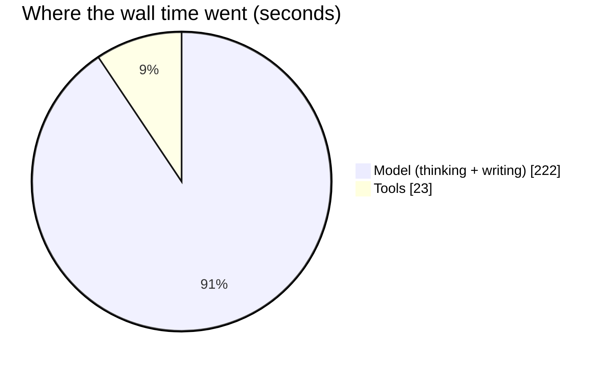

# corporate-ma/draft-markup-of-transition-services-agreement-tsa · run4 (`hv-mixed200-lunahigh-r4-20261116T164249Z`)

Result: **all-pass** 56/56 criteria · 4.1 min · 26 model calls · 26 tool calls (1 errors or timeouts) · ending `completed` · started 11-16 23:04:17 IST

## Overview

One box per stretch of steps that used the same kind of tool (blue: looking/searching/reading, purple: writing or editing files, yellow: a message with no tool call, red border: a tool error or timeout inside the box).

```mermaid
flowchart TD
    T(["Task prompt"])
    P0["<b>Step 1</b> · 0.1 min<br/>create_goal"]
    T --> P0
    class P0 look
    P1["<b>Step 2</b> · 0.0 min<br/>todo_write"]
    P0 --> P1
    class P1 look
    P2["<b>Step 3</b> · 0.1 min<br/>glob x2<br/><i>documents/**/*, output/*</i>"]
    P1 --> P2
    class P2 look
    P3["<b>Step 4</b> · 0.0 min<br/>read<br/><i>andersen-instructions.eml</i>"]
    P2 --> P3
    class P3 look
    P4["<b>Step 5</b> · 0.1 min<br/>bash<br/><i>for f in documents/*.docx; do b=$(bas…</i>"]
    P3 --> P4
    class P4 look
    P5["<b>Steps 6-12</b> · 0.2 min<br/>read x7<br/><i>apa-excerpts.txt, polaris-tsa-playbook.txt, trident-draft-tsa.txt</i>"]
    P4 --> P5
    class P5 look
    P6["<b>Steps 13-16</b> · 2.9 min<br/>bash x4<br/><i>python - #lt;#lt;'PY' import docx print(doc…, cat #gt; make_docs.py #lt;#lt;'PY' from docx i…, for f in output/*.docx; do echo #quot;--- … +1</i>"]
    P5 --> P6
    class P6 look
    P7["<b>Steps 17-18</b> · 0.1 min<br/>edit<br/>read<br/><i>make_docs.py</i>"]
    P6 --> P7
    class P7 err
    P8["<b>Step 19</b> · 0.1 min<br/>grep<br/><i>make_docs.py</i>"]
    P7 --> P8
    class P8 look
    P9["<b>Step 20</b> · 0.0 min<br/>edit<br/><i>make_docs.py</i>"]
    P8 --> P9
    class P9 write
    P10["<b>Steps 21-22</b> · 0.1 min<br/>bash x2<br/><i>python make_docs.py && parse-doc docx…, unzip -t output/tsa-markup-redline.do…</i>"]
    P9 --> P10
    class P10 look
    P11["<b>Step 23</b> · 0.1 min<br/>todo_write"]
    P10 --> P11
    class P11 look
    P12["<b>Step 24</b> · 0.0 min<br/>get_goal"]
    P11 --> P12
    class P12 look
    P13["<b>Step 25</b> · 0.0 min<br/>update_goal"]
    P12 --> P13
    class P13 look
    P14["<b>Step 26</b> · 0.1 min<br/>final message"]
    P13 --> P14
    class P14 ans
    R(["ALL PASS: 56/56 criteria"])
    P14 --> R
    class R pass
    classDef look fill:#e8f0fe,stroke:#4a6fa5,color:#111
    classDef write fill:#f3e8fd,stroke:#7b1fa2,color:#111
    classDef ans fill:#fff8e1,stroke:#b58900,color:#111
    classDef err fill:#e8f0fe,stroke:#c62828,stroke-width:3px,color:#111
    classDef pass fill:#e6f4ea,stroke:#2e7d32,color:#111
    classDef fail fill:#fce8e6,stroke:#c62828,color:#111
```





One row per model call:

| Step | Started (IST) | Model s | Tools s | Tool calls | Tools | Output chars |
|---|---|---|---|---|---|---|
| 1 | 23:04:17 | 4 | 1 | 1 | create_goal | 362 |
| 2 | 23:04:22 | 2 | 0 | 1 | todo_write | 57 |
| 3 | 23:04:24 | 3 | 2 | 2 | glob x2 | 146 |
| 4 | 23:04:29 | 2 | 0 | 1 | read | 11,952 |
| 5 | 23:04:31 | 2 | 6 | 1 | bash | 1,357 |
| 6 | 23:04:39 | 2 | 0 | 1 | read | 53,308 |
| 7 | 23:04:42 | 2 | 0 | 1 | read | 2,850 |
| 8 | 23:04:44 | 3 | 0 | 1 | read | 52,732 |
| 9 | 23:04:46 | 2 | 0 | 1 | read | 20,453 |
| 10 | 23:04:48 | 2 | 0 | 1 | read | 52,962 |
| 11 | 23:04:50 | 1 | 0 | 1 | read | 54,157 |
| 12 | 23:04:52 | 2 | 0 | 1 | read | 9,903 |
| 13 | 23:04:54 | 28 | 1 | 1 | bash | 6 |
| 14 | 23:05:23 | 131 | 1 | 1 | bash | 246 |
| 15 | 23:07:35 | 2 | 4 | 1 | bash | 8,926 |
| 16 | 23:07:41 | 4 | 4 | 1 | bash | 1,368 |
| 17 | 23:07:49 | 3 | 0 | 1 | edit ⚠ | 247 |
| 18 | 23:07:52 | 3 | 0 | 1 | read | 5,949 |
| 19 | 23:07:56 | 3 | 0 | 1 | grep | 315 |
| 20 | 23:07:59 | 2 | 0 | 1 | edit | 212 |
| 21 | 23:08:01 | 2 | 3 | 1 | bash | 1,278 |
| 22 | 23:08:06 | 4 | 0 | 1 | bash | 201 |
| 23 | 23:08:10 | 3 | 0 | 1 | todo_write | 57 |
| 24 | 23:08:13 | 3 | 0 | 1 | get_goal | 362 |
| 25 | 23:08:16 | 2 | 0 | 1 | update_goal | 367 |
| 26 | 23:08:18 | 5 | 0 | 0 | (message only) | 0 |

## Task prompt

```text
Review the attached draft TSA from the seller's perspective using our playbook, APA excerpts, and client instructions; produce a redline with annotated comments and a priority-tiered cover memo. Output: `tsa-markup-redline.docx` and `tsa-review-memo.docx`.
```

## Rubric

| # | Criterion | Verdict |
|---|---|---|
| C-001 | ISSUE_001a: Identifies 24-month lookback deviation in service standard | pass |
| C-002 | ISSUE_001b: Identifies 'or better than' qualifier in service standard | pass |
| C-003 | ISSUE_001c: Identifies undefined 'industry best practices' benchmark | pass |
| C-004 | ISSUE_001d: Proposes redline conforming service standard to playbook | pass |
| C-005 | ISSUE_002a: Identifies liability cap as 200% of total fees vs. APA's trailing 12-month cap | pass |
| C-006 | ISSUE_002b: Quantifies liability cap exposure difference | pass |
| C-007 | ISSUE_002c: Redlines liability cap to conform to APA Section 7.12(d) | pass |
| C-008 | ISSUE_003a: Identifies non-mutual consequential damages waiver | pass |
| C-009 | ISSUE_003b: Redlines to make consequential damages waiver mutual | pass |
| C-010 | ISSUE_004a: Identifies automatic renewal extending TSA beyond 18 months | pass |
| C-011 | ISSUE_004b: Redlines to delete auto-renewal and impose hard 18-month stop | pass |
| C-012 | ISSUE_005a: Identifies 120-day termination notice exceeding APA's 90 days | pass |
| C-013 | ISSUE_005b: Redlines termination notice to 90 days per APA | pass |
| C-014 | ISSUE_006a: Identifies Key Personnel consent right overriding Polaris staffing discretion | pass |
| C-015 | ISSUE_006b: Proposes compromise on Key Personnel (notice + qualified replacement) | pass |
| C-016 | ISSUE_007a: Identifies IT services 15% markup exceeding APA 10% cap | pass |
| C-017 | ISSUE_007b: Correctly computes IT fee difference | pass |
| C-018 | ISSUE_007c: Notes APA compliance risk even though overcharge benefits Polaris | pass |
| C-019 | ISSUE_008a: Identifies audit frequency deviation (twice/year vs. once/12 months) | pass |
| C-020 | ISSUE_008b: Identifies audit cost allocation deviation (Seller's vs. Buyer's expense) | pass |
| C-021 | ISSUE_008c: Identifies audit notice period deviation (10 vs. 30 business days) | pass |
| C-022 | ISSUE_009a: Identifies Ohio governing law vs. playbook's Pennsylvania law | pass |
| C-023 | ISSUE_009b: Identifies Cuyahoga County litigation vs. playbook's AAA arbitration in Pittsburgh | pass |
| C-024 | ISSUE_009c: Explains strategic importance of home-state law and arbitration for Polaris | pass |
| C-025 | ISSUE_010a: Identifies overbroad perpetual IP license grant | pass |
| C-026 | ISSUE_010b: Redlines to delete IP license and confirm Polaris sole ownership | pass |
| C-027 | ISSUE_011a: Identifies missing non-solicitation provision | pass |
| C-028 | ISSUE_011b: Drafts non-solicitation provision with 12-month post-service tail | pass |
| C-029 | ISSUE_012a: Identifies CGL insurance reduction ($2M vs. $5M playbook) | pass |
| C-030 | ISSUE_012b: Identifies missing umbrella coverage requirement | pass |
| C-031 | ISSUE_012c: Identifies missing additional insured endorsement | pass |
| C-032 | ISSUE_013a: Flags missing IMMEX program provisions for Monterrey facility | pass |
| C-033 | ISSUE_013b: Flags missing Mexican data privacy (LFPDPPP) provisions | pass |
| C-034 | ISSUE_014a: Identifies missing termination assistance/wind-down provisions | pass |
| C-035 | ISSUE_014b: Proposes termination assistance at cost-plus-15% for up to 60 days | pass |
| C-036 | ISSUE_015a: Identifies missing change order procedure | pass |
| C-037 | ISSUE_015b: Proposes change order procedure with cost-plus-15% pricing | pass |
| C-038 | ISSUE_016a: Identifies vague payment terms ('commercially reasonable time') | pass |
| C-039 | ISSUE_016b: Redlines payment terms to Net 30 days | pass |
| C-040 | ISSUE_016c: Adds late payment interest at 1.5%/month or max legal rate | pass |
| C-041 | ISSUE_017a: Identifies missing force majeure 90-day termination trigger | pass |
| C-042 | ISSUE_017b: Proposes 90-day force majeure termination right | pass |
| C-043 | Cover memo produced as a deliverable | pass |
| C-044 | Cover memo organizes issues by priority tiers (Critical/Significant/Minor) | pass |
| C-045 | APA-conflict issues classified as highest priority in cover memo | pass |
| C-046 | Cover memo includes negotiation strategy distinguishing firm vs. flexible positions | pass |
| C-047 | Redline markup includes proposed edits to the TSA | pass |
| C-048 | Redline markup includes explanatory comments for changes | pass |
| C-049 | Correctly identifies Polaris as Service Provider / Seller throughout | pass |
| C-050 | References APA Section 7.12 when flagging APA-conflict issues | pass |
| C-051 | Fee escalation provision addressed (playbook: greater of 3% or CPI-U) | pass |
| C-052 | Indemnification provision addressed (Buyer indemnifies for third-party claims) | pass |
| C-053 | Both deliverable files are produced | pass |
| C-054 | Correct total monthly service cost baseline ($1,020,000) referenced | pass |
| C-055 | Playbook's dispute escalation to senior executives referenced | pass |
| C-056 | Redline comments explain specific risk to Polaris for at least five changes | pass |

Judge's reasoning:

**C-001 (pass):** ISSUE_001a: Identifies 24-month lookback deviation in service standard

```text
The output expressly identifies that the draft uses a 24-month service-standard lookback and revises it to the 12-month lookback required by APA §7.12 and the playbook, both in the markup and review memo.
```

**C-002 (pass):** ISSUE_001b: Identifies 'or better than' qualifier in service standard

```text
The output expressly flags the draft’s “at least equal to or better than” service standard as an upward-ratcheting obligation, deletes that language, and replaces it with the playbook/APA standard of “substantially consistent” historical performance.
```

**C-003 (pass):** ISSUE_001c: Identifies undefined 'industry best practices' benchmark

```text
The output expressly flags “industry best practices” in Section 3.1 as an external, potentially expansive and disputed benchmark not supported by the APA/playbook, deletes it, and replaces it with the APA’s 12-month historical “substantially consistent” standard. The memo likewise identifies deletion of “industry best practices” as a critical must-change.
```

**C-004 (pass):** ISSUE_001d: Proposes redline conforming service standard to playbook

```text
The output proposes explicit replacement language in Section 3.1 requiring each Service to be provided “in a manner and at a level of quality substantially consistent with the manner and quality” provided to the Business during the twelve months immediately preceding Closing, which conforms to the playbook standard.
```

**C-005 (pass):** ISSUE_002a: Identifies liability cap as 200% of total fees vs. APA's trailing 12-month cap

```text
The output expressly identifies the draft cap as 200% of total Service Charges/fees paid as of the claim and contrasts it with APA §7.12(d), which requires a cap based on TSA fees actually paid during the 12 months preceding the claim, including the first-12-month rule.
```

**C-006 (pass):** ISSUE_002b: Quantifies liability cap exposure difference

```text
The output expressly quantifies the liability-cap exposure: approximately $41.004 million under the draft versus $13.464 million under the APA trailing-12-month formula, a difference of $27.540 million (about 3.05×). This is in the correct ballpark and demonstrates the required calculation.
```

**C-007 (pass):** ISSUE_002c: Redlines liability cap to conform to APA Section 7.12(d)

```text
The agent expressly replaces Section 10.1 with a cap on Polaris’s aggregate liability equal to TSA fees actually paid during the 12-month period immediately preceding the date the applicable claim is first asserted in writing, including a rolling 12-month calculation. This conforms to APA Section 7.12(d) and satisfies the criterion.
```

**C-008 (pass):** ISSUE_003a: Identifies non-mutual consequential damages waiver

```text
The output expressly identifies the consequential-damages waiver as one-way/unilateral and explains that it protects Trident while leaving Polaris exposed to consequential, lost-profit, and related claims. It also proposes replacing it with a mutual waiver.
```

**C-009 (pass):** ISSUE_003b: Redlines to make consequential damages waiver mutual

```text
The agent expressly replaces the one-way waiver in Section 10.2 with mutual language stating that “NEITHER PARTY SHALL BE LIABLE TO THE OTHER” for consequential, incidental, indirect, special, exemplary, or punitive damages, consistent with the criterion and Polaris playbook.
```

**C-010 (pass):** ISSUE_004a: Identifies automatic renewal extending TSA beyond 18 months

```text
The output expressly identifies the initial 18-month term plus two automatic six-month renewals as potentially requiring services for up to 30 months, and states that this violates APA §7.12(a)'s 18-month maximum and prohibition on automatic renewal.
```

**C-011 (pass):** ISSUE_004b: Redlines to delete auto-renewal and impose hard 18-month stop

```text
The markup expressly deletes the automatic six-month renewal terms and Renewal Term definition, imposes an 18-month maximum Transition Period, and states that no automatic renewal, extension, or rollover applies. It permits extensions only for individual services through a written amendment signed by both parties, with cost-plus-15% proposed pricing.
```

**C-012 (pass):** ISSUE_005a: Identifies 120-day termination notice exceeding APA's 90 days

```text
The output expressly flags that the draft requires 120 days’ notice to terminate an individual service and states this conflicts with APA §7.12(c), which requires a 90-day notice period. It revises the notice period to 90 days in both the markup and review memo.
```

**C-013 (pass):** ISSUE_005b: Redlines termination notice to 90 days per APA

```text
The output expressly deletes the 120-day individual-service termination notice in Section 5.3 and replaces it with 90 days, citing APA Section 7.12(c) as the basis.
```

**C-014 (pass):** ISSUE_006a: Identifies Key Personnel consent right overriding Polaris staffing discretion

```text
The output expressly flags Section 4.3/Schedule H as problematic because it requires Trident's prior written consent for reassignment or replacement of named Key Personnel. It states that this conflicts with the playbook's requirement that Polaris retain sole discretion over staffing and proposes deleting the consent-based regime.
```

**C-015 (pass):** ISSUE_006b: Proposes compromise on Key Personnel (notice + qualified replacement)

```text
The markup restores Polaris’s sole discretion over staffing and removes Trident’s consent right, while offering a notice-and-replacement compromise: 15 Business Days’ advance notice when practicable and reasonable efforts to identify a reasonably qualified replacement.
```

**C-016 (pass):** ISSUE_007a: Identifies IT services 15% markup exceeding APA 10% cap

```text
The agent explicitly flags that the IT Services schedule uses a 15% markup and $391,000/month instead of the APA §7.12(b) maximum 10% markup and $374,000/month, and corrects both figures in the markup and review memo.
```

**C-017 (pass):** ISSUE_007b: Correctly computes IT fee difference

```text
The output correctly computes the IT fee difference as $391,000 minus $374,000 = $17,000 per month and $306,000 over 18 months.
```

**C-018 (pass):** ISSUE_007c: Notes APA compliance risk even though overcharge benefits Polaris

```text
The output expressly notes that the 15% IT markup benefits Polaris economically but violates APA §7.12(b) and must be corrected for APA compliance and credibility. Both the markup comment and review memo make this point clearly.
```

**C-019 (pass):** ISSUE_008a: Identifies audit frequency deviation (twice/year vs. once/12 months)

```text
The agent expressly flags that the draft permits audits twice per calendar year, contrasts this with the playbook limit of once per 12-month period, and proposes revising the audit right to once in any 12-month period.
```

**C-020 (pass):** ISSUE_008b: Identifies audit cost allocation deviation (Seller's vs. Buyer's expense)

```text
The agent expressly flags that the draft permits audits at Polaris's expense, states that the playbook requires Buyer/Trident to bear audit costs, and proposes redlining Section 14 so audits are at Trident's sole expense, subject to reimbursement only if an overcharge exceeds 5%.
```

**C-021 (pass):** ISSUE_008c: Identifies audit notice period deviation (10 vs. 30 business days)

```text
The output expressly flags that the draft permits audits on 10 Business Days' notice, states the playbook requires 30 Business Days' notice, and proposes revising the audit provision to require 30 Business Days' prior written notice.
```

**C-022 (pass):** ISSUE_009a: Identifies Ohio governing law vs. playbook's Pennsylvania law

```text
The output expressly flags Section 15.1's Ohio governing law as inconsistent with the Polaris playbook's Pennsylvania-law position and proposes replacing Ohio law with Pennsylvania law.
```

**C-023 (pass):** ISSUE_009b: Identifies Cuyahoga County litigation vs. playbook's AAA arbitration in Pittsburgh

```text
The output expressly flags draft Section 15.2's exclusive litigation in Cuyahoga County, Ohio, contrasts it with the playbook's preference for confidential binding arbitration under the AAA Commercial Arbitration Rules in Pittsburgh, Pennsylvania, and proposes replacing the draft provision accordingly.
```

**C-024 (pass):** ISSUE_009c: Explains strategic importance of home-state law and arbitration for Polaris

```text
The output expressly explains the strategic rationale: Pennsylvania law is favored because Polaris and most service personnel are based in Pittsburgh, reducing home-court and counsel-unfamiliarity risk, while Pittsburgh AAA arbitration provides confidentiality and avoids public-docket, discovery, venue, and Trident home-court risks associated with Ohio litigation.
```

**C-025 (pass):** ISSUE_010a: Identifies overbroad perpetual IP license grant

```text
The output expressly flags Section 7.1’s perpetual, irrevocable, worldwide, royalty-free, sublicensable license covering Polaris tools, methodologies, templates, software, and know-how as a significant, non-starter IP leakage risk. It identifies this as contrary to the playbook’s firm no-license position and explains the exposure to Polaris’s enterprise-wide proprietary operational IP.
```

**C-026 (pass):** ISSUE_010b: Redlines to delete IP license and confirm Polaris sole ownership

```text
The output deletes the perpetual, irrevocable, royalty-free license and replaces it with language stating that all Service Provider Materials and related IP remain Polaris’s sole and exclusive property. It expressly grants no license or other interest and permits Trident only limited access and use during the applicable service term solely to receive the Services, with all access ending upon expiration or termination.
```

**C-027 (pass):** ISSUE_011a: Identifies missing non-solicitation provision

```text
The markup expressly adds a new Section 15.12 non-solicitation provision restricting Trident from soliciting, recruiting, hiring, or engaging Polaris employees who provided TSA services, and explains the risk of Trident cherry-picking those personnel. This adequately identifies and addresses the draft's missing non-solicitation/non-hire restriction.
```

**C-028 (pass):** ISSUE_011b: Drafts non-solicitation provision with 12-month post-service tail

```text
The proposed Section 15.12 prohibits Trident from soliciting, recruiting, hiring, or engaging Polaris employees who provided Services during the Term and for 12 months thereafter, unless Polaris gives prior written consent. This satisfies the required post-service tail and consent requirement.
```

**C-029 (pass):** ISSUE_012a: Identifies CGL insurance reduction ($2M vs. $5M playbook)

```text
The agent expressly flags that the draft provides only $2 million CGL coverage and proposes increasing it to $5 million per occurrence/$5 million aggregate, citing the playbook's $5 million target.
```

**C-030 (pass):** ISSUE_012b: Identifies missing umbrella coverage requirement

```text
The output expressly flags that the draft lacks umbrella coverage and proposes adding $5 million in umbrella/excess liability coverage, citing the playbook requirement in Section 13.1 and the review memo.
```

**C-031 (pass):** ISSUE_012c: Identifies missing additional insured endorsement

```text
The agent expressly flags that the draft lacks an additional-insured endorsement and proposes requiring Trident to name Polaris as an additional insured on its CGL and umbrella policies, with certificates and endorsements provided after Closing.
```

**C-032 (pass):** ISSUE_013a: Flags missing IMMEX program provisions for Monterrey facility

```text
The output expressly flags the TSA’s omission of Monterrey IMMEX provisions and proposes detailed language allocating primary post-Closing responsibility to Trident for maintaining IMMEX certification and related customs, temporary-import, recordkeeping, reporting, cost, notice, and transition obligations, with defined assistance from Polaris.
```

**C-033 (pass):** ISSUE_013b: Flags missing Mexican data privacy (LFPDPPP) provisions

```text
The output expressly flags that the draft addresses only U.S. privacy law and omits Mexico's LFPDPPP despite HR/payroll processing for Mexican employees. It proposes substantive LFPDPPP provisions and a Mexico data-processing addendum covering controller/processor roles, privacy notices, consent or other lawful bases, cross-border transfers, safeguards, breach response, subprocessors, data-subject requests, and return/deletion.
```

**C-034 (pass):** ISSUE_014a: Identifies missing termination assistance/wind-down provisions

```text
The output expressly flags that the draft has no termination-assistance framework and adds a provision for up to 60 days of reasonable, compensated wind-down support. The review memo likewise identifies termination assistance as omitted and recommends a 60-day maximum period.
```

**C-035 (pass):** ISSUE_014b: Proposes termination assistance at cost-plus-15% for up to 60 days

```text
Section 5.5 proposes express termination assistance for up to 60 days, including knowledge transfer, data migration support, replacement-provider cooperation, and transition documentation, priced separately at cost-plus-15%.
```

**C-036 (pass):** ISSUE_015a: Identifies missing change order procedure

```text
The output expressly flags the missing change-order mechanism in both the markup and review memo. It adds a new Section 6.7 requiring written, mutually signed change orders for out-of-scope services, material volume increases, or material scope changes, and explains that this playbook-required gate prevents informal scope creep.
```

**C-037 (pass):** ISSUE_015b: Proposes change order procedure with cost-plus-15% pricing

```text
The output proposes a new Section 6.7 requiring written change orders signed by authorized representatives of both parties for out-of-scope services, material volume increases, or material scope changes, with pricing at cost-plus-15%.
```

**C-038 (pass):** ISSUE_016a: Identifies vague payment terms ('commercially reasonable time')

```text
The agent expressly flags “commercially reasonable time” as vague and replaces it with a defined Net 30 payment deadline, while also adding late interest and requiring payment of undisputed amounts.
```

**C-039 (pass):** ISSUE_016b: Redlines payment terms to Net 30 days

```text
Section 6.3 expressly replaces the vague “commercially reasonable time” payment standard with invoices payable Net 30 from the invoice date, consistent with the criterion.
```

**C-040 (pass):** ISSUE_016c: Adds late payment interest at 1.5%/month or max legal rate

```text
Section 6.3 proposes that late amounts accrue interest at the lesser of 1.5% per month or the maximum lawful rate, exactly satisfying the criterion.
```

**C-041 (pass):** ISSUE_017a: Identifies missing force majeure 90-day termination trigger

```text
The agent expressly flags that the draft force majeure clause lacks a termination trigger and adds a right for either party to terminate the affected service if the force majeure event continues for 90 consecutive days, without further liability for future performance. This satisfies the criterion.
```

**C-042 (pass):** ISSUE_017b: Proposes 90-day force majeure termination right

```text
Section 12.1/12.2 proposes that if a force majeure event continues for 90 consecutive days and materially prevents an affected service, either party may terminate that service on written notice without further liability for future performance.
```

**C-043 (pass):** Cover memo produced as a deliverable

```text
The agent produced a substantive cover memorandum summarizing the TSA review, including an executive summary, prioritized issues, quantified analysis, negotiation positions, action items, and a conclusion.
```

**C-044 (pass):** Cover memo organizes issues by priority tiers (Critical/Significant/Minor)

```text
The cover memo clearly organizes deviations into three labeled priority tiers: “Priority Tier 1 — Critical / Must-Change,” “Priority Tier 2 — Significant / Major Playbook Deviations,” and “Priority Tier 3 — Minor / Cleanup and Negotiation Preferences.”
```

**C-045 (pass):** APA-conflict issues classified as highest priority in cover memo

```text
The memo places all specified direct APA conflicts in “Priority Tier 1 — Critical / Must-Change”: the 200% liability cap (C-1), automatic renewal and 18-month cap (C-4), 120-day versus 90-day termination notice (C-5), and 15% versus 10% IT markup (C-6). It separately classifies playbook deviations as Priority Tier 2, clearly distinguishing them as lower priority.
```

**C-046 (pass):** Cover memo includes negotiation strategy distinguishing firm vs. flexible positions

```text
The memo clearly distinguishes firm from flexible positions for well over three key issues. Its negotiation-posture table identifies APA-mandated terms (including the liability cap, 90-day notice, 18-month maximum term, 10% markup cap, service standard, and Mexico requirements) as non-negotiable because they must conform to the APA, while providing fallbacks for IP, staffing, audits, governing law, escalation, extensions, and insurance. It also explains the rationale for firm positions throughout the priority tiers and identifies acceptable compromise parameters.
```

**C-047 (pass):** Redline markup includes proposed edits to the TSA

```text
The output includes extensive article-by-article and schedule-specific proposed redline edits, with draft language expressly shown as deleted via strikethrough and replacement or new language shown as added/revised via underline. It is therefore more than a list of issues and satisfies the criterion.
```

**C-048 (pass):** Redline markup includes explanatory comments for changes

```text
The markup includes extensive explanatory comment boxes for the proposed edits. The comments identify the basis for changes—such as APA provisions, Polaris TSA Playbook positions, and compliance considerations—and generally explain the associated risk and negotiating flexibility.
```

**C-049 (pass):** Correctly identifies Polaris as Service Provider / Seller throughout

```text
The output consistently identifies Polaris as the Seller and Service Provider and Trident as the Buyer/Service Recipient. The markup and memo are expressly seller-side and frame recommendations to protect Polaris’s fees, liability exposure, IP, staffing discretion, systems, data, and operational interests. No material party-role confusion appears.
```

**C-050 (pass):** References APA Section 7.12 when flagging APA-conflict issues

```text
The output repeatedly cites APA Section 7.12 and relevant subsections when flagging conflicts, including §7.12(d) for the liability cap, §7.12(a) for term/renewal, §7.12(c) for termination notice, and §7.12(b) for the fee markup cap.
```

**C-051 (pass):** Fee escalation provision addressed (playbook: greater of 3% or CPI-U)

```text
The agent expressly addresses fee escalation in Section 6.4, proposing annual fee adjustments by the greater of 3% or CPI-U for the trailing 12 months, and attributes this position to the playbook. The review memo also repeats this mechanism and provides CPI-U-only as a fallback.
```

**C-052 (pass):** Indemnification provision addressed (Buyer indemnifies for third-party claims)

```text
The output expressly addresses indemnification in Section 9.2 and states that Trident (Buyer) should indemnify Polaris (Seller) for third-party claims arising from Trident’s use or receipt of the Services, except to the extent caused by Polaris’s gross negligence, fraud, or willful misconduct. This satisfies the stated playbook position.
```

**C-053 (pass):** Both deliverable files are produced

```text
The output includes two clearly distinct deliverables: a marked-up TSA identified as “tsa-markup-redline.docx” and a partner review memo identified as “tsa-review-memo.docx.”
```

**C-054 (pass):** Correct total monthly service cost baseline ($1,020,000) referenced

```text
The agent repeatedly references the correct total monthly fee at a 10% markup of $1,122,000, including in the headline summary, Schedule G revisions, execution checklist, and review memo. It also correctly calculates the corresponding 18-month total of $20,196,000.
```

**C-055 (pass):** Playbook's dispute escalation to senior executives referenced

```text
The markup expressly requires disputes to escalate to designated CFO/General Counsel-level executives for 15 Business Days before arbitration. The review memo also references escalation before optional mediation and confidential AAA arbitration.
```

**C-056 (pass):** Redline comments explain specific risk to Polaris for at least five changes

```text
The output includes well over five distinct comments identifying concrete adverse consequences to Polaris. Examples include a quantified $27.54M increase in liability-cap exposure (C-10), compelled long-term service and missed-notice risk from automatic renewals (C-04), IP leakage and competitive harm from a perpetual license (S-10), employment and operational burdens from buyer-controlled staffing (S-03), Mexican privacy and cross-border compliance exposure (C-08/C-09), customs duties, penalties, and disruption from unclear IMMEX responsibility (C-12), and sensitive-data exposure and audit burden from broad audit rights (S-16). These comments go beyond merely citing the APA or playbook.
```

## Delivered files (output/)

- `tsa-markup-redline.docx` (54,736 bytes)
- `tsa-review-memo.docx` (44,311 bytes)

## Trajectory

### Step 1: 1 tool call

_Started 11-16 23:04:17 IST · model 4 s · tools 1 s_

**Reasoning summary:**

```text
**Organizing document tasks**

I need to manipulate some documents and inspect files. I might be looking at .docx files, but I want to make sure that's the correct format. I should map out the task requirements, even if some documents aren't available. I'll create a long-running goal and some to-dos to keep everything organized. I don't need to read task.json right now; focusing on the overall objectives seems more important!
```

**Call `create_goal`** (1.0 s)

```json
{
 "objective": "Review the attached draft TSA from the seller's perspective using the provided playbook, APA excerpts, and client instructions, then produce tsa-markup-redline.docx and tsa-review-memo.docx in output/.",
 "max_goal_rounds": 3
}
```

Output (362 chars):

```text
{"goal":{"id":"goal-9c32f052-4edf-42e7-9d15-0bff1a357bdb","revision":1,"objective":"Review the attached draft TSA from the seller's perspective using the provided playbook, APA excerpts, and client instructions, then produce tsa-markup-redline.docx and tsa-review-memo.docx in output/.","phase":"active","roundsStarted":0,"maxGoalRounds":3},"activation":"armed"}
```

### Step 2: 1 tool call

_Started 11-16 23:04:22 IST · model 2 s · tools 0 s_

**Call `todo_write`** (0.0 s)

```json
{
 "todos": [
  {
   "content": "Inspect provided TSA, playbook, APA excerpts, and client instructions",
   "status": "in_progress"
  },
  {
   "content": "Develop seller-side issues, redline changes, and annotated comments",
   "status": "pending"
  },
  {
   "content": "Create redline and priority-tiered cover memo DOCX deliverables",
   "status": "pending"
  },
  {
   "content": "Validate DOCX outputs and summarize completed work",
   "status": "pending"
  }
 ]
}
```

Output (57 chars):

```text
Updated todo list: 3 pending, 1 in progress, 0 completed.
```

**Todo list now:**

- [~] Inspect provided TSA, playbook, APA excerpts, and client instructions
- [ ] Develop seller-side issues, redline changes, and annotated comments
- [ ] Create redline and priority-tiered cover memo DOCX deliverables
- [ ] Validate DOCX outputs and summarize completed work

### Step 3: 2 tool calls

_Started 11-16 23:04:24 IST · model 3 s · tools 2 s_

**Reasoning summary:**

```text
**Inspecting files**

I need to inspect files, and it sounds like I might use a method to "glob" all the relevant documents. It seems like a straightforward process, but I want to be thorough in ensuring I gather everything I need. I'll take my time to sift through the files to confirm that nothing important gets overlooked. It makes sense to check carefully, so I don't miss any key details!
```

**Call `glob`** (0.7 s)

```json
{
 "pattern": "documents/**/*"
}
```

Output (132 chars):

```text
documents/andersen-instructions.eml
documents/trident-draft-tsa.docx
documents/polaris-tsa-playbook.docx
documents/apa-excerpts.docx
```

**Call `glob`** (1.2 s)

```json
{
 "pattern": "output/*"
}
```

Output (14 chars):

```text
No files found
```

### Step 4: 1 tool call

_Started 11-16 23:04:29 IST · model 2 s · tools 0 s_

**Reasoning summary:**

```text
**Reading email and converting documents**

I need to read the email in a plain format, so I'm thinking I can use the reading method. For converting documents, maybe I should use a bash command to parse the document to text. I wonder if I could write that to a scratch space outside the usual output. It feels like I should clarify what’s permitted in my workspace before I proceed. Let’s see how this goes!
```

**Call `read`** (0.0 s)

```json
{
 "file_path": "documents/andersen-instructions.eml"
}
```

Output (11,952 chars):

```text
<path>/home/agarwaldi/dsh-bench-harness/runs/hv-mixed200-lunahigh-r4-20261116T164249Z/tasks/corporate-ma__draft-markup-of-transition-services-agreement-tsa/workspace/documents/andersen-instructions.eml</path>
<type>file</type>
<content>
1: From: Victoria S. Andersen (vandersen@whitfieldcrane.com)
2: To: Nathan J. Reeves (nreeves@whitfieldcrane.com)
3: Date: Tue, 29 Apr 2025 08:17:00 -0000
4: Subject: RE: Polaris / Trident — TSA Markup Assignment — Specialty Coatings
5:  Divestiture
6: Content-Type: text/plain; charset="utf-8"
7: Content-Transfer-Encoding: quoted-printable
8: MIME-Version: 1.0
9: 
10: Nathan,
11: 
12: Caldwell Briggs & Foley (Tom Graziano's team =E2=80=94 his associate Priya Ve=
13: nkatesh circulated) sent over Trident's first draft of the Transition Service=
14: s Agreement yesterday evening. I've done a quick initial skim but haven't had=
15:  time to go through it with a fine-tooth comb =E2=80=94 that's where you come=
16:  in.
17: 
18: For context, this is the TSA contemplated by Section 7.12 of the executed Ass=
19: et Purchase Agreement dated March 14, 2025, between Polaris Industrial Holdin=
20: gs, Inc. (as Seller and Service Provider) and Trident Manufacturing Group, In=
21: c. (as Buyer and Service Recipient) for the divestiture of the Specialty Coat=
22: ings Division. Expected closing is June 2, 2025, which means we need to turn =
23: around a comprehensive markup by end of next week at the latest. Sharon Petro=
24: sian wants to see our redline b
… [10,452 more chars]
```

### Step 5: 1 tool call

_Started 11-16 23:04:31 IST · model 2 s · tools 6 s_

**Call `bash`** (5.9 s)

```json
{
 "command": "for f in documents/*.docx; do b=$(basename \"$f\" .docx); parse-doc docx \"$f\" > \"$b.txt\"; done; ls -l *.txt",
 "description": "Convert source DOCX files to text"
}
```

Output (1,357 chars):

```text
-rw-r--r-- 1 agarwaldi@microsoft.com users  53534 Nov 16 17:34 apa-excerpts.txt
-rw-r--r-- 1 agarwaldi@microsoft.com users  70352 Nov 16 17:34 polaris-tsa-playbook.txt
-rw-r--r-- 1 agarwaldi@microsoft.com users 110921 Nov 16 17:34 trident-draft-tsa.txt
[stderr]
2026-11-16 17:34:34.783028532 [W:onnxruntime:Default, device_discovery.cc:95 GetPciBusId] Skipping pci_bus_id for PCI path at "/sys/devices/LNXSYSTM:00/LNXSYBUS:00/ACPI0004:00/VMBUS:00/5620e0c7-8062-4dce-aeb7-520c7ef76171" because filename "5620e0c7-8062-4dce-aeb7-520c7ef76171" did not match expected pattern of [0-9a-f]+:[0-9a-f]+:[0-9a-f]+[.][0-9a-f]+
2026-11-16 17:34:36.363001208 [W:onnxruntime:Default, device_discovery.cc:95 GetPciBusId] Skipping pci_bus_id for PCI path at "/sys/devices/LNXSYSTM:00/LNXSYBUS:00/ACPI0004:00/VMBUS:00/5620e0c7-8062-4dce-aeb7-520c7ef76171" because filename "5620e0c7-8062-4dce-aeb7-520c7ef76171" did not match expected pattern of [0-9a-f]+:[0-9a-f]+:[0-9a-f]+[.][0-9a-f]+
2026-11-16 17:34:37.966914678 [W:onnxruntime:Default, device_discovery.cc:95 GetPciBusId] Skipping pci_bus_id for PCI path at "/sys/devices/LNXSYSTM:00/LNXSYBUS:00/ACPI0004:00/VMBUS:00/5620e0c7-8062-4dce-aeb7-520c7ef76171" because filename "5620e0c7-8062-4dce-aeb7-520c7ef76171" did not match expected pattern of [0-9a-f]+:[0-9a-f]+:[0-9a-f]+[.][0-9a-f]+
```

### Step 6: 1 tool call

_Started 11-16 23:04:39 IST · model 2 s · tools 0 s_

**Call `read`** (0.3 s)

```json
{
 "file_path": "apa-excerpts.txt",
 "limit": 2000
}
```

Output (53,308 chars):

```text
<path>/home/agarwaldi/dsh-bench-harness/runs/hv-mixed200-lunahigh-r4-20261116T164249Z/tasks/corporate-ma__draft-markup-of-transition-services-agreement-tsa/workspace/apa-excerpts.txt</path>
<type>file</type>
<content>
1: **[EXCERPTS FROM EXECUTED ASSET PURCHASE AGREEMENT]{.underline}**
2: 
3: **ASSET PURCHASE AGREEMENT**
4: 
5: **dated as of March 14, 2025**
6: 
7: **by and between**
8: 
9: **POLARIS INDUSTRIAL HOLDINGS, INC.**
10: 
11: **and**
12: 
13: **TRIDENT MANUFACTURING GROUP, INC.**
14: 
15: This document contains selected excerpts from the Asset Purchase Agreement dated as of March 14, 2025, by and between Polaris Industrial Holdings, Inc. and Trident Manufacturing Group, Inc. The complete Asset Purchase Agreement is approximately 180 pages. Only the provisions relevant to the Transition Services Agreement are reproduced herein. Sections, exhibits, and schedules not reproduced are indicated by bracketed editorial notations. Defined terms used but not defined in these excerpts have the meanings given to them in the full Asset Purchase Agreement.
16: 
17: **APA Execution Date: March 14, 2025**
18: 
19: **[PREAMBLE AND RECITALS (EXCERPT)]{.underline}**
20: 
21: This ASSET PURCHASE AGREEMENT (this \"**Agreement**\") is entered into as of March 14, 2025, by and between:
22: 
23: **POLARIS INDUSTRIAL HOLDINGS, INC.**, a Delaware corporation, with its principal offices at 1200 Commonwealth Avenue, Suite 3000, Pittsburgh, PA 15222 (\"**Seller**\"),
24: 
25: and
26: 
27: **TR
… [51,808 more chars]
```

### Step 7: 1 tool call

_Started 11-16 23:04:42 IST · model 2 s · tools 0 s_

**Call `read`** (0.0 s)

```json
{
 "file_path": "apa-excerpts.txt",
 "offset": 394,
 "limit": 500
}
```

Output (2,850 chars):

```text
<path>/home/agarwaldi/dsh-bench-harness/runs/hv-mixed200-lunahigh-r4-20261116T164249Z/tasks/corporate-ma__draft-markup-of-transition-services-agreement-tsa/workspace/apa-excerpts.txt</path>
<type>file</type>
<content>
394:   Information Technology             \$340,000                       10%              \$374,000             31
395: 
396:   Human Resources                    \$125,000                       10%              \$137,500             18
397: 
398:   Supply Chain & Procurement         \$210,000                       10%              \$231,000             14
399: 
400:   Regulatory & EHS Compliance        \$95,000                        10%              \$104,500             8
401: 
402:   Treasury & Tax                     \$65,000                        10%              \$71,500              7
403: 
404:   **TOTAL**                          **\$1,020,000**                 **10%**          **\$1,122,000**       **100**
405:   ------------------------------------------------------------------------------------------------------------------------
406: 
407: The estimated maximum aggregate TSA Fees for the full eighteen (18) month Maximum TSA Term, assuming all six categories of Transition Services are provided for the full Maximum TSA Term, are \$1,122,000 × 18 = **\$20,196,000**. Actual TSA Fees will vary based on actual Fully-Loaded Costs incurred and the duration of each category of Transition Services.
408: 
409: The foregoing estimates do not include any Addi
… [1,350 more chars]
```

### Step 8: 1 tool call

_Started 11-16 23:04:44 IST · model 3 s · tools 0 s_

**Call `read`** (0.1 s)

```json
{
 "file_path": "polaris-tsa-playbook.txt",
 "limit": 2000
}
```

Output (52,732 chars):

```text
<path>/home/agarwaldi/dsh-bench-harness/runs/hv-mixed200-lunahigh-r4-20261116T164249Z/tasks/corporate-ma__draft-markup-of-transition-services-agreement-tsa/workspace/polaris-tsa-playbook.txt</path>
<type>file</type>
<content>
1: **[TRANSITION SERVICES AGREEMENT]{.underline}**
2: 
3: **[NEGOTIATION PLAYBOOK]{.underline}**
4: 
5: **Polaris Industrial Holdings, Inc. --- Service Provider Positions**
6: 
7: **PRIVILEGED AND CONFIDENTIAL --- ATTORNEY-CLIENT WORK PRODUCT**
8: 
9: This document is protected by the attorney-client privilege and the work-product doctrine. It contains the legal strategies, negotiation positions, and confidential assessments of Polaris Industrial Holdings, Inc. and its counsel. Distribution is strictly limited to authorized personnel. Any unauthorized disclosure, copying, or distribution is prohibited and may constitute a waiver of applicable privileges.
10: 
11: **Maintained by:** Legal Department, Polaris Industrial Holdings, Inc., 1200 Commonwealth Avenue, Suite 3000, Pittsburgh, PA 15222
12: 
13: **Approved by:** Sharon M. Petrosian, General Counsel
14: 
15: **Last Updated:** January 15, 2025
16: 
17: **Version:** 4.2
18: 
19: **Distribution:** Limited to Polaris Legal Department, CFO (David K. Okafor), CEO (Margaret R. Lindstrom), and outside counsel (Whitfield & Crane LLP, 600 Grant Street, Suite 4800, Pittsburgh, PA 15219; Lead Partner: Victoria S. Andersen)
20: 
21: This Playbook sets forth Polaris\'s preferred and fallback positions for any Tran
… [51,232 more chars]
```

### Step 9: 1 tool call

_Started 11-16 23:04:46 IST · model 2 s · tools 0 s_

**Call `read`** (0.1 s)

```json
{
 "file_path": "polaris-tsa-playbook.txt",
 "offset": 364,
 "limit": 1000
}
```

Output (20,453 chars):

```text
<path>/home/agarwaldi/dsh-bench-harness/runs/hv-mixed200-lunahigh-r4-20261116T164249Z/tasks/corporate-ma__draft-markup-of-transition-services-agreement-tsa/workspace/polaris-tsa-playbook.txt</path>
<type>file</type>
<content>
364:   -------------------------------------------------------------------------------------------------------------------------------------------------------------------------------------------------------------------------------------------------------------------------------------------------------------------------------------------------------------------------------------------------------------------------------------------------------------------------------------------------------------------------------------------------------------------------------------------------------------
365:                                       **Position**
366:   ----------------------------------- -------------------------------------------------------------------------------------------------------------------------------------------------------------------------------------------------------------------------------------------------------------------------------------------------------------------------------------------------------------------------------------------------------------------------------------------------------------------------------------------------------------------------------------------------------------------------
367:   **Target**       
… [18,953 more chars]
```

### Step 10: 1 tool call

_Started 11-16 23:04:48 IST · model 2 s · tools 0 s_

**Call `read`** (0.0 s)

```json
{
 "file_path": "trident-draft-tsa.txt",
 "limit": 2000
}
```

Output (52,962 chars):

```text
<path>/home/agarwaldi/dsh-bench-harness/runs/hv-mixed200-lunahigh-r4-20261116T164249Z/tasks/corporate-ma__draft-markup-of-transition-services-agreement-tsa/workspace/trident-draft-tsa.txt</path>
<type>file</type>
<content>
1: DRAFT --- APRIL 28, 2025 PRIVILEGED & CONFIDENTIAL SUBJECT TO CONTRACT
2: 
3: **[TRANSITION SERVICES AGREEMENT]{.underline}**
4: 
5: **by and between**
6: 
7: **POLARIS INDUSTRIAL HOLDINGS, INC.**
8: 
9: **and**
10: 
11: **TRIDENT MANUFACTURING GROUP, INC.**
12: 
13: Dated as of \[●\], 2025
14: 
15: Prepared by Caldwell Briggs & Foley LLP
16: 
17: **TABLE OF CONTENTS**
18: 
19:   ----------------------------------------------------------------------------------------------------------
20:                                                                                      **Page**
21:   ----------------------- ---------------------------------------------------------- -----------------------
22:   **ARTICLE 1**           **DEFINITIONS**                                            \[●\]
23: 
24:                           Section 1.1 Defined Terms                                  \[●\]
25: 
26:   **ARTICLE 2**           **SERVICES**                                               \[●\]
27: 
28:                           Section 2.1 Provision of Services                          \[●\]
29: 
30:                           Section 2.2 Scope Limitations                              \[●\]
31: 
32:                           Section 2.3 Exclusive Remedy               
… [51,462 more chars]
```

### Step 11: 1 tool call

_Started 11-16 23:04:50 IST · model 1 s · tools 0 s_

**Call `read`** (0.0 s)

```json
{
 "file_path": "trident-draft-tsa.txt",
 "offset": 443,
 "limit": 2000
}
```

Output (54,157 chars):

```text
<path>/home/agarwaldi/dsh-bench-harness/runs/hv-mixed200-lunahigh-r4-20261116T164249Z/tasks/corporate-ma__draft-markup-of-transition-services-agreement-tsa/workspace/trident-draft-tsa.txt</path>
<type>file</type>
<content>
443: **Section 10.2** *Consequential Damages.* SERVICE PROVIDER HEREBY WAIVES, AND SHALL NOT ASSERT, ANY AND ALL CLAIMS AGAINST SERVICE RECIPIENT FOR CONSEQUENTIAL, INCIDENTAL, SPECIAL, PUNITIVE, EXEMPLARY, OR INDIRECT DAMAGES, INCLUDING LOSS OF REVENUE, LOSS OF PROFITS, LOSS OF BUSINESS OPPORTUNITY, COST OF REPLACEMENT SERVICES, DIMINUTION OF VALUE, OR LOSS OF GOODWILL, ARISING OUT OF OR RELATING TO THIS AGREEMENT, REGARDLESS OF WHETHER SUCH DAMAGES ARE BASED ON CONTRACT, TORT (INCLUDING NEGLIGENCE), STRICT LIABILITY, OR ANY OTHER LEGAL OR EQUITABLE THEORY, AND REGARDLESS OF WHETHER SERVICE PROVIDER HAS BEEN ADVISED OF THE POSSIBILITY OF SUCH DAMAGES. THE FOREGOING WAIVER SHALL APPLY EVEN IN THE EVENT OF THE FAILURE OF ESSENTIAL PURPOSE OF ANY REMEDY.
444: 
445: **Section 10.3** *Essential Basis.* The Parties acknowledge and agree that the limitations and exclusions of liability set forth in this Article 10 represent a fundamental element of the basis of the bargain between the Parties and that the Parties would not have entered into this Agreement absent such limitations and exclusions. Such limitations and exclusions shall apply regardless of the failure of essential purpose of any remedy provided herein and shall survive the termination or expiration of
… [52,657 more chars]
```

### Step 12: 1 tool call

_Started 11-16 23:04:52 IST · model 2 s · tools 0 s_

**Call `read`** (0.0 s)

```json
{
 "file_path": "trident-draft-tsa.txt",
 "offset": 980,
 "limit": 1000
}
```

Output (9,903 chars):

```text
<path>/home/agarwaldi/dsh-bench-harness/runs/hv-mixed200-lunahigh-r4-20261116T164249Z/tasks/corporate-ma__draft-markup-of-transition-services-agreement-tsa/workspace/trident-draft-tsa.txt</path>
<type>file</type>
<content>
980:   Monthly Fee:                        \$71,500
981:   -----------------------------------------------------------------------
982: 
983: **6. Migration Milestones**
984: 
985: > \(a\) **Bank Accounts.** Service Recipient shall establish its own bank accounts within thirty (30) days of the Closing Date. Service Provider shall cooperate with the orderly transition of banking relationships, including providing authorized signatories, account details, and historical banking records as reasonably requested.
986: >
987: > \(b\) **Intercompany Settlement.** All intercompany balances between Service Provider and the Business outstanding as of the Closing Date shall be settled within ninety (90) days of the Closing Date, in accordance with the settlement procedures set forth in the Purchase Agreement.
988: >
989: > \(c\) **Tax Filing Responsibilities.** Service Recipient shall assume responsibility for all Tax filings (sales and use, property, income, and other) for the Business by the twelfth (12th) month following the Closing Date. Service Provider shall cooperate with the transition of Tax filing responsibilities, including providing historical Tax returns, workpapers, and supporting documentation.
990: 
991: **7. Assumptions and Dependencies**
992: 
993: Th
… [8,403 more chars]
```

### Step 13: 1 tool call

_Started 11-16 23:04:54 IST · model 28 s · tools 1 s_

**Reasoning summary:**

```text
**Planning redline document**

I’ve got a substantive task ahead: creating a redline document with annotated comments, and I think using Python-docx could help. The user asked for a redline, so I can show deletions with strikethroughs and additions underlined in red, adding comments in shaded boxes too. 

I'll aim for a full-document markup, covering all deviations, even if that means generating around 20-30 pages of changes. I need to verify if the Python-docx library is installed before proceeding!

**Identifying critical issues**

I need to pinpoint all the issues by section, starting with the critical APA conflicts. 

For instance, in section 3.1, the service standard should be revised to 12 months instead of 24 months, and we need to clarify there are no priorities or best efforts. In section 5.2, I should delete the auto-renewal clause and establish a hard stop at 18 months with a written mutual extension of a maximum of 6 months. 

There are also corrections needed in sections 5.3 and 10.1 regarding fees and liability caps, which require careful drafting!

**Clarifying liability caps and calculations**

I need to ensure the draft cap excludes specific items like fraud, willful misconduct, and confidentiality, but it shouldn't overlook the third-party indemnification carve-out. The liability cap should align precisely with APA standards. 

Regarding calculations, the total monthly fee is $1,139,000, with a 15% IT fee over 18 months totaling $20,502,000, which results in a 200% cap of $41,004,000. The correct APA monthly estimate is $1,122,000, leading to a trailing 12-month figure of $13,464,000. The delta here is $27,540,000, and I might need to note actual 12-month figures after the initial period.

**Evaluating insurance playbook guidance**

I'm reviewing the playbook, and a critical note stands out. For insurance, the recipient currently has just a $2 million CGL with no umbrella or additional insured waiver, while I think the target should be $5 million CGL plus a $5 million umbrella. That's important to address. As for the service provider's insurance, they have a draft of $5 million CGL and $5 million E&O, but I wonder if the playbook's focus on the recipient means we could consider removing the E&O requirement?

**Focusing on transition support**

I need to narrow down on transition support rather than legal advice. Exhibit H seems to permit some regulatory Environmental Health and Safety (EHS) aspects, including locations like Greenville and Monterrey. However, my support in Pittsburgh appears to be limited. I’m making note of these specifics to guide my approach accurately. It's crucial to ensure I stay clear on these parameters as I move forward!

**Evaluating compliance and schedules**

I'm looking at Exhibit H, which talks about Regulatory EHS compliance and notes that support is only for the Pittsburgh transition. There's a concern about significant scope creep and whether Schedule A is missing an ad hoc financial analysis, which isn’t a problem for the seller. I need to align the draft schedules with Exhibit H, making sure they reflect what's required by the APA. There are some omissions in the draft that may need clarification.

**Clarifying exhibit requirements**

Exhibit H from HR includes general advisory support, which is omitted in the draft, and the buyer could request it. Since the seller is required to provide it, I should add an exact redline but avoid over-contracting beyond what's outlined in the APA. Supply chain-related items seem fine, but the EHS section includes permits and audits that might be overly broad for Pittsburgh. I'll focus on ensuring compliance without adding unnecessary details while mentioning scope alignment in the cover memo. Lastly, I need to generate documents using python-docx for detailed redlining and comments.

**Planning document annotations**

I want to create visually annotated comments and incorporate "redline conventions." A complete markup could involve generating a new document with sections and a "Marked-up Agreement" that includes all 15 articles. However, I don't need to reproduce all unchanged schedules fully; instead, I could indicate "unchanged provisions retained." It might be possible to import plain text sections programmatically, but readability in DOCX format is key. I’ll also compile a "Seller's markup of the Trident draft TSA" with key redlines and include a list of unchanged provisions. Plus, I should emphasize all high-priority items.

**Exploring document formatting tools**

I'm considering whether I could use pandoc or better yet, python-docx for document formatting. First, I need to check if python-docx is installed, as that will affect what I can do next. I’m feeling like I need to figure out the best tool for the task, depending on what’s available. Let's see how this all pans out!
```

**Call `bash`** (0.9 s)

```json
{
 "command": "python - <<'PY'\nimport docx\nprint(docx.__version__)\nPY",
 "description": "Check DOCX generation library"
}
```

Output (6 chars):

```text
1.2.0
```

### Step 14: 1 tool call

_Started 11-16 23:05:23 IST · model 131 s · tools 1 s_

**Reasoning summary:**

```text
**Planning document styling**

I need to think about extracting the original document's styling or maybe creating our own. I want to draft content programmatically and consider using redline markup instead of actual tracked revisions. I could show deleted clauses with red strikethroughs labeled "DELETED" and new ones with red underlines labeled "ADDED." That feels more direct. I’m also pondering whether to use comments in the document, but maybe it’s better not to. I'll outline the redline sections, including the title, executive summary, conventions, and definition changes.

**Reviewing article amendments**

I’m considering leaving the definition and amending section 7.1. For Article 2, I’m thinking of adding legal/third-party disclaimers and possibly reserving equitable relief in §2.3. In Article 3, I plan to fully replace §3.1, keep §3.2 as is, and add conditions for Buyer cooperation in §3.3. Article 4 will have §4.3 replaced and limit reporting in §4.4. There are many other amendments across Articles 5 to 9 that I’m organizing based on specific requirements.

**Revising articles 10 and 11**

For Article 10, I plan to replace §10.1 entirely with a cap for the first 12 months, making it rolling and noting any exceptions. §10.2 will undergo mutual replacement as well. Moving to Article 11, I'm considering whether to delete the provider representations in subsections (a) to (c) or narrow them down, as the current draft feels too broad. I need to ensure the representations are necessary and sufficient, with limitations on warranty beyond historical service standards.

**Creating a document with bash**

I need to generate a docx file using bash and ensure that the task configuration doesn’t get read incorrectly. It's important that I craft this carefully. I plan to stylize the document, adding comments in tables with shading. I should use redline text for emphasis, incorporating red color along with strikethrough and underline features. Additionally, I'll include a summary table for the redline sections. Alright, let's get coding on this!
```

**Call `bash`** (1.2 s)

```json
{
 "command": "cat > make_docs.py <<'PY'\nfrom docx import Document\nfrom docx.shared import Inches, Pt, RGBColor\nfrom docx.enum.text import WD_ALIGN_PARAGRAPH, WD_BREAK\nfrom docx.enum.table import WD_TABLE_ALIGNMENT, WD_CELL_VERTICAL_ALIGNMENT\nfrom docx.enum.section import WD_SECTION\nfrom docx.oxml import OxmlElement\nfrom docx.oxml.ns import qn\nfrom docx.enum.style import WD_STYLE_TYPE\nfrom docx.enum.text import WD_LINE_SPACING\nfrom docx.enum.table import WD_ROW_HEIGHT_RULE\nfrom docx.enum.section import WD_ORIENT\nfrom pathlib import Path\n\nOUT=Path('output')\nOUT.mkdir(exist_ok=True)\nRED=RGBColor(0xC0,0x00,0x00)\nBLUE=RGBColor(0x00,0x44,0x88)\nGRAY=RGBColor(0x66,0x66,0x66)\nDARK=RGBColor(0x22,0x22,0x22)\nGREEN=RGBColor(0x00,0x66,0x33)\n\n\ndef set_cell_shading(cell, fill):\n    tcPr=cell._tc.get_or_add_tcPr(); shd=tcPr.find(qn('w:shd'))\n    if shd is None: shd=OxmlElement('w:shd'); tcPr.append(shd)\n    shd.set(qn('w:fill'), fill)\n\ndef set_cell_border(cell, **kwargs):\n    tc = cell._tc; tcPr = tc.get_or_add_tcPr(); tcBorders=tcPr.first_child_found_in('w:tcBorders')\n    if tcBorders is None: tcBorders=OxmlElement('w:tcBorders'); tcPr.append(tcBorders)\n    for edge
… [63,080 more chars]
```

Output (246 chars):

```text
created output/tsa-markup-redline.docx output/tsa-review-memo.docx
-rw-r--r-- 1 agarwaldi@microsoft.com users 54K Nov 16 17:37 output/tsa-markup-redline.docx
-rw-r--r-- 1 agarwaldi@microsoft.com users 44K Nov 16 17:37 output/tsa-review-memo.docx
```

### Step 15: 1 tool call

_Started 11-16 23:07:35 IST · model 2 s · tools 4 s_

**Call `bash`** (4.2 s)

```json
{
 "command": "for f in output/*.docx; do echo \"--- $f\"; parse-doc docx \"$f\" | head -40; done",
 "description": "Validate generated DOCX text output",
 "timeoutMs": 120000
}
```

Output (8,926 chars):

```text
--- output/tsa-markup-redline.docx
**Transition Services Agreement --- Polaris / Trident Specialty Coatings Divestiture**

  ------------------------------------------------------------------------------------------------------------------------------------------------
  **Draft reviewed**                  Trident draft TSA dated April 28, 2025
  ----------------------------------- ------------------------------------------------------------------------------------------------------------
  **Governing benchmark**             APA dated March 14, 2025, §7.12 and Exhibit H; Polaris TSA Playbook v4.2 (Jan. 15, 2025)

  **Closing assumption**              June 2, 2025

  **Markup posture**                  Polaris as Service Provider; redline reflects firm APA compliance positions and playbook opening positions
  ------------------------------------------------------------------------------------------------------------------------------------------------

**IMPORTANT REVIEW NOTE**

This document is a seller-side markup aid. Deletions are shown in red strikethrough; additions/revisions are shown in red underline. Yellow/blue callout boxes are annotated comments, not operative contract text. Unchanged draft language is treated as retained unless expressly revised below. This markup should be conformed to the final execution copy and checked against the complete APA if any excerpt discrepancy arises.

# HEADLINE MUST-CHANGES

  ------------------------------------------------------
… [7,425 more chars]
```

### Step 16: 1 tool call

_Started 11-16 23:07:41 IST · model 4 s · tools 4 s_

**Reasoning summary:**

```text
**Aligning dates in memo**

I need to check the overall text for inconsistencies. The memo mentions a "before May 1 call," but the date is May 2, which creates a problem. The user's email says to call on Thursday, May 1, and that doesn’t align. To fix this, it’s better to set the memo date to April 30, 2025. Also, I might need to ensure the title isn't missing from the first line and look for any keywords in the redlined comments.
```

**Call `bash`** (3.8 s)

```json
{
 "command": "parse-doc docx output/tsa-markup-redline.docx > redline-validate.txt; parse-doc docx output/tsa-review-memo.docx > memo-validate.txt; printf 'redline lines '; wc -l < redline-validate.txt; printf 'memo lines '; wc -l < memo-validate.txt; for term in 'LFPDPPP' 'IMMEX' '27.540' 'non-solicitation' 'AAA' 'Schedule H' 'termination assistance' 'change order' '10%' '5%' 'Pennsylvania'; do echo -n \"$term: \"; grep -i -c \"$term\" redline-validate.txt memo-validate.txt || true; done",
 "description": "Check key review issues in generated documents",
 "timeoutMs": 120000
}
```

Output (1,368 chars):

```text
redline lines 587
memo lines 191
LFPDPPP: redline-validate.txt:7
memo-validate.txt:4
IMMEX: redline-validate.txt:8
memo-validate.txt:5
27.540: redline-validate.txt:2
memo-validate.txt:1
non-solicitation: redline-validate.txt:2
memo-validate.txt:1
AAA: redline-validate.txt:3
memo-validate.txt:2
Schedule H: redline-validate.txt:3
memo-validate.txt:2
termination assistance: redline-validate.txt:2
memo-validate.txt:3
change order: redline-validate.txt:6
memo-validate.txt:5
10%: redline-validate.txt:14
memo-validate.txt:5
5%: redline-validate.txt:13
memo-validate.txt:10
Pennsylvania: redline-validate.txt:4
memo-validate.txt:1
[stderr]
2026-11-16 17:37:46.664860622 [W:onnxruntime:Default, device_discovery.cc:95 GetPciBusId] Skipping pci_bus_id for PCI path at "/sys/devices/LNXSYSTM:00/LNXSYBUS:00/ACPI0004:00/VMBUS:00/5620e0c7-8062-4dce-aeb7-520c7ef76171" because filename "5620e0c7-8062-4dce-aeb7-520c7ef76171" did not match expected pattern of [0-9a-f]+:[0-9a-f]+:[0-9a-f]+[.][0-9a-f]+
2026-11-16 17:37:48.369253636 [W:onnxruntime:Default, device_discovery.cc:95 GetPciBusId] Skipping pci_bus_id for PCI path at "/sys/devices/LNXSYSTM:00/LNXSYBUS:00/ACPI0004:00/VMBUS:00/5620e0c7-8062-4dce-aeb7-520c7ef76171" because filename "5620e0c7-8062-4dce-aeb7-520c7ef76171" did not match expected pattern of [0-9a-f]+:[0-9a-f]+:[0-9a-f]+[.][0-9a-f]+
```

### Step 17: 1 tool call

_Started 11-16 23:07:49 IST · model 3 s · tools 0 s_

**Call `edit`** (0.0 s · **error/timeout**)

```json
{
 "file_path": "make_docs.py",
 "old_string": "('Date','May 2, 2025')",
 "new_string": "('Date','April 30, 2025')"
}
```

Output (247 chars):

```text
Error: cannot modify "/home/agarwaldi/dsh-bench-harness/runs/hv-mixed200-lunahigh-r4-20261116T164249Z/tasks/corporate-ma__draft-markup-of-transition-services-agreement-tsa/workspace/make_docs.py": file has not been read — read the file, then retry
```

### Step 18: 1 tool call

_Started 11-16 23:07:52 IST · model 3 s · tools 0 s_

**Call `read`** (0.0 s)

```json
{
 "file_path": "make_docs.py",
 "offset": 150,
 "limit": 20
}
```

Output (5,949 chars):

```text
<path>/home/agarwaldi/dsh-bench-harness/runs/hv-mixed200-lunahigh-r4-20261116T164249Z/tasks/corporate-ma__draft-markup-of-transition-services-agreement-tsa/workspace/make_docs.py</path>
<type>file</type>
<content>
150: 'Retain subject to the express termination, payment, injunctive-relief, confidentiality, IP, and data-security remedies in this Agreement; add that no remedy expands the APA-mandated liability cap or damages waiver.',
151: ('The concept is seller-protective, but it should not inadvertently eliminate Polaris’s ability to seek payment or equitable relief for misuse of IP/confidential information.','A blanket exclusivity clause may generate an argument that Polaris cannot obtain injunctive relief or collect unpaid fees.','Negotiable cleanup; preserve the cap and waiver as firm.') ,'MINOR','M-01')
152: 
153: add_clause(red,'Section 3.1 — Standard of performance',
154: 'Service Provider shall perform at a level “at least equal to or better than” services provided during the “twenty-four (24) month” period and “in all cases in accordance with industry best practices.”',
155: 'Service Provider shall provide each Service in a manner and at a level of quality substantially consistent with the manner and quality at which such Service was provided to or on behalf of the Business during the twelve (12) months immediately preceding the Closing Date. Historical practices, methodologies, systems, and resource levels are the benchmark. Service Provider is not required to excee
… [4,449 more chars]
```

### Step 19: 1 tool call

_Started 11-16 23:07:56 IST · model 3 s · tools 0 s_

**Reasoning summary:**

```text
**Exploring date retrieval**

I'm considering how to find the date. I could use the grep tool, which might help filter through text for specific patterns. Alternatively, I could read the lines around the bottom of the document, as that could give me context about the date. It seems like both methods might work, so I’ll decide based on which approach seems more efficient as I dive into the task. Let's see what happens!
```

**Call `grep`** (0.5 s)

```json
{
 "pattern": "May 2, 2025",
 "path": "make_docs.py"
}
```

Output (315 chars):

```text
Found 1 match

make_docs.py
Line 266: add_meta(memo,[('To','Victoria S. Andersen, Partner'),('From','Transaction Review Team'),('Date','May 2, 2025'),('Matter','Polaris / Trident — TSA Markup Assignment — Specialty Coatings Divestiture'),('Deliverables','Seller-side redline and this priority-tiered review memo')])
```

### Step 20: 1 tool call

_Started 11-16 23:07:59 IST · model 2 s · tools 0 s_

**Call `edit`** (0.1 s)

```json
{
 "file_path": "make_docs.py",
 "old_string": "('Date','May 2, 2025')",
 "new_string": "('Date','April 30, 2025')"
}
```

Output (212 chars):

```text
The file /home/agarwaldi/dsh-bench-harness/runs/hv-mixed200-lunahigh-r4-20261116T164249Z/tasks/corporate-ma__draft-markup-of-transition-services-agreement-tsa/workspace/make_docs.py has been updated successfully.
```

### Step 21: 1 tool call

_Started 11-16 23:08:01 IST · model 2 s · tools 3 s_

**Call `bash`** (2.7 s)

```json
{
 "command": "python make_docs.py && parse-doc docx output/tsa-review-memo.docx | head -15",
 "description": "Regenerate documents with corrected memo date",
 "timeoutMs": 120000
}
```

Output (1,278 chars):

```text
created output/tsa-markup-redline.docx output/tsa-review-memo.docx
**Attorney-Client Work Product --- Seller-Side TSA Review**

  --------------------------------------------------------------------------------------------------------------------
  **To**                              Victoria S. Andersen, Partner
  ----------------------------------- --------------------------------------------------------------------------------
  **From**                            Transaction Review Team

  **Date**                            April 30, 2025

  **Matter**                          Polaris / Trident --- TSA Markup Assignment --- Specialty Coatings Divestiture

  **Deliverables**                    Seller-side redline and this priority-tiered review memo
  --------------------------------------------------------------------------------------------------------------------

# EXECUTIVE SUMMARY
[stderr]
2026-11-16 17:38:05.487212632 [W:onnxruntime:Default, device_discovery.cc:95 GetPciBusId] Skipping pci_bus_id for PCI path at "/sys/devices/LNXSYSTM:00/LNXSYBUS:00/ACPI0004:00/VMBUS:00/5620e0c7-8062-4dce-aeb7-520c7ef76171" because filename "5620e0c7-8062-4dce-aeb7-520c7ef76171" did not match expected pattern of [0-9a-f]+:[0-9a-f]+:[0-9a-f]+[.][0-9a-f]+
```

### Step 22: 1 tool call

_Started 11-16 23:08:06 IST · model 4 s · tools 0 s_

**Reasoning summary:**

```text
**Considering document inspection**

I'm thinking about visually inspecting the document by converting it to PDF. I could also check if opening the DOCX file with LibreOffice works, just to see if it opens correctly. Another option might be to unzip the file and check its contents. I wonder if running a DOCX integrity check might help, like using a command to test its structure. There are several paths to explore here!
```

**Call `bash`** (0.5 s)

```json
{
 "command": "unzip -t output/tsa-markup-redline.docx >/dev/null && unzip -t output/tsa-review-memo.docx >/dev/null && echo 'DOCX ZIP integrity OK'; ls -lh output/*.docx",
 "description": "Check DOCX package integrity and sizes"
}
```

Output (201 chars):

```text
DOCX ZIP integrity OK
-rw-r--r-- 1 agarwaldi@microsoft.com users 54K Nov 16 17:38 output/tsa-markup-redline.docx
-rw-r--r-- 1 agarwaldi@microsoft.com users 44K Nov 16 17:38 output/tsa-review-memo.docx
```

### Step 23: 1 tool call

_Started 11-16 23:08:10 IST · model 3 s · tools 0 s_

**Reasoning summary:**

```text
**Updating filenames and todos**

I think I need to compare the required exact filenames to ensure everything is in order. It’s important that I cross-check them carefully. Once that’s done, I’ll update my todos to complete the process. I want to make sure nothing gets overlooked, so double-checking feels like a good plan right now. Keeping my tasks organized will help me stay on track and ensure everything runs smoothly!
```

**Call `todo_write`** (0.0 s)

```json
{
 "todos": [
  {
   "content": "Inspect provided TSA, playbook, APA excerpts, and client instructions",
   "status": "completed"
  },
  {
   "content": "Develop seller-side issues, redline changes, and annotated comments",
   "status": "completed"
  },
  {
   "content": "Create redline and priority-tiered cover memo DOCX deliverables",
   "status": "completed"
  },
  {
   "content": "Validate DOCX outputs and summarize completed work",
   "status": "completed"
  }
 ]
}
```

Output (57 chars):

```text
Updated todo list: 0 pending, 0 in progress, 4 completed.
```

**Todo list now:**

- [x] Inspect provided TSA, playbook, APA excerpts, and client instructions
- [x] Develop seller-side issues, redline changes, and annotated comments
- [x] Create redline and priority-tiered cover memo DOCX deliverables
- [x] Validate DOCX outputs and summarize completed work

### Step 24: 1 tool call

_Started 11-16 23:08:13 IST · model 3 s · tools 0 s_

**Call `get_goal`** (0.0 s)

```json
{}
```

Output (362 chars):

```text
{"goal":{"id":"goal-9c32f052-4edf-42e7-9d15-0bff1a357bdb","revision":1,"objective":"Review the attached draft TSA from the seller's perspective using the provided playbook, APA excerpts, and client instructions, then produce tsa-markup-redline.docx and tsa-review-memo.docx in output/.","phase":"active","roundsStarted":0,"maxGoalRounds":3},"activation":"armed"}
```

### Step 25: 1 tool call

_Started 11-16 23:08:16 IST · model 2 s · tools 0 s_

**Call `update_goal`** (0.0 s)

```json
{
 "goal_id": "goal-9c32f052-4edf-42e7-9d15-0bff1a357bdb",
 "revision": 1,
 "action": "complete"
}
```

Output (367 chars):

```text
{"goal":{"id":"goal-9c32f052-4edf-42e7-9d15-0bff1a357bdb","revision":2,"objective":"Review the attached draft TSA from the seller's perspective using the provided playbook, APA excerpts, and client instructions, then produce tsa-markup-redline.docx and tsa-review-memo.docx in output/.","phase":"complete","roundsStarted":0,"maxGoalRounds":3},"activation":"disarmed"}
```

### Step 26: 0 tool calls

_Started 11-16 23:08:18 IST · model 5 s · tools 0 s_

**Reasoning summary:**

```text
**Summarizing output requirements**

I need to finalize the document by ensuring all files are concise and include necessary validation details. I shouldn't mention unsupported full documents, but I can indicate their creation. I'll use markdown links to reference file locations, primarily from the sandbox directory. It's important to include highlighted points and possibly "annotated comment callouts" instead of standard Word comments. The user has asked for a final list of outputs, so I'll ensure that’s clear in my response.
```

**Text:**

```markdown
Completed and validated both deliverables:

- [tsa-markup-redline.docx](sandbox:/home/agarwaldi/dsh-bench-harness/runs/hv-mixed200-lunahigh-r4-20261116T164249Z/tasks/corporate-ma__draft-markup-of-transition-services-agreement-tsa/workspace/output/tsa-markup-redline.docx)
- [tsa-review-memo.docx](sandbox:/home/agarwaldi/dsh-bench-harness/runs/hv-mixed200-lunahigh-r4-20261116T164249Z/tasks/corporate-ma__draft-markup-of-transition-services-agreement-tsa/workspace/output/tsa-review-memo.docx)

The redline includes seller-side revisions and annotated comments addressing, among other items:

- APA conflicts involving the liability cap, term, termination notice, service standard, fee methodology, and Mexico requirements.
- Liability exposure quantified at approximately $41.004 million under the draft versus $13.464 million under the APA-based cap.
- IT fee correction from 15% to 10%, reducing the estimated monthly fee by $17,000.
- Deletion of the perpetual IP license.
- Mutual consequential-damages waiver.
- IMMEX responsibility allocation and LFPDPPP data-processing provisions.
- Staffing discretion, audit limitations, insurance, payment terms, escalation, change orders, termination assistance, non-solicitation, force majeure, Pennsylvania law, and AAA Pittsburgh arbitration.

Both DOCX packages passed ZIP integrity validation and text-extraction review.
```

