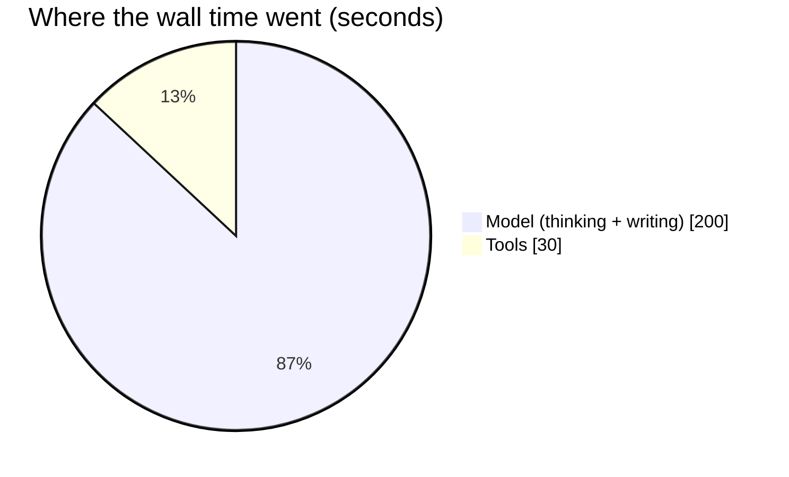

# corporate-ma/draft-markup-of-transition-services-agreement-tsa · run5 (`hv-mixed200-lunahigh-r5-20261116T164249Z`)

Result: **all-pass** 56/56 criteria · 3.9 min · 23 model calls · 36 tool calls (0 errors or timeouts) · ending `completed` · started 11-16 23:04:24 IST

## Overview

One box per stretch of steps that used the same kind of tool (blue: looking/searching/reading, purple: writing or editing files, yellow: a message with no tool call, red border: a tool error or timeout inside the box).

```mermaid
flowchart TD
    T(["Task prompt"])
    P0["<b>Step 1</b> · 0.0 min<br/>create_goal"]
    T --> P0
    class P0 look
    P1["<b>Step 2</b> · 0.0 min<br/>todo_write"]
    P0 --> P1
    class P1 look
    P2["<b>Step 3</b> · 0.0 min<br/>glob<br/><i>*</i>"]
    P1 --> P2
    class P2 look
    P3["<b>Step 4</b> · 0.2 min<br/>bash x3<br/>read<br/><i>andersen-instructions.eml, parse-doc docx documents/trident-draf…, parse-doc docx documents/polaris-tsa-… +1</i>"]
    P2 --> P3
    class P3 look
    P4["<b>Step 5</b> · 0.2 min<br/>bash x3<br/><i>parse-doc docx documents/trident-draf…, parse-doc docx documents/polaris-tsa-…, parse-doc docx documents/apa-excerpts…</i>"]
    P3 --> P4
    class P4 look
    P5["<b>Steps 6-8</b> · 0.1 min<br/>read x7<br/><i>draft.txt, playbook.txt, apa.txt</i>"]
    P4 --> P5
    class P5 look
    P6["<b>Step 9</b> · 0.5 min<br/>bash<br/><i>python - #lt;#lt;'PY' import docx from docx…</i>"]
    P5 --> P6
    class P6 look
    P7["<b>Step 10</b> · 0.2 min<br/>todo_write"]
    P6 --> P7
    class P7 look
    P8["<b>Steps 11-12</b> · 1.9 min<br/>bash x4<br/><i>cat #gt; build_docs.py #lt;#lt;'PY' from docx …, parse-doc docx output/tsa-markup-redl…, parse-doc docx output/tsa-review-memo… +1</i>"]
    P7 --> P8
    class P8 look
    P9["<b>Steps 13-15</b> · 0.2 min<br/>read x5<br/><i>redline-parse.txt, memo-parse.txt, build_docs.py</i>"]
    P8 --> P9
    class P9 look
    P10["<b>Step 16</b> · 0.1 min<br/>grep<br/><i>build_docs.py</i>"]
    P9 --> P10
    class P10 look
    P11["<b>Step 17</b> · 0.1 min<br/>edit<br/><i>build_docs.py</i>"]
    P10 --> P11
    class P11 write
    P12["<b>Step 18</b> · 0.1 min<br/>bash<br/><i>python build_docs.py && parse-doc doc…</i>"]
    P11 --> P12
    class P12 look
    P13["<b>Step 19</b> · 0.1 min<br/>bash<br/>glob<br/><i>python - #lt;#lt;'PY' from docx import Docu…, output/*</i>"]
    P12 --> P13
    class P13 look
    P14["<b>Step 20</b> · 0.0 min<br/>todo_write"]
    P13 --> P14
    class P14 look
    P15["<b>Step 21</b> · 0.0 min<br/>get_goal"]
    P14 --> P15
    class P15 look
    P16["<b>Step 22</b> · 0.0 min<br/>update_goal"]
    P15 --> P16
    class P16 look
    P17["<b>Step 23</b> · 0.1 min<br/>final message"]
    P16 --> P17
    class P17 ans
    R(["ALL PASS: 56/56 criteria"])
    P17 --> R
    class R pass
    classDef look fill:#e8f0fe,stroke:#4a6fa5,color:#111
    classDef write fill:#f3e8fd,stroke:#7b1fa2,color:#111
    classDef ans fill:#fff8e1,stroke:#b58900,color:#111
    classDef err fill:#e8f0fe,stroke:#c62828,stroke-width:3px,color:#111
    classDef pass fill:#e6f4ea,stroke:#2e7d32,color:#111
    classDef fail fill:#fce8e6,stroke:#c62828,color:#111
```





One row per model call:

| Step | Started (IST) | Model s | Tools s | Tool calls | Tools | Output chars |
|---|---|---|---|---|---|---|
| 1 | 23:04:24 | 3 | 0 | 1 | create_goal | 385 |
| 2 | 23:04:27 | 2 | 0 | 1 | todo_write | 57 |
| 3 | 23:04:29 | 1 | 1 | 1 | glob | 132 |
| 4 | 23:04:31 | 3 | 7 | 4 | bash x3, read | 161,896 |
| 5 | 23:04:40 | 4 | 10 | 3 | bash x3 | 1,122 |
| 6 | 23:04:54 | 2 | 0 | 3 | read x3 | 158,969 |
| 7 | 23:04:56 | 3 | 0 | 3 | read x3 | 77,427 |
| 8 | 23:04:59 | 2 | 0 | 1 | read | 9,891 |
| 9 | 23:05:01 | 27 | 1 | 1 | bash | 35 |
| 10 | 23:05:29 | 11 | 0 | 1 | todo_write | 57 |
| 11 | 23:05:40 | 104 | 1 | 1 | bash | 246 |
| 12 | 23:07:25 | 4 | 5 | 3 | bash x3 | 905 |
| 13 | 23:07:34 | 3 | 0 | 3 | read x3 | 64,543 |
| 14 | 23:07:37 | 4 | 0 | 1 | read | 23,287 |
| 15 | 23:07:41 | 5 | 0 | 1 | read | 1,831 |
| 16 | 23:07:46 | 2 | 1 | 1 | grep | 557 |
| 17 | 23:07:49 | 3 | 0 | 1 | edit | 213 |
| 18 | 23:07:52 | 3 | 3 | 1 | bash | 921 |
| 19 | 23:07:58 | 4 | 2 | 2 | bash, glob | 206 |
| 20 | 23:08:04 | 3 | 0 | 1 | todo_write | 57 |
| 21 | 23:08:06 | 2 | 0 | 1 | get_goal | 385 |
| 22 | 23:08:09 | 3 | 0 | 1 | update_goal | 390 |
| 23 | 23:08:11 | 5 | 0 | 0 | (message only) | 0 |

## Task prompt

```text
Review the attached draft TSA from the seller's perspective using our playbook, APA excerpts, and client instructions; produce a redline with annotated comments and a priority-tiered cover memo. Output: `tsa-markup-redline.docx` and `tsa-review-memo.docx`.
```

## Rubric

| # | Criterion | Verdict |
|---|---|---|
| C-001 | ISSUE_001a: Identifies 24-month lookback deviation in service standard | pass |
| C-002 | ISSUE_001b: Identifies 'or better than' qualifier in service standard | pass |
| C-003 | ISSUE_001c: Identifies undefined 'industry best practices' benchmark | pass |
| C-004 | ISSUE_001d: Proposes redline conforming service standard to playbook | pass |
| C-005 | ISSUE_002a: Identifies liability cap as 200% of total fees vs. APA's trailing 12-month cap | pass |
| C-006 | ISSUE_002b: Quantifies liability cap exposure difference | pass |
| C-007 | ISSUE_002c: Redlines liability cap to conform to APA Section 7.12(d) | pass |
| C-008 | ISSUE_003a: Identifies non-mutual consequential damages waiver | pass |
| C-009 | ISSUE_003b: Redlines to make consequential damages waiver mutual | pass |
| C-010 | ISSUE_004a: Identifies automatic renewal extending TSA beyond 18 months | pass |
| C-011 | ISSUE_004b: Redlines to delete auto-renewal and impose hard 18-month stop | pass |
| C-012 | ISSUE_005a: Identifies 120-day termination notice exceeding APA's 90 days | pass |
| C-013 | ISSUE_005b: Redlines termination notice to 90 days per APA | pass |
| C-014 | ISSUE_006a: Identifies Key Personnel consent right overriding Polaris staffing discretion | pass |
| C-015 | ISSUE_006b: Proposes compromise on Key Personnel (notice + qualified replacement) | pass |
| C-016 | ISSUE_007a: Identifies IT services 15% markup exceeding APA 10% cap | pass |
| C-017 | ISSUE_007b: Correctly computes IT fee difference | pass |
| C-018 | ISSUE_007c: Notes APA compliance risk even though overcharge benefits Polaris | pass |
| C-019 | ISSUE_008a: Identifies audit frequency deviation (twice/year vs. once/12 months) | pass |
| C-020 | ISSUE_008b: Identifies audit cost allocation deviation (Seller's vs. Buyer's expense) | pass |
| C-021 | ISSUE_008c: Identifies audit notice period deviation (10 vs. 30 business days) | pass |
| C-022 | ISSUE_009a: Identifies Ohio governing law vs. playbook's Pennsylvania law | pass |
| C-023 | ISSUE_009b: Identifies Cuyahoga County litigation vs. playbook's AAA arbitration in Pittsburgh | pass |
| C-024 | ISSUE_009c: Explains strategic importance of home-state law and arbitration for Polaris | pass |
| C-025 | ISSUE_010a: Identifies overbroad perpetual IP license grant | pass |
| C-026 | ISSUE_010b: Redlines to delete IP license and confirm Polaris sole ownership | pass |
| C-027 | ISSUE_011a: Identifies missing non-solicitation provision | pass |
| C-028 | ISSUE_011b: Drafts non-solicitation provision with 12-month post-service tail | pass |
| C-029 | ISSUE_012a: Identifies CGL insurance reduction ($2M vs. $5M playbook) | pass |
| C-030 | ISSUE_012b: Identifies missing umbrella coverage requirement | pass |
| C-031 | ISSUE_012c: Identifies missing additional insured endorsement | pass |
| C-032 | ISSUE_013a: Flags missing IMMEX program provisions for Monterrey facility | pass |
| C-033 | ISSUE_013b: Flags missing Mexican data privacy (LFPDPPP) provisions | pass |
| C-034 | ISSUE_014a: Identifies missing termination assistance/wind-down provisions | pass |
| C-035 | ISSUE_014b: Proposes termination assistance at cost-plus-15% for up to 60 days | pass |
| C-036 | ISSUE_015a: Identifies missing change order procedure | pass |
| C-037 | ISSUE_015b: Proposes change order procedure with cost-plus-15% pricing | pass |
| C-038 | ISSUE_016a: Identifies vague payment terms ('commercially reasonable time') | pass |
| C-039 | ISSUE_016b: Redlines payment terms to Net 30 days | pass |
| C-040 | ISSUE_016c: Adds late payment interest at 1.5%/month or max legal rate | pass |
| C-041 | ISSUE_017a: Identifies missing force majeure 90-day termination trigger | pass |
| C-042 | ISSUE_017b: Proposes 90-day force majeure termination right | pass |
| C-043 | Cover memo produced as a deliverable | pass |
| C-044 | Cover memo organizes issues by priority tiers (Critical/Significant/Minor) | pass |
| C-045 | APA-conflict issues classified as highest priority in cover memo | pass |
| C-046 | Cover memo includes negotiation strategy distinguishing firm vs. flexible positions | pass |
| C-047 | Redline markup includes proposed edits to the TSA | pass |
| C-048 | Redline markup includes explanatory comments for changes | pass |
| C-049 | Correctly identifies Polaris as Service Provider / Seller throughout | pass |
| C-050 | References APA Section 7.12 when flagging APA-conflict issues | pass |
| C-051 | Fee escalation provision addressed (playbook: greater of 3% or CPI-U) | pass |
| C-052 | Indemnification provision addressed (Buyer indemnifies for third-party claims) | pass |
| C-053 | Both deliverable files are produced | pass |
| C-054 | Correct total monthly service cost baseline ($1,020,000) referenced | pass |
| C-055 | Playbook's dispute escalation to senior executives referenced | pass |
| C-056 | Redline comments explain specific risk to Polaris for at least five changes | pass |

Judge's reasoning:

**C-001 (pass):** ISSUE_001a: Identifies 24-month lookback deviation in service standard

```text
The output expressly identifies the draft's 24-month service-standard lookback as conflicting with the APA's required 12-month lookback and proposes replacing it with the 12 months immediately preceding Closing.
```

**C-002 (pass):** ISSUE_001b: Identifies 'or better than' qualifier in service standard

```text
The agent expressly flags the draft’s “at least equal to or better than” service standard as an upward-ratchet obligation, deletes it, and replaces it with the APA/playbook’s 12-month “substantially consistent” standard.
```

**C-003 (pass):** ISSUE_001c: Identifies undefined 'industry best practices' benchmark

```text
The output expressly flags “industry best practices” as an undefined external benchmark that conflicts with the APA/playbook and creates an expansive performance guarantee. It proposes deleting that language and replacing it with the APA’s 12-month “substantially consistent” historical service standard.
```

**C-004 (pass):** ISSUE_001d: Proposes redline conforming service standard to playbook

```text
The agent proposes express replacement language in Section 3.1 requiring services to be provided “in a manner and at a level of quality substantially consistent with” how they were provided to the Business during the twelve months immediately preceding Closing, which conforms to the playbook standard.
```

**C-005 (pass):** ISSUE_002a: Identifies liability cap as 200% of total fees vs. APA's trailing 12-month cap

```text
The output expressly identifies the draft cap as 200% of total Service Charges/fees paid and contrasts it with APA Section 7.12(d)'s rolling trailing-12-month cap based on fees actually paid during the 12 months preceding the claim. It also proposes conforming replacement language and quantifies the exposure difference.
```

**C-006 (pass):** ISSUE_002b: Quantifies liability cap exposure difference

```text
The output expressly quantifies the liability-cap exposure: approximately $41.004 million under the draft versus $13.464 million under the APA trailing-12-month cap, a difference of $27.540 million (about 3.05x). It also provides an apples-to-apples corrected-fee comparison.
```

**C-007 (pass):** ISSUE_002c: Redlines liability cap to conform to APA Section 7.12(d)

```text
The agent proposes corrective redline language in Section 10.1 capping each party’s aggregate liability at the TSA fees actually paid during the 12 months immediately preceding the date the applicable claim is first asserted, expressly aligning the cap with APA Section 7.12(d).
```

**C-008 (pass):** ISSUE_003a: Identifies non-mutual consequential damages waiver

```text
The output expressly identifies Section 10.2 as a unilateral/one-way consequential damages waiver that protects Trident but leaves Polaris exposed, and proposes replacing it with a mutual waiver.
```

**C-009 (pass):** ISSUE_003b: Redlines to make consequential damages waiver mutual

```text
Section 10.2 expressly replaces the unilateral waiver with mutual language stating that “each Party” waives claims against the other for consequential, incidental, indirect, special, exemplary, and punitive damages, consistent with the criterion.
```

**C-010 (pass):** ISSUE_004a: Identifies automatic renewal extending TSA beyond 18 months

```text
The output expressly identifies the two automatic six-month renewals as potentially extending the TSA from the 18-month initial term to 30 months, states that this conflicts with APA §7.12(a)'s 18-month cap, and proposes deleting automatic renewal.
```

**C-011 (pass):** ISSUE_004b: Redlines to delete auto-renewal and impose hard 18-month stop

```text
The output expressly deletes automatic renewal and provides that the TSA expires after the 18-month Initial Term. It permits only a mutually agreed written extension for an individual service, limited to six additional months and priced at cost-plus 15%, satisfying the stated criterion.
```

**C-012 (pass):** ISSUE_005a: Identifies 120-day termination notice exceeding APA's 90 days

```text
The output expressly flags Section 5.3's 120-day prior written notice for terminating individual services as conflicting with APA Section 7.12(c)'s 90-day notice period and proposes replacing it with 90 days.
```

**C-013 (pass):** ISSUE_005b: Redlines termination notice to 90 days per APA

```text
The output expressly redlines Section 5.3 by replacing the 120-day termination notice with a 90-day prior written notice and cites APA Section 7.12(c) as the basis.
```

**C-014 (pass):** ISSUE_006a: Identifies Key Personnel consent right overriding Polaris staffing discretion

```text
The output expressly flags Sections 4.3 and Schedule H as improperly giving Trident prior-consent rights over reassignment, removal, and replacement of Key Personnel, explains that this conflicts with Polaris's sole staffing discretion under the playbook, and proposes deleting those consent and approval rights.
```

**C-015 (pass):** ISSUE_006b: Proposes compromise on Key Personnel (notice + qualified replacement)

```text
The redline restores Polaris’s sole discretion over staffing and removes Trident’s consent right, while offering a reasonable compromise: advance notice where practicable and identification or assignment of a reasonably qualified replacement. Sections 4.3 and Schedule H expressly implement this approach.
```

**C-016 (pass):** ISSUE_007a: Identifies IT services 15% markup exceeding APA 10% cap

```text
The agent expressly flags the IT Services 15% markup and $391,000 monthly fee as exceeding APA §7.12(b)'s 10% cap, and corrects the fee to $374,000 per month.
```

**C-017 (pass):** ISSUE_007b: Correctly computes IT fee difference

```text
The output correctly calculates the IT fee overcharge as $17,000 per month ($391,000 minus $374,000) and $306,000 over 18 months.
```

**C-018 (pass):** ISSUE_007c: Notes APA compliance risk even though overcharge benefits Polaris

```text
The output expressly notes that the 15% IT markup economically benefits Polaris but violates APA §7.12(b)'s 10% cap and must be corrected. It also explains that correction preserves Polaris's credibility and avoids a potential challenge to the fee schedule.
```

**C-019 (pass):** ISSUE_008a: Identifies audit frequency deviation (twice/year vs. once/12 months)

```text
The agent expressly flags that the draft permits audits twice per calendar year and proposes revising the provision to allow audits no more than once in any 12-month period, consistent with the playbook.
```

**C-020 (pass):** ISSUE_008b: Identifies audit cost allocation deviation (Seller's vs. Buyer's expense)

```text
The output expressly flags that the draft makes audits seller-funded/at Service Provider's expense, cites the playbook deviation, and proposes revised language making audits at Trident's sole expense, subject to reimbursement only if an overcharge exceeds 5%.
```

**C-021 (pass):** ISSUE_008c: Identifies audit notice period deviation (10 vs. 30 business days)

```text
The output expressly flags the draft’s 10 Business Days’ audit notice as too short and proposes redlining Section 14.1–14.2 to require at least 30 Business Days’ prior written notice, citing the playbook.
```

**C-022 (pass):** ISSUE_009a: Identifies Ohio governing law vs. playbook's Pennsylvania law

```text
The output expressly flags the draft's Ohio governing law and cites the playbook, then proposes replacing it with Pennsylvania law in Sections 15.1–15.2. The review memo likewise identifies Ohio law as the deviation and Pennsylvania law as the seller's proposed fix.
```

**C-023 (pass):** ISSUE_009b: Identifies Cuyahoga County litigation vs. playbook's AAA arbitration in Pittsburgh

```text
The output expressly flags the draft’s Ohio/Cuyahoga County court litigation provision as a deviation and proposes Pennsylvania law with confidential binding arbitration under the AAA Commercial Arbitration Rules in Pittsburgh, Pennsylvania.
```

**C-024 (pass):** ISSUE_009c: Explains strategic importance of home-state law and arbitration for Polaris

```text
The output expressly explains the strategic rationale: Ohio litigation creates a buyer-home-state and public-docket disadvantage, while Pennsylvania law and confidential AAA arbitration in Pittsburgh reduce home-court, discovery, and confidentiality risks for Pittsburgh-based Polaris.
```

**C-025 (pass):** ISSUE_010a: Identifies overbroad perpetual IP license grant

```text
The output expressly flags Section 7.1’s perpetual, irrevocable, royalty-free license, including modification, derivative-work, and sublicensing rights, as a significant and fundamental departure from the no-license position. It identifies proprietary tools, methodologies, software, and know-how as exposed to material IP leakage and proposes deleting the grant and limiting access to the TSA term solely to receive services.
```

**C-026 (pass):** ISSUE_010b: Redlines to delete IP license and confirm Polaris sole ownership

```text
The output deletes the perpetual, irrevocable license and replaces it with language stating that all Service Provider Materials remain Polaris’s sole and exclusive property. It grants no license or ownership interest beyond Trident’s limited, term-bound access and use solely to receive the Services, with access ending upon termination or expiration.
```

**C-027 (pass):** ISSUE_011a: Identifies missing non-solicitation provision

```text
The agent expressly flags that the draft omits a non-solicitation provision and proposes a new Section 15.12 prohibiting Trident from soliciting, recruiting, hiring, or engaging Polaris personnel who provided services under the TSA.
```

**C-028 (pass):** ISSUE_011b: Drafts non-solicitation provision with 12-month post-service tail

```text
The proposed Section 15.12 prohibits Trident from soliciting, recruiting, hiring, or engaging Polaris service personnel during the Term and for 12 months after termination or expiration, unless Polaris gives prior written consent.
```

**C-029 (pass):** ISSUE_012a: Identifies CGL insurance reduction ($2M vs. $5M playbook)

```text
The output expressly flags that the draft requires only $2 million in CGL coverage and proposes increasing Buyer’s CGL coverage to $5 million per occurrence and aggregate, consistent with the playbook requirement.
```

**C-030 (pass):** ISSUE_012b: Identifies missing umbrella coverage requirement

```text
The agent expressly flags that the draft has no umbrella coverage and proposes adding $5 million in umbrella/excess coverage in Section 13.1 and the review memorandum.
```

**C-031 (pass):** ISSUE_012c: Identifies missing additional insured endorsement

```text
The agent expressly flags that the draft lacks additional-insured protection and proposes requiring Polaris to be named as an additional insured under Buyer's CGL and umbrella policies, with certificates and endorsements delivered after closing and annually.
```

**C-032 (pass):** ISSUE_013a: Flags missing IMMEX program provisions for Monterrey facility

```text
The output expressly flags that the draft lacks an allocation for maintaining the Monterrey facility's IMMEX certification and proposes detailed language assigning primary responsibility and costs to Trident, with defined transition assistance and notice obligations for Polaris.
```

**C-033 (pass):** ISSUE_013b: Flags missing Mexican data privacy (LFPDPPP) provisions

```text
The output expressly flags that the TSA is limited to U.S. privacy law and omits Mexican LFPDPPP requirements for Monterrey employee HR/payroll data. It proposes a controller/processor allocation, compliant privacy notices (avisos de privacidad), required consents or lawful cross-border transfer mechanisms, security and breach obligations, and a data-processing addendum.
```

**C-034 (pass):** ISSUE_014a: Identifies missing termination assistance/wind-down provisions

```text
The output expressly flags that the draft is silent on termination assistance/wind-down and proposes a new Section 5.5 providing reasonable, bounded transition assistance for up to 60 days, consistent with the Polaris playbook.
```

**C-035 (pass):** ISSUE_014b: Proposes termination assistance at cost-plus-15% for up to 60 days

```text
The proposed New Section 5.5 expressly provides termination assistance for no more than 60 days at cost-plus-15% pricing and includes drafted wind-down support language.
```

**C-036 (pass):** ISSUE_015a: Identifies missing change order procedure

```text
The output expressly flags that the draft lacks a formal change-order process and explains the risk of informal scope expansion. It proposes a written, dual-signature change order procedure for out-of-scope services, material volume increases, new deliverables, and other material changes, consistent with the playbook.
```

**C-037 (pass):** ISSUE_015b: Proposes change order procedure with cost-plus-15% pricing

```text
The proposed new Section 6.7 requires a written change order signed by authorized representatives of both parties for out-of-scope services, material volume increases, new deliverables, or material changes, and states that additional services are priced at cost-plus 15% unless otherwise agreed.
```

**C-038 (pass):** ISSUE_016a: Identifies vague payment terms ('commercially reasonable time')

```text
The agent expressly flags “commercially reasonable time” as vague and unacceptable, explains the resulting cash-flow and enforcement risk, and replaces it with a defined Net 30 payment deadline (with Net 45 as a fallback).
```

**C-039 (pass):** ISSUE_016b: Redlines payment terms to Net 30 days

```text
Section 6.3 replaces the vague payment timing with payment of each undisputed invoice within thirty (30) days after the invoice date, which satisfies the Net 30 requirement.
```

**C-040 (pass):** ISSUE_016c: Adds late payment interest at 1.5%/month or max legal rate

```text
Section 6.3 expressly adds that late amounts accrue interest at the lesser of 1.5% per month or the maximum rate permitted by applicable law.
```

**C-041 (pass):** ISSUE_017a: Identifies missing force majeure 90-day termination trigger

```text
The output expressly flags that the draft force majeure clause lacks a termination trigger and proposes allowing either party to terminate the affected service without penalty after 90 consecutive days of a materially affecting force majeure event.
```

**C-042 (pass):** ISSUE_017b: Proposes 90-day force majeure termination right

```text
The proposed Article 12 language states that if a force majeure event continues for 90 consecutive days and materially affects a service, either party may terminate the affected service without penalty on written notice.
```

**C-043 (pass):** Cover memo produced as a deliverable

```text
The output includes a clearly labeled seller-side TSA review memorandum that summarizes the key TSA issues, risks, proposed fixes, and negotiation strategy.
```

**C-044 (pass):** Cover memo organizes issues by priority tiers (Critical/Significant/Minor)

```text
The memo clearly organizes issues into three priority tiers: Section 2 is labeled “Critical,” Section 4 is labeled “Significant,” and Section 5 is labeled “Minor.”
```

**C-045 (pass):** APA-conflict issues classified as highest priority in cover memo

```text
The memo expressly places the identified direct APA conflicts in Section 2, titled “Critical — direct APA conflicts or closing-level issues,” and marks the 200% liability cap, automatic renewals beyond the 18-month limit, 120-day termination notice, and 15% IT markup as “Must-change.” It separately categorizes playbook deviations as merely “Significant,” so the APA conflicts are clearly assigned the highest priority.
```

**C-046 (pass):** Cover memo includes negotiation strategy distinguishing firm vs. flexible positions

```text
The memo clearly distinguishes firm from flexible positions for well over three key issues and explains the basis. It labels direct APA conflicts as “Must-change,” treats the perpetual IP license and staffing discretion as firm/non-starters, and identifies negotiable fallbacks for termination assistance, change-order pricing, payment terms, insurance, audits, force majeure, dispute resolution, and non-solicitation. The recommended negotiation sequence and trading-points section further separates non-negotiable APA/IP/Mexico protections from implementation details where compromise is acceptable.
```

**C-047 (pass):** Redline markup includes proposed edits to the TSA

```text
The output includes extensive section-by-section proposed redline edits to the TSA, with explicit deletions, additions, and substitutions to draft language, rather than merely listing issues.
```

**C-048 (pass):** Redline markup includes explanatory comments for changes

```text
The redline includes extensive explanatory comments for each substantive proposed edit, identifying the basis (such as specific APA sections, playbook provisions, and client instructions), the risk if unchanged, and negotiability. These bracketed/anchored comments and corresponding comment boxes satisfy the criterion.
```

**C-049 (pass):** Correctly identifies Polaris as Service Provider / Seller throughout

```text
The output consistently identifies Polaris Industrial Holdings, Inc. as the Seller and Service Provider, identifies Trident as the Buyer/Service Recipient, and frames all proposed revisions to protect Polaris’s provider-side interests. No material party-role confusion appears.
```

**C-050 (pass):** References APA Section 7.12 when flagging APA-conflict issues

```text
The output repeatedly cites APA Section 7.12 and its relevant subsections when flagging APA conflicts, including §7.12(a) for term/renewal, §7.12(c) for termination notice, §7.12(b) for the fee markup cap, and §7.12(d) for the liability cap and damages waiver.
```

**C-051 (pass):** Fee escalation provision addressed (playbook: greater of 3% or CPI-U)

```text
The agent expressly addresses fee escalation in Section 6.4 / Schedule G §5, cites Playbook §4.2, and proposes annual fee increases by the greater of 3% or the CPI-U increase for the preceding 12 months. The review memo also repeats this opening position.
```

**C-052 (pass):** Indemnification provision addressed (Buyer indemnifies for third-party claims)

```text
The output expressly addresses indemnification in Sections 9.1–9.3 and proposes that Buyer/Service Recipient indemnify Seller for third-party claims arising from Buyer's use of or reliance on the services, Buyer's breach, or Buyer's wrongful acts, except to the extent caused by Seller's gross negligence or willful misconduct. This aligns with the stated playbook position.
```

**C-053 (pass):** Both deliverable files are produced

```text
The output includes two clearly distinct deliverables: a seller-side redlined TSA labeled “tsa-markup-redline.docx” and a separate partner cover/review memorandum labeled “tsa-review-memo.docx.”
```

**C-054 (pass):** Correct total monthly service cost baseline ($1,020,000) referenced

```text
The output expressly identifies the total monthly base cost as $1,020,000 and the corrected aggregate monthly fee at a 10% markup as $1,122,000, including a fee table showing the component amounts and correct sum.
```

**C-055 (pass):** Playbook's dispute escalation to senior executives referenced

```text
The output expressly proposes that disputes first be escalated to the parties’ CFO or General Counsel representatives for 15 Business Days before confidential AAA arbitration. The review memo also references executive escalation in the recommended dispute-resolution process.
```

**C-056 (pass):** Redline comments explain specific risk to Polaris for at least five changes

```text
The redline comments identify concrete adverse consequences to Polaris for well over five distinct issues. Examples include up to $27.54 million in additional liability exposure under the proposed cap, permanent leakage and sublicensing of Polaris IP, workforce and operational constraints from staffing approval rights, indefinite service obligations from automatic renewal and force majeure provisions, cash-flow risk from vague payment terms, Mexican privacy and IMMEX compliance exposure, and disruptive audits into proprietary systems. These comments go beyond merely citing the APA or playbook.
```

## Delivered files (output/)

- `tsa-markup-redline.docx` (58,301 bytes)
- `tsa-review-memo.docx` (44,032 bytes)

## Trajectory

### Step 1: 1 tool call

_Started 11-16 23:04:24 IST · model 3 s · tools 0 s_

**Reasoning summary:**

```text
**Organizing document tasks**

I’m thinking about how to manipulate documents and inspect files. Maybe I should consider what skills I need and make a list. First, using glob sounds like a good start. It looks like I have a long-running objective, so perhaps I should set a clear goal. The user is asking about deliverables, which suggests it is a multi-step document creation process. I'll think about calling create_goal and glob in parallel to keep things efficient.
```

**Call `create_goal`** (0.0 s)

```json
{
 "objective": "Review the draft TSA against the seller perspective, playbook, APA excerpts, and client instructions, then produce the annotated redline tsa-markup-redline.docx and priority-tiered cover memo tsa-review-memo.docx in output.",
 "max_goal_rounds": 10
}
```

Output (385 chars):

```text
{"goal":{"id":"goal-06b0bbbd-e045-4a47-9e96-1e3074d0c4aa","revision":1,"objective":"Review the draft TSA against the seller perspective, playbook, APA excerpts, and client instructions, then produce the annotated redline tsa-markup-redline.docx and priority-tiered cover memo tsa-review-memo.docx in output.","phase":"active","roundsStarted":0,"maxGoalRounds":10},"activation":"armed"}
```

### Step 2: 1 tool call

_Started 11-16 23:04:27 IST · model 2 s · tools 0 s_

**Call `todo_write`** (0.0 s)

```json
{
 "todos": [
  {
   "content": "Inventory task documents and identify source materials",
   "status": "in_progress"
  },
  {
   "content": "Review draft TSA against instructions and reference materials",
   "status": "pending"
  },
  {
   "content": "Prepare seller-side redline with annotated comments",
   "status": "pending"
  },
  {
   "content": "Prepare priority-tiered cover memo",
   "status": "pending"
  },
  {
   "content": "Validate both DOCX deliverables and finalize output",
   "status": "pending"
  }
 ]
}
```

Output (57 chars):

```text
Updated todo list: 4 pending, 1 in progress, 0 completed.
```

**Todo list now:**

- [~] Inventory task documents and identify source materials
- [ ] Review draft TSA against instructions and reference materials
- [ ] Prepare seller-side redline with annotated comments
- [ ] Prepare priority-tiered cover memo
- [ ] Validate both DOCX deliverables and finalize output

### Step 3: 1 tool call

_Started 11-16 23:04:29 IST · model 1 s · tools 1 s_

**Call `glob`** (0.7 s)

```json
{
 "pattern": "*"
}
```

Output (132 chars):

```text
documents/andersen-instructions.eml
documents/trident-draft-tsa.docx
documents/polaris-tsa-playbook.docx
documents/apa-excerpts.docx
```

### Step 4: 4 tool calls

_Started 11-16 23:04:31 IST · model 3 s · tools 7 s_

**Reasoning summary:**

```text
**Looking into parsing tools**

I need to read the documentation for the tools I'm using. For parsing DOCX files, I believe I should use `parse-doc`, and for EML files, `read` is the command to go with. I'm considering using bash for this, and it seems like I can run four parsing tools concurrently with the `multi_tool_use` command. I just need to double-check the exact command names to ensure everything runs smoothly.
```

**Call `read`** (0.1 s)

```json
{
 "file_path": "documents/andersen-instructions.eml"
}
```

Output (11,952 chars):

```text
<path>/home/agarwaldi/dsh-bench-harness/runs/hv-mixed200-lunahigh-r5-20261116T164249Z/tasks/corporate-ma__draft-markup-of-transition-services-agreement-tsa/workspace/documents/andersen-instructions.eml</path>
<type>file</type>
<content>
1: From: Victoria S. Andersen (vandersen@whitfieldcrane.com)
2: To: Nathan J. Reeves (nreeves@whitfieldcrane.com)
3: Date: Tue, 29 Apr 2025 08:17:00 -0000
4: Subject: RE: Polaris / Trident — TSA Markup Assignment — Specialty Coatings
5:  Divestiture
6: Content-Type: text/plain; charset="utf-8"
7: Content-Transfer-Encoding: quoted-printable
8: MIME-Version: 1.0
9: 
10: Nathan,
11: 
12: Caldwell Briggs & Foley (Tom Graziano's team =E2=80=94 his associate Priya Ve=
13: nkatesh circulated) sent over Trident's first draft of the Transition Service=
14: s Agreement yesterday evening. I've done a quick initial skim but haven't had=
15:  time to go through it with a fine-tooth comb =E2=80=94 that's where you come=
16:  in.
17: 
18: For context, this is the TSA contemplated by Section 7.12 of the executed Ass=
19: et Purchase Agreement dated March 14, 2025, between Polaris Industrial Holdin=
20: gs, Inc. (as Seller and Service Provider) and Trident Manufacturing Group, In=
21: c. (as Buyer and Service Recipient) for the divestiture of the Specialty Coat=
22: ings Division. Expected closing is June 2, 2025, which means we need to turn =
23: around a comprehensive markup by end of next week at the latest. Sharon Petro=
24: sian wants to see our redline b
… [10,452 more chars]
```

**Call `bash`** (2.5 s)

```json
{
 "command": "parse-doc docx documents/trident-draft-tsa.docx",
 "description": "Extract draft TSA text"
}
```

Output (49,993 chars):

```text
ing to:

> \(a\) any gross negligence or willful misconduct of Service Provider, its Affiliates, or their respective employees, agents, or contractors in performing the Services;
>
> \(b\) any breach by Service Provider of any representation, warranty, covenant, or obligation under this Agreement; or
>
> \(c\) any violation of Applicable Law by Service Provider, its Affiliates, or their respective employees, agents, or contractors in performing the Services.

**Section 9.3** *Indemnification Procedures.* The following procedures shall apply to any claim for indemnification under this Article 9:

> \(a\) **Notice.** The Party seeking indemnification (the \"**Indemnified Party**\") shall promptly notify the other Party (the \"**Indemnifying Party**\") in writing of any claim, demand, suit, action, or proceeding for which indemnification is sought (a \"**Claim**\"), specifying in reasonable detail the nature of the Claim and the amount of Losses incurred or expected to be incurred (to the extent then known). The failure by the Indemnified Party to give timely notice shall not relieve the Indemnifying Party of its indemnification obligations except to the extent that the Indemnifying Party is actually and materially prejudiced by such failure.
>
> \(b\) **Defense of Third-Party Claims.** Upon receipt of notice of a Claim involving a third-party claim, the Indemnifying Party shall have the right, but not the obligation, to assume the defense of such third-party claim, including th
… [48,493 more chars]
```

**Call `bash`** (2.0 s)

```json
{
 "command": "parse-doc docx documents/polaris-tsa-playbook.docx",
 "description": "Extract TSA playbook text"
}
```

Output (49,959 chars):

```text
such as *\"equal to or better than,\"* *\"at least equal to,\"* or *\"no less favorable than.\"* These formulations impose a floor that ratchets upward and does not permit any reduction or variation, however reasonable.
>
> • **Reject \"Best Practices\" and Similar Standards:** References to *\"industry best practices,\"* *\"commercially reasonable best efforts,\"* or other aspirational benchmarks must be rejected. These terms are undefined, subjective, invite disputes, and impose a standard that may materially exceed what Polaris historically provided to the divested business. Polaris is not a third-party service provider competing for business --- it is providing transitional support as an accommodation.
>
> • **Not a Guarantor:** Service Provider\'s obligation is limited to making available the same general type and level of resources as historically deployed. Service Provider does not guarantee specific outcomes, results, or service levels beyond what was historically provided.
>
> • **APA Precedence:** If the APA specifies a service standard (e.g., in the TSA covenant section or an exhibit), that APA standard controls and the TSA cannot impose a more stringent requirement.

**[2.2 Exclusions from Service Obligation]{.underline}**

Service Provider has no obligation to:

> • **(a)** Provide services not described in the applicable Service Schedules;
>
> • **(b)** Hire additional personnel or acquire additional resources beyond those in place as of the Closing Date;
>
> • 
… [48,459 more chars]
```

**Call `bash`** (2.0 s)

```json
{
 "command": "parse-doc docx documents/apa-excerpts.docx",
 "description": "Extract APA excerpts text"
}
```

Output (49,992 chars):

```text
**[EXCERPTS FROM EXECUTED ASSET PURCHASE AGREEMENT]{.underline}**

**ASSET PURCHASE AGREEMENT**

**dated as of March 14, 2025**

**by and between**

**POLARIS INDUSTRIAL HOLDINGS, INC.**

**and**

**TRIDENT MANUFACTURING GROUP, INC.**

This document contains selected excerpts from the Asset Purchase Agreement dated as of March 14, 2025, by and between Polaris Industrial Holdings, Inc. and Trident Manufacturing Group, Inc. The complete Asset Purchase Agreement is approximately 180 pages. Only the provisions relevant to the Transition Services Agreement are reproduced herein. Sections, exhibits, and schedules not reproduced are indicated by bracketed editorial notations. Defined terms used but not defined in these excerpts have the meanings given to them in the full Asset Purchase Agreement.

**APA Execution Date: March 14, 2025**

**[PREAMBLE AND RECITALS (EXCERPT)]{.underline}**

This ASSET PURCHASE AGREEMENT (this \"**Agreement**\") is entered into as of March 14, 2025, by and between:

**POLARIS INDUSTRIAL HOLDINGS, INC.**, a Delaware corporation, with its principal offices at 1200 Commonwealth Avenue, Suite 3000, Pittsburgh, PA 15222 (\"**Seller**\"),

and

**TRIDENT MANUFACTURING GROUP, INC.**, an Ohio corporation, with its principal offices at 800 Lakeside Drive, Suite 400, Cleveland, OH 44114 (\"**Buyer**\").

**RECITALS**

**WHEREAS:**

\(A\) Seller operates, among other businesses, the Specialty Coatings Division (as defined below), which is engaged in the development
… [48,492 more chars]
```

### Step 5: 3 tool calls

_Started 11-16 23:04:40 IST · model 4 s · tools 10 s_

**Call `bash`** (4.3 s)

```json
{
 "command": "parse-doc docx documents/trident-draft-tsa.docx > draft.txt",
 "description": "Save draft TSA extraction"
}
```

Output (374 chars):

```text
[stderr]
2026-11-16 17:34:46.788412924 [W:onnxruntime:Default, device_discovery.cc:95 GetPciBusId] Skipping pci_bus_id for PCI path at "/sys/devices/LNXSYSTM:00/LNXSYBUS:00/ACPI0004:00/VMBUS:00/5620e0c7-8062-4dce-aeb7-520c7ef76171" because filename "5620e0c7-8062-4dce-aeb7-520c7ef76171" did not match expected pattern of [0-9a-f]+:[0-9a-f]+:[0-9a-f]+[.][0-9a-f]+
```

**Call `bash`** (2.3 s)

```json
{
 "command": "parse-doc docx documents/polaris-tsa-playbook.docx > playbook.txt",
 "description": "Save playbook extraction"
}
```

Output (374 chars):

```text
[stderr]
2026-11-16 17:34:50.006024280 [W:onnxruntime:Default, device_discovery.cc:95 GetPciBusId] Skipping pci_bus_id for PCI path at "/sys/devices/LNXSYSTM:00/LNXSYBUS:00/ACPI0004:00/VMBUS:00/5620e0c7-8062-4dce-aeb7-520c7ef76171" because filename "5620e0c7-8062-4dce-aeb7-520c7ef76171" did not match expected pattern of [0-9a-f]+:[0-9a-f]+:[0-9a-f]+[.][0-9a-f]+
```

**Call `bash`** (3.6 s)

```json
{
 "command": "parse-doc docx documents/apa-excerpts.docx > apa.txt",
 "description": "Save APA extraction"
}
```

Output (374 chars):

```text
[stderr]
2026-11-16 17:34:52.251668020 [W:onnxruntime:Default, device_discovery.cc:95 GetPciBusId] Skipping pci_bus_id for PCI path at "/sys/devices/LNXSYSTM:00/LNXSYBUS:00/ACPI0004:00/VMBUS:00/5620e0c7-8062-4dce-aeb7-520c7ef76171" because filename "5620e0c7-8062-4dce-aeb7-520c7ef76171" did not match expected pattern of [0-9a-f]+:[0-9a-f]+:[0-9a-f]+[.][0-9a-f]+
```

### Step 6: 3 tool calls

_Started 11-16 23:04:54 IST · model 2 s · tools 0 s_

**Call `read`** (0.1 s)

```json
{
 "file_path": "draft.txt",
 "offset": 1,
 "limit": 1000
}
```

Output (52,950 chars):

```text
<path>/home/agarwaldi/dsh-bench-harness/runs/hv-mixed200-lunahigh-r5-20261116T164249Z/tasks/corporate-ma__draft-markup-of-transition-services-agreement-tsa/workspace/draft.txt</path>
<type>file</type>
<content>
1: DRAFT --- APRIL 28, 2025 PRIVILEGED & CONFIDENTIAL SUBJECT TO CONTRACT
2: 
3: **[TRANSITION SERVICES AGREEMENT]{.underline}**
4: 
5: **by and between**
6: 
7: **POLARIS INDUSTRIAL HOLDINGS, INC.**
8: 
9: **and**
10: 
11: **TRIDENT MANUFACTURING GROUP, INC.**
12: 
13: Dated as of \[●\], 2025
14: 
15: Prepared by Caldwell Briggs & Foley LLP
16: 
17: **TABLE OF CONTENTS**
18: 
19:   ----------------------------------------------------------------------------------------------------------
20:                                                                                      **Page**
21:   ----------------------- ---------------------------------------------------------- -----------------------
22:   **ARTICLE 1**           **DEFINITIONS**                                            \[●\]
23: 
24:                           Section 1.1 Defined Terms                                  \[●\]
25: 
26:   **ARTICLE 2**           **SERVICES**                                               \[●\]
27: 
28:                           Section 2.1 Provision of Services                          \[●\]
29: 
30:                           Section 2.2 Scope Limitations                              \[●\]
31: 
32:                           Section 2.3 Exclusive Remedy                           
… [51,450 more chars]
```

**Call `read`** (0.1 s)

```json
{
 "file_path": "playbook.txt",
 "offset": 1,
 "limit": 800
}
```

Output (52,720 chars):

```text
<path>/home/agarwaldi/dsh-bench-harness/runs/hv-mixed200-lunahigh-r5-20261116T164249Z/tasks/corporate-ma__draft-markup-of-transition-services-agreement-tsa/workspace/playbook.txt</path>
<type>file</type>
<content>
1: **[TRANSITION SERVICES AGREEMENT]{.underline}**
2: 
3: **[NEGOTIATION PLAYBOOK]{.underline}**
4: 
5: **Polaris Industrial Holdings, Inc. --- Service Provider Positions**
6: 
7: **PRIVILEGED AND CONFIDENTIAL --- ATTORNEY-CLIENT WORK PRODUCT**
8: 
9: This document is protected by the attorney-client privilege and the work-product doctrine. It contains the legal strategies, negotiation positions, and confidential assessments of Polaris Industrial Holdings, Inc. and its counsel. Distribution is strictly limited to authorized personnel. Any unauthorized disclosure, copying, or distribution is prohibited and may constitute a waiver of applicable privileges.
10: 
11: **Maintained by:** Legal Department, Polaris Industrial Holdings, Inc., 1200 Commonwealth Avenue, Suite 3000, Pittsburgh, PA 15222
12: 
13: **Approved by:** Sharon M. Petrosian, General Counsel
14: 
15: **Last Updated:** January 15, 2025
16: 
17: **Version:** 4.2
18: 
19: **Distribution:** Limited to Polaris Legal Department, CFO (David K. Okafor), CEO (Margaret R. Lindstrom), and outside counsel (Whitfield & Crane LLP, 600 Grant Street, Suite 4800, Pittsburgh, PA 15219; Lead Partner: Victoria S. Andersen)
20: 
21: This Playbook sets forth Polaris\'s preferred and fallback positions for any Transition Servi
… [51,220 more chars]
```

**Call `read`** (0.1 s)

```json
{
 "file_path": "apa.txt",
 "offset": 1,
 "limit": 1000
}
```

Output (53,299 chars):

```text
<path>/home/agarwaldi/dsh-bench-harness/runs/hv-mixed200-lunahigh-r5-20261116T164249Z/tasks/corporate-ma__draft-markup-of-transition-services-agreement-tsa/workspace/apa.txt</path>
<type>file</type>
<content>
1: **[EXCERPTS FROM EXECUTED ASSET PURCHASE AGREEMENT]{.underline}**
2: 
3: **ASSET PURCHASE AGREEMENT**
4: 
5: **dated as of March 14, 2025**
6: 
7: **by and between**
8: 
9: **POLARIS INDUSTRIAL HOLDINGS, INC.**
10: 
11: **and**
12: 
13: **TRIDENT MANUFACTURING GROUP, INC.**
14: 
15: This document contains selected excerpts from the Asset Purchase Agreement dated as of March 14, 2025, by and between Polaris Industrial Holdings, Inc. and Trident Manufacturing Group, Inc. The complete Asset Purchase Agreement is approximately 180 pages. Only the provisions relevant to the Transition Services Agreement are reproduced herein. Sections, exhibits, and schedules not reproduced are indicated by bracketed editorial notations. Defined terms used but not defined in these excerpts have the meanings given to them in the full Asset Purchase Agreement.
16: 
17: **APA Execution Date: March 14, 2025**
18: 
19: **[PREAMBLE AND RECITALS (EXCERPT)]{.underline}**
20: 
21: This ASSET PURCHASE AGREEMENT (this \"**Agreement**\") is entered into as of March 14, 2025, by and between:
22: 
23: **POLARIS INDUSTRIAL HOLDINGS, INC.**, a Delaware corporation, with its principal offices at 1200 Commonwealth Avenue, Suite 3000, Pittsburgh, PA 15222 (\"**Seller**\"),
24: 
25: and
26: 
27: **TRIDENT MAN
… [51,799 more chars]
```

### Step 7: 3 tool calls

_Started 11-16 23:04:56 IST · model 3 s · tools 0 s_

**Reasoning summary:**

```text
**Reviewing draft details**

I need to inspect the rest of the draft starting from line 443 and possibly look over the whole schedules too. It seems like using chunks to read through the content could be the best approach. I’m hoping this will help me make sure everything is in order and nothing has been overlooked. There’s a lot to juggle, so I want to be thorough! Let’s see how this unfolds.
```

**Call `read`** (0.1 s)

```json
{
 "file_path": "draft.txt",
 "offset": 443,
 "limit": 1000
}
```

Output (54,145 chars):

```text
<path>/home/agarwaldi/dsh-bench-harness/runs/hv-mixed200-lunahigh-r5-20261116T164249Z/tasks/corporate-ma__draft-markup-of-transition-services-agreement-tsa/workspace/draft.txt</path>
<type>file</type>
<content>
443: **Section 10.2** *Consequential Damages.* SERVICE PROVIDER HEREBY WAIVES, AND SHALL NOT ASSERT, ANY AND ALL CLAIMS AGAINST SERVICE RECIPIENT FOR CONSEQUENTIAL, INCIDENTAL, SPECIAL, PUNITIVE, EXEMPLARY, OR INDIRECT DAMAGES, INCLUDING LOSS OF REVENUE, LOSS OF PROFITS, LOSS OF BUSINESS OPPORTUNITY, COST OF REPLACEMENT SERVICES, DIMINUTION OF VALUE, OR LOSS OF GOODWILL, ARISING OUT OF OR RELATING TO THIS AGREEMENT, REGARDLESS OF WHETHER SUCH DAMAGES ARE BASED ON CONTRACT, TORT (INCLUDING NEGLIGENCE), STRICT LIABILITY, OR ANY OTHER LEGAL OR EQUITABLE THEORY, AND REGARDLESS OF WHETHER SERVICE PROVIDER HAS BEEN ADVISED OF THE POSSIBILITY OF SUCH DAMAGES. THE FOREGOING WAIVER SHALL APPLY EVEN IN THE EVENT OF THE FAILURE OF ESSENTIAL PURPOSE OF ANY REMEDY.
444: 
445: **Section 10.3** *Essential Basis.* The Parties acknowledge and agree that the limitations and exclusions of liability set forth in this Article 10 represent a fundamental element of the basis of the bargain between the Parties and that the Parties would not have entered into this Agreement absent such limitations and exclusions. Such limitations and exclusions shall apply regardless of the failure of essential purpose of any remedy provided herein and shall survive the termination or expiration of this Agreem
… [52,645 more chars]
```

**Call `read`** (0.1 s)

```json
{
 "file_path": "playbook.txt",
 "offset": 364,
 "limit": 600
}
```

Output (20,441 chars):

```text
<path>/home/agarwaldi/dsh-bench-harness/runs/hv-mixed200-lunahigh-r5-20261116T164249Z/tasks/corporate-ma__draft-markup-of-transition-services-agreement-tsa/workspace/playbook.txt</path>
<type>file</type>
<content>
364:   -------------------------------------------------------------------------------------------------------------------------------------------------------------------------------------------------------------------------------------------------------------------------------------------------------------------------------------------------------------------------------------------------------------------------------------------------------------------------------------------------------------------------------------------------------------------------------------------------------------
365:                                       **Position**
366:   ----------------------------------- -------------------------------------------------------------------------------------------------------------------------------------------------------------------------------------------------------------------------------------------------------------------------------------------------------------------------------------------------------------------------------------------------------------------------------------------------------------------------------------------------------------------------------------------------------------------------
367:   **Target**                   
… [18,941 more chars]
```

**Call `read`** (0.1 s)

```json
{
 "file_path": "apa.txt",
 "offset": 394,
 "limit": 200
}
```

Output (2,841 chars):

```text
<path>/home/agarwaldi/dsh-bench-harness/runs/hv-mixed200-lunahigh-r5-20261116T164249Z/tasks/corporate-ma__draft-markup-of-transition-services-agreement-tsa/workspace/apa.txt</path>
<type>file</type>
<content>
394:   Information Technology             \$340,000                       10%              \$374,000             31
395: 
396:   Human Resources                    \$125,000                       10%              \$137,500             18
397: 
398:   Supply Chain & Procurement         \$210,000                       10%              \$231,000             14
399: 
400:   Regulatory & EHS Compliance        \$95,000                        10%              \$104,500             8
401: 
402:   Treasury & Tax                     \$65,000                        10%              \$71,500              7
403: 
404:   **TOTAL**                          **\$1,020,000**                 **10%**          **\$1,122,000**       **100**
405:   ------------------------------------------------------------------------------------------------------------------------
406: 
407: The estimated maximum aggregate TSA Fees for the full eighteen (18) month Maximum TSA Term, assuming all six categories of Transition Services are provided for the full Maximum TSA Term, are \$1,122,000 × 18 = **\$20,196,000**. Actual TSA Fees will vary based on actual Fully-Loaded Costs incurred and the duration of each category of Transition Services.
408: 
409: The foregoing estimates do not include any Additional Se
… [1,341 more chars]
```

### Step 8: 1 tool call

_Started 11-16 23:04:59 IST · model 2 s · tools 0 s_

**Call `read`** (0.0 s)

```json
{
 "file_path": "draft.txt",
 "offset": 980,
 "limit": 1000
}
```

Output (9,891 chars):

```text
<path>/home/agarwaldi/dsh-bench-harness/runs/hv-mixed200-lunahigh-r5-20261116T164249Z/tasks/corporate-ma__draft-markup-of-transition-services-agreement-tsa/workspace/draft.txt</path>
<type>file</type>
<content>
980:   Monthly Fee:                        \$71,500
981:   -----------------------------------------------------------------------
982: 
983: **6. Migration Milestones**
984: 
985: > \(a\) **Bank Accounts.** Service Recipient shall establish its own bank accounts within thirty (30) days of the Closing Date. Service Provider shall cooperate with the orderly transition of banking relationships, including providing authorized signatories, account details, and historical banking records as reasonably requested.
986: >
987: > \(b\) **Intercompany Settlement.** All intercompany balances between Service Provider and the Business outstanding as of the Closing Date shall be settled within ninety (90) days of the Closing Date, in accordance with the settlement procedures set forth in the Purchase Agreement.
988: >
989: > \(c\) **Tax Filing Responsibilities.** Service Recipient shall assume responsibility for all Tax filings (sales and use, property, income, and other) for the Business by the twelfth (12th) month following the Closing Date. Service Provider shall cooperate with the transition of Tax filing responsibilities, including providing historical Tax returns, workpapers, and supporting documentation.
990: 
991: **7. Assumptions and Dependencies**
992: 
993: The Fees and s
… [8,391 more chars]
```

### Step 9: 1 tool call

_Started 11-16 23:05:01 IST · model 27 s · tools 1 s_

**Reasoning summary:**

```text
**Creating a redline document**

I need to create a redline document with annotated comments, and it seems likely that I'll need to use the python-docx library. The user wants a document that contains redlined markup, but maybe I can keep it concise instead of the full 48 pages. It’s essential to highlight substantive changes in red or underlined for deletions and blue for insertions. Using python-docx to modify the original document while keeping comments clear will be a bit tricky. Maybe starting from a draft docx is a good idea!

**Creating a redline DOCX**

I can create a new DOCX file programmatically using the complete text from the draft, utilizing paragraphs. However, I need to think about preserving the original formatting if it's a 48-page document. The easiest way might be to keep the DOCX, then insert comments. Using python-docx allows me to manipulate text and add redlines in paragraphs, along with comment-like annotations. I should consider including the full draft and appending a section for "Seller Redline and Comments" while ensuring relevant clause-by-clause markup is visible. That seems like a solid plan!

**Identifying APA issues systematically**

I need to identify all the issues in the document thoroughly. For example, in Section 3.1, the service standard should change from 24 months to 12 months with no priority, aligning with industry best practices. In Section 5.2, we should delete the auto-renew clause and instead mention a written mutual extension of up to six months. Section 5.3 needs a change from a 120-day termination notice to 90 days, and I'll also need to address fees to include non-cancelable costs. Finally, the cap on fees in Section 10.1 requires adjustments based on actual payments.

**Evaluating contract changes**

I’m considering changing the terms to allow for sole discretion, with perhaps a 15 business days notice for a named list and qualified replacements. I’ll also remove the FTE minimum. Don’t forget to include notes for Schedule H; that’s significant. It looks like non-solicitation is entirely missing, so I should add Section 15.12. Maybe I should interpret it as Section 15.11 before creating this new one.

**Revising notice requirements**

I need to be careful about over-marking. The draft needs an email and same-day courier, which seems cumbersome. There’s a minor change that allows an APA notice to be effective upon email during business hours or the next business day, eliminating the courier requirement. The entire agreement in Section 15.5 states that the APA controls unless stated otherwise, but it seems that may not be specific enough when considering potential conflicts.

**Exploring comment visibility**

I'm trying to figure out how visible comments work in a document. It seems like I can have numbered comments in the body, which is distinct from traditional Word comments. I'm curious if using the python-docx library version 1.2 allows for actual comments with `Document.add_comment`. I need to check the documentation to confirm how to implement that and whether it's feasible for what I want to achieve.
```

**Call `bash`** (0.9 s)

```json
{
 "command": "python - <<'PY'\nimport docx\nfrom docx import Document\nprint('python-docx', docx.__version__)\nprint('add_comment', hasattr(Document(), 'add_comment'))\nPY",
 "description": "Check DOCX authoring support"
}
```

Output (35 chars):

```text
python-docx 1.2.0
add_comment True
```

### Step 10: 1 tool call

_Started 11-16 23:05:29 IST · model 11 s · tools 0 s_

**Reasoning summary:**

```text
**Considering document creation**

I’m thinking about creating a DOCX from scratch while including comments that are anchored to the inserted or deleted runs. I can add comments with the function add_comment, which could help with redline paragraphs—like using red strikethrough for deleted text and red underline for added text. I'll also need to access comments in python-docx. To create a full draft, I’m considering a title page labeled "Seller's Redline Markup – Draft TSA (April 28, 2025)" along with a legend for clarity.

**Reviewing document revisions**

I'm focusing on selected issues for the document. I want to append a section for "Schedule-level conforming/cleanup edits" that includes proposed revisions for all 15 articles and schedules in a matrix. The markup should address the entire draft, and I might include a "Review Status / Markup Map" for clarity. 

For Article changes, I want to modify Section 1.1 definitions, like removing the Renewal Term and adding Data Processing and cyberattack clauses to Force Majeure. Additionally, I’m considering other revisions in Articles 2, 3, and 4.
```

**Call `todo_write`** (0.0 s)

```json
{
 "todos": [
  {
   "content": "Inventory task documents and identify source materials",
   "status": "completed"
  },
  {
   "content": "Review draft TSA against instructions and reference materials",
   "status": "completed"
  },
  {
   "content": "Prepare seller-side redline with annotated comments",
   "status": "in_progress"
  },
  {
   "content": "Prepare priority-tiered cover memo",
   "status": "pending"
  },
  {
   "content": "Validate both DOCX deliverables and finalize output",
   "status": "pending"
  }
 ]
}
```

Output (57 chars):

```text
Updated todo list: 2 pending, 1 in progress, 2 completed.
```

**Todo list now:**

- [x] Inventory task documents and identify source materials
- [x] Review draft TSA against instructions and reference materials
- [~] Prepare seller-side redline with annotated comments
- [ ] Prepare priority-tiered cover memo
- [ ] Validate both DOCX deliverables and finalize output

### Step 11: 1 tool call

_Started 11-16 23:05:40 IST · model 104 s · tools 1 s_

**Reasoning summary:**

```text
**Creating a script file**

I need to write a script file using a bash heredoc. I think it's best to use this approach since it's allowed. I want to clarify that using "write" is specific to markdown, and bash is fine for creating .docx files. I have to be careful with characters like curly braces. 

Next, I'll outline functions that set margins, add headings, and paragraphs. One function will handle redline entries, and I’ll make sure to format comments in a way that maintains clarity.
```

**Call `bash`** (1.2 s)

```json
{
 "command": "cat > build_docs.py <<'PY'\nfrom docx import Document\nfrom docx.shared import Inches, Pt, RGBColor\nfrom docx.enum.text import WD_ALIGN_PARAGRAPH, WD_BREAK\nfrom docx.enum.section import WD_SECTION\nfrom docx.enum.table import WD_TABLE_ALIGNMENT, WD_CELL_VERTICAL_ALIGNMENT\nfrom docx.oxml import OxmlElement\nfrom docx.oxml.ns import qn\nfrom docx.enum.style import WD_STYLE_TYPE\nfrom docx.enum.text import WD_LINE_SPACING\nfrom docx.enum.table import WD_ROW_HEIGHT_RULE\nfrom docx.enum.section import WD_ORIENT\nfrom docx.enum.text import WD_COLOR_INDEX\nfrom pathlib import Path\n\nOUT = Path('output')\nOUT.mkdir(exist_ok=True)\n\nNAVY = RGBColor(31, 78, 121)\nDARK = RGBColor(31, 31, 31)\nRED = RGBColor(192, 0, 0)\nBLUE = RGBColor(0, 102, 204)\nGREEN = RGBColor(0, 102, 51)\nGRAY = 'E7E6E6'\nLIGHT_BLUE = 'D9EAF7'\nLIGHT_RED = 'FCE4D6'\nLIGHT_YELLOW = 'FFF2CC'\n\n\ndef set_cell_shading(cell, fill):\n    tcPr = cell._tc.get_or_add_tcPr()\n    shd = tcPr.find(qn('w:shd'))\n    if shd is None:\n        shd = OxmlElement('w:shd')\n        tcPr.append(shd)\n    shd.set(qn('w:fill'), fill)\n\n\ndef set_cell_text(cell, text, bold=False, color=None, size=9):\n    cell.text = ''\
… [63,302 more chars]
```

Output (246 chars):

```text
created output/tsa-markup-redline.docx output/tsa-review-memo.docx
total 104
-rw-r--r-- 1 agarwaldi@microsoft.com users 58301 Nov 16 17:37 tsa-markup-redline.docx
-rw-r--r-- 1 agarwaldi@microsoft.com users 44029 Nov 16 17:37 tsa-review-memo.docx
```

### Step 12: 3 tool calls

_Started 11-16 23:07:25 IST · model 4 s · tools 5 s_

**Reasoning summary:**

```text
**Validating document parsing**

I need to validate the parsing of a DOCX file, perhaps checking for comments as well. I should use the output from the parse-doc function for workspace validation. It’s probably a good idea to check for any errors that might show up in redline. I can parse documents effectively, but I want to ensure everything is working correctly before proceeding! Let's make sure we cover all bases during this validation process.
```

**Call `bash`** (2.1 s)

```json
{
 "command": "parse-doc docx output/tsa-markup-redline.docx > redline-parse.txt && wc -l redline-parse.txt",
 "description": "Validate redline DOCX structure"
}
```

Output (396 chars):

```text
463 redline-parse.txt
[stderr]
2026-11-16 17:37:30.354627776 [W:onnxruntime:Default, device_discovery.cc:95 GetPciBusId] Skipping pci_bus_id for PCI path at "/sys/devices/LNXSYSTM:00/LNXSYBUS:00/ACPI0004:00/VMBUS:00/5620e0c7-8062-4dce-aeb7-520c7ef76171" because filename "5620e0c7-8062-4dce-aeb7-520c7ef76171" did not match expected pattern of [0-9a-f]+:[0-9a-f]+:[0-9a-f]+[.][0-9a-f]+
```

**Call `bash`** (2.1 s)

```json
{
 "command": "parse-doc docx output/tsa-review-memo.docx > memo-parse.txt && wc -l memo-parse.txt",
 "description": "Validate memo DOCX structure"
}
```

Output (393 chars):

```text
187 memo-parse.txt
[stderr]
2026-11-16 17:37:32.578761825 [W:onnxruntime:Default, device_discovery.cc:95 GetPciBusId] Skipping pci_bus_id for PCI path at "/sys/devices/LNXSYSTM:00/LNXSYBUS:00/ACPI0004:00/VMBUS:00/5620e0c7-8062-4dce-aeb7-520c7ef76171" because filename "5620e0c7-8062-4dce-aeb7-520c7ef76171" did not match expected pattern of [0-9a-f]+:[0-9a-f]+:[0-9a-f]+[.][0-9a-f]+
```

**Call `bash`** (0.6 s)

```json
{
 "command": "python - <<'PY'\nfrom zipfile import ZipFile\nfor p in ['output/tsa-markup-redline.docx','output/tsa-review-memo.docx']:\n    with ZipFile(p) as z:\n        names=set(z.namelist())\n        print(p, 'comments', 'word/comments.xml' in names, 'document', 'word/document.xml' in names)\nPY",
 "description": "Check DOCX comments and parts"
}
```

Output (116 chars):

```text
output/tsa-markup-redline.docx comments True document True
output/tsa-review-memo.docx comments False document True
```

### Step 13: 3 tool calls

_Started 11-16 23:07:34 IST · model 3 s · tools 0 s_

**Call `read`** (0.0 s)

```json
{
 "file_path": "redline-parse.txt",
 "offset": 1,
 "limit": 120
}
```

Output (13,164 chars):

```text
<path>/home/agarwaldi/dsh-bench-harness/runs/hv-mixed200-lunahigh-r5-20261116T164249Z/tasks/corporate-ma__draft-markup-of-transition-services-agreement-tsa/workspace/redline-parse.txt</path>
<type>file</type>
<content>
1: **PRIVILEGED & CONFIDENTIAL\
2: ATTORNEY-CLIENT WORK PRODUCT**
3: 
4: **SELLER-SIDE REDLINE MARKUP**
5: 
6: *Draft Transition Services Agreement --- Polaris / Trident Specialty Coatings Divestiture*
7: 
8: Polaris Industrial Holdings, Inc. --- Seller-side review\
9: May 1, 2025
10: 
11:   --------------------------------------------------------------------------------------------------------------------------------------------------------------------------------------------------------------------------------------------------------------------------------------------------------------------------------------------------------------------------------------------------------------------------------------------------------------------------------------------------
12:   **Review conclusion\**
13:   The April 28 buyer draft is not executable as submitted. It contains multiple direct conflicts with APA Section 7.12, including the service standard, term/renewal mechanics, termination notice, fee markup, liability cap, and consequential-damages waiver. It also exposes Polaris to material IP leakage and unallocated Monterrey IMMEX/LFPDPPP risk. This markup presents a comprehensive opening position; comments identify the basis, risk, and flexibility for each substan
… [11,664 more chars]
```

**Call `read`** (0.0 s)

```json
{
 "file_path": "redline-parse.txt",
 "offset": 120,
 "limit": 180
}
```

Output (29,506 chars):

```text
<path>/home/agarwaldi/dsh-bench-harness/runs/hv-mixed200-lunahigh-r5-20261116T164249Z/tasks/corporate-ma__draft-markup-of-transition-services-agreement-tsa/workspace/redline-parse.txt</path>
<type>file</type>
<content>
120:   **Risk if unchanged:** The draft overcharges IT by \$17,000 per month and creates a \$306,000 overstatement over 18 months. Keeping an incorrect fee also undermines credibility in the negotiation.\
121:   **Negotiability:** No flexibility on the 10% cap or correcting the math; actual-cost adjustments remain available only within APA §7.12(b).
122:   -------------------------------------------------------------------------------------------------------------------------------------------------------------------------------------------------------
123: 
124:   -------------------------------------------------------------------------------------------------------------------------------------------------------------------------------------------------------
125: 
126: ## Section 10.1 --- Aggregate Liability Cap --- replace total-fee multiple with APA cap
127: 
128: **Seller redline:** ~~\[DELETE\] Service Provider's aggregate liability \... shall not exceed two hundred percent (200%) of the total Service Charges actually paid \... as of the date of the applicable claim~~ [\[ADD\] Each Party's aggregate liability, including the liability of its Affiliates and their respective officers, directors, employees and agents, arising out of or relating to this Agree
… [28,006 more chars]
```

**Call `read`** (0.0 s)

```json
{
 "file_path": "memo-parse.txt",
 "offset": 1,
 "limit": 187
}
```

Output (21,873 chars):

```text
<path>/home/agarwaldi/dsh-bench-harness/runs/hv-mixed200-lunahigh-r5-20261116T164249Z/tasks/corporate-ma__draft-markup-of-transition-services-agreement-tsa/workspace/memo-parse.txt</path>
<type>file</type>
<content>
1: **PRIVILEGED & CONFIDENTIAL\
2: ATTORNEY-CLIENT WORK PRODUCT**
3: 
4: **SELLER-SIDE TSA REVIEW MEMORANDUM**
5: 
6: *Draft Transition Services Agreement --- Polaris / Trident Specialty Coatings Divestiture*
7: 
8: Polaris Industrial Holdings, Inc. --- Seller-side review\
9: May 1, 2025
10: 
11:   --------------------------------------------------------------------------------------------------------------------
12:   **To**                              Victoria S. Andersen, Partner
13:   ----------------------------------- --------------------------------------------------------------------------------
14:   **From**                            Nathan J. Reeves
15: 
16:   **Date**                            May 1, 2025
17: 
18:   **Re**                              Trident draft TSA dated April 28, 2025
19: 
20:   **Privileged status**               Attorney-client privileged / attorney work product --- internal Polaris review
21:   --------------------------------------------------------------------------------------------------------------------
22: 
23:   ----------------------------------------------------------------------------------------------------------------------------------------------------------------------------------------------------------------
… [20,373 more chars]
```

### Step 14: 1 tool call

_Started 11-16 23:07:37 IST · model 4 s · tools 0 s_

**Reasoning summary:**

```text
**Checking syntax integrity**

I think everything looks good so far, but I want to ensure that I check the redline rest to confirm there are no syntax breaks or missing entries. Taking this extra step is important to maintain the integrity of the data and ensure everything functions correctly. I'll go through it carefully, looking out for any potential issues that could cause problems later on. That way, I can be more confident in the outcome!
```

**Call `read`** (0.0 s)

```json
{
 "file_path": "redline-parse.txt",
 "offset": 295,
 "limit": 180
}
```

Output (23,287 chars):

```text
<path>/home/agarwaldi/dsh-bench-harness/runs/hv-mixed200-lunahigh-r5-20261116T164249Z/tasks/corporate-ma__draft-markup-of-transition-services-agreement-tsa/workspace/redline-parse.txt</path>
<type>file</type>
<content>
295: ## Article 12 --- Force Majeure --- add termination trigger
296: 
297: **Seller redline:** ~~\[DELETE\] Neither Party shall be liable for delay caused by a Force Majeure Event \...~~ [\[ADD\] Neither Party shall be liable for delay caused by an event beyond its reasonable control, including natural disasters, pandemics, war/terrorism, government action, sanctions, strikes, power or telecommunications failures, cyberattacks and similar events. Obligations are suspended, not terminated, during the event; the affected Party shall give prompt notice and use commercially reasonable mitigation efforts. If the event continues for ninety (90) consecutive days and materially affects a Service, either Party may terminate that affected Service without penalty on written notice, and Fees shall be equitably adjusted to Services actually delivered]{.underline}
298: 
299:   --------------------------------------------------------------------------------------------------------------------------------------------------------------------
300:   **COMMENT C-18 --- SIGNIFICANT \| Firm on termination trigger; 120 days is maximum fallback\
301:   Basis:** Playbook §10.1; the draft has no exit mechanism for prolonged interruption.\
302:   **Risk if unchanged:** Polaris could re
… [21,787 more chars]
```

### Step 15: 1 tool call

_Started 11-16 23:07:41 IST · model 5 s · tools 0 s_

**Reasoning summary:**

```text
**Clarifying editing steps**

I'm trying to determine whether the critical table with 9 entries is relevant. It may be better to specify it contains "multiple direct APA conflicts." I'll focus on editing the `build_docs.py` script. But wait, do I need to read the file first? I have the script output, but it seems I should read the first lines to ensure compliance with policy before making any edits. I think I’ll check that before proceeding with the edit.
```

**Call `read`** (0.0 s)

```json
{
 "file_path": "build_docs.py",
 "offset": 370,
 "limit": 10
}
```

Output (1,831 chars):

```text
<path>/home/agarwaldi/dsh-bench-harness/runs/hv-mixed200-lunahigh-r5-20261116T164249Z/tasks/corporate-ma__draft-markup-of-transition-services-agreement-tsa/workspace/build_docs.py</path>
<type>file</type>
<content>
370:         ('Schedule D: ', 'add third-party-consent, vendor-pricing and warehouse-capacity qualifications; require Trident to migrate vendor relationships promptly.'),
371:         ('Schedule E: ', 'limit Monterrey support to coordination/assistance; preserve Trident’s responsibility for permits, operations, incidents and agency compliance.'),
372:         ('Schedule F: ', 'limit tax and transfer-pricing work to administrative support based on buyer-provided information; exclude advice, opinions and extraordinary audits unless separately agreed.'),
373:         ('Schedule G: ', 'correct IT markup and total; preserve a 10% cap for each category and the APA’s actual-cost / five-percent consent mechanics.'),
374:         ('Schedule H: ', 'remove named-person consent, minimum FTE, “essential” language and buyer approval for replacements; make the list illustrative.'),
375:     ])
376:     add_info_box(doc, 'Seller opening position', 'The redline is intentionally comprehensive. Polaris should lead with the APA-conflict corrections as non-negotiable, pair the IP and staffing protections with reasonable operational explanations, and offer limited flexibility on notice periods, audit frequency, extension pricing, and termination-assistance pricing only after Trident acc
… [331 more chars]
```

### Step 16: 1 tool call

_Started 11-16 23:07:46 IST · model 2 s · tools 1 s_

**Call `grep`** (0.9 s)

```json
{
 "pattern": "six direct APA",
 "path": "build_docs.py"
}
```

Output (557 chars):

```text
Found 1 match

build_docs.py
Line 409:     add_info_box(doc,'Bottom line','The buyer draft should not be circulated as a near-final form. It contains six direct APA conflicts, a unilateral consequential-damages waiver, a perpetual Polaris IP license, buyer control over Polaris staffing, and no operational allocation for IMMEX or LFPDPPP compliance. The first markup should be comprehensive but commercially explainable: insist on the APA terms and board-level IP/Mexico protections, while reserving negotiation room on implementation details.', LIGHT_RED)
```

### Step 17: 1 tool call

_Started 11-16 23:07:49 IST · model 3 s · tools 0 s_

**Call `edit`** (0.0 s)

```json
{
 "file_path": "build_docs.py",
 "old_string": "It contains six direct APA conflicts, a unilateral consequential-damages waiver, a perpetual Polaris IP license, buyer control over Polaris staffing, and no operational allocation for IMMEX or LFPDPPP compliance.",
 "new_string": "It contains multiple direct APA conflicts, a unilateral consequential-damages waiver, a perpetual Polaris IP license, buyer control over Polaris staffing, and no operational allocation for IMMEX or LFPDPPP compliance."
}
```

Output (213 chars):

```text
The file /home/agarwaldi/dsh-bench-harness/runs/hv-mixed200-lunahigh-r5-20261116T164249Z/tasks/corporate-ma__draft-markup-of-transition-services-agreement-tsa/workspace/build_docs.py has been updated successfully.
```

### Step 18: 1 tool call

_Started 11-16 23:07:52 IST · model 3 s · tools 3 s_

**Call `bash`** (3.0 s)

```json
{
 "command": "python build_docs.py && parse-doc docx output/tsa-review-memo.docx > memo-parse.txt && grep -n \"multiple direct\\|six direct\" memo-parse.txt || true",
 "description": "Refresh documents after memo correction"
}
```

Output (921 chars):

```text
created output/tsa-markup-redline.docx output/tsa-review-memo.docx
25:  The buyer draft should not be circulated as a near-final form. It contains multiple direct APA conflicts, a unilateral consequential-damages waiver, a perpetual Polaris IP license, buyer control over Polaris staffing, and no operational allocation for IMMEX or LFPDPPP compliance. The first markup should be comprehensive but commercially explainable: insist on the APA terms and board-level IP/Mexico protections, while reserving negotiation room on implementation details.
[stderr]
2026-11-16 17:37:57.962504072 [W:onnxruntime:Default, device_discovery.cc:95 GetPciBusId] Skipping pci_bus_id for PCI path at "/sys/devices/LNXSYSTM:00/LNXSYBUS:00/ACPI0004:00/VMBUS:00/5620e0c7-8062-4dce-aeb7-520c7ef76171" because filename "5620e0c7-8062-4dce-aeb7-520c7ef76171" did not match expected pattern of [0-9a-f]+:[0-9a-f]+:[0-9a-f]+[.][0-9a-f]+
```

### Step 19: 2 tool calls

_Started 11-16 23:07:58 IST · model 4 s · tools 2 s_

**Call `bash`** (0.8 s)

```json
{
 "command": "python - <<'PY'\nfrom docx import Document\nfrom zipfile import ZipFile\nfor p in ['output/tsa-markup-redline.docx','output/tsa-review-memo.docx']:\n    d=Document(p)\n    print(p, 'paragraphs', len(d.paragraphs), 'tables', len(d.tables))\n    with ZipFile(p) as z:\n        print('  comments.xml', 'word/comments.xml' in z.namelist())\nPY",
 "description": "Smoke test generated DOCX files"
}
```

Output (148 chars):

```text
output/tsa-markup-redline.docx paragraphs 110 tables 31
  comments.xml True
output/tsa-review-memo.docx paragraphs 53 tables 6
  comments.xml False
```

**Call `glob`** (0.7 s)

```json
{
 "pattern": "output/*"
}
```

Output (58 chars):

```text
output/tsa-markup-redline.docx
output/tsa-review-memo.docx
```

### Step 20: 1 tool call

_Started 11-16 23:08:04 IST · model 3 s · tools 0 s_

**Call `todo_write`** (0.0 s)

```json
{
 "todos": [
  {
   "content": "Inventory task documents and identify source materials",
   "status": "completed"
  },
  {
   "content": "Review draft TSA against instructions and reference materials",
   "status": "completed"
  },
  {
   "content": "Prepare seller-side redline with annotated comments",
   "status": "completed"
  },
  {
   "content": "Prepare priority-tiered cover memo",
   "status": "completed"
  },
  {
   "content": "Validate both DOCX deliverables and finalize output",
   "status": "completed"
  }
 ]
}
```

Output (57 chars):

```text
Updated todo list: 0 pending, 0 in progress, 5 completed.
```

**Todo list now:**

- [x] Inventory task documents and identify source materials
- [x] Review draft TSA against instructions and reference materials
- [x] Prepare seller-side redline with annotated comments
- [x] Prepare priority-tiered cover memo
- [x] Validate both DOCX deliverables and finalize output

### Step 21: 1 tool call

_Started 11-16 23:08:06 IST · model 2 s · tools 0 s_

**Call `get_goal`** (0.0 s)

```json
{}
```

Output (385 chars):

```text
{"goal":{"id":"goal-06b0bbbd-e045-4a47-9e96-1e3074d0c4aa","revision":1,"objective":"Review the draft TSA against the seller perspective, playbook, APA excerpts, and client instructions, then produce the annotated redline tsa-markup-redline.docx and priority-tiered cover memo tsa-review-memo.docx in output.","phase":"active","roundsStarted":0,"maxGoalRounds":10},"activation":"armed"}
```

### Step 22: 1 tool call

_Started 11-16 23:08:09 IST · model 3 s · tools 0 s_

**Call `update_goal`** (0.0 s)

```json
{
 "goal_id": "goal-06b0bbbd-e045-4a47-9e96-1e3074d0c4aa",
 "revision": 1,
 "action": "complete"
}
```

Output (390 chars):

```text
{"goal":{"id":"goal-06b0bbbd-e045-4a47-9e96-1e3074d0c4aa","revision":2,"objective":"Review the draft TSA against the seller perspective, playbook, APA excerpts, and client instructions, then produce the annotated redline tsa-markup-redline.docx and priority-tiered cover memo tsa-review-memo.docx in output.","phase":"complete","roundsStarted":0,"maxGoalRounds":10},"activation":"disarmed"}
```

### Step 23: 0 tool calls

_Started 11-16 23:08:11 IST · model 5 s · tools 0 s_

**Text:**

```markdown
Completed and validated both deliverables:

- [tsa-markup-redline.docx](sandbox:/home/agarwaldi/dsh-bench-harness/runs/hv-mixed200-lunahigh-r5-20261116T164249Z/tasks/corporate-ma__draft-markup-of-transition-services-agreement-tsa/workspace/output/tsa-markup-redline.docx)
- [tsa-review-memo.docx](sandbox:/home/agarwaldi/dsh-bench-harness/runs/hv-mixed200-lunahigh-r5-20261116T164249Z/tasks/corporate-ma__draft-markup-of-transition-services-agreement-tsa/workspace/output/tsa-review-memo.docx)

The redline includes visible seller edits, annotated comments, APA/playbook bases, risk explanations, and negotiation flexibility. The memo is organized by Critical, Significant, and Minor priorities and includes the fee and liability-cap exposure calculations.
```

