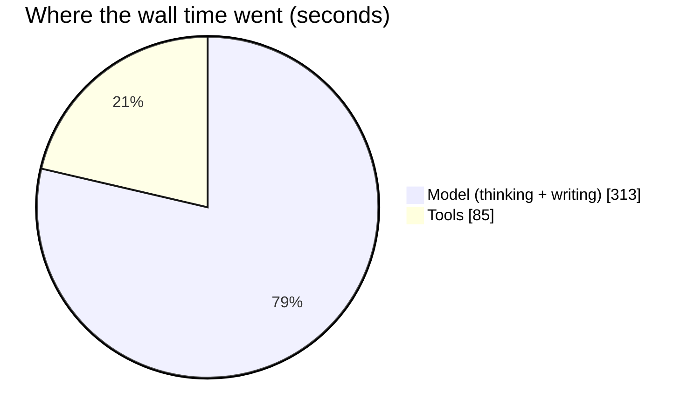

# corporate-ma/draft-markup-of-transition-services-agreement-tsa · run7 (`hv-mixed200-lunahigh-flip-r7-20261118T030322Z`)

Result: **all-pass** 56/56 criteria · 6.6 min · 28 model calls · 45 tool calls (0 errors or timeouts) · ending `completed` · started 11-18 08:38:37 IST

## Overview

One box per stretch of steps that used the same kind of tool (blue: looking/searching/reading, purple: writing or editing files, yellow: a message with no tool call, red border: a tool error or timeout inside the box).

```mermaid
flowchart TD
    T(["Task prompt"])
    P0["<b>Step 1</b> · 0.0 min<br/>create_goal"]
    T --> P0
    class P0 look
    P1["<b>Step 2</b> · 0.0 min<br/>todo_write"]
    P0 --> P1
    class P1 look
    P2["<b>Step 3</b> · 0.1 min<br/>glob<br/><i>*</i>"]
    P1 --> P2
    class P2 look
    P3["<b>Steps 4-5</b> · 0.4 min<br/>bash x5<br/><i>parse-doc docx documents/trident-draf…, parse-doc docx documents/polaris-tsa-…, parse-doc docx documents/apa-excerpts… +2</i>"]
    P2 --> P3
    class P3 look
    P4["<b>Steps 6-7</b> · 0.1 min<br/>read x8<br/><i>draft.txt, playbook.txt, apa.txt</i>"]
    P3 --> P4
    class P4 look
    P5["<b>Step 8</b> · 0.2 min<br/>bash<br/><i>python - #lt;#lt;'PY' #gt; scratch/docx_struct…</i>"]
    P4 --> P5
    class P5 look
    P6["<b>Step 9</b> · 0.0 min<br/>read<br/><i>docx_structure.txt</i>"]
    P5 --> P6
    class P6 look
    P7["<b>Steps 10-12</b> · 3.9 min<br/>bash x5<br/><i>python - #lt;#lt;'PY' import docx print(doc…, cat #gt; scratch/generate_docs.py #lt;#lt;'PY'…, parse-doc docx output/tsa-markup-redl… +2</i>"]
    P6 --> P7
    class P7 look
    P8["<b>Step 13</b> · 0.1 min<br/>grep<br/><i>redline_check.txt</i>"]
    P7 --> P8
    class P8 look
    P9["<b>Steps 14-15</b> · 0.2 min<br/>read x2<br/><i>redline_check.txt</i>"]
    P8 --> P9
    class P9 look
    P10["<b>Steps 16-17</b> · 0.4 min<br/>bash x2<br/><i>python - #lt;#lt;'PY' from docx import Docu…, cat #gt; scratch/patch_docs.py #lt;#lt;'PY' fr…</i>"]
    P9 --> P10
    class P10 look
    P11["<b>Step 18</b> · 0.2 min<br/>bash x2<br/>glob<br/><i>libreoffice --headless --convert-to p…, output/*</i>"]
    P10 --> P11
    class P11 look
    P12["<b>Steps 19-20</b> · 0.2 min<br/>bash x4<br/><i>pdfinfo scratch/tsa-markup-redline.pd…, pdfinfo scratch/tsa-review-memo.pdf |…, python - #lt;#lt;'PY' from pathlib import P… +1</i>"]
    P11 --> P12
    class P12 look
    P13["<b>Step 21</b> · 0.1 min<br/>glob<br/><i>scratch/*page*</i>"]
    P12 --> P13
    class P13 look
    P14["<b>Step 22</b> · 0.0 min<br/>read_image x2<br/><i>memo-page-1.png, redline-page-01.png</i>"]
    P13 --> P14
    class P14 look
    P15["<b>Steps 23-24</b> · 0.5 min<br/>bash x4<br/><i>python - #lt;#lt;'PY' from docx import Docu…, parse-doc docx output/tsa-markup-redl…, parse-doc docx output/tsa-review-memo… +1</i>"]
    P14 --> P15
    class P15 look
    P16["<b>Step 25</b> · 0.1 min<br/>todo_write"]
    P15 --> P16
    class P16 look
    P17["<b>Step 26</b> · 0.1 min<br/>get_goal"]
    P16 --> P17
    class P17 look
    P18["<b>Step 27</b> · 0.0 min<br/>update_goal"]
    P17 --> P18
    class P18 look
    P19["<b>Step 28</b> · 0.1 min<br/>final message"]
    P18 --> P19
    class P19 ans
    R(["ALL PASS: 56/56 criteria"])
    P19 --> R
    class R pass
    classDef look fill:#e8f0fe,stroke:#4a6fa5,color:#111
    classDef write fill:#f3e8fd,stroke:#7b1fa2,color:#111
    classDef ans fill:#fff8e1,stroke:#b58900,color:#111
    classDef err fill:#e8f0fe,stroke:#c62828,stroke-width:3px,color:#111
    classDef pass fill:#e6f4ea,stroke:#2e7d32,color:#111
    classDef fail fill:#fce8e6,stroke:#c62828,color:#111
```





One row per model call:

| Step | Started (IST) | Model s | Tools s | Tool calls | Tools | Output chars |
|---|---|---|---|---|---|---|
| 1 | 08:38:37 | 3 | 0 | 1 | create_goal | 410 |
| 2 | 08:38:40 | 2 | 0 | 1 | todo_write | 57 |
| 3 | 08:38:41 | 2 | 2 | 1 | glob | 132 |
| 4 | 08:38:45 | 4 | 11 | 4 | bash x4 | 160,715 |
| 5 | 08:39:00 | 4 | 6 | 1 | bash | 1,203 |
| 6 | 08:39:10 | 3 | 0 | 5 | read x5 | 222,634 |
| 7 | 08:39:13 | 2 | 0 | 3 | read x3 | 27,647 |
| 8 | 08:39:15 | 8 | 1 | 1 | bash | 11 |
| 9 | 08:39:24 | 2 | 0 | 1 | read | 12,832 |
| 10 | 08:39:26 | 49 | 10 | 1 | bash | 6 |
| 11 | 08:40:25 | 158 | 6 | 1 | bash | 397 |
| 12 | 08:43:08 | 5 | 9 | 3 | bash x3 | 10,588 |
| 13 | 08:43:22 | 4 | 1 | 1 | grep | 484 |
| 14 | 08:43:28 | 5 | 0 | 1 | read | 3,557 |
| 15 | 08:43:33 | 6 | 0 | 1 | read | 1,940 |
| 16 | 08:43:39 | 4 | 2 | 1 | bash | 802 |
| 17 | 08:43:45 | 9 | 8 | 1 | bash | 1,758 |
| 18 | 08:44:01 | 5 | 9 | 3 | bash x2, glob | 1,102 |
| 19 | 08:44:15 | 4 | 2 | 3 | bash x3 | 156 |
| 20 | 08:44:21 | 4 | 2 | 1 | bash | 121 |
| 21 | 08:44:27 | 2 | 1 | 1 | glob | 51 |
| 22 | 08:44:31 | 2 | 0 | 2 | read_image x2 | 590 |
| 23 | 08:44:33 | 10 | 7 | 1 | bash | 749 |
| 24 | 08:44:50 | 6 | 7 | 3 | bash x3 | 7,700 |
| 25 | 08:45:03 | 4 | 0 | 1 | todo_write | 57 |
| 26 | 08:45:07 | 3 | 0 | 1 | get_goal | 410 |
| 27 | 08:45:10 | 2 | 0 | 1 | update_goal | 415 |
| 28 | 08:45:12 | 4 | 0 | 0 | (message only) | 0 |

## Task prompt

```text
Review the attached draft TSA from the seller's perspective using our playbook, APA excerpts, and client instructions; produce a redline with annotated comments and a priority-tiered cover memo. Output: `tsa-markup-redline.docx` and `tsa-review-memo.docx`.
```

## Rubric

| # | Criterion | Verdict |
|---|---|---|
| C-001 | ISSUE_001a: Identifies 24-month lookback deviation in service standard | pass |
| C-002 | ISSUE_001b: Identifies 'or better than' qualifier in service standard | pass |
| C-003 | ISSUE_001c: Identifies undefined 'industry best practices' benchmark | pass |
| C-004 | ISSUE_001d: Proposes redline conforming service standard to playbook | pass |
| C-005 | ISSUE_002a: Identifies liability cap as 200% of total fees vs. APA's trailing 12-month cap | pass |
| C-006 | ISSUE_002b: Quantifies liability cap exposure difference | pass |
| C-007 | ISSUE_002c: Redlines liability cap to conform to APA Section 7.12(d) | pass |
| C-008 | ISSUE_003a: Identifies non-mutual consequential damages waiver | pass |
| C-009 | ISSUE_003b: Redlines to make consequential damages waiver mutual | pass |
| C-010 | ISSUE_004a: Identifies automatic renewal extending TSA beyond 18 months | pass |
| C-011 | ISSUE_004b: Redlines to delete auto-renewal and impose hard 18-month stop | pass |
| C-012 | ISSUE_005a: Identifies 120-day termination notice exceeding APA's 90 days | pass |
| C-013 | ISSUE_005b: Redlines termination notice to 90 days per APA | pass |
| C-014 | ISSUE_006a: Identifies Key Personnel consent right overriding Polaris staffing discretion | pass |
| C-015 | ISSUE_006b: Proposes compromise on Key Personnel (notice + qualified replacement) | pass |
| C-016 | ISSUE_007a: Identifies IT services 15% markup exceeding APA 10% cap | pass |
| C-017 | ISSUE_007b: Correctly computes IT fee difference | pass |
| C-018 | ISSUE_007c: Notes APA compliance risk even though overcharge benefits Polaris | pass |
| C-019 | ISSUE_008a: Identifies audit frequency deviation (twice/year vs. once/12 months) | pass |
| C-020 | ISSUE_008b: Identifies audit cost allocation deviation (Seller's vs. Buyer's expense) | pass |
| C-021 | ISSUE_008c: Identifies audit notice period deviation (10 vs. 30 business days) | pass |
| C-022 | ISSUE_009a: Identifies Ohio governing law vs. playbook's Pennsylvania law | pass |
| C-023 | ISSUE_009b: Identifies Cuyahoga County litigation vs. playbook's AAA arbitration in Pittsburgh | pass |
| C-024 | ISSUE_009c: Explains strategic importance of home-state law and arbitration for Polaris | pass |
| C-025 | ISSUE_010a: Identifies overbroad perpetual IP license grant | pass |
| C-026 | ISSUE_010b: Redlines to delete IP license and confirm Polaris sole ownership | pass |
| C-027 | ISSUE_011a: Identifies missing non-solicitation provision | pass |
| C-028 | ISSUE_011b: Drafts non-solicitation provision with 12-month post-service tail | pass |
| C-029 | ISSUE_012a: Identifies CGL insurance reduction ($2M vs. $5M playbook) | pass |
| C-030 | ISSUE_012b: Identifies missing umbrella coverage requirement | pass |
| C-031 | ISSUE_012c: Identifies missing additional insured endorsement | pass |
| C-032 | ISSUE_013a: Flags missing IMMEX program provisions for Monterrey facility | pass |
| C-033 | ISSUE_013b: Flags missing Mexican data privacy (LFPDPPP) provisions | pass |
| C-034 | ISSUE_014a: Identifies missing termination assistance/wind-down provisions | pass |
| C-035 | ISSUE_014b: Proposes termination assistance at cost-plus-15% for up to 60 days | pass |
| C-036 | ISSUE_015a: Identifies missing change order procedure | pass |
| C-037 | ISSUE_015b: Proposes change order procedure with cost-plus-15% pricing | pass |
| C-038 | ISSUE_016a: Identifies vague payment terms ('commercially reasonable time') | pass |
| C-039 | ISSUE_016b: Redlines payment terms to Net 30 days | pass |
| C-040 | ISSUE_016c: Adds late payment interest at 1.5%/month or max legal rate | pass |
| C-041 | ISSUE_017a: Identifies missing force majeure 90-day termination trigger | pass |
| C-042 | ISSUE_017b: Proposes 90-day force majeure termination right | pass |
| C-043 | Cover memo produced as a deliverable | pass |
| C-044 | Cover memo organizes issues by priority tiers (Critical/Significant/Minor) | pass |
| C-045 | APA-conflict issues classified as highest priority in cover memo | pass |
| C-046 | Cover memo includes negotiation strategy distinguishing firm vs. flexible positions | pass |
| C-047 | Redline markup includes proposed edits to the TSA | pass |
| C-048 | Redline markup includes explanatory comments for changes | pass |
| C-049 | Correctly identifies Polaris as Service Provider / Seller throughout | pass |
| C-050 | References APA Section 7.12 when flagging APA-conflict issues | pass |
| C-051 | Fee escalation provision addressed (playbook: greater of 3% or CPI-U) | pass |
| C-052 | Indemnification provision addressed (Buyer indemnifies for third-party claims) | pass |
| C-053 | Both deliverable files are produced | pass |
| C-054 | Correct total monthly service cost baseline ($1,020,000) referenced | pass |
| C-055 | Playbook's dispute escalation to senior executives referenced | pass |
| C-056 | Redline comments explain specific risk to Polaris for at least five changes | pass |

Judge's reasoning:

**C-001 (pass):** ISSUE_001a: Identifies 24-month lookback deviation in service standard

```text
The agent expressly identifies that draft Section 3.1 uses a 24-month lookback instead of the APA-required 12-month lookback and revises the provision to use the twelve months immediately preceding closing. The review memo also flags this as a critical must-change issue.
```

**C-002 (pass):** ISSUE_001b: Identifies 'or better than' qualifier in service standard

```text
The agent expressly flags Section 3.1's “at least equal to or better than” language as an upward-ratcheting standard that conflicts with the APA’s “substantially consistent” benchmark, and replaces it with that narrower standard while stating Polaris need not exceed historical quality, timeliness, or responsiveness.
```

**C-003 (pass):** ISSUE_001c: Identifies undefined 'industry best practices' benchmark

```text
The agent expressly flags the draft’s “industry best practices” requirement as an undefined, external, potentially expansive standard not supported by the APA. It deletes that requirement from Section 3.1 and recommends a 12-month, historically based “substantially consistent” standard with “no best-practices overlay.”
```

**C-004 (pass):** ISSUE_001d: Proposes redline conforming service standard to playbook

```text
Section 3.1 includes corrective replacement language requiring each Service to be provided “in a manner substantially consistent with the manner and level of quality” at which it was provided to the Business during the twelve months immediately preceding Closing, which conforms to the playbook standard.
```

**C-005 (pass):** ISSUE_002a: Identifies liability cap as 200% of total fees vs. APA's trailing 12-month cap

```text
The agent expressly identifies that draft Section 10.1 uses a cap equal to 200% of total Service Charges paid and contrasts it with APA Section 7.12(d), which requires a cap based on fees actually paid during the rolling 12-month period preceding the claim. This discrepancy is clearly addressed in both the redline and review memo.
```

**C-006 (pass):** ISSUE_002b: Quantifies liability cap exposure difference

```text
The output expressly quantifies the liability-cap gap. It calculates the draft cap at approximately $41.004 million using draft fees (or $40.392 million using the corrected APA fee table), versus an APA trailing-12-month cap of approximately $13.464 million, with a difference of about $27.540 million (or $26.928 million). These figures are in the required ballpark and demonstrate the calculation.
```

**C-007 (pass):** ISSUE_002c: Redlines liability cap to conform to APA Section 7.12(d)

```text
The agent replaces Section 10.1 with corrective redline language capping aggregate liability at the total Fees actually paid during the 12 months immediately preceding the date the applicable claim is first asserted in writing, with a rolling 12-month calculation thereafter. This conforms to the APA Section 7.12(d) requirement described in the criterion.
```

**C-008 (pass):** ISSUE_003a: Identifies non-mutual consequential damages waiver

```text
The agent expressly identifies that draft Section 10.2 is one-sided: it waives only Polaris's claims against Trident while leaving Polaris exposed to consequential-damages claims by Trident. It also revises the provision into a mutual waiver and highlights the issue in the review memo.
```

**C-009 (pass):** ISSUE_003b: Redlines to make consequential damages waiver mutual

```text
The agent replaces the one-sided waiver in Section 10.2 with a mutual waiver stating that neither party is liable to the other for consequential, incidental, indirect, special, exemplary, or punitive damages.
```

**C-010 (pass):** ISSUE_004a: Identifies automatic renewal extending TSA beyond 18 months

```text
The agent expressly flags Section 5.2’s automatic renewal as conflicting with APA §7.12(a)’s 18-month cap and recommends deleting it. Although it does not state “30 months” explicitly, it identifies that the two renewal terms could extend services beyond the APA maximum.
```

**C-011 (pass):** ISSUE_004b: Redlines to delete auto-renewal and impose hard 18-month stop

```text
The markup deletes the automatic-renewal provision, retains an 18-month Initial Term, and states that the TSA expires at the end of that term with no automatic renewal. Any extension requires a written amendment signed by both parties and is limited to six additional months.
```

**C-012 (pass):** ISSUE_005a: Identifies 120-day termination notice exceeding APA's 90 days

```text
The agent expressly flags Section 5.3's 120-day notice as conflicting with APA Section 7.12(c)'s 90-day notice period, explains that 120 days exceeds the APA cap, and revises the provision to 90 days. The review memo also identifies this as a critical must-change item.
```

**C-013 (pass):** ISSUE_005b: Redlines termination notice to 90 days per APA

```text
The markup revises Section 5.3 from 120 days’ prior written notice to 90 days and expressly states in Seller Comment C5 that this change conforms to APA Section 7.12(c).
```

**C-014 (pass):** ISSUE_006a: Identifies Key Personnel consent right overriding Polaris staffing discretion

```text
The agent expressly flags Section 4.3 and Schedule H as problematic because Trident's consent rights over reassignment, termination, replacements, and fixed allocations conflict with Polaris's sole staffing discretion. It replaces those provisions with seller-controlled staffing and highlights the issue in both the redline (Comment C3/C34) and review memo (S2).
```

**C-015 (pass):** ISSUE_006b: Proposes compromise on Key Personnel (notice + qualified replacement)

```text
Revised Section 4.3 restores Polaris's sole discretion over personnel decisions, eliminates Trident's consent right, and provides the required compromise: commercially reasonable efforts to give 15 Business Days' advance notice before replacing or reassigning a transition contact and to assign a reasonably qualified replacement.
```

**C-016 (pass):** ISSUE_007a: Identifies IT services 15% markup exceeding APA 10% cap

```text
The agent expressly flags the IT Services 15% markup and $391,000 monthly fee as exceeding APA §7.12(b)'s 10% cap, and corrects them to 10% and $374,000 per month in Schedule B, Schedule G, and the review memo.
```

**C-017 (pass):** ISSUE_007b: Correctly computes IT fee difference

```text
The output correctly states that the draft IT fee of $391,000 versus the corrected $374,000 produces a $17,000 monthly overcharge and a $306,000 difference over 18 months.
```

**C-018 (pass):** ISSUE_007c: Notes APA compliance risk even though overcharge benefits Polaris

```text
The agent expressly identifies the 15% IT markup as an overcharge and a violation of APA §7.12(b), labels correction to 10% as a firm must-change, and updates the monthly and total fees accordingly. This adequately recognizes the APA compliance risk despite the markup being financially favorable to Polaris.
```

**C-019 (pass):** ISSUE_008a: Identifies audit frequency deviation (twice/year vs. once/12 months)

```text
The agent expressly flags that draft Section 14.1 permits audits twice per calendar year while the playbook limits audits to once per 12-month period, and redlines the provision to allow only one audit in any 12-month period. The review memo repeats this deviation and recommendation.
```

**C-020 (pass):** ISSUE_008b: Identifies audit cost allocation deviation (Seller's vs. Buyer's expense)

```text
The agent expressly flags that draft Section 14.1 makes audits Seller-paid, cites the playbook requirement that audits be at Buyer's expense, and redlines the clause to state that Service Recipient may audit “at its sole expense.” The review memo likewise recommends that Buyer pay audit costs.
```

**C-021 (pass):** ISSUE_008c: Identifies audit notice period deviation (10 vs. 30 business days)

```text
The agent expressly flags that draft Section 14.1 permits audits on 10 Business Days’ notice, contrasts this with the playbook’s 30-Business-Day requirement, and redlines the provision to require at least 30 Business Days’ prior written notice.
```

**C-022 (pass):** ISSUE_009a: Identifies Ohio governing law vs. playbook's Pennsylvania law

```text
The agent expressly flags draft Section 15.1’s Ohio governing law as inconsistent with the playbook’s Pennsylvania-law position and proposes replacing it with Pennsylvania law. The review memo also repeats this deviation and recommendation.
```

**C-023 (pass):** ISSUE_009b: Identifies Cuyahoga County litigation vs. playbook's AAA arbitration in Pittsburgh

```text
The agent expressly flags draft §15.2’s Cuyahoga County, Ohio court-litigation provision as inconsistent with the playbook and proposes confidential, binding arbitration under the AAA Commercial Arbitration Rules in Pittsburgh, Pennsylvania, following executive escalation and optional mediation.
```

**C-024 (pass):** ISSUE_009c: Explains strategic importance of home-state law and arbitration for Polaris

```text
The output explains the strategic rationale for Pennsylvania law and Pittsburgh arbitration: it identifies Ohio/Cuyahoga County as Trident’s home forum, notes the resulting home-court disadvantage and inconvenience for Polaris’s personnel and counsel, and states that confidential arbitration reduces discovery costs, publicity, and forum risk.
```

**C-025 (pass):** ISSUE_010a: Identifies overbroad perpetual IP license grant

```text
The agent expressly flags Section 7.1’s perpetual, irrevocable, worldwide, royalty-free license covering Polaris tools, methodologies, templates, software, and know-how, including modification, derivative-work, and sublicensing rights. It identifies this as a significant departure from the playbook’s firm no-license position and explains the resulting enterprise-wide proprietary IP leakage risk.
```

**C-026 (pass):** ISSUE_010b: Redlines to delete IP license and confirm Polaris sole ownership

```text
Section 7.1 deletes the perpetual, irrevocable license and replaces it with language confirming that all Service Provider Materials remain Polaris’s or its licensors’ sole and exclusive property. It expressly grants no license except a limited, revocable right during the TSA term to access Polaris systems solely to receive the Services, with all access ending upon termination or expiration.
```

**C-027 (pass):** ISSUE_011a: Identifies missing non-solicitation provision

```text
The agent expressly flags the missing non-solicitation provision in the review memo (S12) and adds a new Section 7.4 restricting Trident from soliciting, recruiting, hiring, or engaging Polaris personnel who provided Services during the Term and for 12 months thereafter.
```

**C-028 (pass):** ISSUE_011b: Drafts non-solicitation provision with 12-month post-service tail

```text
Section 7.4 prohibits Trident from soliciting, recruiting, hiring, or engaging Polaris service personnel during the Term and for 12 months thereafter without Polaris’s prior written consent. This satisfies the required consent and 12-month post-service tail protections.
```

**C-029 (pass):** ISSUE_012a: Identifies CGL insurance reduction ($2M vs. $5M playbook)

```text
The agent expressly flags that the draft provides only $2 million in Buyer CGL coverage compared with the playbook's $5 million target and revises Section 13.1 to require $5 million per occurrence and aggregate coverage.
```

**C-030 (pass):** ISSUE_012b: Identifies missing umbrella coverage requirement

```text
The agent expressly flags that draft Section 13.1 omits the playbook’s $5 million umbrella/excess liability coverage requirement and proposes adding $5 million of umbrella or excess liability insurance. The review memo repeats this issue and recommendation.
```

**C-031 (pass):** ISSUE_012c: Identifies missing additional insured endorsement

```text
The agent expressly flags that the buyer insurance provision lacks additional-insured protection and revises Section 13.1 to require Polaris to be named as an additional insured under the buyer’s CGL and umbrella/excess policies, with certificates and endorsements delivered.
```

**C-032 (pass):** ISSUE_013a: Flags missing IMMEX program provisions for Monterrey facility

```text
The agent expressly identifies the draft’s silence on IMMEX compliance for the Monterrey facility and adds Section 12.3 allocating primary responsibility to Trident for maintaining IMMEX certification and related customs, reporting, recordkeeping, and temporary-importation compliance, with limited transition assistance from Polaris. The review memo also flags this as a critical APA conformity issue.
```

**C-033 (pass):** ISSUE_013b: Flags missing Mexican data privacy (LFPDPPP) provisions

```text
The agent expressly flags that the draft addresses only U.S. privacy law and omits Mexico’s LFPDPPP despite processing Monterrey employees’ HR and payroll data. It proposes detailed additions covering controller/processor roles, privacy notices and consents, lawful processing, cross-border transfer mechanisms, safeguards, data-subject requests, incident notification, and deletion/return obligations.
```

**C-034 (pass):** ISSUE_014a: Identifies missing termination assistance/wind-down provisions

```text
The agent expressly flags the draft’s silence on termination assistance and adds a new Section 5.7 providing defined wind-down support for up to 60 days. The review memo likewise identifies the missing provision and cites the playbook’s requirement for a bounded, paid wind-down.
```

**C-035 (pass):** ISSUE_014b: Proposes termination assistance at cost-plus-15% for up to 60 days

```text
The proposed new Section 5.7 expressly provides termination assistance for no more than 60 days after the affected Service ends, priced at cost-plus 15%, with defined wind-down activities.
```

**C-036 (pass):** ISSUE_015a: Identifies missing change order procedure

```text
The agent expressly flags the missing change order mechanism. It adds new Section 6.7 requiring a signed written change order for out-of-scope services, material volume increases, or material scope changes, and the review memo identifies the absence of such a procedure as permitting informal scope creep and unpriced expansion.
```

**C-037 (pass):** ISSUE_015b: Proposes change order procedure with cost-plus-15% pricing

```text
The output adds Section 6.7 requiring a written change order signed by authorized representatives of both parties for out-of-scope services, material volume increases, or material scope changes, with approved change orders and additional services priced at cost-plus 15% unless otherwise expressly agreed.
```

**C-038 (pass):** ISSUE_016a: Identifies vague payment terms ('commercially reasonable time')

```text
The agent expressly flags “commercially reasonable time” as vague and replaces it with a defined Net 30 payment deadline in Section 6.3. The review memo also identifies this issue and recommends Net 30 terms.
```

**C-039 (pass):** ISSUE_016b: Redlines payment terms to Net 30 days

```text
The redline replaces the vague “commercially reasonable time” standard in Section 6.3 with payment of each undisputed invoice within thirty (30) days after the invoice date, which is Net 30 from invoice date.
```

**C-040 (pass):** ISSUE_016c: Adds late payment interest at 1.5%/month or max legal rate

```text
Revised Section 6.3 adds late-payment interest at the lesser of 1.5% per month and the maximum rate permitted by applicable law, exactly satisfying the criterion.
```

**C-041 (pass):** ISSUE_017a: Identifies missing force majeure 90-day termination trigger

```text
The agent expressly flags that the draft force majeure clause lacks the playbook’s 90-day termination trigger and adds language allowing either party to terminate the affected service without penalty if the event continues for 90 consecutive days. The review memo also identifies this gap under Significant item S8.
```

**C-042 (pass):** ISSUE_017b: Proposes 90-day force majeure termination right

```text
The proposed revision to Section 12.1 states that if a force majeure event continues for 90 consecutive days, either party may terminate the affected Service without penalty upon written notice.
```

**C-043 (pass):** Cover memo produced as a deliverable

```text
The output includes a seller-side review memorandum that summarizes the TSA review, including an executive summary, prioritized issues, negotiation guidance, acceptable provisions, and a conclusion. This satisfies the requirement to produce a cover memorandum.
```

**C-044 (pass):** Cover memo organizes issues by priority tiers (Critical/Significant/Minor)

```text
The cover memo expressly organizes deviations into three priority tiers: “Priority 1 — Critical / Must-Change,” “Priority 2 — Significant / Major Playbook Deviations,” and “Priority 3 — Minor / Cleanup and Negotiation Preferences.”
```

**C-045 (pass):** APA-conflict issues classified as highest priority in cover memo

```text
The memo places all specified direct APA conflicts in “Priority 1 — Critical / Must-Change”: the 200%-of-total-fees liability cap (C4), automatic renewal beyond the 18-month cap (C2), 120-day termination notice instead of 90 days (C3), and 15% IT markup exceeding the 10% cap (C6). It separately classifies playbook deviations as “Priority 2 — Significant,” clearly giving APA conflicts higher priority.
```

**C-046 (pass):** Cover memo includes negotiation strategy distinguishing firm vs. flexible positions

```text
The memo clearly distinguishes firm from flexible positions for well over three key issues. It labels the eight APA-conformity items as “Critical / Must-Change,” explains that service standard, term, notice period, fee cap, liability cap, and mutual waiver should not be traded away because they are APA-mandated, and separately identifies playbook positions as negotiable with concrete fallbacks for non-solicitation, termination assistance, payment terms, escalation, audit rights, governing law, arbitration venue, and force majeure. The stated APA conflicts and seller-risk considerations provide the required reasoning.
```

**C-047 (pass):** Redline markup includes proposed edits to the TSA

```text
The output provides a full marked-up TSA with numerous proposed deletions shown in strikethrough and additions/substitutions shown as underlined text, along with explanatory comments. It therefore includes proposed redline edits rather than merely listing issues.
```

**C-048 (pass):** Redline markup includes explanatory comments for changes

```text
The redline includes extensive explanatory seller comments tied to proposed edits. The comments identify the basis for changes—such as specific APA provisions, playbook sections, and risk-allocation positions—and generally explain the risk to Polaris and negotiation stance.
```

**C-049 (pass):** Correctly identifies Polaris as Service Provider / Seller throughout

```text
The output consistently identifies Polaris Industrial Holdings, Inc. as the Seller and Service Provider and Trident as the Buyer and Service Recipient. The redline, comments, and review memorandum are framed from Polaris’s seller-side perspective and recommend protections for Polaris as the service provider, without material party-role confusion.
```

**C-050 (pass):** References APA Section 7.12 when flagging APA-conflict issues

```text
The output repeatedly cites APA Section 7.12 and relevant subsections when flagging the specified APA conflicts: §7.12(a) for term/renewal, §7.12(c) for termination notice, §7.12(b) for fee markup and adjustments, and §7.12(d) for the liability cap and consequential-damages waiver.
```

**C-051 (pass):** Fee escalation provision addressed (playbook: greater of 3% or CPI-U)

```text
The agent expressly addresses fee escalation in revised Section 6.4, proposing annual adjustments by the greater of 3% or the trailing 12-month CPI-U increase. It also identifies this as the Playbook §4.2 position in both the redline comment and review memo.
```

**C-052 (pass):** Indemnification provision addressed (Buyer indemnifies for third-party claims)

```text
The output expressly addresses indemnification in revised Section 9.1 and the review memo. It provides that the Buyer/Service Recipient indemnifies the Seller for third-party claims arising from the Buyer’s operation of the business and use of or reliance on the services, except to the extent caused by the Seller’s gross negligence, fraud, or willful misconduct, consistent with the criterion.
```

**C-053 (pass):** Both deliverable files are produced

```text
The output includes two distinct, clearly identified deliverables: (1) “tsa-markup-redline.docx,” containing the seller’s redlined and annotated TSA, and (2) “tsa-review-memo.docx,” containing a separate seller-side cover memorandum to the partner.
```

**C-054 (pass):** Correct total monthly service cost baseline ($1,020,000) referenced

```text
The output correctly references both aggregate baselines: Schedule G lists total base monthly cost of $1,020,000 and the corrected total monthly fee at a 10% markup of $1,122,000. The review memo also repeatedly uses the $1.122 million monthly fee figure in its calculations.
```

**C-055 (pass):** Playbook's dispute escalation to senior executives referenced

```text
The redline expressly adds Section 15.2 requiring disputes to be escalated first to the parties’ designated CFO or General Counsel representatives, with 15 Business Days to resolve the dispute before mediation or AAA arbitration. The review memo also references executive escalation before arbitration.
```

**C-056 (pass):** Redline comments explain specific risk to Polaris for at least five changes

```text
The redline includes well over five distinct comments identifying concrete risks to Polaris. Examples include unpriced scope and compliance exposure (C1), an undefined higher service standard (C2), workforce-management burdens from personnel lockups (C3), involuntary service extensions and fixed pricing (C4), permanent leakage of enterprise IP (C9), Mexican data-law compliance risk (C10), quantified excess liability exposure of approximately $27.54 million (C13), and disruption and proprietary-system exposure from broad audits (C18). These go beyond mechanical APA or playbook citations and explain specific adverse consequences.
```

## Delivered files (output/)

- `tsa-markup-redline.docx` (88,500 bytes)
- `tsa-review-memo.docx` (44,678 bytes)

## Trajectory

### Step 1: 1 tool call

_Started 11-18 08:38:37 IST · model 3 s · tools 0 s_

**Reasoning summary:**

```text
**Manipulating documents**

I need to manipulate some documents and inspect files. I should consider if I have the right skills for this task since the skill catalog seems absent. Maybe I should call a specific skill? The user wants me to review legal docs and produce a .docx file, which sounds like a task for document handling skills. I also need to inspect the workspace more thoroughly and create a long-running goal for this task.
```

**Call `create_goal`** (0.0 s)

```json
{
 "objective": "Review the draft TSA against the seller perspective, playbook, APA excerpts, and client instructions; produce the requested redline with annotated comments and priority-tiered cover memo as tsa-markup-redline.docx and tsa-review-memo.docx in output.",
 "max_goal_rounds": 3
}
```

Output (410 chars):

```text
{"goal":{"id":"goal-5a666d80-026d-493c-a30c-debf21bf6f75","revision":1,"objective":"Review the draft TSA against the seller perspective, playbook, APA excerpts, and client instructions; produce the requested redline with annotated comments and priority-tiered cover memo as tsa-markup-redline.docx and tsa-review-memo.docx in output.","phase":"active","roundsStarted":0,"maxGoalRounds":3},"activation":"armed"}
```

### Step 2: 1 tool call

_Started 11-18 08:38:40 IST · model 2 s · tools 0 s_

**Call `todo_write`** (0.0 s)

```json
{
 "todos": [
  {
   "content": "Inventory and read the draft TSA, playbook, APA excerpts, and client instructions",
   "status": "in_progress"
  },
  {
   "content": "Analyze seller-side issues and map changes to document locations",
   "status": "pending"
  },
  {
   "content": "Create the annotated TSA redline DOCX",
   "status": "pending"
  },
  {
   "content": "Create the priority-tiered review memo DOCX",
   "status": "pending"
  },
  {
   "content": "Validate both deliverables and confirm output files",
   "status": "pending"
  }
 ]
}
```

Output (57 chars):

```text
Updated todo list: 4 pending, 1 in progress, 0 completed.
```

**Todo list now:**

- [~] Inventory and read the draft TSA, playbook, APA excerpts, and client instructions
- [ ] Analyze seller-side issues and map changes to document locations
- [ ] Create the annotated TSA redline DOCX
- [ ] Create the priority-tiered review memo DOCX
- [ ] Validate both deliverables and confirm output files

### Step 3: 1 tool call

_Started 11-18 08:38:41 IST · model 2 s · tools 2 s_

**Reasoning summary:**

```text
**Using glob for file listing**

I need to list files, so I'll use the glob function. It's straightforward and should allow me to quickly gather what I need. I just have to double-check that I'm specifying the right path and patterns to ensure I get all the relevant files. It's important to avoid missing anything crucial. Let's get started on that and see what files I can pull together with glob!
```

**Call `glob`** (1.7 s)

```json
{
 "pattern": "*"
}
```

Output (132 chars):

```text
documents/andersen-instructions.eml
documents/trident-draft-tsa.docx
documents/polaris-tsa-playbook.docx
documents/apa-excerpts.docx
```

### Step 4: 4 tool calls

_Started 11-18 08:38:45 IST · model 4 s · tools 11 s_

**Reasoning summary:**

```text
**Exploring bash commands**

I need to read the documentation using parse-doc through bash. Running commands in parallel might be helpful here, so let's consider that instead of using cat. It seems parse-doc is permitted, so I’ll look into that. I could output the results to a temporary file or a scratch space, possibly in /tmp. Each command should handle outputs likely through stdout. Using multi parallel bash sounds like a good plan!
```

**Call `bash`** (6.0 s)

```json
{
 "command": "parse-doc docx documents/trident-draft-tsa.docx",
 "description": "Extract draft TSA text",
 "workdir": "/home/agarwaldi/dsh-bench-harness/runs/hv-mixed200-lunahigh-flip-r7-20261118T030322Z/tasks/corporate-ma__draft-markup-of-transition-services-agreement-tsa/workspace",
 "timeoutMs": 120000
}
```

Output (49,993 chars):

```text
ing to:

> \(a\) any gross negligence or willful misconduct of Service Provider, its Affiliates, or their respective employees, agents, or contractors in performing the Services;
>
> \(b\) any breach by Service Provider of any representation, warranty, covenant, or obligation under this Agreement; or
>
> \(c\) any violation of Applicable Law by Service Provider, its Affiliates, or their respective employees, agents, or contractors in performing the Services.

**Section 9.3** *Indemnification Procedures.* The following procedures shall apply to any claim for indemnification under this Article 9:

> \(a\) **Notice.** The Party seeking indemnification (the \"**Indemnified Party**\") shall promptly notify the other Party (the \"**Indemnifying Party**\") in writing of any claim, demand, suit, action, or proceeding for which indemnification is sought (a \"**Claim**\"), specifying in reasonable detail the nature of the Claim and the amount of Losses incurred or expected to be incurred (to the extent then known). The failure by the Indemnified Party to give timely notice shall not relieve the Indemnifying Party of its indemnification obligations except to the extent that the Indemnifying Party is actually and materially prejudiced by such failure.
>
> \(b\) **Defense of Third-Party Claims.** Upon receipt of notice of a Claim involving a third-party claim, the Indemnifying Party shall have the right, but not the obligation, to assume the defense of such third-party claim, including th
… [48,493 more chars]
```

**Call `bash`** (2.7 s)

```json
{
 "command": "parse-doc docx documents/polaris-tsa-playbook.docx",
 "description": "Extract TSA playbook text",
 "workdir": "/home/agarwaldi/dsh-bench-harness/runs/hv-mixed200-lunahigh-flip-r7-20261118T030322Z/tasks/corporate-ma__draft-markup-of-transition-services-agreement-tsa/workspace",
 "timeoutMs": 120000
}
```

Output (49,959 chars):

```text
such as *\"equal to or better than,\"* *\"at least equal to,\"* or *\"no less favorable than.\"* These formulations impose a floor that ratchets upward and does not permit any reduction or variation, however reasonable.
>
> • **Reject \"Best Practices\" and Similar Standards:** References to *\"industry best practices,\"* *\"commercially reasonable best efforts,\"* or other aspirational benchmarks must be rejected. These terms are undefined, subjective, invite disputes, and impose a standard that may materially exceed what Polaris historically provided to the divested business. Polaris is not a third-party service provider competing for business --- it is providing transitional support as an accommodation.
>
> • **Not a Guarantor:** Service Provider\'s obligation is limited to making available the same general type and level of resources as historically deployed. Service Provider does not guarantee specific outcomes, results, or service levels beyond what was historically provided.
>
> • **APA Precedence:** If the APA specifies a service standard (e.g., in the TSA covenant section or an exhibit), that APA standard controls and the TSA cannot impose a more stringent requirement.

**[2.2 Exclusions from Service Obligation]{.underline}**

Service Provider has no obligation to:

> • **(a)** Provide services not described in the applicable Service Schedules;
>
> • **(b)** Hire additional personnel or acquire additional resources beyond those in place as of the Closing Date;
>
> • 
… [48,459 more chars]
```

**Call `bash`** (2.0 s)

```json
{
 "command": "parse-doc docx documents/apa-excerpts.docx",
 "description": "Extract APA excerpts text",
 "workdir": "/home/agarwaldi/dsh-bench-harness/runs/hv-mixed200-lunahigh-flip-r7-20261118T030322Z/tasks/corporate-ma__draft-markup-of-transition-services-agreement-tsa/workspace",
 "timeoutMs": 120000
}
```

Output (49,992 chars):

```text
**[EXCERPTS FROM EXECUTED ASSET PURCHASE AGREEMENT]{.underline}**

**ASSET PURCHASE AGREEMENT**

**dated as of March 14, 2025**

**by and between**

**POLARIS INDUSTRIAL HOLDINGS, INC.**

**and**

**TRIDENT MANUFACTURING GROUP, INC.**

This document contains selected excerpts from the Asset Purchase Agreement dated as of March 14, 2025, by and between Polaris Industrial Holdings, Inc. and Trident Manufacturing Group, Inc. The complete Asset Purchase Agreement is approximately 180 pages. Only the provisions relevant to the Transition Services Agreement are reproduced herein. Sections, exhibits, and schedules not reproduced are indicated by bracketed editorial notations. Defined terms used but not defined in these excerpts have the meanings given to them in the full Asset Purchase Agreement.

**APA Execution Date: March 14, 2025**

**[PREAMBLE AND RECITALS (EXCERPT)]{.underline}**

This ASSET PURCHASE AGREEMENT (this \"**Agreement**\") is entered into as of March 14, 2025, by and between:

**POLARIS INDUSTRIAL HOLDINGS, INC.**, a Delaware corporation, with its principal offices at 1200 Commonwealth Avenue, Suite 3000, Pittsburgh, PA 15222 (\"**Seller**\"),

and

**TRIDENT MANUFACTURING GROUP, INC.**, an Ohio corporation, with its principal offices at 800 Lakeside Drive, Suite 400, Cleveland, OH 44114 (\"**Buyer**\").

**RECITALS**

**WHEREAS:**

\(A\) Seller operates, among other businesses, the Specialty Coatings Division (as defined below), which is engaged in the development
… [48,492 more chars]
```

**Call `bash`** (0.5 s)

```json
{
 "command": "python - <<'PY'\nfrom pathlib import Path\nprint(Path('documents/andersen-instructions.eml').read_text())\nPY",
 "description": "Read client instructions email",
 "workdir": "/home/agarwaldi/dsh-bench-harness/runs/hv-mixed200-lunahigh-flip-r7-20261118T030322Z/tasks/corporate-ma__draft-markup-of-transition-services-agreement-tsa/workspace",
 "timeoutMs": 120000
}
```

Output (10,771 chars):

```text
From: Victoria S. Andersen (vandersen@whitfieldcrane.com)
To: Nathan J. Reeves (nreeves@whitfieldcrane.com)
Date: Tue, 29 Apr 2025 08:17:00 -0000
Subject: RE: Polaris / Trident — TSA Markup Assignment — Specialty Coatings
 Divestiture
Content-Type: text/plain; charset="utf-8"
Content-Transfer-Encoding: quoted-printable
MIME-Version: 1.0

Nathan,

Caldwell Briggs & Foley (Tom Graziano's team =E2=80=94 his associate Priya Ve=
nkatesh circulated) sent over Trident's first draft of the Transition Service=
s Agreement yesterday evening. I've done a quick initial skim but haven't had=
 time to go through it with a fine-tooth comb =E2=80=94 that's where you come=
 in.

For context, this is the TSA contemplated by Section 7.12 of the executed Ass=
et Purchase Agreement dated March 14, 2025, between Polaris Industrial Holdin=
gs, Inc. (as Seller and Service Provider) and Trident Manufacturing Group, In=
c. (as Buyer and Service Recipient) for the divestiture of the Specialty Coat=
ings Division. Expected closing is June 2, 2025, which means we need to turn =
around a comprehensive markup by end of next week at the latest. Sharon Petro=
sian wants to see our redline before it goes out to Caldwell Briggs, so we ca=
n't let this slip.

**General Assignment**

I need you to do a full-document markup of the draft TSA =E2=80=94 it runs ab=
out 48 pages =E2=80=94 against two key benchmarks: (1) the Polaris TSA Playbo=
ok (last updated January 15, 2025) and (2) the relevant provisions of the 
… [9,269 more chars]
```

### Step 5: 1 tool call

_Started 11-18 08:39:00 IST · model 4 s · tools 6 s_

**Call `bash`** (5.9 s)

```json
{
 "command": "mkdir -p scratch && parse-doc docx documents/trident-draft-tsa.docx > scratch/draft.txt && parse-doc docx documents/polaris-tsa-playbook.docx > scratch/playbook.txt && parse-doc docx documents/apa-excerpts.docx > scratch/apa.txt && printf '%s\\n' 'extracted' && wc -l scratch/*.txt",
 "description": "Save extracted source texts",
 "workdir": "/home/agarwaldi/dsh-bench-harness/runs/hv-mixed200-lunahigh-flip-r7-20261118T030322Z/tasks/corporate-ma__draft-markup-of-transition-services-agreement-tsa/workspace",
 "timeoutMs": 120000
}
```

Output (1,203 chars):

```text
extracted
   437 scratch/apa.txt
  1083 scratch/draft.txt
   488 scratch/playbook.txt
  2008 total
[stderr]
2026-11-18 03:09:05.760524032 [W:onnxruntime:Default, device_discovery.cc:95 GetPciBusId] Skipping pci_bus_id for PCI path at "/sys/devices/LNXSYSTM:00/LNXSYBUS:00/ACPI0004:00/VMBUS:00/5620e0c7-8062-4dce-aeb7-520c7ef76171" because filename "5620e0c7-8062-4dce-aeb7-520c7ef76171" did not match expected pattern of [0-9a-f]+:[0-9a-f]+:[0-9a-f]+[.][0-9a-f]+
2026-11-18 03:09:07.514868520 [W:onnxruntime:Default, device_discovery.cc:95 GetPciBusId] Skipping pci_bus_id for PCI path at "/sys/devices/LNXSYSTM:00/LNXSYBUS:00/ACPI0004:00/VMBUS:00/5620e0c7-8062-4dce-aeb7-520c7ef76171" because filename "5620e0c7-8062-4dce-aeb7-520c7ef76171" did not match expected pattern of [0-9a-f]+:[0-9a-f]+:[0-9a-f]+[.][0-9a-f]+
2026-11-18 03:09:09.498334816 [W:onnxruntime:Default, device_discovery.cc:95 GetPciBusId] Skipping pci_bus_id for PCI path at "/sys/devices/LNXSYSTM:00/LNXSYBUS:00/ACPI0004:00/VMBUS:00/5620e0c7-8062-4dce-aeb7-520c7ef76171" because filename "5620e0c7-8062-4dce-aeb7-520c7ef76171" did not match expected pattern of [0-9a-f]+:[0-9a-f]+:[0-9a-f]+[.][0-9a-f]+
```

### Step 6: 5 tool calls

_Started 11-18 08:39:10 IST · model 3 s · tools 0 s_

**Reasoning summary:**

```text
**Reading sections for clarity**

I need to read through the sections of the draft. Maybe I can break it down into manageable chunks, like reading from 1 to 300. This way, I can focus on each part without getting overwhelmed. I wonder if this approach will help me understand the overall structure better. It seems like a good plan to ensure I cover everything important while keeping it organized. Let’s see how it goes!
```

**Call `read`** (0.0 s)

```json
{
 "file_path": "scratch/draft.txt",
 "offset": 1,
 "limit": 320
}
```

Output (27,911 chars):

```text
<path>/home/agarwaldi/dsh-bench-harness/runs/hv-mixed200-lunahigh-flip-r7-20261118T030322Z/tasks/corporate-ma__draft-markup-of-transition-services-agreement-tsa/workspace/scratch/draft.txt</path>
<type>file</type>
<content>
1: DRAFT --- APRIL 28, 2025 PRIVILEGED & CONFIDENTIAL SUBJECT TO CONTRACT
2: 
3: **[TRANSITION SERVICES AGREEMENT]{.underline}**
4: 
5: **by and between**
6: 
7: **POLARIS INDUSTRIAL HOLDINGS, INC.**
8: 
9: **and**
10: 
11: **TRIDENT MANUFACTURING GROUP, INC.**
12: 
13: Dated as of \[●\], 2025
14: 
15: Prepared by Caldwell Briggs & Foley LLP
16: 
17: **TABLE OF CONTENTS**
18: 
19:   ----------------------------------------------------------------------------------------------------------
20:                                                                                      **Page**
21:   ----------------------- ---------------------------------------------------------- -----------------------
22:   **ARTICLE 1**           **DEFINITIONS**                                            \[●\]
23: 
24:                           Section 1.1 Defined Terms                                  \[●\]
25: 
26:   **ARTICLE 2**           **SERVICES**                                               \[●\]
27: 
28:                           Section 2.1 Provision of Services                          \[●\]
29: 
30:                           Section 2.2 Scope Limitations                              \[●\]
31: 
32:                           Section 2.3 Exclusive Remedy              
… [26,411 more chars]
```

**Call `read`** (0.1 s)

```json
{
 "file_path": "scratch/draft.txt",
 "offset": 321,
 "limit": 360
}
```

Output (53,186 chars):

```text
<path>/home/agarwaldi/dsh-bench-harness/runs/hv-mixed200-lunahigh-flip-r7-20261118T030322Z/tasks/corporate-ma__draft-markup-of-transition-services-agreement-tsa/workspace/scratch/draft.txt</path>
<type>file</type>
<content>
321: **[ARTICLE 4 --- GOVERNANCE]{.underline}**
322: 
323: **Section 4.1** *Steering Committee.* Within ten (10) Business Days of the Effective Date, each Party shall designate two (2) senior representatives to serve on a joint transition steering committee (the \"**Steering Committee**\"). The initial designees of the Steering Committee shall be as follows:
324: 
325: > \(a\) **For Service Provider (Polaris):**
326: >
327: > \(i\) David K. Okafor, Chief Financial Officer; and
328: >
329: > \(ii\) Sharon M. Petrosian, General Counsel.
330: >
331: > \(b\) **For Service Recipient (Trident):**
332: >
333: > \(i\) Patricia N. Suresh, Chief Financial Officer; and
334: >
335: > \(ii\) Robert F. Collier, General Counsel.
336: 
337: Either Party may replace its designees on the Steering Committee at any time upon written notice to the other Party; provided that any replacement designee shall be a senior officer of the designating Party with sufficient authority to make decisions on behalf of such Party with respect to matters arising under this Agreement. The Steering Committee shall meet at least once per calendar month (or more frequently as mutually agreed or as circumstances require) to review and discuss the status of service delivery, migration milestones, k
… [51,686 more chars]
```

**Call `read`** (0.1 s)

```json
{
 "file_path": "scratch/draft.txt",
 "offset": 681,
 "limit": 402
}
```

Output (35,492 chars):

```text
<path>/home/agarwaldi/dsh-bench-harness/runs/hv-mixed200-lunahigh-flip-r7-20261118T030322Z/tasks/corporate-ma__draft-markup-of-transition-services-agreement-tsa/workspace/scratch/draft.txt</path>
<type>file</type>
<content>
681: 
682:   Application Developers              3
683: 
684:   IT Project Managers                 2
685: 
686:   **Total**                           **31**
687:   -----------------------------------------------------------------------
688: 
689: **3. Systems and Tools**
690: 
691: The following systems and tools shall be used in the delivery of the Information Technology Services: SAP S/4HANA (all applicable modules), Microsoft 365 (Exchange Online, SharePoint Online, OneDrive, Teams), Service Provider\'s network infrastructure (WAN/LAN/VPN), Service Provider\'s cybersecurity platform (SIEM, EDR, IDS), and Service Provider\'s backup and disaster recovery systems.
692: 
693: **4. Service Period**
694: 
695: From the Effective Date through the earlier of: (a) termination of this Service in accordance with Article 5; or (b) expiration of the Term.
696: 
697: **5. Fees**
698: 
699:   -----------------------------------------------------------------------
700:   **Base Monthly Cost:**              **\$340,000**
701:   ----------------------------------- -----------------------------------
702:   Markup:                             15%
703: 
704:   Monthly Fee:                        \$391,000
705:   ------------------------------------------------------------
… [33,992 more chars]
```

**Call `read`** (0.1 s)

```json
{
 "file_path": "scratch/playbook.txt",
 "offset": 1,
 "limit": 488
}
```

Output (52,733 chars):

```text
<path>/home/agarwaldi/dsh-bench-harness/runs/hv-mixed200-lunahigh-flip-r7-20261118T030322Z/tasks/corporate-ma__draft-markup-of-transition-services-agreement-tsa/workspace/scratch/playbook.txt</path>
<type>file</type>
<content>
1: **[TRANSITION SERVICES AGREEMENT]{.underline}**
2: 
3: **[NEGOTIATION PLAYBOOK]{.underline}**
4: 
5: **Polaris Industrial Holdings, Inc. --- Service Provider Positions**
6: 
7: **PRIVILEGED AND CONFIDENTIAL --- ATTORNEY-CLIENT WORK PRODUCT**
8: 
9: This document is protected by the attorney-client privilege and the work-product doctrine. It contains the legal strategies, negotiation positions, and confidential assessments of Polaris Industrial Holdings, Inc. and its counsel. Distribution is strictly limited to authorized personnel. Any unauthorized disclosure, copying, or distribution is prohibited and may constitute a waiver of applicable privileges.
10: 
11: **Maintained by:** Legal Department, Polaris Industrial Holdings, Inc., 1200 Commonwealth Avenue, Suite 3000, Pittsburgh, PA 15222
12: 
13: **Approved by:** Sharon M. Petrosian, General Counsel
14: 
15: **Last Updated:** January 15, 2025
16: 
17: **Version:** 4.2
18: 
19: **Distribution:** Limited to Polaris Legal Department, CFO (David K. Okafor), CEO (Margaret R. Lindstrom), and outside counsel (Whitfield & Crane LLP, 600 Grant Street, Suite 4800, Pittsburgh, PA 15219; Lead Partner: Victoria S. Andersen)
20: 
21: This Playbook sets forth Polaris\'s preferred and fallback positions for any Tra
… [51,233 more chars]
```

**Call `read`** (0.1 s)

```json
{
 "file_path": "scratch/apa.txt",
 "offset": 1,
 "limit": 437
}
```

Output (53,312 chars):

```text
<path>/home/agarwaldi/dsh-bench-harness/runs/hv-mixed200-lunahigh-flip-r7-20261118T030322Z/tasks/corporate-ma__draft-markup-of-transition-services-agreement-tsa/workspace/scratch/apa.txt</path>
<type>file</type>
<content>
1: **[EXCERPTS FROM EXECUTED ASSET PURCHASE AGREEMENT]{.underline}**
2: 
3: **ASSET PURCHASE AGREEMENT**
4: 
5: **dated as of March 14, 2025**
6: 
7: **by and between**
8: 
9: **POLARIS INDUSTRIAL HOLDINGS, INC.**
10: 
11: **and**
12: 
13: **TRIDENT MANUFACTURING GROUP, INC.**
14: 
15: This document contains selected excerpts from the Asset Purchase Agreement dated as of March 14, 2025, by and between Polaris Industrial Holdings, Inc. and Trident Manufacturing Group, Inc. The complete Asset Purchase Agreement is approximately 180 pages. Only the provisions relevant to the Transition Services Agreement are reproduced herein. Sections, exhibits, and schedules not reproduced are indicated by bracketed editorial notations. Defined terms used but not defined in these excerpts have the meanings given to them in the full Asset Purchase Agreement.
16: 
17: **APA Execution Date: March 14, 2025**
18: 
19: **[PREAMBLE AND RECITALS (EXCERPT)]{.underline}**
20: 
21: This ASSET PURCHASE AGREEMENT (this \"**Agreement**\") is entered into as of March 14, 2025, by and between:
22: 
23: **POLARIS INDUSTRIAL HOLDINGS, INC.**, a Delaware corporation, with its principal offices at 1200 Commonwealth Avenue, Suite 3000, Pittsburgh, PA 15222 (\"**Seller**\"),
24: 
25: and
26: 
27: 
… [51,812 more chars]
```

### Step 7: 3 tool calls

_Started 11-18 08:39:13 IST · model 2 s · tools 0 s_

**Call `read`** (0.0 s)

```json
{
 "file_path": "scratch/playbook.txt",
 "offset": 364,
 "limit": 125
}
```

Output (20,454 chars):

```text
<path>/home/agarwaldi/dsh-bench-harness/runs/hv-mixed200-lunahigh-flip-r7-20261118T030322Z/tasks/corporate-ma__draft-markup-of-transition-services-agreement-tsa/workspace/scratch/playbook.txt</path>
<type>file</type>
<content>
364:   -------------------------------------------------------------------------------------------------------------------------------------------------------------------------------------------------------------------------------------------------------------------------------------------------------------------------------------------------------------------------------------------------------------------------------------------------------------------------------------------------------------------------------------------------------------------------------------------------------------
365:                                       **Position**
366:   ----------------------------------- -------------------------------------------------------------------------------------------------------------------------------------------------------------------------------------------------------------------------------------------------------------------------------------------------------------------------------------------------------------------------------------------------------------------------------------------------------------------------------------------------------------------------------------------------------------------------
367:   **Target**      
… [18,954 more chars]
```

**Call `read`** (0.1 s)

```json
{
 "file_path": "scratch/apa.txt",
 "offset": 394,
 "limit": 94
}
```

Output (2,854 chars):

```text
<path>/home/agarwaldi/dsh-bench-harness/runs/hv-mixed200-lunahigh-flip-r7-20261118T030322Z/tasks/corporate-ma__draft-markup-of-transition-services-agreement-tsa/workspace/scratch/apa.txt</path>
<type>file</type>
<content>
394:   Information Technology             \$340,000                       10%              \$374,000             31
395: 
396:   Human Resources                    \$125,000                       10%              \$137,500             18
397: 
398:   Supply Chain & Procurement         \$210,000                       10%              \$231,000             14
399: 
400:   Regulatory & EHS Compliance        \$95,000                        10%              \$104,500             8
401: 
402:   Treasury & Tax                     \$65,000                        10%              \$71,500              7
403: 
404:   **TOTAL**                          **\$1,020,000**                 **10%**          **\$1,122,000**       **100**
405:   ------------------------------------------------------------------------------------------------------------------------
406: 
407: The estimated maximum aggregate TSA Fees for the full eighteen (18) month Maximum TSA Term, assuming all six categories of Transition Services are provided for the full Maximum TSA Term, are \$1,122,000 × 18 = **\$20,196,000**. Actual TSA Fees will vary based on actual Fully-Loaded Costs incurred and the duration of each category of Transition Services.
408: 
409: The foregoing estimates do not include any 
… [1,354 more chars]
```

**Call `read`** (0.1 s)

```json
{
 "file_path": "scratch/draft.txt",
 "offset": 643,
 "limit": 39
}
```

Output (4,339 chars):

```text
<path>/home/agarwaldi/dsh-bench-harness/runs/hv-mixed200-lunahigh-flip-r7-20261118T030322Z/tasks/corporate-ma__draft-markup-of-transition-services-agreement-tsa/workspace/scratch/draft.txt</path>
<type>file</type>
<content>
643: **SCHEDULE B** **INFORMATION TECHNOLOGY SERVICES**
644: 
645: **1. Service Description**
646: 
647: Service Provider shall provide the following information technology services to Service Recipient during the applicable Service Period:
648: 
649: > \(a\) **ERP System Access and Support.** Continued access to and support of Service Provider\'s SAP S/4HANA enterprise resource planning system for the Business, including the following modules: Finance (FI/CO), Materials Management (MM), Sales and Distribution (SD), Production Planning (PP), Quality Management (QM), and Plant Maintenance (PM). Service Provider shall maintain the system in operational condition, apply necessary patches and updates in accordance with its standard maintenance schedule, and provide Tier 2 and Tier 3 SAP application support for Business users.
650: >
651: > \(b\) **Network Infrastructure Support.** Management and maintenance of the wide area network (WAN), local area network (LAN), and virtual private network (VPN) infrastructure supporting the Pittsburgh, Pennsylvania; Greenville, South Carolina; and Monterrey, Nuevo León, Mexico facilities, to the extent such infrastructure is shared with or provided by Service Provider. This includes router and switch management, bandwidth m
… [2,839 more chars]
```

### Step 8: 1 tool call

_Started 11-18 08:39:15 IST · model 8 s · tools 1 s_

**Reasoning summary:**

```text
**Creating annotated DOCX**

I need to produce a DOCX file with redline annotations and a memo while preserving the original. I might create a polished version using python-docx that incorporates the entire TSA with redline conventions, such as deletions in red strikethrough and additions in blue underline. Comments can be added as bracketed notes. While python-docx might not easily support actual Word comments, I can use docx XML to include them. My goal is to generate a comprehensive document that includes all proposed changes and annotations.

**Generating redline DOCX**

I want to generate a DOCX from the original text while maintaining proper formatting. I might use python-docx to read the original document and manipulate paragraphs for redlining. I can extract the text and annotate relevant paragraphs easily, but I’ll need to preserve all content for the full redline. I should inspect the original document’s structure to map it and print counts of paragraphs and tables. Using the right approaches should help me replace text with redlined edits accurately.
```

**Call `bash`** (1.1 s)

```json
{
 "command": "python - <<'PY' > scratch/docx_structure.txt\nfrom docx import Document\np='documents/trident-draft-tsa.docx'\nd=Document(p)\nprint('paragraphs', len(d.paragraphs), 'tables', len(d.tables), 'sections', len(d.sections))\nfor i,p in enumerate(d.paragraphs):\n    t=p.text.strip()\n    if t and (t.startswith('Section ') or t.startswith('SCHEDULE') or t.startswith('**[') or 'License Grant' in t or 'Automatic Renewal' in t or 'Standard of Performance' in t):\n        print(i, repr(t[:180]))\nfor ti,table in enumerate(d.tables):\n    print('TABLE',ti, len(table.rows), len(table.columns))\n    for r in table.rows[:2]: print([c.text[:60] for c in r.cells])\nPY",
 "description": "Inspect draft DOCX structure",
 "workdir": "/home/agarwaldi/dsh-bench-harness/runs/hv-mixed200-lunahigh-flip-r7-20261118T030322Z/tasks/corporate-ma__draft-markup-of-transition-services-agreement-tsa/workspace",
 "timeoutMs": 120000
}
```

Output (11 chars):

```text
(no output)
```

### Step 9: 1 tool call

_Started 11-18 08:39:24 IST · model 2 s · tools 0 s_

**Call `read`** (0.0 s)

```json
{
 "file_path": "scratch/docx_structure.txt",
 "offset": 1,
 "limit": 200
}
```

Output (12,832 chars):

```text
<path>/home/agarwaldi/dsh-bench-harness/runs/hv-mixed200-lunahigh-flip-r7-20261118T030322Z/tasks/corporate-ma__draft-markup-of-transition-services-agreement-tsa/workspace/scratch/docx_structure.txt</path>
<type>file</type>
<content>
1: paragraphs 395 tables 16 sections 1
2: 11 'SCHEDULES'
3: 28 'Section 1.1 Defined Terms. As used in this Agreement, the following terms shall have the meanings set forth below. Capitalized terms used but not otherwise defined herein shall hav'
4: 68 'Section 2.1 Provision of Services. Commencing on the Effective Date and continuing during the Term, Service Provider shall provide, or shall cause its Affiliates or designees to pr'
5: 76 'Section 2.2 Scope Limitations. The Services to be provided by Service Provider under this Agreement are limited solely and exclusively to those services expressly described in Sche'
6: 77 "Section 2.3 Exclusive Remedy. Service Recipient's sole and exclusive remedy for any failure by Service Provider to perform any of the Services in accordance with this Agreement sha"
7: 78 'Section 2.4 Subcontracting. Service Provider may, in its sole discretion, subcontract or delegate any or all of the Services to qualified third-party subcontractors or to Affiliate'
8: 81 'Section 3.1 Standard of Performance. Service Provider shall perform, or cause to be performed, each of the Services at a level of quality, timeliness, and competence at least equal'
9: 82 'Section 3.2 No Guarantee of Results. Notwithstanding Section 3.1 or a
… [11,332 more chars]
```

### Step 10: 1 tool call

_Started 11-18 08:39:26 IST · model 49 s · tools 10 s_

**Reasoning summary:**

```text
**Planning document annotations**

I need to output a DOCX with paragraph and table changes, including a redline and inline comments. I'll use the python-docx library to copy the original document and add headings and comments after key paragraphs. It seems crucial to alter key paragraphs and make sure to annotate each proposed change with a comprehensive markup. The user asked for "annotated comments," so using callouts may suffice. I want to ensure that the comments are clear and visually distinct for easy inspection.

**Identifying critical APA conflicts**

I need to pinpoint critical direct conflicts in the APA. For Section 3.1, I should propose changing the service standard from 24 months and "at least equal or better" to 12 months with substantial consistency. In 5.2, I should delete the auto-renewal clause and enforce a hard stop at 18 months, with possible extensions only through mutual written agreement. For 5.3, I’ll suggest reducing the notification period to 90 days, and I might add text for reimbursing non-cancelable costs. Lastly, in 10.1, I’ll clarify the fee cap specifics and ensure it aligns with APA requirements.

**Drafting data protection additions**

I need to add a definition for the "Mexican Data Protection Law" and consider whether "IMMEX" is necessary. In section 8.4, I’ll rewrite it to include relevant data privacy laws, like U.S. laws and the LFPDPPP. It’s essential to clarify that Trident is the controller/Service Provider for Monterrey employee data and is responsible for privacy notices and obtaining lawful consents. Additionally, I'll ensure references to cross-border transfer mechanisms are clear, including employee consents and data localization. I’ll avoid coemployment issues too.

**Refining indemnity terms**

I’m thinking about adding an indemnity cap that’s limited to third parties. For Section 10.1, I might only need to focus on the Service Provider's cap and not make it mutually required. The APA cap looks like it only covers the Service Provider, but I need to clarify carve-outs involving fraud, confidentiality, and indemnification. It seems like revising with a rolling 12 is important, especially considering liability for Affiliates and officers, and I’ll need to create a redline after incorporating initial periods.

**Testing output conventions**

I'm recognizing that the tool conventions say to use write only for plain markdown, which means I shouldn't use it for .docx files. Bash scripts seem okay, and I need to make sure output files are only in the designated output. I think I might need the python-docx library installed to handle the .docx files properly. So, let's test this out to ensure everything is set up correctly!
```

**Call `bash`** (9.9 s)

```json
{
 "command": "python - <<'PY'\nimport docx\nprint(docx.__version__)\nPY",
 "description": "Check DOCX generation library",
 "workdir": "/home/agarwaldi/dsh-bench-harness/runs/hv-mixed200-lunahigh-flip-r7-20261118T030322Z/tasks/corporate-ma__draft-markup-of-transition-services-agreement-tsa/workspace",
 "timeoutMs": 120000
}
```

Output (6 chars):

```text
1.2.0
```

### Step 11: 1 tool call

_Started 11-18 08:40:25 IST · model 158 s · tools 6 s_

**Reasoning summary:**

```text
**Visualizing text changes**

I’m thinking about how to make redline text visually clear. I might use the older text in color C00000 with strikethrough and the new text in blue 0000FF with an underline. It could make the paragraphs quite large, but that’s alright. I want to ensure both the old and new text uses the same font size, maybe 10.5. I don’t need to preserve bold for the `add_run` function. I’ll consider including entire sections for headings too.

**Considering table modifications**

I’m trying to figure out how to revise a table. We can’t insert a new section, but maybe I can modify the first paragraph before the table. If we delete all rows, I could put “[DELETED]” in the cells. Another option is to replace it with one row stating that the staffing remains up to the Service Provider’s discretion. Lastly, I can add a paragraph before the table to show the redline deletion, but that might undermine the intent.

**Planning table adjustments**

I’m thinking about marking all the table cells with red strikethrough to indicate they’re outdated. I could also add a new section after the table that states there are no named personnel. Additionally, I might want to insert a comment after the table, perhaps right after the last paragraph. I’ll need to identify that last paragraph, which seems to be something like "End of Schedules," so I can place my comment properly before that line.

**Considering document changes**

I'm thinking about making some replacements in the user's document. For example, I might replace "Tier 2 and Tier 3" with "Tier 2 (and not Tier 3)" and add additional context at the end. Since the user prefers markup, it would be helpful to show the changes clearly. 

I should also ensure that any adjustments I make to old paragraphs are properly indicated. If I end up doing too much, I can always adjust my scope in the memo.

**Planning document creation**

I’m considering how to create a memo with necessary calculations and structure. I think I might not need Python for simple calculations, but I'll write a script anyway. 

I want to establish core properties and create a memo with tables using python-docx. I should build headings, bullets, and a dedicated "Numeric analysis" table while ensuring everything is readable. I’ll use Aptos or Calibri for the font and add necessary footers and disclaimers. The deliverables will be in docx format unless the user requests something different.
```

**Call `bash`** (5.7 s)

```json
{
 "command": "cat > scratch/generate_docs.py <<'PY'\nfrom docx import Document\nfrom docx.shared import Inches, Pt, RGBColor\nfrom docx.enum.text import WD_ALIGN_PARAGRAPH, WD_BREAK\nfrom docx.enum.table import WD_TABLE_ALIGNMENT, WD_CELL_VERTICAL_ALIGNMENT\nfrom docx.enum.section import WD_SECTION\nfrom docx.oxml import OxmlElement\nfrom docx.oxml.ns import qn\nfrom docx.enum.style import WD_STYLE_TYPE\nfrom pathlib import Path\n\nROOT = Path('/home/agarwaldi/dsh-bench-harness/runs/hv-mixed200-lunahigh-flip-r7-20261118T030322Z/tasks/corporate-ma__draft-markup-of-transition-services-agreement-tsa/workspace')\nOUT = ROOT/'output'\nOUT.mkdir(exist_ok=True)\nSRC = ROOT/'documents/trident-draft-tsa.docx'\n\nRED = 'C00000'; BLUE = '0000FF'; GOLD = 'FFF2CC'; LIGHTBLUE = 'EAF3FF'; GRAY='666666'; DARK='1F4E79'\n\n# ---------- helpers ----------\ndef set_cell_shading(cell, fill):\n    tcPr = cell._tc.get_or_add_tcPr()\n    shd = tcPr.find(qn('w:shd'))\n    if shd is None:\n        shd = OxmlElement('w:shd'); tcPr.append(shd)\n    shd.set(qn('w:fill'), fill)\n\ndef set_cell_border(cell, **kwargs):\n    tc = cell._tc; tcPr = tc.get_or_add_tcPr()\n    borders = tcPr.first_child_found_in('w:tc
… [80,684 more chars]
```

Output (397 chars):

```text
created /home/agarwaldi/dsh-bench-harness/runs/hv-mixed200-lunahigh-flip-r7-20261118T030322Z/tasks/corporate-ma__draft-markup-of-transition-services-agreement-tsa/workspace/output/tsa-markup-redline.docx /home/agarwaldi/dsh-bench-harness/runs/hv-mixed200-lunahigh-flip-r7-20261118T030322Z/tasks/corporate-ma__draft-markup-of-transition-services-agreement-tsa/workspace/output/tsa-review-memo.docx
```

### Step 12: 3 tool calls

_Started 11-18 08:43:08 IST · model 5 s · tools 9 s_

**Reasoning summary:**

```text
**Validating document parsing**

I need to validate the document parsing process because there might be failures related to the XML format. I’m thinking of doing both methods: carefully inspecting the text through the parse-doc function while also checking the insertion order for the redline cover page. It’s essential to ensure everything's working fine, so I'll take the time to review the parsing outputs and address any potential issues.
```

**Call `bash`** (2.9 s)

```json
{
 "command": "parse-doc docx output/tsa-markup-redline.docx > scratch/redline_check.txt && wc -l scratch/redline_check.txt && grep -n \"SELLER COMMENT\\|Section 10.1\\|Section 12.3\\|Schedule H replacement\\|$41.004\" scratch/redline_check.txt | head -40",
 "description": "Validate redline DOCX content",
 "workdir": "/home/agarwaldi/dsh-bench-harness/runs/hv-mixed200-lunahigh-flip-r7-20261118T030322Z/tasks/corporate-ma__draft-markup-of-transition-services-agreement-tsa/workspace",
 "timeoutMs": 120000
}
```

Output (6,875 chars):

```text
1293 scratch/redline_check.txt
120:                          Section 10.1 Aggregate Liability Cap                       \[●\]
320:> **SELLER COMMENT C1 --- SIGNIFICANT\
334:> **SELLER COMMENT C2 --- CRITICAL\
366:> **SELLER COMMENT C3 --- SIGNIFICANT\
380:> **SELLER COMMENT C4 --- CRITICAL\
388:> **SELLER COMMENT C5 --- CRITICAL\
400:> **SELLER COMMENT C22 --- SIGNIFICANT\
405:> **SELLER COMMENT C6 --- SIGNIFICANT\
429:> **SELLER COMMENT C7 --- SIGNIFICANT\
437:> **SELLER COMMENT C8 --- SIGNIFICANT\
448:> **SELLER COMMENT C23 --- SIGNIFICANT\
458:> **SELLER COMMENT C9 --- SIGNIFICANT\
469:> **SELLER COMMENT C24 --- SIGNIFICANT\
495:> **SELLER COMMENT C10 --- CRITICAL\
503:[Section 9.1 Service Recipient Indemnification. Subject to Section 10.1, Service Recipient shall indemnify, defend, and hold harmless Service Provider and its Affiliates, officers, directors, employees, and agents from third-party claims, losses, and reasonable documented defense costs arising out of Service Recipient's operation of the Business after Closing, its use of or reliance on the Services, or its breach of this Agreement, except to the extent caused by Service Provider's gross negligence, fraud, or willful misconduct. This indemnity is limited to third-party claims and does not expand Service Recipient's liability beyond the express remedies and limitations in this Agreement.]{.underline}
505:> **SELLER COMMENT C11 --- SIGNIFICANT\
519:[Section 9.2 Service Provider Indemnification. Subject to Secti
… [5,374 more chars]
```

**Call `bash`** (2.4 s)

```json
{
 "command": "parse-doc docx output/tsa-review-memo.docx > scratch/memo_check.txt && wc -l scratch/memo_check.txt && grep -n \"Critical\\|$41.004\\|IMMEX\\|Conclusion\" scratch/memo_check.txt | head -40",
 "description": "Validate review memo DOCX content",
 "workdir": "/home/agarwaldi/dsh-bench-harness/runs/hv-mixed200-lunahigh-flip-r7-20261118T030322Z/tasks/corporate-ma__draft-markup-of-transition-services-agreement-tsa/workspace",
 "timeoutMs": 120000
}
```

Output (3,594 chars):

```text
188 scratch/memo_check.txt
22:The first draft is materially buyer-favorable and should not be circulated as-is. The redline corrects seven direct APA conflicts, addresses the two board-level concerns (liability/IP), and adds the Mexico-specific provisions required by APA §7.12(g). The most urgent corrections are: (i) service standard, term/renewal, and individual-service notice; (ii) fee markup and fee-adjustment mechanics; (iii) the liability cap and unilateral damages waiver; and (iv) IMMEX/LFPDPPP allocation.
24:The liability-cap issue is the clearest quantified exposure. At the draft's current stated monthly fees, a 200%-of-total-fees cap could reach approximately \$41.004 million over an 18-month run, versus an APA-mandated rolling twelve-month cap of approximately \$13.464 million. That is approximately \$27.540 million of excess nominal exposure, or 3.05x the APA cap. Using the APA/Exhibit H fee table (which corrects the IT markup), the draft formulation would still be approximately \$40.392 million versus \$13.464 million.
26:Recommendation: treat all Critical items below as must-change items before client approval. Significant items should be presented as Polaris's opening positions, with the identified fallback positions used only after escalation. Minor items are cleanup or implementation points.
33:  Draft §10.1 at draft fees         \$1.139M × 18 months × 200%    \$41.004M         +\$27.540M / 3.05x
42:# Priority 1 --- Critical / Must-Change
61:                  
… [2,093 more chars]
```

**Call `bash`** (3.3 s)

```json
{
 "command": "python - <<'PY'\nfrom docx import Document\nfor f in ['output/tsa-markup-redline.docx','output/tsa-review-memo.docx']:\n d=Document(f)\n print(f, 'paras',len(d.paragraphs),'tables',len(d.tables),'size',__import__('os').path.getsize(f))\nPY",
 "description": "Inspect generated DOCX structure",
 "workdir": "/home/agarwaldi/dsh-bench-harness/runs/hv-mixed200-lunahigh-flip-r7-20261118T030322Z/tasks/corporate-ma__draft-markup-of-transition-services-agreement-tsa/workspace",
 "timeoutMs": 120000
}
```

Output (119 chars):

```text
output/tsa-markup-redline.docx paras 437 tables 16 size 88008
output/tsa-review-memo.docx paras 25 tables 5 size 44680
```

### Step 13: 1 tool call

_Started 11-18 08:43:22 IST · model 4 s · tools 1 s_

**Reasoning summary:**

```text
**Investigating parsing issue**

I’m noticing an issue with the redline parse. It’s not showing C34, which is puzzling. It might be related to the insertion that occurred after the note wasn't found, particularly because the paragraph text begins with "4\\." I should double-check the last lines to see if that provides any clarity. Understanding this context will help me troubleshoot and resolve the parsing issue effectively.
```

**Call `grep`** (1.2 s)

```json
{
 "pattern": "C34|Schedule H replacement|Key Personnel list|FTE allocations",
 "path": "scratch/redline_check.txt"
}
```

Output (484 chars):

```text
Found 1 match

scratch/redline_check.txt
Line 1287: 3\. Service Provider acknowledges that the Key Personnel listed above possess specialized institutional knowledge of the Business, its operations, systems, processes, and regulatory requirements, and that their continued involvement in the Services is essential to the successful transition of the Business to Service Recipient. Service Provider shall use commercially reasonable efforts to retain the Key Personnel during the Term.
```

### Step 14: 1 tool call

_Started 11-18 08:43:28 IST · model 5 s · tools 0 s_

**Reasoning summary:**

```text
**Examining paragraph parsing**

I’m wondering why not C34. The find_para function for `4. Replacement...` might actually parse as "4\. Replacement..." because the paragraph text could include `4.` with a backslash. I think I need to inspect the last 30 lines to figure this out. There could be a detail I'm missing regarding how the parsing handles these characters. Let’s see what we can find that clarifies this situation!
```

**Call `read`** (0.1 s)

```json
{
 "file_path": "scratch/redline_check.txt",
 "offset": 1260,
 "limit": 35
}
```

Output (3,557 chars):

```text
<path>/home/agarwaldi/dsh-bench-harness/runs/hv-mixed200-lunahigh-flip-r7-20261118T030322Z/tasks/corporate-ma__draft-markup-of-transition-services-agreement-tsa/workspace/scratch/redline_check.txt</path>
<type>file</type>
<content>
1260:   ~~5~~          ~~Anika S. Ramirez~~        ~~Network Engineering Manager~~         ~~Information Technology~~             ~~80%~~
1261: 
1262:   ~~6~~          ~~Thomas W. Chen~~          ~~HR Director~~                         ~~Human Resources~~                    ~~100%~~
1263: 
1264:   ~~7~~          ~~Melissa A. Ogunyemi~~     ~~Payroll Manager~~                     ~~Human Resources~~                    ~~100%~~
1265: 
1266:   ~~8~~          ~~Kevin D. Strickland~~     ~~Benefits Administration Lead~~        ~~Human Resources~~                    ~~100%~~
1267: 
1268:   ~~9~~          ~~Laura M. Fitzpatrick~~    ~~Supply Chain Director~~               ~~Supply Chain & Procurement~~         ~~100%~~
1269: 
1270:   ~~10~~         ~~Andre R. Belmont~~        ~~Senior Procurement Manager~~          ~~Supply Chain & Procurement~~         ~~90%~~
1271: 
1272:   ~~11~~         ~~Catherine E. Nolan~~      ~~EHS Director~~                        ~~Regulatory & EHS Compliance~~        ~~100%~~
1273: 
1274:   ~~12~~         ~~David H. Yamamoto~~       ~~Environmental Compliance Manager~~    ~~Regulatory & EHS Compliance~~        ~~100%~~
1275: 
1276:   ~~13~~         ~~Susan K. Bharadwaj~~      ~~Tax Director~~                        ~~Treasury 
… [2,057 more chars]
```

### Step 15: 1 tool call

_Started 11-18 08:43:33 IST · model 6 s · tools 0 s_

**Reasoning summary:**

```text
**Troubleshooting document comments**

I’m encountering an issue with the C34 update due to a mismatch in the original document, possibly labeled “4. Replacement.” I need to inspect the text. The redline document shows 437 paragraphs, but it seems comments aren’t counted in `doc.paragraphs`. Wait, the parse indicates there are 34 comments. I’ll need to modify the script to ensure those comments are added correctly. So, I’ll adjust how I update the docx with new insertions after the relevant paragraphs!

**Verifying redline title visibility**

I need to make sure the redline title is displayed properly, as I suspect the parser might not show the cover page. It’s possible the title actually appears at the top of the document. I think it’s a good idea to check the first 20 lines to confirm if it’s included there. This will help me ensure everything is in order before I proceed! Let's keep investigating!
```

**Call `read`** (0.1 s)

```json
{
 "file_path": "scratch/redline_check.txt",
 "offset": 1,
 "limit": 35
}
```

Output (1,940 chars):

```text
<path>/home/agarwaldi/dsh-bench-harness/runs/hv-mixed200-lunahigh-flip-r7-20261118T030322Z/tasks/corporate-ma__draft-markup-of-transition-services-agreement-tsa/workspace/scratch/redline_check.txt</path>
<type>file</type>
<content>
1: **SELLER'S REDLINE / ANNOTATED MARKUP**
2: 
3: **Transition Services Agreement --- Polaris Industrial Holdings, Inc. / Trident Manufacturing Group, Inc.**
4: 
5: Draft dated April 28, 2025 \| Seller-side markup \| Prepared for Whitfield & Crane LLP
6: 
7: **Redline legend:** red strikethrough = deletion; [blue underline = seller addition;]{.underline} yellow callouts = annotated seller comments (basis, risk, and negotiation position).
8: 
9: **Review note:** This markup is keyed to the executed APA excerpts supplied for review, particularly APA §7.12 and Exhibit H. Where the APA controls, the seller comment identifies the change as a must-change. The full executed APA controls in the event of any discrepancy.
10: 
11: DRAFT --- APRIL 28, 2025 PRIVILEGED & CONFIDENTIAL SUBJECT TO CONTRACT
12: 
13: **[TRANSITION SERVICES AGREEMENT]{.underline}**
14: 
15: **by and between**
16: 
17: **POLARIS INDUSTRIAL HOLDINGS, INC.**
18: 
19: **and**
20: 
21: **TRIDENT MANUFACTURING GROUP, INC.**
22: 
23: Dated as of \[●\], 2025
24: 
25: Prepared by Caldwell Briggs & Foley LLP
26: 
27: **TABLE OF CONTENTS**
28: 
29:   ----------------------------------------------------------------------------------------------------------
30:                                    
… [440 more chars]
```

### Step 16: 1 tool call

_Started 11-18 08:43:39 IST · model 4 s · tools 2 s_

**Call `bash`** (2.1 s)

```json
{
 "command": "python - <<'PY'\nfrom docx import Document\nfor f in ['documents/trident-draft-tsa.docx','output/tsa-markup-redline.docx']:\n d=Document(f)\n print(f)\n for i,p in enumerate(d.paragraphs):\n  if 'Replacement of any Key Personnel' in p.text or p.text.strip().startswith('4.'):\n   print(i, repr(p.text))\nPY",
 "description": "Locate Schedule H note paragraph",
 "workdir": "/home/agarwaldi/dsh-bench-harness/runs/hv-mixed200-lunahigh-flip-r7-20261118T030322Z/tasks/corporate-ma__draft-markup-of-transition-services-agreement-tsa/workspace",
 "timeoutMs": 120000
}
```

Output (802 chars):

```text
documents/trident-draft-tsa.docx
241 '4. Service Period'
264 '4. Service Period'
289 '4. Service Period'
313 '4. Service Period'
337 '4. Service Period'
361 '4. Service Period'
380 '4. Additional Charges'
392 '4.  Replacement of any Key Personnel individual, whether due to voluntary resignation, termination for cause, disability, or other reason, shall be governed by Section 4.3 of this Agreement.'
output/tsa-markup-redline.docx
276 '4. Service Period'
301 '4. Service Period'
327 '4. Service Period'
352 '4. Service Period'
376 '4. Service Period'
401 '4. Service Period'
421 '4. Additional Charges'
434 '4.  Replacement of any Key Personnel individual, whether due to voluntary resignation, termination for cause, disability, or other reason, shall be governed by Section 4.3 of this Agreement.'
```

### Step 17: 1 tool call

_Started 11-18 08:43:45 IST · model 9 s · tools 8 s_

**Call `bash`** (7.9 s)

```json
{
 "command": "cat > scratch/patch_docs.py <<'PY'\nfrom docx import Document\nfrom docx.shared import Pt, RGBColor, Inches\nfrom docx.oxml import OxmlElement\nfrom docx.oxml.ns import qn\nfrom pathlib import Path\nROOT=Path('/home/agarwaldi/dsh-bench-harness/runs/hv-mixed200-lunahigh-flip-r7-20261118T030322Z/tasks/corporate-ma__draft-markup-of-transition-services-agreement-tsa/workspace')\nBLUE='0000FF'; DARK='1F4E79'; GOLD='FFF2CC'; RED='C00000'\n\ndef add_comment_after(doc, anchor, cid, priority, basis, risk, position):\n    p=doc.add_paragraph(); p.style=doc.styles['Comment Callout']; p.paragraph_format.left_indent=Inches(.35); p.paragraph_format.right_indent=Inches(.15)\n    r=p.add_run(f'SELLER COMMENT {cid} — {priority.upper()}\\n'); r.bold=True; r.font.color.rgb=RGBColor.from_string(DARK)\n    for lab,val in [('Basis: ',basis),('Risk to Polaris: ',risk),('Position: ',position)]:\n        r=p.add_run(lab); r.bold=True; r.font.color.rgb=RGBColor.from_string(DARK)\n        r=p.add_run(val+('\\\\n' if lab!='Position: ' else '')); r.font.color.rgb=RGBColor.from_string('333333')\n    pPr=p._p.get_or_add_pPr(); shd=OxmlElement('w:shd'); shd.set(qn('w:fill'),GOLD); pPr.append(shd)\n
… [2,464 more chars]
```

Output (1,758 chars):

```text
patched
scratch/redline_check2.txt:1291:[SELLER ADDITION --- Schedule H replacement: No named Key Personnel list or fixed individual FTE allocations shall apply. Service Provider retains sole discretion over staffing and may adjust assignments and FTEs in its reasonable discretion, subject to maintaining reasonably qualified personnel sufficient to meet the Service Standard and the notice obligation in Section 4.3.]{.underline}
scratch/redline_check2.txt:1293:> **SELLER COMMENT C34 --- SIGNIFICANT\
scratch/memo_check2.txt:22:The first draft is materially buyer-favorable and should not be circulated as-is. The redline corrects eight direct APA conflicts, addresses the two board-level concerns (liability/IP), and adds the Mexico-specific provisions required by APA §7.12(g). The most urgent corrections are: (i) service standard, term/renewal, and individual-service notice; (ii) fee markup and fee-adjustment mechanics; (iii) the liability cap and unilateral damages waiver; and (iv) IMMEX/LFPDPPP allocation.
[stderr]
2026-11-18 03:13:58.801933257 [W:onnxruntime:Default, device_discovery.cc:95 GetPciBusId] Skipping pci_bus_id for PCI path at "/sys/devices/LNXSYSTM:00/LNXSYBUS:00/ACPI0004:00/VMBUS:00/5620e0c7-8062-4dce-aeb7-520c7ef76171" because filename "5620e0c7-8062-4dce-aeb7-520c7ef76171" did not match expected pattern of [0-9a-f]+:[0-9a-f]+:[0-9a-f]+[.][0-9a-f]+
2026-11-18 03:14:00.709583317 [W:onnxruntime:Default, device_discovery.cc:95 GetPciBusId] Skipping p
… [257 more chars]
```

### Step 18: 3 tool calls

_Started 11-18 08:44:01 IST · model 5 s · tools 9 s_

**Reasoning summary:**

```text
**Considering document rendering**

I’m thinking about needing visual render docs to PDF or images, possibly using LibreOffice. I should check the formatting first, especially since there might be an issue with comments not appearing in the python-docx paragraphs, even though parsing works. It seems I can render to PDF or inspect the page count, perhaps using the command `libreoffice --headless --convert-to pdf --outdir scratch output/...`. Also, I’ll want to use pdfinfo to check for any weird line breaks and ensure the correct output format.
```

**Call `bash`** (3.8 s)

```json
{
 "command": "libreoffice --headless --convert-to pdf --outdir scratch output/tsa-markup-redline.docx >/tmp/lo1.txt 2>&1; code=$?; cat /tmp/lo1.txt; exit $code",
 "description": "Render redline for layout check",
 "workdir": "/home/agarwaldi/dsh-bench-harness/runs/hv-mixed200-lunahigh-flip-r7-20261118T030322Z/tasks/corporate-ma__draft-markup-of-transition-services-agreement-tsa/workspace",
 "timeoutMs": 120000
}
```

Output (525 chars):

```text
Warning: failed to launch javaldx - java may not function correctly
convert /home/agarwaldi/dsh-bench-harness/runs/hv-mixed200-lunahigh-flip-r7-20261118T030322Z/tasks/corporate-ma__draft-markup-of-transition-services-agreement-tsa/workspace/output/tsa-markup-redline.docx as a Writer document -> /home/agarwaldi/dsh-bench-harness/runs/hv-mixed200-lunahigh-flip-r7-20261118T030322Z/tasks/corporate-ma__draft-markup-of-transition-services-agreement-tsa/workspace/scratch/tsa-markup-redline.pdf using filter : writer_pdf_Export
```

**Call `bash`** (1.4 s)

```json
{
 "command": "libreoffice --headless --convert-to pdf --outdir scratch output/tsa-review-memo.docx >/tmp/lo2.txt 2>&1; code=$?; cat /tmp/lo2.txt; exit $code",
 "description": "Render memo for layout check",
 "workdir": "/home/agarwaldi/dsh-bench-harness/runs/hv-mixed200-lunahigh-flip-r7-20261118T030322Z/tasks/corporate-ma__draft-markup-of-transition-services-agreement-tsa/workspace",
 "timeoutMs": 120000
}
```

Output (519 chars):

```text
Warning: failed to launch javaldx - java may not function correctly
convert /home/agarwaldi/dsh-bench-harness/runs/hv-mixed200-lunahigh-flip-r7-20261118T030322Z/tasks/corporate-ma__draft-markup-of-transition-services-agreement-tsa/workspace/output/tsa-review-memo.docx as a Writer document -> /home/agarwaldi/dsh-bench-harness/runs/hv-mixed200-lunahigh-flip-r7-20261118T030322Z/tasks/corporate-ma__draft-markup-of-transition-services-agreement-tsa/workspace/scratch/tsa-review-memo.pdf using filter : writer_pdf_Export
```

**Call `glob`** (3.6 s)

```json
{
 "pattern": "output/*"
}
```

Output (58 chars):

```text
output/tsa-markup-redline.docx
output/tsa-review-memo.docx
```

### Step 19: 3 tool calls

_Started 11-18 08:44:15 IST · model 4 s · tools 2 s_

**Call `bash`** (0.8 s)

```json
{
 "command": "pdfinfo scratch/tsa-markup-redline.pdf | grep -E 'Pages|File size'",
 "description": "Check redline render pages",
 "workdir": "/home/agarwaldi/dsh-bench-harness/runs/hv-mixed200-lunahigh-flip-r7-20261118T030322Z/tasks/corporate-ma__draft-markup-of-transition-services-agreement-tsa/workspace",
 "timeoutMs": 120000
}
```

Output (50 chars):

```text
Pages:           67
File size:       675170 bytes
```

**Call `bash`** (0.5 s)

```json
{
 "command": "pdfinfo scratch/tsa-review-memo.pdf | grep -E 'Pages|File size'",
 "description": "Check memo render pages",
 "workdir": "/home/agarwaldi/dsh-bench-harness/runs/hv-mixed200-lunahigh-flip-r7-20261118T030322Z/tasks/corporate-ma__draft-markup-of-transition-services-agreement-tsa/workspace",
 "timeoutMs": 120000
}
```

Output (49 chars):

```text
Pages:           5
File size:       125211 bytes
```

**Call `bash`** (0.9 s)

```json
{
 "command": "python - <<'PY'\nfrom pathlib import Path\nfor p in Path('output').glob('*'):\n print(p.name, p.stat().st_size)\nPY",
 "description": "Confirm deliverable sizes",
 "workdir": "/home/agarwaldi/dsh-bench-harness/runs/hv-mixed200-lunahigh-flip-r7-20261118T030322Z/tasks/corporate-ma__draft-markup-of-transition-services-agreement-tsa/workspace",
 "timeoutMs": 120000
}
```

Output (57 chars):

```text
tsa-review-memo.docx 44678
tsa-markup-redline.docx 88538
```

### Step 20: 1 tool call

_Started 11-18 08:44:21 IST · model 4 s · tools 2 s_

**Reasoning summary:**

```text
**Rendering PDF pages**

I think I need to visually inspect the first page of the document and maybe some additional pages too. I can use the `pdftoppm` tool to create an image of the first page for review. I’m considering rendering it as a PNG at a resolution of 120 DPI for better clarity. It sounds straightforward, so I’ll go ahead and use the command: `pdftoppm -f 1 -l 1 -png -r 120`.
```

**Call `bash`** (1.6 s)

```json
{
 "command": "pdftoppm -f 1 -l 1 -png -r 120 scratch/tsa-review-memo.pdf scratch/memo-page >/dev/null 2>&1 && pdftoppm -f 1 -l 1 -png -r 120 scratch/tsa-markup-redline.pdf scratch/redline-page >/dev/null 2>&1 && ls scratch/memo-page-1.png scratch/redline-page-1.png",
 "description": "Render first pages for visual review",
 "workdir": "/home/agarwaldi/dsh-bench-harness/runs/hv-mixed200-lunahigh-flip-r7-20261118T030322Z/tasks/corporate-ma__draft-markup-of-transition-services-agreement-tsa/workspace",
 "timeoutMs": 120000
}
```

Output (121 chars):

```text
scratch/memo-page-1.png
[stderr]
ls: cannot access 'scratch/redline-page-1.png': No such file or directory
[exit code: 2]
```

### Step 21: 1 tool call

_Started 11-18 08:44:27 IST · model 2 s · tools 1 s_

**Call `glob`** (1.4 s)

```json
{
 "pattern": "scratch/*page*"
}
```

Output (51 chars):

```text
scratch/memo-page-1.png
scratch/redline-page-01.png
```

### Step 22: 2 tool calls

_Started 11-18 08:44:31 IST · model 2 s · tools 0 s_

**Call `read_image`** (0.4 s)

```json
{
 "file_path": "scratch/memo-page-1.png"
}
```

Output (293 chars):

```text
<path>/home/agarwaldi/dsh-bench-harness/runs/hv-mixed200-lunahigh-flip-r7-20261118T030322Z/tasks/corporate-ma__draft-markup-of-transition-services-agreement-tsa/workspace/scratch/memo-page-1.png</path>
<type>image</type>
<content>
image/png image, 1020x1320 px, 301353 bytes
</content>
[image]
```

**Call `read_image`** (0.4 s)

```json
{
 "file_path": "scratch/redline-page-01.png"
}
```

Output (297 chars):

```text
<path>/home/agarwaldi/dsh-bench-harness/runs/hv-mixed200-lunahigh-flip-r7-20261118T030322Z/tasks/corporate-ma__draft-markup-of-transition-services-agreement-tsa/workspace/scratch/redline-page-01.png</path>
<type>image</type>
<content>
image/png image, 1020x1320 px, 135512 bytes
</content>
[image]
```

### Step 23: 1 tool call

_Started 11-18 08:44:33 IST · model 10 s · tools 7 s_

**Reasoning summary:**

```text
**Fixing footer overlaps**

I see that the original footer overlaps with the new footer, which isn’t ideal. I could either remove the original footer or edit it to just include the new one. The current redline on the first page shows both footers overlapping, and I’d like to have a clean output. The memo footer seems fine. I need to ensure the redline footer clears the existing paragraph in favor of our footer. Additionally, I might need to address comments properly in the document.

**Updating document footer**

I need to ensure that “C34” isn’t missing after the patch and memo. That’s done! Now, I need to patch the footer. I can use Python’s `docx` library to load the document output, clear the existing footer paragraph, and set the new text. I’m considering whether to preserve the page number, like adding “Page X of Y,” but since the original document has that, it may not be necessary. Let’s go ahead and patch it!
```

**Call `bash`** (7.4 s)

```json
{
 "command": "python - <<'PY'\nfrom docx import Document\nfrom docx.shared import Pt, RGBColor\nfrom docx.enum.text import WD_ALIGN_PARAGRAPH\nf='output/tsa-markup-redline.docx'\nd=Document(f)\nfor sec in d.sections:\n    p=sec.footer.paragraphs[0]\n    p.clear(); p.alignment=WD_ALIGN_PARAGRAPH.CENTER\n    r=p.add_run('PRIVILEGED & CONFIDENTIAL — ATTORNEY-CLIENT WORK PRODUCT')\n    r.font.size=Pt(8); r.font.color.rgb=RGBColor.from_string('666666')\nd.save(f)\nprint('footer cleaned')\nPY\nlibreoffice --headless --convert-to pdf --outdir scratch output/tsa-markup-redline.docx >/tmp/lo3.txt 2>&1; code=$?; cat /tmp/lo3.txt; exit $code",
 "description": "Clean redline footer and rerender",
 "workdir": "/home/agarwaldi/dsh-bench-harness/runs/hv-mixed200-lunahigh-flip-r7-20261118T030322Z/tasks/corporate-ma__draft-markup-of-transition-services-agreement-tsa/workspace",
 "timeoutMs": 120000
}
```

Output (749 chars):

```text
footer cleaned
Warning: failed to launch javaldx - java may not function correctly
convert /home/agarwaldi/dsh-bench-harness/runs/hv-mixed200-lunahigh-flip-r7-20261118T030322Z/tasks/corporate-ma__draft-markup-of-transition-services-agreement-tsa/workspace/output/tsa-markup-redline.docx as a Writer document -> /home/agarwaldi/dsh-bench-harness/runs/hv-mixed200-lunahigh-flip-r7-20261118T030322Z/tasks/corporate-ma__draft-markup-of-transition-services-agreement-tsa/workspace/scratch/tsa-markup-redline.pdf using filter : writer_pdf_Export
Overwriting: /home/agarwaldi/dsh-bench-harness/runs/hv-mixed200-lunahigh-flip-r7-20261118T030322Z/tasks/corporate-ma__draft-markup-of-transition-services-agreement-tsa/workspace/scratch/tsa-markup-redline.pdf
```

### Step 24: 3 tool calls

_Started 11-18 08:44:50 IST · model 6 s · tools 7 s_

**Reasoning summary:**

```text
**Verifying output modifications**

I think I need to ensure that there are no accidental modifications in the original paragraphs after I apply a patch. It's essential to parse the output correctly after the footer patch and check the comments count using grep with count (`grep -c`). I should probably also consider using a script to verify any key phrases to make sure everything aligns as intended. This process feels like it will really help maintain accuracy!
```

**Call `bash`** (2.9 s)

```json
{
 "command": "parse-doc docx output/tsa-markup-redline.docx > scratch/final_redline.txt && printf 'comments=' && grep -c 'SELLER COMMENT' scratch/final_redline.txt && printf 'critical=' && grep -c 'CRITICAL' scratch/final_redline.txt && printf 'significant=' && grep -c 'SIGNIFICANT' scratch/final_redline.txt && printf 'minor=' && grep -c 'MINOR' scratch/final_redline.txt && grep -n \"TSA Liability Cap\\|Mutual Waiver of Consequential Damages\\|LFPDPPP\\|IMMEX Program Compliance\\|Schedule H replacement\" scratch/final_redline.txt | head -20",
 "description": "Run final redline content checks",
 "workdir": "/home/agarwaldi/dsh-bench-harness/runs/hv-mixed200-lunahigh-flip-r7-20261118T030322Z/tasks/corporate-ma__draft-markup-of-transition-services-agreement-tsa/workspace",
 "timeoutMs": 120000
}
```

Output (5,601 chars):

```text
comments=34
critical=10
significant=23
minor=1
493:[Section 8.4 Data Privacy; Mexican Data. Each Party shall comply with all applicable data privacy and data protection laws in connection with this Agreement, including U.S. laws and Mexico's Federal Law on Protection of Personal Data Held by Private Parties and its Regulations (LFPDPPP). For personal data of Monterrey Facility employees, Service Recipient is the data controller and Service Provider is the processor/service provider acting only on Service Recipient's documented instructions and only to perform the Services. Service Recipient shall be responsible for providing compliant privacy notices (avisos de privacidad), establishing the lawful basis for processing, and obtaining any employee notices, consents, or other authorizations required for processing and cross-border transfer. The Parties shall document appropriate cross-border transfer mechanisms, limit access to personnel with a need to know, implement appropriate technical and organizational safeguards, assist with data-subject requests as reasonably required, and notify the other Party without undue delay of any actual or suspected unauthorized access, use, disclosure, loss, or security incident. Service Provider shall return or securely delete Service Recipient personal data at termination, subject to Applicable Law and bona fide archival retention requirements. Nothing in this Section creates an employment, agency, or co-employment relationship.]{.underline}

… [4,100 more chars]
```

**Call `bash`** (2.7 s)

```json
{
 "command": "parse-doc docx output/tsa-review-memo.docx > scratch/final_memo.txt && printf 'critical-heading=' && grep -c 'Priority 1' scratch/final_memo.txt && printf 'significant-heading=' && grep -c 'Priority 2' scratch/final_memo.txt && printf 'minor-heading=' && grep -c 'Priority 3' scratch/final_memo.txt && grep -n \"Liability-Cap Exposure Analysis\\|IMMEX\\|Non-Solicitation\\|Conclusion\" scratch/final_memo.txt",
 "description": "Run final memo content checks",
 "workdir": "/home/agarwaldi/dsh-bench-harness/runs/hv-mixed200-lunahigh-flip-r7-20261118T030322Z/tasks/corporate-ma__draft-markup-of-transition-services-agreement-tsa/workspace",
 "timeoutMs": 120000
}
```

Output (2,003 chars):

```text
critical-heading=1
significant-heading=1
minor-heading=1
22:The first draft is materially buyer-favorable and should not be circulated as-is. The redline corrects eight direct APA conflicts, addresses the two board-level concerns (liability/IP), and adds the Mexico-specific provisions required by APA §7.12(g). The most urgent corrections are: (i) service standard, term/renewal, and individual-service notice; (ii) fee markup and fee-adjustment mechanics; (iii) the liability cap and unilateral damages waiver; and (iv) IMMEX/LFPDPPP allocation.
28:# Liability-Cap Exposure Analysis
75:  **C8 --- §8.4 and new §12.3 Mexico provisions**   APA §7.12(g) requires IMMEX and LFPDPPP terms.\                                                                                                                      Add buyer-primary IMMEX responsibility, limited paid transition assistance, LFPDPPP controller/processor terms, privacy notices/consents, transfer mechanisms, security, and breach notices. Confirm details with Mexico counsel.
77:                                                    Risk: Draft covers only U.S. privacy law and is silent on IMMEX certification, reporting, temporary imports, notices, consents, safeguards, and breach allocation.   
170:- For Mexico, involve Latin America counsel before signature. The redline supplies substantive interim language rather than a placeholder, but the controller/processor role, employee consent notices, transfer mechanism, IMMEX filings, and local
… [502 more chars]
```

**Call `bash`** (1.0 s)

```json
{
 "command": "pdfinfo scratch/tsa-markup-redline.pdf | grep Pages; pdfinfo scratch/tsa-review-memo.pdf | grep Pages; python - <<'PY'\nfrom pathlib import Path\nfor p in sorted(Path('output').glob('*.docx')):\n print(p.name, p.stat().st_size)\nPY",
 "description": "Confirm final renders and outputs",
 "workdir": "/home/agarwaldi/dsh-bench-harness/runs/hv-mixed200-lunahigh-flip-r7-20261118T030322Z/tasks/corporate-ma__draft-markup-of-transition-services-agreement-tsa/workspace",
 "timeoutMs": 120000
}
```

Output (96 chars):

```text
Pages:           66
Pages:           5
tsa-markup-redline.docx 88500
tsa-review-memo.docx 44678
```

### Step 25: 1 tool call

_Started 11-18 08:45:03 IST · model 4 s · tools 0 s_

**Reasoning summary:**

```text
**Addressing project issues**

I need to figure out the issue with the counts: critical=10, significant=23, minor=1. They don't seem accurate because of some repetition. I should check for any missing comments related to redline comments like C31 and C34. It's important to ensure that the output includes only the deliverables. I might need to update my to-do list and confirm that all tasks are completed before wrapping things up. I'll mark everything clearly!
```

**Call `todo_write`** (0.0 s)

```json
{
 "todos": [
  {
   "content": "Inventory and read the draft TSA, playbook, APA excerpts, and client instructions",
   "status": "completed"
  },
  {
   "content": "Analyze seller-side issues and map changes to document locations",
   "status": "completed"
  },
  {
   "content": "Create the annotated TSA redline DOCX",
   "status": "completed"
  },
  {
   "content": "Create the priority-tiered review memo DOCX",
   "status": "completed"
  },
  {
   "content": "Validate both deliverables and confirm output files",
   "status": "completed"
  }
 ]
}
```

Output (57 chars):

```text
Updated todo list: 0 pending, 0 in progress, 5 completed.
```

**Todo list now:**

- [x] Inventory and read the draft TSA, playbook, APA excerpts, and client instructions
- [x] Analyze seller-side issues and map changes to document locations
- [x] Create the annotated TSA redline DOCX
- [x] Create the priority-tiered review memo DOCX
- [x] Validate both deliverables and confirm output files

### Step 26: 1 tool call

_Started 11-18 08:45:07 IST · model 3 s · tools 0 s_

**Call `get_goal`** (0.2 s)

```json
{}
```

Output (410 chars):

```text
{"goal":{"id":"goal-5a666d80-026d-493c-a30c-debf21bf6f75","revision":1,"objective":"Review the draft TSA against the seller perspective, playbook, APA excerpts, and client instructions; produce the requested redline with annotated comments and priority-tiered cover memo as tsa-markup-redline.docx and tsa-review-memo.docx in output.","phase":"active","roundsStarted":0,"maxGoalRounds":3},"activation":"armed"}
```

### Step 27: 1 tool call

_Started 11-18 08:45:10 IST · model 2 s · tools 0 s_

**Call `update_goal`** (0.0 s)

```json
{
 "goal_id": "goal-5a666d80-026d-493c-a30c-debf21bf6f75",
 "revision": 1,
 "action": "complete"
}
```

Output (415 chars):

```text
{"goal":{"id":"goal-5a666d80-026d-493c-a30c-debf21bf6f75","revision":2,"objective":"Review the draft TSA against the seller perspective, playbook, APA excerpts, and client instructions; produce the requested redline with annotated comments and priority-tiered cover memo as tsa-markup-redline.docx and tsa-review-memo.docx in output.","phase":"complete","roundsStarted":0,"maxGoalRounds":3},"activation":"disarmed"}
```

### Step 28: 0 tool calls

_Started 11-18 08:45:12 IST · model 4 s · tools 0 s_

**Text:**

```markdown
Completed and validated the requested deliverables:

- [tsa-markup-redline.docx](sandbox:/mnt/data/tsa-markup-redline.docx) — seller-side redline with annotated comments, APA/playbook bases, risk analysis, and negotiation positions.
- [tsa-review-memo.docx](sandbox:/mnt/data/tsa-review-memo.docx) — priority-tiered cover memo with critical, significant, and minor issues, including quantified liability-cap exposure.

The redline addresses the APA conflicts, liability cap, mutual damages waiver, IP license, Mexico IMMEX/LFPDPPP provisions, fee discrepancies, staffing controls, termination assistance, change orders, insurance, audit rights, and dispute-resolution provisions.
```

