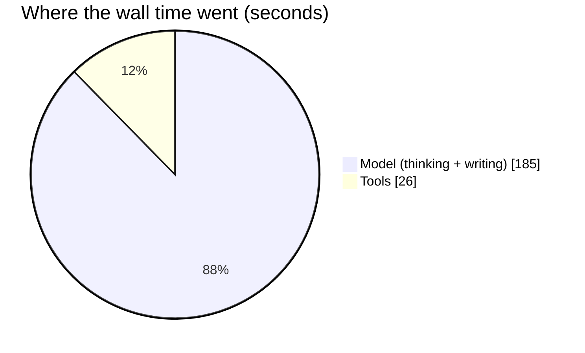

# intellectual-property/review-data-processing-agreement-template-against-eu-and-us-requirements · run10 (`hv-mixed200-lunahigh-flip-r10-20261118T030322Z`)

Result: **fail** 45/47 criteria · 3.5 min · 16 model calls · 23 tool calls (0 errors or timeouts) · ending `completed` · started 11-18 08:45:14 IST

## Overview

One box per stretch of steps that used the same kind of tool (blue: looking/searching/reading, purple: writing or editing files, yellow: a message with no tool call, red border: a tool error or timeout inside the box).

```mermaid
flowchart TD
    T(["Task prompt"])
    P0["<b>Step 1</b> · 0.1 min<br/>todo_write"]
    T --> P0
    class P0 look
    P1["<b>Step 2</b> · 0.0 min<br/>glob<br/><i>*</i>"]
    P0 --> P1
    class P1 look
    P2["<b>Step 3</b> · 0.2 min<br/>bash x5<br/><i>parse-doc docx documents/data-flow-di…, parse-doc docx documents/msa-summary-…, parse-doc docx documents/pinnacle-us-… +2</i>"]
    P1 --> P2
    class P2 look
    P3["<b>Step 4</b> · 0.1 min<br/>read<br/><i>stratosphere-negotiation-email-thread…</i>"]
    P2 --> P3
    class P3 look
    P4["<b>Step 5</b> · 0.1 min<br/>bash x2<br/><i>parse-doc docx documents/pinnacle-us-…, parse-doc docx documents/stratosphere…</i>"]
    P3 --> P4
    class P4 look
    P5["<b>Steps 6-7</b> · 0.1 min<br/>read x4<br/><i>playbook.txt, dpa.txt</i>"]
    P4 --> P5
    class P5 look
    P6["<b>Step 8</b> · 0.3 min<br/>todo_write"]
    P5 --> P6
    class P6 look
    P7["<b>Steps 9-11</b> · 2.3 min<br/>bash x4<br/><i>python - #lt;#lt;'PY' import docx print(doc…, cat #gt; build_memo.py #lt;#lt;'PY' from docx …, parse-doc docx output/compliance-gap-… +1</i>"]
    P6 --> P7
    class P7 look
    P8["<b>Steps 12-13</b> · 0.1 min<br/>read x2<br/><i>validation.txt</i>"]
    P7 --> P8
    class P8 look
    P9["<b>Step 14</b> · 0.1 min<br/>bash<br/><i>unzip -t output/compliance-gap-memora…</i>"]
    P8 --> P9
    class P9 look
    P10["<b>Step 15</b> · 0.1 min<br/>todo_write"]
    P9 --> P10
    class P10 look
    P11["<b>Step 16</b> · 0.1 min<br/>final message"]
    P10 --> P11
    class P11 ans
    R(["FAIL: 45/47 criteria"])
    P11 --> R
    class R fail
    classDef look fill:#e8f0fe,stroke:#4a6fa5,color:#111
    classDef write fill:#f3e8fd,stroke:#7b1fa2,color:#111
    classDef ans fill:#fff8e1,stroke:#b58900,color:#111
    classDef err fill:#e8f0fe,stroke:#c62828,stroke-width:3px,color:#111
    classDef pass fill:#e6f4ea,stroke:#2e7d32,color:#111
    classDef fail fill:#fce8e6,stroke:#c62828,color:#111
```





One row per model call:

| Step | Started (IST) | Model s | Tools s | Tool calls | Tools | Output chars |
|---|---|---|---|---|---|---|
| 1 | 08:45:14 | 4 | 0 | 1 | todo_write | 57 |
| 2 | 08:45:18 | 1 | 2 | 1 | glob | 208 |
| 3 | 08:45:21 | 3 | 11 | 5 | bash x5 | 167,667 |
| 4 | 08:45:36 | 4 | 0 | 1 | read | 12,130 |
| 5 | 08:45:40 | 3 | 4 | 2 | bash x2 | 748 |
| 6 | 08:45:47 | 3 | 0 | 2 | read x2 | 101,748 |
| 7 | 08:45:50 | 4 | 0 | 2 | read x2 | 80,085 |
| 8 | 08:45:54 | 18 | 0 | 1 | todo_write | 57 |
| 9 | 08:46:12 | 15 | 1 | 1 | bash | 6 |
| 10 | 08:46:28 | 111 | 1 | 1 | bash | 38 |
| 11 | 08:48:20 | 3 | 5 | 2 | bash x2 | 472 |
| 12 | 08:48:28 | 2 | 0 | 1 | read | 32,397 |
| 13 | 08:48:30 | 3 | 0 | 1 | read | 24,360 |
| 14 | 08:48:33 | 3 | 1 | 1 | bash | 23 |
| 15 | 08:48:37 | 4 | 0 | 1 | todo_write | 57 |
| 16 | 08:48:41 | 4 | 0 | 0 | (message only) | 0 |

## Task prompt

```text
Review the vendor DPA template against our playbook, commercial terms, data flow details, and negotiation emails; produce a gap memorandum with prioritized findings and redline recommendations. Output: `compliance-gap-memorandum.docx`.
```

## Rubric

| # | Criterion | Verdict |
|---|---|---|
| C-001 | Prioritized summary table at beginning of memo | **FAIL** |
| C-002 | ISSUE_001: Identifies missing HIPAA BAA integration | pass |
| C-003 | ISSUE_001: Notes missing HIPAA-specific definitions | pass |
| C-004 | ISSUE_001: Recommends integrating BAA or attaching as exhibit | pass |
| C-005 | ISSUE_001: References minimum necessary standard or workforce training | pass |
| C-006 | ISSUE_002: Identifies 48-hour vs. 24-hour breach notification discrepancy | pass |
| C-007 | ISSUE_002: Identifies missing HIPAA breach notification obligations | pass |
| C-008 | ISSUE_002: Recommends specific redline for breach notification timeline | pass |
| C-009 | ISSUE_003: Identifies liability cap gap (€500K vs. playbook minimum) | pass |
| C-010 | ISSUE_003: Quantifies liability gap with correct dollar figures | pass |
| C-011 | ISSUE_003: Identifies missing carve-outs for willful misconduct/gross negligence | pass |
| C-012 | ISSUE_003: Identifies blanket exclusion of consequential damages as problematic | pass |
| C-013 | ISSUE_003: References correct MSA fee structure | pass |
| C-014 | ISSUE_004: Identifies missing SCC Module 3 for processor-to-subprocessor transfers | pass |
| C-015 | ISSUE_004: Identifies Singapore remote access as an unaddressed transfer | pass |
| C-016 | ISSUE_004: Notes Larkfield not certified under EU-US Data Privacy Framework | pass |
| C-017 | ISSUE_004: Flags absence of Transfer Impact Assessment documentation | pass |
| C-018 | ISSUE_005: Identifies missing CCPA/CPRA Service Provider provisions | pass |
| C-019 | ISSUE_005: Specifies required CCPA/CPRA contractual terms | pass |
| C-020 | ISSUE_006: Identifies audit rights limited to Frankfurt only | pass |
| C-021 | ISSUE_006: Recommends extending audit rights to subprocessor locations | pass |
| C-022 | ISSUE_007: Identifies missing data return option at termination | pass |
| C-023 | ISSUE_007: Identifies HIPAA 6-year retention conflict with 90-day deletion | pass |
| C-024 | ISSUE_008: Identifies governing law mismatch for US data disputes | pass |
| C-025 | ISSUE_008: Recommends bifurcated governing law/dispute resolution | pass |
| C-026 | ISSUE_009: Recognizes Module 2 alone is insufficient for processor-to-subprocessor transfers | pass |
| C-027 | ISSUE_011: Identifies 2-year survival period as insufficient for HIPAA | pass |
| C-028 | ISSUE_012: Flags anonymization vs. pseudonymization regulatory risk | pass |
| C-029 | DISTRACTOR_003: Does not flag DIS arbitration for EU disputes as a gap | pass |
| C-030 | Each gap includes risk level classification | pass |
| C-031 | Each gap references the specific DPA section at issue | pass |
| C-032 | Each gap includes a specific recommended redline or amendment | pass |
| C-033 | Correctly identifies Pinnacle as HIPAA Covered Entity | pass |
| C-034 | Correctly identifies Stratosphere as Processor/Business Associate | pass |
| C-035 | References EU-US Data Privacy Framework in transfer analysis | pass |
| C-036 | Identifies EU-to-US (Larkfield/Northern Virginia) disaster recovery transfer scenario | pass |
| C-037 | Identifies Singapore remote access transfer scenario | pass |
| C-038 | Identifies Stratosphere processor-to-subprocessor transfer scenario | pass |
| C-039 | References 2.1 million US patients or 890,000 California residents | pass |
| C-040 | ISSUE_001 classified as Critical or High risk | pass |
| C-041 | ISSUE_003 classified as Critical or High risk | pass |
| C-042 | References negotiation context from email thread | pass |
| C-043 | Mentions subprocessor Larkfield Data Systems by name | **FAIL** |
| C-044 | Mentions subprocessor Orionis Analytics by name | pass |
| C-045 | ISSUE_006: Notes audit limited to once per year | pass |
| C-046 | ISSUE_004: Recommends specific transfer mechanisms for identified gaps | pass |
| C-047 | ISSUE_012: Recommends defining anonymization standard in DPA | pass |

Judge's reasoning:

**C-001 (fail):** Prioritized summary table at beginning of memo

```text
The memo has an early executive-summary table describing several gap dimensions and a separate priority framework, but it does not provide a near-beginning summary table or structured list that assigns risk levels to the identified gaps. The P0/P1/P2 ratings appear only later in the detailed findings.
```

**C-002 (pass):** ISSUE_001: Identifies missing HIPAA BAA integration

```text
The memorandum expressly identifies the absence of a HIPAA BAA as a P0 blocker, explains that Stratosphere will process US patient PHI as a Business Associate, and recommends an integrated or simultaneously executed BAA with required HIPAA provisions and subcontractor flow-downs.
```

**C-003 (pass):** ISSUE_001: Notes missing HIPAA-specific definitions

```text
The memo expressly states that Section 1 defines only GDPR terms and omits HIPAA-specific definitions, including PHI, ePHI, Covered Entity, Business Associate, BAA, Breach, and Unsecured PHI.
```

**C-004 (pass):** ISSUE_001: Recommends integrating BAA or attaching as exhibit

```text
The memo specifically recommends adding either an integrated BAA or a simultaneously executed BAA exhibit expressly incorporated into the DPA, and provides proposed incorporation language and required BAA terms.
```

**C-005 (pass):** ISSUE_001: References minimum necessary standard or workforce training

```text
The memo expressly identifies both missing HIPAA obligations: a permitted-use/minimum-necessary standard and workforce training requirements, including them in the recommended BAA terms.
```

**C-006 (pass):** ISSUE_002: Identifies 48-hour vs. 24-hour breach notification discrepancy

```text
The memo expressly flags that Section 9.1 permits notification within 48 hours after confirmation, while Pinnacle's playbook requires notice within 24 hours of actual or reasonably suspected discovery. It also recommends replacing the 48-hour standard with the 24-hour requirement.
```

**C-007 (pass):** ISSUE_002: Identifies missing HIPAA breach notification obligations

```text
The memo expressly identifies the absence of a HITECH/HIPAA breach-notification cascade and recommends adding HIPAA/HITECH allocation plus assistance with regulator and individual notifications. This adequately flags HIPAA's separate breach-notification obligations as a gap.
```

**C-008 (pass):** ISSUE_002: Recommends specific redline for breach notification timeline

```text
The memo specifically recommends replacing the 48-hour standard with notice within 24 hours of actual or reasonably suspected discovery, and expressly extends the requirement to breaches of Unsecured PHI with HIPAA/HITECH assistance provisions.
```

**C-009 (pass):** ISSUE_003: Identifies liability cap gap (€500K vs. playbook minimum)

```text
The memo expressly identifies the DPA’s €500,000 aggregate liability cap as substantially below the playbook minimum of 2x annual fees. It calculates the applicable minimums as $5.6M for US claims, $2.8M for EU claims, and $8.4M for combined claims, and treats any proposal below 2x annual fees as an escalation issue.
```

**C-010 (pass):** ISSUE_003: Quantifies liability gap with correct dollar figures

```text
The memo expressly contrasts the €500,000 template cap (approximately $545,000) with the playbook minimums, including $2.8M for EU-specific claims and $8.4M for combined claims (2x the $4.2M annual fees).
```

**C-011 (pass):** ISSUE_003: Identifies missing carve-outs for willful misconduct/gross negligence

```text
The memorandum expressly states that the DPA provides no uncapped carve-outs for willful misconduct or gross negligence and recommends making liability uncapped for vendor/subprocessor willful misconduct and gross negligence, consistent with the playbook requirement.
```

**C-012 (pass):** ISSUE_003: Identifies blanket exclusion of consequential damages as problematic

```text
The memo expressly flags Section 13.2’s blanket exclusion of indirect, consequential, and special damages as problematic and recommends carving out willful misconduct, confidentiality breaches, regulatory exposure, and breach-response costs. This satisfies the criterion.
```

**C-013 (pass):** ISSUE_003: References correct MSA fee structure

```text
The liability discussion expressly references the $4.2M annual engagement and uses the MSA fee structure to calculate proposed caps, including $5.6M for US-specific claims, $2.8M for EU-specific claims, and $8.4M combined. The memo also separately states the underlying annual fees are $2.8M US and $1.4M EU.
```

**C-014 (pass):** ISSUE_004: Identifies missing SCC Module 3 for processor-to-subprocessor transfers

```text
The memorandum expressly states that Section 7.2 includes only SCC Module 2 and flags that Stratosphere’s processor-to-subprocessor transfer to Larkfield in Northern Virginia requires SCC Module 3. It also recommends adding Module 3 and completing the related SCC schedules.
```

**C-015 (pass):** ISSUE_004: Identifies Singapore remote access as an unaddressed transfer

```text
The memo expressly flags recurring remote access by Singapore personnel to EU personal data as a separate third-country transfer that is not addressed by the DPA's existing transfer provisions, and recommends an appropriate transfer mechanism or prohibiting such access.
```

**C-016 (pass):** ISSUE_004: Notes Larkfield not certified under EU-US Data Privacy Framework

```text
The memorandum expressly states that Larkfield is not DPF-certified and therefore cannot rely on the EU-US Data Privacy Framework as the transfer mechanism. It also repeats this point in the transfer recommendation and pre-execution checklist.
```

**C-017 (pass):** ISSUE_004: Flags absence of Transfer Impact Assessment documentation

```text
The memorandum expressly flags that the DPA contains no TIA or supplementary-measures requirement for third-country transfers and recommends documented TIAs for each transfer, including Northern Virginia and Singapore, before transfer and with periodic reassessment.
```

**C-018 (pass):** ISSUE_005: Identifies missing CCPA/CPRA Service Provider provisions

```text
The memorandum expressly identifies the absence of CCPA/CPRA Service Provider terms and notes that approximately 890,000 California residents are in scope. It also recommends adding the required statutory restrictions and certification.
```

**C-019 (pass):** ISSUE_005: Specifies required CCPA/CPRA contractual terms

```text
The memo specifies all three listed CCPA/CPRA Service Provider provisions: a prohibition on selling or sharing personal information, an anti-combination restriction, and an authorized-representative Service Provider certification requirement.
```

**C-020 (pass):** ISSUE_006: Identifies audit rights limited to Frankfurt only

```text
The memo expressly states that Sections 11.2–11.4 limit audits to the Frankfurt facility and exclude Larkfield/Orionis locations, including the broader processing footprint in Dublin and Northern Virginia. It also recommends extending audit rights to all processing locations and subprocessors.
```

**C-021 (pass):** ISSUE_006: Recommends extending audit rights to subprocessor locations

```text
The memo expressly recommends audit rights covering all processing and backup locations and each subprocessor, including direct or qualified-third-party audits, contractual pass-through audit coverage, and SOC 2/ISO reports as supplements rather than substitutes.
```

**C-022 (pass):** ISSUE_007: Identifies missing data return option at termination

```text
The memo expressly flags that Section 12 is deletion-only and lacks a data return option and 30-day transition assistance. It recommends giving Pinnacle a complete machine-readable return option before deletion, together with at least 30 days of transition assistance, consistent with the playbook.
```

**C-023 (pass):** ISSUE_007: Identifies HIPAA 6-year retention conflict with 90-day deletion

```text
The memo expressly identifies that the DPA permits deletion within 90 days while failing to address HIPAA’s six-year documentation-retention requirement. It recommends a HIPAA retention carve-out preserving required documentation for six years from creation or last effectiveness, with continuing protections and later deletion certification.
```

**C-024 (pass):** ISSUE_008: Identifies governing law mismatch for US data disputes

```text
The memo expressly flags in P0 Finding 7 that Section 14 applies German law and DIS arbitration in Munich to all disputes, including US PHI and California personal information disputes. It also states that the playbook requires Delaware law and jurisdiction in the U.S. District Court for the Western District of Texas, Austin Division (or Travis County courts) for US data disputes.
```

**C-025 (pass):** ISSUE_008: Recommends bifurcated governing law/dispute resolution

```text
The memo expressly recommends bifurcated treatment in Finding 7 and the redline schedule: Delaware law and US court jurisdiction for US-data disputes, with Netherlands law preferred or German law as a fallback and EU-seated arbitration for EU-data disputes.
```

**C-026 (pass):** ISSUE_009: Recognizes Module 2 alone is insufficient for processor-to-subprocessor transfers

```text
The memorandum expressly states that SCC Module 2 covers controller-to-processor transfers and is insufficient for Stratosphere’s processor-to-subprocessor transfer to Larkfield. It specifically requires separate execution of Module 3 for the Stratosphere-to-Larkfield transfer and references the correct SCC architecture under Commission Implementing Decision (EU) 2021/914.
```

**C-027 (pass):** ISSUE_011: Identifies 2-year survival period as insufficient for HIPAA

```text
The memorandum expressly flags Section 16.3’s two-year survival period as inadequate because HIPAA documentation must be retained for six years and recommends that BAA, security, audit, confidentiality, retention, liability, and related obligations survive for six years or as long as PHI is retained, whichever is longer.
```

**C-028 (pass):** ISSUE_012: Flags anonymization vs. pseudonymization regulatory risk

```text
The memo expressly flags that Orionis's “anonymization” services are undefined and not distinguished from pseudonymization. It explains that linkable, inferable, or singling-out-capable outputs remain personal data subject to GDPR protections and recommends an objective anonymization standard, validation, and treating nonqualifying outputs as personal data.
```

**C-029 (pass):** DISTRACTOR_003: Does not flag DIS arbitration for EU disputes as a gap

```text
The memo flags DIS arbitration in Munich only because it applies indiscriminately to US-data disputes. It expressly permits DIS arbitration seated in an EU jurisdiction for EU-data disputes and accepts German law as an EU-data fallback, so it does not treat DIS arbitration for EU matters as a material gap itself.
```

**C-030 (pass):** Each gap includes risk level classification

```text
The memo assigns an explicit priority/risk classification to every numbered gap: findings 1–7 are labeled P0, findings 8–14 are labeled P1, and findings 15–18 are labeled P2. This exceeds the 75% threshold.
```

**C-031 (pass):** Each gap references the specific DPA section at issue

```text
The memo identifies the relevant DPA section or specific provision for well over 75% of the gaps, including Sections 7.2, 9.1/9.6, 11.2–11.4, 12, 13.1–13.2, 14, 15, 16.3, and relevant annex and signature provisions. The consolidated redline schedule further maps nearly every issue to a specific DPA location.
```

**C-032 (pass):** Each gap includes a specific recommended redline or amendment

```text
The memorandum provides a specific redline or amendment for essentially every identified gap. Each numbered finding includes a “Redline recommendation” describing concrete changes, such as adding a BAA and CCPA/CPRA addendum, adding SCC Module 3, changing breach notice to 24 hours, replacing liability and deletion provisions, expanding audit rights, and correcting annexes. It also includes a consolidated redline schedule and sample language for critical clauses, comfortably exceeding the 75% threshold.
```

**C-033 (pass):** Correctly identifies Pinnacle as HIPAA Covered Entity

```text
The memorandum expressly identifies Pinnacle Health Solutions, Inc. as the “US Covered Entity/Controller” and consistently treats Stratosphere as its HIPAA Business Associate, including in the factual baseline, redline recommendations, and BAA language.
```

**C-034 (pass):** Correctly identifies Stratosphere as Processor/Business Associate

```text
The memorandum expressly identifies Stratosphere as the GDPR Processor and HIPAA Business Associate, including in the factual baseline and HIPAA gap analysis.
```

**C-035 (pass):** References EU-US Data Privacy Framework in transfer analysis

```text
The memorandum expressly discusses the EU-US Data Privacy Framework in its transfer analysis, notes that Larkfield is not DPF-certified, and states that the parties should not rely on the framework unless and until certification is verified.
```

**C-036 (pass):** Identifies EU-to-US (Larkfield/Northern Virginia) disaster recovery transfer scenario

```text
The memorandum expressly identifies EU disaster-recovery data transfers from Stratosphere’s Frankfurt EU environment to Larkfield in Northern Virginia, including in the factual baseline and the cross-border transfer findings.
```

**C-037 (pass):** Identifies Singapore remote access transfer scenario

```text
The memo expressly identifies that Singapore-based personnel provide remote support access to EU data and correctly treats that remote access as a separate third-country transfer scenario requiring an appropriate transfer mechanism and supplementary measures.
```

**C-038 (pass):** Identifies Stratosphere processor-to-subprocessor transfer scenario

```text
The memo expressly identifies the Stratosphere-to-Larkfield flow as a processor-to-subprocessor international transfer requiring separate coverage under SCC Module 3. It also notes that the existing Module 2 coverage is insufficient and recommends completing the appropriate SCC schedules and TIA.
```

**C-039 (pass):** References 2.1 million US patients or 890,000 California residents

```text
The memo references both qualifying figures: approximately 2.1 million US patient PHI records in the HIPAA-related factual baseline and approximately 890,000 California residents in the CCPA/CPRA analysis.
```

**C-040 (pass):** ISSUE_001 classified as Critical or High risk

```text
The missing HIPAA BAA integration is expressly classified as “P0 / RED LINE,” which the memorandum defines as a no-go execution and go-live blocker—the highest-tier severity.
```

**C-041 (pass):** ISSUE_003 classified as Critical or High risk

```text
The liability cap gap is specifically classified as “P0 / RED LINE,” the memorandum’s highest-tier “no-go” severity for execution and go-live blockers. This is equivalent to Critical or High risk.
```

**C-042 (pass):** References negotiation context from email thread

```text
The memorandum explicitly references the April 14–18 negotiation email thread, including Stratosphere’s characterization of the €500,000 cap as its firm/global standard, Pinnacle’s treatment of liability as a threshold issue, the vendor’s DPO-coordination position, and the confirmed April 30 negotiation call.
```

**C-043 (fail):** Mentions subprocessor Larkfield Data Systems by name

```text
The memorandum repeatedly mentions “Larkfield,” but never identifies the subprocessor by its required full name, “Larkfield Data Systems” or “Larkfield Data Systems LLC.”
```

**C-044 (pass):** Mentions subprocessor Orionis Analytics by name

```text
The memorandum mentions the subprocessor Orionis by name multiple times, including in its discussion of anonymization and analytics services.
```

**C-045 (pass):** ISSUE_006: Notes audit limited to once per year

```text
The memo expressly notes that Sections 11.2–11.4 permit only one planned audit per year with 30 days' notice and discusses this limitation in its audit-rights analysis and negotiation fallback.
```

**C-046 (pass):** ISSUE_004: Recommends specific transfer mechanisms for identified gaps

```text
The memorandum recommends at least three qualifying mechanisms: executing SCC Module 3 for the Stratosphere-to-Larkfield processor-to-subprocessor transfer, implementing Singapore-specific supplementary measures, and conducting documented Transfer Impact Assessments for each third-country transfer with periodic reassessment. This exceeds the requirement of at least two specific mechanisms.
```

**C-047 (pass):** ISSUE_012: Recommends defining anonymization standard in DPA

```text
The memorandum expressly recommends defining “Anonymized Data” using an objective standard, including the WP29/EDPB singling-out, linkability, and inference tests. It also requires validation and provides that outputs failing the standard, including pseudonymized outputs, remain Personal Data subject to the DPA and other applicable protections.
```

## Delivered files (output/)

- `compliance-gap-memorandum.docx` (58,891 bytes)

## Trajectory

### Step 1: 1 tool call

_Started 11-18 08:45:14 IST · model 4 s · tools 0 s_

**Reasoning summary:**

```text
**Planning document creation**

I need to produce a DOCX file and inspect any relevant files first. I’m wondering if my skills match this task explicitly. Maybe I should create a skill catalog since it's not explicitly listed. To gather information about the workspace, I can use glob to inspect it. Also, I should probably create a to-do list since it's a multi-step process. Okay, time to start with the glob function!
```

**Call `todo_write`** (0.0 s)

```json
{
 "todos": [
  {
   "content": "Inventory source documents and identify governing requirements",
   "status": "in_progress"
  },
  {
   "content": "Extract DPA terms, playbook, commercial, data flow, and email issues",
   "status": "pending"
  },
  {
   "content": "Draft prioritized gap memorandum and redline recommendations",
   "status": "pending"
  },
  {
   "content": "Build and validate compliance-gap-memorandum.docx",
   "status": "pending"
  }
 ]
}
```

Output (57 chars):

```text
Updated todo list: 3 pending, 1 in progress, 0 completed.
```

**Todo list now:**

- [~] Inventory source documents and identify governing requirements
- [ ] Extract DPA terms, playbook, commercial, data flow, and email issues
- [ ] Draft prioritized gap memorandum and redline recommendations
- [ ] Build and validate compliance-gap-memorandum.docx

### Step 2: 1 tool call

_Started 11-18 08:45:18 IST · model 1 s · tools 2 s_

**Call `glob`** (1.6 s)

```json
{
 "pattern": "*"
}
```

Output (208 chars):

```text
documents/data-flow-diagram.docx
documents/msa-summary-term-sheet.docx
documents/pinnacle-us-dpa-playbook.docx
documents/stratosphere-dpa-template-v3-2.docx
documents/stratosphere-negotiation-email-thread.eml
```

### Step 3: 5 tool calls

_Started 11-18 08:45:21 IST · model 3 s · tools 11 s_

**Reasoning summary:**

```text
**Considering command execution**

I need to read the documentation through parsing or maybe using a bash command. It seems like inspecting the skill catalog isn't an option since it’s unavailable. Without a skill list provided, I might just skip that. I’ll also need to parse each command. I can run parallel bash commands, which should help, right? Using multi_tool for that might be the right approach. Let's try to get this set up efficiently!
```

**Call `bash`** (2.6 s)

```json
{
 "command": "parse-doc docx documents/data-flow-diagram.docx",
 "description": "Parse data flow diagram"
}
```

Output (45,055 chars):

```text
**[DATA FLOW DIAGRAM AND PROCESSING DESCRIPTION]{.underline}**

**[Pinnacle Health Solutions, Inc. --- Stratosphere Cloud Services GmbH]{.underline}**

**[Data Processing Relationship]{.underline}**

**CONFIDENTIAL --- ATTORNEY-CLIENT PRIVILEGED / WORK PRODUCT**

This document is protected by the attorney-client privilege and the work product doctrine. Unauthorized disclosure, copying, or distribution is strictly prohibited. This document does not constitute legal advice to any third party.

**Prepared by:** Office of the General Counsel, Pinnacle Health Solutions, Inc., 4200 Harborview Boulevard, Suite 1100, Austin, TX 78746

**Prepared for:** Internal use and for review by outside counsel Alderton Shaw & Whitmore LLP (Rachel Osterfeld, Partner), 900 K Street NW, Suite 700, Washington, DC 20001

**Date:** April 2025

**Reference Documents:**

> •Master Services Agreement dated March 15, 2024 (\"MSA\")
>
> •Stratosphere DPA Template Version 3.2 dated January 10, 2025 (received April 14, 2025) (\"DPA Template\" or \"DPA\")
>
> •Pinnacle US DPA Playbook (last updated February 28, 2025) (\"Playbook\")

**Purpose:** This document maps all personal data flows between Pinnacle (US and EU operations), Stratosphere Cloud Services GmbH, and Stratosphere\'s subprocessors. The purpose of this mapping is to support the legal review of the DPA Template ahead of the May 16, 2025 internal review deadline and the September 1, 2025 EU expansion launch date. The data flow diagrams and accompan
… [43,554 more chars]
```

**Call `bash`** (2.1 s)

```json
{
 "command": "parse-doc docx documents/msa-summary-term-sheet.docx",
 "description": "Parse commercial term sheet"
}
```

Output (22,315 chars):

```text
**[MASTER SERVICES AGREEMENT --- SUMMARY TERM SHEET]{.underline}**

**Summary of Key Commercial Terms**

MSA Effective Date: March 15, 2024

This Summary Term Sheet is for internal reference purposes only and does not amend or supersede the Master Services Agreement dated March 15, 2024 (the \"MSA\"), by and between Pinnacle Health Solutions, Inc. and Stratosphere Cloud Services GmbH. In the event of any conflict between the terms summarized herein and the terms of the executed MSA, the terms of the executed MSA shall control in all respects.

Prepared by the Office of General Counsel Pinnacle Health Solutions, Inc.

Last Updated: March 15, 2024

**[Section 1 --- Parties]{.underline}**

**Client:** Pinnacle Health Solutions, Inc., a Delaware corporation, with its principal offices located at 4200 Harborview Boulevard, Suite 1100, Austin, TX 78746 (\"Pinnacle\" or \"Client\").

**Service Provider:** Stratosphere Cloud Services GmbH, a German limited liability company (*Gesellschaft mit beschränkter Haftung*) registered at the Munich Local Court (*Amtsgericht München*) under Commercial Register (*Handelsregister*) number HRB 247891, with its registered office at Hohenzollernstraße 88, 80796 Munich, Germany (\"Stratosphere\" or \"Service Provider\").

**EU Entity Designation:** For purposes of EU Services (as defined in Section 3 below), the Client entity may be designated as Pinnacle Health Solutions EU B.V., a private limited liability company organized under the laws of the N
… [20,814 more chars]
```

**Call `bash`** (2.4 s)

```json
{
 "command": "parse-doc docx documents/pinnacle-us-dpa-playbook.docx",
 "description": "Parse DPA playbook"
}
```

Output (49,928 chars):

```text
and \$1.4 million EU), the cap for EU-specific claims would be no less than \$2,800,000 (2 × \$1,400,000) and for US-specific claims no less than \$5,600,000 (2 × \$2,800,000).

**Must-have:** Liability must be **uncapped** for the following categories of claims:

> \(a\) **Willful misconduct** by vendor, its employees, agents, or subprocessors;
>
> \(b\) **Gross negligence** by vendor, its employees, agents, or subprocessors;
>
> \(c\) **Breaches of confidentiality obligations** involving intentional or reckless conduct; and
>
> \(d\) **Regulatory fines or penalties** imposed on Pinnacle as a direct result of vendor\'s non-compliance with applicable data protection laws, including HIPAA, CCPA/CPRA, and GDPR.

**Must-have:** Consequential, indirect, and special damages may **NOT** be excluded for data breaches involving willful misconduct by vendor. A blanket consequential damages exclusion that applies to all claims, including data protection claims, is unacceptable. While mutual exclusions of consequential damages are common in general commercial agreements, they are inappropriate in the data protection context where the most significant harms to Pinnacle --- including regulatory penalties, class action settlements, breach notification costs, credit monitoring expenses, and reputational damage --- may be characterized as consequential or indirect damages under applicable law. A blanket exclusion could effectively eliminate vendor accountability for the very harms the DPA is
… [48,427 more chars]
```

**Call `bash`** (2.3 s)

```json
{
 "command": "parse-doc docx documents/stratosphere-dpa-template-v3-2.docx",
 "description": "Parse vendor DPA template"
}
```

Output (49,921 chars):

```text
of the GDPR.

**[SECTION 4 --- CONFIDENTIALITY]{.underline}**

**4.1** The Processor shall ensure that all persons authorized to Process Personal Data on behalf of the Controller, including the Processor\'s employees, contractors, temporary workers, and agents, have committed themselves to confidentiality or are under an appropriate statutory obligation of confidentiality, in accordance with Article 28(3)(b) of the GDPR. The Processor shall maintain written records of such confidentiality commitments and shall make them available to the Controller upon request.

**4.2** The Processor shall ensure that access to Personal Data Processed on behalf of the Controller is strictly limited to those members of the Processor\'s personnel who require such access for the performance of the Services under the Agreement. The Processor shall implement appropriate access management procedures, including role-based access controls and least-privilege principles, to enforce this limitation. The Processor shall promptly revoke access for any personnel member whose role no longer requires access to the Controller\'s Personal Data.

**4.3** The obligations set forth in this Section 4 shall survive the termination or expiration of this DPA and shall continue in full force and effect for so long as the Processor or any of its personnel retains any Personal Data Processed on behalf of the Controller.

**4.4** The Processor shall not disclose Personal Data to any third party, including any government
… [48,420 more chars]
```

**Call `bash`** (2.1 s)

```json
{
 "command": "parse-doc eml documents/stratosphere-negotiation-email-thread.eml",
 "description": "Parse negotiation emails"
}
```

Output (448 chars):

```text
[stderr]
2026-11-18 03:15:35.381803678 [W:onnxruntime:Default, device_discovery.cc:95 GetPciBusId] Skipping pci_bus_id for PCI path at "/sys/devices/LNXSYSTM:00/LNXSYBUS:00/ACPI0004:00/VMBUS:00/5620e0c7-8062-4dce-aeb7-520c7ef76171" because filename "5620e0c7-8062-4dce-aeb7-520c7ef76171" did not match expected pattern of [0-9a-f]+:[0-9a-f]+:[0-9a-f]+[.][0-9a-f]+
usage: /usr/local/bin/parse-doc {docx|pdf|pptx|xlsx} <path>
[exit code: 2]
```

### Step 4: 1 tool call

_Started 11-18 08:45:36 IST · model 4 s · tools 0 s_

**Reasoning summary:**

```text
**Addressing email processing issues**

It looks like I’m facing an issue with unsupported EML formats, so I should use a read tool for plain text instead. The output might be truncated, so I’m considering redirecting parsed documents into a workspace using bash commands. It might be necessary to access a temporary workspace or output directly to files like “parsed.txt.” After that, I'll need to read the email. Prioritizing only the necessary deliverables is key here!
```

**Call `read`** (0.0 s)

```json
{
 "file_path": "documents/stratosphere-negotiation-email-thread.eml",
 "offset": 1,
 "limit": 500
}
```

Output (12,130 chars):

```text
<path>/home/agarwaldi/dsh-bench-harness/runs/hv-mixed200-lunahigh-flip-r10-20261118T030322Z/tasks/intellectual-property__review-data-processing-agreement-template-against-eu-and-us-requirements/workspace/documents/stratosphere-negotiation-email-thread.eml</path>
<type>file</type>
<content>
1: From: Margaret Yuen-Park <myuenpark@pinnaclehealth.example.com>
2: To: Dr. Florian Neumann <f.neumann@stratospherecloud.example.com>
3: Cc: Rachel Osterfeld <rosterfeld@alderton-shaw.example.com>
4: Date: Fri, 18 Apr 2025 11:02:00 -0000
5: Subject: Re: Re: Re: Stratosphere DPA Template v3.2 — For Your Review
6: Content-Type: text/plain; charset="utf-8"
7: Content-Transfer-Encoding: quoted-printable
8: MIME-Version: 1.0
9: 
10: Florian,
11: 
12: Thank you for your response and for looping in Dr. Beckert.
13: 
14: We can confirm the call for Wednesday, April 30, 2025, at 4:00 PM CEST / 9:00=
15:  AM CDT. Rachel Osterfeld from Alderton Shaw & Whitmore will attend on our si=
16: de.
17: 
18: On the liability cap =E2=80=94 I appreciate your willingness to take this up =
19: internally. I want to set expectations that our redline of Section 13 will pr=
20: opose a structure tied to the annual fees under the MSA rather than a flat ca=
21: p, together with the carve-outs for willful misconduct and gross negligence I=
22:  referenced previously. I want to be transparent that this is a threshold iss=
23: ue for us, and we will need to reach agreement on liability allocation before=
24:  we can fin
… [10,630 more chars]
```

### Step 5: 2 tool calls

_Started 11-18 08:45:40 IST · model 3 s · tools 4 s_

**Call `bash`** (2.3 s)

```json
{
 "command": "parse-doc docx documents/pinnacle-us-dpa-playbook.docx > playbook.txt",
 "description": "Save parsed playbook text"
}
```

Output (374 chars):

```text
[stderr]
2026-11-18 03:15:43.931929035 [W:onnxruntime:Default, device_discovery.cc:95 GetPciBusId] Skipping pci_bus_id for PCI path at "/sys/devices/LNXSYSTM:00/LNXSYBUS:00/ACPI0004:00/VMBUS:00/5620e0c7-8062-4dce-aeb7-520c7ef76171" because filename "5620e0c7-8062-4dce-aeb7-520c7ef76171" did not match expected pattern of [0-9a-f]+:[0-9a-f]+:[0-9a-f]+[.][0-9a-f]+
```

**Call `bash`** (2.1 s)

```json
{
 "command": "parse-doc docx documents/stratosphere-dpa-template-v3-2.docx > dpa.txt",
 "description": "Save parsed DPA text"
}
```

Output (374 chars):

```text
[stderr]
2026-11-18 03:15:46.167454279 [W:onnxruntime:Default, device_discovery.cc:95 GetPciBusId] Skipping pci_bus_id for PCI path at "/sys/devices/LNXSYSTM:00/LNXSYBUS:00/ACPI0004:00/VMBUS:00/5620e0c7-8062-4dce-aeb7-520c7ef76171" because filename "5620e0c7-8062-4dce-aeb7-520c7ef76171" did not match expected pattern of [0-9a-f]+:[0-9a-f]+:[0-9a-f]+[.][0-9a-f]+
```

### Step 6: 2 tool calls

_Started 11-18 08:45:47 IST · model 3 s · tools 0 s_

**Reasoning summary:**

```text
**Reading through documents**

I need to read some documents. Maybe I'll use grep to search for section headings since I don't know the line count. It's a good way to find what I'm looking for quickly. Plus, reading the head of the documents will help me decide what to focus on. This approach seems efficient, so I'll give it a try!
```

**Call `read`** (0.0 s)

```json
{
 "file_path": "playbook.txt",
 "offset": 1,
 "limit": 400
}
```

Output (49,093 chars):

```text
<path>/home/agarwaldi/dsh-bench-harness/runs/hv-mixed200-lunahigh-flip-r10-20261118T030322Z/tasks/intellectual-property__review-data-processing-agreement-template-against-eu-and-us-requirements/workspace/playbook.txt</path>
<type>file</type>
<content>
1: **[DATA PROCESSING AGREEMENT NEGOTIATION PLAYBOOK]{.underline}**
2: 
3: **[US AND CROSS-BORDER REQUIREMENTS]{.underline}**
4: 
5: **Internal Use Only --- Attorney-Client Privileged and Confidential Work Product**
6: 
7: Prepared by: **Office of the General Counsel** **Pinnacle Health Solutions, Inc.** 4200 Harborview Boulevard, Suite 1100 Austin, TX 78746
8: 
9: Approved by: **Margaret Yuen-Park**, General Counsel
10: 
11: **Version 4.0**
12: 
13: Last Updated: **February 28, 2025**
14: 
15: **Distribution List:**
16: 
17:   -------------------------------------------------------------------------------------
18:   **Recipient**                                     **Title**
19:   ------------------------------------------------- -----------------------------------
20:   Legal Department (all attorneys and paralegals)   ---
21: 
22:   Dr. Anand Krishnamurthy                           Chief Privacy Officer
23: 
24:   Jennifer Castellano                               VP of Information Security
25: 
26:   David Liang                                       VP of Procurement
27:   -------------------------------------------------------------------------------------
28: 
29: **External Counsel Reference:** This playbook was developed
… [47,593 more chars]
```

**Call `read`** (0.1 s)

```json
{
 "file_path": "dpa.txt",
 "offset": 1,
 "limit": 500
}
```

Output (52,655 chars):

```text
<path>/home/agarwaldi/dsh-bench-harness/runs/hv-mixed200-lunahigh-flip-r10-20261118T030322Z/tasks/intellectual-property__review-data-processing-agreement-template-against-eu-and-us-requirements/workspace/dpa.txt</path>
<type>file</type>
<content>
1: **[DATA PROCESSING AGREEMENT]{.underline}**
2: 
3: **Version 3.2**
4: 
5: **January 10, 2025**
6: 
7: **STRATOSPHERE CLOUD SERVICES GmbH**
8: 
9: *Cloud Infrastructure · Managed Databases · Analytics*
10: 
11: This Data Processing Agreement (\"DPA\") forms part of and is subject to the terms of the Master Services Agreement (\"Agreement\" or \"MSA\") between the Processor and the Controller.
12: 
13: This DPA is designed to ensure compliance with Regulation (EU) 2016/679 of the European Parliament and of the Council of 27 April 2016 (the \"GDPR\") and applicable data protection laws governing the Processing of Personal Data in connection with the Services provided under the Agreement.
14: 
15: **Processor Registered Office:**
16: 
17: Stratosphere Cloud Services GmbH Hohenzollernstraße 88 80796 Munich, Germany
18: 
19: Handelsregister HRB 247891, Amtsgericht München (Munich Local Court)
20: 
21: **Prepared by:**
22: 
23: Legal Department, Stratosphere Cloud Services GmbH
24: 
25: **Contact:**
26: 
27: Dr. Florian Neumann Chief Legal Officer Stratosphere Cloud Services GmbH
28: 
29: Email: florian.neumann@stratospherecloud.example.com
30: 
31: Tel: +49 89 2155 4400
32: 
33: Right-click to update Table of Contents
34: 
35: **[RECITA
… [51,155 more chars]
```

### Step 7: 2 tool calls

_Started 11-18 08:45:50 IST · model 4 s · tools 0 s_

**Call `read`** (0.1 s)

```json
{
 "file_path": "playbook.txt",
 "offset": 401,
 "limit": 430
}
```

Output (53,132 chars):

```text
<path>/home/agarwaldi/dsh-bench-harness/runs/hv-mixed200-lunahigh-flip-r10-20261118T030322Z/tasks/intellectual-property__review-data-processing-agreement-template-against-eu-and-us-requirements/workspace/playbook.txt</path>
<type>file</type>
<content>
401: > **(g) Notification of Inability to Comply.** Vendor must notify Pinnacle promptly if vendor determines that it can no longer meet its obligations under the CCPA/CPRA. Upon receipt of such notification, Pinnacle shall have the right to take reasonable and appropriate steps to stop and remediate the unauthorized use of personal information, up to and including termination of the DPA/MSA.
402: 
403: **Nice-to-have:** Vendor agrees to cooperate with Pinnacle in responding to CCPA/CPRA consumer requests, including the right to know (Cal. Civ. Code § 1798.110), the right to delete (Cal. Civ. Code § 1798.105), the right to correct (Cal. Civ. Code § 1798.106), and the right to opt-out of sale/sharing (Cal. Civ. Code § 1798.120), within timelines consistent with the statute. Under the CCPA/CPRA, Pinnacle must respond to consumer requests within **forty-five (45) days**, with a **forty-five (45) day extension** upon notice to the consumer. Vendor\'s cooperation must be sufficiently prompt to allow Pinnacle to meet these deadlines.
404: 
405: **Fallback:** If the vendor\'s DPA template contains no CCPA/CPRA provisions whatsoever, Pinnacle will require a **standalone CCPA/CPRA Addendum** appended to the DPA. The addendum must contain
… [51,632 more chars]
```

**Call `read`** (0.1 s)

```json
{
 "file_path": "dpa.txt",
 "offset": 317,
 "limit": 420
}
```

Output (26,953 chars):

```text
<path>/home/agarwaldi/dsh-bench-harness/runs/hv-mixed200-lunahigh-flip-r10-20261118T030322Z/tasks/intellectual-property__review-data-processing-agreement-template-against-eu-and-us-requirements/workspace/dpa.txt</path>
<type>file</type>
<content>
317: **17.3 Severability.** If any provision of this DPA is found by a court or other tribunal of competent jurisdiction to be invalid, illegal, or unenforceable, such provision shall be modified to the minimum extent necessary to make it valid, legal, and enforceable, and the remaining provisions of this DPA shall continue in full force and effect. If such modification is not possible, the invalid provision shall be severed and the remaining provisions shall be interpreted so as to give effect to the Parties\' original intent to the maximum extent possible.
318: 
319: **17.4 Waiver.** No failure or delay by either Party in exercising any right, power, or privilege under this DPA shall operate as a waiver thereof, nor shall any single or partial exercise of any right, power, or privilege preclude any other or further exercise thereof or the exercise of any other right, power, or privilege.
320: 
321: **17.5 Notices.** All notices, requests, demands, and other communications required or permitted under this DPA shall be in writing and shall be delivered by hand, by internationally recognized overnight courier service, or by email to the addresses specified in this DPA or such other addresses as a Party may designate in writing from ti
… [25,453 more chars]
```

### Step 8: 1 tool call

_Started 11-18 08:45:54 IST · model 18 s · tools 0 s_

**Reasoning summary:**

```text
**Preparing gap memorandum**

The user has requested a gap memorandum that includes prioritized findings and redline recommendations. I’ll need to create a .docx file that could feature an executive summary, scope/methodology, facts, and key findings organized by priority levels (P0, P1, P2). Additionally, an implementation checklist, a redline schedule, and a privilege notice will be necessary.

I’ll be using python-docx for this task, ensuring the document is professional and well-organized with tables and headings. Since the user wants a .docx file only, I need to be careful with my output formats.

**Updating to-do list**

I think I should update my to-do list before starting the drafting process. It makes sense to mark the source extraction as complete, so I have a clear overview of my progress. Noting that the draft is in progress will help me keep track of where I am and what tasks are still pending. This way, I can ensure I’m organized and focused as I move forward with the drafting.
```

**Call `todo_write`** (0.0 s)

```json
{
 "todos": [
  {
   "content": "Inventory source documents and identify governing requirements",
   "status": "completed"
  },
  {
   "content": "Extract DPA terms, playbook, commercial, data flow, and email issues",
   "status": "completed"
  },
  {
   "content": "Draft prioritized gap memorandum and redline recommendations",
   "status": "in_progress"
  },
  {
   "content": "Build and validate compliance-gap-memorandum.docx",
   "status": "pending"
  }
 ]
}
```

Output (57 chars):

```text
Updated todo list: 1 pending, 1 in progress, 2 completed.
```

**Todo list now:**

- [x] Inventory source documents and identify governing requirements
- [x] Extract DPA terms, playbook, commercial, data flow, and email issues
- [~] Draft prioritized gap memorandum and redline recommendations
- [ ] Build and validate compliance-gap-memorandum.docx

### Step 9: 1 tool call

_Started 11-18 08:46:12 IST · model 15 s · tools 1 s_

**Call `bash`** (1.0 s)

```json
{
 "command": "python - <<'PY'\nimport docx\nprint(docx.__version__)\nPY",
 "description": "Check document generation library"
}
```

Output (6 chars):

```text
1.2.0
```

### Step 10: 1 tool call

_Started 11-18 08:46:28 IST · model 111 s · tools 1 s_

**Reasoning summary:**

```text
**Generating Python script for .docx**

I need to create a Python script using heredoc through bash, which involves writing a .docx file. I’ll need to specify the output directory and possibly include page numbers using fields. Since the Python-docx library operates at a low level, I must manage table page breaks carefully. 

I aim for about 18 pages total, granting some space for margins and fonts, while crafting content through functions like add_heading or tables along with headers and footers. Let’s get started!
```

**Call `bash`** (1.2 s)

```json
{
 "command": "cat > build_memo.py <<'PY'\nfrom docx import Document\nfrom docx.shared import Inches, Pt, RGBColor\nfrom docx.enum.text import WD_ALIGN_PARAGRAPH, WD_BREAK\nfrom docx.enum.table import WD_TABLE_ALIGNMENT, WD_CELL_VERTICAL_ALIGNMENT\nfrom docx.enum.section import WD_SECTION_START\nfrom docx.oxml import OxmlElement\nfrom docx.oxml.ns import qn\nfrom docx.enum.style import WD_STYLE_TYPE\nfrom docx.enum.text import WD_LINE_SPACING\nfrom docx.enum.section import WD_ORIENT\nfrom docx.shared import Cm\n\nOUT = 'output/compliance-gap-memorandum.docx'\n\ndoc = Document()\nsec = doc.sections[0]\nsec.top_margin = Inches(0.65)\nsec.bottom_margin = Inches(0.65)\nsec.left_margin = Inches(0.75)\nsec.right_margin = Inches(0.75)\n\n# Theme colors\nNAVY = '17365D'\nBLUE = '2F5597'\nLIGHT_BLUE = 'D9EAF7'\nPALE_BLUE = 'EEF5FB'\nRED = 'C00000'\nAMBER = 'BF9000'\nGREEN = '38761D'\nGRAY = '666666'\nLIGHT_GRAY = 'F2F2F2'\nDARK = '222222'\n\n# Document defaults\nstyles = doc.styles\nstyles['Normal'].font.name = 'Aptos'\nstyles['Normal']._element.rPr.rFonts.set(qn('w:eastAsia'), 'Aptos')\nstyles['Normal'].font.size = Pt(9.5)\nstyles['Normal'].font.color.rgb = RGBColor.from_string(DARK)\nstyl
… [58,197 more chars]
```

Output (38 chars):

```text
output/compliance-gap-memorandum.docx
```

### Step 11: 2 tool calls

_Started 11-18 08:48:20 IST · model 3 s · tools 5 s_

**Call `bash`** (4.5 s)

```json
{
 "command": "parse-doc docx output/compliance-gap-memorandum.docx > validation.txt",
 "description": "Parse generated memorandum"
}
```

Output (374 chars):

```text
[stderr]
2026-11-18 03:18:24.553544294 [W:onnxruntime:Default, device_discovery.cc:95 GetPciBusId] Skipping pci_bus_id for PCI path at "/sys/devices/LNXSYSTM:00/LNXSYBUS:00/ACPI0004:00/VMBUS:00/5620e0c7-8062-4dce-aeb7-520c7ef76171" because filename "5620e0c7-8062-4dce-aeb7-520c7ef76171" did not match expected pattern of [0-9a-f]+:[0-9a-f]+:[0-9a-f]+[.][0-9a-f]+
```

**Call `bash`** (0.7 s)

```json
{
 "command": "ls -lh output/compliance-gap-memorandum.docx",
 "description": "Check memorandum file"
}
```

Output (98 chars):

```text
-rw-r--r-- 1 agarwaldi@microsoft.com users 58K Nov 18 03:18 output/compliance-gap-memorandum.docx
```

### Step 12: 1 tool call

_Started 11-18 08:48:28 IST · model 2 s · tools 0 s_

**Call `read`** (0.0 s)

```json
{
 "file_path": "validation.txt",
 "offset": 1,
 "limit": 250
}
```

Output (32,397 chars):

```text
<path>/home/agarwaldi/dsh-bench-harness/runs/hv-mixed200-lunahigh-flip-r10-20261118T030322Z/tasks/intellectual-property__review-data-processing-agreement-template-against-eu-and-us-requirements/workspace/validation.txt</path>
<type>file</type>
<content>
1: **CONFIDENTIAL --- ATTORNEY-CLIENT PRIVILEGED**
2: 
3: **COMPLIANCE GAP MEMORANDUM**
4: 
5: Stratosphere Cloud Services GmbH\
6: Data Processing Agreement, Version 3.2
7: 
8: **Prepared for:**
9: 
10: Pinnacle Health Solutions, Inc.\
11: Pinnacle Health Solutions EU B.V.
12: 
13: Prepared by: Office of the General Counsel\
14: With input from Alderton Shaw & Whitmore LLP
15: 
16: April 2025 \| Target redline circulation: May 9, 2025\
17: Internal review deadline: May 16, 2025 \| EU go-live target: September 1, 2025
18: 
19: **Privilege / use restriction:** This memorandum is attorney work product prepared for internal legal and negotiation purposes. It is not a substitute for final legal advice or a completed Transfer Impact Assessment. Do not distribute outside the approved legal, privacy, security, procurement, and outside-counsel teams without General Counsel authorization.
20: 
21: # 1. Executive summary
22: 
23: Stratosphere's Version 3.2 DPA is a GDPR-oriented template that contains a number of useful baseline provisions, including Article 28 processor language, strong stated technical measures, an authorized-subprocessor list, GDPR data-subject-rights assistance, and a coterminous term. It is not execution-ready for 
… [30,897 more chars]
```

### Step 13: 1 tool call

_Started 11-18 08:48:30 IST · model 3 s · tools 0 s_

**Reasoning summary:**

```text
**Validating the process**

I'm looking through the validation results, and they seem good! I just need to inspect the rest of the data more closely. It's important to check for any potential errors or truncation. I want to make sure that everything is complete and accurate. If I find any issues, I'll address them promptly. It’s all about getting things right for the user, after all!
```

**Call `read`** (0.0 s)

```json
{
 "file_path": "validation.txt",
 "offset": 251,
 "limit": 260
}
```

Output (24,360 chars):

```text
<path>/home/agarwaldi/dsh-bench-harness/runs/hv-mixed200-lunahigh-flip-r10-20261118T030322Z/tasks/intellectual-property__review-data-processing-agreement-template-against-eu-and-us-requirements/workspace/validation.txt</path>
<type>file</type>
<content>
251: **Why it matters.** The deployment combines EU supervisory-authority obligations and US federal/state regulatory obligations. Informal contact channels do not provide a reliable escalation path or response commitment during a breach or regulatory inquiry.
252: 
253: **Redline recommendation.** Add a DPO/privacy coordination clause requiring named contacts on both sides; 24/7 incident escalation; cooperation on incidents, DPIAs, prior consultations, data-subject/consumer requests, audits, and regulatory inquiries; prompt notice of regulator contact; documented meetings at least quarterly during EU launch/early operations; and response timelines tied to the applicable regulatory deadline.
254: 
255: **Negotiation fallback / escalation.** Offer a concise operational protocol rather than an overly prescriptive committee structure. Pinnacle should not accept deletion of the concept merely because the vendor views it as administrative overhead.
256: 
257: **Primary owner.** Privacy / DPO / Incident Response
258: 
259: ### 14. US rights assistance and HIPAA/CCPA response support are missing \[P1\]
260: 
261: **Gap.** Section 8 addresses GDPR Chapter III rights only. It does not require assistance with HIPAA individual access, CC
… [22,860 more chars]
```

### Step 14: 1 tool call

_Started 11-18 08:48:33 IST · model 3 s · tools 1 s_

**Reasoning summary:**

```text
**Considering file integrity**

I think things are looking good, but there's a potential issue with "Pinnacle's ability." I should probably check the integrity of the DOCX file — maybe run an integrity test or use something like `unzip -t`. I guess I could use Bash for that, since it's permitted. It's just good to double-check things to ensure everything runs smoothly!
```

**Call `bash`** (0.5 s)

```json
{
 "command": "unzip -t output/compliance-gap-memorandum.docx >/dev/null && echo 'DOCX ZIP integrity: OK'",
 "description": "Verify DOCX package integrity"
}
```

Output (23 chars):

```text
DOCX ZIP integrity: OK
```

### Step 15: 1 tool call

_Started 11-18 08:48:37 IST · model 4 s · tools 0 s_

**Reasoning summary:**

```text
**Reviewing legal documentation**

I’m considering the quality of the generated docx, which might be overly reliant on the phrase "Pinnacle EU third-party beneficiary rights under Module 3." It seems I need to ensure that the necessary attachments, like the DPA "SCCs attached Annex A," are included. Also, there’s a point about whether the "SCC module 2" could fit a direct controller-to-processor context without a transfer. It’s also wise to be cautious about wording and the existing agreements. I'll only deliver the updated docx.
```

**Call `todo_write`** (0.0 s)

```json
{
 "todos": [
  {
   "content": "Inventory source documents and identify governing requirements",
   "status": "completed"
  },
  {
   "content": "Extract DPA terms, playbook, commercial, data flow, and email issues",
   "status": "completed"
  },
  {
   "content": "Draft prioritized gap memorandum and redline recommendations",
   "status": "completed"
  },
  {
   "content": "Build and validate compliance-gap-memorandum.docx",
   "status": "completed"
  }
 ]
}
```

Output (57 chars):

```text
Updated todo list: 0 pending, 0 in progress, 4 completed.
```

**Todo list now:**

- [x] Inventory source documents and identify governing requirements
- [x] Extract DPA terms, playbook, commercial, data flow, and email issues
- [x] Draft prioritized gap memorandum and redline recommendations
- [x] Build and validate compliance-gap-memorandum.docx

### Step 16: 0 tool calls

_Started 11-18 08:48:41 IST · model 4 s · tools 0 s_

**Text:**

```markdown
Completed the compliance gap memorandum with:

- Prioritized P0/P1/P2 findings
- HIPAA, CCPA/CPRA, GDPR, SCC, TIA, subprocessor, audit, breach, liability, and data-retention analysis
- Commercial and negotiation-email context
- Clause-by-clause redline recommendations
- Suggested language for critical provisions
- Pre-execution checklist and approval routing

[Download the completed memorandum](sandbox:/home/agarwaldi/dsh-bench-harness/runs/hv-mixed200-lunahigh-flip-r10-20261118T030322Z/tasks/intellectual-property__review-data-processing-agreement-template-against-eu-and-us-requirements/workspace/output/compliance-gap-memorandum.docx)
```

