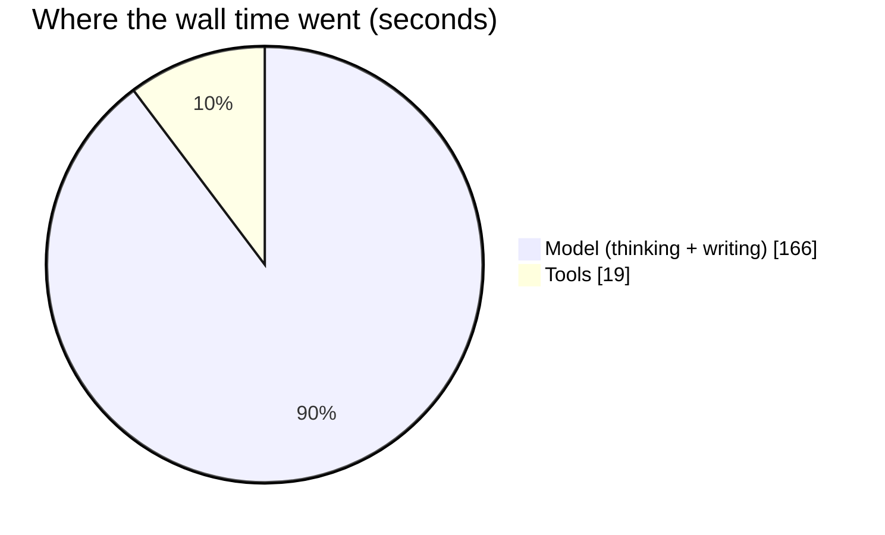

# intellectual-property/review-data-processing-agreement-template-against-eu-and-us-requirements · run2 (`hv-mixed200-lunahigh-r2-20261116T093818Z`)

Result: **all-pass** 47/47 criteria · 3.1 min · 13 model calls · 20 tool calls (0 errors or timeouts) · ending `completed` · started 11-16 17:33:10 IST

## Overview

One box per stretch of steps that used the same kind of tool (blue: looking/searching/reading, purple: writing or editing files, yellow: a message with no tool call, red border: a tool error or timeout inside the box).

```mermaid
flowchart TD
    T(["Task prompt"])
    P0["<b>Step 1</b> · 0.1 min<br/>todo_write"]
    T --> P0
    class P0 look
    P1["<b>Steps 2-3</b> · 0.3 min<br/>bash x4<br/><i>ls -la && printf '\nDocuments:\n' && …, mkdir -p extracted && parse-doc docx …, cp documents/stratosphere-negotiation…</i>"]
    P0 --> P1
    class P1 look
    P2["<b>Steps 4-5</b> · 0.1 min<br/>read x8<br/><i>playbook.txt, msa.txt, dataflow.txt +2</i>"]
    P1 --> P2
    class P2 look
    P3["<b>Step 6</b> · 0.4 min<br/>bash<br/><i>python - #lt;#lt;'PY' import docx print('py…</i>"]
    P2 --> P3
    class P3 look
    P4["<b>Step 7</b> · 0.0 min<br/>todo_write"]
    P3 --> P4
    class P4 look
    P5["<b>Steps 8-9</b> · 1.9 min<br/>bash x2<br/><i>cat #gt; build_memo.py #lt;#lt;'PY' from docx …, parse-doc docx output/compliance-gap-…</i>"]
    P4 --> P5
    class P5 look
    P6["<b>Step 10</b> · 0.1 min<br/>read<br/><i>memo.txt</i>"]
    P5 --> P6
    class P6 look
    P7["<b>Step 11</b> · 0.2 min<br/>bash<br/><i>if command -v libreoffice #gt;/dev/null …</i>"]
    P6 --> P7
    class P7 look
    P8["<b>Step 12</b> · 0.1 min<br/>todo_write"]
    P7 --> P8
    class P8 look
    P9["<b>Step 13</b> · 0.1 min<br/>final message"]
    P8 --> P9
    class P9 ans
    R(["ALL PASS: 47/47 criteria"])
    P9 --> R
    class R pass
    classDef look fill:#e8f0fe,stroke:#4a6fa5,color:#111
    classDef write fill:#f3e8fd,stroke:#7b1fa2,color:#111
    classDef ans fill:#fff8e1,stroke:#b58900,color:#111
    classDef err fill:#e8f0fe,stroke:#c62828,stroke-width:3px,color:#111
    classDef pass fill:#e6f4ea,stroke:#2e7d32,color:#111
    classDef fail fill:#fce8e6,stroke:#c62828,color:#111
```





One row per model call:

| Step | Started (IST) | Model s | Tools s | Tool calls | Tools | Output chars |
|---|---|---|---|---|---|---|
| 1 | 17:33:10 | 4 | 0 | 1 | todo_write | 57 |
| 2 | 17:33:14 | 1 | 1 | 1 | bash | 1,039 |
| 3 | 17:33:16 | 4 | 10 | 3 | bash x3 | 1,489 |
| 4 | 17:33:30 | 3 | 0 | 5 | read x5 | 176,320 |
| 5 | 17:33:33 | 2 | 0 | 3 | read x3 | 87,575 |
| 6 | 17:33:36 | 22 | 2 | 1 | bash | 18 |
| 7 | 17:33:59 | 3 | 0 | 1 | todo_write | 57 |
| 8 | 17:34:02 | 105 | 1 | 1 | bash | 260 |
| 9 | 17:35:48 | 5 | 3 | 1 | bash | 5,113 |
| 10 | 17:35:56 | 3 | 0 | 1 | read | 52,516 |
| 11 | 17:36:00 | 7 | 2 | 1 | bash | 1,198 |
| 12 | 17:36:09 | 3 | 0 | 1 | todo_write | 57 |
| 13 | 17:36:12 | 4 | 0 | 0 | (message only) | 0 |

## Task prompt

```text
Review the vendor DPA template against our playbook, commercial terms, data flow details, and negotiation emails; produce a gap memorandum with prioritized findings and redline recommendations. Output: `compliance-gap-memorandum.docx`.
```

## Rubric

| # | Criterion | Verdict |
|---|---|---|
| C-001 | Prioritized summary table at beginning of memo | pass |
| C-002 | ISSUE_001: Identifies missing HIPAA BAA integration | pass |
| C-003 | ISSUE_001: Notes missing HIPAA-specific definitions | pass |
| C-004 | ISSUE_001: Recommends integrating BAA or attaching as exhibit | pass |
| C-005 | ISSUE_001: References minimum necessary standard or workforce training | pass |
| C-006 | ISSUE_002: Identifies 48-hour vs. 24-hour breach notification discrepancy | pass |
| C-007 | ISSUE_002: Identifies missing HIPAA breach notification obligations | pass |
| C-008 | ISSUE_002: Recommends specific redline for breach notification timeline | pass |
| C-009 | ISSUE_003: Identifies liability cap gap (€500K vs. playbook minimum) | pass |
| C-010 | ISSUE_003: Quantifies liability gap with correct dollar figures | pass |
| C-011 | ISSUE_003: Identifies missing carve-outs for willful misconduct/gross negligence | pass |
| C-012 | ISSUE_003: Identifies blanket exclusion of consequential damages as problematic | pass |
| C-013 | ISSUE_003: References correct MSA fee structure | pass |
| C-014 | ISSUE_004: Identifies missing SCC Module 3 for processor-to-subprocessor transfers | pass |
| C-015 | ISSUE_004: Identifies Singapore remote access as an unaddressed transfer | pass |
| C-016 | ISSUE_004: Notes Larkfield not certified under EU-US Data Privacy Framework | pass |
| C-017 | ISSUE_004: Flags absence of Transfer Impact Assessment documentation | pass |
| C-018 | ISSUE_005: Identifies missing CCPA/CPRA Service Provider provisions | pass |
| C-019 | ISSUE_005: Specifies required CCPA/CPRA contractual terms | pass |
| C-020 | ISSUE_006: Identifies audit rights limited to Frankfurt only | pass |
| C-021 | ISSUE_006: Recommends extending audit rights to subprocessor locations | pass |
| C-022 | ISSUE_007: Identifies missing data return option at termination | pass |
| C-023 | ISSUE_007: Identifies HIPAA 6-year retention conflict with 90-day deletion | pass |
| C-024 | ISSUE_008: Identifies governing law mismatch for US data disputes | pass |
| C-025 | ISSUE_008: Recommends bifurcated governing law/dispute resolution | pass |
| C-026 | ISSUE_009: Recognizes Module 2 alone is insufficient for processor-to-subprocessor transfers | pass |
| C-027 | ISSUE_011: Identifies 2-year survival period as insufficient for HIPAA | pass |
| C-028 | ISSUE_012: Flags anonymization vs. pseudonymization regulatory risk | pass |
| C-029 | DISTRACTOR_003: Does not flag DIS arbitration for EU disputes as a gap | pass |
| C-030 | Each gap includes risk level classification | pass |
| C-031 | Each gap references the specific DPA section at issue | pass |
| C-032 | Each gap includes a specific recommended redline or amendment | pass |
| C-033 | Correctly identifies Pinnacle as HIPAA Covered Entity | pass |
| C-034 | Correctly identifies Stratosphere as Processor/Business Associate | pass |
| C-035 | References EU-US Data Privacy Framework in transfer analysis | pass |
| C-036 | Identifies EU-to-US (Larkfield/Northern Virginia) disaster recovery transfer scenario | pass |
| C-037 | Identifies Singapore remote access transfer scenario | pass |
| C-038 | Identifies Stratosphere processor-to-subprocessor transfer scenario | pass |
| C-039 | References 2.1 million US patients or 890,000 California residents | pass |
| C-040 | ISSUE_001 classified as Critical or High risk | pass |
| C-041 | ISSUE_003 classified as Critical or High risk | pass |
| C-042 | References negotiation context from email thread | pass |
| C-043 | Mentions subprocessor Larkfield Data Systems by name | pass |
| C-044 | Mentions subprocessor Orionis Analytics by name | pass |
| C-045 | ISSUE_006: Notes audit limited to once per year | pass |
| C-046 | ISSUE_004: Recommends specific transfer mechanisms for identified gaps | pass |
| C-047 | ISSUE_012: Recommends defining anonymization standard in DPA | pass |

Judge's reasoning:

**C-001 (pass):** Prioritized summary table at beginning of memo

```text
Near the beginning, the Executive Summary includes a structured table listing each major gap, assigning priority/risk levels such as P0 and P1/P2, and providing a brief explanation and required outcome for each.
```

**C-002 (pass):** ISSUE_001: Identifies missing HIPAA BAA integration

```text
The memorandum expressly identifies the absence of a HIPAA BAA as a P0 execution blocker, explains that Stratosphere will process US patient PHI as Pinnacle’s Business Associate, and recommends adding an integrated or incorporated BAA with required HIPAA terms and subcontractor flow-down.
```

**C-003 (pass):** ISSUE_001: Notes missing HIPAA-specific definitions

```text
The memo expressly notes that the DPA's definitions are GDPR-only and recommends adding HIPAA-specific definitions, including PHI, ePHI, Covered Entity, Business Associate, and BAA.
```

**C-004 (pass):** ISSUE_001: Recommends integrating BAA or attaching as exhibit

```text
The memo specifically recommends inserting an integrated BAA as a new DPA section or attaching a standalone BAA exhibit expressly incorporated into and executed with the DPA.
```

**C-005 (pass):** ISSUE_001: References minimum necessary standard or workforce training

```text
The memo expressly identifies both missing HIPAA obligations: the minimum necessary standard for PHI use/disclosure and HIPAA workforce training requirements, including training upon hire and annually.
```

**C-006 (pass):** ISSUE_002: Identifies 48-hour vs. 24-hour breach notification discrepancy

```text
The memorandum expressly states that the DPA requires notice within 48 hours after confirmation, while Pinnacle's playbook requires notice within 24 hours of discovery of an actual or reasonably suspected breach, and recommends replacing the 48-hour standard.
```

**C-007 (pass):** ISSUE_002: Identifies missing HIPAA breach notification obligations

```text
The memo expressly flags the absence of a “HIPAA-specific ... breach cascade,” requires notice for breaches of Unsecured PHI, and calls for support with HIPAA notifications. This identifies missing HIPAA-specific breach notification obligations as a gap.
```

**C-008 (pass):** ISSUE_002: Recommends specific redline for breach notification timeline

```text
The memo gives a specific redline replacing the 48-hour confirmed-breach standard with notice within 24 hours after discovery of any actual or reasonably suspected breach involving Personal Data, PHI, or California Personal Information. It also recommends HIPAA-specific breach provisions in the BAA.
```

**C-009 (pass):** ISSUE_003: Identifies liability cap gap (€500K vs. playbook minimum)

```text
The memo expressly identifies the DPA’s €500,000 aggregate liability cap as materially below Pinnacle’s playbook minimum of 2x annual fees for the affected processing, and calculates the applicable floors as $8.4M combined, $5.6M for US-specific claims, and $2.8M for EU-specific claims.
```

**C-010 (pass):** ISSUE_003: Quantifies liability gap with correct dollar figures

```text
The memo specifically states the $8.4M combined minimum and $2.8M EU-specific minimum, and contrasts them with the template's €500,000 cap, converted to approximately $545,000.
```

**C-011 (pass):** ISSUE_003: Identifies missing carve-outs for willful misconduct/gross negligence

```text
The memo expressly identifies the missing carve-outs and recommends that liability be uncapped for the processor’s willful misconduct and gross negligence, consistent with Pinnacle’s playbook.
```

**C-012 (pass):** ISSUE_003: Identifies blanket exclusion of consequential damages as problematic

```text
The memo expressly flags §13.2’s broad exclusion of indirect, consequential, and special damages as unacceptable and recommends that the exclusion not apply to data-protection claims involving willful misconduct, among other carve-outs. This satisfies the criterion.
```

**C-013 (pass):** ISSUE_003: References correct MSA fee structure

```text
The liability discussion expressly references the MSA fee structure: $4.2M total annual fees, comprising $2.8M for US services and $1.4M for EU services, and uses those figures to calculate the proposed 2x liability caps.
```

**C-014 (pass):** ISSUE_004: Identifies missing SCC Module 3 for processor-to-subprocessor transfers

```text
The memo expressly states that the DPA designates only SCC Module 2 and that the Stratosphere-to-Larkfield transfer is processor-to-subprocessor, requiring SCC Module 3. It also recommends executing Module 3 with Larkfield before transferring EU personal data.
```

**C-015 (pass):** ISSUE_004: Identifies Singapore remote access as an unaddressed transfer

```text
The memo expressly flags Singapore-based support engineers’ remote access to EU data as an international transfer scenario not addressed by the DPA. It states that a Chapter V transfer mechanism or an EEA-only access restriction is required and recommends supplementary measures.
```

**C-016 (pass):** ISSUE_004: Notes Larkfield not certified under EU-US Data Privacy Framework

```text
The memo expressly states that Larkfield is not DPF-certified and therefore the EU-US Data Privacy Framework cannot be relied upon for the transfer to Larkfield.
```

**C-017 (pass):** ISSUE_004: Flags absence of Transfer Impact Assessment documentation

```text
The memorandum expressly flags that no TIA is required or documented for the US or Singapore transfer scenarios and recommends requiring documented TIAs for each third-country transfer, including reassessment and supplementary measures.
```

**C-018 (pass):** ISSUE_005: Identifies missing CCPA/CPRA Service Provider provisions

```text
The memo expressly identifies that the DPA lacks CCPA/CPRA definitions and Service Provider provisions despite covering approximately 890,000 California residents, and recommends adding a compliant CCPA/CPRA addendum.
```

**C-019 (pass):** ISSUE_005: Specifies required CCPA/CPRA contractual terms

```text
The memo specifies all three listed CCPA/CPRA Service Provider provisions: it prohibits selling or sharing Pinnacle personal information, prohibits combining it with data from other clients except as legally permitted, and requires the vendor to certify that it understands and will comply with the restrictions.
```

**C-020 (pass):** ISSUE_006: Identifies audit rights limited to Frankfurt only

```text
The memo expressly identifies that Sections 11.2–11.4 limit audits to the Frankfurt facility and states that this excludes Dublin and Larkfield/Northern Virginia, among other processing locations. It recommends extending audit rights to all vendor and subprocessor locations.
```

**C-021 (pass):** ISSUE_006: Recommends extending audit rights to subprocessor locations

```text
The memo expressly recommends expanding audit rights to all vendor and subprocessor locations, systems, personnel, and controls. It also calls for subprocessor audit flow-down and confirms that reports/certifications should supplement rather than replace on-site audit rights.
```

**C-022 (pass):** ISSUE_007: Identifies missing data return option at termination

```text
The memo expressly states in P0-7 that Section 12 is deletion-focused and lacks a clear machine-readable data return option and 30 days of transition assistance. It also recommends adding return before deletion and at least 30 calendar days of transition assistance, matching the criterion.
```

**C-023 (pass):** ISSUE_007: Identifies HIPAA 6-year retention conflict with 90-day deletion

```text
The memo expressly identifies that the DPA's 90-day deletion timeline lacks a HIPAA six-year retention carve-out and cites 45 CFR § 164.530(j). It also recommends reconciling deletion with retention of required HIPAA records for six years.
```

**C-024 (pass):** ISSUE_008: Identifies governing law mismatch for US data disputes

```text
The memo expressly flags that Section 14 applies German law and Munich-seated DIS arbitration to all DPA disputes, including US PHI and CCPA/CPRA-covered data, and contrasts this with the playbook requirement for Delaware law and exclusive jurisdiction in the U.S. District Court for the Western District of Texas, Austin Division (or Travis County courts if federal jurisdiction is unavailable).
```

**C-025 (pass):** ISSUE_008: Recommends bifurcated governing law/dispute resolution

```text
The memo expressly recommends bifurcated treatment in P0-6 and the consolidated redline package: Delaware law and US court jurisdiction for disputes involving US data, and Netherlands or German law with EU-seated arbitration for EU/EEA data matters.
```

**C-026 (pass):** ISSUE_009: Recognizes Module 2 alone is insufficient for processor-to-subprocessor transfers

```text
The memo expressly states that SCC Module 2 covers Controller-to-Processor transfers and does not cover Stratosphere’s Processor-to-Subprocessor transfer to Larkfield. It specifically recommends separately executing SCC Module 3 with Larkfield for that transfer, consistent with the required distinction.
```

**C-027 (pass):** ISSUE_011: Identifies 2-year survival period as insufficient for HIPAA

```text
The memo expressly flags Section 16.3's two-year survival period as insufficient for HIPAA, cites the six-year retention requirement under 45 CFR § 164.530(j), and recommends that HIPAA obligations survive through the six-year period and for as long as PHI is retained.
```

**C-028 (pass):** ISSUE_012: Flags anonymization vs. pseudonymization regulatory risk

```text
The memo expressly flags that the DPA lacks a defined distinction between anonymization and pseudonymization for Orionis’s analytics. It recommends an objective anonymization standard, Orionis validation/certification, and treating outputs that do not meet that standard as Personal Data subject to the DPA. It also states that pseudonymized or aggregated data remains within GDPR scope unless irreversibly anonymized.
```

**C-029 (pass):** DISTRACTOR_003: Does not flag DIS arbitration for EU disputes as a gap

```text
The memo flags German law and Munich DIS arbitration only insofar as they currently apply to US data disputes. It expressly permits DIS arbitration for EU/EEA disputes and allows German law as an alternative, so it does not treat DIS arbitration for EU matters as a material compliance gap.
```

**C-030 (pass):** Each gap includes risk level classification

```text
The memo assigns priority classifications to substantially all identified gaps. Major findings are labeled P0, the required pre-execution findings are labeled P1, strengthening items are labeled P2, and the appendix matrix reiterates a priority for each gap. This exceeds the 75% threshold.
```

**C-031 (pass):** Each gap references the specific DPA section at issue

```text
The memo references specific DPA sections for well over 75% of identified gaps, including §§1, 3.4, 6.5–6.6, 7.2, 8, 9.1 and 9.6, 11.2–11.4, 12, 13.1–13.5, 14, 15, 16.3, and 17.5. The gap matrix also maps nearly every issue to a precise section or annex.
```

**C-032 (pass):** Each gap includes a specific recommended redline or amendment

```text
The memorandum provides specific amendment instructions for well over 75% of the identified gaps. Major findings include proposed replacement language or concrete structural changes, such as adding an integrated BAA, SCC Module 3 and TIAs, 24-hour breach notice, CCPA/CPRA service-provider terms, bifurcated governing-law provisions, revised liability caps, and return/deletion requirements. The P1/P2 tables and gap matrix likewise pair nearly every gap with a targeted redline recommendation.
```

**C-033 (pass):** Correctly identifies Pinnacle as HIPAA Covered Entity

```text
The memo expressly identifies Pinnacle Health Solutions, Inc. as the US HIPAA Covered Entity and Stratosphere as its Business Associate, including in the processing-relationship discussion and proposed BAA language.
```

**C-034 (pass):** Correctly identifies Stratosphere as Processor/Business Associate

```text
The memo expressly identifies Stratosphere as the GDPR processor and HIPAA Business Associate, including in the processing-relationship section and proposed BAA language.
```

**C-035 (pass):** References EU-US Data Privacy Framework in transfer analysis

```text
The memo expressly discusses the EU-US Data Privacy Framework in its international transfer analysis, noting that Larkfield is not DPF-certified and that the framework cannot be relied upon for an uncertified recipient.
```

**C-036 (pass):** Identifies EU-to-US (Larkfield/Northern Virginia) disaster recovery transfer scenario

```text
The memorandum expressly identifies EU-originating data replicated from Frankfurt to Larkfield in Northern Virginia for disaster recovery and discusses the required transfer mechanism.
```

**C-037 (pass):** Identifies Singapore remote access transfer scenario

```text
The memo expressly identifies that Singapore-based support engineers may remotely access EU personal data and treats that access as an international transfer requiring a Chapter V mechanism or an EEA-only access restriction.
```

**C-038 (pass):** Identifies Stratosphere processor-to-subprocessor transfer scenario

```text
The memo expressly identifies the Frankfurt-to-Larkfield transfer as a processor-to-subprocessor international transfer and states that it requires separate SCC Module 3 coverage rather than Module 2, along with TIAs and supplementary measures.
```

**C-039 (pass):** References 2.1 million US patients or 890,000 California residents

```text
The memo references both qualifying figures: approximately 2.1 million US patients in the HIPAA/PHI context and approximately 890,000 California residents in the CCPA/CPRA context.
```

**C-040 (pass):** ISSUE_001 classified as Critical or High risk

```text
The missing HIPAA BAA is expressly classified as “P0 — no execution,” the memorandum’s highest-priority blocker tier, and the overall risk is rated HIGH. This is equivalent to Critical/High severity for the specific issue.
```

**C-041 (pass):** ISSUE_003 classified as Critical or High risk

```text
The liability cap gap is expressly classified as “P0 — threshold,” and the memorandum defines P0 items as execution-blocking/highest-priority issues. It also states the €500,000 cap is unacceptable and materially below the required minimum, satisfying the Critical/High-risk criterion.
```

**C-042 (pass):** References negotiation context from email thread

```text
The memo expressly references the April 16–18 email thread, notes that liability is a threshold issue for Pinnacle, and states that Stratosphere characterized the €500,000 cap as its global standard while agreeing to discuss a commercial middle ground.
```

**C-043 (pass):** Mentions subprocessor Larkfield Data Systems by name

```text
The memorandum repeatedly identifies the subprocessor by name as “Larkfield,” including its Northern Virginia hosting and disaster-recovery role.
```

**C-044 (pass):** Mentions subprocessor Orionis Analytics by name

```text
The memo expressly mentions Orionis by name multiple times, including “Orionis analytics in Ireland” and references to Orionis as the analytics subprocessor.
```

**C-045 (pass):** ISSUE_006: Notes audit limited to once per year

```text
The memo expressly states in P1-1 that §§11.2–11.4 limit audits to “one planned audit/year” with 30 days’ notice, and recommends preserving one planned annual audit while allowing additional for-cause audits.
```

**C-046 (pass):** ISSUE_004: Recommends specific transfer mechanisms for identified gaps

```text
The memo recommends at least three specified mechanisms: executing SCC Module 3 for the Stratosphere-to-Larkfield processor-to-subprocessor transfer, conducting Transfer Impact Assessments for third-country transfers, and implementing supplementary measures for Singapore remote access such as least-privilege access, MFA, logging, approval controls, data minimization, and no local copying. This exceeds the requirement of at least two mechanisms.
```

**C-047 (pass):** ISSUE_012: Recommends defining anonymization standard in DPA

```text
The memo expressly recommends defining an objective, verifiable anonymization standard for Orionis using singling-out, linkability, and inference criteria, requiring Orionis validation/certification, and treating outputs that do not meet the standard—including merely pseudonymized data—as Personal Data subject to the DPA.
```

## Delivered files (output/)

- `compliance-gap-memorandum.docx` (55,543 bytes)

## Trajectory

### Step 1: 1 tool call

_Started 11-16 17:33:10 IST · model 4 s · tools 0 s_

**Reasoning summary:**

```text
**Managing document tasks**

I need to handle some document manipulation requested by the user, specifically to review and generate a DOCX file. It seems I may not have access to all the necessary skills to accomplish that. I'll check the workspace by listing files using a bash command, but I need to avoid reading from task.json. I guess my first steps will focus on whatever documents are available. This feels like it will require multiple steps.
```

**Call `todo_write`** (0.0 s)

```json
{
 "todos": [
  {
   "content": "Inspect provided DPA, playbook, commercial, data flow, and email materials",
   "status": "in_progress"
  },
  {
   "content": "Extract requirements and map gaps against the vendor template",
   "status": "pending"
  },
  {
   "content": "Draft prioritized gap memorandum and redline recommendations",
   "status": "pending"
  },
  {
   "content": "Generate and validate compliance-gap-memorandum.docx",
   "status": "pending"
  }
 ]
}
```

Output (57 chars):

```text
Updated todo list: 3 pending, 1 in progress, 0 completed.
```

**Todo list now:**

- [~] Inspect provided DPA, playbook, commercial, data flow, and email materials
- [ ] Extract requirements and map gaps against the vendor template
- [ ] Draft prioritized gap memorandum and redline recommendations
- [ ] Generate and validate compliance-gap-memorandum.docx

### Step 2: 1 tool call

_Started 11-16 17:33:14 IST · model 1 s · tools 1 s_

**Call `bash`** (0.5 s)

```json
{
 "command": "ls -la && printf '\\nDocuments:\\n' && ls -la documents && printf '\\nOutput:\\n' && ls -la output",
 "description": "List workspace documents and output"
}
```

Output (1,039 chars):

```text
total 16
drwxr-xr-x 4 agarwaldi@microsoft.com users 4096 Nov 16 12:03 .
drwxr-xr-x 3 root                    root  4096 Nov 16 12:03 ..
dr-xr-xr-x 2 agarwaldi@microsoft.com users 4096 Nov  5 18:20 documents
drwxr-xr-x 2 agarwaldi@microsoft.com users 4096 Nov 16 12:03 output

Documents:
total 264
dr-xr-xr-x 2 agarwaldi@microsoft.com users  4096 Nov  5 18:20 .
drwxr-xr-x 4 agarwaldi@microsoft.com users  4096 Nov 16 12:03 ..
-r--r--r-- 3 agarwaldi@microsoft.com users 54272 Nov  5 18:20 data-flow-diagram.docx
-r--r--r-- 3 agarwaldi@microsoft.com users 47124 Nov  5 18:20 msa-summary-term-sheet.docx
-r--r--r-- 3 agarwaldi@microsoft.com users 75843 Nov  5 18:20 pinnacle-us-dpa-playbook.docx
-r--r--r-- 3 agarwaldi@microsoft.com users 63464 Nov  5 18:20 stratosphere-dpa-template-v3-2.docx
-r--r--r-- 3 agarwaldi@microsoft.com users 10806 Nov  5 18:20 stratosphere-negotiation-email-thread.eml

Output:
total 8
drwxr-xr-x 2 agarwaldi@microsoft.com users 4096 Nov 16 12:03 .
drwxr-xr-x 4 agarwaldi@microsoft.com users 4096 Nov 16 12:03 ..
```

### Step 3: 3 tool calls

_Started 11-16 17:33:16 IST · model 4 s · tools 10 s_

**Call `bash`** (3.7 s)

```json
{
 "command": "mkdir -p extracted && parse-doc docx documents/pinnacle-us-dpa-playbook.docx > extracted/playbook.txt && parse-doc docx documents/msa-summary-term-sheet.docx > extracted/msa.txt",
 "description": "Convert playbook and commercial terms"
}
```

Output (739 chars):

```text
[stderr]
2026-11-16 12:03:21.758330164 [W:onnxruntime:Default, device_discovery.cc:95 GetPciBusId] Skipping pci_bus_id for PCI path at "/sys/devices/LNXSYSTM:00/LNXSYBUS:00/ACPI0004:00/VMBUS:00/5620e0c7-8062-4dce-aeb7-520c7ef76171" because filename "5620e0c7-8062-4dce-aeb7-520c7ef76171" did not match expected pattern of [0-9a-f]+:[0-9a-f]+:[0-9a-f]+[.][0-9a-f]+
2026-11-16 12:03:23.438774131 [W:onnxruntime:Default, device_discovery.cc:95 GetPciBusId] Skipping pci_bus_id for PCI path at "/sys/devices/LNXSYSTM:00/LNXSYBUS:00/ACPI0004:00/VMBUS:00/5620e0c7-8062-4dce-aeb7-520c7ef76171" because filename "5620e0c7-8062-4dce-aeb7-520c7ef76171" did not match expected pattern of [0-9a-f]+:[0-9a-f]+:[0-9a-f]+[.][0-9a-f]+
```

**Call `bash`** (6.2 s)

```json
{
 "command": "mkdir -p extracted && parse-doc docx documents/data-flow-diagram.docx > extracted/dataflow.txt && parse-doc docx documents/stratosphere-dpa-template-v3-2.docx > extracted/vendor-dpa.txt",
 "description": "Convert data flow and vendor DPA"
}
```

Output (739 chars):

```text
[stderr]
2026-11-16 12:03:25.235989517 [W:onnxruntime:Default, device_discovery.cc:95 GetPciBusId] Skipping pci_bus_id for PCI path at "/sys/devices/LNXSYSTM:00/LNXSYBUS:00/ACPI0004:00/VMBUS:00/5620e0c7-8062-4dce-aeb7-520c7ef76171" because filename "5620e0c7-8062-4dce-aeb7-520c7ef76171" did not match expected pattern of [0-9a-f]+:[0-9a-f]+:[0-9a-f]+[.][0-9a-f]+
2026-11-16 12:03:29.300830296 [W:onnxruntime:Default, device_discovery.cc:95 GetPciBusId] Skipping pci_bus_id for PCI path at "/sys/devices/LNXSYSTM:00/LNXSYBUS:00/ACPI0004:00/VMBUS:00/5620e0c7-8062-4dce-aeb7-520c7ef76171" because filename "5620e0c7-8062-4dce-aeb7-520c7ef76171" did not match expected pattern of [0-9a-f]+:[0-9a-f]+:[0-9a-f]+[.][0-9a-f]+
```

**Call `bash`** (0.6 s)

```json
{
 "command": "cp documents/stratosphere-negotiation-email-thread.eml extracted/emails.eml",
 "description": "Copy negotiation email thread"
}
```

Output (11 chars):

```text
(no output)
```

### Step 4: 5 tool calls

_Started 11-16 17:33:30 IST · model 3 s · tools 0 s_

**Reasoning summary:**

```text
**Considering text reading**

I need to read some texts. I think I can use methods like counting lines or maybe even sizes to help. That way, I’ll know how much material I’m dealing with. I’m also considering using a method to extract the relevant parts. It’s a bit overwhelming to think about everything I need to manage, but I’m confident that breaking it down into steps will help make it more manageable!
```

**Call `read`** (0.0 s)

```json
{
 "file_path": "extracted/playbook.txt",
 "offset": 1,
 "limit": 400
}
```

Output (49,097 chars):

```text
<path>/home/agarwaldi/dsh-bench-harness/runs/hv-mixed200-lunahigh-r2-20261116T093818Z/tasks/intellectual-property__review-data-processing-agreement-template-against-eu-and-us-requirements/workspace/extracted/playbook.txt</path>
<type>file</type>
<content>
1: **[DATA PROCESSING AGREEMENT NEGOTIATION PLAYBOOK]{.underline}**
2: 
3: **[US AND CROSS-BORDER REQUIREMENTS]{.underline}**
4: 
5: **Internal Use Only --- Attorney-Client Privileged and Confidential Work Product**
6: 
7: Prepared by: **Office of the General Counsel** **Pinnacle Health Solutions, Inc.** 4200 Harborview Boulevard, Suite 1100 Austin, TX 78746
8: 
9: Approved by: **Margaret Yuen-Park**, General Counsel
10: 
11: **Version 4.0**
12: 
13: Last Updated: **February 28, 2025**
14: 
15: **Distribution List:**
16: 
17:   -------------------------------------------------------------------------------------
18:   **Recipient**                                     **Title**
19:   ------------------------------------------------- -----------------------------------
20:   Legal Department (all attorneys and paralegals)   ---
21: 
22:   Dr. Anand Krishnamurthy                           Chief Privacy Officer
23: 
24:   Jennifer Castellano                               VP of Information Security
25: 
26:   David Liang                                       VP of Procurement
27:   -------------------------------------------------------------------------------------
28: 
29: **External Counsel Reference:** This playbook was devel
… [47,597 more chars]
```

**Call `read`** (0.0 s)

```json
{
 "file_path": "extracted/msa.txt",
 "offset": 1,
 "limit": 300
}
```

Output (23,022 chars):

```text
<path>/home/agarwaldi/dsh-bench-harness/runs/hv-mixed200-lunahigh-r2-20261116T093818Z/tasks/intellectual-property__review-data-processing-agreement-template-against-eu-and-us-requirements/workspace/extracted/msa.txt</path>
<type>file</type>
<content>
1: **[MASTER SERVICES AGREEMENT --- SUMMARY TERM SHEET]{.underline}**
2: 
3: **Summary of Key Commercial Terms**
4: 
5: MSA Effective Date: March 15, 2024
6: 
7: This Summary Term Sheet is for internal reference purposes only and does not amend or supersede the Master Services Agreement dated March 15, 2024 (the \"MSA\"), by and between Pinnacle Health Solutions, Inc. and Stratosphere Cloud Services GmbH. In the event of any conflict between the terms summarized herein and the terms of the executed MSA, the terms of the executed MSA shall control in all respects.
8: 
9: Prepared by the Office of General Counsel Pinnacle Health Solutions, Inc.
10: 
11: Last Updated: March 15, 2024
12: 
13: **[Section 1 --- Parties]{.underline}**
14: 
15: **Client:** Pinnacle Health Solutions, Inc., a Delaware corporation, with its principal offices located at 4200 Harborview Boulevard, Suite 1100, Austin, TX 78746 (\"Pinnacle\" or \"Client\").
16: 
17: **Service Provider:** Stratosphere Cloud Services GmbH, a German limited liability company (*Gesellschaft mit beschränkter Haftung*) registered at the Munich Local Court (*Amtsgericht München*) under Commercial Register (*Handelsregister*) number HRB 247891, with its registered office at Hohenzoller
… [21,522 more chars]
```

**Call `read`** (0.1 s)

```json
{
 "file_path": "extracted/dataflow.txt",
 "offset": 1,
 "limit": 300
}
```

Output (39,442 chars):

```text
<path>/home/agarwaldi/dsh-bench-harness/runs/hv-mixed200-lunahigh-r2-20261116T093818Z/tasks/intellectual-property__review-data-processing-agreement-template-against-eu-and-us-requirements/workspace/extracted/dataflow.txt</path>
<type>file</type>
<content>
1: **[DATA FLOW DIAGRAM AND PROCESSING DESCRIPTION]{.underline}**
2: 
3: **[Pinnacle Health Solutions, Inc. --- Stratosphere Cloud Services GmbH]{.underline}**
4: 
5: **[Data Processing Relationship]{.underline}**
6: 
7: **CONFIDENTIAL --- ATTORNEY-CLIENT PRIVILEGED / WORK PRODUCT**
8: 
9: This document is protected by the attorney-client privilege and the work product doctrine. Unauthorized disclosure, copying, or distribution is strictly prohibited. This document does not constitute legal advice to any third party.
10: 
11: **Prepared by:** Office of the General Counsel, Pinnacle Health Solutions, Inc., 4200 Harborview Boulevard, Suite 1100, Austin, TX 78746
12: 
13: **Prepared for:** Internal use and for review by outside counsel Alderton Shaw & Whitmore LLP (Rachel Osterfeld, Partner), 900 K Street NW, Suite 700, Washington, DC 20001
14: 
15: **Date:** April 2025
16: 
17: **Reference Documents:**
18: 
19: > •Master Services Agreement dated March 15, 2024 (\"MSA\")
20: >
21: > •Stratosphere DPA Template Version 3.2 dated January 10, 2025 (received April 14, 2025) (\"DPA Template\" or \"DPA\")
22: >
23: > •Pinnacle US DPA Playbook (last updated February 28, 2025) (\"Playbook\")
24: 
25: **Purpose:** This document maps all 
… [37,942 more chars]
```

**Call `read`** (0.1 s)

```json
{
 "file_path": "extracted/vendor-dpa.txt",
 "offset": 1,
 "limit": 500
}
```

Output (52,666 chars):

```text
<path>/home/agarwaldi/dsh-bench-harness/runs/hv-mixed200-lunahigh-r2-20261116T093818Z/tasks/intellectual-property__review-data-processing-agreement-template-against-eu-and-us-requirements/workspace/extracted/vendor-dpa.txt</path>
<type>file</type>
<content>
1: **[DATA PROCESSING AGREEMENT]{.underline}**
2: 
3: **Version 3.2**
4: 
5: **January 10, 2025**
6: 
7: **STRATOSPHERE CLOUD SERVICES GmbH**
8: 
9: *Cloud Infrastructure · Managed Databases · Analytics*
10: 
11: This Data Processing Agreement (\"DPA\") forms part of and is subject to the terms of the Master Services Agreement (\"Agreement\" or \"MSA\") between the Processor and the Controller.
12: 
13: This DPA is designed to ensure compliance with Regulation (EU) 2016/679 of the European Parliament and of the Council of 27 April 2016 (the \"GDPR\") and applicable data protection laws governing the Processing of Personal Data in connection with the Services provided under the Agreement.
14: 
15: **Processor Registered Office:**
16: 
17: Stratosphere Cloud Services GmbH Hohenzollernstraße 88 80796 Munich, Germany
18: 
19: Handelsregister HRB 247891, Amtsgericht München (Munich Local Court)
20: 
21: **Prepared by:**
22: 
23: Legal Department, Stratosphere Cloud Services GmbH
24: 
25: **Contact:**
26: 
27: Dr. Florian Neumann Chief Legal Officer Stratosphere Cloud Services GmbH
28: 
29: Email: florian.neumann@stratospherecloud.example.com
30: 
31: Tel: +49 89 2155 4400
32: 
33: Right-click to update Table of Contents
34: 
35
… [51,166 more chars]
```

**Call `read`** (0.1 s)

```json
{
 "file_path": "extracted/emails.eml",
 "offset": 1,
 "limit": 300
}
```

Output (12,093 chars):

```text
<path>/home/agarwaldi/dsh-bench-harness/runs/hv-mixed200-lunahigh-r2-20261116T093818Z/tasks/intellectual-property__review-data-processing-agreement-template-against-eu-and-us-requirements/workspace/extracted/emails.eml</path>
<type>file</type>
<content>
1: From: Margaret Yuen-Park <myuenpark@pinnaclehealth.example.com>
2: To: Dr. Florian Neumann <f.neumann@stratospherecloud.example.com>
3: Cc: Rachel Osterfeld <rosterfeld@alderton-shaw.example.com>
4: Date: Fri, 18 Apr 2025 11:02:00 -0000
5: Subject: Re: Re: Re: Stratosphere DPA Template v3.2 — For Your Review
6: Content-Type: text/plain; charset="utf-8"
7: Content-Transfer-Encoding: quoted-printable
8: MIME-Version: 1.0
9: 
10: Florian,
11: 
12: Thank you for your response and for looping in Dr. Beckert.
13: 
14: We can confirm the call for Wednesday, April 30, 2025, at 4:00 PM CEST / 9:00=
15:  AM CDT. Rachel Osterfeld from Alderton Shaw & Whitmore will attend on our si=
16: de.
17: 
18: On the liability cap =E2=80=94 I appreciate your willingness to take this up =
19: internally. I want to set expectations that our redline of Section 13 will pr=
20: opose a structure tied to the annual fees under the MSA rather than a flat ca=
21: p, together with the carve-outs for willful misconduct and gross negligence I=
22:  referenced previously. I want to be transparent that this is a threshold iss=
23: ue for us, and we will need to reach agreement on liability allocation before=
24:  we can finalize the DPA.
25: 
26: Regarding DPO
… [10,593 more chars]
```

### Step 5: 3 tool calls

_Started 11-16 17:33:33 IST · model 2 s · tools 0 s_

**Call `read`** (0.1 s)

```json
{
 "file_path": "extracted/playbook.txt",
 "offset": 381,
 "limit": 460
}
```

Output (53,151 chars):

```text
<path>/home/agarwaldi/dsh-bench-harness/runs/hv-mixed200-lunahigh-r2-20261116T093818Z/tasks/intellectual-property__review-data-processing-agreement-template-against-eu-and-us-requirements/workspace/extracted/playbook.txt</path>
<type>file</type>
<content>
381: **[Section 7: CCPA / CPRA Service Provider Requirements]{.underline}**
382: 
383: This Section sets forth the mandatory contractual provisions that must appear in all DPAs where the vendor processes personal information of California residents on Pinnacle\'s behalf. These provisions are required to establish the vendor\'s status as a \"Service Provider\" under the CCPA/CPRA, which is essential to Pinnacle\'s compliance with the statute.
384: 
385: **[7.1 Service Provider Contractual Terms]{.underline}**
386: 
387: **Must-have:** The DPA must include the following CCPA/CPRA Service Provider provisions, consistent with Cal. Civ. Code § 1798.100(d) and § 1798.140(ag):
388: 
389: > **(a) Prohibition on Selling or Sharing.** Vendor is prohibited from selling (as defined in Cal. Civ. Code § 1798.140(ad)) or sharing (as defined in Cal. Civ. Code § 1798.140(ah)) any personal information received from, or on behalf of, Pinnacle. This prohibition applies regardless of whether the vendor receives monetary or other valuable consideration in exchange for the personal information.
390: >
391: > **(b) Purpose Limitation.** Vendor is prohibited from retaining, using, or disclosing personal information received from Pinnacle for any pur
… [51,651 more chars]
```

**Call `read`** (0.1 s)

```json
{
 "file_path": "extracted/vendor-dpa.txt",
 "offset": 317,
 "limit": 420
}
```

Output (26,964 chars):

```text
<path>/home/agarwaldi/dsh-bench-harness/runs/hv-mixed200-lunahigh-r2-20261116T093818Z/tasks/intellectual-property__review-data-processing-agreement-template-against-eu-and-us-requirements/workspace/extracted/vendor-dpa.txt</path>
<type>file</type>
<content>
317: **17.3 Severability.** If any provision of this DPA is found by a court or other tribunal of competent jurisdiction to be invalid, illegal, or unenforceable, such provision shall be modified to the minimum extent necessary to make it valid, legal, and enforceable, and the remaining provisions of this DPA shall continue in full force and effect. If such modification is not possible, the invalid provision shall be severed and the remaining provisions shall be interpreted so as to give effect to the Parties\' original intent to the maximum extent possible.
318: 
319: **17.4 Waiver.** No failure or delay by either Party in exercising any right, power, or privilege under this DPA shall operate as a waiver thereof, nor shall any single or partial exercise of any right, power, or privilege preclude any other or further exercise thereof or the exercise of any other right, power, or privilege.
320: 
321: **17.5 Notices.** All notices, requests, demands, and other communications required or permitted under this DPA shall be in writing and shall be delivered by hand, by internationally recognized overnight courier service, or by email to the addresses specified in this DPA or such other addresses as a Party may designate in writ
… [25,464 more chars]
```

**Call `read`** (0.1 s)

```json
{
 "file_path": "extracted/dataflow.txt",
 "offset": 301,
 "limit": 100
}
```

Output (7,460 chars):

```text
<path>/home/agarwaldi/dsh-bench-harness/runs/hv-mixed200-lunahigh-r2-20261116T093818Z/tasks/intellectual-property__review-data-processing-agreement-template-against-eu-and-us-requirements/workspace/extracted/dataflow.txt</path>
<type>file</type>
<content>
301: **Financial Context:** The MSA annual fees total \$4.2 million, allocated as \$2.8 million for US services and \$1.4 million for EU services. This financial context is relevant to the proportionality assessment for liability cap negotiations addressed in the separate compliance gap memorandum.
302: 
303: **Timeline Note:** The EU expansion launch date is **September 1, 2025**. The DPA must be fully negotiated, executed, and compliant with all applicable GDPR requirements --- including valid international transfer mechanisms for all identified cross-border data flows --- before this date. The internal review deadline for the DPA Template is **May 16, 2025**, which allows approximately four months for negotiation and finalization prior to the launch date.
304: 
305: **[Section 6: Observations and Flags for Legal Review]{.underline}**
306: 
307: This section provides a consolidated list of all issues identified through the data flow mapping exercise described in this document. Each issue is cross-referenced to the relevant DPA Template section, the data flow diagram(s) in which the issue was identified, and the internal issue tracking reference. These flags are intended for use by the legal team in preparing the compliance
… [5,960 more chars]
```

### Step 6: 1 tool call

_Started 11-16 17:33:36 IST · model 22 s · tools 2 s_

**Reasoning summary:**

```text
**Finalizing a polished document**

I need to produce a polished docx and might have to load a skill for documents, but there’s no skill catalog provided. I usually work with python-docx via bash, so I’ll consider inspecting the document styles. It’s important to develop a substantive memorandum that accurately includes findings, redline recommendations, and notes on legal reviews and privileges. I'll also need to address data flow inaccuracies in the DPA and mention specific gaps, ensuring everything aligns correctly.

**Addressing Annex B inconsistencies**

There's a clear inconsistency in Annex B regarding the Dublin operator. The DPA table mentions Orionis as the secondary EU data center, but the MSA states that Stratosphere owns the data centers in Frankfurt and Dublin, with Orionis only handling analytics. I should highlight the contradictions in location and scope. I'll need to draft the document content using python-docx and include a legal disclaimer indicating that it’s not legal advice. Additionally, I plan to provide one or two recommendations based on prioritization.

**Refining DPA breach terms**

In reviewing the DPA, particularly §9 regarding breach notifications, I noticed it states 48 hours after confirmation, but it should be 24 hours after discovery of an actual or suspected breach. The current content seems incomplete, as it lacks details on the nature and scope of affected systems, individuals when known, and the data protection officer’s contact. It also misses vital information like affected identities, the lead name for incidents, and direct notice contacts for updates and cooperation. I need to address these gaps!

**Generating DOCX document**

I need to create a DOCX file with the right styles, possibly using python-docx. I’m thinking of utilizing headings, tables, and a footer, but I don’t want to overcomplicate it. It’s important to verify how to parse the docx and check installation. Including a "confidential" header/footer and noting that it’s for internal negotiation is crucial. I might draft the overall structure with a Python script and consider using bash heredoc for the build script. Let’s check the import for that.
```

**Call `bash`** (1.5 s)

```json
{
 "command": "python - <<'PY'\nimport docx\nprint('python-docx', docx.__version__)\nPY",
 "description": "Check DOCX generation library"
}
```

Output (18 chars):

```text
python-docx 1.2.0
```

### Step 7: 1 tool call

_Started 11-16 17:33:59 IST · model 3 s · tools 0 s_

**Call `todo_write`** (0.0 s)

```json
{
 "todos": [
  {
   "content": "Inspect provided DPA, playbook, commercial, data flow, and email materials",
   "status": "completed"
  },
  {
   "content": "Extract requirements and map gaps against the vendor template",
   "status": "completed"
  },
  {
   "content": "Draft prioritized gap memorandum and redline recommendations",
   "status": "in_progress"
  },
  {
   "content": "Generate and validate compliance-gap-memorandum.docx",
   "status": "pending"
  }
 ]
}
```

Output (57 chars):

```text
Updated todo list: 1 pending, 1 in progress, 2 completed.
```

**Todo list now:**

- [x] Inspect provided DPA, playbook, commercial, data flow, and email materials
- [x] Extract requirements and map gaps against the vendor template
- [~] Draft prioritized gap memorandum and redline recommendations
- [ ] Generate and validate compliance-gap-memorandum.docx

### Step 8: 1 tool call

_Started 11-16 17:34:02 IST · model 105 s · tools 1 s_

**Reasoning summary:**

```text
**Creating a content script**

I need to generate a script that’s probably quite long. I might use helper functions and format it using a 'Table Grid' style with a shaded header and page breaks. It’s important to balance the number of pages. I see a potential legal accuracy issue regarding the timeframes; the Playbook states 30 days, but I should clarify it as "within the applicable GDPR statutory period (generally one month)." I'll also need to include priority labels for various legal items that need addressing.

**Outlining audit and documentation needs**

I'm focusing on the audit scope, rights assistance, and subprocessor flow-down, as well as scheduling for document corrections and DPO coordination. For security and certification, I need to decide on a fallback notice period—15 days is okay, but I’d prefer 30 days. There’s also the idea of creating a "Status key" for redline recommendations that specifies must-have clauses. I’ll prepare a gap memorandum with prioritized findings, ensuring actual content in the document and utilizing bullet lists and tables to format effectively. Consistency with "Pinnacle US" and "Pinnacle EU" is key too.

**Negotiating liability and deadlines**

I need to emphasize the importance of emails regarding threshold liability and formal DPO coordination. There’s a redline circulation set around deadlines of May 9 and May 16, which is critical to keep in mind. The vendor firm has a standard of €500k, but I should remain open to discussions on this. It’s important to maintain a strong negotiation posture during these conversations to ensure the best outcomes.
```

**Call `bash`** (1.3 s)

```json
{
 "command": "cat > build_memo.py <<'PY'\nfrom docx import Document\nfrom docx.shared import Inches, Pt, RGBColor\nfrom docx.enum.text import WD_ALIGN_PARAGRAPH, WD_BREAK\nfrom docx.enum.section import WD_SECTION\nfrom docx.enum.table import WD_TABLE_ALIGNMENT, WD_CELL_VERTICAL_ALIGNMENT\nfrom docx.oxml import OxmlElement\nfrom docx.oxml.ns import qn\nfrom docx.enum.style import WD_STYLE_TYPE\nfrom docx.enum.text import WD_LINE_SPACING\nfrom docx.enum.table import WD_ROW_HEIGHT_RULE\nfrom docx.enum.section import WD_ORIENT\n\nOUT = 'output/compliance-gap-memorandum.docx'\n\ndoc = Document()\nsec = doc.sections[0]\nsec.top_margin = Inches(0.7)\nsec.bottom_margin = Inches(0.7)\nsec.left_margin = Inches(0.75)\nsec.right_margin = Inches(0.75)\n\n# Page / fonts\nstyles = doc.styles\nstyles['Normal'].font.name = 'Aptos'\nstyles['Normal']._element.rPr.rFonts.set(qn('w:eastAsia'), 'Aptos')\nstyles['Normal'].font.size = Pt(9.5)\nstyles['Normal'].paragraph_format.space_after = Pt(5)\nstyles['Normal'].paragraph_format.line_spacing = 1.08\nfor sty_name, size, color in [('Title', 22, '17365D'), ('Heading 1', 15, '17365D'), ('Heading 2', 11.5, '1F4E79'), ('Heading 3', 10.5, '1F4E79')]:\n    s =
… [46,804 more chars]
```

Output (260 chars):

```text
output/compliance-gap-memorandum.docx
-rw-r--r-- 1 agarwaldi@microsoft.com users 55543 Nov 16 12:05 output/compliance-gap-memorandum.docx
    testing: docProps/thumbnail.jpeg   OK
No errors detected in compressed data of output/compliance-gap-memorandum.docx.
```

### Step 9: 1 tool call

_Started 11-16 17:35:48 IST · model 5 s · tools 3 s_

**Reasoning summary:**

```text
**Validating document output**

I need to validate the output from the parse-doc tool. First, I’ll save the extracted data to a memo file. Then I plan to read through that file. I want to ensure there are no errors and check if there are any issues with the pages. It’s important for me to ensure the data is accurate, so I’ll take my time on this. Let’s see how it looks once I finish!
```

**Call `bash`** (2.7 s)

```json
{
 "command": "parse-doc docx output/compliance-gap-memorandum.docx > extracted/memo.txt && wc -l extracted/memo.txt && grep -n \"P0-\\|P1-\\|Appendix\\|Conclusion\" extracted/memo.txt | head -n 40",
 "description": "Validate generated memorandum text",
 "timeoutMs": 120000
}
```

Output (5,113 chars):

```text
325 extracted/memo.txt
77:## P0-1. No HIPAA Business Associate Agreement
89:## P0-2. International transfer architecture is incomplete or incorrect
103:## P0-3. Liability cap, damages exclusion and indemnity are unacceptable
117:## P0-4. Breach notice is too late, too narrow and under-penalized
129:## P0-5. CCPA/CPRA Service Provider terms are absent
139:## P0-6. US data disputes are assigned to German law and Munich DIS arbitration
147:## P0-7. No adequate data return option; deletion and survival conflict with HIPAA
164:  P1-1              Audit rights do not reach actual processing footprint                    §11.2--11.4 limits audits to one planned audit/year, 30 days' notice and the Frankfurt facility; vendor may substitute SOC/ISO at its discretion. This excludes Larkfield/Northern Virginia, Dublin, backup/DR, and Singapore access operations.                                                      Permit one planned audit with 30 days' notice plus for-cause audit without notice after breach, suspected breach, regulatory inquiry or material concern; cover all vendor and subprocessor locations, systems, personnel, policies and HIPAA controls. Reports/certifications supplement, not replace, on-site rights; deliver within 30 days of request.
166:  P1-2              Subprocessor flow-down is GDPR-only                                      §6.5 requires Article 28-equivalent terms but does not expressly flow down BAA, CCPA/CPRA, audit, transfer or confidentiality terms. §6.6 app
… [3,612 more chars]
```

### Step 10: 1 tool call

_Started 11-16 17:35:56 IST · model 3 s · tools 0 s_

**Reasoning summary:**

```text
**Adjusting grep usage**

I’ve realized that we used shell grep instead of the recommended grep tool, which might be a violation. Now, I need to make sure to follow the developer's guidelines correctly, but it seems we won’t get automatic help on this. I should avoid further issues, so I’ll focus on reading the extracted or memo text to inspect it properly. Let’s proceed with that adjustment!
```

**Call `read`** (0.0 s)

```json
{
 "file_path": "extracted/memo.txt",
 "offset": 1,
 "limit": 340
}
```

Output (52,516 chars):

```text
<path>/home/agarwaldi/dsh-bench-harness/runs/hv-mixed200-lunahigh-r2-20261116T093818Z/tasks/intellectual-property__review-data-processing-agreement-template-against-eu-and-us-requirements/workspace/extracted/memo.txt</path>
<type>file</type>
<content>
1: **Stratosphere Cloud Services GmbH --- DPA Template v3.2**
2: 
3: *Review against Pinnacle's DPA playbook, MSA commercial terms, data-flow description, and negotiation correspondence*
4: 
5:   ----------------------------------------------------------------------------------------------------------------------------------------------------------------------------------------------------------------------------------------------------------
6:   **Document status.** Internal negotiation memorandum for Pinnacle Health Solutions, Inc. and Pinnacle Health Solutions EU B.V. Prepared for use with the proposed redline; not a substitute for final review by the General Counsel and outside counsel.
7:   ----------------------------------------------------------------------------------------------------------------------------------------------------------------------------------------------------------------------------------------------------------
8: 
9:   ----------------------------------------------------------------------------------------------------------------------------------------------------------------------------------------------------------------------------------------------------------
10: 
11:   --------------------
… [51,016 more chars]
```

### Step 11: 1 tool call

_Started 11-16 17:36:00 IST · model 7 s · tools 2 s_

**Reasoning summary:**

```text
**Exploring extraction methods**

I’m thinking of using bash to check things out. I don’t necessarily have to use shell grep. Running a Python script with the docx library to count paragraphs or tables seems tricky for pages. Maybe I could try using LibreOffice in headless mode to convert documents to PDF for validation. That should help me check the rendering. I’ll need to run that command and see how it goes!
```

**Call `bash`** (2.4 s)

```json
{
 "command": "if command -v libreoffice >/dev/null 2>&1; then libreoffice --headless --convert-to pdf --outdir extracted output/compliance-gap-memorandum.docx >/tmp/lo.txt 2>&1; status=$?; printf 'libreoffice status=%s\\n' \"$status\"; printf 'conversion output:\\n'; python - <<'PY'\nfrom pathlib import Path\nprint(Path('/tmp/lo.txt').read_text(errors='replace'))\nPY\nif command -v pdfinfo >/dev/null 2>&1 && [ -f extracted/compliance-gap-memorandum.pdf ]; then pdfinfo extracted/compliance-gap-memorandum.pdf | sed -n '1,12p'; fi\nelse echo 'libreoffice not installed'; fi",
 "description": "Render DOCX to check layout",
 "timeoutMs": 120000
}
```

Output (1,198 chars):

```text
libreoffice status=0
conversion output:
Warning: failed to launch javaldx - java may not function correctly
convert /home/agarwaldi/dsh-bench-harness/runs/hv-mixed200-lunahigh-r2-20261116T093818Z/tasks/intellectual-property__review-data-processing-agreement-template-against-eu-and-us-requirements/workspace/output/compliance-gap-memorandum.docx as a Writer document -> /home/agarwaldi/dsh-bench-harness/runs/hv-mixed200-lunahigh-r2-20261116T093818Z/tasks/intellectual-property__review-data-processing-agreement-template-against-eu-and-us-requirements/workspace/extracted/compliance-gap-memorandum.pdf using filter : writer_pdf_Export

Title:           Compliance Gap Memorandum — Stratosphere DPA Template v3.2
Subject:         Prioritized DPA compliance gaps and redline recommendations
Keywords:        DPA, GDPR, HIPAA, CCPA, CPRA, SCC, BAA, compliance, gap, memorandum
Author:          Pinnacle Health Solutions, Inc. — Office of the General Counsel
Creator:         Writer
Producer:        LibreOffice 25.2.3.2 (X86_64) / LibreOffice Community
CreationDate:    Mon Nov 16 12:06:08 2026 UTC
Custom Metadata: no
Metadata Stream: yes
Tagged:          yes
UserProperties:  no
Suspects:        no
```

### Step 12: 1 tool call

_Started 11-16 17:36:09 IST · model 3 s · tools 0 s_

**Call `todo_write`** (0.0 s)

```json
{
 "todos": [
  {
   "content": "Inspect provided DPA, playbook, commercial, data flow, and email materials",
   "status": "completed"
  },
  {
   "content": "Extract requirements and map gaps against the vendor template",
   "status": "completed"
  },
  {
   "content": "Draft prioritized gap memorandum and redline recommendations",
   "status": "completed"
  },
  {
   "content": "Generate and validate compliance-gap-memorandum.docx",
   "status": "completed"
  }
 ]
}
```

Output (57 chars):

```text
Updated todo list: 0 pending, 0 in progress, 4 completed.
```

**Todo list now:**

- [x] Inspect provided DPA, playbook, commercial, data flow, and email materials
- [x] Extract requirements and map gaps against the vendor template
- [x] Draft prioritized gap memorandum and redline recommendations
- [x] Generate and validate compliance-gap-memorandum.docx

### Step 13: 0 tool calls

_Started 11-16 17:36:12 IST · model 4 s · tools 0 s_

**Reasoning summary:**

```text
**Finalizing output documentation**

I need to create a final concise output that includes a link. It’s important to mention validation, and I want to ensure it encompasses any privileged status and highlights major P0 issues. However, I should be careful not to overdo it or make it too complicated. Clarity is key here, but I also want to keep it informative and to the point. So, let’s make it straightforward and effective!
```

**Text:**

```markdown
Created and validated the requested memorandum:

[Download the compliance-gap-memorandum.docx](sandbox:/home/agarwaldi/dsh-bench-harness/runs/hv-mixed200-lunahigh-r2-20261116T093818Z/tasks/intellectual-property__review-data-processing-agreement-template-against-eu-and-us-requirements/workspace/output/compliance-gap-memorandum.docx)

The memorandum includes:

- Executive risk assessment and prioritized P0/P1/P2 findings
- HIPAA BAA, GDPR/SCC, Singapore access, CCPA/CPRA, breach, liability, audit, deletion, survival, and governing-law gaps
- Commercial liability calculations based on the $4.2M annual fee structure
- Clause-specific redline recommendations and proposed language
- Consolidated redline package and closing conditions
- Appendices with a DPA-section gap matrix and key data/commercial figures
```

