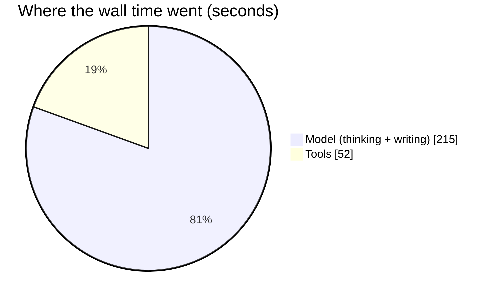

# intellectual-property/review-data-processing-agreement-template-against-eu-and-us-requirements · run3 (`hv-mixed200-lunahigh-r3-20261116T093818Z`)

Result: **fail** 46/47 criteria · 4.5 min · 31 model calls · 50 tool calls (3 errors or timeouts) · ending `completed` · started 11-16 17:33:31 IST

## Overview

One box per stretch of steps that used the same kind of tool (blue: looking/searching/reading, purple: writing or editing files, yellow: a message with no tool call, red border: a tool error or timeout inside the box).

```mermaid
flowchart TD
    T(["Task prompt"])
    P0["<b>Step 1</b> · 0.1 min<br/>create_goal"]
    T --> P0
    class P0 look
    P1["<b>Step 2</b> · 0.0 min<br/>todo_write"]
    P0 --> P1
    class P1 look
    P2["<b>Steps 3-5</b> · 0.6 min<br/>bash x10<br/><i>printf '%s\n' 'Workspace files:'; ls …, parse-doc docx documents/data-flow-di…, parse-doc docx documents/msa-summary-… +3</i>"]
    P1 --> P2
    class P2 look
    P3["<b>Step 6</b> · 0.0 min<br/>read<br/><i>stratosphere-negotiation-email-thread…</i>"]
    P2 --> P3
    class P3 look
    P4["<b>Step 7</b> · 0.2 min<br/>grep x4<br/><i>playbook.txt, vendor-dpa.txt, data-flow.txt +1</i>"]
    P3 --> P4
    class P4 look
    P5["<b>Steps 8-9</b> · 0.1 min<br/>read x5<br/><i>playbook.txt, vendor-dpa.txt, data-flow.txt</i>"]
    P4 --> P5
    class P5 look
    P6["<b>Step 10</b> · 0.3 min<br/>todo_write"]
    P5 --> P6
    class P6 look
    P7["<b>Steps 11-13</b> · 1.8 min<br/>bash x5<br/><i>python - #lt;#lt;'PY' import docx, sys prin…, cat #gt; build_memo.py #lt;#lt;'PY' from docx …, unzip -t output/compliance-gap-memora… +2</i>"]
    P6 --> P7
    class P7 look
    P8["<b>Steps 14-18</b> · 0.4 min<br/>edit x6<br/>read x2<br/><i>memo-parse.txt, build_memo.py</i>"]
    P7 --> P8
    class P8 err
    P9["<b>Steps 19-22</b> · 0.4 min<br/>bash x4<br/><i>python build_memo.py && parse-doc doc…, if command -v libreoffice #gt;/dev/null …, pdfinfo /tmp/memo-render/compliance-g… +1</i>"]
    P8 --> P9
    class P9 look
    P10["<b>Step 23</b> · 0.0 min<br/>read_image x2<br/><i>page-1.png, page-9.png</i>"]
    P9 --> P10
    class P10 err
    P11["<b>Step 24</b> · 0.1 min<br/>bash<br/><i>cp /tmp/memo-png/page-1.png memo-page…</i>"]
    P10 --> P11
    class P11 look
    P12["<b>Step 25</b> · 0.0 min<br/>read_image x2<br/><i>memo-page-1.png, memo-page-9.png</i>"]
    P11 --> P12
    class P12 look
    P13["<b>Step 26</b> · 0.1 min<br/>bash<br/><i>rm -f build_memo.py playbook.txt vend…</i>"]
    P12 --> P13
    class P13 look
    P14["<b>Step 27</b> · 0.1 min<br/>todo_write"]
    P13 --> P14
    class P14 look
    P15["<b>Step 28</b> · 0.0 min<br/>get_goal"]
    P14 --> P15
    class P15 look
    P16["<b>Step 29</b> · 0.0 min<br/>update_goal"]
    P15 --> P16
    class P16 look
    P17["<b>Step 30</b> · 0.1 min<br/>todo_write"]
    P16 --> P17
    class P17 look
    P18["<b>Step 31</b> · 0.1 min<br/>final message"]
    P17 --> P18
    class P18 ans
    R(["FAIL: 46/47 criteria"])
    P18 --> R
    class R fail
    classDef look fill:#e8f0fe,stroke:#4a6fa5,color:#111
    classDef write fill:#f3e8fd,stroke:#7b1fa2,color:#111
    classDef ans fill:#fff8e1,stroke:#b58900,color:#111
    classDef err fill:#e8f0fe,stroke:#c62828,stroke-width:3px,color:#111
    classDef pass fill:#e6f4ea,stroke:#2e7d32,color:#111
    classDef fail fill:#fce8e6,stroke:#c62828,color:#111
```





One row per model call:

| Step | Started (IST) | Model s | Tools s | Tool calls | Tools | Output chars |
|---|---|---|---|---|---|---|
| 1 | 17:33:31 | 4 | 0 | 1 | create_goal | 365 |
| 2 | 17:33:35 | 2 | 0 | 1 | todo_write | 57 |
| 3 | 17:33:36 | 2 | 1 | 1 | bash | 1,054 |
| 4 | 17:33:40 | 5 | 14 | 5 | bash x5 | 140,575 |
| 5 | 17:33:58 | 5 | 13 | 4 | bash x4 | 1,496 |
| 6 | 17:34:15 | 3 | 0 | 1 | read | 12,124 |
| 7 | 17:34:18 | 4 | 9 | 4 | grep x4 | 143,552 |
| 8 | 17:34:31 | 3 | 0 | 4 | read x4 | 124,802 |
| 9 | 17:34:35 | 4 | 0 | 1 | read | 15,865 |
| 10 | 17:34:39 | 16 | 0 | 1 | todo_write | 57 |
| 11 | 17:34:55 | 5 | 1 | 1 | bash | 18 |
| 12 | 17:35:01 | 92 | 1 | 1 | bash | 136 |
| 13 | 17:36:34 | 4 | 3 | 3 | bash x3 | 646 |
| 14 | 17:36:41 | 3 | 0 | 1 | read | 43,790 |
| 15 | 17:36:44 | 10 | 0 | 1 | edit ⚠ | 280 |
| 16 | 17:36:54 | 2 | 0 | 1 | read | 28,732 |
| 17 | 17:36:56 | 4 | 0 | 1 | edit | 245 |
| 18 | 17:37:00 | 5 | 0 | 4 | edit x4 | 980 |
| 19 | 17:37:05 | 3 | 3 | 1 | bash | 553 |
| 20 | 17:37:11 | 5 | 2 | 1 | bash | 951 |
| 21 | 17:37:18 | 4 | 1 | 1 | bash | 89 |
| 22 | 17:37:23 | 4 | 1 | 1 | bash | 155 |
| 23 | 17:37:28 | 3 | 0 | 2 | read_image x2 ⚠ | 132 |
| 24 | 17:37:30 | 3 | 2 | 1 | bash | 154 |
| 25 | 17:37:35 | 2 | 0 | 2 | read_image x2 | 624 |
| 26 | 17:37:38 | 4 | 1 | 1 | bash | 231 |
| 27 | 17:37:43 | 4 | 0 | 1 | todo_write | 57 |
| 28 | 17:37:47 | 2 | 0 | 1 | get_goal | 365 |
| 29 | 17:37:49 | 3 | 0 | 1 | update_goal | 370 |
| 30 | 17:37:52 | 3 | 0 | 1 | todo_write | 57 |
| 31 | 17:37:56 | 4 | 0 | 0 | (message only) | 0 |

## Task prompt

```text
Review the vendor DPA template against our playbook, commercial terms, data flow details, and negotiation emails; produce a gap memorandum with prioritized findings and redline recommendations. Output: `compliance-gap-memorandum.docx`.
```

## Rubric

| # | Criterion | Verdict |
|---|---|---|
| C-001 | Prioritized summary table at beginning of memo | pass |
| C-002 | ISSUE_001: Identifies missing HIPAA BAA integration | pass |
| C-003 | ISSUE_001: Notes missing HIPAA-specific definitions | pass |
| C-004 | ISSUE_001: Recommends integrating BAA or attaching as exhibit | pass |
| C-005 | ISSUE_001: References minimum necessary standard or workforce training | pass |
| C-006 | ISSUE_002: Identifies 48-hour vs. 24-hour breach notification discrepancy | pass |
| C-007 | ISSUE_002: Identifies missing HIPAA breach notification obligations | pass |
| C-008 | ISSUE_002: Recommends specific redline for breach notification timeline | pass |
| C-009 | ISSUE_003: Identifies liability cap gap (€500K vs. playbook minimum) | pass |
| C-010 | ISSUE_003: Quantifies liability gap with correct dollar figures | pass |
| C-011 | ISSUE_003: Identifies missing carve-outs for willful misconduct/gross negligence | pass |
| C-012 | ISSUE_003: Identifies blanket exclusion of consequential damages as problematic | pass |
| C-013 | ISSUE_003: References correct MSA fee structure | pass |
| C-014 | ISSUE_004: Identifies missing SCC Module 3 for processor-to-subprocessor transfers | pass |
| C-015 | ISSUE_004: Identifies Singapore remote access as an unaddressed transfer | pass |
| C-016 | ISSUE_004: Notes Larkfield not certified under EU-US Data Privacy Framework | pass |
| C-017 | ISSUE_004: Flags absence of Transfer Impact Assessment documentation | pass |
| C-018 | ISSUE_005: Identifies missing CCPA/CPRA Service Provider provisions | pass |
| C-019 | ISSUE_005: Specifies required CCPA/CPRA contractual terms | pass |
| C-020 | ISSUE_006: Identifies audit rights limited to Frankfurt only | pass |
| C-021 | ISSUE_006: Recommends extending audit rights to subprocessor locations | pass |
| C-022 | ISSUE_007: Identifies missing data return option at termination | pass |
| C-023 | ISSUE_007: Identifies HIPAA 6-year retention conflict with 90-day deletion | pass |
| C-024 | ISSUE_008: Identifies governing law mismatch for US data disputes | pass |
| C-025 | ISSUE_008: Recommends bifurcated governing law/dispute resolution | pass |
| C-026 | ISSUE_009: Recognizes Module 2 alone is insufficient for processor-to-subprocessor transfers | pass |
| C-027 | ISSUE_011: Identifies 2-year survival period as insufficient for HIPAA | pass |
| C-028 | ISSUE_012: Flags anonymization vs. pseudonymization regulatory risk | pass |
| C-029 | DISTRACTOR_003: Does not flag DIS arbitration for EU disputes as a gap | pass |
| C-030 | Each gap includes risk level classification | pass |
| C-031 | Each gap references the specific DPA section at issue | pass |
| C-032 | Each gap includes a specific recommended redline or amendment | pass |
| C-033 | Correctly identifies Pinnacle as HIPAA Covered Entity | pass |
| C-034 | Correctly identifies Stratosphere as Processor/Business Associate | pass |
| C-035 | References EU-US Data Privacy Framework in transfer analysis | pass |
| C-036 | Identifies EU-to-US (Larkfield/Northern Virginia) disaster recovery transfer scenario | pass |
| C-037 | Identifies Singapore remote access transfer scenario | pass |
| C-038 | Identifies Stratosphere processor-to-subprocessor transfer scenario | pass |
| C-039 | References 2.1 million US patients or 890,000 California residents | pass |
| C-040 | ISSUE_001 classified as Critical or High risk | pass |
| C-041 | ISSUE_003 classified as Critical or High risk | pass |
| C-042 | References negotiation context from email thread | pass |
| C-043 | Mentions subprocessor Larkfield Data Systems by name | pass |
| C-044 | Mentions subprocessor Orionis Analytics by name | **FAIL** |
| C-045 | ISSUE_006: Notes audit limited to once per year | pass |
| C-046 | ISSUE_004: Recommends specific transfer mechanisms for identified gaps | pass |
| C-047 | ISSUE_012: Recommends defining anonymization standard in DPA | pass |

Judge's reasoning:

**C-001 (pass):** Prioritized summary table at beginning of memo

```text
The memo includes a prioritized summary table in the Executive Summary near the beginning. It lists each identified issue with P0/P1/P2 risk levels, concise descriptions of why each matters, and required dispositions.
```

**C-002 (pass):** ISSUE_001: Identifies missing HIPAA BAA integration

```text
The memo expressly identifies the absence of a HIPAA BAA as a P0 blocking issue, notes that Stratosphere processes US patient PHI as a Business Associate, and recommends adding an integrated BAA with required HIPAA provisions and subcontractor flow-downs.
```

**C-003 (pass):** ISSUE_001: Notes missing HIPAA-specific definitions

```text
The memo expressly states in F-01 that the DPA “defines only GDPR terms” and has “no HIPAA definitions,” which directly identifies the missing HIPAA-specific definitions required by the criterion.
```

**C-004 (pass):** ISSUE_001: Recommends integrating BAA or attaching as exhibit

```text
The memo expressly recommends adding an integrated BAA or an executed BAA exhibit. Finding F-01 proposes a “new BAA exhibit / integration clause,” and the consolidated redline package directs adding a HIPAA BAA as an execution exhibit.
```

**C-005 (pass):** ISSUE_001: References minimum necessary standard or workforce training

```text
The memo expressly identifies both missing HIPAA obligations in F-01: the minimum-necessary standard and workforce training, and recommends adding them to the BAA.
```

**C-006 (pass):** ISSUE_002: Identifies 48-hour vs. 24-hour breach notification discrepancy

```text
The memo expressly flags that the DPA requires notice within 48 hours after confirmation, while Pinnacle's playbook requires notice within 24 hours of discovery of an actual or reasonably suspected breach. It also recommends replacing the 48-hour provision with the 24-hour standard.
```

**C-007 (pass):** ISSUE_002: Identifies missing HIPAA breach notification obligations

```text
The memo expressly identifies the absence of a HIPAA breach-notification cascade as a gap and recommends adding HIPAA-specific breach notice and cascade cooperation requirements, separate from the GDPR incident provisions.
```

**C-008 (pass):** ISSUE_002: Recommends specific redline for breach notification timeline

```text
The memo provides a specific redline replacing the existing 48-hour confirmed-breach standard with notice within 24 hours of discovery of any actual or reasonably suspected incident. It also recommends a four-hour telephonic notice, written notice within 24 hours, and HIPAA breach-notification/cascade provisions.
```

**C-009 (pass):** ISSUE_003: Identifies liability cap gap (€500K vs. playbook minimum)

```text
The memo expressly identifies the €500,000 aggregate liability cap as substantially below Pinnacle’s playbook minimum of 2x annual fees, calculating the applicable minimums as $8.4M combined, $5.6M for US services, and $2.8M for EU services.
```

**C-010 (pass):** ISSUE_003: Quantifies liability gap with correct dollar figures

```text
The memo expressly contrasts the €500,000 template cap (approximately $545,000) with the playbook minimums of $8.4M for the combined engagement and $2.8M for the EU-specific fees, satisfying the required dollar quantification.
```

**C-011 (pass):** ISSUE_003: Identifies missing carve-outs for willful misconduct/gross negligence

```text
The memo expressly states in F-05 that the DPA lacks required uncapped carve-outs for willful misconduct and gross negligence, and recommends revising the liability clause to make the cap inapplicable to both categories of conduct.
```

**C-012 (pass):** ISSUE_003: Identifies blanket exclusion of consequential damages as problematic

```text
The memo expressly flags Section 13.2’s broad consequential/indirect damages exclusion as problematic and recommends that no consequential-damages exclusion apply to data breaches involving willful misconduct, matching the playbook requirement.
```

**C-013 (pass):** ISSUE_003: References correct MSA fee structure

```text
The liability discussion expressly references the MSA annual fee structure: $4.2M total, comprising $2.8M for US services and $1.4M for EU services, and uses those figures to calculate the proposed 2x liability caps.
```

**C-014 (pass):** ISSUE_004: Identifies missing SCC Module 3 for processor-to-subprocessor transfers

```text
The memo expressly states that the DPA incorporates only SCC Module 2 and that Stratosphere’s processor-to-subprocessor transfer to Larkfield in Northern Virginia requires SCC Module 3. It also recommends executing Module 3 with Larkfield before any transfer.
```

**C-015 (pass):** ISSUE_004: Identifies Singapore remote access as an unaddressed transfer

```text
The memo expressly flags Singapore-based support engineers' regular remote access to EU personal data as a restricted third-country transfer that is not addressed by the DPA. It also recommends either eliminating/restricting that access or covering it with SCCs, a TIA, and supplementary safeguards.
```

**C-016 (pass):** ISSUE_004: Notes Larkfield not certified under EU-US Data Privacy Framework

```text
The memo expressly states that “Larkfield is not DPF-certified” in both the operating facts and the transfer-gap analysis, and accordingly recommends SCC Module 3 rather than relying on the EU-US Data Privacy Framework.
```

**C-017 (pass):** ISSUE_004: Flags absence of Transfer Impact Assessment documentation

```text
The memorandum expressly flags that the DPA does not require documented TIAs for the US or Singapore transfer flows, including periodic reassessment and supplementary measures, and recommends adding those requirements.
```

**C-018 (pass):** ISSUE_005: Identifies missing CCPA/CPRA Service Provider provisions

```text
The memo expressly identifies the absence of CCPA/CPRA Service Provider provisions despite processing personal information of approximately 890,000 California residents, including in the executive summary, priority table, and Finding F-02.
```

**C-019 (pass):** ISSUE_005: Specifies required CCPA/CPRA contractual terms

```text
The memo specifies all three listed CCPA/CPRA Service Provider provisions: a prohibition on sale or sharing, a restriction on combining personal information with data from other sources except as permitted, and certification by an authorized representative that the processor understands and will comply with the restrictions.
```

**C-020 (pass):** ISSUE_006: Identifies audit rights limited to Frankfurt only

```text
The memo expressly flags in F-09 that Section 11.3 limits audits to Frankfurt, excluding Dublin and Larkfield/Northern Virginia, and recommends extending audit rights to all processor and subprocessor locations.
```

**C-021 (pass):** ISSUE_006: Recommends extending audit rights to subprocessor locations

```text
The memo expressly recommends extending audits to all processor and subprocessor locations, including Larkfield/Northern Virginia, Dublin, and Singapore operations. It also requires each subprocessor to provide equivalent audit rights or current relevant reports at least annually, satisfying the criterion.
```

**C-022 (pass):** ISSUE_007: Identifies missing data return option at termination

```text
The memo expressly identifies in F-10 that Section 12 provides only deletion and lacks a structured data return option. It also recommends machine-readable return and at least 30 days of transition assistance, matching the playbook requirement.
```

**C-023 (pass):** ISSUE_007: Identifies HIPAA 6-year retention conflict with 90-day deletion

```text
The memo expressly identifies the conflict between DPA §12’s 90-day deletion requirement and HIPAA’s six-year documentation-retention requirement under 45 CFR § 164.530(j), particularly in Finding F-11, and recommends a retention and survival carve-out.
```

**C-024 (pass):** ISSUE_008: Identifies governing law mismatch for US data disputes

```text
The memo expressly flags that German law and Munich DIS arbitration apply to all DPA disputes, including PHI and CCPA/CPRA data, and contrasts this with the playbook requirement for Delaware law and US court jurisdiction, specifically the Western District of Texas, Austin Division, for US data disputes.
```

**C-025 (pass):** ISSUE_008: Recommends bifurcated governing law/dispute resolution

```text
The memo expressly recommends bifurcating governing law and dispute resolution: Delaware law and U.S. court jurisdiction for U.S. data disputes, while retaining Netherlands or German law and DIS arbitration for EU data disputes.
```

**C-026 (pass):** ISSUE_009: Recognizes Module 2 alone is insufficient for processor-to-subprocessor transfers

```text
The memo expressly distinguishes SCC Module 2 (Controller-to-Processor) from Module 3 (Processor-to-Subprocessor), identifies the Stratosphere-to-Larkfield transfer as a processor-to-subprocessor transfer, and recommends separately executing Module 3 under Commission Implementing Decision (EU) 2021/914 before that transfer occurs.
```

**C-027 (pass):** ISSUE_011: Identifies 2-year survival period as insufficient for HIPAA

```text
The memorandum expressly flags Section 16's two-year survival period as insufficient for HIPAA, cites the six-year retention requirement under 45 CFR § 164.530(j), and recommends that BAA protections survive for as long as PHI is retained and at least six years for required records.
```

**C-028 (pass):** ISSUE_012: Flags anonymization vs. pseudonymization regulatory risk

```text
The memo expressly flags that Orionis's purported anonymization may instead produce pseudonymized personal data, states that the DPA fails to distinguish or define anonymization versus pseudonymization, and recommends an objective anonymization test with outputs failing that test remaining subject to GDPR/DPA obligations. This captures the regulatory consequence that only truly anonymized data falls outside GDPR scope.
```

**C-029 (pass):** DISTRACTOR_003: Does not flag DIS arbitration for EU disputes as a gap

```text
The memo flags German law/Munich DIS only insofar as it improperly applies to US data disputes. It expressly permits retaining German law/DIS for EU data as a negotiated fallback and does not treat DIS arbitration for EU matters as a material compliance gap.
```

**C-030 (pass):** Each gap includes risk level classification

```text
All 16 identified findings are explicitly classified by priority in their headings (P0, P1, or P2), and the executive summary also maps these priorities to Blocking, High, or Material severity. This exceeds the 75% threshold.
```

**C-031 (pass):** Each gap references the specific DPA section at issue

```text
All 16 enumerated findings include a specific “Template location” identifying the relevant DPA section(s), annex, or provision—for example, §13 for liability, §§9.1–9.6 for breach notification, §14 for governing law/forum, and Annex A/B provisions for annex-related gaps. This substantially exceeds the 75% threshold.
```

**C-032 (pass):** Each gap includes a specific recommended redline or amendment

```text
All 16 identified findings include a specific recommended redline or amendment, typically with proposed contract language and a precise structural or operational change (such as adding a BAA/CCPA exhibit, SCC Module 3, a 24-hour notice deadline, expanded audit rights, or revised liability terms). This comfortably exceeds the 75% threshold.
```

**C-033 (pass):** Correctly identifies Pinnacle as HIPAA Covered Entity

```text
The memorandum expressly states in Section 2 that “Pinnacle Health Solutions, Inc. is HIPAA Covered Entity” and consistently treats Stratosphere as Pinnacle’s Business Associate.
```

**C-034 (pass):** Correctly identifies Stratosphere as Processor/Business Associate

```text
The memo expressly identifies Stratosphere as a GDPR Processor and HIPAA Business Associate in the roles table and consistently applies those roles throughout its findings.
```

**C-035 (pass):** References EU-US Data Privacy Framework in transfer analysis

```text
The memorandum discusses the Data Privacy Framework in its transfer analysis by stating that Larkfield is not DPF-certified, including in the EU-to-US disaster-recovery transfer finding and source crosswalk.
```

**C-036 (pass):** Identifies EU-to-US (Larkfield/Northern Virginia) disaster recovery transfer scenario

```text
The memorandum expressly identifies the Frankfurt/EU-to-Larkfield/Northern Virginia transfer of EU data for disaster recovery, including in the transfer facts, Finding F-03, the transfer matrix instructions, and the pre-sign checklist.
```

**C-037 (pass):** Identifies Singapore remote access transfer scenario

```text
The memorandum expressly identifies regular remote access by Singapore-based support engineers to EU personal data as a third-country transfer scenario, including it in the findings, transfer schedule recommendations, and pre-sign checklist.
```

**C-038 (pass):** Identifies Stratosphere processor-to-subprocessor transfer scenario

```text
The memo expressly identifies the Stratosphere-to-Larkfield transfer as a processor-to-subprocessor international transfer, explains that SCC Module 2 is insufficient, and recommends separate coverage under SCC Module 3. It also addresses Singapore subprocessor/access transfer coverage.
```

**C-039 (pass):** References 2.1 million US patients or 890,000 California residents

```text
The memo references both required figures in the relevant contexts: approximately 2.1 million US patient records/PHI for HIPAA analysis and approximately 890,000 California residents for CCPA/CPRA analysis.
```

**C-040 (pass):** ISSUE_001 classified as Critical or High risk

```text
The missing HIPAA BAA is explicitly classified as “P0 -- Blocking,” the memorandum’s highest-priority severity tier, and is described as a no-go item requiring resolution before execution or PHI processing. This is equivalent to Critical/High risk.
```

**C-041 (pass):** ISSUE_003 classified as Critical or High risk

```text
The liability cap gap is explicitly classified as “P0 -- Blocking” in the executive summary and as “P0 / F-05” in the detailed findings, which is an equivalent highest-tier severity exceeding Critical/High.
```

**C-042 (pass):** References negotiation context from email thread

```text
The memo expressly references the negotiation email thread, including Stratosphere’s position that the €500,000 liability cap is its “global standard / firm position,” Pinnacle’s threshold objection, and the scheduled April 30 call and redline timing.
```

**C-043 (pass):** Mentions subprocessor Larkfield Data Systems by name

```text
The memorandum repeatedly mentions Larkfield by name and identifies it as the relevant US subprocessor and BA subcontractor.
```

**C-044 (fail):** Mentions subprocessor Orionis Analytics by name

```text
The memo mentions “Orionis” repeatedly, but never identifies the subprocessor by its full name, “Orionis Analytics” or “Orionis Analytics Ltd.”
```

**C-045 (pass):** ISSUE_006: Notes audit limited to once per year

```text
The audit-rights analysis expressly proposes one planned audit annually on 30 days’ notice, while adding unlimited for-cause audits without notice. This addresses the annual audit frequency and its sufficiency by supplementing it with for-cause rights.
```

**C-046 (pass):** ISSUE_004: Recommends specific transfer mechanisms for identified gaps

```text
The memo recommends at least three specified mechanisms: executing SCC Module 3 for the Stratosphere-to-Larkfield processor-to-subprocessor transfer, implementing supplementary measures for Singapore remote access (including least privilege, MFA, logging, masking, and no local storage), and conducting documented TIAs for the US and Singapore transfers with reassessment triggers.
```

**C-047 (pass):** ISSUE_012: Recommends defining anonymization standard in DPA

```text
The memo expressly recommends adding an objective anonymization definition for Orionis, requiring validation against that standard, and treating any output that fails the standard—including pseudonymized output—as Personal Data subject to the DPA.
```

## Delivered files (output/)

- `compliance-gap-memorandum.docx` (52,339 bytes)

## Trajectory

### Step 1: 1 tool call

_Started 11-16 17:33:31 IST · model 4 s · tools 0 s_

**Reasoning summary:**

```text
**Planning document review**

I need to manipulate some documents and inspect files based on the user's request for a substantive review. It seems I should use my skills to check for any available catalog not currently shown. I'll make a list of the workspace with bash commands that are allowed, and it might make sense to create a long-term goal, which could involve multiple steps. First, I should start by inspecting the documents.
```

**Call `create_goal`** (0.0 s)

```json
{
 "objective": "Review the vendor DPA template against the playbook, commercial terms, data flow details, and negotiation emails, then produce the final compliance-gap memorandum as output/compliance-gap-memorandum.docx.",
 "max_goal_rounds": 3
}
```

Output (365 chars):

```text
{"goal":{"id":"goal-64d7cda9-229d-4e51-97d0-46970f03072a","revision":1,"objective":"Review the vendor DPA template against the playbook, commercial terms, data flow details, and negotiation emails, then produce the final compliance-gap memorandum as output/compliance-gap-memorandum.docx.","phase":"active","roundsStarted":0,"maxGoalRounds":3},"activation":"armed"}
```

### Step 2: 1 tool call

_Started 11-16 17:33:35 IST · model 2 s · tools 0 s_

**Call `todo_write`** (0.0 s)

```json
{
 "todos": [
  {
   "content": "Inventory and read all source materials",
   "status": "in_progress"
  },
  {
   "content": "Extract requirements and identify prioritized gaps",
   "status": "pending"
  },
  {
   "content": "Draft memorandum with redline recommendations",
   "status": "pending"
  },
  {
   "content": "Generate and validate DOCX deliverable",
   "status": "pending"
  },
  {
   "content": "Complete objective and report deliverable",
   "status": "pending"
  }
 ]
}
```

Output (57 chars):

```text
Updated todo list: 4 pending, 1 in progress, 0 completed.
```

**Todo list now:**

- [~] Inventory and read all source materials
- [ ] Extract requirements and identify prioritized gaps
- [ ] Draft memorandum with redline recommendations
- [ ] Generate and validate DOCX deliverable
- [ ] Complete objective and report deliverable

### Step 3: 1 tool call

_Started 11-16 17:33:36 IST · model 2 s · tools 1 s_

**Call `bash`** (0.7 s)

```json
{
 "command": "printf '%s\\n' 'Workspace files:'; ls -la; printf '%s\\n' 'Documents:'; ls -la documents; printf '%s\\n' 'Output:'; ls -la output",
 "description": "List workspace and document files"
}
```

Output (1,054 chars):

```text
Workspace files:
total 16
drwxr-xr-x 4 agarwaldi@microsoft.com users 4096 Nov 16 12:03 .
drwxr-xr-x 3 root                    root  4096 Nov 16 12:03 ..
dr-xr-xr-x 2 agarwaldi@microsoft.com users 4096 Nov  5 18:20 documents
drwxr-xr-x 2 agarwaldi@microsoft.com users 4096 Nov 16 12:03 output
Documents:
total 264
dr-xr-xr-x 2 agarwaldi@microsoft.com users  4096 Nov  5 18:20 .
drwxr-xr-x 4 agarwaldi@microsoft.com users  4096 Nov 16 12:03 ..
-r--r--r-- 4 agarwaldi@microsoft.com users 54272 Nov  5 18:20 data-flow-diagram.docx
-r--r--r-- 4 agarwaldi@microsoft.com users 47124 Nov  5 18:20 msa-summary-term-sheet.docx
-r--r--r-- 4 agarwaldi@microsoft.com users 75843 Nov  5 18:20 pinnacle-us-dpa-playbook.docx
-r--r--r-- 4 agarwaldi@microsoft.com users 63464 Nov  5 18:20 stratosphere-dpa-template-v3-2.docx
-r--r--r-- 4 agarwaldi@microsoft.com users 10806 Nov  5 18:20 stratosphere-negotiation-email-thread.eml
Output:
total 8
drwxr-xr-x 2 agarwaldi@microsoft.com users 4096 Nov 16 12:03 .
drwxr-xr-x 4 agarwaldi@microsoft.com users 4096 Nov 16 12:03 ..
```

### Step 4: 5 tool calls

_Started 11-16 17:33:40 IST · model 5 s · tools 14 s_

**Reasoning summary:**

```text
**Exploring document parsing**

I need to read the documentation using a parse-doc command via bash. I’m wondering if I could convert everything in parallel. It seems like using commands could work with the parse-doc outputs. I don’t think I need to use cat. I could parse to text files in my workspace, but the source is read-only, and the output directory is deliverable. Scratch workspace should be okay for that. Let's consider using bash for each in parallel, I think that could help!
```

**Call `bash`** (2.1 s)

```json
{
 "command": "parse-doc docx documents/data-flow-diagram.docx > /tmp/data-flow.txt && wc -l /tmp/data-flow.txt && sed -n '1,240p' /tmp/data-flow.txt",
 "description": "Parse data flow diagram"
}
```

Output (27,507 chars):

```text
341 /tmp/data-flow.txt
**[DATA FLOW DIAGRAM AND PROCESSING DESCRIPTION]{.underline}**

**[Pinnacle Health Solutions, Inc. --- Stratosphere Cloud Services GmbH]{.underline}**

**[Data Processing Relationship]{.underline}**

**CONFIDENTIAL --- ATTORNEY-CLIENT PRIVILEGED / WORK PRODUCT**

This document is protected by the attorney-client privilege and the work product doctrine. Unauthorized disclosure, copying, or distribution is strictly prohibited. This document does not constitute legal advice to any third party.

**Prepared by:** Office of the General Counsel, Pinnacle Health Solutions, Inc., 4200 Harborview Boulevard, Suite 1100, Austin, TX 78746

**Prepared for:** Internal use and for review by outside counsel Alderton Shaw & Whitmore LLP (Rachel Osterfeld, Partner), 900 K Street NW, Suite 700, Washington, DC 20001

**Date:** April 2025

**Reference Documents:**

> •Master Services Agreement dated March 15, 2024 (\"MSA\")
>
> •Stratosphere DPA Template Version 3.2 dated January 10, 2025 (received April 14, 2025) (\"DPA Template\" or \"DPA\")
>
> •Pinnacle US DPA Playbook (last updated February 28, 2025) (\"Playbook\")

**Purpose:** This document maps all personal data flows between Pinnacle (US and EU operations), Stratosphere Cloud Services GmbH, and Stratosphere\'s subprocessors. The purpose of this mapping is to support the legal review of the DPA Template ahead of the May 16, 2025 internal review deadline and the September 1, 2025 EU expansion launch date. The data flo
… [26,006 more chars]
```

**Call `bash`** (3.7 s)

```json
{
 "command": "parse-doc docx documents/msa-summary-term-sheet.docx > /tmp/msa-summary.txt && wc -l /tmp/msa-summary.txt && sed -n '1,300p' /tmp/msa-summary.txt",
 "description": "Parse commercial terms"
}
```

Output (22,340 chars):

```text
179 /tmp/msa-summary.txt
**[MASTER SERVICES AGREEMENT --- SUMMARY TERM SHEET]{.underline}**

**Summary of Key Commercial Terms**

MSA Effective Date: March 15, 2024

This Summary Term Sheet is for internal reference purposes only and does not amend or supersede the Master Services Agreement dated March 15, 2024 (the \"MSA\"), by and between Pinnacle Health Solutions, Inc. and Stratosphere Cloud Services GmbH. In the event of any conflict between the terms summarized herein and the terms of the executed MSA, the terms of the executed MSA shall control in all respects.

Prepared by the Office of General Counsel Pinnacle Health Solutions, Inc.

Last Updated: March 15, 2024

**[Section 1 --- Parties]{.underline}**

**Client:** Pinnacle Health Solutions, Inc., a Delaware corporation, with its principal offices located at 4200 Harborview Boulevard, Suite 1100, Austin, TX 78746 (\"Pinnacle\" or \"Client\").

**Service Provider:** Stratosphere Cloud Services GmbH, a German limited liability company (*Gesellschaft mit beschränkter Haftung*) registered at the Munich Local Court (*Amtsgericht München*) under Commercial Register (*Handelsregister*) number HRB 247891, with its registered office at Hohenzollernstraße 88, 80796 Munich, Germany (\"Stratosphere\" or \"Service Provider\").

**EU Entity Designation:** For purposes of EU Services (as defined in Section 3 below), the Client entity may be designated as Pinnacle Health Solutions EU B.V., a private limited liability company organize
… [20,839 more chars]
```

**Call `bash`** (2.5 s)

```json
{
 "command": "parse-doc docx documents/pinnacle-us-dpa-playbook.docx > /tmp/playbook.txt && wc -l /tmp/playbook.txt && sed -n '1,360p' /tmp/playbook.txt",
 "description": "Parse DPA playbook"
}
```

Output (40,300 chars):

```text
823 /tmp/playbook.txt
**[DATA PROCESSING AGREEMENT NEGOTIATION PLAYBOOK]{.underline}**

**[US AND CROSS-BORDER REQUIREMENTS]{.underline}**

**Internal Use Only --- Attorney-Client Privileged and Confidential Work Product**

Prepared by: **Office of the General Counsel** **Pinnacle Health Solutions, Inc.** 4200 Harborview Boulevard, Suite 1100 Austin, TX 78746

Approved by: **Margaret Yuen-Park**, General Counsel

**Version 4.0**

Last Updated: **February 28, 2025**

**Distribution List:**

  -------------------------------------------------------------------------------------
  **Recipient**                                     **Title**
  ------------------------------------------------- -----------------------------------
  Legal Department (all attorneys and paralegals)   ---

  Dr. Anand Krishnamurthy                           Chief Privacy Officer

  Jennifer Castellano                               VP of Information Security

  David Liang                                       VP of Procurement
  -------------------------------------------------------------------------------------

**External Counsel Reference:** This playbook was developed in consultation with **Alderton Shaw & Whitmore LLP**, 900 K Street NW, Suite 700, Washington, DC 20001. Lead Partner: **Rachel Osterfeld**. All questions regarding this playbook\'s application to specific vendor engagements may be directed to Ms. Osterfeld at rosterfeld@aldertonsw.com or (202) 555-0147.

**Classification:** Attorney-
… [38,799 more chars]
```

**Call `bash`** (2.2 s)

```json
{
 "command": "parse-doc docx documents/stratosphere-dpa-template-v3-2.docx > /tmp/vendor-dpa.txt && wc -l /tmp/vendor-dpa.txt && sed -n '1,360p' /tmp/vendor-dpa.txt",
 "description": "Parse vendor DPA template"
}
```

Output (49,980 chars):

```text
607 /tmp/vendor-dpa.txt
**[DATA PROCESSING AGREEMENT]{.underline}**

**Version 3.2**

**January 10, 2025**

**STRATOSPHERE CLOUD SERVICES GmbH**

*Cloud Infrastructure · Managed Databases · Analytics*

This Data Processing Agreement (\"DPA\") forms part of and is subject to the terms of the Master Services Agreement (\"Agreement\" or \"MSA\") between the Processor and the Controller.

This DPA is designed to ensure compliance with Regulation (EU) 2016/679 of the European Parliament and of the Council of 27 April 2016 (the \"GDPR\") and applicable data protection laws governing the Processing of Personal Data in connection with the Services provided under the Agreement.

**Processor Registered Office:**

Stratosphere Cloud Services GmbH Hohenzollernstraße 88 80796 Munich, Germany

Handelsregister HRB 247891, Amtsgericht München (Munich Local Court)

**Prepared by:**

Legal Department, Stratosphere Cloud Services GmbH

**Contact:**

Dr. Florian Neumann Chief Legal Officer Stratosphere Cloud Services GmbH

Email: florian.neumann@stratospherecloud.example.com

Tel: +49 89 2155 4400

Right-click to update Table of Contents

**[RECITALS]{.underline}**

**WHEREAS**, the Controller and the Processor have entered into a Master Services Agreement dated \\*\\*\\*\\*\\*\\*\\*\\*\\*\\*\\*\\*\\*\\*\\*\\* (the \"Agreement\") pursuant to which the Processor provides cloud hosting, managed database services, and analytics support to the Controller in connection with the Controller\'s business
… [48,480 more chars]
```

**Call `bash`** (3.1 s)

```json
{
 "command": "parse-doc eml documents/stratosphere-negotiation-email-thread.eml > /tmp/emails.txt && wc -l /tmp/emails.txt && sed -n '1,360p' /tmp/emails.txt",
 "description": "Parse negotiation emails"
}
```

Output (448 chars):

```text
[stderr]
2026-11-16 12:03:57.944676276 [W:onnxruntime:Default, device_discovery.cc:95 GetPciBusId] Skipping pci_bus_id for PCI path at "/sys/devices/LNXSYSTM:00/LNXSYBUS:00/ACPI0004:00/VMBUS:00/5620e0c7-8062-4dce-aeb7-520c7ef76171" because filename "5620e0c7-8062-4dce-aeb7-520c7ef76171" did not match expected pattern of [0-9a-f]+:[0-9a-f]+:[0-9a-f]+[.][0-9a-f]+
usage: /usr/local/bin/parse-doc {docx|pdf|pptx|xlsx} <path>
[exit code: 2]
```

### Step 5: 4 tool calls

_Started 11-16 17:33:58 IST · model 5 s · tools 13 s_

**Call `bash`** (2.1 s)

```json
{
 "command": "parse-doc docx documents/pinnacle-us-dpa-playbook.docx > playbook.txt",
 "description": "Save parsed playbook text"
}
```

Output (374 chars):

```text
[stderr]
2026-11-16 12:04:04.425582738 [W:onnxruntime:Default, device_discovery.cc:95 GetPciBusId] Skipping pci_bus_id for PCI path at "/sys/devices/LNXSYSTM:00/LNXSYBUS:00/ACPI0004:00/VMBUS:00/5620e0c7-8062-4dce-aeb7-520c7ef76171" because filename "5620e0c7-8062-4dce-aeb7-520c7ef76171" did not match expected pattern of [0-9a-f]+:[0-9a-f]+:[0-9a-f]+[.][0-9a-f]+
```

**Call `bash`** (4.0 s)

```json
{
 "command": "parse-doc docx documents/stratosphere-dpa-template-v3-2.docx > vendor-dpa.txt",
 "description": "Save parsed vendor DPA text"
}
```

Output (374 chars):

```text
[stderr]
2026-11-16 12:04:06.479938388 [W:onnxruntime:Default, device_discovery.cc:95 GetPciBusId] Skipping pci_bus_id for PCI path at "/sys/devices/LNXSYSTM:00/LNXSYBUS:00/ACPI0004:00/VMBUS:00/5620e0c7-8062-4dce-aeb7-520c7ef76171" because filename "5620e0c7-8062-4dce-aeb7-520c7ef76171" did not match expected pattern of [0-9a-f]+:[0-9a-f]+:[0-9a-f]+[.][0-9a-f]+
```

**Call `bash`** (3.0 s)

```json
{
 "command": "parse-doc docx documents/data-flow-diagram.docx > data-flow.txt",
 "description": "Save parsed data flow text"
}
```

Output (374 chars):

```text
[stderr]
2026-11-16 12:04:11.397508286 [W:onnxruntime:Default, device_discovery.cc:95 GetPciBusId] Skipping pci_bus_id for PCI path at "/sys/devices/LNXSYSTM:00/LNXSYBUS:00/ACPI0004:00/VMBUS:00/5620e0c7-8062-4dce-aeb7-520c7ef76171" because filename "5620e0c7-8062-4dce-aeb7-520c7ef76171" did not match expected pattern of [0-9a-f]+:[0-9a-f]+:[0-9a-f]+[.][0-9a-f]+
```

**Call `bash`** (3.5 s)

```json
{
 "command": "parse-doc docx documents/msa-summary-term-sheet.docx > msa-summary.txt",
 "description": "Save parsed MSA text"
}
```

Output (374 chars):

```text
[stderr]
2026-11-16 12:04:15.100998188 [W:onnxruntime:Default, device_discovery.cc:95 GetPciBusId] Skipping pci_bus_id for PCI path at "/sys/devices/LNXSYSTM:00/LNXSYBUS:00/ACPI0004:00/VMBUS:00/5620e0c7-8062-4dce-aeb7-520c7ef76171" because filename "5620e0c7-8062-4dce-aeb7-520c7ef76171" did not match expected pattern of [0-9a-f]+:[0-9a-f]+:[0-9a-f]+[.][0-9a-f]+
```

### Step 6: 1 tool call

_Started 11-16 17:34:15 IST · model 3 s · tools 0 s_

**Call `read`** (0.0 s)

```json
{
 "file_path": "documents/stratosphere-negotiation-email-thread.eml",
 "offset": 1,
 "limit": 1000
}
```

Output (12,124 chars):

```text
<path>/home/agarwaldi/dsh-bench-harness/runs/hv-mixed200-lunahigh-r3-20261116T093818Z/tasks/intellectual-property__review-data-processing-agreement-template-against-eu-and-us-requirements/workspace/documents/stratosphere-negotiation-email-thread.eml</path>
<type>file</type>
<content>
1: From: Margaret Yuen-Park <myuenpark@pinnaclehealth.example.com>
2: To: Dr. Florian Neumann <f.neumann@stratospherecloud.example.com>
3: Cc: Rachel Osterfeld <rosterfeld@alderton-shaw.example.com>
4: Date: Fri, 18 Apr 2025 11:02:00 -0000
5: Subject: Re: Re: Re: Stratosphere DPA Template v3.2 — For Your Review
6: Content-Type: text/plain; charset="utf-8"
7: Content-Transfer-Encoding: quoted-printable
8: MIME-Version: 1.0
9: 
10: Florian,
11: 
12: Thank you for your response and for looping in Dr. Beckert.
13: 
14: We can confirm the call for Wednesday, April 30, 2025, at 4:00 PM CEST / 9:00=
15:  AM CDT. Rachel Osterfeld from Alderton Shaw & Whitmore will attend on our si=
16: de.
17: 
18: On the liability cap =E2=80=94 I appreciate your willingness to take this up =
19: internally. I want to set expectations that our redline of Section 13 will pr=
20: opose a structure tied to the annual fees under the MSA rather than a flat ca=
21: p, together with the carve-outs for willful misconduct and gross negligence I=
22:  referenced previously. I want to be transparent that this is a threshold iss=
23: ue for us, and we will need to reach agreement on liability allocation before=
24:  we can finalize 
… [10,624 more chars]
```

### Step 7: 4 tool calls

_Started 11-16 17:34:18 IST · model 4 s · tools 9 s_

**Reasoning summary:**

```text
**Reading playbook sections**

I need to read the entire playbook, especially focusing on the relevant vendor-specific sections between pages 6 and 13, as well as the annexes. I'll consider using the grep search in my workspace to find specific patterns in the playbook.txt file efficiently. It's important to ensure I'm getting all necessary details, so that my understanding is complete. Let’s dive into this!
```

**Call `grep`** (4.6 s)

```json
{
 "pattern": "^\\*\\*\\[Section|^\\*\\*\\[[0-9]|Must-have|Fallback|Nice-to-have|DPO|audit|deletion|subprocessor|transfer|TIA|Singapore|CCPA|BAA|liability|governing",
 "path": "playbook.txt"
}
```

Output (49,926 chars):

```text
Found 227 matches

playbook.txt
Line 1: **[DATA PROCESSING AGREEMENT NEGOTIATION PLAYBOOK]{.underline}**
Line 35: **[Section 1: Purpose and Scope of This Playbook]{.underline}**
Line 43: Pinnacle processes personal information of approximately **890,000 California residents**, triggering obligations under the California Consumer Privacy Act as amended by the California Privacy Rights Act (\"**CCPA/CPRA**\"). Given the significant volume of California resident data processed by Pinnacle and its vendors, CCPA/CPRA compliance is a primary concern in all vendor DPA negotiations involving consumer-facing data.
Line 49: > • **HIPAA/HITECH**, including Business Associate Agreement (\"BAA\") requirements;
Line 51: > • **CCPA/CPRA**, including Service Provider qualification and certification requirements;
Line 53: > • **GDPR**, including Article 28 processor requirements and cross-border data transfer mechanisms; and
Line 57: **Important Note:** This playbook does NOT replace the requirement for outside counsel review of DPAs involving novel or high-risk processing activities. Negotiators must escalate to **Rachel Osterfeld** at Alderton Shaw & Whitmore LLP for matters involving cross-border transfers to jurisdictions without adequacy decisions, novel HIPAA scenarios (including first-of-kind technology deployments involving PHI), regulatory enforcement actions or investigations, or any matter where the vendor\'s proposed terms deviate materially from the positions set forth herein and
… [48,426 more chars]
```

**Call `grep`** (2.5 s)

```json
{
 "pattern": "^\\*\\*\\[SECTION|^\\*\\*[0-9]+\\.|Annex|Module|Singapore|Larkfield|Orionis|48|72|500,000|€500,000|liability|DPO|subprocessor|transfer|audit|delet",
 "path": "vendor-dpa.txt"
}
```

Output (49,984 chars):

```text
Found 129 matches

vendor-dpa.txt
Line 39: **WHEREAS**, in the course of providing the Services under the Agreement, the Processor will Process Personal Data on behalf of the Controller, and such Processing may involve the collection, storage, retrieval, use, disclosure by transmission, combination, restriction, erasure, and destruction of Personal Data as further described in Annex A to this DPA;
Line 45: **WHEREAS**, the Parties agree that this DPA, together with the Annexes attached hereto, constitutes the binding agreement between them with respect to the Processing of Personal Data under the Agreement and shall supplement and form an integral part of the Agreement;
Line 49: **[SECTION 1 --- DEFINITIONS]{.underline}**
Line 51: **1.1** \"**Applicable Data Protection Law**\" means Regulation (EU) 2016/679 (the GDPR) and any applicable legislation of the European Union or its Member States implementing, supplementing, or replacing the GDPR, including without limitation the German Federal Data Protection Act (*Bundesdatenschutzgesetz*, \"BDSG\") as amended from time to time, and any other data protection legislation directly applicable within the European Economic Area.
Line 53: **1.2** \"**Controller**\" means the natural or legal person, public authority, agency, or other body which, alone or jointly with others, determines the purposes and means of the Processing of Personal Data, as defined in Article 4(7) of the GDPR, and as identified in the signature block of this DPA.
… [48,484 more chars]
```

**Call `grep`** (0.9 s)

```json
{
 "pattern": "^\\*\\*\\[Section|^\\*\\*\\[[0-9]|FLAG|Singapore|Module|Larkfield|Orionis|pseudonym|anonym|T(I|i)A|encryption|Article 9|CCPA|HIPAA|BAA",
 "path": "data-flow.txt"
}
```

Output (30,936 chars):

```text
Found 89 matches

data-flow.txt
Line 7: **CONFIDENTIAL --- ATTORNEY-CLIENT PRIVILEGED / WORK PRODUCT**
Line 29: **[Section 1: Overview of Parties and Processing Relationship]{.underline}**
Line 33: **[1.1 Controllers]{.underline}**
Line 35: **Pinnacle Health Solutions, Inc.** is a Delaware corporation headquartered at 4200 Harborview Boulevard, Suite 1100, Austin, TX 78746. Pinnacle acts as a Controller under the General Data Protection Regulation (Regulation (EU) 2016/679) (\"GDPR\") for EU data subjects and as a HIPAA Covered Entity under 45 CFR Parts 160 and 164 for US Protected Health Information (\"PHI\"). Pinnacle has an annual revenue of approximately \$385 million and employs approximately 2,800 individuals.
Line 39: For US data flows, Pinnacle Health Solutions, Inc. acts as the HIPAA Covered Entity and, where applicable, as a Controller. For EU data flows, Pinnacle Health Solutions EU B.V. is the data exporter and Controller. The distinction between these two entities and their respective roles is critical for determining the appropriate transfer mechanisms, the applicable SCC module, and the regulatory obligations attaching to each data flow.
Line 41: **[1.2 Processor]{.underline}**
Line 43: **Stratosphere Cloud Services GmbH** is a German limited liability company (Gesellschaft mit beschränkter Haftung) registered at Hohenzollernstraße 88, 80796 Munich, Germany (Handelsregister HRB 247891, Amtsgericht München). Stratosphere acts as Processor under the GDPR and as B
… [29,436 more chars]
```

**Call `grep`** (0.8 s)

```json
{
 "pattern": "DPA|liability|cap|BAA|subprocessor|Singapore|EU|CCPA|HIPAA|DPO|termination|audit|deletion|governing",
 "path": "msa-summary.txt"
}
```

Output (12,706 chars):

```text
Found 29 matches

msa-summary.txt
Line 17: **Service Provider:** Stratosphere Cloud Services GmbH, a German limited liability company (*Gesellschaft mit beschränkter Haftung*) registered at the Munich Local Court (*Amtsgericht München*) under Commercial Register (*Handelsregister*) number HRB 247891, with its registered office at Hohenzollernstraße 88, 80796 Munich, Germany (\"Stratosphere\" or \"Service Provider\").
Line 19: **EU Entity Designation:** For purposes of EU Services (as defined in Section 3 below), the Client entity may be designated as Pinnacle Health Solutions EU B.V., a private limited liability company organized under the laws of the Netherlands, registered at Herengracht 450, 1017 CA Amsterdam, Netherlands (\"Pinnacle EU\"), as specified in the applicable Statements of Work executed under the MSA. Where a Statement of Work designates Pinnacle EU as the contracting Client entity, all references to \"Client\" in such Statement of Work shall be deemed to refer to Pinnacle EU.
Line 33: **EU Expansion Note:** Pinnacle\'s EU Services under the MSA are expected to commence on or about September 1, 2025 (the \"EU Go-Live Date\"), subject to the completion of all regulatory and contractual prerequisites, including without limitation the execution of a fully conforming Data Processing Agreement between the parties (see Section 9 below for current status and additional detail regarding the DPA).
Line 39: **EU Services:** Cloud hosting, managed database services, and a
… [11,206 more chars]
```

### Step 8: 4 tool calls

_Started 11-16 17:34:31 IST · model 3 s · tools 0 s_

**Reasoning summary:**

```text
**Retrieving playbook lines**

I need to retrieve the playbook lines starting from 325, focusing on indemnity, governing, and audit topics. Additionally, I should look into vendor lines starting from 153 onward to ensure I’m including all relevant information. Those sections seem crucial to what I'm working on, and I’ll use the reading tool to access them. It's essential to be thorough here and not miss any details! Let's get this done!
```

**Call `read`** (0.0 s)

```json
{
 "file_path": "playbook.txt",
 "offset": 325,
 "limit": 390
}
```

Output (51,393 chars):

```text
<path>/home/agarwaldi/dsh-bench-harness/runs/hv-mixed200-lunahigh-r3-20261116T093818Z/tasks/intellectual-property__review-data-processing-agreement-template-against-eu-and-us-requirements/workspace/playbook.txt</path>
<type>file</type>
<content>
325: **[Section 6: Liability and Indemnification]{.underline}**
326: 
327: Liability provisions are among the most heavily negotiated terms in any DPA. The allocation of financial risk between Pinnacle and its vendors must reflect the magnitude of the data at stake, the severity of potential regulatory penalties, and the operational and reputational harm that a data breach or compliance failure could cause. This Section establishes Pinnacle\'s required liability framework, including liability caps, carve-outs, and indemnification obligations.
328: 
329: Pinnacle\'s position on liability is informed by the following considerations: (i) a breach of PHI affecting Pinnacle\'s approximately 2.1 million US patients could result in HIPAA penalties of up to \$2,067,813 per violation category per calendar year, plus class action litigation exposure; (ii) a CCPA/CPRA violation could result in statutory damages of \$100 to \$750 per consumer per incident, which at 890,000 California residents represents potential exposure of \$89 million to \$667.5 million; and (iii) GDPR penalties can reach up to €20 million or 4% of annual worldwide turnover, whichever is higher. Against this backdrop, vendor liability caps that are a fraction of annual fees a
… [49,893 more chars]
```

**Call `read`** (0.0 s)

```json
{
 "file_path": "vendor-dpa.txt",
 "offset": 153,
 "limit": 170
}
```

Output (30,627 chars):

```text
<path>/home/agarwaldi/dsh-bench-harness/runs/hv-mixed200-lunahigh-r3-20261116T093818Z/tasks/intellectual-property__review-data-processing-agreement-template-against-eu-and-us-requirements/workspace/vendor-dpa.txt</path>
<type>file</type>
<content>
153: **[SECTION 7 --- INTERNATIONAL DATA TRANSFERS]{.underline}**
154: 
155: **7.1** The Processor shall not transfer Personal Data to any country or territory outside the European Economic Area (\"EEA\") or to any international organization, and shall not permit any Subprocessor to make any such transfer, unless one of the following conditions is satisfied:
156: 
157: > \(a\) The European Commission has issued an adequacy decision for the recipient country, territory, or international organization, or a specified sector within such country, pursuant to Article 45 of the GDPR, and such adequacy decision remains in force and has not been invalidated by the Court of Justice of the European Union or otherwise;
158: >
159: > \(b\) Appropriate safeguards have been provided in accordance with Article 46 of the GDPR, including but not limited to the execution of Standard Contractual Clauses approved by the European Commission, the adoption of binding corporate rules approved by a competent Supervisory Authority, or the use of an approved certification mechanism together with binding and enforceable commitments of the data importer; or
160: >
161: > \(c\) A derogation for specific situations under Article 49 of the GDPR applies, provided th
… [29,127 more chars]
```

**Call `read`** (0.0 s)

```json
{
 "file_path": "vendor-dpa.txt",
 "offset": 360,
 "limit": 250
}
```

Output (23,838 chars):

```text
<path>/home/agarwaldi/dsh-bench-harness/runs/hv-mixed200-lunahigh-r3-20261116T093818Z/tasks/intellectual-property__review-data-processing-agreement-template-against-eu-and-us-requirements/workspace/vendor-dpa.txt</path>
<type>file</type>
<content>
360: 
361: **[ANNEX A --- DESCRIPTION OF PROCESSING]{.underline}**
362: 
363: This Annex A forms an integral part of the Data Processing Agreement (\"DPA\") and describes the Processing of Personal Data carried out by the Processor on behalf of the Controller in connection with the Services provided under the Agreement.
364: 
365: **A.1 Controller(s).**
366: 
367:   ---------------------------------------------------------------------------------------------------------------------------------------------------------------------
368:   **Field**                                     **Details**
369:   --------------------------------------------- -----------------------------------------------------------------------------------------------------------------------
370:   **Name**                                      \[To be completed by the Controller\]
371: 
372:   **Address**                                   \[To be completed by the Controller\]
373: 
374:   **Contact Person**                            \[To be completed by the Controller --- name, position, email, telephone\]
375: 
376:   **Activities Relevant to Data Transferred**   \[To be completed by the Controller --- description of the Controller\'s activities in connection 
… [22,338 more chars]
```

**Call `read`** (0.1 s)

```json
{
 "file_path": "data-flow.txt",
 "offset": 229,
 "limit": 110
}
```

Output (18,944 chars):

```text
<path>/home/agarwaldi/dsh-bench-harness/runs/hv-mixed200-lunahigh-r3-20261116T093818Z/tasks/intellectual-property__review-data-processing-agreement-template-against-eu-and-us-requirements/workspace/data-flow.txt</path>
<type>file</type>
<content>
229: **[3.5 Diagram 5 --- EU Data to Orionis Analytics (Anonymization and Analytics)]{.underline}**
230: 
231: **Flow Description:**
232: 
233: This data flow involves the transfer of EU personal data from Stratosphere to Orionis Analytics Ltd. for anonymization and analytics processing. Both parties operate within the EEA.
234: 
235: **Source:** **Stratosphere Cloud Services GmbH** --- Frankfurt Data Center (Germany) and/or Dublin Data Center (Ireland), acting as Processor.
236: 
237: **Transmission:** EU personal data is transferred to Orionis for anonymization and analytics processing. The DPA Template does not specify the encryption protocol or method for this specific intra-EEA transfer; counsel should confirm that appropriate technical measures are in place.
238: 
239: **Destination:** **Orionis Analytics Ltd.** --- Dublin, Ireland, acting as Subprocessor.
240: 
241: **Purpose:** Anonymization and analytics services as described in the DPA Template.
242: 
243: **Nature of Transfer:** This is an intra-EEA transfer from Germany/Ireland to Ireland. Both the data exporter (Stratosphere, Frankfurt/Dublin) and the data importer (Orionis, Dublin) are located within the European Economic Area. No GDPR Chapter V international transfer m
… [17,444 more chars]
```

### Step 9: 1 tool call

_Started 11-16 17:34:35 IST · model 4 s · tools 0 s_

**Call `read`** (0.0 s)

```json
{
 "file_path": "playbook.txt",
 "offset": 739,
 "limit": 84
}
```

Output (15,865 chars):

```text
<path>/home/agarwaldi/dsh-bench-harness/runs/hv-mixed200-lunahigh-r3-20261116T093818Z/tasks/intellectual-property__review-data-processing-agreement-template-against-eu-and-us-requirements/workspace/playbook.txt</path>
<type>file</type>
<content>
739: **[16.3 Current High-Risk Engagement]{.underline}**
740: 
741: For reference, the current **Stratosphere Cloud Services GmbH** engagement --- with annual fees of **\$4.2 million**, PHI of approximately **2.1 million US patients**, and cross-border EU expansion implications --- falls into the **High-Risk** category under this matrix. All DPA negotiations with Stratosphere must be reviewed by Margaret Yuen-Park with input from Rachel Osterfeld at Alderton Shaw & Whitmore LLP.
742: 
743: **[Appendix A: Quick-Reference Comparison Table]{.underline}**
744: 
745: The following table summarizes Pinnacle\'s key DPA positions across must-have, nice-to-have, and fallback categories for all clause categories covered in this playbook.
746: 
747:   -----------------------------------------------------------------------------------------------------------------------------------------------------------------------------------------------------------------------------------------------------------------------------------------------------------------------------------------------------------------------------------------------------------------------------------------------------------------------------------------------------------------------
… [14,365 more chars]
```

### Step 10: 1 tool call

_Started 11-16 17:34:39 IST · model 16 s · tools 0 s_

**Reasoning summary:**

```text
**Formulating a memo**

I need to create a robust memo as the user requested a document in docx format. It looks like I might need to use python-docx for this since that’s likely installed. I want to make sure I’m clear on the document's requirements, which should include sections like an executive summary, risk ratings, and detailed findings with recommendations. I must avoid inventing any information and ensure everything is accurate and based on actual sources.

**Identifying memo issues**

I need to clarify some important details based on the scope and annex provisions. The scope mentions all services, while the annex focuses on personal data, only requiring subcontractors if PHI is involved. There are missing terms regarding CCPA/CPRA, such as definitions and requirements for certification and notification. Also, the international transfer clauses need attention, especially regarding the EU processor. Additionally, breach notification timelines and liability caps require thorough recalculations. I need to prioritize these findings properly to ensure clarity.

**Assessing DPA coverage**

I see that section 13.4 of the DPA is GDPR-specific and might create some limited exceptions. However, it doesn't cover issues like willful misconduct or gross negligence regarding fines and penalties, so I need to add an indemnity clause. Additionally, the governing law and dispute resolution are stated to be based in Germany with DIS in Munich, but I must ensure that the DPA applies to US data as well. I’ll need to clarify and expand on these points in the memo.
```

**Call `todo_write`** (0.0 s)

```json
{
 "todos": [
  {
   "content": "Inventory and read all source materials",
   "status": "completed"
  },
  {
   "content": "Extract requirements and identify prioritized gaps",
   "status": "completed"
  },
  {
   "content": "Draft memorandum with redline recommendations",
   "status": "in_progress"
  },
  {
   "content": "Generate and validate DOCX deliverable",
   "status": "pending"
  },
  {
   "content": "Complete objective and report deliverable",
   "status": "pending"
  }
 ]
}
```

Output (57 chars):

```text
Updated todo list: 2 pending, 1 in progress, 2 completed.
```

**Todo list now:**

- [x] Inventory and read all source materials
- [x] Extract requirements and identify prioritized gaps
- [~] Draft memorandum with redline recommendations
- [ ] Generate and validate DOCX deliverable
- [ ] Complete objective and report deliverable

### Step 11: 1 tool call

_Started 11-16 17:34:55 IST · model 5 s · tools 1 s_

**Call `bash`** (1.0 s)

```json
{
 "command": "python - <<'PY'\nimport docx, sys\nprint('python-docx', docx.__version__)\nPY",
 "description": "Check DOCX generation library"
}
```

Output (18 chars):

```text
python-docx 1.2.0
```

### Step 12: 1 tool call

_Started 11-16 17:35:01 IST · model 92 s · tools 1 s_

**Reasoning summary:**

```text
**Drafting script details**

I’m getting ready to create the script, and it looks like I need to set the page footer fields. I might need to use a custom helper for that, but I need to make sure to keep the output intact. Let's get started on drafting the script now! I wonder if I’ll need to consider any specific formatting or additional fields as I go along. This could be a fun process!
```

**Call `bash`** (1.0 s)

```json
{
 "command": "cat > build_memo.py <<'PY'\nfrom docx import Document\nfrom docx.shared import Inches, Pt, RGBColor\nfrom docx.enum.text import WD_ALIGN_PARAGRAPH, WD_BREAK\nfrom docx.enum.section import WD_SECTION\nfrom docx.enum.table import WD_TABLE_ALIGNMENT, WD_CELL_VERTICAL_ALIGNMENT\nfrom docx.oxml import OxmlElement\nfrom docx.oxml.ns import qn\nfrom docx.enum.style import WD_STYLE_TYPE\nfrom docx.enum.text import WD_LINE_SPACING\nfrom docx.enum.section import WD_ORIENT\nfrom docx.enum.table import WD_ROW_HEIGHT_RULE\n\nOUT = 'output/compliance-gap-memorandum.docx'\n\ndoc = Document()\nsec = doc.sections[0]\nsec.top_margin = Inches(0.65)\nsec.bottom_margin = Inches(0.65)\nsec.left_margin = Inches(0.7)\nsec.right_margin = Inches(0.7)\n\n# Colors\nNAVY = '17365D'\nBLUE = 'D9EAF7'\nLIGHT_BLUE = 'EEF5FB'\nRED = 'FCE4D6'\nAMBER = 'FFF2CC'\nGREEN = 'E2F0D9'\nGRAY = 'F2F2F2'\nDARK_GRAY = '666666'\nWHITE = 'FFFFFF'\n\n# Base styles\nstyles = doc.styles\nstyles['Normal'].font.name = 'Aptos'\nstyles['Normal']._element.rPr.rFonts.set(qn('w:eastAsia'), 'Aptos')\nstyles['Normal'].font.size = Pt(9.2)\nstyles['Normal'].paragraph_format.space_after = Pt(4)\nstyles['Normal'].paragraph_format
… [41,420 more chars]
```

Output (136 chars):

```text
output/compliance-gap-memorandum.docx
-rw-r--r-- 1 agarwaldi@microsoft.com users 52K Nov 16 12:06 output/compliance-gap-memorandum.docx
```

### Step 13: 3 tool calls

_Started 11-16 17:36:34 IST · model 4 s · tools 3 s_

**Reasoning summary:**

```text
**Validating DOCX output**

I need to validate and parse a DOCX file, inspecting the output carefully. I plan to use the parse-doc output in a workspace scratch area for better clarity. Checking pages through LibreOffice might also help confirm things. I’m thinking of running a DOCX integrity check, possibly by unzipping the file and using the `-t` option. This might give me a more thorough understanding of any issues. Let's go through this step by step!
```

**Call `bash`** (0.6 s)

```json
{
 "command": "unzip -t output/compliance-gap-memorandum.docx | tail -n 3",
 "description": "Validate DOCX archive integrity"
}
```

Output (163 chars):

```text
testing: word/footer1.xml         OK
    testing: docProps/thumbnail.jpeg   OK
No errors detected in compressed data of output/compliance-gap-memorandum.docx.
```

**Call `bash`** (2.1 s)

```json
{
 "command": "parse-doc docx output/compliance-gap-memorandum.docx > memo-parse.txt && wc -l memo-parse.txt",
 "description": "Parse generated memorandum"
}
```

Output (393 chars):

```text
334 memo-parse.txt
[stderr]
2026-11-16 12:06:39.658670135 [W:onnxruntime:Default, device_discovery.cc:95 GetPciBusId] Skipping pci_bus_id for PCI path at "/sys/devices/LNXSYSTM:00/LNXSYBUS:00/ACPI0004:00/VMBUS:00/5620e0c7-8062-4dce-aeb7-520c7ef76171" because filename "5620e0c7-8062-4dce-aeb7-520c7ef76171" did not match expected pattern of [0-9a-f]+:[0-9a-f]+:[0-9a-f]+[.][0-9a-f]+
```

**Call `bash`** (0.8 s)

```json
{
 "command": "python - <<'PY'\nfrom docx import Document\np='output/compliance-gap-memorandum.docx'\nd=Document(p)\nprint('paragraphs', len(d.paragraphs), 'tables', len(d.tables), 'sections', len(d.sections))\nprint('headings', sum(1 for x in d.paragraphs if x.style.name.startswith('Heading')))\nprint('contains F-01', any('F-01' in x.text for x in d.paragraphs))\nprint('contains checklist', any('Pre-Sign / Go-Live Checklist' in x.text for x in d.paragraphs))\nPY",
 "description": "Inspect generated DOCX structure"
}
```

Output (90 chars):

```text
paragraphs 132 tables 8 sections 1
headings 23
contains F-01 True
contains checklist True
```

### Step 14: 1 tool call

_Started 11-16 17:36:41 IST · model 3 s · tools 0 s_

**Call `read`** (0.0 s)

```json
{
 "file_path": "memo-parse.txt",
 "offset": 1,
 "limit": 380
}
```

Output (43,790 chars):

```text
<path>/home/agarwaldi/dsh-bench-harness/runs/hv-mixed200-lunahigh-r3-20261116T093818Z/tasks/intellectual-property__review-data-processing-agreement-template-against-eu-and-us-requirements/workspace/memo-parse.txt</path>
<type>file</type>
<content>
1: **COMPLIANCE-GAP\
2: MEMORANDUM**
3: 
4: **Stratosphere Cloud Services GmbH -- DPA Template v3.2**
5: 
6: **Prepared for:** Pinnacle Health Solutions, Inc. / Office of the General Counsel
7: 
8: **Review scope:** Vendor DPA against Pinnacle playbook, MSA commercial terms, mapped data flows, and negotiation email thread
9: 
10: **DPA reviewed:** Stratosphere DPA Template Version 3.2, dated January 10, 2025; received April 14, 2025
11: 
12: **Key deadline:** Internal review: May 16, 2025 \| EU go-live target: September 1, 2025
13: 
14: **Prepared:** April 2025 review package
15: 
16: **Status:** Negotiation draft -- not execution-ready
17: 
18:   ------------------------------------------------------------------------------------------------------------------------------------------------------------------------------------------------------------------------------------------------------------------------------------------
19:   **PRIVILEGE / CONFIDENTIALITY.** This memorandum is prepared for Pinnacle's internal legal review and outside-counsel discussions. It is attorney work product and should not be distributed outside the approved legal, privacy, security, and procurement teams without authorization.
20:   --------------------
… [42,290 more chars]
```

### Step 15: 1 tool call

_Started 11-16 17:36:44 IST · model 10 s · tools 0 s_

**Reasoning summary:**

```text
**Reviewing document structure**

I see a concern with the line title "Template refs" for F-01 due to the tuple field being incorrectly placed. I think it’s better to label it as DPA §§1, 6, 12. It's a minor fix, but worth it. Also, there's a potential issue in the data flow regarding the MSA and DPA requirement, especially since US services might already be operational. I need to ensure the document is well-formatted, perhaps consider a table of contents, and check margin widths to avoid any overflow.

**Adjusting table widths**

I realize I need to fix the widths since the maximum should be 7.0. The first table widths total 7.6, and others like facts and roadmap are also too wide, which could cause overflow. I need to modify the script and regenerate it accordingly. Also, the document should have a proper title page with a header. I’ll use the edit tool for this, specifically modifying the width arrays and the F-01 section text. The table font sizes are small, but they’re acceptable. I'll review column widths in Word as well.
```

**Call `edit`** (0.0 s · **error/timeout**)

```json
{
 "file_path": "build_memo.py",
 "old_string": "('P0 / F-01 – HIPAA BAA is absent', 'Template refs', 'The DPA defines only GDPR terms",
 "new_string": "('P0 / F-01 – HIPAA BAA is absent', 'DPA §§1, 6, 12; Annexes A–B', 'The DPA defines only GDPR terms"
}
```

Output (280 chars):

```text
Error: cannot modify "/home/agarwaldi/dsh-bench-harness/runs/hv-mixed200-lunahigh-r3-20261116T093818Z/tasks/intellectual-property__review-data-processing-agreement-template-against-eu-and-us-requirements/workspace/build_memo.py": file has not been read — read the file, then retry
```

### Step 16: 1 tool call

_Started 11-16 17:36:54 IST · model 2 s · tools 0 s_

**Call `read`** (0.1 s)

```json
{
 "file_path": "build_memo.py",
 "offset": 215,
 "limit": 180
}
```

Output (28,732 chars):

```text
<path>/home/agarwaldi/dsh-bench-harness/runs/hv-mixed200-lunahigh-r3-20261116T093818Z/tasks/intellectual-property__review-data-processing-agreement-template-against-eu-and-us-requirements/workspace/build_memo.py</path>
<type>file</type>
<content>
215:     ('Negotiation posture','Stratosphere described €500,000 liability cap as global standard / firm position. Pinnacle identified liability and DPO coordination as threshold issues and plans a redline plus memorandum.'),
216: ], widths=[1.45,6.15], font_size=7.6)
217: 
218: # Detailed findings
219: doc.add_heading('3. Prioritized Findings and Redline Recommendations', level=1)
220: 
221: findings = [
222: ('P0 / F-01 – HIPAA BAA is absent', 'Template refs', 'The DPA defines only GDPR terms and contains no BAA, no HIPAA definitions, no permitted PHI use/disclosure terms, minimum-necessary standard, HIPAA safeguards, workforce training, HIPAA breach cascade, six-year documentation retention, or PHI return/destruction treatment. The data flow confirms Stratosphere processes US PHI and Larkfield hosts it. Section 6.5’s generic GDPR flow-down is not a substitute for 45 CFR § 164.502(e)(1)(ii) BAA flow-down.', 'Playbook §§2.1, 4.1–4.2; DPA §§1, 6, 12; MSA §§3, 9; Data Flow §§2.2, 3.2.', RED),
223: ('P0 / F-02 – CCPA/CPRA Service Provider framework is missing', 'Template §§1–17', 'No CCPA/CPRA definitions or enforceable restrictions prohibit sale/share, non-service-provider use, use outside the direct relationship, or impermissible com
… [27,232 more chars]
```

### Step 17: 1 tool call

_Started 11-16 17:36:56 IST · model 4 s · tools 0 s_

**Call `edit`** (0.0 s)

```json
{
 "file_path": "build_memo.py",
 "old_string": "('P0 / F-01 – HIPAA BAA is absent', 'Template refs', 'The DPA defines only GDPR terms",
 "new_string": "('P0 / F-01 – HIPAA BAA is absent', 'DPA §§1, 6, 12; Annexes A–B', 'The DPA defines only GDPR terms"
}
```

Output (245 chars):

```text
The file /home/agarwaldi/dsh-bench-harness/runs/hv-mixed200-lunahigh-r3-20261116T093818Z/tasks/intellectual-property__review-data-processing-agreement-template-against-eu-and-us-requirements/workspace/build_memo.py has been updated successfully.
```

### Step 18: 4 tool calls

_Started 11-16 17:37:00 IST · model 5 s · tools 0 s_

**Call `edit`** (0.0 s)

```json
{
 "file_path": "build_memo.py",
 "old_string": "], widths=[0.8,1.55,3.55,1.7], font_size=7.2)",
 "new_string": "], widths=[0.68,1.42,3.25,1.65], font_size=7.2)"
}
```

Output (245 chars):

```text
The file /home/agarwaldi/dsh-bench-harness/runs/hv-mixed200-lunahigh-r3-20261116T093818Z/tasks/intellectual-property__review-data-processing-agreement-template-against-eu-and-us-requirements/workspace/build_memo.py has been updated successfully.
```

**Call `edit`** (0.0 s)

```json
{
 "file_path": "build_memo.py",
 "old_string": "], widths=[1.45,6.15], font_size=7.6)",
 "new_string": "], widths=[1.25,5.75], font_size=7.6)"
}
```

Output (245 chars):

```text
The file /home/agarwaldi/dsh-bench-harness/runs/hv-mixed200-lunahigh-r3-20261116T093818Z/tasks/intellectual-property__review-data-processing-agreement-template-against-eu-and-us-requirements/workspace/build_memo.py has been updated successfully.
```

**Call `edit`** (0.0 s)

```json
{
 "file_path": "build_memo.py",
 "old_string": "], widths=[1.15,1.65,3.55,1.7], font_size=7.4)",
 "new_string": "], widths=[1.05,1.45,2.95,1.55], font_size=7.4)"
}
```

Output (245 chars):

```text
The file /home/agarwaldi/dsh-bench-harness/runs/hv-mixed200-lunahigh-r3-20261116T093818Z/tasks/intellectual-property__review-data-processing-agreement-template-against-eu-and-us-requirements/workspace/build_memo.py has been updated successfully.
```

**Call `edit`** (0.0 s)

```json
{
 "file_path": "build_memo.py",
 "old_string": "], widths=[2.15,5.45], font_size=7.4)",
 "new_string": "], widths=[1.95,5.05], font_size=7.4)"
}
```

Output (245 chars):

```text
The file /home/agarwaldi/dsh-bench-harness/runs/hv-mixed200-lunahigh-r3-20261116T093818Z/tasks/intellectual-property__review-data-processing-agreement-template-against-eu-and-us-requirements/workspace/build_memo.py has been updated successfully.
```

### Step 19: 1 tool call

_Started 11-16 17:37:05 IST · model 3 s · tools 3 s_

**Call `bash`** (2.6 s)

```json
{
 "command": "python build_memo.py && parse-doc docx output/compliance-gap-memorandum.docx > memo-parse.txt && wc -l memo-parse.txt && unzip -t output/compliance-gap-memorandum.docx | tail -n 2",
 "description": "Regenerate and revalidate memorandum",
 "timeoutMs": 120000
}
```

Output (553 chars):

```text
output/compliance-gap-memorandum.docx
334 memo-parse.txt
    testing: docProps/thumbnail.jpeg   OK
No errors detected in compressed data of output/compliance-gap-memorandum.docx.
[stderr]
2026-11-16 12:07:10.417665627 [W:onnxruntime:Default, device_discovery.cc:95 GetPciBusId] Skipping pci_bus_id for PCI path at "/sys/devices/LNXSYSTM:00/LNXSYBUS:00/ACPI0004:00/VMBUS:00/5620e0c7-8062-4dce-aeb7-520c7ef76171" because filename "5620e0c7-8062-4dce-aeb7-520c7ef76171" did not match expected pattern of [0-9a-f]+:[0-9a-f]+:[0-9a-f]+[.][0-9a-f]+
```

### Step 20: 1 tool call

_Started 11-16 17:37:11 IST · model 5 s · tools 2 s_

**Reasoning summary:**

```text
**Considering PDF rendering**

I think I might need to render the document to PDF to check the pages and tables properly. I wonder if using LibreOffice would be a good option for that? It's always a reliable choice for handling documents. I’ll need to make sure everything looks good in the PDF format, so it will be interesting to see how the tables turn out. Let’s explore how to get this done!
```

**Call `bash`** (2.3 s)

```json
{
 "command": "if command -v libreoffice >/dev/null 2>&1; then mkdir -p /tmp/memo-render && libreoffice --headless --convert-to pdf --outdir /tmp/memo-render output/compliance-gap-memorandum.docx >/tmp/lo.out 2>/tmp/lo.err; cat /tmp/lo.out; cat /tmp/lo.err; pdfinfo /tmp/memo-render/compliance-gap-memorandum.pdf | sed -n '1,12p'; else echo 'libreoffice not installed'; fi",
 "description": "Render memorandum and inspect pagination",
 "timeoutMs": 120000
}
```

Output (951 chars):

```text
convert /home/agarwaldi/dsh-bench-harness/runs/hv-mixed200-lunahigh-r3-20261116T093818Z/tasks/intellectual-property__review-data-processing-agreement-template-against-eu-and-us-requirements/workspace/output/compliance-gap-memorandum.docx as a Writer document -> /tmp/memo-render/compliance-gap-memorandum.pdf using filter : writer_pdf_Export
Warning: failed to launch javaldx - java may not function correctly
Title:           Compliance-Gap Memorandum – Stratosphere DPA Template v3.2
Subject:         Pinnacle internal legal review of vendor DPA
Keywords:        DPA, GDPR, HIPAA, CCPA/CPRA, SCC, TIA, Stratosphere, Pinnacle
Author:          Pinnacle Health Solutions, Inc. – Office of the General Counsel
Creator:         Writer
Producer:        LibreOffice 25.2.3.2 (X86_64) / LibreOffice Community
CreationDate:    Mon Nov 16 12:07:17 2026 UTC
Custom Metadata: no
Metadata Stream: yes
Tagged:          yes
UserProperties:  no
Suspects:        no
```

### Step 21: 1 tool call

_Started 11-16 17:37:18 IST · model 4 s · tools 1 s_

**Reasoning summary:**

```text
**Investigating PDF output**

I'm thinking about the PDF file I have and whether it might be truncated. It seems like I should check the first 12 pages using pdfinfo. However, I’m concerned that it might not output anything at all if there are no pages to show. The plan is to run pdfinfo on the file to see what it reveals about the pages. Let’s see what comes up when I do that!
```

**Call `bash`** (1.5 s)

```json
{
 "command": "pdfinfo /tmp/memo-render/compliance-gap-memorandum.pdf | grep -E 'Pages|Page size|File size'",
 "description": "Check rendered memorandum pages"
}
```

Output (89 chars):

```text
Pages:           9
Page size:       612 x 792 pts (letter)
File size:       186190 bytes
```

### Step 22: 1 tool call

_Started 11-16 17:37:23 IST · model 4 s · tools 1 s_

**Reasoning summary:**

```text
**Considering image conversion**

I'm thinking I might need to visually inspect some pages, possibly to convert images. I know that read_image is only supported, so I’m considering using pdftoppm. Though, hmm, maybe that’s not necessary after all. I want to check just page 1 and page 9. It seems like I'll need to convert the pages to PNG first using pdftoppm, and then I can read the images. It’s essential to keep things organized while doing this!
```

**Call `bash`** (0.8 s)

```json
{
 "command": "mkdir -p /tmp/memo-png && pdftoppm -f 1 -l 1 -png -r 120 /tmp/memo-render/compliance-gap-memorandum.pdf /tmp/memo-png/page >/dev/null 2>&1 && pdftoppm -f 9 -l 9 -png -r 120 /tmp/memo-render/compliance-gap-memorandum.pdf /tmp/memo-png/page >/dev/null 2>&1 && ls -lh /tmp/memo-png",
 "description": "Render first and last pages as images"
}
```

Output (155 chars):

```text
total 292K
-rw-r--r-- 1 agarwaldi@microsoft.com users 116K Nov 16 12:07 page-1.png
-rw-r--r-- 1 agarwaldi@microsoft.com users 173K Nov 16 12:07 page-9.png
```

### Step 23: 2 tool calls

_Started 11-16 17:37:28 IST · model 3 s · tools 0 s_

**Call `read_image`** (0.0 s · **error/timeout**)

```json
{
 "file_path": "/tmp/memo-png/page-1.png"
}
```

Output (66 chars):

```text
Error: [sandbox: file access denied under workspace-isolated mode]
```

**Call `read_image`** (0.0 s · **error/timeout**)

```json
{
 "file_path": "/tmp/memo-png/page-9.png"
}
```

Output (66 chars):

```text
Error: [sandbox: file access denied under workspace-isolated mode]
```

### Step 24: 1 tool call

_Started 11-16 17:37:30 IST · model 3 s · tools 2 s_

**Call `bash`** (2.2 s)

```json
{
 "command": "cp /tmp/memo-png/page-1.png memo-page-1.png; cp /tmp/memo-png/page-9.png memo-page-9.png; ls -lh memo-page-*.png",
 "description": "Copy rendered pages into workspace"
}
```

Output (154 chars):

```text
-rw-r--r-- 1 agarwaldi@microsoft.com users 116K Nov 16 12:07 memo-page-1.png
-rw-r--r-- 1 agarwaldi@microsoft.com users 173K Nov 16 12:07 memo-page-9.png
```

### Step 25: 2 tool calls

_Started 11-16 17:37:35 IST · model 2 s · tools 0 s_

**Call `read_image`** (0.3 s)

```json
{
 "file_path": "memo-page-1.png"
}
```

Output (312 chars):

```text
<path>/home/agarwaldi/dsh-bench-harness/runs/hv-mixed200-lunahigh-r3-20261116T093818Z/tasks/intellectual-property__review-data-processing-agreement-template-against-eu-and-us-requirements/workspace/memo-page-1.png</path>
<type>image</type>
<content>
image/png image, 1020x1320 px, 117985 bytes
</content>
[image]
```

**Call `read_image`** (0.3 s)

```json
{
 "file_path": "memo-page-9.png"
}
```

Output (312 chars):

```text
<path>/home/agarwaldi/dsh-bench-harness/runs/hv-mixed200-lunahigh-r3-20261116T093818Z/tasks/intellectual-property__review-data-processing-agreement-template-against-eu-and-us-requirements/workspace/memo-page-9.png</path>
<type>image</type>
<content>
image/png image, 1020x1320 px, 176855 bytes
</content>
[image]
```

### Step 26: 1 tool call

_Started 11-16 17:37:38 IST · model 4 s · tools 1 s_

**Call `bash`** (0.6 s)

```json
{
 "command": "rm -f build_memo.py playbook.txt vendor-dpa.txt data-flow.txt msa-summary.txt memo-parse.txt memo-page-1.png memo-page-9.png; ls -la output",
 "description": "Clean scratch files and confirm deliverable"
}
```

Output (231 chars):

```text
total 60
drwxr-xr-x 2 agarwaldi@microsoft.com users  4096 Nov 16 12:06 .
drwxr-xr-x 4 agarwaldi@microsoft.com users  4096 Nov 16 12:07 ..
-rw-r--r-- 1 agarwaldi@microsoft.com users 52339 Nov 16 12:07 compliance-gap-memorandum.docx
```

### Step 27: 1 tool call

_Started 11-16 17:37:43 IST · model 4 s · tools 0 s_

**Call `todo_write`** (0.1 s)

```json
{
 "todos": [
  {
   "content": "Inventory and read all source materials",
   "status": "completed"
  },
  {
   "content": "Extract requirements and identify prioritized gaps",
   "status": "completed"
  },
  {
   "content": "Draft memorandum with redline recommendations",
   "status": "completed"
  },
  {
   "content": "Generate and validate DOCX deliverable",
   "status": "completed"
  },
  {
   "content": "Complete objective and report deliverable",
   "status": "in_progress"
  }
 ]
}
```

Output (57 chars):

```text
Updated todo list: 0 pending, 1 in progress, 4 completed.
```

**Todo list now:**

- [x] Inventory and read all source materials
- [x] Extract requirements and identify prioritized gaps
- [x] Draft memorandum with redline recommendations
- [x] Generate and validate DOCX deliverable
- [~] Complete objective and report deliverable

### Step 28: 1 tool call

_Started 11-16 17:37:47 IST · model 2 s · tools 0 s_

**Call `get_goal`** (0.0 s)

```json
{}
```

Output (365 chars):

```text
{"goal":{"id":"goal-64d7cda9-229d-4e51-97d0-46970f03072a","revision":1,"objective":"Review the vendor DPA template against the playbook, commercial terms, data flow details, and negotiation emails, then produce the final compliance-gap memorandum as output/compliance-gap-memorandum.docx.","phase":"active","roundsStarted":0,"maxGoalRounds":3},"activation":"armed"}
```

### Step 29: 1 tool call

_Started 11-16 17:37:49 IST · model 3 s · tools 0 s_

**Call `update_goal`** (0.0 s)

```json
{
 "goal_id": "goal-64d7cda9-229d-4e51-97d0-46970f03072a",
 "revision": 1,
 "action": "complete"
}
```

Output (370 chars):

```text
{"goal":{"id":"goal-64d7cda9-229d-4e51-97d0-46970f03072a","revision":2,"objective":"Review the vendor DPA template against the playbook, commercial terms, data flow details, and negotiation emails, then produce the final compliance-gap memorandum as output/compliance-gap-memorandum.docx.","phase":"complete","roundsStarted":0,"maxGoalRounds":3},"activation":"disarmed"}
```

### Step 30: 1 tool call

_Started 11-16 17:37:52 IST · model 3 s · tools 0 s_

**Call `todo_write`** (0.0 s)

```json
{
 "todos": [
  {
   "content": "Inventory and read all source materials",
   "status": "completed"
  },
  {
   "content": "Extract requirements and identify prioritized gaps",
   "status": "completed"
  },
  {
   "content": "Draft memorandum with redline recommendations",
   "status": "completed"
  },
  {
   "content": "Generate and validate DOCX deliverable",
   "status": "completed"
  },
  {
   "content": "Complete objective and report deliverable",
   "status": "completed"
  }
 ]
}
```

Output (57 chars):

```text
Updated todo list: 0 pending, 0 in progress, 5 completed.
```

**Todo list now:**

- [x] Inventory and read all source materials
- [x] Extract requirements and identify prioritized gaps
- [x] Draft memorandum with redline recommendations
- [x] Generate and validate DOCX deliverable
- [x] Complete objective and report deliverable

### Step 31: 0 tool calls

_Started 11-16 17:37:56 IST · model 4 s · tools 0 s_

**Text:**

```markdown
Completed the compliance-gap memorandum with prioritized findings, source cross-references, negotiation guidance, and clause-level redline recommendations.

Deliverable: [compliance-gap-memorandum.docx](sandbox:/mnt/data/output/compliance-gap-memorandum.docx)
```

