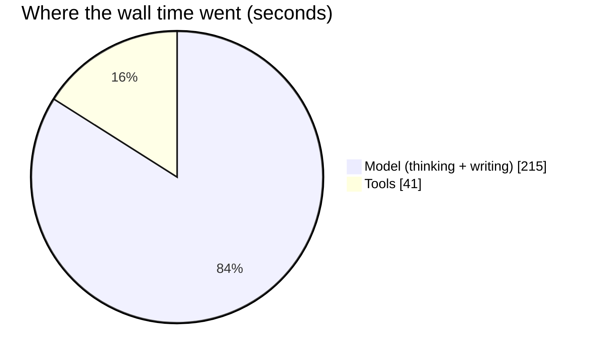

# intellectual-property/review-data-processing-agreement-template-against-eu-and-us-requirements · run4 (`hv-mixed200-lunahigh-r4-20261116T164249Z`)

Result: **fail** 44/47 criteria · 4.3 min · 23 model calls · 45 tool calls (2 errors or timeouts) · ending `completed` · started 11-16 23:44:58 IST

## Overview

One box per stretch of steps that used the same kind of tool (blue: looking/searching/reading, purple: writing or editing files, yellow: a message with no tool call, red border: a tool error or timeout inside the box).

```mermaid
flowchart TD
    T(["Task prompt"])
    P0["<b>Step 1</b> · 0.1 min<br/>todo_write<br/>bash<br/><i>ls -la && printf '\nDocuments:\n' && …</i>"]
    T --> P0
    class P0 look
    P1["<b>Steps 2-3</b> · 0.5 min<br/>bash x9<br/><i>parse-doc docx documents/pinnacle-us-…, parse-doc docx documents/msa-summary-…, parse-doc docx documents/data-flow-di… +2</i>"]
    P0 --> P1
    class P1 look
    P2["<b>Steps 4-6</b> · 0.2 min<br/>read x10<br/><i>playbook.txt, msa.txt, dataflow.txt +2</i>"]
    P1 --> P2
    class P2 look
    P3["<b>Step 7</b> · 0.3 min<br/>todo_write"]
    P2 --> P3
    class P3 look
    P4["<b>Steps 8-9</b> · 1.9 min<br/>bash x3<br/><i>python - #lt;#lt;'PY' from docx import Docu…, parse-doc docx output/compliance-gap-…, ls -lh output/compliance-gap-memorand…</i>"]
    P3 --> P4
    class P4 look
    P5["<b>Step 10</b> · 0.0 min<br/>read<br/><i>validation.txt</i>"]
    P4 --> P5
    class P5 look
    P6["<b>Steps 11-12</b> · 0.3 min<br/>bash x4<br/><i>mkdir -p preview && libreoffice --hea…, grep -n #quot;TODO\|TBD\|undefined\|None#quot; …, pdfinfo preview/compliance-gap-memora… +1</i>"]
    P5 --> P6
    class P6 look
    P7["<b>Step 13</b> · 0.0 min<br/>read_image x2<br/><i>page-1.png, page-2.png</i>"]
    P6 --> P7
    class P7 err
    P8["<b>Step 14</b> · 0.1 min<br/>bash<br/><i>ls -lh preview</i>"]
    P7 --> P8
    class P8 look
    P9["<b>Step 15</b> · 0.0 min<br/>read_image x2<br/><i>page-01.png, page-02.png</i>"]
    P8 --> P9
    class P9 look
    P10["<b>Step 16</b> · 0.1 min<br/>bash<br/><i>pdftoppm -f 3 -l 4 -png -r 120 previe…</i>"]
    P9 --> P10
    class P10 look
    P11["<b>Step 17</b> · 0.0 min<br/>read_image x2<br/><i>page-03.png, page-04.png</i>"]
    P10 --> P11
    class P11 look
    P12["<b>Steps 18-19</b> · 0.3 min<br/>bash x2<br/><i>python - #lt;#lt;'PY' from docx import Docu…, pdfinfo preview/compliance-gap-memora…</i>"]
    P11 --> P12
    class P12 look
    P13["<b>Step 20</b> · 0.1 min<br/>read_image x2<br/><i>page-03.png, page-04.png</i>"]
    P12 --> P13
    class P13 look
    P14["<b>Step 21</b> · 0.1 min<br/>bash x2<br/><i>parse-doc docx output/compliance-gap-…, python - #lt;#lt;'PY' from docx import Docu…</i>"]
    P13 --> P14
    class P14 look
    P15["<b>Step 22</b> · 0.1 min<br/>todo_write"]
    P14 --> P15
    class P15 look
    P16["<b>Step 23</b> · 0.1 min<br/>final message"]
    P15 --> P16
    class P16 ans
    R(["FAIL: 44/47 criteria"])
    P16 --> R
    class R fail
    classDef look fill:#e8f0fe,stroke:#4a6fa5,color:#111
    classDef write fill:#f3e8fd,stroke:#7b1fa2,color:#111
    classDef ans fill:#fff8e1,stroke:#b58900,color:#111
    classDef err fill:#e8f0fe,stroke:#c62828,stroke-width:3px,color:#111
    classDef pass fill:#e6f4ea,stroke:#2e7d32,color:#111
    classDef fail fill:#fce8e6,stroke:#c62828,color:#111
```





One row per model call:

| Step | Started (IST) | Model s | Tools s | Tool calls | Tools | Output chars |
|---|---|---|---|---|---|---|
| 1 | 23:44:58 | 5 | 1 | 2 | todo_write, bash | 1,096 |
| 2 | 23:45:03 | 3 | 11 | 5 | bash x5 | 167,667 |
| 3 | 23:45:18 | 6 | 9 | 4 | bash x4 | 1,496 |
| 4 | 23:45:33 | 3 | 0 | 5 | read x5 | 134,594 |
| 5 | 23:45:36 | 3 | 0 | 4 | read x4 | 125,903 |
| 6 | 23:45:40 | 3 | 0 | 1 | read | 12,821 |
| 7 | 23:45:43 | 18 | 0 | 1 | todo_write | 57 |
| 8 | 23:46:01 | 107 | 2 | 1 | bash | 38 |
| 9 | 23:47:49 | 4 | 3 | 2 | bash x2 | 645 |
| 10 | 23:47:56 | 2 | 0 | 1 | read | 36,679 |
| 11 | 23:47:59 | 3 | 3 | 2 | bash x2 | 604 |
| 12 | 23:48:05 | 8 | 2 | 2 | bash x2 | 775 |
| 13 | 23:48:15 | 3 | 0 | 2 | read_image x2 ⚠ | 484 |
| 14 | 23:48:18 | 5 | 1 | 1 | bash | 248 |
| 15 | 23:48:24 | 2 | 0 | 2 | read_image x2 | 632 |
| 16 | 23:48:27 | 4 | 1 | 1 | bash | 11 |
| 17 | 23:48:32 | 3 | 0 | 2 | read_image x2 | 632 |
| 18 | 23:48:35 | 9 | 4 | 1 | bash | 616 |
| 19 | 23:48:47 | 4 | 1 | 1 | bash | 20 |
| 20 | 23:48:52 | 3 | 0 | 2 | read_image x2 | 632 |
| 21 | 23:48:55 | 4 | 3 | 2 | bash x2 | 414 |
| 22 | 23:49:02 | 7 | 0 | 1 | todo_write | 57 |
| 23 | 23:49:09 | 5 | 0 | 0 | (message only) | 0 |

## Task prompt

```text
Review the vendor DPA template against our playbook, commercial terms, data flow details, and negotiation emails; produce a gap memorandum with prioritized findings and redline recommendations. Output: `compliance-gap-memorandum.docx`.
```

## Rubric

| # | Criterion | Verdict |
|---|---|---|
| C-001 | Prioritized summary table at beginning of memo | pass |
| C-002 | ISSUE_001: Identifies missing HIPAA BAA integration | pass |
| C-003 | ISSUE_001: Notes missing HIPAA-specific definitions | pass |
| C-004 | ISSUE_001: Recommends integrating BAA or attaching as exhibit | pass |
| C-005 | ISSUE_001: References minimum necessary standard or workforce training | pass |
| C-006 | ISSUE_002: Identifies 48-hour vs. 24-hour breach notification discrepancy | pass |
| C-007 | ISSUE_002: Identifies missing HIPAA breach notification obligations | pass |
| C-008 | ISSUE_002: Recommends specific redline for breach notification timeline | pass |
| C-009 | ISSUE_003: Identifies liability cap gap (€500K vs. playbook minimum) | pass |
| C-010 | ISSUE_003: Quantifies liability gap with correct dollar figures | pass |
| C-011 | ISSUE_003: Identifies missing carve-outs for willful misconduct/gross negligence | pass |
| C-012 | ISSUE_003: Identifies blanket exclusion of consequential damages as problematic | pass |
| C-013 | ISSUE_003: References correct MSA fee structure | pass |
| C-014 | ISSUE_004: Identifies missing SCC Module 3 for processor-to-subprocessor transfers | pass |
| C-015 | ISSUE_004: Identifies Singapore remote access as an unaddressed transfer | pass |
| C-016 | ISSUE_004: Notes Larkfield not certified under EU-US Data Privacy Framework | pass |
| C-017 | ISSUE_004: Flags absence of Transfer Impact Assessment documentation | pass |
| C-018 | ISSUE_005: Identifies missing CCPA/CPRA Service Provider provisions | pass |
| C-019 | ISSUE_005: Specifies required CCPA/CPRA contractual terms | pass |
| C-020 | ISSUE_006: Identifies audit rights limited to Frankfurt only | pass |
| C-021 | ISSUE_006: Recommends extending audit rights to subprocessor locations | pass |
| C-022 | ISSUE_007: Identifies missing data return option at termination | pass |
| C-023 | ISSUE_007: Identifies HIPAA 6-year retention conflict with 90-day deletion | pass |
| C-024 | ISSUE_008: Identifies governing law mismatch for US data disputes | pass |
| C-025 | ISSUE_008: Recommends bifurcated governing law/dispute resolution | pass |
| C-026 | ISSUE_009: Recognizes Module 2 alone is insufficient for processor-to-subprocessor transfers | pass |
| C-027 | ISSUE_011: Identifies 2-year survival period as insufficient for HIPAA | pass |
| C-028 | ISSUE_012: Flags anonymization vs. pseudonymization regulatory risk | **FAIL** |
| C-029 | DISTRACTOR_003: Does not flag DIS arbitration for EU disputes as a gap | pass |
| C-030 | Each gap includes risk level classification | pass |
| C-031 | Each gap references the specific DPA section at issue | pass |
| C-032 | Each gap includes a specific recommended redline or amendment | pass |
| C-033 | Correctly identifies Pinnacle as HIPAA Covered Entity | pass |
| C-034 | Correctly identifies Stratosphere as Processor/Business Associate | pass |
| C-035 | References EU-US Data Privacy Framework in transfer analysis | pass |
| C-036 | Identifies EU-to-US (Larkfield/Northern Virginia) disaster recovery transfer scenario | pass |
| C-037 | Identifies Singapore remote access transfer scenario | pass |
| C-038 | Identifies Stratosphere processor-to-subprocessor transfer scenario | pass |
| C-039 | References 2.1 million US patients or 890,000 California residents | pass |
| C-040 | ISSUE_001 classified as Critical or High risk | pass |
| C-041 | ISSUE_003 classified as Critical or High risk | pass |
| C-042 | References negotiation context from email thread | pass |
| C-043 | Mentions subprocessor Larkfield Data Systems by name | pass |
| C-044 | Mentions subprocessor Orionis Analytics by name | **FAIL** |
| C-045 | ISSUE_006: Notes audit limited to once per year | pass |
| C-046 | ISSUE_004: Recommends specific transfer mechanisms for identified gaps | pass |
| C-047 | ISSUE_012: Recommends defining anonymization standard in DPA | **FAIL** |

Judge's reasoning:

**C-001 (pass):** Prioritized summary table at beginning of memo

```text
The memo includes a prioritized gap register near the beginning, immediately after the executive summary and scope section. It lists each identified gap with Critical/High/Medium priority levels and concise descriptions of the issue, required outcome, and disposition.
```

**C-002 (pass):** ISSUE_001: Identifies missing HIPAA BAA integration

```text
The memorandum expressly identifies the absence of a HIPAA BAA as a critical execution blocker, notes that Stratosphere processes PHI for approximately 2.1 million US patients, and recommends adding an integrated BAA or executed exhibit with required HIPAA protections and subcontractor flow-downs.
```

**C-003 (pass):** ISSUE_001: Notes missing HIPAA-specific definitions

```text
The memorandum expressly states that the DPA lacks HIPAA-specific definitions, including PHI, ePHI, Covered Entity, Business Associate, Breach, Unsecured PHI, and BAA, particularly in P0-01.
```

**C-004 (pass):** ISSUE_001: Recommends integrating BAA or attaching as exhibit

```text
The memorandum expressly recommends adding an integrated BAA or a separately executed BAA exhibit (Exhibit E), incorporated into and executed with the DPA.
```

**C-005 (pass):** ISSUE_001: References minimum necessary standard or workforce training

```text
The memo expressly identifies both missing HIPAA obligations: a permitted-use/minimum-necessary standard and workforce training requirements, including in P0-01 and the execution checklist.
```

**C-006 (pass):** ISSUE_002: Identifies 48-hour vs. 24-hour breach notification discrepancy

```text
The memo expressly flags that DPA §9.1 permits notification within 48 hours after confirmation, contrasts this with the playbook’s required 24-hour notification from discovery, and recommends replacing the timeline accordingly.
```

**C-007 (pass):** ISSUE_002: Identifies missing HIPAA breach notification obligations

```text
The memo expressly flags the absence of a “HITECH breach cascade” and notes that the existing breach provision omits HIPAA Breaches of Unsecured PHI. This identifies HIPAA’s separate breach-notification regime as a gap, even though it does not enumerate individual, HHS, and media notices.
```

**C-008 (pass):** ISSUE_002: Recommends specific redline for breach notification timeline

```text
The memo specifically recommends replacing the 48-hour confirmed-breach timeline with notice within 24 hours of discovery of any actual or reasonably suspected incident, expressly including HIPAA breaches of unsecured PHI, and provides proposed redline language.
```

**C-009 (pass):** ISSUE_003: Identifies liability cap gap (€500K vs. playbook minimum)

```text
The memo expressly identifies the DPA’s €500,000 aggregate liability cap as substantially below Pinnacle’s playbook floor of 2x annual fees. It calculates the applicable floors as $8.4M combined, $5.6M US-specific, and $2.8M EU-specific, and treats the gap as a critical escalation issue.
```

**C-010 (pass):** ISSUE_003: Quantifies liability gap with correct dollar figures

```text
The memo expressly identifies the playbook floor as $8.4M combined (2x $4.2M annual fees), also lists the $2.8M EU-specific floor, and contrasts these amounts with the €500,000 template cap, stated as approximately $545,000.
```

**C-011 (pass):** ISSUE_003: Identifies missing carve-outs for willful misconduct/gross negligence

```text
The memo expressly identifies the absence of required uncapped carve-outs in P0-02 and recommends that the liability cap not apply to claims arising from willful misconduct or gross negligence, consistent with the playbook requirement.
```

**C-012 (pass):** ISSUE_003: Identifies blanket exclusion of consequential damages as problematic

```text
The memo expressly flags the blanket consequential-damages exclusion in P0-02 as problematic and recommends that the exclusion not apply to data breaches involving willful misconduct, matching Pinnacle's playbook requirement.
```

**C-013 (pass):** ISSUE_003: References correct MSA fee structure

```text
The liability discussion expressly references $4.2M in annual fees and calculates the playbook liability floor as $8.4M (2x annual fees). The memo also elsewhere identifies the MSA fee breakdown as $2.8M for US services and $1.4M for EU services.
```

**C-014 (pass):** ISSUE_004: Identifies missing SCC Module 3 for processor-to-subprocessor transfers

```text
The memo expressly states that DPA §7.2 designates SCC Module 2 only and flags that the Frankfurt-to-Larkfield processor-to-subprocessor transfer requires SCC Module 3. It also recommends executing Module 3 with Larkfield before any transfer.
```

**C-015 (pass):** ISSUE_004: Identifies Singapore remote access as an unaddressed transfer

```text
The memo expressly flags recurring Singapore-based remote support access to EU personal data as an international transfer scenario not addressed by DPA §7 or its existing transfer mechanisms, and recommends SCC coverage and supplementary controls or EEA-only access.
```

**C-016 (pass):** ISSUE_004: Notes Larkfield not certified under EU-US Data Privacy Framework

```text
The memo expressly states in P0-03 that “Larkfield is not DPF-certified, so DPF cannot substitute for SCCs,” clearly noting both the lack of EU-US Data Privacy Framework certification and its consequence for the transfer mechanism.
```

**C-017 (pass):** ISSUE_004: Flags absence of Transfer Impact Assessment documentation

```text
The memorandum expressly flags that the DPA contains no duty to conduct or document TIAs for third-country transfers, including the Larkfield and Singapore transfer paths, and recommends documented TIAs with periodic reassessment.
```

**C-018 (pass):** ISSUE_005: Identifies missing CCPA/CPRA Service Provider provisions

```text
The memorandum expressly identifies the absence of CCPA/CPRA Service Provider terms despite processing personal information of approximately 890,000 California residents, including in P0-06 and the executive summary.
```

**C-019 (pass):** ISSUE_005: Specifies required CCPA/CPRA contractual terms

```text
The memo specifies all three listed CCPA/CPRA provisions: a prohibition on selling or sharing personal information, a restriction on combining it with information from other sources except as permitted, and express certification language that the processor understands and will comply with the restrictions.
```

**C-020 (pass):** ISSUE_006: Identifies audit rights limited to Frankfurt only

```text
The memo expressly flags in P1-08 that DPA §11.3 limits audits to Frankfurt and states that this excludes Dublin, Northern Virginia, backups, and subprocessor sites. It also recommends extending audit rights to all processing locations and subprocessors.
```

**C-021 (pass):** ISSUE_006: Recommends extending audit rights to subprocessor locations

```text
The memo expressly recommends extending audit rights to all vendor and subprocessor sites. P1-08 calls for audits of “all processing locations and subprocessors” and requires Stratosphere to obtain equivalent audit access from each subprocessor; P1-12 also includes audit obligations in the required subprocessor flow-down.
```

**C-022 (pass):** ISSUE_007: Identifies missing data return option at termination

```text
The memo expressly flags in P0-04 that Section 12 is operationally deletion-only, lacks data return mechanics, and omits 30 days of transition assistance. It recommends a true controller election for machine-readable return or deletion plus at least 30 calendar days of transition assistance.
```

**C-023 (pass):** ISSUE_007: Identifies HIPAA 6-year retention conflict with 90-day deletion

```text
The memo expressly identifies the conflict between DPA §12’s 90-day deletion timeline and HIPAA’s six-year documentation-retention requirement, and recommends a specific HIPAA retention carve-out with continued protections and later certified deletion.
```

**C-024 (pass):** ISSUE_008: Identifies governing law mismatch for US data disputes

```text
The memo expressly flags that DPA §14 applies German law and DIS Munich arbitration to all disputes, including US PHI and California data, and contrasts this with the playbook requirement for Delaware law and jurisdiction in the U.S. District Court for the Western District of Texas, Austin Division (or Travis County courts if federal jurisdiction is unavailable).
```

**C-025 (pass):** ISSUE_008: Recommends bifurcated governing law/dispute resolution

```text
The memo expressly recommends bifurcating governing law and dispute resolution: Delaware law and U.S. court jurisdiction for U.S. data disputes, and Netherlands law (with German law as a fallback) plus EU arbitration for EU/EEA matters.
```

**C-026 (pass):** ISSUE_009: Recognizes Module 2 alone is insufficient for processor-to-subprocessor transfers

```text
The memo expressly states that SCC Module 2 covers controller-to-processor transfers but is insufficient for the Frankfurt-to-Larkfield processor-to-subprocessor transfer. It specifically requires separate execution of SCC Module 3 between Stratosphere and Larkfield before that transfer.
```

**C-027 (pass):** ISSUE_011: Identifies 2-year survival period as insufficient for HIPAA

```text
The memo expressly flags DPA §16.3’s two-year survival period as inadequate because it does not preserve HIPAA/BAA obligations and protections for six years. It recommends survival for six years from record creation or last effectiveness, or as long as PHI is retained, whichever is longer.
```

**C-028 (fail):** ISSUE_012: Flags anonymization vs. pseudonymization regulatory risk

```text
The memo briefly states that pseudonymization does not remove GDPR coverage, but it does not flag that the DPA fails to define or distinguish anonymization from pseudonymization specifically for Orionis Analytics, nor explain that truly anonymized data falls outside GDPR while pseudonymized data remains in scope.
```

**C-029 (pass):** DISTRACTOR_003: Does not flag DIS arbitration for EU disputes as a gap

```text
The memo does not treat DIS arbitration as inherently problematic for EU disputes. It objects to the blanket German-law/Munich-DIS framework covering US data, then expressly permits DIS (along with ICC or LCIA) for EU disputes and allows German law as an EU fallback.
```

**C-030 (pass):** Each gap includes risk level classification

```text
All 15 identified gaps are assigned explicit priority classifications in the gap register (P0 Critical, P1 High, or P2 Medium), and the detailed findings repeat these severity labels. This exceeds the 75% threshold.
```

**C-031 (pass):** Each gap references the specific DPA section at issue

```text
The memorandum references specific DPA sections or provisions for essentially every identified gap. The prioritized register cites sections such as §7.2, §9.1, §§11.3–11.4, §12, §13, §14, §15, and §16.3, and the detailed findings consistently identify the relevant DPA sections in the assessment and source references. This comfortably exceeds the 75% threshold.
```

**C-032 (pass):** Each gap includes a specific recommended redline or amendment

```text
All 15 identified gaps include a specific required redline outcome and detailed amendment recommendation. Most also provide suggested replacement or insertion language, while others specify concrete structural or timing changes such as adding a BAA and CCPA/CPRA addendum, executing SCC Module 3, reducing breach notice to 24 hours, and expanding audit rights. This comfortably exceeds the 75% threshold.
```

**C-033 (pass):** Correctly identifies Pinnacle as HIPAA Covered Entity

```text
The memo treats Pinnacle as the HIPAA Covered Entity. It identifies Stratosphere as Pinnacle’s Business Associate and Larkfield as a BA subcontractor, and expressly recommends clarifying in the DPA which Pinnacle entity is the HIPAA Covered Entity.
```

**C-034 (pass):** Correctly identifies Stratosphere as Processor/Business Associate

```text
The memo correctly characterizes Stratosphere as the GDPR Processor throughout and expressly states that the data-flow map identifies Stratosphere as Pinnacle's HIPAA Business Associate.
```

**C-035 (pass):** References EU-US Data Privacy Framework in transfer analysis

```text
The memo discusses the EU-US Data Privacy Framework in its international transfer analysis, stating that Larkfield is not DPF-certified and therefore the DPF cannot substitute for SCCs.
```

**C-036 (pass):** Identifies EU-to-US (Larkfield/Northern Virginia) disaster recovery transfer scenario

```text
The memo explicitly identifies the Frankfurt EU data center to Larkfield in Northern Virginia transfer for disaster recovery/business continuity, including its processor-to-subprocessor nature and need for SCC Module 3.
```

**C-037 (pass):** Identifies Singapore remote access transfer scenario

```text
The memorandum expressly identifies recurring Singapore-based remote support access to EU personal data as an international transfer scenario, including in the executive summary, P0-03 finding, and transfer checklist.
```

**C-038 (pass):** Identifies Stratosphere processor-to-subprocessor transfer scenario

```text
The memo expressly identifies the Frankfurt-to-Larkfield transfer as a processor-to-subprocessor international transfer requiring separate SCC Module 3 coverage, along with a TIA and supplementary measures. It also addresses Singapore subprocessor/remote-access transfer coverage.
```

**C-039 (pass):** References 2.1 million US patients or 890,000 California residents

```text
The memo references approximately 2.1 million US patients in its HIPAA/BAA analysis and approximately 890,000 California residents in its CCPA/CPRA analysis.
```

**C-040 (pass):** ISSUE_001 classified as Critical or High risk

```text
The missing HIPAA BAA integration is explicitly classified as “Critical” in gap P0-01 and described as an “execution blocker,” satisfying the highest-tier severity requirement.
```

**C-041 (pass):** ISSUE_003 classified as Critical or High risk

```text
The liability cap gap is expressly classified as “Critical” in P0-02 and described as requiring immediate escalation, satisfying the highest-tier severity requirement.
```

**C-042 (pass):** References negotiation context from email thread

```text
The memo explicitly references the email negotiation context, including Stratosphere’s April 14 statement that the €500,000 cap is its “firm global standard,” its April 17 willingness to discuss an exception, the DPO coordination exchange, and the upcoming April 30 call.
```

**C-043 (pass):** Mentions subprocessor Larkfield Data Systems by name

```text
The memorandum repeatedly mentions the subprocessor Larkfield by name, including its Northern Virginia processing and disaster-recovery role.
```

**C-044 (fail):** Mentions subprocessor Orionis Analytics by name

```text
The memo mentions “Orionis” and describes it as an analytics subprocessor, but it does not identify the entity by the required name “Orionis Analytics” or “Orionis Analytics Ltd.”
```

**C-045 (pass):** ISSUE_006: Notes audit limited to once per year

```text
The audit-rights analysis expressly states that DPA §11.2 permits only one planned audit per year with 30 days' notice and recommends expanded planned and for-cause audit rights, directly addressing the limitation.
```

**C-046 (pass):** ISSUE_004: Recommends specific transfer mechanisms for identified gaps

```text
The memo recommends at least three qualifying mechanisms: executing SCC Module 3 for the Frankfurt-to-Larkfield processor-to-subprocessor transfer, conducting and periodically reassessing TIAs for each third-country transfer path, and implementing supplementary measures for Singapore remote access (including least-privilege access, masking, and logging).
```

**C-047 (fail):** ISSUE_012: Recommends defining anonymization standard in DPA

```text
The memo notes that pseudonymization does not remove GDPR coverage, but it does not recommend defining an anonymization standard for Orionis Analytics or specify contractual treatment if Orionis outputs are pseudonymized rather than truly anonymized.
```

## Delivered files (output/)

- `compliance-gap-memorandum.docx` (58,675 bytes)

## Trajectory

### Step 1: 2 tool calls

_Started 11-16 23:44:58 IST · model 5 s · tools 1 s_

**Reasoning summary:**

```text
**Planning document creation**

I’m looking at the need to manipulate some documents and inspect files. If the task involves document creation or review, I’ll need to list the skills I have available. It might be helpful to check the workspace with a bash command like `ls`. Using a to-do list for multi-step tasks sounds good too. I need to remember not to read the `task.json`. Oh, and creating a `.docx` output might require the `python-docx` library, so I'll inspect the documents and proceed with my plans!
```

**Call `todo_write`** (0.0 s)

```json
{
 "todos": [
  {
   "content": "Inspect source materials and identify governing requirements",
   "status": "in_progress"
  },
  {
   "content": "Analyze DPA gaps against EU and US requirements",
   "status": "pending"
  },
  {
   "content": "Draft prioritized memorandum with redline recommendations",
   "status": "pending"
  },
  {
   "content": "Generate and validate compliance-gap-memorandum.docx",
   "status": "pending"
  }
 ]
}
```

Output (57 chars):

```text
Updated todo list: 3 pending, 1 in progress, 0 completed.
```

**Call `bash`** (0.7 s)

```json
{
 "command": "ls -la && printf '\\nDocuments:\\n' && ls -la documents && printf '\\nOutput:\\n' && ls -la output",
 "description": "List workspace, documents, and output contents"
}
```

Output (1,039 chars):

```text
total 16
drwxr-xr-x 4 agarwaldi@microsoft.com users 4096 Nov 16 18:14 .
drwxr-xr-x 3 root                    root  4096 Nov 16 18:14 ..
dr-xr-xr-x 2 agarwaldi@microsoft.com users 4096 Nov  5 18:20 documents
drwxr-xr-x 2 agarwaldi@microsoft.com users 4096 Nov 16 18:14 output

Documents:
total 264
dr-xr-xr-x 2 agarwaldi@microsoft.com users  4096 Nov  5 18:20 .
drwxr-xr-x 4 agarwaldi@microsoft.com users  4096 Nov 16 18:14 ..
-r--r--r-- 6 agarwaldi@microsoft.com users 54272 Nov  5 18:20 data-flow-diagram.docx
-r--r--r-- 6 agarwaldi@microsoft.com users 47124 Nov  5 18:20 msa-summary-term-sheet.docx
-r--r--r-- 6 agarwaldi@microsoft.com users 75843 Nov  5 18:20 pinnacle-us-dpa-playbook.docx
-r--r--r-- 6 agarwaldi@microsoft.com users 63464 Nov  5 18:20 stratosphere-dpa-template-v3-2.docx
-r--r--r-- 6 agarwaldi@microsoft.com users 10806 Nov  5 18:20 stratosphere-negotiation-email-thread.eml

Output:
total 8
drwxr-xr-x 2 agarwaldi@microsoft.com users 4096 Nov 16 18:14 .
drwxr-xr-x 4 agarwaldi@microsoft.com users 4096 Nov 16 18:14 ..
```

**Todo list now:**

- [~] Inspect source materials and identify governing requirements
- [ ] Analyze DPA gaps against EU and US requirements
- [ ] Draft prioritized memorandum with redline recommendations
- [ ] Generate and validate compliance-gap-memorandum.docx

### Step 2: 5 tool calls

_Started 11-16 23:45:03 IST · model 3 s · tools 11 s_

**Reasoning summary:**

```text
**Deciding on skills and parsing**

I think I might need the skill documents, but I'm unsure of the exact skill name. I wonder if I can use a wildcard search, but it seems like the skills are not in the workspace. I’m also questioning if that’s really necessary. I could attempt calling a skill for "document creation," but it feels vague due to the lack of a skill catalog provided. Anyway, I’ll go ahead and parse the docx/eml files using a bash command—maybe in parallel for four documents.
```

**Call `bash`** (2.6 s)

```json
{
 "command": "parse-doc docx documents/pinnacle-us-dpa-playbook.docx",
 "description": "Extract playbook text"
}
```

Output (49,928 chars):

```text
and \$1.4 million EU), the cap for EU-specific claims would be no less than \$2,800,000 (2 × \$1,400,000) and for US-specific claims no less than \$5,600,000 (2 × \$2,800,000).

**Must-have:** Liability must be **uncapped** for the following categories of claims:

> \(a\) **Willful misconduct** by vendor, its employees, agents, or subprocessors;
>
> \(b\) **Gross negligence** by vendor, its employees, agents, or subprocessors;
>
> \(c\) **Breaches of confidentiality obligations** involving intentional or reckless conduct; and
>
> \(d\) **Regulatory fines or penalties** imposed on Pinnacle as a direct result of vendor\'s non-compliance with applicable data protection laws, including HIPAA, CCPA/CPRA, and GDPR.

**Must-have:** Consequential, indirect, and special damages may **NOT** be excluded for data breaches involving willful misconduct by vendor. A blanket consequential damages exclusion that applies to all claims, including data protection claims, is unacceptable. While mutual exclusions of consequential damages are common in general commercial agreements, they are inappropriate in the data protection context where the most significant harms to Pinnacle --- including regulatory penalties, class action settlements, breach notification costs, credit monitoring expenses, and reputational damage --- may be characterized as consequential or indirect damages under applicable law. A blanket exclusion could effectively eliminate vendor accountability for the very harms the DPA is
… [48,427 more chars]
```

**Call `bash`** (1.9 s)

```json
{
 "command": "parse-doc docx documents/msa-summary-term-sheet.docx",
 "description": "Extract commercial terms"
}
```

Output (22,315 chars):

```text
**[MASTER SERVICES AGREEMENT --- SUMMARY TERM SHEET]{.underline}**

**Summary of Key Commercial Terms**

MSA Effective Date: March 15, 2024

This Summary Term Sheet is for internal reference purposes only and does not amend or supersede the Master Services Agreement dated March 15, 2024 (the \"MSA\"), by and between Pinnacle Health Solutions, Inc. and Stratosphere Cloud Services GmbH. In the event of any conflict between the terms summarized herein and the terms of the executed MSA, the terms of the executed MSA shall control in all respects.

Prepared by the Office of General Counsel Pinnacle Health Solutions, Inc.

Last Updated: March 15, 2024

**[Section 1 --- Parties]{.underline}**

**Client:** Pinnacle Health Solutions, Inc., a Delaware corporation, with its principal offices located at 4200 Harborview Boulevard, Suite 1100, Austin, TX 78746 (\"Pinnacle\" or \"Client\").

**Service Provider:** Stratosphere Cloud Services GmbH, a German limited liability company (*Gesellschaft mit beschränkter Haftung*) registered at the Munich Local Court (*Amtsgericht München*) under Commercial Register (*Handelsregister*) number HRB 247891, with its registered office at Hohenzollernstraße 88, 80796 Munich, Germany (\"Stratosphere\" or \"Service Provider\").

**EU Entity Designation:** For purposes of EU Services (as defined in Section 3 below), the Client entity may be designated as Pinnacle Health Solutions EU B.V., a private limited liability company organized under the laws of the N
… [20,814 more chars]
```

**Call `bash`** (3.0 s)

```json
{
 "command": "parse-doc docx documents/data-flow-diagram.docx",
 "description": "Extract data flow details"
}
```

Output (45,055 chars):

```text
**[DATA FLOW DIAGRAM AND PROCESSING DESCRIPTION]{.underline}**

**[Pinnacle Health Solutions, Inc. --- Stratosphere Cloud Services GmbH]{.underline}**

**[Data Processing Relationship]{.underline}**

**CONFIDENTIAL --- ATTORNEY-CLIENT PRIVILEGED / WORK PRODUCT**

This document is protected by the attorney-client privilege and the work product doctrine. Unauthorized disclosure, copying, or distribution is strictly prohibited. This document does not constitute legal advice to any third party.

**Prepared by:** Office of the General Counsel, Pinnacle Health Solutions, Inc., 4200 Harborview Boulevard, Suite 1100, Austin, TX 78746

**Prepared for:** Internal use and for review by outside counsel Alderton Shaw & Whitmore LLP (Rachel Osterfeld, Partner), 900 K Street NW, Suite 700, Washington, DC 20001

**Date:** April 2025

**Reference Documents:**

> •Master Services Agreement dated March 15, 2024 (\"MSA\")
>
> •Stratosphere DPA Template Version 3.2 dated January 10, 2025 (received April 14, 2025) (\"DPA Template\" or \"DPA\")
>
> •Pinnacle US DPA Playbook (last updated February 28, 2025) (\"Playbook\")

**Purpose:** This document maps all personal data flows between Pinnacle (US and EU operations), Stratosphere Cloud Services GmbH, and Stratosphere\'s subprocessors. The purpose of this mapping is to support the legal review of the DPA Template ahead of the May 16, 2025 internal review deadline and the September 1, 2025 EU expansion launch date. The data flow diagrams and accompan
… [43,554 more chars]
```

**Call `bash`** (2.2 s)

```json
{
 "command": "parse-doc docx documents/stratosphere-dpa-template-v3-2.docx",
 "description": "Extract vendor DPA template"
}
```

Output (49,921 chars):

```text
of the GDPR.

**[SECTION 4 --- CONFIDENTIALITY]{.underline}**

**4.1** The Processor shall ensure that all persons authorized to Process Personal Data on behalf of the Controller, including the Processor\'s employees, contractors, temporary workers, and agents, have committed themselves to confidentiality or are under an appropriate statutory obligation of confidentiality, in accordance with Article 28(3)(b) of the GDPR. The Processor shall maintain written records of such confidentiality commitments and shall make them available to the Controller upon request.

**4.2** The Processor shall ensure that access to Personal Data Processed on behalf of the Controller is strictly limited to those members of the Processor\'s personnel who require such access for the performance of the Services under the Agreement. The Processor shall implement appropriate access management procedures, including role-based access controls and least-privilege principles, to enforce this limitation. The Processor shall promptly revoke access for any personnel member whose role no longer requires access to the Controller\'s Personal Data.

**4.3** The obligations set forth in this Section 4 shall survive the termination or expiration of this DPA and shall continue in full force and effect for so long as the Processor or any of its personnel retains any Personal Data Processed on behalf of the Controller.

**4.4** The Processor shall not disclose Personal Data to any third party, including any government
… [48,420 more chars]
```

**Call `bash`** (1.8 s)

```json
{
 "command": "parse-doc eml documents/stratosphere-negotiation-email-thread.eml",
 "description": "Extract negotiation emails"
}
```

Output (448 chars):

```text
[stderr]
2026-11-16 18:15:18.104579662 [W:onnxruntime:Default, device_discovery.cc:95 GetPciBusId] Skipping pci_bus_id for PCI path at "/sys/devices/LNXSYSTM:00/LNXSYBUS:00/ACPI0004:00/VMBUS:00/5620e0c7-8062-4dce-aeb7-520c7ef76171" because filename "5620e0c7-8062-4dce-aeb7-520c7ef76171" did not match expected pattern of [0-9a-f]+:[0-9a-f]+:[0-9a-f]+[.][0-9a-f]+
usage: /usr/local/bin/parse-doc {docx|pdf|pptx|xlsx} <path>
[exit code: 2]
```

### Step 3: 4 tool calls

_Started 11-16 23:45:18 IST · model 6 s · tools 9 s_

**Reasoning summary:**

```text
**Exploring text outputs**

I’m considering how to create text outputs in the workspace using bash. I remember to use the read tool instead of shell commands like cat for inspecting text files. So, I want to parse it to the workspace via bash and read it. Each step seems logical. I also realize that .eml parse-doc may not support the task, but I think I can directly read plain text emails. Let’s go ahead and check that out!
```

**Call `bash`** (2.2 s)

```json
{
 "command": "parse-doc docx documents/pinnacle-us-dpa-playbook.docx > playbook.txt",
 "description": "Save playbook extraction"
}
```

Output (374 chars):

```text
[stderr]
2026-11-16 18:15:26.042042141 [W:onnxruntime:Default, device_discovery.cc:95 GetPciBusId] Skipping pci_bus_id for PCI path at "/sys/devices/LNXSYSTM:00/LNXSYBUS:00/ACPI0004:00/VMBUS:00/5620e0c7-8062-4dce-aeb7-520c7ef76171" because filename "5620e0c7-8062-4dce-aeb7-520c7ef76171" did not match expected pattern of [0-9a-f]+:[0-9a-f]+:[0-9a-f]+[.][0-9a-f]+
```

**Call `bash`** (2.3 s)

```json
{
 "command": "parse-doc docx documents/msa-summary-term-sheet.docx > msa.txt",
 "description": "Save commercial terms extraction"
}
```

Output (374 chars):

```text
[stderr]
2026-11-16 18:15:28.566412483 [W:onnxruntime:Default, device_discovery.cc:95 GetPciBusId] Skipping pci_bus_id for PCI path at "/sys/devices/LNXSYSTM:00/LNXSYBUS:00/ACPI0004:00/VMBUS:00/5620e0c7-8062-4dce-aeb7-520c7ef76171" because filename "5620e0c7-8062-4dce-aeb7-520c7ef76171" did not match expected pattern of [0-9a-f]+:[0-9a-f]+:[0-9a-f]+[.][0-9a-f]+
```

**Call `bash`** (1.9 s)

```json
{
 "command": "parse-doc docx documents/data-flow-diagram.docx > dataflow.txt",
 "description": "Save data flow extraction"
}
```

Output (374 chars):

```text
[stderr]
2026-11-16 18:15:30.444653382 [W:onnxruntime:Default, device_discovery.cc:95 GetPciBusId] Skipping pci_bus_id for PCI path at "/sys/devices/LNXSYSTM:00/LNXSYBUS:00/ACPI0004:00/VMBUS:00/5620e0c7-8062-4dce-aeb7-520c7ef76171" because filename "5620e0c7-8062-4dce-aeb7-520c7ef76171" did not match expected pattern of [0-9a-f]+:[0-9a-f]+:[0-9a-f]+[.][0-9a-f]+
```

**Call `bash`** (2.1 s)

```json
{
 "command": "parse-doc docx documents/stratosphere-dpa-template-v3-2.docx > dpa.txt",
 "description": "Save DPA extraction"
}
```

Output (374 chars):

```text
[stderr]
2026-11-16 18:15:32.378905566 [W:onnxruntime:Default, device_discovery.cc:95 GetPciBusId] Skipping pci_bus_id for PCI path at "/sys/devices/LNXSYSTM:00/LNXSYBUS:00/ACPI0004:00/VMBUS:00/5620e0c7-8062-4dce-aeb7-520c7ef76171" because filename "5620e0c7-8062-4dce-aeb7-520c7ef76171" did not match expected pattern of [0-9a-f]+:[0-9a-f]+:[0-9a-f]+[.][0-9a-f]+
```

### Step 4: 5 tool calls

_Started 11-16 23:45:33 IST · model 3 s · tools 0 s_

**Reasoning summary:**

```text
**Considering file reading**

I think I need to read files, and maybe I should check the line counts, which can be done using the `wc` command. But I’m wondering, do I need to inspect the contents of the lines themselves? I might just focus on reading them first to see what I can gather from the file structure. My approach seems a bit straightforward, so I’ll keep that in mind while I figure this out.
```

**Call `read`** (0.1 s)

```json
{
 "file_path": "playbook.txt",
 "offset": 1,
 "limit": 240
}
```

Output (26,920 chars):

```text
<path>/home/agarwaldi/dsh-bench-harness/runs/hv-mixed200-lunahigh-r4-20261116T164249Z/tasks/intellectual-property__review-data-processing-agreement-template-against-eu-and-us-requirements/workspace/playbook.txt</path>
<type>file</type>
<content>
1: **[DATA PROCESSING AGREEMENT NEGOTIATION PLAYBOOK]{.underline}**
2: 
3: **[US AND CROSS-BORDER REQUIREMENTS]{.underline}**
4: 
5: **Internal Use Only --- Attorney-Client Privileged and Confidential Work Product**
6: 
7: Prepared by: **Office of the General Counsel** **Pinnacle Health Solutions, Inc.** 4200 Harborview Boulevard, Suite 1100 Austin, TX 78746
8: 
9: Approved by: **Margaret Yuen-Park**, General Counsel
10: 
11: **Version 4.0**
12: 
13: Last Updated: **February 28, 2025**
14: 
15: **Distribution List:**
16: 
17:   -------------------------------------------------------------------------------------
18:   **Recipient**                                     **Title**
19:   ------------------------------------------------- -----------------------------------
20:   Legal Department (all attorneys and paralegals)   ---
21: 
22:   Dr. Anand Krishnamurthy                           Chief Privacy Officer
23: 
24:   Jennifer Castellano                               VP of Information Security
25: 
26:   David Liang                                       VP of Procurement
27:   -------------------------------------------------------------------------------------
28: 
29: **External Counsel Reference:** This playbook was developed in co
… [25,420 more chars]
```

**Call `read`** (0.1 s)

```json
{
 "file_path": "msa.txt",
 "offset": 1,
 "limit": 220
}
```

Output (23,012 chars):

```text
<path>/home/agarwaldi/dsh-bench-harness/runs/hv-mixed200-lunahigh-r4-20261116T164249Z/tasks/intellectual-property__review-data-processing-agreement-template-against-eu-and-us-requirements/workspace/msa.txt</path>
<type>file</type>
<content>
1: **[MASTER SERVICES AGREEMENT --- SUMMARY TERM SHEET]{.underline}**
2: 
3: **Summary of Key Commercial Terms**
4: 
5: MSA Effective Date: March 15, 2024
6: 
7: This Summary Term Sheet is for internal reference purposes only and does not amend or supersede the Master Services Agreement dated March 15, 2024 (the \"MSA\"), by and between Pinnacle Health Solutions, Inc. and Stratosphere Cloud Services GmbH. In the event of any conflict between the terms summarized herein and the terms of the executed MSA, the terms of the executed MSA shall control in all respects.
8: 
9: Prepared by the Office of General Counsel Pinnacle Health Solutions, Inc.
10: 
11: Last Updated: March 15, 2024
12: 
13: **[Section 1 --- Parties]{.underline}**
14: 
15: **Client:** Pinnacle Health Solutions, Inc., a Delaware corporation, with its principal offices located at 4200 Harborview Boulevard, Suite 1100, Austin, TX 78746 (\"Pinnacle\" or \"Client\").
16: 
17: **Service Provider:** Stratosphere Cloud Services GmbH, a German limited liability company (*Gesellschaft mit beschränkter Haftung*) registered at the Munich Local Court (*Amtsgericht München*) under Commercial Register (*Handelsregister*) number HRB 247891, with its registered office at Hohenzollernstraße 88
… [21,512 more chars]
```

**Call `read`** (0.1 s)

```json
{
 "file_path": "dataflow.txt",
 "offset": 1,
 "limit": 240
}
```

Output (28,517 chars):

```text
<path>/home/agarwaldi/dsh-bench-harness/runs/hv-mixed200-lunahigh-r4-20261116T164249Z/tasks/intellectual-property__review-data-processing-agreement-template-against-eu-and-us-requirements/workspace/dataflow.txt</path>
<type>file</type>
<content>
1: **[DATA FLOW DIAGRAM AND PROCESSING DESCRIPTION]{.underline}**
2: 
3: **[Pinnacle Health Solutions, Inc. --- Stratosphere Cloud Services GmbH]{.underline}**
4: 
5: **[Data Processing Relationship]{.underline}**
6: 
7: **CONFIDENTIAL --- ATTORNEY-CLIENT PRIVILEGED / WORK PRODUCT**
8: 
9: This document is protected by the attorney-client privilege and the work product doctrine. Unauthorized disclosure, copying, or distribution is strictly prohibited. This document does not constitute legal advice to any third party.
10: 
11: **Prepared by:** Office of the General Counsel, Pinnacle Health Solutions, Inc., 4200 Harborview Boulevard, Suite 1100, Austin, TX 78746
12: 
13: **Prepared for:** Internal use and for review by outside counsel Alderton Shaw & Whitmore LLP (Rachel Osterfeld, Partner), 900 K Street NW, Suite 700, Washington, DC 20001
14: 
15: **Date:** April 2025
16: 
17: **Reference Documents:**
18: 
19: > •Master Services Agreement dated March 15, 2024 (\"MSA\")
20: >
21: > •Stratosphere DPA Template Version 3.2 dated January 10, 2025 (received April 14, 2025) (\"DPA Template\" or \"DPA\")
22: >
23: > •Pinnacle US DPA Playbook (last updated February 28, 2025) (\"Playbook\")
24: 
25: **Purpose:** This document maps all personal d
… [27,017 more chars]
```

**Call `read`** (0.1 s)

```json
{
 "file_path": "dpa.txt",
 "offset": 1,
 "limit": 260
}
```

Output (44,021 chars):

```text
<path>/home/agarwaldi/dsh-bench-harness/runs/hv-mixed200-lunahigh-r4-20261116T164249Z/tasks/intellectual-property__review-data-processing-agreement-template-against-eu-and-us-requirements/workspace/dpa.txt</path>
<type>file</type>
<content>
1: **[DATA PROCESSING AGREEMENT]{.underline}**
2: 
3: **Version 3.2**
4: 
5: **January 10, 2025**
6: 
7: **STRATOSPHERE CLOUD SERVICES GmbH**
8: 
9: *Cloud Infrastructure · Managed Databases · Analytics*
10: 
11: This Data Processing Agreement (\"DPA\") forms part of and is subject to the terms of the Master Services Agreement (\"Agreement\" or \"MSA\") between the Processor and the Controller.
12: 
13: This DPA is designed to ensure compliance with Regulation (EU) 2016/679 of the European Parliament and of the Council of 27 April 2016 (the \"GDPR\") and applicable data protection laws governing the Processing of Personal Data in connection with the Services provided under the Agreement.
14: 
15: **Processor Registered Office:**
16: 
17: Stratosphere Cloud Services GmbH Hohenzollernstraße 88 80796 Munich, Germany
18: 
19: Handelsregister HRB 247891, Amtsgericht München (Munich Local Court)
20: 
21: **Prepared by:**
22: 
23: Legal Department, Stratosphere Cloud Services GmbH
24: 
25: **Contact:**
26: 
27: Dr. Florian Neumann Chief Legal Officer Stratosphere Cloud Services GmbH
28: 
29: Email: florian.neumann@stratospherecloud.example.com
30: 
31: Tel: +49 89 2155 4400
32: 
33: Right-click to update Table of Contents
34: 
35: **[RECITALS]{.u
… [42,521 more chars]
```

**Call `read`** (0.1 s)

```json
{
 "file_path": "documents/stratosphere-negotiation-email-thread.eml",
 "offset": 1,
 "limit": 240
}
```

Output (12,124 chars):

```text
<path>/home/agarwaldi/dsh-bench-harness/runs/hv-mixed200-lunahigh-r4-20261116T164249Z/tasks/intellectual-property__review-data-processing-agreement-template-against-eu-and-us-requirements/workspace/documents/stratosphere-negotiation-email-thread.eml</path>
<type>file</type>
<content>
1: From: Margaret Yuen-Park <myuenpark@pinnaclehealth.example.com>
2: To: Dr. Florian Neumann <f.neumann@stratospherecloud.example.com>
3: Cc: Rachel Osterfeld <rosterfeld@alderton-shaw.example.com>
4: Date: Fri, 18 Apr 2025 11:02:00 -0000
5: Subject: Re: Re: Re: Stratosphere DPA Template v3.2 — For Your Review
6: Content-Type: text/plain; charset="utf-8"
7: Content-Transfer-Encoding: quoted-printable
8: MIME-Version: 1.0
9: 
10: Florian,
11: 
12: Thank you for your response and for looping in Dr. Beckert.
13: 
14: We can confirm the call for Wednesday, April 30, 2025, at 4:00 PM CEST / 9:00=
15:  AM CDT. Rachel Osterfeld from Alderton Shaw & Whitmore will attend on our si=
16: de.
17: 
18: On the liability cap =E2=80=94 I appreciate your willingness to take this up =
19: internally. I want to set expectations that our redline of Section 13 will pr=
20: opose a structure tied to the annual fees under the MSA rather than a flat ca=
21: p, together with the carve-outs for willful misconduct and gross negligence I=
22:  referenced previously. I want to be transparent that this is a threshold iss=
23: ue for us, and we will need to reach agreement on liability allocation before=
24:  we can finalize 
… [10,624 more chars]
```

### Step 5: 4 tool calls

_Started 11-16 23:45:36 IST · model 3 s · tools 0 s_

**Reasoning summary:**

```text
**Inspecting documents**

I need to inspect the remainder of the playbook and the DPA. The plan is to use grep to search for specific terms to locate the parts I'm interested in. It feels a bit tedious, but I know it's necessary to ensure everything is accurate. I want to make sure I'm thorough in this process so that nothing important gets missed. Let's see what I can find!
```

**Call `read`** (0.1 s)

```json
{
 "file_path": "playbook.txt",
 "offset": 241,
 "limit": 320
}
```

Output (44,341 chars):

```text
<path>/home/agarwaldi/dsh-bench-harness/runs/hv-mixed200-lunahigh-r4-20261116T164249Z/tasks/intellectual-property__review-data-processing-agreement-template-against-eu-and-us-requirements/workspace/playbook.txt</path>
<type>file</type>
<content>
241: Negotiators should also be aware that some vendors may propose a \"HIPAA addendum\" or \"healthcare data supplement\" that purports to address HIPAA requirements but does not contain all of the mandatory BAA provisions listed in Section 4.1 above. Such documents must be carefully reviewed against the checklist in Section 4.1, and any missing provisions must be added before execution.
242: 
243: **[Section 5: Breach Notification]{.underline}**
244: 
245: Breach notification provisions are among the most operationally significant terms in any DPA. The speed and completeness of vendor breach notification directly affects Pinnacle\'s ability to assess the breach, mitigate harm to affected individuals, and meet its own notification obligations under HIPAA, CCPA/CPRA, and GDPR. This Section establishes Pinnacle\'s breach notification requirements, which are in certain respects **more restrictive** than the standalone requirements of any single applicable regulation.
246: 
247: Pinnacle\'s internal data breach response standard, as adopted by the Board of Directors in October 2023, requires that the Company\'s Incident Response Team be activated within **four (4) hours** of receiving vendor notification of a breach or suspected breach. 
… [42,841 more chars]
```

**Call `read`** (0.1 s)

```json
{
 "file_path": "playbook.txt",
 "offset": 561,
 "limit": 280
}
```

Output (35,914 chars):

```text
<path>/home/agarwaldi/dsh-bench-harness/runs/hv-mixed200-lunahigh-r4-20261116T164249Z/tasks/intellectual-property__review-data-processing-agreement-template-against-eu-and-us-requirements/workspace/playbook.txt</path>
<type>file</type>
<content>
561: > • **Module 2** (Controller-to-Processor): For transfers from Pinnacle EU B.V. (as Controller) to a vendor (as Processor) located outside the EEA;
562: >
563: > • **Module 3** (Processor-to-Subprocessor): For transfers from a vendor (as Processor) to a subprocessor located outside the EEA; and
564: >
565: > • **Module 4** (Processor-to-Controller): Where applicable, for reverse transfers.
566: >
567: > **(b) EU-US Data Privacy Framework (\"DPF\")** certification: Acceptable only if the receiving entity (vendor or subprocessor) is certified under the EU-US Data Privacy Framework and the certification covers the relevant data processing activities. Negotiators should verify the vendor\'s DPF certification status on the International Trade Administration\'s Data Privacy Framework List (dataprivacyframework.gov) before relying on this mechanism.
568: >
569: > **(c) Binding Corporate Rules (\"BCRs\")**: Acceptable where the vendor has approved BCRs in place that have been reviewed and approved by the competent EU supervisory authority.
570: 
571: **Must-have:** The DPA must address **all** transfer scenarios, including:
572: 
573: > • Primary data hosting and processing transfers (e.g., data stored in an EEA data center and processed
… [34,414 more chars]
```

**Call `read`** (0.1 s)

```json
{
 "file_path": "dpa.txt",
 "offset": 243,
 "limit": 260
}
```

Output (27,283 chars):

```text
<path>/home/agarwaldi/dsh-bench-harness/runs/hv-mixed200-lunahigh-r4-20261116T164249Z/tasks/intellectual-property__review-data-processing-agreement-template-against-eu-and-us-requirements/workspace/dpa.txt</path>
<type>file</type>
<content>
243: **[SECTION 12 --- DATA DELETION]{.underline}**
244: 
245: **12.1** Upon termination or expiration of the Agreement for any reason, the Processor shall, at the Controller\'s choice and subject to Section 12.2, delete all Personal Data Processed on behalf of the Controller, including all copies, backups, and archives thereof, within ninety (90) calendar days of the effective date of termination or expiration of the Agreement. Deletion shall be performed using industry-standard secure deletion methods that render the Personal Data unrecoverable, including, where applicable, cryptographic erasure, multi-pass overwriting, or physical destruction of storage media.
246: 
247: **12.2** Notwithstanding Section 12.1, the Processor may retain Personal Data to the extent and for the duration required by European Union or German federal or state law to which the Processor is subject, including without limitation any mandatory data retention obligations under German commercial law (*Handelsgesetzbuch*) or German tax law (*Abgabenordnung*). In such cases, the Processor shall promptly inform the Controller of the applicable legal requirement and the categories of Personal Data to be retained, and shall limit its Processing of the retained Personal Da
… [25,783 more chars]
```

**Call `read`** (0.1 s)

```json
{
 "file_path": "dataflow.txt",
 "offset": 241,
 "limit": 140
}
```

Output (18,365 chars):

```text
<path>/home/agarwaldi/dsh-bench-harness/runs/hv-mixed200-lunahigh-r4-20261116T164249Z/tasks/intellectual-property__review-data-processing-agreement-template-against-eu-and-us-requirements/workspace/dataflow.txt</path>
<type>file</type>
<content>
241: **Purpose:** Anonymization and analytics services as described in the DPA Template.
242: 
243: **Nature of Transfer:** This is an intra-EEA transfer from Germany/Ireland to Ireland. Both the data exporter (Stratosphere, Frankfurt/Dublin) and the data importer (Orionis, Dublin) are located within the European Economic Area. No GDPR Chapter V international transfer mechanism is required.
244: 
245: **FLAG FOR LEGAL REVIEW --- Anonymization vs. Pseudonymization :** Data sent to Orionis for \"anonymization\" is personal data at the point of transfer and must be protected accordingly under the GDPR. The critical question is whether Orionis\'s output constitutes truly anonymized data (which would fall outside the scope of the GDPR) or pseudonymized data (which remains personal data subject to the full panoply of GDPR obligations).
246: 
247: The DPA must be amended to address this issue comprehensively. Specifically, the DPA should:
248: 
249: > \(1\) Define the anonymization standard by reference to objective and verifiable criteria, including the three-criteria test established in WP29 Opinion 05/2014 (WP216): (a) singling out --- it should not be possible to isolate an individual from the dataset; (b) linkability --- it should not b
… [16,865 more chars]
```

### Step 6: 1 tool call

_Started 11-16 23:45:40 IST · model 3 s · tools 0 s_

**Reasoning summary:**

```text
**Reviewing document details**

I need to create a memorandum in docx format. First, I need to inspect lines 500-607 in the DPA for any security details. It sounds like line 13.4 might be particularly important, so I'll focus on that as well. Let’s start by reading from line 503 onward to ensure I’m capturing all the relevant information. This should help me produce a thorough and accurate document.
```

**Call `read`** (0.0 s)

```json
{
 "file_path": "dpa.txt",
 "offset": 503,
 "limit": 140
}
```

Output (12,821 chars):

```text
<path>/home/agarwaldi/dsh-bench-harness/runs/hv-mixed200-lunahigh-r4-20261116T164249Z/tasks/intellectual-property__review-data-processing-agreement-template-against-eu-and-us-requirements/workspace/dpa.txt</path>
<type>file</type>
<content>
503: **B.1 Encryption. Encryption at Rest:** All Personal Data stored in the Processor\'s data centers, including data stored in databases, file systems, object storage, and backup media, is encrypted at rest using the Advanced Encryption Standard with 256-bit keys (AES-256). Encryption at rest is applied uniformly across all storage tiers and replication targets, including primary storage in Frankfurt, secondary storage in Dublin, and disaster recovery storage in Northern Virginia.
504: 
505: **Encryption in Transit:** All data transmissions involving Personal Data are encrypted in transit using Transport Layer Security version 1.3 (TLS 1.3) or higher. This includes transmissions between the Controller\'s systems and the Processor\'s cloud infrastructure, transmissions between the Processor\'s data centers (Frankfurt, Dublin, and Northern Virginia), and transmissions between the Processor and its Subprocessors. The Processor does not support deprecated encryption protocols (including SSL 3.0, TLS 1.0, and TLS 1.1) for any connections involving Personal Data.
506: 
507: **Key Management:** Encryption keys are managed through a centralized key management system utilizing FIPS 140-2 Level 3 validated hardware security modules (HSMs). Encrypt
… [11,321 more chars]
```

### Step 7: 1 tool call

_Started 11-16 23:45:43 IST · model 18 s · tools 0 s_

**Reasoning summary:**

```text
**Generating legal document**

I need to create a DOCX file that includes a disclaimer stating "not legal advice" and ensure there's internal privilege noted. I’ll compile thorough and prioritized findings with redline recommendations, maybe along with a status table. I could include around 10-12 findings such as the absence of a BAA, issues with liability caps, and limitations around audits and data transfers. It's vital to clarify points on data return and deletion, while making sure all compliance aspects are addressed properly.

**Reviewing data agreement clauses**

I’m analyzing several terms related to a data agreement. For survival duration, it specifies two years, covering breaches, audits, and liability. However, there's no mention of a BAA, and while confidentiality is indefinite, HIPAA survival language is missing. I need to point out the survival gap. 

For subprocessors, I see good GDPR flowdown, but not explicit CCPA/HIPAA terms, and the current termination process might be less favorable. There are DPO coordination issues I must address, including a lack of a formal protocol. Finally, definitions are limited to GDPR without HIPAA/CCPA references, plus there’s an incomplete controller structure in Annex A.

**Assessing security coverage**

I’m looking into the security coverage, which is excellent regarding GDPR and technical organizational measures (TOMs) like TLS, AES, and MFA, plus quarterly assessments and SOC/ISO certifications. However, there’s a mismatch in certification scope since Annex B only mentions Frankfurt, while the MSA references Frankfurt and Dublin and excludes Larkfield/Singapore. I need to be cautious about legal accuracy and avoid incorrectly claiming regulatory compliance. I could phrase this as "per playbook" alongside "contractual requirements" for clarity.

**Evaluating the DPA's Inconsistencies**

I’m noticing that the DPA is missing a lot, like the actual BAA. It's mostly focused on GDPR definitions but lacks clarity. For instance, there are inconsistencies where Annex B states that Dublin is operated by Orionis, while the MSA says it's Stratosphere's data center. The data flow indicates different ownership in Frankfurt and Dublin as well. I think it will be essential to reconcile these inconsistencies. I'll create a .docx file for documentation using the python-docx library and include styles and headers for clarity.

**Creating a Comprehensive Document**

I’m planning to create a .docx file with polished formatting that includes a cover, executive summary, decision asks, risk rating key, and a prioritized findings table. The document should be about 15-20 pages and provide comprehensive details with a desired verbosity of 4. I think it would be best to include around 12 findings, citing DPA sections and source documents, but I might skip the original doc line references. Each finding will have "Source references" and redline recommendations with the actual clause language for priority findings.

**Preparing Redline Recommendations**

I need to provide redline recommendations with ready-to-use replacement language for key sections in the document. This includes adding a BAA exhibit, updating definitions to cover US scope and dual controllers, and replacing breach notification and liability sections. I’ll also include a CCPA addendum, updates for audits, data transfers, data return/deletion, and legal forum coordination. Plus, I should mention existing acceptable positions in sections related to documented instructions, security terms, and GDPR support, while incorporating a redline legend as well.

**Evaluating compliance needs**

I’m assessing the financials around a €500k investment, which is roughly $545k, making up 6.5% of $8.4M or 13% of $4.2M. I need to consider the exposure of 2.1M US patients and specific numbers for California and the EU. There's a DPA tied to GDPR requirements, but since PHI is stored in the US, we’ll have to ensure a BAA is in place before processing. I’ll also think about generating documentation with appropriate formatting.
```

**Call `todo_write`** (0.0 s)

```json
{
 "todos": [
  {
   "content": "Inspect source materials and identify governing requirements",
   "status": "completed"
  },
  {
   "content": "Analyze DPA gaps against EU and US requirements",
   "status": "completed"
  },
  {
   "content": "Draft prioritized memorandum with redline recommendations",
   "status": "in_progress"
  },
  {
   "content": "Generate and validate compliance-gap-memorandum.docx",
   "status": "pending"
  }
 ]
}
```

Output (57 chars):

```text
Updated todo list: 1 pending, 1 in progress, 2 completed.
```

**Todo list now:**

- [x] Inspect source materials and identify governing requirements
- [x] Analyze DPA gaps against EU and US requirements
- [~] Draft prioritized memorandum with redline recommendations
- [ ] Generate and validate compliance-gap-memorandum.docx

### Step 8: 1 tool call

_Started 11-16 23:46:01 IST · model 107 s · tools 2 s_

**Reasoning summary:**

```text
**Considering data center discrepancies**

I see that there's a discrepancy regarding the Dublin data center. "Annex B lists Dublin as Orionis-operated," but the MSA/dataflow suggests Stratosphere owns it. This should definitely be addressed. It might be best to categorize this as a separate finding, maybe under finding 13, which deals with the integrity of annex and processing descriptions. It’s important to correct these inaccuracies to maintain clarity and reliability in the documentation.
```

**Call `bash`** (1.6 s)

```json
{
 "command": "python - <<'PY'\nfrom docx import Document\nfrom docx.shared import Inches, Pt, RGBColor\nfrom docx.enum.text import WD_ALIGN_PARAGRAPH, WD_BREAK\nfrom docx.enum.table import WD_TABLE_ALIGNMENT, WD_CELL_VERTICAL_ALIGNMENT\nfrom docx.enum.section import WD_SECTION\nfrom docx.oxml import OxmlElement\nfrom docx.oxml.ns import qn\nfrom docx.enum.style import WD_STYLE_TYPE\nfrom docx.enum.text import WD_LINE_SPACING\nfrom docx.enum.section import WD_ORIENT\nfrom docx.enum.table import WD_ROW_HEIGHT_RULE\nfrom docx.enum.text import WD_TAB_ALIGNMENT\nfrom docx.enum.text import WD_TAB_LEADER\nfrom docx.enum.style import WD_STYLE_TYPE\nfrom docx.shared import Cm\n\nOUT = 'output/compliance-gap-memorandum.docx'\n\ndoc = Document()\nsec = doc.sections[0]\nsec.top_margin = Inches(0.65)\nsec.bottom_margin = Inches(0.65)\nsec.left_margin = Inches(0.72)\nsec.right_margin = Inches(0.72)\nsec.header_distance = Inches(0.25)\nsec.footer_distance = Inches(0.25)\n\n# Colors\nNAVY = '17365D'\nBLUE = '1F4E79'\nLIGHT_BLUE = 'D9EAF7'\nPALE_BLUE = 'EEF5FB'\nRED = '9C0006'\nPALE_RED = 'FCE4D6'\nORANGE = 'C65911'\nPALE_ORANGE = 'FCE4D6'\nGREEN = '006100'\nPALE_GREEN = 'E2F0D9'\nGRAY = '666666'\
… [52,796 more chars]
```

Output (38 chars):

```text
output/compliance-gap-memorandum.docx
```

### Step 9: 2 tool calls

_Started 11-16 23:47:49 IST · model 4 s · tools 3 s_

**Reasoning summary:**

```text
**Validating document parsing**

I need to validate the document parsing process by maybe checking the page count. Converting the document into a text format could be a step, and using LibreOffice in headless mode might help with visually inspecting the PDF. I also need to check for any errors during parsing. The commands I'm considering are using `parse-doc` to convert to `validation.txt` and then listing the output with `ls -lh`.
```

**Call `bash`** (2.3 s)

```json
{
 "command": "parse-doc docx output/compliance-gap-memorandum.docx > validation.txt",
 "description": "Validate generated memorandum text",
 "timeoutMs": 120000
}
```

Output (374 chars):

```text
[stderr]
2026-11-16 18:17:55.059367935 [W:onnxruntime:Default, device_discovery.cc:95 GetPciBusId] Skipping pci_bus_id for PCI path at "/sys/devices/LNXSYSTM:00/LNXSYBUS:00/ACPI0004:00/VMBUS:00/5620e0c7-8062-4dce-aeb7-520c7ef76171" because filename "5620e0c7-8062-4dce-aeb7-520c7ef76171" did not match expected pattern of [0-9a-f]+:[0-9a-f]+:[0-9a-f]+[.][0-9a-f]+
```

**Call `bash`** (0.9 s)

```json
{
 "command": "ls -lh output/compliance-gap-memorandum.docx && python - <<'PY'\nfrom docx import Document\np='output/compliance-gap-memorandum.docx'\nd=Document(p)\nprint('paragraphs', len(d.paragraphs), 'tables', len(d.tables), 'sections', len(d.sections))\nprint('first', d.paragraphs[0].text)\nprint('last', d.paragraphs[-1].text[:100])\nPY",
 "description": "Inspect generated DOCX structure"
}
```

Output (271 chars):

```text
-rw-r--r-- 1 agarwaldi@microsoft.com users 58K Nov 16 18:17 output/compliance-gap-memorandum.docx
paragraphs 128 tables 6 sections 1
first COMPLIANCE GAP MEMORANDUM
last CONFIDENTIALITY / PRIVILEGE NOTICE
This memorandum contains attorney work product and confidential n
```

### Step 10: 1 tool call

_Started 11-16 23:47:56 IST · model 2 s · tools 0 s_

**Call `read`** (0.0 s)

```json
{
 "file_path": "validation.txt",
 "offset": 1,
 "limit": 240
}
```

Output (36,679 chars):

```text
<path>/home/agarwaldi/dsh-bench-harness/runs/hv-mixed200-lunahigh-r4-20261116T164249Z/tasks/intellectual-property__review-data-processing-agreement-template-against-eu-and-us-requirements/workspace/validation.txt</path>
<type>file</type>
<content>
1: **COMPLIANCE GAP MEMORANDUM**
2: 
3: **Stratosphere Cloud Services GmbH\
4: Data Processing Agreement Template v3.2**
5: 
6: *Review against Pinnacle's DPA Playbook, MSA commercial terms, data-flow map, and negotiation correspondence*
7: 
8:   --------------------------------------------------------------------------------------------------------------------------------------------------
9:   **Prepared for**                    Margaret Yuen-Park, General Counsel; Rachel Osterfeld, Alderton Shaw & Whitmore LLP
10:   ----------------------------------- --------------------------------------------------------------------------------------------------------------
11:   **Prepared by**                     Pinnacle Health Solutions, Inc. --- Office of the General Counsel
12: 
13:   **Review date**                     April 2025 review cycle; redline circulation target May 9, 2025
14: 
15:   **Launch constraint**               EU go-live target September 1, 2025; conforming DPA is a condition precedent
16: 
17:   **Disposition**                     Do not execute the DPA or commence EU Services until Critical / High gaps are resolved or expressly approved
18:   ---------------------------------------------------------------------------
… [35,179 more chars]
```

### Step 11: 2 tool calls

_Started 11-16 23:47:59 IST · model 3 s · tools 3 s_

**Call `bash`** (2.5 s)

```json
{
 "command": "mkdir -p preview && libreoffice --headless --convert-to pdf --outdir preview output/compliance-gap-memorandum.docx >/tmp/lo.txt 2>&1; code=$?; cat /tmp/lo.txt; exit $code",
 "description": "Render memorandum to PDF for QA",
 "timeoutMs": 120000
}
```

Output (593 chars):

```text
Warning: failed to launch javaldx - java may not function correctly
convert /home/agarwaldi/dsh-bench-harness/runs/hv-mixed200-lunahigh-r4-20261116T164249Z/tasks/intellectual-property__review-data-processing-agreement-template-against-eu-and-us-requirements/workspace/output/compliance-gap-memorandum.docx as a Writer document -> /home/agarwaldi/dsh-bench-harness/runs/hv-mixed200-lunahigh-r4-20261116T164249Z/tasks/intellectual-property__review-data-processing-agreement-template-against-eu-and-us-requirements/workspace/preview/compliance-gap-memorandum.pdf using filter : writer_pdf_Export
```

**Call `bash`** (0.6 s)

```json
{
 "command": "grep -n \"TODO\\|TBD\\|undefined\\|None\" validation.txt || true",
 "description": "Check memorandum for placeholder text"
}
```

Output (11 chars):

```text
(no output)
```

### Step 12: 2 tool calls

_Started 11-16 23:48:05 IST · model 8 s · tools 2 s_

**Reasoning summary:**

```text
**Considering PDF inspection**

I think I need to inspect the PDF page count and possibly check the first image. Using tools like `pdfinfo` and `pdftotext` could help. It seems like I can utilize `pdfinfo` to get details about the PDF, and maybe `pdftoppm` to convert it into images. I want to ensure I create images in my workspace instead of outputting them directly. Alright, using `pdfinfo` seems like a good first step!
```

**Call `bash`** (0.6 s)

```json
{
 "command": "pdfinfo preview/compliance-gap-memorandum.pdf | sed -n '1,20p'",
 "description": "Check rendered PDF metadata"
}
```

Output (764 chars):

```text
Title:           Compliance Gap Memorandum — Stratosphere DPA Template v3.2
Subject:         Prioritized EU/US data-processing compliance gaps and redline recommendations
Keywords:        DPA, GDPR, HIPAA, CCPA, CPRA, SCC, compliance, gaps, redline
Author:          Pinnacle Health Solutions, Inc. — Office of the General Counsel
Creator:         Writer
Producer:        LibreOffice 25.2.3.2 (X86_64) / LibreOffice Community
CreationDate:    Mon Nov 16 18:18:04 2026 UTC
Custom Metadata: no
Metadata Stream: yes
Tagged:          yes
UserProperties:  no
Suspects:        no
Form:            none
JavaScript:      no
Pages:           12
Encrypted:       no
Page size:       612 x 792 pts (letter)
Page rot:        0
File size:       228564 bytes
Optimized:       no
```

**Call `bash`** (1.0 s)

```json
{
 "command": "pdftoppm -f 1 -l 2 -png -r 120 preview/compliance-gap-memorandum.pdf preview/page >/tmp/pdftoppm.txt 2>&1; code=$?; cat /tmp/pdftoppm.txt; exit $code",
 "description": "Create preview images for visual QA",
 "timeoutMs": 120000
}
```

Output (11 chars):

```text
(no output)
```

### Step 13: 2 tool calls

_Started 11-16 23:48:15 IST · model 3 s · tools 0 s_

**Call `read_image`** (0.0 s · **error/timeout**)

```json
{
 "file_path": "preview/page-1.png"
}
```

Output (242 chars):

```text
Error: cannot read "/home/agarwaldi/dsh-bench-harness/runs/hv-mixed200-lunahigh-r4-20261116T164249Z/tasks/intellectual-property__review-data-processing-agreement-template-against-eu-and-us-requirements/workspace/preview/page-1.png": not found
```

**Call `read_image`** (0.0 s · **error/timeout**)

```json
{
 "file_path": "preview/page-2.png"
}
```

Output (242 chars):

```text
Error: cannot read "/home/agarwaldi/dsh-bench-harness/runs/hv-mixed200-lunahigh-r4-20261116T164249Z/tasks/intellectual-property__review-data-processing-agreement-template-against-eu-and-us-requirements/workspace/preview/page-2.png": not found
```

### Step 14: 1 tool call

_Started 11-16 23:48:18 IST · model 5 s · tools 1 s_

**Call `bash`** (0.6 s)

```json
{
 "command": "ls -lh preview",
 "description": "List rendered preview images"
}
```

Output (248 chars):

```text
total 688K
-rw-r--r-- 1 agarwaldi@microsoft.com users 224K Nov 16 18:18 compliance-gap-memorandum.pdf
-rw-r--r-- 1 agarwaldi@microsoft.com users 140K Nov 16 18:18 page-01.png
-rw-r--r-- 1 agarwaldi@microsoft.com users 323K Nov 16 18:18 page-02.png
```

### Step 15: 2 tool calls

_Started 11-16 23:48:24 IST · model 2 s · tools 0 s_

**Call `read_image`** (0.3 s)

```json
{
 "file_path": "preview/page-01.png"
}
```

Output (316 chars):

```text
<path>/home/agarwaldi/dsh-bench-harness/runs/hv-mixed200-lunahigh-r4-20261116T164249Z/tasks/intellectual-property__review-data-processing-agreement-template-against-eu-and-us-requirements/workspace/preview/page-01.png</path>
<type>image</type>
<content>
image/png image, 1020x1320 px, 142965 bytes
</content>
[image]
```

**Call `read_image`** (0.5 s)

```json
{
 "file_path": "preview/page-02.png"
}
```

Output (316 chars):

```text
<path>/home/agarwaldi/dsh-bench-harness/runs/hv-mixed200-lunahigh-r4-20261116T164249Z/tasks/intellectual-property__review-data-processing-agreement-template-against-eu-and-us-requirements/workspace/preview/page-02.png</path>
<type>image</type>
<content>
image/png image, 1020x1320 px, 330227 bytes
</content>
[image]
```

### Step 16: 1 tool call

_Started 11-16 23:48:27 IST · model 4 s · tools 1 s_

**Reasoning summary:**

```text
**Inspecting page rendering**

I think everything looks good overall. However, I might need to check page 3 because the scope/gap table could be clipped due to a wide table. It seems I should focus on rendering page 3, or possibly even page 4, since currently, I've only generated the first two pages. I'll take care of that and ensure everything is displayed properly!
```

**Call `bash`** (1.2 s)

```json
{
 "command": "pdftoppm -f 3 -l 4 -png -r 120 preview/compliance-gap-memorandum.pdf preview/page >/tmp/pdftoppm2.txt 2>&1; code=$?; cat /tmp/pdftoppm2.txt; exit $code",
 "description": "Render gap tables for visual QA",
 "timeoutMs": 120000
}
```

Output (11 chars):

```text
(no output)
```

### Step 17: 2 tool calls

_Started 11-16 23:48:32 IST · model 3 s · tools 0 s_

**Call `read_image`** (0.3 s)

```json
{
 "file_path": "preview/page-03.png"
}
```

Output (316 chars):

```text
<path>/home/agarwaldi/dsh-bench-harness/runs/hv-mixed200-lunahigh-r4-20261116T164249Z/tasks/intellectual-property__review-data-processing-agreement-template-against-eu-and-us-requirements/workspace/preview/page-03.png</path>
<type>image</type>
<content>
image/png image, 1020x1320 px, 295900 bytes
</content>
[image]
```

**Call `read_image`** (0.3 s)

```json
{
 "file_path": "preview/page-04.png"
}
```

Output (316 chars):

```text
<path>/home/agarwaldi/dsh-bench-harness/runs/hv-mixed200-lunahigh-r4-20261116T164249Z/tasks/intellectual-property__review-data-processing-agreement-template-against-eu-and-us-requirements/workspace/preview/page-04.png</path>
<type>image</type>
<content>
image/png image, 1020x1320 px, 257121 bytes
</content>
[image]
```

### Step 18: 1 tool call

_Started 11-16 23:48:35 IST · model 9 s · tools 4 s_

**Reasoning summary:**

```text
**Considering table formatting**

I'm looking at the formatting of a table where row P0-06 splits across pages, which isn't ideal since it reduces polish. If I set the `cantSplit` option for the rows, it might keep them together, even though it could move the entire row to the next page, which is a trade-off. I’m considering modifying the script to automatically implement this option, allowing for a higher quality document. I'll have to run the script again to patch the output with these changes.

**Planning document processing**

I’m planning to use python-docx to load and save the document, then re-render it to validate any changes. This approach targets the DOCX format specifically, not plain text, which is fine for what I need. I want to ensure everything works smoothly in this format, so I’ll proceed with the implementation. It feels good to have a clear plan in place to handle the document processing effectively. Let’s get started!
```

**Call `bash`** (3.6 s)

```json
{
 "command": "python - <<'PY'\nfrom docx import Document\nfrom docx.oxml import OxmlElement\nfrom docx.oxml.ns import qn\np='output/compliance-gap-memorandum.docx'\nd=Document(p)\nfor table in d.tables:\n    for row in table.rows:\n        trPr=row._tr.get_or_add_trPr()\n        if trPr.find(qn('w:cantSplit')) is None:\n            trPr.append(OxmlElement('w:cantSplit'))\nd.save(p)\nprint('patched cantSplit rows')\nPY\nrm -f preview/compliance-gap-memorandum.pdf preview/page-*.png\nlibreoffice --headless --convert-to pdf --outdir preview output/compliance-gap-memorandum.docx >/tmp/lo2.txt 2>&1; code=$?; cat /tmp/lo2.txt; exit $code",
 "description": "Prevent table rows splitting across pages",
 "timeoutMs": 120000
}
```

Output (616 chars):

```text
patched cantSplit rows
Warning: failed to launch javaldx - java may not function correctly
convert /home/agarwaldi/dsh-bench-harness/runs/hv-mixed200-lunahigh-r4-20261116T164249Z/tasks/intellectual-property__review-data-processing-agreement-template-against-eu-and-us-requirements/workspace/output/compliance-gap-memorandum.docx as a Writer document -> /home/agarwaldi/dsh-bench-harness/runs/hv-mixed200-lunahigh-r4-20261116T164249Z/tasks/intellectual-property__review-data-processing-agreement-template-against-eu-and-us-requirements/workspace/preview/compliance-gap-memorandum.pdf using filter : writer_pdf_Export
```

### Step 19: 1 tool call

_Started 11-16 23:48:47 IST · model 4 s · tools 1 s_

**Reasoning summary:**

```text
**Verifying page details**

I need to check if the page count is staying at 12; that may not have changed. I should render pages 3 and 4, but it looks like I won't split them. It seems to be a straightforward task, and I'm hoping everything is still in order. Let me just make sure I have the right information before finalizing anything. I'm ready to get started!
```

**Call `bash`** (1.1 s)

```json
{
 "command": "pdfinfo preview/compliance-gap-memorandum.pdf | grep Pages; pdftoppm -f 3 -l 4 -png -r 120 preview/compliance-gap-memorandum.pdf preview/page >/tmp/pdftoppm3.txt 2>&1; code=$?; cat /tmp/pdftoppm3.txt; exit $code",
 "description": "Verify table pagination after patch",
 "timeoutMs": 120000
}
```

Output (20 chars):

```text
Pages:           12
```

### Step 20: 2 tool calls

_Started 11-16 23:48:52 IST · model 3 s · tools 0 s_

**Call `read_image`** (0.3 s)

```json
{
 "file_path": "preview/page-03.png"
}
```

Output (316 chars):

```text
<path>/home/agarwaldi/dsh-bench-harness/runs/hv-mixed200-lunahigh-r4-20261116T164249Z/tasks/intellectual-property__review-data-processing-agreement-template-against-eu-and-us-requirements/workspace/preview/page-03.png</path>
<type>image</type>
<content>
image/png image, 1020x1320 px, 276957 bytes
</content>
[image]
```

**Call `read_image`** (0.3 s)

```json
{
 "file_path": "preview/page-04.png"
}
```

Output (316 chars):

```text
<path>/home/agarwaldi/dsh-bench-harness/runs/hv-mixed200-lunahigh-r4-20261116T164249Z/tasks/intellectual-property__review-data-processing-agreement-template-against-eu-and-us-requirements/workspace/preview/page-04.png</path>
<type>image</type>
<content>
image/png image, 1020x1320 px, 240611 bytes
</content>
[image]
```

### Step 21: 2 tool calls

_Started 11-16 23:48:55 IST · model 4 s · tools 3 s_

**Reasoning summary:**

```text
**Ensuring output clarity**

I think everything looks good! I need to do a re-run of the parse-doc function after applying the patch to ensure that the output is correct. There’s also a thought about checking if the output actually exists; I want to be sure of that. After confirming, I'll definitely update my to-do list to reflect these changes. It’s all about keeping things organized and making sure I’m on top of it!
```

**Call `bash`** (2.2 s)

```json
{
 "command": "parse-doc docx output/compliance-gap-memorandum.docx > validation-final.txt",
 "description": "Run final DOCX text validation",
 "timeoutMs": 120000
}
```

Output (374 chars):

```text
[stderr]
2026-11-16 18:19:01.041784298 [W:onnxruntime:Default, device_discovery.cc:95 GetPciBusId] Skipping pci_bus_id for PCI path at "/sys/devices/LNXSYSTM:00/LNXSYBUS:00/ACPI0004:00/VMBUS:00/5620e0c7-8062-4dce-aeb7-520c7ef76171" because filename "5620e0c7-8062-4dce-aeb7-520c7ef76171" did not match expected pattern of [0-9a-f]+:[0-9a-f]+:[0-9a-f]+[.][0-9a-f]+
```

**Call `bash`** (0.8 s)

```json
{
 "command": "python - <<'PY'\nfrom docx import Document\np='output/compliance-gap-memorandum.docx'\nd=Document(p)\nassert len(d.tables) == 6\ntext='\\n'.join(x.text for x in d.paragraphs)\nfor needle in ['Executive Summary','P0-01','P0-06','P1-13','Appendix A','CONFIDENTIALITY / PRIVILEGE NOTICE']:\n    assert needle in text, needle\nprint('validation ok:', len(d.paragraphs), 'paragraphs;', len(d.tables), 'tables')\nPY",
 "description": "Check memorandum content markers"
}
```

Output (40 chars):

```text
validation ok: 128 paragraphs; 6 tables
```

### Step 22: 1 tool call

_Started 11-16 23:49:02 IST · model 7 s · tools 0 s_

**Reasoning summary:**

```text
**Checking and updating validations**

I’m considering whether I need to do a `validation-final` read. It feels a bit unnecessary. I should just check the exit code to see if it’s 0, which would indicate everything’s fine. Once I confirm that, it’ll be time to update my to-do list. Keeping track of these tasks is so important! I'll make sure to follow up on that update soon.
```

**Call `todo_write`** (0.0 s)

```json
{
 "todos": [
  {
   "content": "Inspect source materials and identify governing requirements",
   "status": "completed"
  },
  {
   "content": "Analyze DPA gaps against EU and US requirements",
   "status": "completed"
  },
  {
   "content": "Draft prioritized memorandum with redline recommendations",
   "status": "completed"
  },
  {
   "content": "Generate and validate compliance-gap-memorandum.docx",
   "status": "completed"
  }
 ]
}
```

Output (57 chars):

```text
Updated todo list: 0 pending, 0 in progress, 4 completed.
```

**Todo list now:**

- [x] Inspect source materials and identify governing requirements
- [x] Analyze DPA gaps against EU and US requirements
- [x] Draft prioritized memorandum with redline recommendations
- [x] Generate and validate compliance-gap-memorandum.docx

### Step 23: 0 tool calls

_Started 11-16 23:49:09 IST · model 5 s · tools 0 s_

**Text:**

```markdown
Completed the compliance gap memorandum with:

- Prioritized Critical / High / Medium findings
- Cross-references to the vendor DPA, playbook, MSA, data-flow map, and negotiation emails
- Redline-ready replacement language
- HIPAA BAA, CCPA/CPRA, GDPR transfer, SCC/TIA, liability, audit, breach, deletion, governing-law, survival, subprocessor, and DPO recommendations
- Execution checklist and escalation guidance

The DOCX was validated and rendered successfully.

[Download the compliance-gap-memorandum.docx](sandbox:/output/compliance-gap-memorandum.docx)
```

