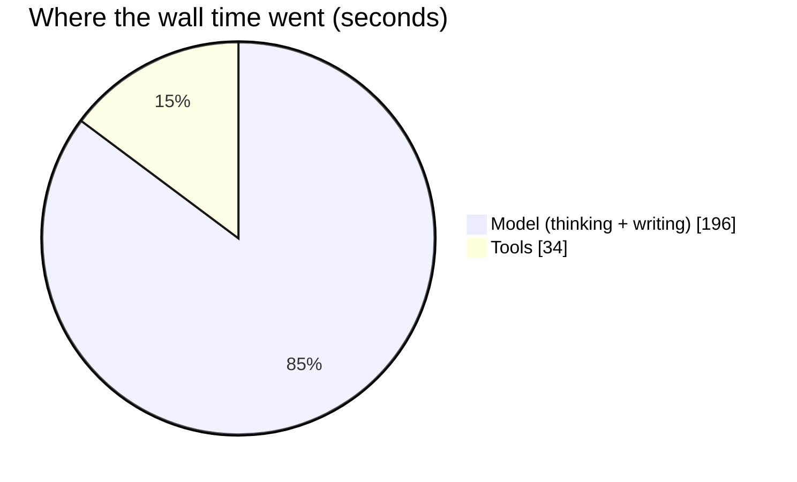

# intellectual-property/review-data-processing-agreement-template-against-eu-and-us-requirements · run5 (`hv-mixed200-lunahigh-r5-20261116T164249Z`)

Result: **all-pass** 47/47 criteria · 3.8 min · 24 model calls · 35 tool calls (1 errors or timeouts) · ending `completed` · started 11-16 23:45:05 IST

## Overview

One box per stretch of steps that used the same kind of tool (blue: looking/searching/reading, purple: writing or editing files, yellow: a message with no tool call, red border: a tool error or timeout inside the box).

```mermaid
flowchart TD
    T(["Task prompt"])
    P0["<b>Step 1</b> · 0.1 min<br/>todo_write"]
    T --> P0
    class P0 look
    P1["<b>Step 2</b> · 0.0 min<br/>glob<br/><i>*</i>"]
    P0 --> P1
    class P1 look
    P2["<b>Steps 3-4</b> · 0.3 min<br/>bash x6<br/><i>parse-doc docx documents/data-flow-di…, parse-doc docx documents/msa-summary-…, parse-doc docx documents/pinnacle-us-… +2</i>"]
    P1 --> P2
    class P2 look
    P3["<b>Step 5</b> · 0.1 min<br/>grep x4<br/><i>dpa.txt, playbook.txt</i>"]
    P2 --> P3
    class P3 look
    P4["<b>Step 6</b> · 0.1 min<br/>read x5<br/><i>dpa.txt, playbook.txt</i>"]
    P3 --> P4
    class P4 look
    P5["<b>Step 7</b> · 0.5 min<br/>glob<br/><i>output/*</i>"]
    P4 --> P5
    class P5 look
    P6["<b>Step 8</b> · 0.0 min<br/>todo_write"]
    P5 --> P6
    class P6 look
    P7["<b>Steps 9-10</b> · 1.6 min<br/>bash x2<br/><i>cat #gt; build_memo.py #lt;#lt;'PY' from docx …, parse-doc docx output/compliance-gap-…</i>"]
    P6 --> P7
    class P7 look
    P8["<b>Step 11</b> · 0.1 min<br/>read<br/><i>memo.txt</i>"]
    P7 --> P8
    class P8 look
    P9["<b>Step 12</b> · 0.2 min<br/>grep<br/><i>build_memo.py</i>"]
    P8 --> P9
    class P9 look
    P10["<b>Steps 13-15</b> · 0.2 min<br/>edit x2<br/>read<br/><i>build_memo.py</i>"]
    P9 --> P10
    class P10 err
    P11["<b>Step 16</b> · 0.1 min<br/>bash<br/><i>python build_memo.py && parse-doc doc…</i>"]
    P10 --> P11
    class P11 look
    P12["<b>Step 17</b> · 0.1 min<br/>glob<br/><i>output/*</i>"]
    P11 --> P12
    class P12 look
    P13["<b>Steps 18-21</b> · 0.3 min<br/>bash x4<br/><i>python - #lt;#lt;'PY' from docx import Docu…, mkdir -p preview && libreoffice --hea…, pdfinfo preview/compliance-gap-memora… +1</i>"]
    P12 --> P13
    class P13 look
    P14["<b>Step 22</b> · 0.1 min<br/>read_image x2<br/><i>page1-01.png, page6-06.png</i>"]
    P13 --> P14
    class P14 look
    P15["<b>Step 23</b> · 0.1 min<br/>todo_write"]
    P14 --> P15
    class P15 look
    P16["<b>Step 24</b> · 0.1 min<br/>final message"]
    P15 --> P16
    class P16 ans
    R(["ALL PASS: 47/47 criteria"])
    P16 --> R
    class R pass
    classDef look fill:#e8f0fe,stroke:#4a6fa5,color:#111
    classDef write fill:#f3e8fd,stroke:#7b1fa2,color:#111
    classDef ans fill:#fff8e1,stroke:#b58900,color:#111
    classDef err fill:#e8f0fe,stroke:#c62828,stroke-width:3px,color:#111
    classDef pass fill:#e6f4ea,stroke:#2e7d32,color:#111
    classDef fail fill:#fce8e6,stroke:#c62828,color:#111
```





One row per model call:

| Step | Started (IST) | Model s | Tools s | Tool calls | Tools | Output chars |
|---|---|---|---|---|---|---|
| 1 | 23:45:05 | 4 | 0 | 1 | todo_write | 57 |
| 2 | 23:45:09 | 1 | 1 | 1 | glob | 208 |
| 3 | 23:45:11 | 4 | 9 | 5 | bash x5 | 178,023 |
| 4 | 23:45:24 | 3 | 4 | 1 | bash | 739 |
| 5 | 23:45:31 | 5 | 2 | 4 | grep x4 | 126,946 |
| 6 | 23:45:38 | 4 | 0 | 5 | read x5 | 82,789 |
| 7 | 23:45:42 | 31 | 1 | 1 | glob | 14 |
| 8 | 23:46:14 | 3 | 0 | 1 | todo_write | 57 |
| 9 | 23:46:17 | 85 | 3 | 1 | bash | 38 |
| 10 | 23:47:44 | 3 | 3 | 1 | bash | 13,243 |
| 11 | 23:47:51 | 4 | 0 | 1 | read | 47,142 |
| 12 | 23:47:55 | 8 | 1 | 1 | grep | 1,091 |
| 13 | 23:48:04 | 5 | 0 | 1 | edit ⚠ | 280 |
| 14 | 23:48:08 | 2 | 0 | 1 | read | 2,657 |
| 15 | 23:48:11 | 3 | 0 | 1 | edit | 245 |
| 16 | 23:48:14 | 3 | 3 | 1 | bash | 469 |
| 17 | 23:48:19 | 3 | 1 | 1 | glob | 37 |
| 18 | 23:48:23 | 3 | 1 | 1 | bash | 133 |
| 19 | 23:48:27 | 3 | 2 | 1 | bash | 12 |
| 20 | 23:48:32 | 3 | 1 | 1 | bash | 60 |
| 21 | 23:48:36 | 6 | 2 | 1 | bash | 11 |
| 22 | 23:48:44 | 3 | 1 | 2 | read_image x2 | 634 |
| 23 | 23:48:47 | 4 | 0 | 1 | todo_write | 57 |
| 24 | 23:48:51 | 4 | 0 | 0 | (message only) | 0 |

## Task prompt

```text
Review the vendor DPA template against our playbook, commercial terms, data flow details, and negotiation emails; produce a gap memorandum with prioritized findings and redline recommendations. Output: `compliance-gap-memorandum.docx`.
```

## Rubric

| # | Criterion | Verdict |
|---|---|---|
| C-001 | Prioritized summary table at beginning of memo | pass |
| C-002 | ISSUE_001: Identifies missing HIPAA BAA integration | pass |
| C-003 | ISSUE_001: Notes missing HIPAA-specific definitions | pass |
| C-004 | ISSUE_001: Recommends integrating BAA or attaching as exhibit | pass |
| C-005 | ISSUE_001: References minimum necessary standard or workforce training | pass |
| C-006 | ISSUE_002: Identifies 48-hour vs. 24-hour breach notification discrepancy | pass |
| C-007 | ISSUE_002: Identifies missing HIPAA breach notification obligations | pass |
| C-008 | ISSUE_002: Recommends specific redline for breach notification timeline | pass |
| C-009 | ISSUE_003: Identifies liability cap gap (€500K vs. playbook minimum) | pass |
| C-010 | ISSUE_003: Quantifies liability gap with correct dollar figures | pass |
| C-011 | ISSUE_003: Identifies missing carve-outs for willful misconduct/gross negligence | pass |
| C-012 | ISSUE_003: Identifies blanket exclusion of consequential damages as problematic | pass |
| C-013 | ISSUE_003: References correct MSA fee structure | pass |
| C-014 | ISSUE_004: Identifies missing SCC Module 3 for processor-to-subprocessor transfers | pass |
| C-015 | ISSUE_004: Identifies Singapore remote access as an unaddressed transfer | pass |
| C-016 | ISSUE_004: Notes Larkfield not certified under EU-US Data Privacy Framework | pass |
| C-017 | ISSUE_004: Flags absence of Transfer Impact Assessment documentation | pass |
| C-018 | ISSUE_005: Identifies missing CCPA/CPRA Service Provider provisions | pass |
| C-019 | ISSUE_005: Specifies required CCPA/CPRA contractual terms | pass |
| C-020 | ISSUE_006: Identifies audit rights limited to Frankfurt only | pass |
| C-021 | ISSUE_006: Recommends extending audit rights to subprocessor locations | pass |
| C-022 | ISSUE_007: Identifies missing data return option at termination | pass |
| C-023 | ISSUE_007: Identifies HIPAA 6-year retention conflict with 90-day deletion | pass |
| C-024 | ISSUE_008: Identifies governing law mismatch for US data disputes | pass |
| C-025 | ISSUE_008: Recommends bifurcated governing law/dispute resolution | pass |
| C-026 | ISSUE_009: Recognizes Module 2 alone is insufficient for processor-to-subprocessor transfers | pass |
| C-027 | ISSUE_011: Identifies 2-year survival period as insufficient for HIPAA | pass |
| C-028 | ISSUE_012: Flags anonymization vs. pseudonymization regulatory risk | pass |
| C-029 | DISTRACTOR_003: Does not flag DIS arbitration for EU disputes as a gap | pass |
| C-030 | Each gap includes risk level classification | pass |
| C-031 | Each gap references the specific DPA section at issue | pass |
| C-032 | Each gap includes a specific recommended redline or amendment | pass |
| C-033 | Correctly identifies Pinnacle as HIPAA Covered Entity | pass |
| C-034 | Correctly identifies Stratosphere as Processor/Business Associate | pass |
| C-035 | References EU-US Data Privacy Framework in transfer analysis | pass |
| C-036 | Identifies EU-to-US (Larkfield/Northern Virginia) disaster recovery transfer scenario | pass |
| C-037 | Identifies Singapore remote access transfer scenario | pass |
| C-038 | Identifies Stratosphere processor-to-subprocessor transfer scenario | pass |
| C-039 | References 2.1 million US patients or 890,000 California residents | pass |
| C-040 | ISSUE_001 classified as Critical or High risk | pass |
| C-041 | ISSUE_003 classified as Critical or High risk | pass |
| C-042 | References negotiation context from email thread | pass |
| C-043 | Mentions subprocessor Larkfield Data Systems by name | pass |
| C-044 | Mentions subprocessor Orionis Analytics by name | pass |
| C-045 | ISSUE_006: Notes audit limited to once per year | pass |
| C-046 | ISSUE_004: Recommends specific transfer mechanisms for identified gaps | pass |
| C-047 | ISSUE_012: Recommends defining anonymization standard in DPA | pass |

Judge's reasoning:

**C-001 (pass):** Prioritized summary table at beginning of memo

```text
Near the beginning, the executive summary contains a structured table with priority labels (P0/blocker and P1/high), identified findings, one-line explanations of why they matter, and required dispositions.
```

**C-002 (pass):** ISSUE_001: Identifies missing HIPAA BAA integration

```text
The memo expressly identifies the absence of a HIPAA BAA as a P0 blocker, notes that Stratosphere and Larkfield process US patient PHI, details the missing BAA protections, and recommends an integrated or simultaneously executed BAA with subcontractor flow-downs.
```

**C-003 (pass):** ISSUE_001: Notes missing HIPAA-specific definitions

```text
The memo expressly states in P0-1 that the DPA “defines only GDPR concepts” and “does not define PHI, Covered Entity, or Business Associate,” directly identifying the missing HIPAA-specific definitions.
```

**C-004 (pass):** ISSUE_001: Recommends integrating BAA or attaching as exhibit

```text
The memorandum specifically recommends adding either an integrated BAA or a standalone BAA incorporated into and executed with the DPA, and provides sample language for attaching the BAA as an exhibit.
```

**C-005 (pass):** ISSUE_001: References minimum necessary standard or workforce training

```text
The memo expressly identifies both missing HIPAA obligations: it states the DPA does not limit PHI use to the “minimum necessary” and does not require HIPAA workforce training.
```

**C-006 (pass):** ISSUE_002: Identifies 48-hour vs. 24-hour breach notification discrepancy

```text
The memo expressly states in P1-6 that the DPA permits notice up to 48 hours after confirmation, while Pinnacle's playbook requires notice within 24 hours of discovering an actual or reasonably suspected breach. It also recommends replacing the clause with a 24-hour notification requirement.
```

**C-007 (pass):** ISSUE_002: Identifies missing HIPAA breach notification obligations

```text
The memo expressly identifies the absence of a HIPAA/HITECH breach-notification cascade as a gap and recommends adding HIPAA-specific notification and cooperation requirements, separate from the GDPR incident provisions.
```

**C-008 (pass):** ISSUE_002: Recommends specific redline for breach notification timeline

```text
The memo gives a specific redline recommendation: replace DPA §9.1 with notice within 24 hours of discovery of an actual or reasonably suspected incident, without waiting for confirmation. It also expressly recommends adding the HIPAA breach-notification cascade and related cooperation requirements.
```

**C-009 (pass):** ISSUE_003: Identifies liability cap gap (€500K vs. playbook minimum)

```text
The memo expressly identifies the DPA’s €500,000 aggregate cap as inadequate and substantially below the playbook minimum. It compares the cap against 2x affected-service annual fees ($5.6M for US services and $2.8M for EU services) and recommends at least a 2x total annual-fee fallback of $8.4M.
```

**C-010 (pass):** ISSUE_003: Quantifies liability gap with correct dollar figures

```text
The memo expressly contrasts the €500,000 template cap (approximately $545,000) with both the $2.8M affected-activity floor and the $8.4M playbook fallback minimum (2x $4.2M total annual fees). It therefore provides the required specific dollar quantification.
```

**C-011 (pass):** ISSUE_003: Identifies missing carve-outs for willful misconduct/gross negligence

```text
The memo expressly identifies the absence of required liability carve-outs and recommends that the cap not apply to the vendor's willful misconduct or gross negligence. It also states an opening position of uncapped liability for relevant data-protection claims, satisfying the criterion.
```

**C-012 (pass):** ISSUE_003: Identifies blanket exclusion of consequential damages as problematic

```text
The memo expressly flags Section 13.2’s exclusion of consequential and related damages as problematic and recommends that the consequential-damages waiver not apply to data breaches involving willful misconduct, matching Pinnacle’s playbook requirement.
```

**C-013 (pass):** ISSUE_003: References correct MSA fee structure

```text
The liability discussion expressly references the MSA fee structure, including $4.2M total annual fees and the $2.8M EU affected-activity figure, and uses $8.4M as 2x total annual fees.
```

**C-014 (pass):** ISSUE_004: Identifies missing SCC Module 3 for processor-to-subprocessor transfers

```text
The memo expressly states that Section 7.2 includes only SCC Module 2 and that the Stratosphere-to-Larkfield processor-to-subprocessor transfer to Northern Virginia requires SCC Module 3. It also recommends executing Module 3 and completing the related annexes and TIA.
```

**C-015 (pass):** ISSUE_004: Identifies Singapore remote access as an unaddressed transfer

```text
The memo expressly identifies Singapore support personnel's remote VPN access to EU data as a third-country transfer and states that this flow is not addressed by the DPA. It also recommends either prohibiting the access or implementing an appropriate transfer mechanism, TIA, and supplementary safeguards.
```

**C-016 (pass):** ISSUE_004: Notes Larkfield not certified under EU-US Data Privacy Framework

```text
The memo expressly states that “Larkfield is not DPF-certified” and advises not to rely on the Data Privacy Framework unless certification is verified, therefore recognizing that the framework cannot currently serve as the transfer mechanism for data sent to Larkfield.
```

**C-017 (pass):** ISSUE_004: Flags absence of Transfer Impact Assessment documentation

```text
The memorandum expressly flags that Section 7 contains no TIA requirement or delivery obligation and recommends documented TIAs for each third-country transfer, including U.S. and Singapore flows.
```

**C-018 (pass):** ISSUE_005: Identifies missing CCPA/CPRA Service Provider provisions

```text
The memorandum expressly identifies the absence of CCPA/CPRA Service Provider terms despite the approximately 890,000 California-resident subset. It details missing sale/share prohibitions, purpose limitations, certification, monitoring rights, and inability-to-comply notice, and recommends adding compliant terms.
```

**C-019 (pass):** ISSUE_005: Specifies required CCPA/CPRA contractual terms

```text
The memo specifies all three qualifying CCPA/CPRA provisions: a prohibition on selling or sharing personal information, a prohibition on combining personal information, and a requirement that Stratosphere certify its understanding and compliance with the Service Provider terms.
```

**C-020 (pass):** ISSUE_006: Identifies audit rights limited to Frankfurt only

```text
The memo expressly states in P1-7 that audits are limited to the Frankfurt primary facility and do not cover Dublin, Northern Virginia/Larkfield, Orionis, or other subprocessor facilities. It also recommends expanding audit scope to all data centers and subprocessors.
```

**C-021 (pass):** ISSUE_006: Recommends extending audit rights to subprocessor locations

```text
The memo expressly recommends expanding audit rights to subprocessor locations. P1-7 states that audit scope must include every subprocessor and subprocessor facility, and the proposed audit clause covers each subprocessor, all data centers, backup/DR locations, systems, records, and personnel. It also requests relevant SOC 2/ISO reports.
```

**C-022 (pass):** ISSUE_007: Identifies missing data return option at termination

```text
The memo expressly flags in P1-8 that Section 12 effectively requires deletion and lacks a complete machine-readable data return option or at least 30 days of transition assistance. It also recommends an explicit controller election to return or delete, machine-readable export, and at least 30 days of transition assistance.
```

**C-023 (pass):** ISSUE_007: Identifies HIPAA 6-year retention conflict with 90-day deletion

```text
The memo expressly identifies that the DPA permits deletion within 90 days while failing to preserve HIPAA’s six-year documentation retention requirement. It recommends a HIPAA carve-out retaining required records for six years from creation or last effective date, which directly addresses the conflict contemplated by 45 CFR § 164.530(j).
```

**C-024 (pass):** ISSUE_008: Identifies governing law mismatch for US data disputes

```text
The memo expressly flags that DPA Section 14 applies German law and Munich-seated DIS arbitration to all disputes, including US PHI and California data, and contrasts this with the playbook requirement for Delaware law and jurisdiction in the Western District of Texas, Austin Division (or Travis County courts) for US data disputes.
```

**C-025 (pass):** ISSUE_008: Recommends bifurcated governing law/dispute resolution

```text
The memo expressly recommends bifurcation: US data disputes would be governed by Delaware law and heard in U.S. courts, while EU/EEA data disputes would use EU governing law (including German law as a fallback) and German-seated DIS arbitration.
```

**C-026 (pass):** ISSUE_009: Recognizes Module 2 alone is insufficient for processor-to-subprocessor transfers

```text
The memo expressly states that SCC Module 2 covers Controller-to-Processor transfers and is insufficient for Stratosphere’s Processor-to-Subprocessor transfer to Larkfield. It specifically requires separate execution of Module 3 for the Frankfurt-to-Northern Virginia DR flow.
```

**C-027 (pass):** ISSUE_011: Identifies 2-year survival period as insufficient for HIPAA

```text
The memo expressly flags in P2-14 that Section 16’s two-year survival period is insufficient because it does not preserve BAA/HIPAA obligations, PHI protections, and related records for six years or as long as PHI is retained. It also recommends an express survival carve-out for those periods.
```

**C-028 (pass):** ISSUE_012: Flags anonymization vs. pseudonymization regulatory risk

```text
The memo expressly flags that Orionis's services are described as “anonymization and analytics” without defining anonymization or distinguishing it from pseudonymization. It explains that pseudonymized data remains personal data under GDPR and warns against treating Orionis outputs as outside GDPR unless an objective anonymization standard is met.
```

**C-029 (pass):** DISTRACTOR_003: Does not flag DIS arbitration for EU disputes as a gap

```text
The memo flags German law and Munich DIS arbitration only insofar as they currently apply to US PHI and California data. It expressly states that German law and DIS arbitration seated in Germany may be accepted for EU/EEA data disputes, so it does not treat DIS arbitration for EU matters as a material gap.
```

**C-030 (pass):** Each gap includes risk level classification

```text
All 14 identified gaps are explicitly assigned a priority classification in their headings (P0, P1, or P2), with the memo defining those levels as blocker, high-risk, and material clarification/operational protection. This exceeds the 75% threshold.
```

**C-031 (pass):** Each gap references the specific DPA section at issue

```text
The memo identifies specific DPA sections or provisions for essentially every numbered gap through the “Source check” and “Current draft” fields. Examples include §§1–17 and Annexes A/B for the missing BAA, §7.2 for transfers, §13 for liability, §14 for governing law, §9 for breach notice, §11 for audits, §12 for deletion, §6 for subprocessors, §15 for DPO coordination, and §16 for survival. This comfortably exceeds the 75% threshold.
```

**C-032 (pass):** Each gap includes a specific recommended redline or amendment

```text
The memo identifies 14 prioritized gaps, and each one includes a specific “Recommended redline” describing concrete amendments, such as adding an integrated BAA and CCPA/CPRA terms, adding SCC Module 3 and TIAs, replacing liability and governing-law clauses, reducing breach notice to 24 hours, expanding audit rights, and revising deletion, subprocessor, DPO, rights-assistance, anonymization, and survival provisions. This comfortably exceeds the 75% threshold.
```

**C-033 (pass):** Correctly identifies Pinnacle as HIPAA Covered Entity

```text
The memorandum expressly identifies Pinnacle, Inc. as a HIPAA Covered Entity in the transaction map and proposed party definitions, while treating Stratosphere as the Business Associate.
```

**C-034 (pass):** Correctly identifies Stratosphere as Processor/Business Associate

```text
The memo expressly identifies Stratosphere as a GDPR Processor and a HIPAA Business Associate, including in the transaction map and recommended party definitions.
```

**C-035 (pass):** References EU-US Data Privacy Framework in transfer analysis

```text
The memorandum discusses the Data Privacy Framework in its international-transfer analysis, stating that Larkfield is not DPF-certified and warning not to rely on DPF status unless certification is verified.
```

**C-036 (pass):** Identifies EU-to-US (Larkfield/Northern Virginia) disaster recovery transfer scenario

```text
The memo explicitly identifies EU disaster recovery replication from Frankfurt to Larkfield Data Systems in Northern Virginia, including the processor-to-subprocessor transfer, DR/BC purpose, and need for SCC Module 3 and a TIA.
```

**C-037 (pass):** Identifies Singapore remote access transfer scenario

```text
The memo expressly identifies Singapore-based support personnel remotely accessing EU personal data stored in Frankfurt/Dublin via VPN, and correctly flags that remote access as a third-country transfer requiring a compliant mechanism and TIA.
```

**C-038 (pass):** Identifies Stratosphere processor-to-subprocessor transfer scenario

```text
The memo expressly identifies the Stratosphere-to-Larkfield transfer as a processor-to-subprocessor international transfer (Frankfurt to Northern Virginia) requiring separate SCC Module 3 coverage, completed annexes, a TIA, and supplementary safeguards. It also distinguishes this from Module 2 controller-to-processor coverage.
```

**C-039 (pass):** References 2.1 million US patients or 890,000 California residents

```text
The memorandum references both qualifying figures in the relevant contexts: approximately 2.1 million US patient records/PHI for HIPAA analysis and approximately 890,000 California residents for CCPA/CPRA analysis.
```

**C-040 (pass):** ISSUE_001 classified as Critical or High risk

```text
The missing HIPAA BAA is expressly classified as “P0 / blocker” and “P0-1,” described as a non-negotiable execution blocker requiring immediate escalation. This is equivalent to the highest-tier Critical/High severity.
```

**C-041 (pass):** ISSUE_003 classified as Critical or High risk

```text
The liability cap gap is expressly classified as “P0 / blocker,” the memorandum’s highest-tier severity, and is also described as an execution blocker requiring escalation. This is equivalent to Critical or High risk.
```

**C-042 (pass):** References negotiation context from email thread

```text
The memo expressly references the April 14–18 email thread, including Stratosphere’s characterization of the €500,000 cap as a firm/global standard, Pinnacle’s response that liability is a threshold issue, the vendor’s DPO-coordination position, and the scheduled April 30 call.
```

**C-043 (pass):** Mentions subprocessor Larkfield Data Systems by name

```text
The memorandum expressly names “Larkfield Data Systems, LLC” as a subprocessor and references Larkfield throughout.
```

**C-044 (pass):** Mentions subprocessor Orionis Analytics by name

```text
The memorandum explicitly names the subprocessor “Orionis Analytics Ltd.” and refers to Orionis throughout.
```

**C-045 (pass):** ISSUE_006: Notes audit limited to once per year

```text
The memo expressly states in P1-7 that audits are limited to the Frankfurt facility, once per year, on 30 days’ notice, and it discusses expanding the right to include for-cause audits and broader coverage.
```

**C-046 (pass):** ISSUE_004: Recommends specific transfer mechanisms for identified gaps

```text
The memo recommends at least three specified mechanisms: executing SCC Module 3 for the Stratosphere-to-Larkfield processor-to-subprocessor transfer, implementing supplementary measures for Singapore remote access, and conducting documented Transfer Impact Assessments for third-country transfers. This exceeds the requirement of at least two mechanisms.
```

**C-047 (pass):** ISSUE_012: Recommends defining anonymization standard in DPA

```text
The memo expressly recommends defining an objective anonymization standard for Orionis based on singling out, linkability, and inference, requiring validation/certification, and treating outputs that fail the standard as Personal Data subject to all DPA obligations.
```

## Delivered files (output/)

- `compliance-gap-memorandum.docx` (55,273 bytes)

## Trajectory

### Step 1: 1 tool call

_Started 11-16 23:45:05 IST · model 4 s · tools 0 s_

**Reasoning summary:**

```text
**Planning document creation**

I need to create a docx file and inspect the documents involved. I should confirm if the task matches the skills I have available, but I can’t see the skill catalog right now. Maybe I should list files using glob for organization. It seems like a multi-step task, so I'll keep that in mind as I plan my approach to make sure everything gets done properly.
```

**Call `todo_write`** (0.0 s)

```json
{
 "todos": [
  {
   "content": "Inspect source documents and identify governing requirements",
   "status": "in_progress"
  },
  {
   "content": "Analyze DPA gaps against legal, commercial, and operational inputs",
   "status": "pending"
  },
  {
   "content": "Draft prioritized gap memorandum with redline recommendations",
   "status": "pending"
  },
  {
   "content": "Create and validate compliance-gap-memorandum.docx",
   "status": "pending"
  }
 ]
}
```

Output (57 chars):

```text
Updated todo list: 3 pending, 1 in progress, 0 completed.
```

**Todo list now:**

- [~] Inspect source documents and identify governing requirements
- [ ] Analyze DPA gaps against legal, commercial, and operational inputs
- [ ] Draft prioritized gap memorandum with redline recommendations
- [ ] Create and validate compliance-gap-memorandum.docx

### Step 2: 1 tool call

_Started 11-16 23:45:09 IST · model 1 s · tools 1 s_

**Call `glob`** (0.6 s)

```json
{
 "pattern": "*"
}
```

Output (208 chars):

```text
documents/data-flow-diagram.docx
documents/msa-summary-term-sheet.docx
documents/pinnacle-us-dpa-playbook.docx
documents/stratosphere-dpa-template-v3-2.docx
documents/stratosphere-negotiation-email-thread.eml
```

### Step 3: 5 tool calls

_Started 11-16 23:45:11 IST · model 4 s · tools 9 s_

**Reasoning summary:**

```text
**Exploring document parsing**

I need to read the documentation and work on parsing DOCX files using the parse-doc bash command. It’s possible I could run them in parallel for efficiency. However, I might need to check if the skill catalog is fully available or if the "legal" skill is exposed. I wonder whether I can inspect this through bash. I think I’ll use separate bash commands and apply multi_tool_use for parallel parsing.
```

**Call `bash`** (2.4 s)

```json
{
 "command": "parse-doc docx documents/data-flow-diagram.docx",
 "description": "Parse data flow diagram document"
}
```

Output (45,055 chars):

```text
**[DATA FLOW DIAGRAM AND PROCESSING DESCRIPTION]{.underline}**

**[Pinnacle Health Solutions, Inc. --- Stratosphere Cloud Services GmbH]{.underline}**

**[Data Processing Relationship]{.underline}**

**CONFIDENTIAL --- ATTORNEY-CLIENT PRIVILEGED / WORK PRODUCT**

This document is protected by the attorney-client privilege and the work product doctrine. Unauthorized disclosure, copying, or distribution is strictly prohibited. This document does not constitute legal advice to any third party.

**Prepared by:** Office of the General Counsel, Pinnacle Health Solutions, Inc., 4200 Harborview Boulevard, Suite 1100, Austin, TX 78746

**Prepared for:** Internal use and for review by outside counsel Alderton Shaw & Whitmore LLP (Rachel Osterfeld, Partner), 900 K Street NW, Suite 700, Washington, DC 20001

**Date:** April 2025

**Reference Documents:**

> •Master Services Agreement dated March 15, 2024 (\"MSA\")
>
> •Stratosphere DPA Template Version 3.2 dated January 10, 2025 (received April 14, 2025) (\"DPA Template\" or \"DPA\")
>
> •Pinnacle US DPA Playbook (last updated February 28, 2025) (\"Playbook\")

**Purpose:** This document maps all personal data flows between Pinnacle (US and EU operations), Stratosphere Cloud Services GmbH, and Stratosphere\'s subprocessors. The purpose of this mapping is to support the legal review of the DPA Template ahead of the May 16, 2025 internal review deadline and the September 1, 2025 EU expansion launch date. The data flow diagrams and accompan
… [43,554 more chars]
```

**Call `bash`** (2.0 s)

```json
{
 "command": "parse-doc docx documents/msa-summary-term-sheet.docx",
 "description": "Parse commercial term sheet"
}
```

Output (22,315 chars):

```text
**[MASTER SERVICES AGREEMENT --- SUMMARY TERM SHEET]{.underline}**

**Summary of Key Commercial Terms**

MSA Effective Date: March 15, 2024

This Summary Term Sheet is for internal reference purposes only and does not amend or supersede the Master Services Agreement dated March 15, 2024 (the \"MSA\"), by and between Pinnacle Health Solutions, Inc. and Stratosphere Cloud Services GmbH. In the event of any conflict between the terms summarized herein and the terms of the executed MSA, the terms of the executed MSA shall control in all respects.

Prepared by the Office of General Counsel Pinnacle Health Solutions, Inc.

Last Updated: March 15, 2024

**[Section 1 --- Parties]{.underline}**

**Client:** Pinnacle Health Solutions, Inc., a Delaware corporation, with its principal offices located at 4200 Harborview Boulevard, Suite 1100, Austin, TX 78746 (\"Pinnacle\" or \"Client\").

**Service Provider:** Stratosphere Cloud Services GmbH, a German limited liability company (*Gesellschaft mit beschränkter Haftung*) registered at the Munich Local Court (*Amtsgericht München*) under Commercial Register (*Handelsregister*) number HRB 247891, with its registered office at Hohenzollernstraße 88, 80796 Munich, Germany (\"Stratosphere\" or \"Service Provider\").

**EU Entity Designation:** For purposes of EU Services (as defined in Section 3 below), the Client entity may be designated as Pinnacle Health Solutions EU B.V., a private limited liability company organized under the laws of the N
… [20,814 more chars]
```

**Call `bash`** (2.2 s)

```json
{
 "command": "parse-doc docx documents/pinnacle-us-dpa-playbook.docx",
 "description": "Parse DPA playbook"
}
```

Output (49,928 chars):

```text
and \$1.4 million EU), the cap for EU-specific claims would be no less than \$2,800,000 (2 × \$1,400,000) and for US-specific claims no less than \$5,600,000 (2 × \$2,800,000).

**Must-have:** Liability must be **uncapped** for the following categories of claims:

> \(a\) **Willful misconduct** by vendor, its employees, agents, or subprocessors;
>
> \(b\) **Gross negligence** by vendor, its employees, agents, or subprocessors;
>
> \(c\) **Breaches of confidentiality obligations** involving intentional or reckless conduct; and
>
> \(d\) **Regulatory fines or penalties** imposed on Pinnacle as a direct result of vendor\'s non-compliance with applicable data protection laws, including HIPAA, CCPA/CPRA, and GDPR.

**Must-have:** Consequential, indirect, and special damages may **NOT** be excluded for data breaches involving willful misconduct by vendor. A blanket consequential damages exclusion that applies to all claims, including data protection claims, is unacceptable. While mutual exclusions of consequential damages are common in general commercial agreements, they are inappropriate in the data protection context where the most significant harms to Pinnacle --- including regulatory penalties, class action settlements, breach notification costs, credit monitoring expenses, and reputational damage --- may be characterized as consequential or indirect damages under applicable law. A blanket exclusion could effectively eliminate vendor accountability for the very harms the DPA is
… [48,427 more chars]
```

**Call `bash`** (2.1 s)

```json
{
 "command": "parse-doc docx documents/stratosphere-dpa-template-v3-2.docx",
 "description": "Parse vendor DPA template"
}
```

Output (49,921 chars):

```text
of the GDPR.

**[SECTION 4 --- CONFIDENTIALITY]{.underline}**

**4.1** The Processor shall ensure that all persons authorized to Process Personal Data on behalf of the Controller, including the Processor\'s employees, contractors, temporary workers, and agents, have committed themselves to confidentiality or are under an appropriate statutory obligation of confidentiality, in accordance with Article 28(3)(b) of the GDPR. The Processor shall maintain written records of such confidentiality commitments and shall make them available to the Controller upon request.

**4.2** The Processor shall ensure that access to Personal Data Processed on behalf of the Controller is strictly limited to those members of the Processor\'s personnel who require such access for the performance of the Services under the Agreement. The Processor shall implement appropriate access management procedures, including role-based access controls and least-privilege principles, to enforce this limitation. The Processor shall promptly revoke access for any personnel member whose role no longer requires access to the Controller\'s Personal Data.

**4.3** The obligations set forth in this Section 4 shall survive the termination or expiration of this DPA and shall continue in full force and effect for so long as the Processor or any of its personnel retains any Personal Data Processed on behalf of the Controller.

**4.4** The Processor shall not disclose Personal Data to any third party, including any government
… [48,420 more chars]
```

**Call `bash`** (0.7 s)

```json
{
 "command": "sed -n '1,240p' documents/stratosphere-negotiation-email-thread.eml",
 "description": "Read negotiation email thread"
}
```

Output (10,804 chars):

```text
From: Margaret Yuen-Park <myuenpark@pinnaclehealth.example.com>
To: Dr. Florian Neumann <f.neumann@stratospherecloud.example.com>
Cc: Rachel Osterfeld <rosterfeld@alderton-shaw.example.com>
Date: Fri, 18 Apr 2025 11:02:00 -0000
Subject: Re: Re: Re: Stratosphere DPA Template v3.2 — For Your Review
Content-Type: text/plain; charset="utf-8"
Content-Transfer-Encoding: quoted-printable
MIME-Version: 1.0

Florian,

Thank you for your response and for looping in Dr. Beckert.

We can confirm the call for Wednesday, April 30, 2025, at 4:00 PM CEST / 9:00=
 AM CDT. Rachel Osterfeld from Alderton Shaw & Whitmore will attend on our si=
de.

On the liability cap =E2=80=94 I appreciate your willingness to take this up =
internally. I want to set expectations that our redline of Section 13 will pr=
opose a structure tied to the annual fees under the MSA rather than a flat ca=
p, together with the carve-outs for willful misconduct and gross negligence I=
 referenced previously. I want to be transparent that this is a threshold iss=
ue for us, and we will need to reach agreement on liability allocation before=
 we can finalize the DPA.

Regarding DPO coordination, I understand Stratosphere's preference for operat=
ional rather than contractual mechanisms. I respectfully disagree. Given the =
dual-regulatory environment we will be operating in =E2=80=94 with obligation=
s to both EU supervisory authorities and US federal regulators =E2=80=94 our =
board and compliance committee will require th
… [9,303 more chars]
```

### Step 4: 1 tool call

_Started 11-16 23:45:24 IST · model 3 s · tools 4 s_

**Call `bash`** (3.9 s)

```json
{
 "command": "parse-doc docx documents/pinnacle-us-dpa-playbook.docx > playbook.txt && parse-doc docx documents/stratosphere-dpa-template-v3-2.docx > dpa.txt",
 "description": "Save parsed source documents for review"
}
```

Output (739 chars):

```text
[stderr]
2026-11-16 18:15:28.716369960 [W:onnxruntime:Default, device_discovery.cc:95 GetPciBusId] Skipping pci_bus_id for PCI path at "/sys/devices/LNXSYSTM:00/LNXSYBUS:00/ACPI0004:00/VMBUS:00/5620e0c7-8062-4dce-aeb7-520c7ef76171" because filename "5620e0c7-8062-4dce-aeb7-520c7ef76171" did not match expected pattern of [0-9a-f]+:[0-9a-f]+:[0-9a-f]+[.][0-9a-f]+
2026-11-16 18:15:30.474470954 [W:onnxruntime:Default, device_discovery.cc:95 GetPciBusId] Skipping pci_bus_id for PCI path at "/sys/devices/LNXSYSTM:00/LNXSYBUS:00/ACPI0004:00/VMBUS:00/5620e0c7-8062-4dce-aeb7-520c7ef76171" because filename "5620e0c7-8062-4dce-aeb7-520c7ef76171" did not match expected pattern of [0-9a-f]+:[0-9a-f]+:[0-9a-f]+[.][0-9a-f]+
```

### Step 5: 4 tool calls

_Started 11-16 23:45:31 IST · model 5 s · tools 2 s_

**Reasoning summary:**

```text
**Using grep for analysis**

I think I need to use the grep tool to filter out headings and key terms. This will help me find important information easily. I'm curious about how efficiently it can handle large text files and if it will provide accurate results. There might be some additional options I need to explore with grep to refine my search further, but I feel confident that it’ll be a useful step in organizing the data.
```

**Call `grep`** (0.5 s)

```json
{
 "pattern": "^\\*\\*\\[?(SECTION|Section|[0-9]+\\.)|SECTION|Section",
 "path": "dpa.txt"
}
```

Output (45,924 chars):

```text
Found 113 matches

dpa.txt
Line 49: **[SECTION 1 --- DEFINITIONS]{.underline}**
Line 51: **1.1** \"**Applicable Data Protection Law**\" means Regulation (EU) 2016/679 (the GDPR) and any applicable legislation of the European Union or its Member States implementing, supplementing, or replacing the GDPR, including without limitation the German Federal Data Protection Act (*Bundesdatenschutzgesetz*, \"BDSG\") as amended from time to time, and any other data protection legislation directly applicable within the European Economic Area.
Line 53: **1.2** \"**Controller**\" means the natural or legal person, public authority, agency, or other body which, alone or jointly with others, determines the purposes and means of the Processing of Personal Data, as defined in Article 4(7) of the GDPR, and as identified in the signature block of this DPA.
Line 55: **1.3** \"**Data Subject**\" means an identified or identifiable natural person to whom Personal Data relates, as defined in Article 4(1) of the GDPR. An identifiable natural person is one who can be identified, directly or indirectly, in particular by reference to an identifier such as a name, an identification number, location data, an online identifier, or to one or more factors specific to the physical, physiological, genetic, mental, economic, cultural, or social identity of that natural person.
Line 57: **1.4** \"**EEA**\" means the European Economic Area, comprising the Member States of the European Union together with Iceland,
… [44,424 more chars]
```

**Call `grep`** (0.6 s)

```json
{
 "pattern": "^\\*\\*\\[?(SECTION|Section|[0-9]+\\.)|SECTION|Section",
 "path": "playbook.txt"
}
```

Output (13,903 chars):

```text
Found 71 matches

playbook.txt
Line 35: **[Section 1: Purpose and Scope of This Playbook]{.underline}**
Line 59: **[Section 2: Regulatory Framework Overview]{.underline}**
Line 61: Pinnacle\'s vendor DPA negotiations must account for three primary regulatory regimes, each of which imposes distinct and, in some cases, overlapping requirements on the contractual relationship between Pinnacle and its data processing vendors. Understanding the interplay among these regimes is essential for effective negotiation. This Section provides a summary overview; detailed negotiation positions for each regime are set forth in the Sections that follow.
Line 67: **[2.1 HIPAA / HITECH]{.underline}**
Line 95: **[2.2 CCPA / CPRA]{.underline}**
Line 111: These provisions are mandatory for all vendors with access to California resident data. A vendor DPA that omits these provisions, or that contains language inconsistent with the Service Provider classification, must be redlined before execution. Detailed negotiation positions for CCPA/CPRA terms are set forth in Section 7 of this playbook.
Line 113: **[2.3 GDPR]{.underline}**
Line 127: **[Section 3: Definitions --- Required Contractual Definitions]{.underline}**
Line 129: Every Pinnacle DPA must include clearly defined terms organized by regulatory regime. The inclusion of complete and accurate definitions is essential to ensuring that the DPA\'s operative provisions are enforceable and that each party\'s obligations are unambiguous. This Sectio
… [12,403 more chars]
```

**Call `grep`** (0.7 s)

```json
{
 "pattern": "BAA|HIPAA|CCPA|CPRA|liability|Governing|Dispute|Deletion|retention|DPO|audit|breach|subprocessor|transfer|Singapore|anonym|pseudonym",
 "path": "dpa.txt"
}
```

Output (17,214 chars):

```text
Found 36 matches

dpa.txt
Line 61: **1.6** \"**Personal Data Breach**\" means a breach of security leading to the accidental or unlawful destruction, loss, alteration, unauthorized disclosure of, or access to, Personal Data transmitted, stored, or otherwise Processed, as defined in Article 4(12) of the GDPR.
Line 67: **1.9** \"**Standard Contractual Clauses**\" or \"**SCCs**\" means the standard contractual clauses for the transfer of personal data to third countries pursuant to Commission Implementing Decision (EU) 2021/914 of 4 June 2021 on standard contractual clauses for the transfer of personal data to third countries pursuant to Regulation (EU) 2016/679 of the European Parliament and of the Council, as may be amended, supplemented, or replaced from time to time by the European Commission.
Line 89: **3.1** The Processor shall Process Personal Data only on documented instructions from the Controller, including with regard to transfers of Personal Data to a third country or an international organization, unless required to do so by European Union or Member State law to which the Processor is subject. In such a case, the Processor shall inform the Controller of that legal requirement before carrying out the Processing, unless that law prohibits such information on important grounds of public interest, in accordance with Article 28(3)(a) of the GDPR. The Processor acknowledges that the requirement to Process on documented instructions is a fundamental obligation under this D
… [15,714 more chars]
```

**Call `grep`** (0.5 s)

```json
{
 "pattern": "BAA|HIPAA|CCPA|CPRA|liability|Governing|Dispute|Deletion|retention|DPO|audit|breach|subprocessor|transfer|Singapore|anonym|pseudonym",
 "path": "playbook.txt"
}
```

Output (49,905 chars):

```text
Found 214 matches

playbook.txt
Line 41: Pinnacle acts as a **HIPAA Covered Entity** for certain data flows involving Protected Health Information (\"**PHI**\") of approximately **2.1 million US patients** and approximately **14,000 US healthcare provider contacts**. These data flows are central to Pinnacle\'s core service offerings and are implicated in the majority of vendor engagements involving clinical and patient-facing data processing activities.
Line 43: Pinnacle processes personal information of approximately **890,000 California residents**, triggering obligations under the California Consumer Privacy Act as amended by the California Privacy Rights Act (\"**CCPA/CPRA**\"). Given the significant volume of California resident data processed by Pinnacle and its vendors, CCPA/CPRA compliance is a primary concern in all vendor DPA negotiations involving consumer-facing data.
Line 49: > • **HIPAA/HITECH**, including Business Associate Agreement (\"BAA\") requirements;
Line 51: > • **CCPA/CPRA**, including Service Provider qualification and certification requirements;
Line 53: > • **GDPR**, including Article 28 processor requirements and cross-border data transfer mechanisms; and
Line 57: **Important Note:** This playbook does NOT replace the requirement for outside counsel review of DPAs involving novel or high-risk processing activities. Negotiators must escalate to **Rachel Osterfeld** at Alderton Shaw & Whitmore LLP for matters involving cross-border transfers to juris
… [48,405 more chars]
```

### Step 6: 5 tool calls

_Started 11-16 23:45:38 IST · model 4 s · tools 0 s_

**Reasoning summary:**

```text
**Reviewing DPA details**

I need to inspect specific sections of the DPA, particularly lines 1-50, 227-325, and maybe also 233-241. I'm considering the relevant lines in the playbook from 195-325; that might be enough right there. It seems crucial to focus on the full DPA lines starting from 227 onward to ensure I fully cover what’s needed. I want to make sure I have everything I need for a thorough review!
```

**Call `read`** (0.0 s)

```json
{
 "file_path": "dpa.txt",
 "offset": 1,
 "limit": 55
}
```

Output (4,961 chars):

```text
<path>/home/agarwaldi/dsh-bench-harness/runs/hv-mixed200-lunahigh-r5-20261116T164249Z/tasks/intellectual-property__review-data-processing-agreement-template-against-eu-and-us-requirements/workspace/dpa.txt</path>
<type>file</type>
<content>
1: **[DATA PROCESSING AGREEMENT]{.underline}**
2: 
3: **Version 3.2**
4: 
5: **January 10, 2025**
6: 
7: **STRATOSPHERE CLOUD SERVICES GmbH**
8: 
9: *Cloud Infrastructure · Managed Databases · Analytics*
10: 
11: This Data Processing Agreement (\"DPA\") forms part of and is subject to the terms of the Master Services Agreement (\"Agreement\" or \"MSA\") between the Processor and the Controller.
12: 
13: This DPA is designed to ensure compliance with Regulation (EU) 2016/679 of the European Parliament and of the Council of 27 April 2016 (the \"GDPR\") and applicable data protection laws governing the Processing of Personal Data in connection with the Services provided under the Agreement.
14: 
15: **Processor Registered Office:**
16: 
17: Stratosphere Cloud Services GmbH Hohenzollernstraße 88 80796 Munich, Germany
18: 
19: Handelsregister HRB 247891, Amtsgericht München (Munich Local Court)
20: 
21: **Prepared by:**
22: 
23: Legal Department, Stratosphere Cloud Services GmbH
24: 
25: **Contact:**
26: 
27: Dr. Florian Neumann Chief Legal Officer Stratosphere Cloud Services GmbH
28: 
29: Email: florian.neumann@stratospherecloud.example.com
30: 
31: Tel: +49 89 2155 4400
32: 
33: Right-click to update Table of Contents
34: 
35: **[RECITALS]{.u
… [3,461 more chars]
```

**Call `read`** (0.0 s)

```json
{
 "file_path": "dpa.txt",
 "offset": 225,
 "limit": 105
}
```

Output (19,012 chars):

```text
<path>/home/agarwaldi/dsh-bench-harness/runs/hv-mixed200-lunahigh-r5-20261116T164249Z/tasks/intellectual-property__review-data-processing-agreement-template-against-eu-and-us-requirements/workspace/dpa.txt</path>
<type>file</type>
<content>
225: **[SECTION 11 --- AUDIT RIGHTS]{.underline}**
226: 
227: **11.1** The Processor shall make available to the Controller all information necessary to demonstrate compliance with the obligations laid down in Article 28 of the GDPR and this DPA, and shall allow for and contribute to audits, including inspections, conducted by the Controller or another auditor mandated by the Controller, in accordance with Article 28(3)(h) of the GDPR. The Processor shall cooperate in good faith with the Controller in connection with any such audit and shall provide the Controller\'s audit team with reasonable access to relevant documentation, systems, and personnel.
228: 
229: **11.2** The Controller may conduct an audit of the Processor\'s Processing activities no more than once per calendar year, subject to at least thirty (30) calendar days\' prior written notice to the Processor. Audits shall be conducted during the Processor\'s normal business hours (Monday through Friday, 9:00 a.m. to 6:00 p.m. Central European Time, excluding German public holidays) and shall not unreasonably interfere with the Processor\'s business operations or the Processor\'s obligations to its other customers. The Controller\'s audit team shall comply with the Processor\'s rea
… [17,512 more chars]
```

**Call `read`** (0.1 s)

```json
{
 "file_path": "dpa.txt",
 "offset": 325,
 "limit": 180
}
```

Output (13,187 chars):

```text
<path>/home/agarwaldi/dsh-bench-harness/runs/hv-mixed200-lunahigh-r5-20261116T164249Z/tasks/intellectual-property__review-data-processing-agreement-template-against-eu-and-us-requirements/workspace/dpa.txt</path>
<type>file</type>
<content>
325: **17.7 Counterparts.** This DPA may be executed in any number of counterparts, each of which shall be deemed an original, and all of which together shall constitute one and the same instrument. Execution and delivery of this DPA by electronic signature or by exchange of PDF copies shall have the same force and effect as execution and delivery of an original signed counterpart.
326: 
327: **[SIGNATURE BLOCK]{.underline}**
328: 
329: **IN WITNESS WHEREOF**, the Parties have caused this Data Processing Agreement to be executed by their duly authorized representatives as of the dates set forth below.
330: 
331: **CONTROLLER:**
332: 
333: \_\_\_\_\_\_\_\_\_\_\_\_\_\_\_\_\_\_\_\_\_\_\_\_\_\_\_\_\_\_\_\_\_\_\_\_\_\_\_\_
334: 
335: \[Full Legal Name of Controller\]
336: 
337: Address: **\_\_\_\_\_\_\_\_**
338: 
339: \_\_\_\_\_\_\_\_\_\_\_\_\_\_\_\_\_\_\_\_\_\_\_\_\_\_\_\_\_\_\_\_\_\_\_\_\_\_\_\_
340: 
341: By: **\_\_\_\_\_\_\_\_**
342: 
343: Name: **\_\_\_\_\_\_\_\_**
344: 
345: Title: **\_\_\_\_\_\_\_\_**
346: 
347: Date: **\_\_\_\_\_\_\_\_**
348: 
349: **PROCESSOR:**
350: 
351: STRATOSPHERE CLOUD SERVICES GmbH Hohenzollernstraße 88, 80796 Munich, Germany Handelsregister HRB 247891, Amtsgericht München
352: 
353: By: **\_\_\_\_\_\_\_\_**
354
… [11,687 more chars]
```

**Call `read`** (0.1 s)

```json
{
 "file_path": "playbook.txt",
 "offset": 195,
 "limit": 145
}
```

Output (20,945 chars):

```text
<path>/home/agarwaldi/dsh-bench-harness/runs/hv-mixed200-lunahigh-r5-20261116T164249Z/tasks/intellectual-property__review-data-processing-agreement-template-against-eu-and-us-requirements/workspace/playbook.txt</path>
<type>file</type>
<content>
195: **[Section 4: HIPAA Business Associate Agreement Requirements]{.underline}**
196: 
197: This Section addresses the most critical requirement for US healthcare vendor DPAs: the **HIPAA Business Associate Agreement**. The BAA is not a discretionary contract term; it is a **regulatory mandate** under 45 CFR § 164.502(e) and 45 CFR § 164.504(e). Failure to execute a compliant BAA with a vendor that processes PHI exposes Pinnacle to enforcement action by the HHS Office for Civil Rights (\"**OCR**\"), including civil monetary penalties of up to \$2,067,813 per violation category per calendar year (as adjusted for inflation). Equally important, the absence of a BAA means that any disclosure of PHI to the vendor may itself constitute a HIPAA violation.
198: 
199: ALL vendors that create, receive, maintain, or transmit PHI on Pinnacle\'s behalf must execute a BAA. There are no exceptions to this requirement. This Section sets forth the must-have, nice-to-have, and fallback positions for BAA terms, as well as non-negotiable red lines.
200: 
201: **[4.1 BAA as Must-Have]{.underline}**
202: 
203: **Must-have:** The vendor DPA must include a fully compliant HIPAA BAA, either integrated into the DPA body or attached as a standalone exhibit tha
… [19,445 more chars]
```

**Call `read`** (0.1 s)

```json
{
 "file_path": "playbook.txt",
 "offset": 507,
 "limit": 200
}
```

Output (24,684 chars):

```text
<path>/home/agarwaldi/dsh-bench-harness/runs/hv-mixed200-lunahigh-r5-20261116T164249Z/tasks/intellectual-property__review-data-processing-agreement-template-against-eu-and-us-requirements/workspace/playbook.txt</path>
<type>file</type>
<content>
507: **[Section 10: Governing Law and Dispute Resolution]{.underline}**
508: 
509: Governing law and dispute resolution provisions are critical in DPAs that cover both US and EU data, particularly where the vendor is a non-US entity. A DPA that applies a single non-US governing law and non-US dispute resolution forum to all disputes --- including disputes involving US PHI and California personal information --- could undermine Pinnacle\'s ability to enforce its US regulatory rights and may be inconsistent with the jurisdictional framework of HIPAA and CCPA/CPRA enforcement. This Section establishes Pinnacle\'s required approach: a bifurcated governing law and dispute resolution structure.
510: 
511: **[10.1 Bifurcated Governing Law]{.underline}**
512: 
513: **Must-have:** DPAs covering both US and EU data must include a **bifurcated governing law clause** that applies different governing law depending on the nature of the claim and the data involved:
514: 
515: > **(a) US Data Disputes.** All disputes, claims, and obligations arising from or related to the processing of **US data** --- including PHI, ePHI, CCPA/CPRA-covered personal information, and any other personal data of US-based data subjects --- shall be governed by and constru
… [23,184 more chars]
```

### Step 7: 1 tool call

_Started 11-16 23:45:42 IST · model 31 s · tools 1 s_

**Reasoning summary:**

```text
**Considering access scenarios**

I need to be nuanced here. Since the Singapore staff are Stratosphere personnel, it's important to consider how remote access is managed by our processor personnel. I’ll need to make the transfer scenario explicit and ensure that SCC coverage includes appropriate safeguards. I'll refer to "Module 2 with Singapore operations designated as an additional importer" as part of the data flow to clarify how everything interacts.

**Creating a docx with python-docx**

I need to create a .docx document, and it looks like I have to use the python-docx package, which should be installed. I’ll need to use bash for the creation process. The developer mentioned that it's fine to use write-only markdown for deliverables. I should be cautious about including a legal advice disclaimer and the date. I’m just thinking it might require some specific skill to ensure everything is done correctly!

**Preparing to write a script**

I want to avoid creating an overly lengthy document, aiming for about 20 pages as a maximum. My goal is to produce a polished output, so I'll write a Python script in the workspace using `python-docx`, presuming it's already installed. I'll need formatting elements like headings, headers, and footers. There's no need to use the write tool because of markdown restrictions. I can write the Python script directly in bash using a here-doc command, and I'll consider checking existing outputs as well.
```

**Call `glob`** (0.6 s)

```json
{
 "pattern": "output/*"
}
```

Output (14 chars):

```text
No files found
```

### Step 8: 1 tool call

_Started 11-16 23:46:14 IST · model 3 s · tools 0 s_

**Call `todo_write`** (0.0 s)

```json
{
 "todos": [
  {
   "content": "Inspect source documents and identify governing requirements",
   "status": "completed"
  },
  {
   "content": "Analyze DPA gaps against legal, commercial, and operational inputs",
   "status": "completed"
  },
  {
   "content": "Draft prioritized gap memorandum with redline recommendations",
   "status": "in_progress"
  },
  {
   "content": "Create and validate compliance-gap-memorandum.docx",
   "status": "pending"
  }
 ]
}
```

Output (57 chars):

```text
Updated todo list: 1 pending, 1 in progress, 2 completed.
```

**Todo list now:**

- [x] Inspect source documents and identify governing requirements
- [x] Analyze DPA gaps against legal, commercial, and operational inputs
- [~] Draft prioritized gap memorandum with redline recommendations
- [ ] Create and validate compliance-gap-memorandum.docx

### Step 9: 1 tool call

_Started 11-16 23:46:17 IST · model 85 s · tools 3 s_

**Reasoning summary:**

```text
**Creating a DOCX script**

I need to generate a DOCX file carefully, ensuring that tables fit the page width and using inches for measurements. I’ll include page breaks and utilize helpers for paragraphs, tables, and shading. The font should be Aptos or Arial, and I want to make sure the content isn't too bloated but still sufficient. I'll incorporate specific phrases for some clauses, referencing Pinnacle Health Solutions in both the EU and the US, while adding the necessary legal caveat. Let's craft that script!
```

**Call `bash`** (2.7 s)

```json
{
 "command": "cat > build_memo.py <<'PY'\nfrom docx import Document\nfrom docx.shared import Inches, Pt, RGBColor\nfrom docx.enum.text import WD_ALIGN_PARAGRAPH, WD_BREAK\nfrom docx.enum.table import WD_TABLE_ALIGNMENT, WD_CELL_VERTICAL_ALIGNMENT\nfrom docx.enum.section import WD_SECTION\nfrom docx.oxml import OxmlElement\nfrom docx.oxml.ns import qn\nfrom docx.enum.style import WD_STYLE_TYPE\nfrom docx.enum.text import WD_LINE_SPACING\n\nOUT = 'output/compliance-gap-memorandum.docx'\n\ndoc = Document()\nsec = doc.sections[0]\nsec.top_margin = Inches(0.65)\nsec.bottom_margin = Inches(0.65)\nsec.left_margin = Inches(0.7)\nsec.right_margin = Inches(0.7)\n\n# Palette\nNAVY = '17365D'\nBLUE = '2F75B5'\nLIGHT_BLUE = 'D9EAF7'\nPALE_BLUE = 'EEF5FB'\nRED = 'C00000'\nPALE_RED = 'FCE4D6'\nAMBER = 'BF9000'\nPALE_AMBER = 'FFF2CC'\nGREEN = '548235'\nPALE_GREEN = 'E2F0D9'\nGRAY = '666666'\nLIGHT_GRAY = 'F2F2F2'\nDARK = '222222'\n\n# Helpers\ndef set_cell_shading(cell, fill):\n    tcPr = cell._tc.get_or_add_tcPr()\n    shd = tcPr.find(qn('w:shd'))\n    if shd is None:\n        shd = OxmlElement('w:shd')\n        tcPr.append(shd)\n    shd.set(qn('w:fill'), fill)\n\ndef set_cell_border(cell, **kwa
… [44,000 more chars]
```

Output (38 chars):

```text
output/compliance-gap-memorandum.docx
```

### Step 10: 1 tool call

_Started 11-16 23:47:44 IST · model 3 s · tools 3 s_

**Reasoning summary:**

```text
**Validating document parsing**

I need to validate the parsing of the DOCX file and possibly inspect the output. It might also be good to check for errors in the parsing process. Additionally, I'm considering whether the script needs to use the cat shell, but it seems okay. I want to ensure that everything is processed correctly, so I’ll check the parse-doc output and confirm that it saves without issues.
```

**Call `bash`** (3.0 s)

```json
{
 "command": "parse-doc docx output/compliance-gap-memorandum.docx > memo.txt && wc -l memo.txt && sed -n '1,80p' memo.txt",
 "description": "Validate generated memorandum document",
 "timeoutMs": 120000
}
```

Output (13,243 chars):

```text
349 memo.txt
**COMPLIANCE GAP MEMORANDUM**

**Review of Stratosphere Cloud Services GmbH DPA Template v3.2**

Against Pinnacle playbook, MSA commercial terms, data-flow mapping, and negotiation correspondence

  --------------------------------------------------------------------------------------------------------------------------------------------------
  **Item**                            **Details**
  ----------------------------------- --------------------------------------------------------------------------------------------------------------
  Prepared for                        Pinnacle Health Solutions, Inc. and Pinnacle Health Solutions EU B.V.

  Vendor                              Stratosphere Cloud Services GmbH; subprocessors: Larkfield Data Systems, LLC and Orionis Analytics Ltd.

  Review date                         April 2025 source package; memorandum prepared for the May 9 circulation target and May 16 internal deadline

  EU launch                           September 1, 2025 (DPA execution is a condition precedent to EU Services)

  Status                              Internal negotiation memorandum; not a final legal opinion or executed redline
  --------------------------------------------------------------------------------------------------------------------------------------------------

+-----------------------------------------------------------------------------------------------------------------------------------------------------------------
… [11,742 more chars]
```

### Step 11: 1 tool call

_Started 11-16 23:47:51 IST · model 4 s · tools 0 s_

**Reasoning summary:**

```text
**Evaluating command usage**

I’m considering if I violated an instruction by using `sed` in bash. The developer mentioned using the `read` tool instead of shell commands like `cat` to inspect text. I used `sed` to preview parse output, but I'm unsure if that breaks the rules. It might be safe, but I should check everything with the `read` tool and validate the rest, especially lines 80 onward with the `parse-doc` command.
```

**Call `read`** (0.0 s)

```json
{
 "file_path": "memo.txt",
 "offset": 80,
 "limit": 280
}
```

Output (47,142 chars):

```text
<path>/home/agarwaldi/dsh-bench-harness/runs/hv-mixed200-lunahigh-r5-20261116T164249Z/tasks/intellectual-property__review-data-processing-agreement-template-against-eu-and-us-requirements/workspace/memo.txt</path>
<type>file</type>
<content>
80: 
81: **P0-1 --- HIPAA BAA is entirely missing**
82: 
83: **Source check:** *DPA §§1--17; Annex A/B; Playbook §§4.1--4.2*
84: 
85: **Current draft / risk:** The DPA states it is designed for GDPR and defines only GDPR concepts. It does not define PHI, Covered Entity, or Business Associate; does not limit PHI use to permitted purposes/minimum necessary; does not require HIPAA workforce training, administrative/physical/technical safeguards, HIPAA breach cascade, six-year documentation retention, or compliant return/destruction. Larkfield receives US PHI in Northern Virginia, so both Stratosphere and Larkfield require Business Associate / subcontractor flow-down protections.
86: 
87: **Recommended redline:** Add an integrated BAA or a standalone BAA expressly incorporated and executed simultaneously. Make the more protective term control for PHI. Bind each PHI-accessing subprocessor to equivalent BAA restrictions before disclosure. Include permitted uses/disclosures, minimum necessary, training and records, §§164.308/310/312 safeguards, 24-hour notice, HIPAA cooperation, six-year retention, and return/destruction/infeasibility provisions. This is a non-negotiable red line; escalate refusal immediately.
88: 
89: **P0-2 --- CCPA/CPRA Servi
… [45,642 more chars]
```

### Step 12: 1 tool call

_Started 11-16 23:47:55 IST · model 8 s · tools 1 s_

**Reasoning summary:**

```text
**Reviewing compliance issues**

I need to check if the requirements include "redline recommendations." It seems refining the technical/legal nuances is necessary. The BAA isn't explicitly required for "Larkfield" with US PHI, but the data flow suggests it acts as a subprocessor. There's a concern regarding a memo mentioning an internal discussion about the €500k standard. I should point out that the MSA DPA liability doesn't fall under the MSA cap. It seems "Pinnacle's April 18 response" correctly identifies some issues, but I should flag that US operations may be a compliance risk since the DPA isn't executed.

**Clarifying processing requirements**

The source term sheet states that the MSA requires the DPA to be effective before any processing happens, but the current US services are already in place, which is a gap I should mention. Adding this information to P0-1 or the executive summary might be beneficial. The phrase "DPA effective no later than first processing" may not address retrospective issues fully. We should confirm that no processing occurred before execution and ensure compliance with an effective date if necessary. I'll edit the source script, and although we've created it already, I'll read the first 10 lines for context before making targeted changes.

**Deciding on editing tools**

I’m considering whether to use the edit function or if it might be easier to utilize Python's sed for this task. The instructions indicate that edit is preferred for incremental refinement. I think I should read the relevant parts first, perhaps using grep to find specific phrases in build_memo.py. This will help ensure I focus on the right sections before making any changes. I'll confirm which approach will be the most efficient!
```

**Call `grep`** (1.0 s)

```json
{
 "pattern": "Larkfield receives US PHI|Make the DPA effective no later than first processing",
 "path": "build_memo.py"
}
```

Output (1,091 chars):

```text
Found 2 matches

build_memo.py
Line 290:  'The DPA states it is designed for GDPR and defines only GDPR concepts. It does not define PHI, Covered Entity, or Business Associate; does not limit PHI use to permitted purposes/minimum necessary; does not require HIPAA workforce training, administrative/physical/technical safeguards, HIPAA breach cascade, six-year documentation retention, or compliant return/destruction. Larkfield receives US PHI in Northern Virginia, so both Stratosphere and Larkfield require Business Associate / subcontractor flow-down protections.',
Line 318:  'Complete the signature block and Annex A for both entities (or add a controller joinder structure), insert the correct MSA date, and state roles by data set. Align Annex A categories, volumes, locations, purposes, and retention with the data-flow document. Correct Annex B.5 operator/role entries and expressly identify Singapore remote access, Larkfield Northern Virginia DR, and Orionis analytics as distinct flows. Make the DPA effective no later than first processing and coterminous with MSA/renewals.'),
```

### Step 13: 1 tool call

_Started 11-16 23:48:04 IST · model 5 s · tools 0 s_

**Call `edit`** (0.0 s · **error/timeout**)

```json
{
 "file_path": "build_memo.py",
 "old_string": "The DPA states it is designed for GDPR and defines only GDPR concepts. It does not define PHI, Covered Entity, or Business Associate; does not limit PHI use to permitted purposes/minimum necessary; does not require HIPAA workforce training, administrative/physical/technical safeguards, HIPAA breach cascade, six-year documentation retention, or compliant return/destruction. Larkfield receives US PHI in Northern Virginia, so both Stratosphere and Larkfield require Business Associate / subcontractor flow-down protections.",
 "new_string": "The DPA states it is designed for GDPR and defines only GDPR concepts. It does not define PHI, Covered Entity, or Business Associate; does not limit PHI use to permitted purposes/minimum necessary; does not require HIPAA workforce training, administrative/physical/technical safeguards, HIPAA breach cascade, six-year documentation retention, or compliant return/destruction. Larkfield receives US PHI in Northern Virginia, so both Stratosphere and Larkfield require Business Associate / subcontractor flow-down protections. Because the MSA requires a DPA before any processing, Pinnacle should also confirm 
… [145 more chars]
```

Output (280 chars):

```text
Error: cannot modify "/home/agarwaldi/dsh-bench-harness/runs/hv-mixed200-lunahigh-r5-20261116T164249Z/tasks/intellectual-property__review-data-processing-agreement-template-against-eu-and-us-requirements/workspace/build_memo.py": file has not been read — read the file, then retry
```

### Step 14: 1 tool call

_Started 11-16 23:48:08 IST · model 2 s · tools 0 s_

**Call `read`** (0.0 s)

```json
{
 "file_path": "build_memo.py",
 "offset": 285,
 "limit": 10
}
```

Output (2,657 chars):

```text
<path>/home/agarwaldi/dsh-bench-harness/runs/hv-mixed200-lunahigh-r5-20261116T164249Z/tasks/intellectual-property__review-data-processing-agreement-template-against-eu-and-us-requirements/workspace/build_memo.py</path>
<type>file</type>
<content>
285: para('Priority labels: P0 = execution / launch blocker; P1 = high-risk term requiring redline before approval; P2 = material clarification or operational protection. “Current draft” identifies the gap; “recommended redline” gives the negotiation instruction and, where useful, starting language.')
286: 
287: # Findings
288: findings = [
289: ('P0-1 — HIPAA BAA is entirely missing', 'DPA §§1–17; Annex A/B; Playbook §§4.1–4.2',
290:  'The DPA states it is designed for GDPR and defines only GDPR concepts. It does not define PHI, Covered Entity, or Business Associate; does not limit PHI use to permitted purposes/minimum necessary; does not require HIPAA workforce training, administrative/physical/technical safeguards, HIPAA breach cascade, six-year documentation retention, or compliant return/destruction. Larkfield receives US PHI in Northern Virginia, so both Stratosphere and Larkfield require Business Associate / subcontractor flow-down protections.',
291:  'Add an integrated BAA or a standalone BAA expressly incorporated and executed simultaneously. Make the more protective term control for PHI. Bind each PHI-accessing subprocessor to equivalent BAA restrictions before disclosure. Include permitted uses/disclosures, minimum necess
… [1,157 more chars]
```

### Step 15: 1 tool call

_Started 11-16 23:48:11 IST · model 3 s · tools 0 s_

**Call `edit`** (0.0 s)

```json
{
 "file_path": "build_memo.py",
 "old_string": "The DPA states it is designed for GDPR and defines only GDPR concepts. It does not define PHI, Covered Entity, or Business Associate; does not limit PHI use to permitted purposes/minimum necessary; does not require HIPAA workforce training, administrative/physical/technical safeguards, HIPAA breach cascade, six-year documentation retention, or compliant return/destruction. Larkfield receives US PHI in Northern Virginia, so both Stratosphere and Larkfield require Business Associate / subcontractor flow-down protections.",
 "new_string": "The DPA states it is designed for GDPR and defines only GDPR concepts. It does not define PHI, Covered Entity, or Business Associate; does not limit PHI use to permitted purposes/minimum necessary; does not require HIPAA workforce training, administrative/physical/technical safeguards, HIPAA breach cascade, six-year documentation retention, or compliant return/destruction. Larkfield receives US PHI in Northern Virginia, so both Stratosphere and Larkfield require Business Associate / subcontractor flow-down protections. Because the MSA requires a DPA before any processing, Pinnacle should also confirm 
… [145 more chars]
```

Output (245 chars):

```text
The file /home/agarwaldi/dsh-bench-harness/runs/hv-mixed200-lunahigh-r5-20261116T164249Z/tasks/intellectual-property__review-data-processing-agreement-template-against-eu-and-us-requirements/workspace/build_memo.py has been updated successfully.
```

### Step 16: 1 tool call

_Started 11-16 23:48:14 IST · model 3 s · tools 3 s_

**Reasoning summary:**

```text
**Considering an executive summary**

I'm wondering if I should include an executive summary. Is it enough, though? I think I need to rebuild and validate my approach to ensure it covers everything necessary. It’s important to make sure that the summary is clear and comprehensive. I want to be certain it's helpful for anyone who reads it, so a thoughtful review feels vital here. Let’s get that right!
```

**Call `bash`** (3.0 s)

```json
{
 "command": "python build_memo.py && parse-doc docx output/compliance-gap-memorandum.docx > memo.txt && wc -c output/compliance-gap-memorandum.docx && wc -l memo.txt",
 "description": "Regenerate and revalidate memorandum DOCX",
 "timeoutMs": 120000
}
```

Output (469 chars):

```text
output/compliance-gap-memorandum.docx
55273 output/compliance-gap-memorandum.docx
349 memo.txt
[stderr]
2026-11-16 18:18:18.879649557 [W:onnxruntime:Default, device_discovery.cc:95 GetPciBusId] Skipping pci_bus_id for PCI path at "/sys/devices/LNXSYSTM:00/LNXSYBUS:00/ACPI0004:00/VMBUS:00/5620e0c7-8062-4dce-aeb7-520c7ef76171" because filename "5620e0c7-8062-4dce-aeb7-520c7ef76171" did not match expected pattern of [0-9a-f]+:[0-9a-f]+:[0-9a-f]+[.][0-9a-f]+
```

### Step 17: 1 tool call

_Started 11-16 23:48:19 IST · model 3 s · tools 1 s_

**Reasoning summary:**

```text
**Evaluating document processing options**

I should consider visually inspecting the pages, possibly using LibreOffice in headless mode for PDFs and images. The DOCX parsing might be enough, but I need to check if the output actually exists. Okay, so I'll explore using glob to see what's available for these files. It’s important to verify everything works smoothly before proceeding!
```

**Call `glob`** (0.5 s)

```json
{
 "pattern": "output/*"
}
```

Output (37 chars):

```text
output/compliance-gap-memorandum.docx
```

### Step 18: 1 tool call

_Started 11-16 23:48:23 IST · model 3 s · tools 1 s_

**Reasoning summary:**

```text
**Validating files with commands**

I'm considering using `unzip -t` to validate the ZIP file, but bash commands are okay only for that purpose, not for inspecting the text itself. I might also think about using the `python-docx` library to load a document and count the paragraphs and tables, which could be really useful too. Lots of options to verify what's inside! I’ll need to figure out the best approach to take.
```

**Call `bash`** (0.8 s)

```json
{
 "command": "python - <<'PY'\nfrom docx import Document\np='output/compliance-gap-memorandum.docx'\nd=Document(p)\nprint('paragraphs', len(d.paragraphs), 'tables', len(d.tables), 'sections', len(d.sections))\nprint('title', d.core_properties.title)\nprint('first', d.paragraphs[0].text)\nPY",
 "description": "Check DOCX structure and metadata"
}
```

Output (133 chars):

```text
paragraphs 118 tables 16 sections 1
title Compliance Gap Memorandum — Stratosphere DPA Template v3.2
first COMPLIANCE GAP MEMORANDUM
```

### Step 19: 1 tool call

_Started 11-16 23:48:27 IST · model 3 s · tools 2 s_

**Reasoning summary:**

```text
**Considering output formats**

I think I should consider how the generated tables look in the parsed output since there's that weird `+` symbol, but the docx format should render fine. It might be worth using a command like `libreoffice --headless --convert-to pdf` to check the page count, too. I need to figure out if I have it installed and ready to use for this! That could be a helpful way to verify formatting.
```

**Call `bash`** (2.4 s)

```json
{
 "command": "mkdir -p preview && libreoffice --headless --convert-to pdf --outdir preview output/compliance-gap-memorandum.docx >/tmp/lo.txt 2>&1; status=$?; python - <<'PY'\nfrom pathlib import Path\nprint(Path('preview/compliance-gap-memorandum.pdf').exists())\nif Path('preview/compliance-gap-memorandum.pdf').exists():\n    print(Path('preview/compliance-gap-memorandum.pdf').stat().st_size)\nPY\nexit $status",
 "description": "Render DOCX to PDF for layout check",
 "timeoutMs": 120000
}
```

Output (12 chars):

```text
True
182036
```

### Step 20: 1 tool call

_Started 11-16 23:48:32 IST · model 3 s · tools 1 s_

**Reasoning summary:**

```text
**Considering PDF inspection methods**

I need to visually inspect a PDF since it might not be readable as text. While I could use `pdftotext`, the instruction suggests using `parse-doc` for DOCX files, so maybe that won't be necessary here. Another option is to use `pdfinfo` to check the number of pages in the PDF. That could be a good way to gather some information without needing to extract all the text right now.
```

**Call `bash`** (0.9 s)

```json
{
 "command": "pdfinfo preview/compliance-gap-memorandum.pdf | grep -E 'Pages|Page size'",
 "description": "Check rendered memorandum pagination"
}
```

Output (60 chars):

```text
Pages:           11
Page size:       612 x 792 pts (letter)
```

### Step 21: 1 tool call

_Started 11-16 23:48:36 IST · model 6 s · tools 2 s_

**Reasoning summary:**

```text
**Evaluating PDF inspection methods**

I'm figuring out how to inspect the contents of a PDF file. The developer mentioned using the grep tool, but since it's not a text file, I might need screenshots instead. Since read_image only works for images, I could convert some pages to PNG using pdftoppm, which makes sense to visually check for any blank pages. I could also use pdftotext, particularly pdftotext -f 1 -l 1, just to extract the text from the first and last pages. That seems like a reasonable plan!
```

**Call `bash`** (1.5 s)

```json
{
 "command": "pdftoppm -png -f 1 -l 1 -r 120 preview/compliance-gap-memorandum.pdf preview/page1 >/dev/null 2>&1 && pdftoppm -png -f 6 -l 6 -r 120 preview/compliance-gap-memorandum.pdf preview/page6 >/dev/null 2>&1",
 "description": "Render representative memorandum pages"
}
```

Output (11 chars):

```text
(no output)
```

### Step 22: 2 tool calls

_Started 11-16 23:48:44 IST · model 3 s · tools 1 s_

**Call `read_image`** (0.4 s)

```json
{
 "file_path": "preview/page1-01.png"
}
```

Output (317 chars):

```text
<path>/home/agarwaldi/dsh-bench-harness/runs/hv-mixed200-lunahigh-r5-20261116T164249Z/tasks/intellectual-property__review-data-processing-agreement-template-against-eu-and-us-requirements/workspace/preview/page1-01.png</path>
<type>image</type>
<content>
image/png image, 1020x1320 px, 252917 bytes
</content>
[image]
```

**Call `read_image`** (0.6 s)

```json
{
 "file_path": "preview/page6-06.png"
}
```

Output (317 chars):

```text
<path>/home/agarwaldi/dsh-bench-harness/runs/hv-mixed200-lunahigh-r5-20261116T164249Z/tasks/intellectual-property__review-data-processing-agreement-template-against-eu-and-us-requirements/workspace/preview/page6-06.png</path>
<type>image</type>
<content>
image/png image, 1020x1320 px, 401432 bytes
</content>
[image]
```

### Step 23: 1 tool call

_Started 11-16 23:48:47 IST · model 4 s · tools 0 s_

**Reasoning summary:**

```text
**Reviewing document flow**

I'm looking over the document, and I see that it looks polished overall. On page 6, I notice that the cut at P2-14 continues pretty naturally. I need to ensure that there aren't any odd blank spots, which might be distracting. That seems good so far! Finally, I should update my to-do list to reflect that everything has been completed. It’s nice to feel organized and on top of tasks!
```

**Call `todo_write`** (0.0 s)

```json
{
 "todos": [
  {
   "content": "Inspect source documents and identify governing requirements",
   "status": "completed"
  },
  {
   "content": "Analyze DPA gaps against legal, commercial, and operational inputs",
   "status": "completed"
  },
  {
   "content": "Draft prioritized gap memorandum with redline recommendations",
   "status": "completed"
  },
  {
   "content": "Create and validate compliance-gap-memorandum.docx",
   "status": "completed"
  }
 ]
}
```

Output (57 chars):

```text
Updated todo list: 0 pending, 0 in progress, 4 completed.
```

**Todo list now:**

- [x] Inspect source documents and identify governing requirements
- [x] Analyze DPA gaps against legal, commercial, and operational inputs
- [x] Draft prioritized gap memorandum with redline recommendations
- [x] Create and validate compliance-gap-memorandum.docx

### Step 24: 0 tool calls

_Started 11-16 23:48:51 IST · model 4 s · tools 0 s_

**Text:**

```markdown
Completed the compliance gap memorandum with:

- Prioritized P0/P1/P2 findings
- GDPR, HIPAA, CCPA/CPRA, commercial, and data-flow analysis
- Transfer mechanism and TIA issues
- Liability, indemnity, audit, breach, deletion, survival, and governing-law gaps
- Negotiation-email context and escalation triggers
- Proposed redline language and pre-signature evidence checklist

Deliverable: [compliance-gap-memorandum.docx](sandbox:/home/agarwaldi/dsh-bench-harness/runs/hv-mixed200-lunahigh-r5-20261116T164249Z/tasks/intellectual-property__review-data-processing-agreement-template-against-eu-and-us-requirements/workspace/output/compliance-gap-memorandum.docx)
```

