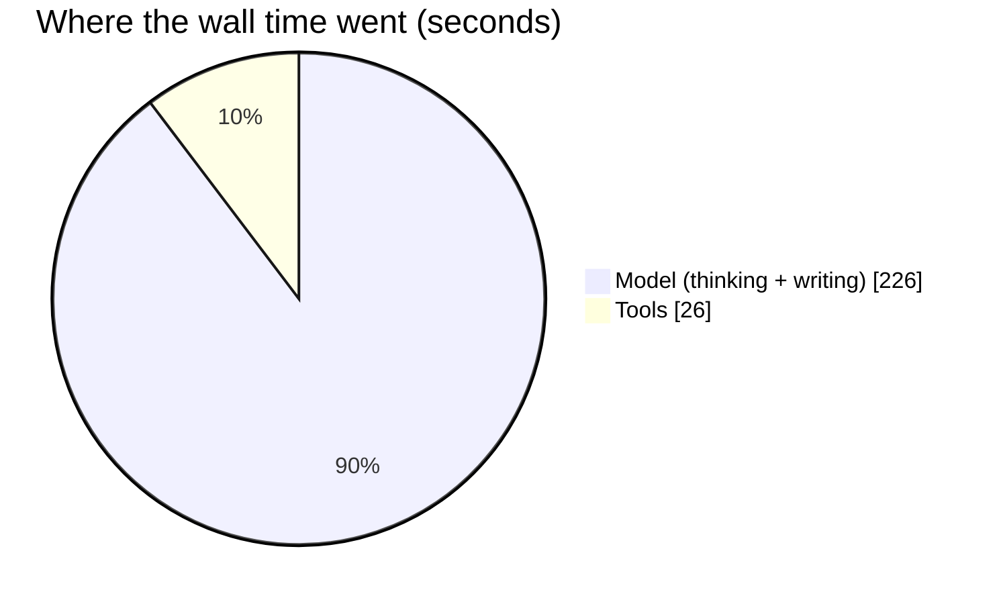

# intellectual-property/review-data-processing-agreement-template-against-eu-and-us-requirements · run6 (`hv-mixed200-lunahigh-flip-r6-20261118T030322Z`)

Result: **fail** 45/47 criteria · 4.2 min · 24 model calls · 35 tool calls (3 errors or timeouts) · ending `completed` · started 11-18 08:44:11 IST

## Overview

One box per stretch of steps that used the same kind of tool (blue: looking/searching/reading, purple: writing or editing files, yellow: a message with no tool call, red border: a tool error or timeout inside the box).

```mermaid
flowchart TD
    T(["Task prompt"])
    P0["<b>Step 1</b> · 0.1 min<br/>create_goal"]
    T --> P0
    class P0 look
    P1["<b>Step 2</b> · 0.0 min<br/>todo_write"]
    P0 --> P1
    class P1 look
    P2["<b>Step 3</b> · 0.1 min<br/>glob<br/><i>*</i>"]
    P1 --> P2
    class P2 look
    P3["<b>Step 4</b> · 0.3 min<br/>bash x5<br/><i>mkdir -p extracted && parse-doc docx …, mkdir -p extracted && parse-doc eml d…</i>"]
    P2 --> P3
    class P3 look
    P4["<b>Step 5</b> · 0.1 min<br/>glob<br/><i>extracted/*.txt</i>"]
    P3 --> P4
    class P4 look
    P5["<b>Steps 6-8</b> · 0.2 min<br/>read x10<br/><i>data-flow-diagram.txt, msa-summary-term-sheet.txt, pinnacle-us-dpa-playbook.txt +2</i>"]
    P4 --> P5
    class P5 err
    P6["<b>Step 9</b> · 0.1 min<br/>todo_write"]
    P5 --> P6
    class P6 look
    P7["<b>Step 10</b> · 0.6 min<br/>bash<br/><i>python - #lt;#lt;'PY' import docx print(doc…</i>"]
    P6 --> P7
    class P7 look
    P8["<b>Step 11</b> · 0.1 min<br/>todo_write"]
    P7 --> P8
    class P8 look
    P9["<b>Step 12</b> · 1.8 min<br/>bash<br/><i>cat #gt; /tmp/build_memo.py #lt;#lt;'PY' from …</i>"]
    P8 --> P9
    class P9 look
    P10["<b>Step 13</b> · 0.1 min<br/>todo_write"]
    P9 --> P10
    class P10 look
    P11["<b>Step 14</b> · 0.1 min<br/>bash<br/><i>parse-doc docx output/compliance-gap-…</i>"]
    P10 --> P11
    class P11 look
    P12["<b>Step 15</b> · 0.0 min<br/>read x2<br/><i>final-memo.txt</i>"]
    P11 --> P12
    class P12 look
    P13["<b>Step 16</b> · 0.1 min<br/>bash<br/><i>python - #lt;#lt;'PY' from docx import Docu…</i>"]
    P12 --> P13
    class P13 look
    P14["<b>Step 17</b> · 0.1 min<br/>glob<br/><i>output/*</i>"]
    P13 --> P14
    class P14 look
    P15["<b>Steps 18-20</b> · 0.4 min<br/>bash x3<br/><i>mkdir -p /tmp/memo-check && libreoffi…, pdfinfo /tmp/memo-check/compliance-ga…, python - #lt;#lt;'PY' from pypdf import Pdf…</i>"]
    P14 --> P15
    class P15 look
    P16["<b>Step 21</b> · 0.0 min<br/>todo_write"]
    P15 --> P16
    class P16 look
    P17["<b>Step 22</b> · 0.0 min<br/>get_goal"]
    P16 --> P17
    class P17 look
    P18["<b>Step 23</b> · 0.0 min<br/>update_goal"]
    P17 --> P18
    class P18 look
    P19["<b>Step 24</b> · 0.0 min<br/>final message"]
    P18 --> P19
    class P19 ans
    R(["FAIL: 45/47 criteria"])
    P19 --> R
    class R fail
    classDef look fill:#e8f0fe,stroke:#4a6fa5,color:#111
    classDef write fill:#f3e8fd,stroke:#7b1fa2,color:#111
    classDef ans fill:#fff8e1,stroke:#b58900,color:#111
    classDef err fill:#e8f0fe,stroke:#c62828,stroke-width:3px,color:#111
    classDef pass fill:#e6f4ea,stroke:#2e7d32,color:#111
    classDef fail fill:#fce8e6,stroke:#c62828,color:#111
```





One row per model call:

| Step | Started (IST) | Model s | Tools s | Tool calls | Tools | Output chars |
|---|---|---|---|---|---|---|
| 1 | 08:44:11 | 3 | 0 | 1 | create_goal | 408 |
| 2 | 08:44:14 | 1 | 0 | 1 | todo_write | 57 |
| 3 | 08:44:16 | 3 | 1 | 1 | glob | 208 |
| 4 | 08:44:19 | 4 | 13 | 5 | bash x5 | 1,944 |
| 5 | 08:44:36 | 4 | 1 | 1 | glob | 204 |
| 6 | 08:44:41 | 3 | 0 | 5 | read x5 ⚠ | 69,778 |
| 7 | 08:44:44 | 6 | 0 | 3 | read x3 | 118,173 |
| 8 | 08:44:50 | 3 | 0 | 2 | read x2 | 80,057 |
| 9 | 08:44:53 | 6 | 0 | 1 | todo_write | 57 |
| 10 | 08:44:59 | 35 | 1 | 1 | bash | 6 |
| 11 | 08:45:35 | 3 | 0 | 1 | todo_write | 57 |
| 12 | 08:45:39 | 108 | 1 | 1 | bash | 138 |
| 13 | 08:47:28 | 4 | 0 | 1 | todo_write | 57 |
| 14 | 08:47:32 | 2 | 2 | 1 | bash | 403 |
| 15 | 08:47:36 | 2 | 0 | 2 | read x2 | 54,332 |
| 16 | 08:47:38 | 5 | 1 | 1 | bash | 455 |
| 17 | 08:47:45 | 3 | 1 | 1 | glob | 37 |
| 18 | 08:47:48 | 6 | 4 | 1 | bash | 167 |
| 19 | 08:47:58 | 12 | 0 | 1 | bash | 545 |
| 20 | 08:48:11 | 3 | 1 | 1 | bash | 9 |
| 21 | 08:48:15 | 3 | 0 | 1 | todo_write | 57 |
| 22 | 08:48:18 | 2 | 0 | 1 | get_goal | 408 |
| 23 | 08:48:19 | 2 | 0 | 1 | update_goal | 413 |
| 24 | 08:48:21 | 3 | 0 | 0 | (message only) | 0 |

## Task prompt

```text
Review the vendor DPA template against our playbook, commercial terms, data flow details, and negotiation emails; produce a gap memorandum with prioritized findings and redline recommendations. Output: `compliance-gap-memorandum.docx`.
```

## Rubric

| # | Criterion | Verdict |
|---|---|---|
| C-001 | Prioritized summary table at beginning of memo | pass |
| C-002 | ISSUE_001: Identifies missing HIPAA BAA integration | pass |
| C-003 | ISSUE_001: Notes missing HIPAA-specific definitions | pass |
| C-004 | ISSUE_001: Recommends integrating BAA or attaching as exhibit | pass |
| C-005 | ISSUE_001: References minimum necessary standard or workforce training | pass |
| C-006 | ISSUE_002: Identifies 48-hour vs. 24-hour breach notification discrepancy | pass |
| C-007 | ISSUE_002: Identifies missing HIPAA breach notification obligations | **FAIL** |
| C-008 | ISSUE_002: Recommends specific redline for breach notification timeline | pass |
| C-009 | ISSUE_003: Identifies liability cap gap (€500K vs. playbook minimum) | pass |
| C-010 | ISSUE_003: Quantifies liability gap with correct dollar figures | pass |
| C-011 | ISSUE_003: Identifies missing carve-outs for willful misconduct/gross negligence | pass |
| C-012 | ISSUE_003: Identifies blanket exclusion of consequential damages as problematic | pass |
| C-013 | ISSUE_003: References correct MSA fee structure | pass |
| C-014 | ISSUE_004: Identifies missing SCC Module 3 for processor-to-subprocessor transfers | pass |
| C-015 | ISSUE_004: Identifies Singapore remote access as an unaddressed transfer | pass |
| C-016 | ISSUE_004: Notes Larkfield not certified under EU-US Data Privacy Framework | pass |
| C-017 | ISSUE_004: Flags absence of Transfer Impact Assessment documentation | pass |
| C-018 | ISSUE_005: Identifies missing CCPA/CPRA Service Provider provisions | pass |
| C-019 | ISSUE_005: Specifies required CCPA/CPRA contractual terms | pass |
| C-020 | ISSUE_006: Identifies audit rights limited to Frankfurt only | pass |
| C-021 | ISSUE_006: Recommends extending audit rights to subprocessor locations | pass |
| C-022 | ISSUE_007: Identifies missing data return option at termination | pass |
| C-023 | ISSUE_007: Identifies HIPAA 6-year retention conflict with 90-day deletion | pass |
| C-024 | ISSUE_008: Identifies governing law mismatch for US data disputes | pass |
| C-025 | ISSUE_008: Recommends bifurcated governing law/dispute resolution | pass |
| C-026 | ISSUE_009: Recognizes Module 2 alone is insufficient for processor-to-subprocessor transfers | pass |
| C-027 | ISSUE_011: Identifies 2-year survival period as insufficient for HIPAA | pass |
| C-028 | ISSUE_012: Flags anonymization vs. pseudonymization regulatory risk | pass |
| C-029 | DISTRACTOR_003: Does not flag DIS arbitration for EU disputes as a gap | pass |
| C-030 | Each gap includes risk level classification | pass |
| C-031 | Each gap references the specific DPA section at issue | pass |
| C-032 | Each gap includes a specific recommended redline or amendment | pass |
| C-033 | Correctly identifies Pinnacle as HIPAA Covered Entity | pass |
| C-034 | Correctly identifies Stratosphere as Processor/Business Associate | pass |
| C-035 | References EU-US Data Privacy Framework in transfer analysis | pass |
| C-036 | Identifies EU-to-US (Larkfield/Northern Virginia) disaster recovery transfer scenario | pass |
| C-037 | Identifies Singapore remote access transfer scenario | pass |
| C-038 | Identifies Stratosphere processor-to-subprocessor transfer scenario | pass |
| C-039 | References 2.1 million US patients or 890,000 California residents | pass |
| C-040 | ISSUE_001 classified as Critical or High risk | pass |
| C-041 | ISSUE_003 classified as Critical or High risk | pass |
| C-042 | References negotiation context from email thread | pass |
| C-043 | Mentions subprocessor Larkfield Data Systems by name | **FAIL** |
| C-044 | Mentions subprocessor Orionis Analytics by name | pass |
| C-045 | ISSUE_006: Notes audit limited to once per year | pass |
| C-046 | ISSUE_004: Recommends specific transfer mechanisms for identified gaps | pass |
| C-047 | ISSUE_012: Recommends defining anonymization standard in DPA | pass |

Judge's reasoning:

**C-001 (pass):** Prioritized summary table at beginning of memo

```text
Near the beginning, Section 1.2 includes a structured “Decision summary” table listing each gap, its priority level (Critical, High, Medium-High, or Medium), and a concise disposition/description.
```

**C-002 (pass):** ISSUE_001: Identifies missing HIPAA BAA integration

```text
The memorandum expressly identifies the absence of a HIPAA BAA despite Stratosphere processing approximately 2.1 million US patient records/PHI, and recommends adding an integrated or incorporated BAA with required HIPAA provisions and subcontractor flow-downs.
```

**C-003 (pass):** ISSUE_001: Notes missing HIPAA-specific definitions

```text
The memo expressly states that the template defines GDPR terms only and lacks definitions for “PHI/ePHI, Covered Entity, Business Associate, BAA, Unsecured PHI, [and] Breach.” This directly satisfies the criterion.
```

**C-004 (pass):** ISSUE_001: Recommends integrating BAA or attaching as exhibit

```text
The memo specifically recommends adding either an integrated BAA or a standalone Exhibit C expressly incorporated into the DPA and signed simultaneously. It also provides proposed BAA integration and conflict language.
```

**C-005 (pass):** ISSUE_001: References minimum necessary standard or workforce training

```text
The memorandum expressly identifies both HIPAA-specific obligations, recommending that the BAA cover the “minimum necessary” standard and workforce training.
```

**C-006 (pass):** ISSUE_002: Identifies 48-hour vs. 24-hour breach notification discrepancy

```text
The memo expressly identifies that Section 9.1 requires notice within 48 hours after confirmation, while Pinnacle's Playbook requires notice within 24 hours of discovery, and recommends revising the clause accordingly.
```

**C-007 (fail):** ISSUE_002: Identifies missing HIPAA breach notification obligations

```text
The memo addresses processor-to-Pinnacle incident notice and generally calls for HIPAA breach support, but it does not identify the missing separate HIPAA Breach Notification Rule obligations, such as notices to affected individuals, HHS (including the 500+ threshold), or the media.
```

**C-008 (pass):** ISSUE_002: Recommends specific redline for breach notification timeline

```text
The memo gives a specific redline recommendation: replace the 48-hour confirmed-breach trigger with notice within 24 hours of discovery of any actual or reasonably suspected incident, expressly covering HIPAA breaches and related notification content and contacts.
```

**C-009 (pass):** ISSUE_003: Identifies liability cap gap (€500K vs. playbook minimum)

```text
The memo expressly identifies the DPA’s €500,000 aggregate cap as materially inadequate and below the playbook minimum, and recommends a cap of at least 2x annual fees attributable to the affected processing, including $8.4 million combined, $5.6 million for US claims, or $2.8 million for EU claims.
```

**C-010 (pass):** ISSUE_003: Quantifies liability gap with correct dollar figures

```text
The memo expressly identifies the €500,000 template cap and contrasts it with the Playbook minimums of $8.4 million for combined processing and $2.8 million for EU-specific claims. This provides the required specific dollar quantification.
```

**C-011 (pass):** ISSUE_003: Identifies missing carve-outs for willful misconduct/gross negligence

```text
The memorandum expressly flags the absence of required liability-cap carve-outs and recommends that the cap not apply to willful misconduct or gross negligence, consistent with the Playbook's uncapped-liability requirement.
```

**C-012 (pass):** ISSUE_003: Identifies blanket exclusion of consequential damages as problematic

```text
The memo expressly flags Section 13.2’s blanket exclusion of indirect, consequential, special, and similar damages as problematic and recommends carving data-protection breaches, including those involving willful misconduct, out of that exclusion.
```

**C-013 (pass):** ISSUE_003: References correct MSA fee structure

```text
The liability discussion expressly references the MSA fee structure: $4.2 million total annual fees, including $2.8 million for US services and $1.4 million for EU services, and uses those figures to calculate the proposed 2x liability caps.
```

**C-014 (pass):** ISSUE_004: Identifies missing SCC Module 3 for processor-to-subprocessor transfers

```text
The memo expressly states that the DPA incorporates only SCC Module 2 and identifies the Frankfurt-to-Northern Virginia transfer to Larkfield as a processor-to-subprocessor transfer requiring SCC Module 3. It also recommends executing Module 3 between Stratosphere and Larkfield.
```

**C-015 (pass):** ISSUE_004: Identifies Singapore remote access as an unaddressed transfer

```text
The memo expressly states that Singapore personnel remotely access EU data, identifies that remote access as a third-country transfer, and notes that the DPA's existing Module 2 provision is silent on and does not address that transfer scenario.
```

**C-016 (pass):** ISSUE_004: Notes Larkfield not certified under EU-US Data Privacy Framework

```text
The memo expressly states that Larkfield is not certified under the EU-US Data Privacy Framework and therefore DPF adequacy is unavailable as a transfer mechanism for that importer.
```

**C-017 (pass):** ISSUE_004: Flags absence of Transfer Impact Assessment documentation

```text
The memo expressly states that the DPA does not require or reference a Transfer Impact Assessment and recommends documented TIAs for each third-country transfer, including reassessment and availability to Pinnacle.
```

**C-018 (pass):** ISSUE_005: Identifies missing CCPA/CPRA Service Provider provisions

```text
The memo expressly identifies that the DPA lacks CCPA/CPRA Service Provider provisions and certification, while noting that approximately 890,000 California residents are within the affected US population. It also recommends adding the required Service Provider restrictions and certification.
```

**C-019 (pass):** ISSUE_005: Specifies required CCPA/CPRA contractual terms

```text
The memo specifies all three qualifying CCPA/CPRA Service Provider provisions: a prohibition on selling or sharing personal information, restrictions on combining personal information with information from other sources, and express certification language that the processor understands and will comply with the restrictions.
```

**C-020 (pass):** ISSUE_006: Identifies audit rights limited to Frankfurt only

```text
The memo expressly identifies that Section 11.3 limits audits to Stratosphere’s primary Frankfurt facility and states that this excludes Dublin, Northern Virginia/Larkfield, Orionis, and other relevant environments. It also recommends expanding audit rights to all vendor and subprocessor sites.
```

**C-021 (pass):** ISSUE_006: Recommends extending audit rights to subprocessor locations

```text
The memorandum expressly recommends extending audits to all vendor and subprocessor sites, including Larkfield and Orionis, and requiring direct audit rights or equivalent contractual pass-through subprocessor audit rights. It also states that SOC 2/ISO evidence should supplement, not replace, those rights.
```

**C-022 (pass):** ISSUE_007: Identifies missing data return option at termination

```text
The memo expressly states that Section 12 is deletion-only and lacks a data-return election and transition assistance. It also recommends adding a controller option to return data in a machine-readable format with at least 30 days of transition assistance, matching the playbook requirement.
```

**C-023 (pass):** ISSUE_007: Identifies HIPAA 6-year retention conflict with 90-day deletion

```text
The memo expressly identifies that the DPA requires deletion within 90 days while HIPAA requires six-year retention of specified documentation under 45 CFR § 164.530(j), noting the risk of premature deletion and recommending an explicit six-year retention carve-out.
```

**C-024 (pass):** ISSUE_008: Identifies governing law mismatch for US data disputes

```text
The memo expressly flags that Section 14 applies German law and DIS arbitration in Munich to all disputes, including US PHI and California personal information, and contrasts this with the playbook requirement for Delaware law and jurisdiction in the Western District of Texas, Austin Division (or Travis County courts where federal jurisdiction is unavailable).
```

**C-025 (pass):** ISSUE_008: Recommends bifurcated governing law/dispute resolution

```text
The memo expressly recommends bifurcation: Delaware law and U.S. courts for U.S.-data disputes, while EU/EEA-data disputes may use Netherlands or German law with EU-seated arbitration. It also provides proposed split-clause language.
```

**C-026 (pass):** ISSUE_009: Recognizes Module 2 alone is insufficient for processor-to-subprocessor transfers

```text
The memo expressly states that SCC Module 2 covers controller-to-processor transfers and is insufficient for the Stratosphere-to-Larkfield processor-to-subprocessor transfer. It specifically recommends separately executing SCC Module 3 between Stratosphere as processor/exporter and Larkfield as subprocessor/importer.
```

**C-027 (pass):** ISSUE_011: Identifies 2-year survival period as insufficient for HIPAA

```text
The memo expressly flags Section 16.3’s blanket two-year survival as insufficient and recommends that HIPAA/BAA obligations and protections survive for as long as PHI is retained and for at least the six-year documentation period under 45 CFR § 164.530(j).
```

**C-028 (pass):** ISSUE_012: Flags anonymization vs. pseudonymization regulatory risk

```text
The memo expressly flags that the DPA does not define anonymization or distinguish it from pseudonymization for Orionis's services. It explains that pseudonymized data remains personal data subject to GDPR, while only data meeting an objective, irreversible anonymization standard falls outside GDPR scope, and recommends validation and continued DPA treatment where that standard is not met.
```

**C-029 (pass):** DISTRACTOR_003: Does not flag DIS arbitration for EU disputes as a gap

```text
The memo does not treat DIS arbitration for EU disputes as a material gap. It flags only the blanket application of German law/Munich DIS arbitration to US-data disputes and expressly states that German law and DIS arbitration are acceptable for EU-data disputes, subject to bifurcation.
```

**C-030 (pass):** Each gap includes risk level classification

```text
The memo assigns an explicit severity classification to all 12 prioritized gaps: Critical, High, Medium-High, or Medium. This exceeds the 75% threshold.
```

**C-031 (pass):** Each gap references the specific DPA section at issue

```text
The memo cites specific DPA sections or identifiable provisions for well over 75% of its gaps, including Sections 7, 9, 11, 12, 13, 14, 15, and Annex provisions. Nearly every numbered finding ties the issue to particular section numbers or annex clauses.
```

**C-032 (pass):** Each gap includes a specific recommended redline or amendment

```text
All 12 prioritized gaps include a dedicated redline recommendation specifying concrete amendments, such as adding a BAA and CCPA/CPRA terms, executing SCC Module 3, changing breach notice to 24 hours, revising liability caps and carve-outs, expanding audit rights, and bifurcating governing law. The memo also supplies sample contract language for several core issues, well exceeding the 75% threshold.
```

**C-033 (pass):** Correctly identifies Pinnacle as HIPAA Covered Entity

```text
The memo expressly identifies “Pinnacle Health Solutions, Inc.” as the “US Covered Entity/Controller” and consistently treats Stratosphere as the Business Associate, including requiring a BAA before Pinnacle discloses PHI.
```

**C-034 (pass):** Correctly identifies Stratosphere as Processor/Business Associate

```text
The memo expressly identifies Stratosphere as both the GDPR Processor and the HIPAA Business Associate, including in the engagement-facts table and the discussion of required BAA terms.
```

**C-035 (pass):** References EU-US Data Privacy Framework in transfer analysis

```text
The memorandum discusses the EU-US Data Privacy Framework in its international-transfer analysis, expressly noting that Larkfield is not certified under the framework and that DPF adequacy is therefore unavailable for that importer.
```

**C-036 (pass):** Identifies EU-to-US (Larkfield/Northern Virginia) disaster recovery transfer scenario

```text
The memo expressly identifies the Frankfurt-to-Northern Virginia disaster recovery flow involving EU data transferred to Larkfield, including replication/hosting for DR and the need for SCC Module 3.
```

**C-037 (pass):** Identifies Singapore remote access transfer scenario

```text
The memo expressly identifies that Singapore-based personnel remotely access EU personal data for support and correctly treats that remote access as a third-country transfer scenario requiring transfer documentation and supplementary measures.
```

**C-038 (pass):** Identifies Stratosphere processor-to-subprocessor transfer scenario

```text
The memo expressly identifies the Frankfurt-to-Northern Virginia transfer from Stratosphere to Larkfield as a processor-to-subprocessor international transfer requiring separate coverage under SCC Module 3. It also recommends completed SCC annexes, TIAs, and supplementary measures for the transfer.
```

**C-039 (pass):** References 2.1 million US patients or 890,000 California residents

```text
The memo references approximately 2.1 million US patient records in its HIPAA/BAA analysis and approximately 890,000 California residents in the data-volume discussion relevant to CCPA/CPRA.
```

**C-040 (pass):** ISSUE_001 classified as Critical or High risk

```text
The missing HIPAA BAA integration is explicitly classified as CRITICAL in Finding 1 (“US regulatory architecture is missing — no HIPAA BAA”), satisfying the highest-tier severity requirement.
```

**C-041 (pass):** ISSUE_003 classified as Critical or High risk

```text
The liability cap gap is explicitly classified as CRITICAL in the decision summary and in Finding 3, satisfying the required Critical or High risk classification.
```

**C-042 (pass):** References negotiation context from email thread

```text
The memo repeatedly references the email-thread negotiation context, including Stratosphere’s claim that the €500,000 cap is its “global standard,” Pinnacle’s position that liability allocation and DPO coordination are threshold issues, and the confirmed April 30 negotiation call.
```

**C-043 (fail):** Mentions subprocessor Larkfield Data Systems by name

```text
The memo repeatedly mentions “Larkfield,” but it never identifies the subprocessor by the required name “Larkfield Data Systems” or “Larkfield Data Systems LLC.”
```

**C-044 (pass):** Mentions subprocessor Orionis Analytics by name

```text
The memorandum mentions the subprocessor Orionis by name multiple times, including its anonymization and analytics role in Dublin.
```

**C-045 (pass):** ISSUE_006: Notes audit limited to once per year

```text
The memo expressly states in the audit-rights analysis that Section 11.2 permits only one audit per year with 30 days' notice, and it recommends retaining one planned annual audit while adding no-notice for-cause audits.
```

**C-046 (pass):** ISSUE_004: Recommends specific transfer mechanisms for identified gaps

```text
The memo recommends at least three qualifying mechanisms: executing SCC Module 3 for the Stratosphere-to-Larkfield processor-to-subprocessor transfer, implementing Singapore-specific supplementary measures, and conducting/documenting Transfer Impact Assessments for each third-country transfer. It also discusses DPF certification status, though it does not rely on DPF absent actual certification.
```

**C-047 (pass):** ISSUE_012: Recommends defining anonymization standard in DPA

```text
The memo expressly recommends defining an objective anonymization standard for Orionis using singling-out, linkability, and inference criteria, requiring validation, and treating outputs that fail the standard—including pseudonymized data—as Personal Data under the DPA.
```

## Delivered files (output/)

- `compliance-gap-memorandum.docx` (55,494 bytes)

## Trajectory

### Step 1: 1 tool call

_Started 11-18 08:44:11 IST · model 3 s · tools 0 s_

**Reasoning summary:**

```text
**Creating a document goal**

I need to produce a docx file and inspect documents. I’m considering if the task matches my skills, particularly in document creation, but I don't have a catalog for that. I should list the files using a glob function since this seems to involve several steps. It feels like creating a long-running goal might be necessary here but it’s not entirely clear if it’s needed. I’ll create the goal anyway, just to be safe.
```

**Call `create_goal`** (0.0 s)

```json
{
 "objective": "Review all provided vendor DPA, playbook, commercial terms, data-flow details, and negotiation emails, then produce the final compliance gap memorandum as output/compliance-gap-memorandum.docx with prioritized findings and redline recommendations.",
 "max_goal_rounds": 3
}
```

Output (408 chars):

```text
{"goal":{"id":"goal-634a6e09-6fc7-4de0-82bc-19d5b684e221","revision":1,"objective":"Review all provided vendor DPA, playbook, commercial terms, data-flow details, and negotiation emails, then produce the final compliance gap memorandum as output/compliance-gap-memorandum.docx with prioritized findings and redline recommendations.","phase":"active","roundsStarted":0,"maxGoalRounds":3},"activation":"armed"}
```

### Step 2: 1 tool call

_Started 11-18 08:44:14 IST · model 1 s · tools 0 s_

**Call `todo_write`** (0.0 s)

```json
{
 "todos": [
  {
   "content": "Inventory and read all source materials",
   "status": "in_progress"
  },
  {
   "content": "Extract requirements and identify DPA gaps",
   "status": "pending"
  },
  {
   "content": "Draft prioritized gap memorandum and redline recommendations",
   "status": "pending"
  },
  {
   "content": "Create and validate final DOCX deliverable",
   "status": "pending"
  }
 ]
}
```

Output (57 chars):

```text
Updated todo list: 3 pending, 1 in progress, 0 completed.
```

**Todo list now:**

- [~] Inventory and read all source materials
- [ ] Extract requirements and identify DPA gaps
- [ ] Draft prioritized gap memorandum and redline recommendations
- [ ] Create and validate final DOCX deliverable

### Step 3: 1 tool call

_Started 11-18 08:44:16 IST · model 3 s · tools 1 s_

**Reasoning summary:**

```text
**Inspecting files**

I need to inspect some files, and I think I'll use the glob tool for that. It's a straightforward way to gather and match files based on patterns. That could help me find what I'm looking for more efficiently. I wonder if I'm considering the right options here. Let's see how it goes and confirm that I'm on the right track. It’s all about making sure I get the right files!
```

**Call `glob`** (0.7 s)

```json
{
 "pattern": "*"
}
```

Output (208 chars):

```text
documents/data-flow-diagram.docx
documents/msa-summary-term-sheet.docx
documents/pinnacle-us-dpa-playbook.docx
documents/stratosphere-dpa-template-v3-2.docx
documents/stratosphere-negotiation-email-thread.eml
```

### Step 4: 5 tool calls

_Started 11-18 08:44:19 IST · model 4 s · tools 13 s_

**Call `bash`** (2.3 s)

```json
{
 "command": "mkdir -p extracted && parse-doc docx documents/data-flow-diagram.docx > extracted/data-flow-diagram.txt",
 "description": "Convert data flow diagram to text"
}
```

Output (374 chars):

```text
[stderr]
2026-11-18 03:14:25.012508280 [W:onnxruntime:Default, device_discovery.cc:95 GetPciBusId] Skipping pci_bus_id for PCI path at "/sys/devices/LNXSYSTM:00/LNXSYBUS:00/ACPI0004:00/VMBUS:00/5620e0c7-8062-4dce-aeb7-520c7ef76171" because filename "5620e0c7-8062-4dce-aeb7-520c7ef76171" did not match expected pattern of [0-9a-f]+:[0-9a-f]+:[0-9a-f]+[.][0-9a-f]+
```

**Call `bash`** (2.3 s)

```json
{
 "command": "mkdir -p extracted && parse-doc docx documents/msa-summary-term-sheet.docx > extracted/msa-summary-term-sheet.txt",
 "description": "Convert term sheet to text"
}
```

Output (374 chars):

```text
[stderr]
2026-11-18 03:14:27.288727462 [W:onnxruntime:Default, device_discovery.cc:95 GetPciBusId] Skipping pci_bus_id for PCI path at "/sys/devices/LNXSYSTM:00/LNXSYBUS:00/ACPI0004:00/VMBUS:00/5620e0c7-8062-4dce-aeb7-520c7ef76171" because filename "5620e0c7-8062-4dce-aeb7-520c7ef76171" did not match expected pattern of [0-9a-f]+:[0-9a-f]+:[0-9a-f]+[.][0-9a-f]+
```

**Call `bash`** (2.6 s)

```json
{
 "command": "mkdir -p extracted && parse-doc docx documents/pinnacle-us-dpa-playbook.docx > extracted/pinnacle-us-dpa-playbook.txt",
 "description": "Convert DPA playbook to text"
}
```

Output (374 chars):

```text
[stderr]
2026-11-18 03:14:29.747867416 [W:onnxruntime:Default, device_discovery.cc:95 GetPciBusId] Skipping pci_bus_id for PCI path at "/sys/devices/LNXSYSTM:00/LNXSYBUS:00/ACPI0004:00/VMBUS:00/5620e0c7-8062-4dce-aeb7-520c7ef76171" because filename "5620e0c7-8062-4dce-aeb7-520c7ef76171" did not match expected pattern of [0-9a-f]+:[0-9a-f]+:[0-9a-f]+[.][0-9a-f]+
```

**Call `bash`** (2.7 s)

```json
{
 "command": "mkdir -p extracted && parse-doc docx documents/stratosphere-dpa-template-v3-2.docx > extracted/stratosphere-dpa-template-v3-2.txt",
 "description": "Convert vendor DPA to text"
}
```

Output (374 chars):

```text
[stderr]
2026-11-18 03:14:32.476744677 [W:onnxruntime:Default, device_discovery.cc:95 GetPciBusId] Skipping pci_bus_id for PCI path at "/sys/devices/LNXSYSTM:00/LNXSYBUS:00/ACPI0004:00/VMBUS:00/5620e0c7-8062-4dce-aeb7-520c7ef76171" because filename "5620e0c7-8062-4dce-aeb7-520c7ef76171" did not match expected pattern of [0-9a-f]+:[0-9a-f]+:[0-9a-f]+[.][0-9a-f]+
```

**Call `bash`** (3.1 s)

```json
{
 "command": "mkdir -p extracted && parse-doc eml documents/stratosphere-negotiation-email-thread.eml > extracted/stratosphere-negotiation-email-thread.txt",
 "description": "Convert negotiation emails to text"
}
```

Output (448 chars):

```text
[stderr]
2026-11-18 03:14:35.974433457 [W:onnxruntime:Default, device_discovery.cc:95 GetPciBusId] Skipping pci_bus_id for PCI path at "/sys/devices/LNXSYSTM:00/LNXSYBUS:00/ACPI0004:00/VMBUS:00/5620e0c7-8062-4dce-aeb7-520c7ef76171" because filename "5620e0c7-8062-4dce-aeb7-520c7ef76171" did not match expected pattern of [0-9a-f]+:[0-9a-f]+:[0-9a-f]+[.][0-9a-f]+
usage: /usr/local/bin/parse-doc {docx|pdf|pptx|xlsx} <path>
[exit code: 2]
```

### Step 5: 1 tool call

_Started 11-18 08:44:36 IST · model 4 s · tools 1 s_

**Reasoning summary:**

```text
**Inspecting EML Parsing**

I see that EML parsing is not allowed, so I need to inspect and perhaps read the EML file directly in plain text. There's been some success with the bash command for this, but the combined output includes 4 warnings and an error from the EML. I'll definitely need to check the extracted files with a glob to see what's going on. It's a bit tricky, but I'm determined to figure this out!
```

**Call `glob`** (1.1 s)

```json
{
 "pattern": "extracted/*.txt"
}
```

Output (204 chars):

```text
extracted/data-flow-diagram.txt
extracted/msa-summary-term-sheet.txt
extracted/pinnacle-us-dpa-playbook.txt
extracted/stratosphere-dpa-template-v3-2.txt
extracted/stratosphere-negotiation-email-thread.txt
```

### Step 6: 5 tool calls

_Started 11-18 08:44:41 IST · model 3 s · tools 0 s_

**Reasoning summary:**

```text
**Considering file reading methods**

I’m thinking the email file might be empty because of a redirect. I should read all the docs, though it might be a large task. Using multi-parallel reading could be helpful, so I’m considering that. I might need to inspect the line counts of the file since the glob function doesn’t provide that. It might make sense to read it in chunks, like 2000 lines at a time. Let's get started!
```

**Call `read`** (0.1 s)

```json
{
 "file_path": "extracted/data-flow-diagram.txt",
 "offset": 1,
 "limit": 2000
}
```

Output (46,591 chars):

```text
<path>/home/agarwaldi/dsh-bench-harness/runs/hv-mixed200-lunahigh-flip-r6-20261118T030322Z/tasks/intellectual-property__review-data-processing-agreement-template-against-eu-and-us-requirements/workspace/extracted/data-flow-diagram.txt</path>
<type>file</type>
<content>
1: **[DATA FLOW DIAGRAM AND PROCESSING DESCRIPTION]{.underline}**
2: 
3: **[Pinnacle Health Solutions, Inc. --- Stratosphere Cloud Services GmbH]{.underline}**
4: 
5: **[Data Processing Relationship]{.underline}**
6: 
7: **CONFIDENTIAL --- ATTORNEY-CLIENT PRIVILEGED / WORK PRODUCT**
8: 
9: This document is protected by the attorney-client privilege and the work product doctrine. Unauthorized disclosure, copying, or distribution is strictly prohibited. This document does not constitute legal advice to any third party.
10: 
11: **Prepared by:** Office of the General Counsel, Pinnacle Health Solutions, Inc., 4200 Harborview Boulevard, Suite 1100, Austin, TX 78746
12: 
13: **Prepared for:** Internal use and for review by outside counsel Alderton Shaw & Whitmore LLP (Rachel Osterfeld, Partner), 900 K Street NW, Suite 700, Washington, DC 20001
14: 
15: **Date:** April 2025
16: 
17: **Reference Documents:**
18: 
19: > •Master Services Agreement dated March 15, 2024 (\"MSA\")
20: >
21: > •Stratosphere DPA Template Version 3.2 dated January 10, 2025 (received April 14, 2025) (\"DPA Template\" or \"DPA\")
22: >
23: > •Pinnacle US DPA Playbook (last updated February 28, 2025) (\"Playbook\")
24: 
25: **Purpose:** This docu
… [45,091 more chars]
```

**Call `read`** (0.1 s)

```json
{
 "file_path": "extracted/msa-summary-term-sheet.txt",
 "offset": 1,
 "limit": 2000
}
```

Output (23,046 chars):

```text
<path>/home/agarwaldi/dsh-bench-harness/runs/hv-mixed200-lunahigh-flip-r6-20261118T030322Z/tasks/intellectual-property__review-data-processing-agreement-template-against-eu-and-us-requirements/workspace/extracted/msa-summary-term-sheet.txt</path>
<type>file</type>
<content>
1: **[MASTER SERVICES AGREEMENT --- SUMMARY TERM SHEET]{.underline}**
2: 
3: **Summary of Key Commercial Terms**
4: 
5: MSA Effective Date: March 15, 2024
6: 
7: This Summary Term Sheet is for internal reference purposes only and does not amend or supersede the Master Services Agreement dated March 15, 2024 (the \"MSA\"), by and between Pinnacle Health Solutions, Inc. and Stratosphere Cloud Services GmbH. In the event of any conflict between the terms summarized herein and the terms of the executed MSA, the terms of the executed MSA shall control in all respects.
8: 
9: Prepared by the Office of General Counsel Pinnacle Health Solutions, Inc.
10: 
11: Last Updated: March 15, 2024
12: 
13: **[Section 1 --- Parties]{.underline}**
14: 
15: **Client:** Pinnacle Health Solutions, Inc., a Delaware corporation, with its principal offices located at 4200 Harborview Boulevard, Suite 1100, Austin, TX 78746 (\"Pinnacle\" or \"Client\").
16: 
17: **Service Provider:** Stratosphere Cloud Services GmbH, a German limited liability company (*Gesellschaft mit beschränkter Haftung*) registered at the Munich Local Court (*Amtsgericht München*) under Commercial Register (*Handelsregister*) number HRB 247891, with its register
… [21,546 more chars]
```

**Call `read`** (0.1 s · **error/timeout**)

```json
{
 "file_path": "extracted/pinnacle-us-dpa-playbook.txt",
 "offset": 1,
 "limit": 3000
}
```

Output (47 chars):

```text
Error: limit must be less than or equal to 2000
```

**Call `read`** (0.1 s · **error/timeout**)

```json
{
 "file_path": "extracted/stratosphere-dpa-template-v3-2.txt",
 "offset": 1,
 "limit": 4000
}
```

Output (47 chars):

```text
Error: limit must be less than or equal to 2000
```

**Call `read`** (0.1 s · **error/timeout**)

```json
{
 "file_path": "documents/stratosphere-negotiation-email-thread.eml",
 "offset": 1,
 "limit": 4000
}
```

Output (47 chars):

```text
Error: limit must be less than or equal to 2000
```

### Step 7: 3 tool calls

_Started 11-18 08:44:44 IST · model 6 s · tools 0 s_

**Reasoning summary:**

```text
**Figuring out read limits**

I’m encountering parallel read errors for over 2000 lines, which isn't great. I need to limit my read to a maximum of 2000 lines, possibly using multiple offsets. I think it’ll be helpful to know the line counts, so maybe reading between 1 and 2000 would be ideal. The playbook and DPA will likely have 300 to 800 lines, and I hope the emails will be more manageable. Let’s go ahead and read 1-2000 each!
```

**Call `read`** (0.1 s)

```json
{
 "file_path": "extracted/pinnacle-us-dpa-playbook.txt",
 "offset": 1,
 "limit": 2000
}
```

Output (53,353 chars):

```text
<path>/home/agarwaldi/dsh-bench-harness/runs/hv-mixed200-lunahigh-flip-r6-20261118T030322Z/tasks/intellectual-property__review-data-processing-agreement-template-against-eu-and-us-requirements/workspace/extracted/pinnacle-us-dpa-playbook.txt</path>
<type>file</type>
<content>
1: **[DATA PROCESSING AGREEMENT NEGOTIATION PLAYBOOK]{.underline}**
2: 
3: **[US AND CROSS-BORDER REQUIREMENTS]{.underline}**
4: 
5: **Internal Use Only --- Attorney-Client Privileged and Confidential Work Product**
6: 
7: Prepared by: **Office of the General Counsel** **Pinnacle Health Solutions, Inc.** 4200 Harborview Boulevard, Suite 1100 Austin, TX 78746
8: 
9: Approved by: **Margaret Yuen-Park**, General Counsel
10: 
11: **Version 4.0**
12: 
13: Last Updated: **February 28, 2025**
14: 
15: **Distribution List:**
16: 
17:   -------------------------------------------------------------------------------------
18:   **Recipient**                                     **Title**
19:   ------------------------------------------------- -----------------------------------
20:   Legal Department (all attorneys and paralegals)   ---
21: 
22:   Dr. Anand Krishnamurthy                           Chief Privacy Officer
23: 
24:   Jennifer Castellano                               VP of Information Security
25: 
26:   David Liang                                       VP of Procurement
27:   -------------------------------------------------------------------------------------
28: 
29: **External Counsel Reference:** Th
… [51,853 more chars]
```

**Call `read`** (0.1 s)

```json
{
 "file_path": "extracted/stratosphere-dpa-template-v3-2.txt",
 "offset": 1,
 "limit": 2000
}
```

Output (52,691 chars):

```text
<path>/home/agarwaldi/dsh-bench-harness/runs/hv-mixed200-lunahigh-flip-r6-20261118T030322Z/tasks/intellectual-property__review-data-processing-agreement-template-against-eu-and-us-requirements/workspace/extracted/stratosphere-dpa-template-v3-2.txt</path>
<type>file</type>
<content>
1: **[DATA PROCESSING AGREEMENT]{.underline}**
2: 
3: **Version 3.2**
4: 
5: **January 10, 2025**
6: 
7: **STRATOSPHERE CLOUD SERVICES GmbH**
8: 
9: *Cloud Infrastructure · Managed Databases · Analytics*
10: 
11: This Data Processing Agreement (\"DPA\") forms part of and is subject to the terms of the Master Services Agreement (\"Agreement\" or \"MSA\") between the Processor and the Controller.
12: 
13: This DPA is designed to ensure compliance with Regulation (EU) 2016/679 of the European Parliament and of the Council of 27 April 2016 (the \"GDPR\") and applicable data protection laws governing the Processing of Personal Data in connection with the Services provided under the Agreement.
14: 
15: **Processor Registered Office:**
16: 
17: Stratosphere Cloud Services GmbH Hohenzollernstraße 88 80796 Munich, Germany
18: 
19: Handelsregister HRB 247891, Amtsgericht München (Munich Local Court)
20: 
21: **Prepared by:**
22: 
23: Legal Department, Stratosphere Cloud Services GmbH
24: 
25: **Contact:**
26: 
27: Dr. Florian Neumann Chief Legal Officer Stratosphere Cloud Services GmbH
28: 
29: Email: florian.neumann@stratospherecloud.example.com
30: 
31: Tel: +49 89 2155 4400
32: 
33: Right-click to update 
… [51,191 more chars]
```

**Call `read`** (0.1 s)

```json
{
 "file_path": "documents/stratosphere-negotiation-email-thread.eml",
 "offset": 1,
 "limit": 2000
}
```

Output (12,129 chars):

```text
<path>/home/agarwaldi/dsh-bench-harness/runs/hv-mixed200-lunahigh-flip-r6-20261118T030322Z/tasks/intellectual-property__review-data-processing-agreement-template-against-eu-and-us-requirements/workspace/documents/stratosphere-negotiation-email-thread.eml</path>
<type>file</type>
<content>
1: From: Margaret Yuen-Park <myuenpark@pinnaclehealth.example.com>
2: To: Dr. Florian Neumann <f.neumann@stratospherecloud.example.com>
3: Cc: Rachel Osterfeld <rosterfeld@alderton-shaw.example.com>
4: Date: Fri, 18 Apr 2025 11:02:00 -0000
5: Subject: Re: Re: Re: Stratosphere DPA Template v3.2 — For Your Review
6: Content-Type: text/plain; charset="utf-8"
7: Content-Transfer-Encoding: quoted-printable
8: MIME-Version: 1.0
9: 
10: Florian,
11: 
12: Thank you for your response and for looping in Dr. Beckert.
13: 
14: We can confirm the call for Wednesday, April 30, 2025, at 4:00 PM CEST / 9:00=
15:  AM CDT. Rachel Osterfeld from Alderton Shaw & Whitmore will attend on our si=
16: de.
17: 
18: On the liability cap =E2=80=94 I appreciate your willingness to take this up =
19: internally. I want to set expectations that our redline of Section 13 will pr=
20: opose a structure tied to the annual fees under the MSA rather than a flat ca=
21: p, together with the carve-outs for willful misconduct and gross negligence I=
22:  referenced previously. I want to be transparent that this is a threshold iss=
23: ue for us, and we will need to reach agreement on liability allocation before=
24:  we can fina
… [10,629 more chars]
```

### Step 8: 2 tool calls

_Started 11-18 08:44:50 IST · model 3 s · tools 0 s_

**Call `read`** (0.1 s)

```json
{
 "file_path": "extracted/pinnacle-us-dpa-playbook.txt",
 "offset": 429,
 "limit": 2000
}
```

Output (53,068 chars):

```text
<path>/home/agarwaldi/dsh-bench-harness/runs/hv-mixed200-lunahigh-flip-r6-20261118T030322Z/tasks/intellectual-property__review-data-processing-agreement-template-against-eu-and-us-requirements/workspace/extracted/pinnacle-us-dpa-playbook.txt</path>
<type>file</type>
<content>
429: > \(i\) Vendor grants Pinnacle **direct audit rights** over subprocessor facilities, with the same scope and frequency as Pinnacle\'s audit rights over vendor; or
430: >
431: > \(ii\) Vendor **contractually requires** each subprocessor to submit to audits by Pinnacle or Pinnacle\'s designated auditor, and provides Pinnacle with the contractual right to exercise such audits; or
432: >
433: > \(iii\) At minimum, vendor requires each subprocessor to **provide SOC 2 Type II reports** and/or **ISO 27001 certifications** covering the relevant data processing services, with copies provided to Pinnacle upon request no less frequently than annually.
434: 
435: **Nice-to-have:** Pinnacle prefers the right to conduct **two (2) audits per calendar year**: one planned audit and one for-cause audit. Planned audits should require **fifteen (15) days\' prior written notice** to the vendor. For-cause audits, triggered by a breach, suspected breach, or other compliance concern, should require **no advance notice** to the vendor.
436: 
437: **Fallback:** One (1) planned audit per calendar year with **thirty (30) days\' prior written notice** is acceptable, provided that the following conditions are met:
438: 
439: > \
… [51,568 more chars]
```

**Call `read`** (0.1 s)

```json
{
 "file_path": "extracted/stratosphere-dpa-template-v3-2.txt",
 "offset": 317,
 "limit": 2000
}
```

Output (26,989 chars):

```text
<path>/home/agarwaldi/dsh-bench-harness/runs/hv-mixed200-lunahigh-flip-r6-20261118T030322Z/tasks/intellectual-property__review-data-processing-agreement-template-against-eu-and-us-requirements/workspace/extracted/stratosphere-dpa-template-v3-2.txt</path>
<type>file</type>
<content>
317: **17.3 Severability.** If any provision of this DPA is found by a court or other tribunal of competent jurisdiction to be invalid, illegal, or unenforceable, such provision shall be modified to the minimum extent necessary to make it valid, legal, and enforceable, and the remaining provisions of this DPA shall continue in full force and effect. If such modification is not possible, the invalid provision shall be severed and the remaining provisions shall be interpreted so as to give effect to the Parties\' original intent to the maximum extent possible.
318: 
319: **17.4 Waiver.** No failure or delay by either Party in exercising any right, power, or privilege under this DPA shall operate as a waiver thereof, nor shall any single or partial exercise of any right, power, or privilege preclude any other or further exercise thereof or the exercise of any other right, power, or privilege.
320: 
321: **17.5 Notices.** All notices, requests, demands, and other communications required or permitted under this DPA shall be in writing and shall be delivered by hand, by internationally recognized overnight courier service, or by email to the addresses specified in this DPA or such other addresses as a Pa
… [25,489 more chars]
```

### Step 9: 1 tool call

_Started 11-18 08:44:53 IST · model 6 s · tools 0 s_

**Reasoning summary:**

```text
**Checking workspace access**

I think I need to use only the workspace access, which is allowed. It's important to confirm if python-docx is installed, and I could do that by running `python -c import docx`. However, before I start that, I should probably update my to-do list. Keeping everything organized will definitely help me tackle tasks more efficiently!
```

**Call `todo_write`** (0.0 s)

```json
{
 "todos": [
  {
   "content": "Inventory and read all source materials",
   "status": "completed"
  },
  {
   "content": "Extract requirements and identify DPA gaps",
   "status": "in_progress"
  },
  {
   "content": "Draft prioritized gap memorandum and redline recommendations",
   "status": "pending"
  },
  {
   "content": "Create and validate final DOCX deliverable",
   "status": "pending"
  }
 ]
}
```

Output (57 chars):

```text
Updated todo list: 2 pending, 1 in progress, 1 completed.
```

**Todo list now:**

- [x] Inventory and read all source materials
- [~] Extract requirements and identify DPA gaps
- [ ] Draft prioritized gap memorandum and redline recommendations
- [ ] Create and validate final DOCX deliverable

### Step 10: 1 tool call

_Started 11-18 08:44:59 IST · model 35 s · tools 1 s_

**Reasoning summary:**

```text
**Considering redline adjustments**

I need to address the need for redline. In the DPIA, there's a mention of assistance within 20 business days, but the playbook doesn’t specify a clear timeframe. It seems reasonable to add an extra 5 to 10 days to ensure timeliness. Also, I notice that the DPA is focused only on GDPR and doesn't account for US risk assessment, which could involve HIPAA considerations or necessitate a BAA.

**Clarifying annex details**

I need to add some information regarding Annex B, specifically about the data center operator mismatch that's been mentioned. There’s also a note that certifications in B.9 only pertain to Frankfurt. However, the data flow indicates that ISO/SOC covers both Frankfurt and Dublin. I should consult with counsel to confirm the situation regarding NV and Singapore. It’s important to ensure everything is accurate and aligned properly!

**Preparing a DPA Document**

I need to gather reference sources related to DPA sections and source documents. The polished document should be about 10-15 pages, including an executive summary table with details like priority, issue, DPA location, impact, and required action. I'll create a DOCX file starting with a title page marked as privileged/confidential. I’m considering not including a current date, just something like "Prepared for internal review" instead, focusing on vendor DPA and related materials for Pinnacle Health Solutions.
```

**Call `bash`** (0.8 s)

```json
{
 "command": "python - <<'PY'\nimport docx\nprint(docx.__version__)\nPY",
 "description": "Check DOCX generation library"
}
```

Output (6 chars):

```text
1.2.0
```

### Step 11: 1 tool call

_Started 11-18 08:45:35 IST · model 3 s · tools 0 s_

**Reasoning summary:**

```text
**Structuring Python Outputs**

I need to create content using Python string structures and perhaps output it directly from a script in the workspace. The developer suggests using `read` instead of `cat` for the text. I’m considering creating a script with a bash command since that seems acceptable. It might be a good idea to run it in the background, but it likely won't take long. I could also think about creating a docx file in the output. No need to install `docxcompose`, since that’s unnecessary now.
```

**Call `todo_write`** (0.0 s)

```json
{
 "todos": [
  {
   "content": "Inventory and read all source materials",
   "status": "completed"
  },
  {
   "content": "Extract requirements and identify DPA gaps",
   "status": "completed"
  },
  {
   "content": "Draft prioritized gap memorandum and redline recommendations",
   "status": "in_progress"
  },
  {
   "content": "Create and validate final DOCX deliverable",
   "status": "pending"
  }
 ]
}
```

Output (57 chars):

```text
Updated todo list: 1 pending, 1 in progress, 2 completed.
```

**Todo list now:**

- [x] Inventory and read all source materials
- [x] Extract requirements and identify DPA gaps
- [~] Draft prioritized gap memorandum and redline recommendations
- [ ] Create and validate final DOCX deliverable

### Step 12: 1 tool call

_Started 11-18 08:45:39 IST · model 108 s · tools 1 s_

**Reasoning summary:**

```text
**Reviewing DPA Requirements**

I see that Section 5.4 of the current DPA only maintains ISO standards, while Section B.9 mentions that a current report can be requested under NDA, but not within 30 days. That seems unclear to me, so I think I need to prepare a redline version to clarify it. Additionally, there's a note about needing MFA for all remote access, not just for admin access, which is an important security measure to consider.
```

**Call `bash`** (0.9 s)

```json
{
 "command": "cat > /tmp/build_memo.py <<'PY'\nfrom docx import Document\nfrom docx.shared import Inches, Pt, RGBColor\nfrom docx.enum.text import WD_ALIGN_PARAGRAPH, WD_BREAK\nfrom docx.enum.table import WD_TABLE_ALIGNMENT, WD_CELL_VERTICAL_ALIGNMENT\nfrom docx.enum.section import WD_SECTION\nfrom docx.oxml import OxmlElement\nfrom docx.oxml.ns import qn\nfrom docx.enum.style import WD_STYLE_TYPE\nfrom docx.enum.text import WD_LINE_SPACING\nfrom docx.enum.section import WD_ORIENT\nfrom docx.enum.table import WD_ROW_HEIGHT_RULE\n\nOUT = 'output/compliance-gap-memorandum.docx'\n\ndoc = Document()\nsec = doc.sections[0]\nsec.top_margin = Inches(0.65)\nsec.bottom_margin = Inches(0.65)\nsec.left_margin = Inches(0.7)\nsec.right_margin = Inches(0.7)\n\n# Colors\nNAVY = RGBColor(31, 55, 85)\nBLUE = RGBColor(45, 93, 135)\nTEAL = RGBColor(0, 112, 121)\nRED = RGBColor(156, 0, 6)\nORANGE = RGBColor(156, 87, 0)\nGRAY = RGBColor(90, 90, 90)\nLIGHT_BLUE = 'D9EAF7'\nLIGHT_GRAY = 'F2F4F7'\nLIGHT_RED = 'FCE4D6'\nLIGHT_ORANGE = 'FFF2CC'\nLIGHT_GREEN = 'E2F0D9'\n\n# Helpers\ndef shade(cell, fill):\n    tcPr = cell._tc.get_or_add_tcPr()\n    shd = tcPr.find(qn('w:shd'))\n    if shd is None:\n        
… [50,723 more chars]
```

Output (138 chars):

```text
output/compliance-gap-memorandum.docx
-rw-r--r-- 1 agarwaldi@microsoft.com users 55494 Nov 18 03:17 output/compliance-gap-memorandum.docx
```

### Step 13: 1 tool call

_Started 11-18 08:47:28 IST · model 4 s · tools 0 s_

**Reasoning summary:**

```text
**Validating document parsing**

I was thinking about using the cat command to handle text files, but I realized the instruction specifies using read instead. So, I need to validate the parse-doc output properly. I could render the resulting docx file and inspect it afterward. I’ll run the bash command to parse the docx and save the output to a text file. After that, I’ll read the first line, or maybe all the lines, to ensure it looks good.
```

**Call `todo_write`** (0.0 s)

```json
{
 "todos": [
  {
   "content": "Inventory and read all source materials",
   "status": "completed"
  },
  {
   "content": "Extract requirements and identify DPA gaps",
   "status": "completed"
  },
  {
   "content": "Draft prioritized gap memorandum and redline recommendations",
   "status": "completed"
  },
  {
   "content": "Create and validate final DOCX deliverable",
   "status": "in_progress"
  }
 ]
}
```

Output (57 chars):

```text
Updated todo list: 0 pending, 1 in progress, 3 completed.
```

**Todo list now:**

- [x] Inventory and read all source materials
- [x] Extract requirements and identify DPA gaps
- [x] Draft prioritized gap memorandum and redline recommendations
- [~] Create and validate final DOCX deliverable

### Step 14: 1 tool call

_Started 11-18 08:47:32 IST · model 2 s · tools 2 s_

**Call `bash`** (2.2 s)

```json
{
 "command": "parse-doc docx output/compliance-gap-memorandum.docx > extracted/final-memo.txt && python - <<'PY'\nfrom pathlib import Path\np=Path('extracted/final-memo.txt')\nprint('parsed_bytes', p.stat().st_size)\nprint('lines', len(p.read_text(encoding='utf-8').splitlines()))\nPY",
 "description": "Parse and sanity-check final memorandum",
 "timeoutMs": 120000
}
```

Output (403 chars):

```text
parsed_bytes 52344
lines 299
[stderr]
2026-11-18 03:17:35.721145435 [W:onnxruntime:Default, device_discovery.cc:95 GetPciBusId] Skipping pci_bus_id for PCI path at "/sys/devices/LNXSYSTM:00/LNXSYBUS:00/ACPI0004:00/VMBUS:00/5620e0c7-8062-4dce-aeb7-520c7ef76171" because filename "5620e0c7-8062-4dce-aeb7-520c7ef76171" did not match expected pattern of [0-9a-f]+:[0-9a-f]+:[0-9a-f]+[.][0-9a-f]+
```

### Step 15: 2 tool calls

_Started 11-18 08:47:36 IST · model 2 s · tools 0 s_

**Call `read`** (0.0 s)

```json
{
 "file_path": "extracted/final-memo.txt",
 "offset": 1,
 "limit": 180
}
```

Output (32,407 chars):

```text
<path>/home/agarwaldi/dsh-bench-harness/runs/hv-mixed200-lunahigh-flip-r6-20261118T030322Z/tasks/intellectual-property__review-data-processing-agreement-template-against-eu-and-us-requirements/workspace/extracted/final-memo.txt</path>
<type>file</type>
<content>
1: **COMPLIANCE GAP\
2: MEMORANDUM**
3: 
4: **Stratosphere Cloud Services GmbH\
5: Data Processing Agreement Template v3.2**
6: 
7: Prepared for Pinnacle Health Solutions, Inc.\
8: Review against DPA Playbook v4.0, MSA commercial terms, data-flow mapping, and negotiation correspondence
9: 
10: Internal Review Package • Target redline circulation: approximately May 9, 2025\
11: Internal review deadline: May 16, 2025 • EU Go-Live: September 1, 2025
12: 
13: +--------------------------------------------------------------------------------------------------------------------------------------------------------------------------------------------------------------------------------------------------------------------------------------------------------------------------------------------------+
14: | **EXECUTIVE DISPOSITION**                                                                                                                                                                                                                                                                                                                        |
15: |                                                                                      
… [30,907 more chars]
```

**Call `read`** (0.0 s)

```json
{
 "file_path": "extracted/final-memo.txt",
 "offset": 181,
 "limit": 160
}
```

Output (21,925 chars):

```text
<path>/home/agarwaldi/dsh-bench-harness/runs/hv-mixed200-lunahigh-flip-r6-20261118T030322Z/tasks/intellectual-property__review-data-processing-agreement-template-against-eu-and-us-requirements/workspace/extracted/final-memo.txt</path>
<type>file</type>
<content>
181: 
182: **Current DPA / source facts:** Section 6.5 requires Article 28-equivalent obligations and Section 6.6 makes Stratosphere fully liable for subprocessors. Section 6.3 gives 15 days' notice, and Section 6.4 provides a good-faith objection process with termination of affected services after 60 days. The template does not expressly flow down HIPAA BAA terms, CCPA/CPRA restrictions, or transfer-specific obligations.
183: 
184: **Gap and risk:** The legal structure is directionally sound but incomplete for Larkfield's PHI/CCPA role and the Module 3 transfer. The DPA should make clear that each subprocessor receives substantially the same obligations across GDPR, HIPAA, CCPA/CPRA, security, audit, retention, and transfer terms. The current remedy is limited to affected services rather than a clear no-penalty termination right for the affected processing relationship.
185: 
186: **Redline recommendation:** Keep the approved list and 15-day notice only as the Playbook fallback; seek 30 days if practical. Add mandatory flow-down of the BAA, Service Provider restrictions/certification, confidentiality, security, audit, breach, deletion/retention, and SCC/TIA terms. Require sufficient notice detail, direct or equivalen
… [20,425 more chars]
```

### Step 16: 1 tool call

_Started 11-18 08:47:38 IST · model 5 s · tools 1 s_

**Reasoning summary:**

```text
**Investigating output formatting**

I’m looking into an output issue where there's a literal backslash in the title. It appears that the title “COMPLIANCE GAP\ MEMORANDUM” has that backslash because I used `COMPLIANCE GAP\\n MEMORANDUM` in the Python heredoc. Essentially, `\\n` turns into a backslash and ‘n’ instead of a newline, causing a formatting problem. It seems like the parser is interpreting it incorrectly, showing the backslash with a line break, so I’ll inspect it further using Python docx for clarification.
```

**Call `bash`** (0.8 s)

```json
{
 "command": "python - <<'PY'\nfrom docx import Document\np=Document('output/compliance-gap-memorandum.docx').paragraphs[0]\nprint(repr(p.text))\nfor i in range(5): print(i, repr(Document('output/compliance-gap-memorandum.docx').paragraphs[i].text))\nPY",
 "description": "Check cover text formatting"
}
```

Output (455 chars):

```text
'COMPLIANCE GAP\nMEMORANDUM'
0 'COMPLIANCE GAP\nMEMORANDUM'
1 'Stratosphere Cloud Services GmbH\nData Processing Agreement Template v3.2'
2 'Prepared for Pinnacle Health Solutions, Inc.\nReview against DPA Playbook v4.0, MSA commercial terms, data-flow mapping, and negotiation correspondence'
3 'Internal Review Package • Target redline circulation: approximately May 9, 2025\nInternal review deadline: May 16, 2025 • EU Go-Live: September 1, 2025'
4 ''
```

### Step 17: 1 tool call

_Started 11-18 08:47:45 IST · model 3 s · tools 1 s_

**Reasoning summary:**

```text
**Inspecting markdown escapes**

I’m realizing that when parsing markdown, newlines get escaped as a backslash followed by a period. I might need to inspect the style to ensure everything is formatted correctly. It's important to make sure that only deliverables are included in the output. There seems to be no issue, but I'll need to pay close attention to the details. Let's figure this out and make sure everything flows smoothly!
```

**Call `glob`** (0.5 s)

```json
{
 "pattern": "output/*"
}
```

Output (37 chars):

```text
output/compliance-gap-memorandum.docx
```

### Step 18: 1 tool call

_Started 11-18 08:47:48 IST · model 6 s · tools 4 s_

**Reasoning summary:**

```text
**Evaluating file integrity and conversion**

I need to check the page count and ensure file integrity with LibreOffice. I can run Python to inspect sections or tables. Using the command `libreoffice --headless --convert-to pdf --outdir /tmp` could help verify if it opens properly. It’s not strictly necessary, but it would be a good validation. I might also consider using `python-docx`, though it can’t detect rendering. If it’s installed, I would run `libreoffice --headless --convert-to pdf --outdir /tmp output/...` to convert it.
```

**Call `bash`** (4.1 s)

```json
{
 "command": "mkdir -p /tmp/memo-check && libreoffice --headless --convert-to pdf --outdir /tmp/memo-check output/compliance-gap-memorandum.docx >/tmp/memo-check/lo.log 2>&1; code=$?; printf 'exit=%s\\n' \"$code\"; if [ -f /tmp/memo-check/compliance-gap-memorandum.pdf ]; then ls -lh /tmp/memo-check/compliance-gap-memorandum.pdf; fi; python - <<'PY'\nfrom docx import Document\nd=Document('output/compliance-gap-memorandum.docx')\nprint('paragraphs', len(d.paragraphs), 'tables', len(d.tables), 'sections', len(d.sections))\nprint('has critical', 'CRITICAL' in '\\n'.join(p.text for p in d.paragraphs))\nPY",
 "description": "Render and validate final DOCX",
 "timeoutMs": 120000
}
```

Output (167 chars):

```text
exit=0
-rw-r--r-- 1 agarwaldi@microsoft.com users 167K Nov 18 03:17 /tmp/memo-check/compliance-gap-memorandum.pdf
paragraphs 107 tables 7 sections 1
has critical True
```

### Step 19: 1 tool call

_Started 11-18 08:47:58 IST · model 12 s · tools 0 s_

**Reasoning summary:**

```text
**Considering document edits**

I could use python-docx to directly edit docx files, but it’s not strictly necessary. I could also rerun the build with script modifications, but the script isn't in my workspace, just in /tmp. Hm, do I even need to modify this? I should check for any factual anomalies: according to DPA Annex B, it mentions TLS 1.3 or higher, and that the output redline says "Frankfurt→Northern Virginia" should apply, which seems good.

**Evaluating DPA and MSA alignment**

I’m considering aligning Section 16.1 with MSA conditions and handling the effective date for the DPA accordingly. The user wants a comprehensive gap analysis. It’s clear the current DPA takes effect upon execution, but the MSA specifies that it should be before any processing, which could pose issues. I should think about mentioning timelines for DPA responses and security findings from the annual SOC report too. Maybe I should clarify the vendor's role as a Business Associate under HIPAA and note the lack of DPF certification.

**Considering PDF page views**

I’m thinking about whether I should use pdfinfo to view the PDF pages. It seems I could check up to 11 pages, which sounds reasonable. I wonder if viewing those pages will give me the insights I need. I’m also considering how easy it will be to read and extract the necessary information from that format. Let's see how effective this option is for my purposes!
```

**Call `bash`** (0.5 s)

```json
{
 "command": "pdfinfo /tmp/memo-check/compliance-gap-memorandum.pdf | sed -n '1,12p'",
 "description": "Check rendered memorandum page count"
}
```

Output (545 chars):

```text
Title:           Compliance Gap Memorandum — Stratosphere DPA Template v3.2
Subject:         Prioritized compliance gaps and redline recommendations
Keywords:        DPA, GDPR, HIPAA, CCPA/CPRA, SCC, compliance, gap, redline
Author:          Pinnacle Health Solutions, Inc. — Office of General Counsel
Creator:         Writer
Producer:        LibreOffice 25.2.3.2 (X86_64) / LibreOffice Community
CreationDate:    Wed Nov 18 03:17:57 2026 UTC
Custom Metadata: no
Metadata Stream: yes
Tagged:          yes
UserProperties:  no
Suspects:        no
```

### Step 20: 1 tool call

_Started 11-18 08:48:11 IST · model 3 s · tools 1 s_

**Reasoning summary:**

```text
**Considering page count extraction**

I’m looking at how to count the pages in a document, and it seems like I might be missing some pages if it’s truncated at 12. Maybe I should use a grep tool? The developer mentioned that, but it feels like it might not be the right approach since this involves output commands and not text files. I could use Python's pypdf library instead; that might give me what I need.
```

**Call `bash`** (0.8 s)

```json
{
 "command": "python - <<'PY'\nfrom pypdf import PdfReader\np='/tmp/memo-check/compliance-gap-memorandum.pdf'\nprint('pages', len(PdfReader(p).pages))\nPY",
 "description": "Count rendered memorandum pages"
}
```

Output (9 chars):

```text
pages 11
```

### Step 21: 1 tool call

_Started 11-18 08:48:15 IST · model 3 s · tools 0 s_

**Reasoning summary:**

```text
**Completing the task**

I think I've realized that the task might only require a docx file and not a response.md. Before I finalize everything, I definitely want to make sure I update my to-do list and confirm my goals are complete. It feels like I'm on the right track, but I should check that I get my goals in order first to wrap things up! Let's double-check everything to ensure it’s done correctly.
```

**Call `todo_write`** (0.0 s)

```json
{
 "todos": [
  {
   "content": "Inventory and read all source materials",
   "status": "completed"
  },
  {
   "content": "Extract requirements and identify DPA gaps",
   "status": "completed"
  },
  {
   "content": "Draft prioritized gap memorandum and redline recommendations",
   "status": "completed"
  },
  {
   "content": "Create and validate final DOCX deliverable",
   "status": "completed"
  }
 ]
}
```

Output (57 chars):

```text
Updated todo list: 0 pending, 0 in progress, 4 completed.
```

**Todo list now:**

- [x] Inventory and read all source materials
- [x] Extract requirements and identify DPA gaps
- [x] Draft prioritized gap memorandum and redline recommendations
- [x] Create and validate final DOCX deliverable

### Step 22: 1 tool call

_Started 11-18 08:48:18 IST · model 2 s · tools 0 s_

**Call `get_goal`** (0.0 s)

```json
{}
```

Output (408 chars):

```text
{"goal":{"id":"goal-634a6e09-6fc7-4de0-82bc-19d5b684e221","revision":1,"objective":"Review all provided vendor DPA, playbook, commercial terms, data-flow details, and negotiation emails, then produce the final compliance gap memorandum as output/compliance-gap-memorandum.docx with prioritized findings and redline recommendations.","phase":"active","roundsStarted":0,"maxGoalRounds":3},"activation":"armed"}
```

### Step 23: 1 tool call

_Started 11-18 08:48:19 IST · model 2 s · tools 0 s_

**Call `update_goal`** (0.0 s)

```json
{
 "goal_id": "goal-634a6e09-6fc7-4de0-82bc-19d5b684e221",
 "revision": 1,
 "action": "complete"
}
```

Output (413 chars):

```text
{"goal":{"id":"goal-634a6e09-6fc7-4de0-82bc-19d5b684e221","revision":2,"objective":"Review all provided vendor DPA, playbook, commercial terms, data-flow details, and negotiation emails, then produce the final compliance gap memorandum as output/compliance-gap-memorandum.docx with prioritized findings and redline recommendations.","phase":"complete","roundsStarted":0,"maxGoalRounds":3},"activation":"disarmed"}
```

### Step 24: 0 tool calls

_Started 11-18 08:48:21 IST · model 3 s · tools 0 s_

**Text:**

```markdown
Created the requested deliverable:

[Download the compliance gap memorandum](sandbox:/home/agarwaldi/dsh-bench-harness/runs/hv-mixed200-lunahigh-flip-r6-20261118T030322Z/tasks/intellectual-property__review-data-processing-agreement-template-against-eu-and-us-requirements/workspace/output/compliance-gap-memorandum.docx)

The memorandum includes:

- Prioritized Critical, High, Medium-High, and Medium findings
- Review against the DPA playbook, MSA terms, data-flow details, and negotiation emails
- Analysis of HIPAA, CCPA/CPRA, GDPR, SCC, TIA, subprocessor, audit, breach, liability, deletion, and governing-law gaps
- Specific redline recommendations and sample clause language
- Negotiation plan, escalation triggers, and execution gates
```

