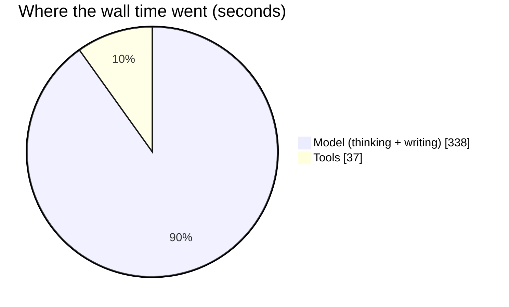

# intellectual-property/review-data-processing-agreement-template-against-eu-and-us-requirements · run7 (`hv-mixed200-lunahigh-flip-r7-20261118T030322Z`)

Result: **all-pass** 47/47 criteria · 6.3 min · 21 model calls · 41 tool calls (3 errors or timeouts) · ending `completed` · started 11-18 08:44:17 IST

## Overview

One box per stretch of steps that used the same kind of tool (blue: looking/searching/reading, purple: writing or editing files, yellow: a message with no tool call, red border: a tool error or timeout inside the box).

```mermaid
flowchart TD
    T(["Task prompt"])
    P0["<b>Step 1</b> · 0.1 min<br/>todo_write"]
    T --> P0
    class P0 look
    P1["<b>Step 2</b> · 0.0 min<br/>create_goal"]
    P0 --> P1
    class P1 look
    P2["<b>Step 3</b> · 0.2 min<br/>glob x6<br/><i>*, **/*, **/*.docx +3</i>"]
    P1 --> P2
    class P2 look
    P3["<b>Step 4</b> · 0.3 min<br/>bash x5<br/><i>parse-doc docx documents/data-flow-di…, parse-doc docx documents/msa-summary-…, parse-doc docx documents/pinnacle-us-… +2</i>"]
    P2 --> P3
    class P3 look
    P4["<b>Steps 5-7</b> · 0.1 min<br/>read x10<br/><i>data-flow.txt, msa-summary.txt, playbook.txt +2</i>"]
    P3 --> P4
    class P4 err
    P5["<b>Steps 8-11</b> · 4.8 min<br/>bash x5<br/><i>python - #lt;#lt;'PY' import docx print(doc…, cat #gt; build_memo.py #lt;#lt;'PY' from docx …, parse-doc docx output/compliance-gap-… +1</i>"]
    P4 --> P5
    class P5 look
    P6["<b>Steps 12-13</b> · 0.1 min<br/>read x2<br/><i>validation.txt</i>"]
    P5 --> P6
    class P6 look
    P7["<b>Steps 14-15</b> · 0.2 min<br/>bash x2<br/><i>pdfinfo /tmp/compliance-gap-memorandu…, mkdir -p renders && pdftoppm -png -r …</i>"]
    P6 --> P7
    class P7 look
    P8["<b>Step 16</b> · 0.0 min<br/>read_image x5<br/><i>memo-01.png, memo-04.png, memo-08.png +2</i>"]
    P7 --> P8
    class P8 look
    P9["<b>Step 17</b> · 0.1 min<br/>bash<br/><i>ls -la output</i>"]
    P8 --> P9
    class P9 look
    P10["<b>Step 18</b> · 0.1 min<br/>todo_write"]
    P9 --> P10
    class P10 look
    P11["<b>Step 19</b> · 0.1 min<br/>get_goal"]
    P10 --> P11
    class P11 look
    P12["<b>Step 20</b> · 0.0 min<br/>update_goal"]
    P11 --> P12
    class P12 look
    P13["<b>Step 21</b> · 0.1 min<br/>final message"]
    P12 --> P13
    class P13 ans
    R(["ALL PASS: 47/47 criteria"])
    P13 --> R
    class R pass
    classDef look fill:#e8f0fe,stroke:#4a6fa5,color:#111
    classDef write fill:#f3e8fd,stroke:#7b1fa2,color:#111
    classDef ans fill:#fff8e1,stroke:#b58900,color:#111
    classDef err fill:#e8f0fe,stroke:#c62828,stroke-width:3px,color:#111
    classDef pass fill:#e6f4ea,stroke:#2e7d32,color:#111
    classDef fail fill:#fce8e6,stroke:#c62828,color:#111
```





One row per model call:

| Step | Started (IST) | Model s | Tools s | Tool calls | Tools | Output chars |
|---|---|---|---|---|---|---|
| 1 | 08:44:17 | 4 | 0 | 1 | todo_write | 57 |
| 2 | 08:44:22 | 1 | 0 | 1 | create_goal | 385 |
| 3 | 08:44:23 | 2 | 11 | 6 | glob x6 | 651 |
| 4 | 08:44:36 | 6 | 15 | 5 | bash x5 | 1,507 |
| 5 | 08:44:57 | 2 | 0 | 5 | read x5 ⚠ | 69,739 |
| 6 | 08:44:59 | 2 | 0 | 3 | read x3 | 118,090 |
| 7 | 08:45:01 | 2 | 0 | 2 | read x2 | 80,003 |
| 8 | 08:45:04 | 47 | 1 | 1 | bash | 6 |
| 9 | 08:45:51 | 136 | 0 | 1 | bash | 377 |
| 10 | 08:48:07 | 96 | 1 | 1 | bash | 138 |
| 11 | 08:49:45 | 4 | 4 | 2 | bash x2 | 957 |
| 12 | 08:49:53 | 4 | 0 | 1 | read | 52,502 |
| 13 | 08:49:58 | 2 | 0 | 1 | read | 52,570 |
| 14 | 08:50:00 | 4 | 0 | 1 | bash | 190 |
| 15 | 08:50:04 | 4 | 3 | 1 | bash | 3 |
| 16 | 08:50:11 | 3 | 0 | 5 | read_image x5 | 1,595 |
| 17 | 08:50:14 | 4 | 1 | 1 | bash | 231 |
| 18 | 08:50:18 | 3 | 0 | 1 | todo_write | 57 |
| 19 | 08:50:21 | 4 | 0 | 1 | get_goal | 385 |
| 20 | 08:50:25 | 2 | 0 | 1 | update_goal | 390 |
| 21 | 08:50:27 | 5 | 0 | 0 | (message only) | 0 |

## Task prompt

```text
Review the vendor DPA template against our playbook, commercial terms, data flow details, and negotiation emails; produce a gap memorandum with prioritized findings and redline recommendations. Output: `compliance-gap-memorandum.docx`.
```

## Rubric

| # | Criterion | Verdict |
|---|---|---|
| C-001 | Prioritized summary table at beginning of memo | pass |
| C-002 | ISSUE_001: Identifies missing HIPAA BAA integration | pass |
| C-003 | ISSUE_001: Notes missing HIPAA-specific definitions | pass |
| C-004 | ISSUE_001: Recommends integrating BAA or attaching as exhibit | pass |
| C-005 | ISSUE_001: References minimum necessary standard or workforce training | pass |
| C-006 | ISSUE_002: Identifies 48-hour vs. 24-hour breach notification discrepancy | pass |
| C-007 | ISSUE_002: Identifies missing HIPAA breach notification obligations | pass |
| C-008 | ISSUE_002: Recommends specific redline for breach notification timeline | pass |
| C-009 | ISSUE_003: Identifies liability cap gap (€500K vs. playbook minimum) | pass |
| C-010 | ISSUE_003: Quantifies liability gap with correct dollar figures | pass |
| C-011 | ISSUE_003: Identifies missing carve-outs for willful misconduct/gross negligence | pass |
| C-012 | ISSUE_003: Identifies blanket exclusion of consequential damages as problematic | pass |
| C-013 | ISSUE_003: References correct MSA fee structure | pass |
| C-014 | ISSUE_004: Identifies missing SCC Module 3 for processor-to-subprocessor transfers | pass |
| C-015 | ISSUE_004: Identifies Singapore remote access as an unaddressed transfer | pass |
| C-016 | ISSUE_004: Notes Larkfield not certified under EU-US Data Privacy Framework | pass |
| C-017 | ISSUE_004: Flags absence of Transfer Impact Assessment documentation | pass |
| C-018 | ISSUE_005: Identifies missing CCPA/CPRA Service Provider provisions | pass |
| C-019 | ISSUE_005: Specifies required CCPA/CPRA contractual terms | pass |
| C-020 | ISSUE_006: Identifies audit rights limited to Frankfurt only | pass |
| C-021 | ISSUE_006: Recommends extending audit rights to subprocessor locations | pass |
| C-022 | ISSUE_007: Identifies missing data return option at termination | pass |
| C-023 | ISSUE_007: Identifies HIPAA 6-year retention conflict with 90-day deletion | pass |
| C-024 | ISSUE_008: Identifies governing law mismatch for US data disputes | pass |
| C-025 | ISSUE_008: Recommends bifurcated governing law/dispute resolution | pass |
| C-026 | ISSUE_009: Recognizes Module 2 alone is insufficient for processor-to-subprocessor transfers | pass |
| C-027 | ISSUE_011: Identifies 2-year survival period as insufficient for HIPAA | pass |
| C-028 | ISSUE_012: Flags anonymization vs. pseudonymization regulatory risk | pass |
| C-029 | DISTRACTOR_003: Does not flag DIS arbitration for EU disputes as a gap | pass |
| C-030 | Each gap includes risk level classification | pass |
| C-031 | Each gap references the specific DPA section at issue | pass |
| C-032 | Each gap includes a specific recommended redline or amendment | pass |
| C-033 | Correctly identifies Pinnacle as HIPAA Covered Entity | pass |
| C-034 | Correctly identifies Stratosphere as Processor/Business Associate | pass |
| C-035 | References EU-US Data Privacy Framework in transfer analysis | pass |
| C-036 | Identifies EU-to-US (Larkfield/Northern Virginia) disaster recovery transfer scenario | pass |
| C-037 | Identifies Singapore remote access transfer scenario | pass |
| C-038 | Identifies Stratosphere processor-to-subprocessor transfer scenario | pass |
| C-039 | References 2.1 million US patients or 890,000 California residents | pass |
| C-040 | ISSUE_001 classified as Critical or High risk | pass |
| C-041 | ISSUE_003 classified as Critical or High risk | pass |
| C-042 | References negotiation context from email thread | pass |
| C-043 | Mentions subprocessor Larkfield Data Systems by name | pass |
| C-044 | Mentions subprocessor Orionis Analytics by name | pass |
| C-045 | ISSUE_006: Notes audit limited to once per year | pass |
| C-046 | ISSUE_004: Recommends specific transfer mechanisms for identified gaps | pass |
| C-047 | ISSUE_012: Recommends defining anonymization standard in DPA | pass |

Judge's reasoning:

**C-001 (pass):** Prioritized summary table at beginning of memo

```text
Near the beginning, the Executive Summary includes a structured table listing identified issues, priority/risk levels (P0 Stop-ship, P1 High, and P2 Important), brief descriptions of the template gaps, and required outcomes.
```

**C-002 (pass):** ISSUE_001: Identifies missing HIPAA BAA integration

```text
The memo expressly identifies the absence of a HIPAA BAA as a stop-ship gap, notes that Stratosphere will process PHI for approximately 2.1 million US patients, and recommends integrating and executing a compliant BAA with downstream subcontractor flow-downs.
```

**C-003 (pass):** ISSUE_001: Notes missing HIPAA-specific definitions

```text
The memo expressly states in F-01 that the DPA “defines only GDPR concepts” and “lacks HIPAA definitions.” It also recommends adding definitions for PHI, Covered Entity, and Business Associate in the consolidated redline package.
```

**C-004 (pass):** ISSUE_001: Recommends integrating BAA or attaching as exhibit

```text
The memo explicitly recommends adding a fully compliant BAA either as an integrated DPA section or as a signed exhibit, and provides redline language incorporating an attached BAA as an integral part of the DPA.
```

**C-005 (pass):** ISSUE_001: References minimum necessary standard or workforce training

```text
The memo expressly identifies both missing HIPAA obligations in F-01: “minimum-necessary limits” and “workforce training.” It also repeats these requirements in the proposed BAA integration package.
```

**C-006 (pass):** ISSUE_002: Identifies 48-hour vs. 24-hour breach notification discrepancy

```text
The memo expressly identifies that DPA Section 9.1 requires notice within 48 hours after confirmation, while Pinnacle’s playbook requires notice within 24 hours of discovery, and recommends replacing the 48-hour timeline with the 24-hour standard.
```

**C-007 (pass):** ISSUE_002: Identifies missing HIPAA breach notification obligations

```text
The memo expressly flags the absence of a HIPAA/HITECH breach-notification cascade, notes that the existing clause does not implement US/HIPAA notification requirements, and recommends cooperation with HHS and other required notices.
```

**C-008 (pass):** ISSUE_002: Recommends specific redline for breach notification timeline

```text
The memo gives a specific redline recommendation requiring notice within 24 hours after discovery of any actual or reasonably suspected incident, defines discovery to include constructive knowledge through reasonable diligence, and expressly covers breaches of Unsecured PHI and HIPAA-related notification support.
```

**C-009 (pass):** ISSUE_003: Identifies liability cap gap (€500K vs. playbook minimum)

```text
The memo expressly identifies the DPA’s €500,000 aggregate liability cap as inadequate and compares it against the playbook minimum of 2x annual fees for the affected processing activity, including proposed $8.4M combined and regional minimums.
```

**C-010 (pass):** ISSUE_003: Quantifies liability gap with correct dollar figures

```text
The memo expressly contrasts the €500,000 template cap (approximately $545,000) against the $4.2M annual fees and states the playbook minimum as $8.4M combined, with a $2.8M EU regional floor. This satisfies the required dollar quantification.
```

**C-011 (pass):** ISSUE_003: Identifies missing carve-outs for willful misconduct/gross negligence

```text
The memo expressly states in F-03 that the DPA does not carve out willful misconduct or gross negligence and recommends making those categories uncapped, consistent with the playbook requirement.
```

**C-012 (pass):** ISSUE_003: Identifies blanket exclusion of consequential damages as problematic

```text
The memo expressly flags the blanket exclusion of indirect, incidental, consequential, special, punitive, and exemplary damages as problematic. It recommends that the exclusion not apply to breach-response and regulatory costs or losses arising from uncapped conduct, including willful misconduct, consistent with the criterion.
```

**C-013 (pass):** ISSUE_003: References correct MSA fee structure

```text
The liability discussion expressly references the $4.2M annual fees and proposes a $8.4M cap based on 2x annual fees. It also gives regional floors of $5.6M for US services and $2.8M for EU services, derived from the stated $2.8M US and $1.4M EU annual fee structure.
```

**C-014 (pass):** ISSUE_004: Identifies missing SCC Module 3 for processor-to-subprocessor transfers

```text
The memo expressly states that the DPA includes only SCC Module 2 and does not cover the processor-to-subprocessor transfer from Stratosphere to Larkfield in Northern Virginia. It identifies SCC Module 3 as required and recommends executing it before transferring EU personal data to Larkfield.
```

**C-015 (pass):** ISSUE_004: Identifies Singapore remote access as an unaddressed transfer

```text
The memo expressly flags Singapore-based support personnel remotely accessing EU data as a third-country transfer that the DPA omits and for which no transfer mechanism is documented. It recommends either an appropriate SCC arrangement with supplementary measures or restricting access to EEA-based personnel.
```

**C-016 (pass):** ISSUE_004: Notes Larkfield not certified under EU-US Data Privacy Framework

```text
The memo expressly states multiple times that Larkfield is not DPF-certified and that the EU-US Data Privacy Framework cannot be relied upon for transfers to Larkfield unless and until certification is verified.
```

**C-017 (pass):** ISSUE_004: Flags absence of Transfer Impact Assessment documentation

```text
The memorandum expressly flags that the DPA does not require or reference a TIA, including stating there is “no TIA” and recommending documented TIAs and reassessments for each third-country transfer.
```

**C-018 (pass):** ISSUE_005: Identifies missing CCPA/CPRA Service Provider provisions

```text
The memo expressly identifies that approximately 890,000 California residents are in scope and that the DPA lacks CCPA/CPRA Service Provider definitions, restrictions, certification, monitoring rights, and inability-to-comply provisions, particularly in Finding F-06.
```

**C-019 (pass):** ISSUE_005: Specifies required CCPA/CPRA contractual terms

```text
The memo specifies all three listed CCPA/CPRA Service Provider provisions: a prohibition on selling or sharing personal information, restrictions on combining it with information from other sources, and express certification that the processor understands and will comply with the Service Provider restrictions.
```

**C-020 (pass):** ISSUE_006: Identifies audit rights limited to Frankfurt only

```text
The memo expressly flags in F-07 that Section 11.3 limits audits to Stratosphere’s Frankfurt facility and notes that audit rights do not cover Dublin, Northern Virginia/Larkfield, Singapore access operations, or subprocessor systems. It also recommends expanding audit scope to all vendor and subprocessor processing locations.
```

**C-021 (pass):** ISSUE_006: Recommends extending audit rights to subprocessor locations

```text
The memo expressly recommends expanding audits to all vendor and subprocessor processing locations, including Northern Virginia/Larkfield and Singapore operations, and requiring equivalent contractual subprocessor audit access or annual relevant reports. This directly satisfies the criterion.
```

**C-022 (pass):** ISSUE_007: Identifies missing data return option at termination

```text
The memo expressly identifies Section 12 as deletion-only, flags the absence of a data return right and transition assistance, and recommends a machine-readable return option with at least 30 days of transition assistance before deletion.
```

**C-023 (pass):** ISSUE_007: Identifies HIPAA 6-year retention conflict with 90-day deletion

```text
The memo expressly identifies the conflict between the DPA's 90-day deletion timeline and HIPAA's six-year documentation-retention requirement under 45 CFR § 164.530(j), including in Finding F-05 and the proposed redline.
```

**C-024 (pass):** ISSUE_008: Identifies governing law mismatch for US data disputes

```text
The memo expressly flags that Section 14 applies German law and Munich DIS arbitration to all DPA disputes, including US PHI and California personal information, and contrasts this with the playbook’s required Delaware law and Western District of Texas, Austin Division (or Travis County) forum for US data disputes.
```

**C-025 (pass):** ISSUE_008: Recommends bifurcated governing law/dispute resolution

```text
The memo expressly recommends bifurcating governing law and dispute resolution: Delaware law and US court jurisdiction (Western District of Texas or Travis County) for US data disputes, and Dutch or German law with EU arbitration for EU/EEA data disputes.
```

**C-026 (pass):** ISSUE_009: Recognizes Module 2 alone is insufficient for processor-to-subprocessor transfers

```text
The memo expressly states that SCC Module 2 alone does not cover Stratosphere’s processor-to-subprocessor transfer to Larkfield and repeatedly recommends separately executing SCC Module 3 for the Frankfurt-to-Northern Virginia transfer before EU personal data is replicated.
```

**C-027 (pass):** ISSUE_011: Identifies 2-year survival period as insufficient for HIPAA

```text
The memo expressly flags Section 16.3’s two-year survival period as inadequate for HIPAA, cites the six-year retention requirement under 45 CFR § 164.530(j), and recommends that BAA and related protections survive for six years or as long as PHI or required documentation is retained, whichever is longer.
```

**C-028 (pass):** ISSUE_012: Flags anonymization vs. pseudonymization regulatory risk

```text
The memo expressly flags that the DPA uses “anonymization” for Orionis without defining it or distinguishing it from pseudonymization. It explains that pseudonymized or otherwise identifiable outputs remain personal data subject to GDPR and recommends objective anonymization criteria, validation, and continued DPA protections until true anonymization is achieved.
```

**C-029 (pass):** DISTRACTOR_003: Does not flag DIS arbitration for EU disputes as a gap

```text
The memo correctly flags German law/DIS arbitration only insofar as it applies to US data disputes. It expressly accepts German law and DIS arbitration for EU data as a fallback/permitted EU dispute framework, so it does not treat DIS arbitration for EU matters as a material gap.
```

**C-030 (pass):** Each gap includes risk level classification

```text
All 16 numbered findings are assigned an explicit priority classification: F-01 through F-05 are P0, F-06 through F-11 are P1, and F-12 through F-16 are P2. The memo also defines the meaning of each priority level and separately labels housekeeping items as P3, so well over 75% of identified gaps have a risk level.
```

**C-031 (pass):** Each gap references the specific DPA section at issue

```text
The memo cites specific DPA sections or annex provisions for essentially every numbered gap, typically in both the “Current text / fact pattern” discussion and the source cross-reference (for example, §9 for breach notice, §13 for liability, §12 for return/deletion, §14 for governing law, and Annex A/B provisions for annex-related gaps). This clearly exceeds the 75% threshold.
```

**C-032 (pass):** Each gap includes a specific recommended redline or amendment

```text
The memorandum provides specific amendment recommendations for essentially every identified gap (F-01 through F-16), including redline-ready language and concrete structural changes such as adding a BAA and CCPA/CPRA addendum, executing SCC Module 3, reducing breach notice to 24 hours, revising liability caps, expanding audits, and adding return/deletion and DPO protocols. This comfortably exceeds the 75% threshold.
```

**C-033 (pass):** Correctly identifies Pinnacle as HIPAA Covered Entity

```text
The memo expressly identifies Pinnacle Health Solutions, Inc. as the HIPAA Covered Entity, including in the fact pattern, F-01 negotiation position, and proposed BAA language, while treating Stratosphere as the Business Associate.
```

**C-034 (pass):** Correctly identifies Stratosphere as Processor/Business Associate

```text
The memo expressly identifies Stratosphere as the GDPR Processor and HIPAA Business Associate, including in the fact-pattern roles table, F-01, F-09, and the proposed redline language.
```

**C-035 (pass):** References EU-US Data Privacy Framework in transfer analysis

```text
The memorandum discusses the Data Privacy Framework in its transfer analysis, noting that Larkfield is not DPF-certified and prohibiting reliance on DPF adequacy unless its certification is verified.
```

**C-036 (pass):** Identifies EU-to-US (Larkfield/Northern Virginia) disaster recovery transfer scenario

```text
The memo expressly identifies the Frankfurt/EU data center to Larkfield in Northern Virginia transfer for disaster recovery, including that it is an EU-to-US transfer involving EU personal data.
```

**C-037 (pass):** Identifies Singapore remote access transfer scenario

```text
The memo expressly identifies that Singapore-based Stratosphere support personnel may remotely view or modify EU personal data over VPN and correctly treats that remote access as a third-country international transfer requiring an appropriate transfer mechanism or EEA-only access restriction.
```

**C-038 (pass):** Identifies Stratosphere processor-to-subprocessor transfer scenario

```text
The memo expressly identifies the Stratosphere Processor-to-Larkfield Subprocessor transfer from Frankfurt to Northern Virginia as a separate international transfer scenario. It explains that SCC Module 2 is insufficient and recommends SCC Module 3, completed annexes, a TIA, and supplementary measures.
```

**C-039 (pass):** References 2.1 million US patients or 890,000 California residents

```text
The memo references approximately 2.1 million US patient records/PHI in its HIPAA analysis and approximately 890,000 California residents in its CCPA/CPRA analysis.
```

**C-040 (pass):** ISSUE_001 classified as Critical or High risk

```text
The missing HIPAA BAA is expressly classified as “P0 / Stop-ship” in the priority table and as finding F-01 under “P0 — Stop-Ship Findings,” which is an equivalent highest-tier/critical severity.
```

**C-041 (pass):** ISSUE_003 classified as Critical or High risk

```text
The liability cap gap is explicitly classified as “P0 / Stop-ship” in the priority table and again as “P0” in Finding F-03, which is equivalent to the highest-tier severity and therefore satisfies the Critical or High risk requirement.
```

**C-042 (pass):** References negotiation context from email thread

```text
The memo expressly references the April 14–18, 2025 negotiation emails and summarizes the parties’ positions, including Stratosphere’s characterization of the €500,000 cap as its “global standard,” Pinnacle’s identification of liability and DPO coordination as threshold issues, and planned circulation of a redline/memo. It also uses that context in the liability and negotiation-strategy sections.
```

**C-043 (pass):** Mentions subprocessor Larkfield Data Systems by name

```text
The memo expressly names the subprocessor as “Larkfield Data Systems, LLC” in multiple places, including the parties/roles discussion and proposed BAA language.
```

**C-044 (pass):** Mentions subprocessor Orionis Analytics by name

```text
The memorandum mentions Orionis by name multiple times, including identifying it as an Irish subprocessor and discussing its analytics and anonymization role.
```

**C-045 (pass):** ISSUE_006: Notes audit limited to once per year

```text
The memo expressly states in F-07 that Section 11.2 permits “one annual audit with 30 days’ notice,” and it discusses expanding this to one planned annual audit plus for-cause audits.
```

**C-046 (pass):** ISSUE_004: Recommends specific transfer mechanisms for identified gaps

```text
The memo recommends at least three qualifying mechanisms: executing SCC Module 3 for the Stratosphere-to-Larkfield processor-to-subprocessor transfer, conducting and periodically updating TIAs for each third-country transfer, and implementing recipient-specific supplementary measures for Singapore remote access. It also discusses DPF certification status for Larkfield, though it does not make certification the primary recommendation.
```

**C-047 (pass):** ISSUE_012: Recommends defining anonymization standard in DPA

```text
The memo expressly recommends defining an objective anonymization standard for Orionis using singling-out, linkability, and inference criteria, requiring validation/certification, and treating outputs that fail the standard or remain pseudonymized as Personal Data subject to the DPA.
```

## Delivered files (output/)

- `compliance-gap-memorandum.docx` (60,464 bytes)

## Trajectory

### Step 1: 1 tool call

_Started 11-18 08:44:17 IST · model 4 s · tools 0 s_

**Reasoning summary:**

```text
**Planning document management**

I need to manipulate documents and inspect files since the user has requested a review and to produce a docx file. It seems I'll need to use my document generation skills, but I don't have a clear skill catalog visible. I can inspect the workspace, but I mustn't read task.json. I wonder if I should create a todo list as a multi-step process. Since the user wants a long-running objective, I might create that with a goal. Let's proceed with setting up the todo and possibly the goal.
```

**Call `todo_write`** (0.0 s)

```json
{
 "todos": [
  {
   "content": "Inventory source documents and identify governing materials",
   "status": "in_progress"
  },
  {
   "content": "Extract DPA terms, playbook requirements, and commercial/data-flow facts",
   "status": "pending"
  },
  {
   "content": "Analyze gaps and prioritize EU/US compliance risks",
   "status": "pending"
  },
  {
   "content": "Draft memorandum with redline recommendations",
   "status": "pending"
  },
  {
   "content": "Generate and validate compliance-gap-memorandum.docx",
   "status": "pending"
  }
 ]
}
```

Output (57 chars):

```text
Updated todo list: 4 pending, 1 in progress, 0 completed.
```

**Todo list now:**

- [~] Inventory source documents and identify governing materials
- [ ] Extract DPA terms, playbook requirements, and commercial/data-flow facts
- [ ] Analyze gaps and prioritize EU/US compliance risks
- [ ] Draft memorandum with redline recommendations
- [ ] Generate and validate compliance-gap-memorandum.docx

### Step 2: 1 tool call

_Started 11-18 08:44:22 IST · model 1 s · tools 0 s_

**Call `create_goal`** (0.0 s)

```json
{
 "objective": "Review the vendor DPA template against the playbook, commercial terms, data-flow details, and negotiation emails, then deliver a validated compliance-gap-memorandum.docx with prioritized findings and redline recommendations.",
 "max_goal_rounds": 3
}
```

Output (385 chars):

```text
{"goal":{"id":"goal-d83b35ea-15f4-4d4d-90c3-b8057e177bc2","revision":1,"objective":"Review the vendor DPA template against the playbook, commercial terms, data-flow details, and negotiation emails, then deliver a validated compliance-gap-memorandum.docx with prioritized findings and redline recommendations.","phase":"active","roundsStarted":0,"maxGoalRounds":3},"activation":"armed"}
```

### Step 3: 6 tool calls

_Started 11-18 08:44:23 IST · model 2 s · tools 11 s_

**Call `glob`** (0.9 s)

```json
{
 "pattern": "*"
}
```

Output (208 chars):

```text
documents/data-flow-diagram.docx
documents/msa-summary-term-sheet.docx
documents/pinnacle-us-dpa-playbook.docx
documents/stratosphere-dpa-template-v3-2.docx
documents/stratosphere-negotiation-email-thread.eml
```

**Call `glob`** (1.2 s)

```json
{
 "pattern": "**/*"
}
```

Output (208 chars):

```text
documents/data-flow-diagram.docx
documents/msa-summary-term-sheet.docx
documents/pinnacle-us-dpa-playbook.docx
documents/stratosphere-dpa-template-v3-2.docx
documents/stratosphere-negotiation-email-thread.eml
```

**Call `glob`** (1.2 s)

```json
{
 "pattern": "**/*.docx"
}
```

Output (156 chars):

```text
documents/data-flow-diagram.docx
documents/msa-summary-term-sheet.docx
documents/pinnacle-us-dpa-playbook.docx
documents/stratosphere-dpa-template-v3-2.docx
```

**Call `glob`** (3.3 s)

```json
{
 "pattern": "**/*.pdf"
}
```

Output (14 chars):

```text
No files found
```

**Call `glob`** (3.6 s)

```json
{
 "pattern": "**/*.xlsx"
}
```

Output (14 chars):

```text
No files found
```

**Call `glob`** (0.5 s)

```json
{
 "pattern": "**/*.eml"
}
```

Output (51 chars):

```text
documents/stratosphere-negotiation-email-thread.eml
```

### Step 4: 5 tool calls

_Started 11-18 08:44:36 IST · model 6 s · tools 15 s_

**Call `bash`** (2.5 s)

```json
{
 "command": "parse-doc docx documents/data-flow-diagram.docx > data-flow.txt",
 "description": "Parse data flow diagram document",
 "workdir": "/home/agarwaldi/dsh-bench-harness/runs/hv-mixed200-lunahigh-flip-r7-20261118T030322Z/tasks/intellectual-property__review-data-processing-agreement-template-against-eu-and-us-requirements/workspace"
}
```

Output (374 chars):

```text
[stderr]
2026-11-18 03:14:44.071363215 [W:onnxruntime:Default, device_discovery.cc:95 GetPciBusId] Skipping pci_bus_id for PCI path at "/sys/devices/LNXSYSTM:00/LNXSYBUS:00/ACPI0004:00/VMBUS:00/5620e0c7-8062-4dce-aeb7-520c7ef76171" because filename "5620e0c7-8062-4dce-aeb7-520c7ef76171" did not match expected pattern of [0-9a-f]+:[0-9a-f]+:[0-9a-f]+[.][0-9a-f]+
```

**Call `bash`** (2.1 s)

```json
{
 "command": "parse-doc docx documents/msa-summary-term-sheet.docx > msa-summary.txt",
 "description": "Parse commercial term sheet",
 "workdir": "/home/agarwaldi/dsh-bench-harness/runs/hv-mixed200-lunahigh-flip-r7-20261118T030322Z/tasks/intellectual-property__review-data-processing-agreement-template-against-eu-and-us-requirements/workspace"
}
```

Output (374 chars):

```text
[stderr]
2026-11-18 03:14:46.330229225 [W:onnxruntime:Default, device_discovery.cc:95 GetPciBusId] Skipping pci_bus_id for PCI path at "/sys/devices/LNXSYSTM:00/LNXSYBUS:00/ACPI0004:00/VMBUS:00/5620e0c7-8062-4dce-aeb7-520c7ef76171" because filename "5620e0c7-8062-4dce-aeb7-520c7ef76171" did not match expected pattern of [0-9a-f]+:[0-9a-f]+:[0-9a-f]+[.][0-9a-f]+
```

**Call `bash`** (5.2 s)

```json
{
 "command": "parse-doc docx documents/pinnacle-us-dpa-playbook.docx > playbook.txt",
 "description": "Parse DPA playbook",
 "workdir": "/home/agarwaldi/dsh-bench-harness/runs/hv-mixed200-lunahigh-flip-r7-20261118T030322Z/tasks/intellectual-property__review-data-processing-agreement-template-against-eu-and-us-requirements/workspace"
}
```

Output (374 chars):

```text
[stderr]
2026-11-18 03:14:48.323427829 [W:onnxruntime:Default, device_discovery.cc:95 GetPciBusId] Skipping pci_bus_id for PCI path at "/sys/devices/LNXSYSTM:00/LNXSYBUS:00/ACPI0004:00/VMBUS:00/5620e0c7-8062-4dce-aeb7-520c7ef76171" because filename "5620e0c7-8062-4dce-aeb7-520c7ef76171" did not match expected pattern of [0-9a-f]+:[0-9a-f]+:[0-9a-f]+[.][0-9a-f]+
```

**Call `bash`** (4.2 s)

```json
{
 "command": "parse-doc docx documents/stratosphere-dpa-template-v3-2.docx > dpa-template.txt",
 "description": "Parse vendor DPA template",
 "workdir": "/home/agarwaldi/dsh-bench-harness/runs/hv-mixed200-lunahigh-flip-r7-20261118T030322Z/tasks/intellectual-property__review-data-processing-agreement-template-against-eu-and-us-requirements/workspace"
}
```

Output (374 chars):

```text
[stderr]
2026-11-18 03:14:55.547169534 [W:onnxruntime:Default, device_discovery.cc:95 GetPciBusId] Skipping pci_bus_id for PCI path at "/sys/devices/LNXSYSTM:00/LNXSYBUS:00/ACPI0004:00/VMBUS:00/5620e0c7-8062-4dce-aeb7-520c7ef76171" because filename "5620e0c7-8062-4dce-aeb7-520c7ef76171" did not match expected pattern of [0-9a-f]+:[0-9a-f]+:[0-9a-f]+[.][0-9a-f]+
```

**Call `bash`** (0.7 s)

```json
{
 "command": "cp documents/stratosphere-negotiation-email-thread.eml negotiation-thread.eml",
 "description": "Stage negotiation email thread",
 "workdir": "/home/agarwaldi/dsh-bench-harness/runs/hv-mixed200-lunahigh-flip-r7-20261118T030322Z/tasks/intellectual-property__review-data-processing-agreement-template-against-eu-and-us-requirements/workspace"
}
```

Output (11 chars):

```text
(no output)
```

### Step 5: 5 tool calls

_Started 11-18 08:44:57 IST · model 2 s · tools 0 s_

**Call `read`** (0.1 s)

```json
{
 "file_path": "data-flow.txt",
 "offset": 1,
 "limit": 2000
}
```

Output (46,573 chars):

```text
<path>/home/agarwaldi/dsh-bench-harness/runs/hv-mixed200-lunahigh-flip-r7-20261118T030322Z/tasks/intellectual-property__review-data-processing-agreement-template-against-eu-and-us-requirements/workspace/data-flow.txt</path>
<type>file</type>
<content>
1: **[DATA FLOW DIAGRAM AND PROCESSING DESCRIPTION]{.underline}**
2: 
3: **[Pinnacle Health Solutions, Inc. --- Stratosphere Cloud Services GmbH]{.underline}**
4: 
5: **[Data Processing Relationship]{.underline}**
6: 
7: **CONFIDENTIAL --- ATTORNEY-CLIENT PRIVILEGED / WORK PRODUCT**
8: 
9: This document is protected by the attorney-client privilege and the work product doctrine. Unauthorized disclosure, copying, or distribution is strictly prohibited. This document does not constitute legal advice to any third party.
10: 
11: **Prepared by:** Office of the General Counsel, Pinnacle Health Solutions, Inc., 4200 Harborview Boulevard, Suite 1100, Austin, TX 78746
12: 
13: **Prepared for:** Internal use and for review by outside counsel Alderton Shaw & Whitmore LLP (Rachel Osterfeld, Partner), 900 K Street NW, Suite 700, Washington, DC 20001
14: 
15: **Date:** April 2025
16: 
17: **Reference Documents:**
18: 
19: > •Master Services Agreement dated March 15, 2024 (\"MSA\")
20: >
21: > •Stratosphere DPA Template Version 3.2 dated January 10, 2025 (received April 14, 2025) (\"DPA Template\" or \"DPA\")
22: >
23: > •Pinnacle US DPA Playbook (last updated February 28, 2025) (\"Playbook\")
24: 
25: **Purpose:** This document maps all pers
… [45,073 more chars]
```

**Call `read`** (0.1 s)

```json
{
 "file_path": "msa-summary.txt",
 "offset": 1,
 "limit": 2000
}
```

Output (23,025 chars):

```text
<path>/home/agarwaldi/dsh-bench-harness/runs/hv-mixed200-lunahigh-flip-r7-20261118T030322Z/tasks/intellectual-property__review-data-processing-agreement-template-against-eu-and-us-requirements/workspace/msa-summary.txt</path>
<type>file</type>
<content>
1: **[MASTER SERVICES AGREEMENT --- SUMMARY TERM SHEET]{.underline}**
2: 
3: **Summary of Key Commercial Terms**
4: 
5: MSA Effective Date: March 15, 2024
6: 
7: This Summary Term Sheet is for internal reference purposes only and does not amend or supersede the Master Services Agreement dated March 15, 2024 (the \"MSA\"), by and between Pinnacle Health Solutions, Inc. and Stratosphere Cloud Services GmbH. In the event of any conflict between the terms summarized herein and the terms of the executed MSA, the terms of the executed MSA shall control in all respects.
8: 
9: Prepared by the Office of General Counsel Pinnacle Health Solutions, Inc.
10: 
11: Last Updated: March 15, 2024
12: 
13: **[Section 1 --- Parties]{.underline}**
14: 
15: **Client:** Pinnacle Health Solutions, Inc., a Delaware corporation, with its principal offices located at 4200 Harborview Boulevard, Suite 1100, Austin, TX 78746 (\"Pinnacle\" or \"Client\").
16: 
17: **Service Provider:** Stratosphere Cloud Services GmbH, a German limited liability company (*Gesellschaft mit beschränkter Haftung*) registered at the Munich Local Court (*Amtsgericht München*) under Commercial Register (*Handelsregister*) number HRB 247891, with its registered office at Hohenzol
… [21,525 more chars]
```

**Call `read`** (0.1 s · **error/timeout**)

```json
{
 "file_path": "playbook.txt",
 "offset": 1,
 "limit": 3000
}
```

Output (47 chars):

```text
Error: limit must be less than or equal to 2000
```

**Call `read`** (0.1 s · **error/timeout**)

```json
{
 "file_path": "dpa-template.txt",
 "offset": 1,
 "limit": 4000
}
```

Output (47 chars):

```text
Error: limit must be less than or equal to 2000
```

**Call `read`** (0.1 s · **error/timeout**)

```json
{
 "file_path": "negotiation-thread.eml",
 "offset": 1,
 "limit": 3000
}
```

Output (47 chars):

```text
Error: limit must be less than or equal to 2000
```

### Step 6: 3 tool calls

_Started 11-18 08:44:59 IST · model 2 s · tools 0 s_

**Call `read`** (0.1 s)

```json
{
 "file_path": "playbook.txt",
 "offset": 1,
 "limit": 2000
}
```

Output (53,327 chars):

```text
<path>/home/agarwaldi/dsh-bench-harness/runs/hv-mixed200-lunahigh-flip-r7-20261118T030322Z/tasks/intellectual-property__review-data-processing-agreement-template-against-eu-and-us-requirements/workspace/playbook.txt</path>
<type>file</type>
<content>
1: **[DATA PROCESSING AGREEMENT NEGOTIATION PLAYBOOK]{.underline}**
2: 
3: **[US AND CROSS-BORDER REQUIREMENTS]{.underline}**
4: 
5: **Internal Use Only --- Attorney-Client Privileged and Confidential Work Product**
6: 
7: Prepared by: **Office of the General Counsel** **Pinnacle Health Solutions, Inc.** 4200 Harborview Boulevard, Suite 1100 Austin, TX 78746
8: 
9: Approved by: **Margaret Yuen-Park**, General Counsel
10: 
11: **Version 4.0**
12: 
13: Last Updated: **February 28, 2025**
14: 
15: **Distribution List:**
16: 
17:   -------------------------------------------------------------------------------------
18:   **Recipient**                                     **Title**
19:   ------------------------------------------------- -----------------------------------
20:   Legal Department (all attorneys and paralegals)   ---
21: 
22:   Dr. Anand Krishnamurthy                           Chief Privacy Officer
23: 
24:   Jennifer Castellano                               VP of Information Security
25: 
26:   David Liang                                       VP of Procurement
27:   -------------------------------------------------------------------------------------
28: 
29: **External Counsel Reference:** This playbook was developed 
… [51,827 more chars]
```

**Call `read`** (0.1 s)

```json
{
 "file_path": "dpa-template.txt",
 "offset": 1,
 "limit": 2000
}
```

Output (52,663 chars):

```text
<path>/home/agarwaldi/dsh-bench-harness/runs/hv-mixed200-lunahigh-flip-r7-20261118T030322Z/tasks/intellectual-property__review-data-processing-agreement-template-against-eu-and-us-requirements/workspace/dpa-template.txt</path>
<type>file</type>
<content>
1: **[DATA PROCESSING AGREEMENT]{.underline}**
2: 
3: **Version 3.2**
4: 
5: **January 10, 2025**
6: 
7: **STRATOSPHERE CLOUD SERVICES GmbH**
8: 
9: *Cloud Infrastructure · Managed Databases · Analytics*
10: 
11: This Data Processing Agreement (\"DPA\") forms part of and is subject to the terms of the Master Services Agreement (\"Agreement\" or \"MSA\") between the Processor and the Controller.
12: 
13: This DPA is designed to ensure compliance with Regulation (EU) 2016/679 of the European Parliament and of the Council of 27 April 2016 (the \"GDPR\") and applicable data protection laws governing the Processing of Personal Data in connection with the Services provided under the Agreement.
14: 
15: **Processor Registered Office:**
16: 
17: Stratosphere Cloud Services GmbH Hohenzollernstraße 88 80796 Munich, Germany
18: 
19: Handelsregister HRB 247891, Amtsgericht München (Munich Local Court)
20: 
21: **Prepared by:**
22: 
23: Legal Department, Stratosphere Cloud Services GmbH
24: 
25: **Contact:**
26: 
27: Dr. Florian Neumann Chief Legal Officer Stratosphere Cloud Services GmbH
28: 
29: Email: florian.neumann@stratospherecloud.example.com
30: 
31: Tel: +49 89 2155 4400
32: 
33: Right-click to update Table of Contents
34: 
35: *
… [51,163 more chars]
```

**Call `read`** (0.1 s)

```json
{
 "file_path": "negotiation-thread.eml",
 "offset": 1,
 "limit": 2000
}
```

Output (12,100 chars):

```text
<path>/home/agarwaldi/dsh-bench-harness/runs/hv-mixed200-lunahigh-flip-r7-20261118T030322Z/tasks/intellectual-property__review-data-processing-agreement-template-against-eu-and-us-requirements/workspace/negotiation-thread.eml</path>
<type>file</type>
<content>
1: From: Margaret Yuen-Park <myuenpark@pinnaclehealth.example.com>
2: To: Dr. Florian Neumann <f.neumann@stratospherecloud.example.com>
3: Cc: Rachel Osterfeld <rosterfeld@alderton-shaw.example.com>
4: Date: Fri, 18 Apr 2025 11:02:00 -0000
5: Subject: Re: Re: Re: Stratosphere DPA Template v3.2 — For Your Review
6: Content-Type: text/plain; charset="utf-8"
7: Content-Transfer-Encoding: quoted-printable
8: MIME-Version: 1.0
9: 
10: Florian,
11: 
12: Thank you for your response and for looping in Dr. Beckert.
13: 
14: We can confirm the call for Wednesday, April 30, 2025, at 4:00 PM CEST / 9:00=
15:  AM CDT. Rachel Osterfeld from Alderton Shaw & Whitmore will attend on our si=
16: de.
17: 
18: On the liability cap =E2=80=94 I appreciate your willingness to take this up =
19: internally. I want to set expectations that our redline of Section 13 will pr=
20: opose a structure tied to the annual fees under the MSA rather than a flat ca=
21: p, together with the carve-outs for willful misconduct and gross negligence I=
22:  referenced previously. I want to be transparent that this is a threshold iss=
23: ue for us, and we will need to reach agreement on liability allocation before=
24:  we can finalize the DPA.
25: 
26: Regard
… [10,600 more chars]
```

### Step 7: 2 tool calls

_Started 11-18 08:45:01 IST · model 2 s · tools 0 s_

**Call `read`** (0.1 s)

```json
{
 "file_path": "playbook.txt",
 "offset": 429,
 "limit": 2000
}
```

Output (53,042 chars):

```text
<path>/home/agarwaldi/dsh-bench-harness/runs/hv-mixed200-lunahigh-flip-r7-20261118T030322Z/tasks/intellectual-property__review-data-processing-agreement-template-against-eu-and-us-requirements/workspace/playbook.txt</path>
<type>file</type>
<content>
429: > \(i\) Vendor grants Pinnacle **direct audit rights** over subprocessor facilities, with the same scope and frequency as Pinnacle\'s audit rights over vendor; or
430: >
431: > \(ii\) Vendor **contractually requires** each subprocessor to submit to audits by Pinnacle or Pinnacle\'s designated auditor, and provides Pinnacle with the contractual right to exercise such audits; or
432: >
433: > \(iii\) At minimum, vendor requires each subprocessor to **provide SOC 2 Type II reports** and/or **ISO 27001 certifications** covering the relevant data processing services, with copies provided to Pinnacle upon request no less frequently than annually.
434: 
435: **Nice-to-have:** Pinnacle prefers the right to conduct **two (2) audits per calendar year**: one planned audit and one for-cause audit. Planned audits should require **fifteen (15) days\' prior written notice** to the vendor. For-cause audits, triggered by a breach, suspected breach, or other compliance concern, should require **no advance notice** to the vendor.
436: 
437: **Fallback:** One (1) planned audit per calendar year with **thirty (30) days\' prior written notice** is acceptable, provided that the following conditions are met:
438: 
439: > \(a\) For-cause audits are 
… [51,542 more chars]
```

**Call `read`** (0.1 s)

```json
{
 "file_path": "dpa-template.txt",
 "offset": 317,
 "limit": 2000
}
```

Output (26,961 chars):

```text
<path>/home/agarwaldi/dsh-bench-harness/runs/hv-mixed200-lunahigh-flip-r7-20261118T030322Z/tasks/intellectual-property__review-data-processing-agreement-template-against-eu-and-us-requirements/workspace/dpa-template.txt</path>
<type>file</type>
<content>
317: **17.3 Severability.** If any provision of this DPA is found by a court or other tribunal of competent jurisdiction to be invalid, illegal, or unenforceable, such provision shall be modified to the minimum extent necessary to make it valid, legal, and enforceable, and the remaining provisions of this DPA shall continue in full force and effect. If such modification is not possible, the invalid provision shall be severed and the remaining provisions shall be interpreted so as to give effect to the Parties\' original intent to the maximum extent possible.
318: 
319: **17.4 Waiver.** No failure or delay by either Party in exercising any right, power, or privilege under this DPA shall operate as a waiver thereof, nor shall any single or partial exercise of any right, power, or privilege preclude any other or further exercise thereof or the exercise of any other right, power, or privilege.
320: 
321: **17.5 Notices.** All notices, requests, demands, and other communications required or permitted under this DPA shall be in writing and shall be delivered by hand, by internationally recognized overnight courier service, or by email to the addresses specified in this DPA or such other addresses as a Party may designate in writing
… [25,461 more chars]
```

### Step 8: 1 tool call

_Started 11-18 08:45:04 IST · model 47 s · tools 1 s_

**Reasoning summary:**

```text
**Creating a gap memorandum**

I need to produce a gap memorandum document. It should be thorough, prioritized, and include redline recommendations. I’m thinking it should have an executive summary, scope/methodology, a fact pattern, a priority matrix, and findings. I must identify all material gaps using the playbook, commercial data, and emails. I’ve noticed a few internal inconsistencies, especially regarding the data center operators mentioned in various documents. I’ll need to flag these issues for correction.

**Refining the scope and liability**

I’m noticing that the scope is vague and doesn’t include specifics for the US. The MSA states that the DPA should cover all US/EU processing and remote access, but I need to add a BAA and CCPA addendum. Additionally, the BAA flow-down to Larkfield regarding PHI isn’t mentioned. The breach notification timelines, liability caps, and definitions also need clarity. I should calculate total liability based on the annual fees and ensure risks like exchange rates are considered, adjusting for redlines as needed.

**Assessing vendor risk**

I need to treat this vendor as high-risk, which is essential for ensuring compliance and mitigating any potential issues. I should request uncapped carveouts to provide flexibility if any unexpected risks arise. This way, I can address liabilities more effectively without being limited by predefined caps. It’s important to approach this contract carefully to protect against any potential vulnerabilities that could impact the organization down the line.

**Evaluating compliance details**

I’m looking into DPA 5.2, which mentions MFA for administrative and privileged access but doesn't specify remote access. I need to add that. The ISO coverage looks inaccurate, so I have to check the Larkfield/Singapore scope and see about the current certification. The HIPAA safeguards don’t explicitly reference everything needed. I see there’s training and annual checks, but they aren't specifically tailored to HIPAA, which I need to clarify further.

**Considering data processing agreements**

I’m reflecting on the DPA (Data Processing Agreement) and how it relates to the MSA (Master Service Agreement) between the processor and the controller. Specifically, for the EU, it seems the controller should be Pinnacle EU B.V. and maybe also include Pinnacle Inc. as the US covered entity. I’m thinking I need a dual controller/processor structure and proper signatures to ensure everything’s compliant. So, I’ll have to double-check all these details!

**Considering document preparation**

I’ve got to think about how to respond effectively, focusing on the user’s request for a docx output. Creating response notes might not be necessary since they asked for that format. It seems important to include a polished memo, possibly with tables and exact citations from the source document sections. I'll consider adding a header or footer indicating “Attorney-client privileged” while ensuring the accuracy of the legal conclusions and drafting content, including redline recommendations for prioritized issues.

**Considering document creation**

I need to focus on creating a script that will generate markdown content. It seems I can use Python code for building the document, but I'll need to remember that the write tool I'm using only supports plain markdown. The developer mentioned that for deliverable files like docx, I should switch to using bash. So, I should keep my markdown simple and plan to convert it into a docx format later!

**Checking document tool availability**

I’m considering if I should use the document tool. I think maybe I could just use python-docx instead. However, it seems like I might not need the document skill at all. So first, I need to check if python-docx is available by running a quick bash command with Python. That should help me figure out the best approach moving forward. Let's get that checked!
```

**Call `bash`** (0.8 s)

```json
{
 "command": "python - <<'PY'\nimport docx\nprint(docx.__version__)\nPY",
 "description": "Check document generation library",
 "workdir": "/home/agarwaldi/dsh-bench-harness/runs/hv-mixed200-lunahigh-flip-r7-20261118T030322Z/tasks/intellectual-property__review-data-processing-agreement-template-against-eu-and-us-requirements/workspace"
}
```

Output (6 chars):

```text
1.2.0
```

### Step 9: 1 tool call

_Started 11-18 08:45:51 IST · model 136 s · tools 0 s_

**Reasoning summary:**

```text
**Creating a styled document**

I need to create a DOCX file with custom styles using a script via bash here-doc. I'll use python-docx and ensure the output path is exact. Including tables with shading is essential, but I need to consider the length of table columns and maybe opt for landscape orientation. 

The executive priority table will have columns like ID, Priority, Gap, and Action, and I'll redline recommendations in shaded paragraphs. It might be important to add status references and ensure proper formatting in UTF-8.

**Drafting memo details**

I need to include a "confidence/assumptions" section in the memo. It will review version 3.2 and source documents, clarifying that it doesn’t validate the law. Notably, there's inconsistency in the DPA Annex B where it mentions Stratosphere Dublin while the source says Orionis, and I need to confirm this. 

Pinnacle US and EU B.V. roles must be distinct, and a correct signature is critical. I’ll also work on coding various elements like headers, footers, shading, and tables in docx.oxml. Let’s get started!
```

**Call `bash`** (0.5 s)

```json
{
 "command": "cat > build_memo.py <<'PY'\nfrom docx import Document\nfrom docx.shared import Inches, Pt, RGBColor\nfrom docx.enum.text import WD_ALIGN_PARAGRAPH, WD_BREAK\nfrom docx.enum.section import WD_SECTION\nfrom docx.enum.table import WD_TABLE_ALIGNMENT, WD_CELL_VERTICAL_ALIGNMENT\nfrom docx.oxml import OxmlElement\nfrom docx.oxml.ns import qn\nfrom docx.enum.style import WD_STYLE_TYPE\nfrom docx.enum.text import WD_LINE_SPACING\nfrom docx.enum.table import WD_ROW_HEIGHT_RULE\nfrom docx.enum.section import WD_ORIENT\nfrom docx.enum.text import WD_COLOR_INDEX\nfrom datetime import date\nimport os\n\nOUT = os.path.join('output', 'compliance-gap-memorandum.docx')\nos.makedirs('output', exist_ok=True)\n\ndoc = Document()\nsec = doc.sections[0]\nsec.top_margin = Inches(0.65)\nsec.bottom_margin = Inches(0.6)\nsec.left_margin = Inches(0.7)\nsec.right_margin = Inches(0.7)\n\n# Base styles\nstyles = doc.styles\nstyles['Normal'].font.name = 'Aptos'\nstyles['Normal']._element.rPr.rFonts.set(qn('w:eastAsia'), 'Aptos')\nstyles['Normal'].font.size = Pt(9.4)\nstyles['Normal'].paragraph_format.space_after = Pt(4)\nstyles['Normal'].paragraph_format.line_spacing = 1.08\nfor name, size, color
… [62,476 more chars]
```

Output (377 chars):

```text
[stderr]
bash: line 1: build_memo.py: Permission denied
python: can't open file '/home/agarwaldi/dsh-bench-harness/runs/hv-mixed200-lunahigh-flip-r7-20261118T030322Z/build_memo.py': [Errno 2] No such file or directory
ls: cannot access 'output/compliance-gap-memorandum.docx': No such file or directory
[sandbox: file access denied under workspace-isolated mode]
[exit code: 2]
```

### Step 10: 1 tool call

_Started 11-18 08:48:07 IST · model 96 s · tools 1 s_

**Call `bash`** (1.5 s)

```json
{
 "command": "cat > build_memo.py <<'PY'\nfrom docx import Document\nfrom docx.shared import Inches, Pt, RGBColor\nfrom docx.enum.text import WD_ALIGN_PARAGRAPH\nfrom docx.enum.table import WD_TABLE_ALIGNMENT, WD_CELL_VERTICAL_ALIGNMENT\nfrom docx.oxml import OxmlElement\nfrom docx.oxml.ns import qn\nfrom docx.enum.style import WD_STYLE_TYPE\nimport os\n\nOUT = os.path.join('output', 'compliance-gap-memorandum.docx')\nos.makedirs('output', exist_ok=True)\ndoc = Document()\nsec = doc.sections[0]\nsec.top_margin = Inches(0.65); sec.bottom_margin = Inches(0.6); sec.left_margin = Inches(0.7); sec.right_margin = Inches(0.7)\nstyles = doc.styles\nstyles['Normal'].font.name = 'Aptos'; styles['Normal']._element.rPr.rFonts.set(qn('w:eastAsia'), 'Aptos'); styles['Normal'].font.size = Pt(9.4); styles['Normal'].paragraph_format.space_after = Pt(4); styles['Normal'].paragraph_format.line_spacing = 1.08\nfor name, size, color in [('Title', 23, '17365D'), ('Heading 1', 15, '17365D'), ('Heading 2', 12, '1F4E79'), ('Heading 3', 10.5, '1F4E79')]:\n    st = styles[name]; st.font.name = 'Aptos Display' if name in ('Title','Heading 1') else 'Aptos'; st._element.rPr.rFonts.set(qn('w:eastAsia'), st.font
… [60,494 more chars]
```

Output (138 chars):

```text
output/compliance-gap-memorandum.docx
-rw-r--r-- 1 agarwaldi@microsoft.com users 60464 Nov 18 03:19 output/compliance-gap-memorandum.docx
```

### Step 11: 2 tool calls

_Started 11-18 08:49:45 IST · model 4 s · tools 4 s_

**Reasoning summary:**

```text
**Validating document output**

I need to validate a DOCX file and ensure there’s no corruption. I’ll use the parse-doc tool to check the output and maybe create a validation.txt file. That could mean checking around 2000 chunks. I’m considering using LibreOffice to convert it to PDF and verify the page count. There might also be a need to render images. I’ll look into using LibreOffice in headless mode and pdfinfo as well. Let’s get started on parsing!
```

**Call `bash`** (2.1 s)

```json
{
 "command": "parse-doc docx output/compliance-gap-memorandum.docx > validation.txt",
 "description": "Parse generated memorandum",
 "workdir": "/home/agarwaldi/dsh-bench-harness/runs/hv-mixed200-lunahigh-flip-r7-20261118T030322Z/tasks/intellectual-property__review-data-processing-agreement-template-against-eu-and-us-requirements/workspace",
 "timeoutMs": 120000
}
```

Output (374 chars):

```text
[stderr]
2026-11-18 03:19:50.896513813 [W:onnxruntime:Default, device_discovery.cc:95 GetPciBusId] Skipping pci_bus_id for PCI path at "/sys/devices/LNXSYSTM:00/LNXSYBUS:00/ACPI0004:00/VMBUS:00/5620e0c7-8062-4dce-aeb7-520c7ef76171" because filename "5620e0c7-8062-4dce-aeb7-520c7ef76171" did not match expected pattern of [0-9a-f]+:[0-9a-f]+:[0-9a-f]+[.][0-9a-f]+
```

**Call `bash`** (2.2 s)

```json
{
 "command": "libreoffice --headless --convert-to pdf --outdir /tmp output/compliance-gap-memorandum.docx >/tmp/lo.txt 2>&1; test -s /tmp/compliance-gap-memorandum.pdf; pdfinfo /tmp/compliance-gap-memorandum.pdf | sed -n '1,12p'",
 "description": "Render memorandum to PDF",
 "workdir": "/home/agarwaldi/dsh-bench-harness/runs/hv-mixed200-lunahigh-flip-r7-20261118T030322Z/tasks/intellectual-property__review-data-processing-agreement-template-against-eu-and-us-requirements/workspace",
 "timeoutMs": 120000
}
```

Output (583 chars):

```text
Title:           Compliance Gap Memorandum — Stratosphere DPA v3.2
Subject:         Pinnacle review of Stratosphere DPA against playbook, MSA, data flow, and negotiation emails
Keywords:        DPA, GDPR, HIPAA, CCPA/CPRA, SCC, compliance, gaps, Stratosphere
Author:          Pinnacle Health Solutions, Inc. — Office of the General Counsel
Creator:         Writer
Producer:        LibreOffice 25.2.3.2 (X86_64) / LibreOffice Community
CreationDate:    Wed Nov 18 03:19:53 2026 UTC
Custom Metadata: no
Metadata Stream: yes
Tagged:          yes
UserProperties:  no
Suspects:        no
```

### Step 12: 1 tool call

_Started 11-18 08:49:53 IST · model 4 s · tools 0 s_

**Reasoning summary:**

```text
**Inspecting PDF page count**

I need to check the page count, possibly using pdfinfo with the tail command. It seems the command isn’t yielding the expected "Pages" line, which might be beyond the first 12. Maybe I should read the whole output. I'll run `pdfinfo ... | head -n 20` to see the first 20 lines, since head is allowed. I’ll ensure I validate the text read first, confirming headings and checking for any missing information.
```

**Call `read`** (0.0 s)

```json
{
 "file_path": "validation.txt",
 "offset": 1,
 "limit": 2000
}
```

Output (52,502 chars):

```text
<path>/home/agarwaldi/dsh-bench-harness/runs/hv-mixed200-lunahigh-flip-r7-20261118T030322Z/tasks/intellectual-property__review-data-processing-agreement-template-against-eu-and-us-requirements/workspace/validation.txt</path>
<type>file</type>
<content>
1: **COMPLIANCE GAP MEMORANDUM**
2: 
3: **Stratosphere Cloud Services GmbH\
4: Data Processing Agreement Version 3.2**
5: 
6: *Review against Pinnacle playbook, MSA commercial terms, data-flow mapping, and negotiation correspondence*
7: 
8:   -----------------------------------------------------------------------------------------------------------------------------------------------------------------------------------------------------------------------------------------------------------------------------------------------------------------------------------------------------------------------------------------------------------
9:   **Bottom line:** The template is a useful GDPR starting point but is not execution-ready for Pinnacle. Execution should be conditioned on a conforming HIPAA BAA, CCPA/CPRA Service Provider terms, corrected cross-border transfer architecture (including SCC Module 3 and a documented TIA), a materially higher liability structure, and a complete US/EU operating and dispute-resolution framework.
10:   -----------------------------------------------------------------------------------------------------------------------------------------------------------------------------------------------------------
… [51,002 more chars]
```

### Step 13: 1 tool call

_Started 11-18 08:49:58 IST · model 2 s · tools 0 s_

**Call `read`** (0.0 s)

```json
{
 "file_path": "validation.txt",
 "offset": 236,
 "limit": 2000
}
```

Output (52,570 chars):

```text
<path>/home/agarwaldi/dsh-bench-harness/runs/hv-mixed200-lunahigh-flip-r7-20261118T030322Z/tasks/intellectual-property__review-data-processing-agreement-template-against-eu-and-us-requirements/workspace/validation.txt</path>
<type>file</type>
<content>
236: **Current text / fact pattern.** The recitals leave the MSA date blank. The Controller signature block and Annex A controller fields are placeholders. The DPA identifies one generic Controller even though the data-flow mapping assigns EU Controller/exporter status to Pinnacle EU B.V. and US Covered Entity/Controller status to Pinnacle Health Solutions, Inc. Annex A omits data volumes and Singapore remote access. Annex B lists Dublin as an Orionis-operated secondary data center, while the MSA/data-flow materials identify Dublin as a Stratosphere data center and Orionis as a Dublin analytics subprocessor.
237: 
238: **Gap and risk.** The DPA may not clearly establish who is Controller for each data set, which entity signs, what services and populations are in scope, or who operates each location. The Dublin operator inconsistency can affect subprocessor status, audit scope, security certification coverage, and the transfer analysis. Annex A also includes Controller employees not identified in the data-flow mapping; this must be confirmed or removed.
239: 
240: **Negotiation position.** Complete the Controller fields for both Pinnacle entities and define roles by data set. Correct the MSA date and list all data categories, da
… [51,070 more chars]
```

### Step 14: 1 tool call

_Started 11-18 08:50:00 IST · model 4 s · tools 0 s_

**Call `bash`** (0.4 s)

```json
{
 "command": "pdfinfo /tmp/compliance-gap-memorandum.pdf | tail -n 8",
 "description": "Check rendered memorandum page count",
 "workdir": "/home/agarwaldi/dsh-bench-harness/runs/hv-mixed200-lunahigh-flip-r7-20261118T030322Z/tasks/intellectual-property__review-data-processing-agreement-template-against-eu-and-us-requirements/workspace"
}
```

Output (190 chars):

```text
JavaScript:      no
Pages:           15
Encrypted:       no
Page size:       612 x 792 pts (letter)
Page rot:        0
File size:       253849 bytes
Optimized:       no
PDF version:     1.7
```

### Step 15: 1 tool call

_Started 11-18 08:50:04 IST · model 4 s · tools 3 s_

**Reasoning summary:**

```text
**Inspecting PDF pages visually**

I need to visually inspect some PDF pages, and I think I can convert selected pages to PNG using a command like `pdftoppm -f 1 -l 15 -png -r 90`. Then I'll gather those images, focusing on the first, middle, and last pages. I want to check for any orphan or broken tables. Using bash, I could generate rendered images under a temporary workspace. I’ll glob the PNG files and read the images at specified pages. Let's get started!
```

**Call `bash`** (3.0 s)

```json
{
 "command": "mkdir -p renders && pdftoppm -png -r 90 /tmp/compliance-gap-memorandum.pdf renders/memo >/tmp/pdftoppm.txt 2>&1 && ls renders/memo-*.png | wc -l",
 "description": "Render memorandum pages for visual check",
 "workdir": "/home/agarwaldi/dsh-bench-harness/runs/hv-mixed200-lunahigh-flip-r7-20261118T030322Z/tasks/intellectual-property__review-data-processing-agreement-template-against-eu-and-us-requirements/workspace",
 "timeoutMs": 120000
}
```

Output (3 chars):

```text
15
```

### Step 16: 5 tool calls

_Started 11-18 08:50:11 IST · model 3 s · tools 0 s_

**Call `read_image`** (0.3 s)

```json
{
 "file_path": "renders/memo-01.png"
}
```

Output (319 chars):

```text
<path>/home/agarwaldi/dsh-bench-harness/runs/hv-mixed200-lunahigh-flip-r7-20261118T030322Z/tasks/intellectual-property__review-data-processing-agreement-template-against-eu-and-us-requirements/workspace/renders/memo-01.png</path>
<type>image</type>
<content>
image/png image, 765x990 px, 116850 bytes
</content>
[image]
```

**Call `read_image`** (0.4 s)

```json
{
 "file_path": "renders/memo-04.png"
}
```

Output (319 chars):

```text
<path>/home/agarwaldi/dsh-bench-harness/runs/hv-mixed200-lunahigh-flip-r7-20261118T030322Z/tasks/intellectual-property__review-data-processing-agreement-template-against-eu-and-us-requirements/workspace/renders/memo-04.png</path>
<type>image</type>
<content>
image/png image, 765x990 px, 251206 bytes
</content>
[image]
```

**Call `read_image`** (0.4 s)

```json
{
 "file_path": "renders/memo-08.png"
}
```

Output (319 chars):

```text
<path>/home/agarwaldi/dsh-bench-harness/runs/hv-mixed200-lunahigh-flip-r7-20261118T030322Z/tasks/intellectual-property__review-data-processing-agreement-template-against-eu-and-us-requirements/workspace/renders/memo-08.png</path>
<type>image</type>
<content>
image/png image, 765x990 px, 225242 bytes
</content>
[image]
```

**Call `read_image`** (0.4 s)

```json
{
 "file_path": "renders/memo-12.png"
}
```

Output (319 chars):

```text
<path>/home/agarwaldi/dsh-bench-harness/runs/hv-mixed200-lunahigh-flip-r7-20261118T030322Z/tasks/intellectual-property__review-data-processing-agreement-template-against-eu-and-us-requirements/workspace/renders/memo-12.png</path>
<type>image</type>
<content>
image/png image, 765x990 px, 204822 bytes
</content>
[image]
```

**Call `read_image`** (0.4 s)

```json
{
 "file_path": "renders/memo-15.png"
}
```

Output (319 chars):

```text
<path>/home/agarwaldi/dsh-bench-harness/runs/hv-mixed200-lunahigh-flip-r7-20261118T030322Z/tasks/intellectual-property__review-data-processing-agreement-template-against-eu-and-us-requirements/workspace/renders/memo-15.png</path>
<type>image</type>
<content>
image/png image, 765x990 px, 155568 bytes
</content>
[image]
```

### Step 17: 1 tool call

_Started 11-18 08:50:14 IST · model 4 s · tools 1 s_

**Reasoning summary:**

```text
**Reviewing deliverables**

I’m checking to ensure that everything looks polished. I think I need to confirm that there aren’t any additional files in the output besides the DOCX file. Maybe running a simple command like `ls output` can help me verify this. It's important to keep things organized, and I want to make sure I’m providing exactly what's needed!
```

**Call `bash`** (0.5 s)

```json
{
 "command": "ls -la output",
 "description": "Confirm delivered files",
 "workdir": "/home/agarwaldi/dsh-bench-harness/runs/hv-mixed200-lunahigh-flip-r7-20261118T030322Z/tasks/intellectual-property__review-data-processing-agreement-template-against-eu-and-us-requirements/workspace"
}
```

Output (231 chars):

```text
total 68
drwxr-xr-x 2 agarwaldi@microsoft.com users  4096 Nov 18 03:19 .
drwxr-xr-x 5 agarwaldi@microsoft.com users  4096 Nov 18 03:20 ..
-rw-r--r-- 1 agarwaldi@microsoft.com users 60464 Nov 18 03:19 compliance-gap-memorandum.docx
```

### Step 18: 1 tool call

_Started 11-18 08:50:18 IST · model 3 s · tools 0 s_

**Call `todo_write`** (0.0 s)

```json
{
 "todos": [
  {
   "content": "Inventory source documents and identify governing materials",
   "status": "completed"
  },
  {
   "content": "Extract DPA terms, playbook requirements, and commercial/data-flow facts",
   "status": "completed"
  },
  {
   "content": "Analyze gaps and prioritize EU/US compliance risks",
   "status": "completed"
  },
  {
   "content": "Draft memorandum with redline recommendations",
   "status": "completed"
  },
  {
   "content": "Generate and validate compliance-gap-memorandum.docx",
   "status": "completed"
  }
 ]
}
```

Output (57 chars):

```text
Updated todo list: 0 pending, 0 in progress, 5 completed.
```

**Todo list now:**

- [x] Inventory source documents and identify governing materials
- [x] Extract DPA terms, playbook requirements, and commercial/data-flow facts
- [x] Analyze gaps and prioritize EU/US compliance risks
- [x] Draft memorandum with redline recommendations
- [x] Generate and validate compliance-gap-memorandum.docx

### Step 19: 1 tool call

_Started 11-18 08:50:21 IST · model 4 s · tools 0 s_

**Call `get_goal`** (0.0 s)

```json
{}
```

Output (385 chars):

```text
{"goal":{"id":"goal-d83b35ea-15f4-4d4d-90c3-b8057e177bc2","revision":1,"objective":"Review the vendor DPA template against the playbook, commercial terms, data-flow details, and negotiation emails, then deliver a validated compliance-gap-memorandum.docx with prioritized findings and redline recommendations.","phase":"active","roundsStarted":0,"maxGoalRounds":3},"activation":"armed"}
```

### Step 20: 1 tool call

_Started 11-18 08:50:25 IST · model 2 s · tools 0 s_

**Call `update_goal`** (0.0 s)

```json
{
 "goal_id": "goal-d83b35ea-15f4-4d4d-90c3-b8057e177bc2",
 "revision": 1,
 "action": "complete"
}
```

Output (390 chars):

```text
{"goal":{"id":"goal-d83b35ea-15f4-4d4d-90c3-b8057e177bc2","revision":2,"objective":"Review the vendor DPA template against the playbook, commercial terms, data-flow details, and negotiation emails, then deliver a validated compliance-gap-memorandum.docx with prioritized findings and redline recommendations.","phase":"complete","roundsStarted":0,"maxGoalRounds":3},"activation":"disarmed"}
```

### Step 21: 0 tool calls

_Started 11-18 08:50:27 IST · model 5 s · tools 0 s_

**Text:**

```markdown
Completed the review and produced the memorandum:

[Download the compliance-gap-memorandum.docx](sandbox:/mnt/data/compliance-gap-memorandum.docx)

The memo includes prioritized P0–P3 findings, source cross-references, negotiation positions, redline-ready recommendations, escalation guidance, and a pre-signature action timeline. It was parsed and rendered successfully for validation.
```

