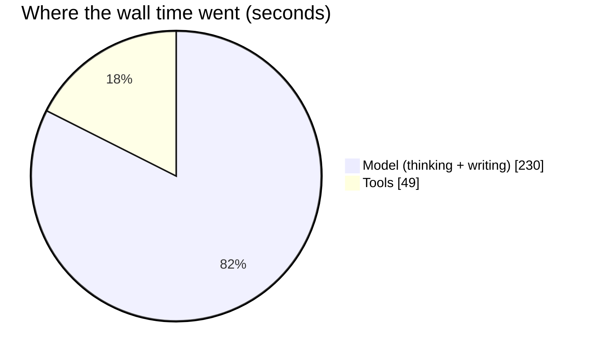

# intellectual-property/review-data-processing-agreement-template-against-eu-and-us-requirements · run8 (`hv-mixed200-lunahigh-flip-r8-20261118T030322Z`)

Result: **fail** 45/47 criteria · 4.7 min · 23 model calls · 49 tool calls (3 errors or timeouts) · ending `completed` · started 11-18 08:44:43 IST

## Overview

One box per stretch of steps that used the same kind of tool (blue: looking/searching/reading, purple: writing or editing files, yellow: a message with no tool call, red border: a tool error or timeout inside the box).

```mermaid
flowchart TD
    T(["Task prompt"])
    P0["<b>Step 1</b> · 0.1 min<br/>todo_write"]
    T --> P0
    class P0 look
    P1["<b>Step 2</b> · 0.2 min<br/>glob x6<br/><i>**/*, *.docx, *.pdf +3</i>"]
    P0 --> P1
    class P1 look
    P2["<b>Step 3</b> · 0.4 min<br/>bash x5<br/><i>parse-doc docx documents/pinnacle-us-…, parse-doc docx documents/msa-summary-…, parse-doc docx documents/data-flow-di… +2</i>"]
    P1 --> P2
    class P2 look
    P3["<b>Steps 4-5</b> · 0.1 min<br/>read x7<br/><i>playbook.txt, terms.txt, dataflow.txt +2</i>"]
    P2 --> P3
    class P3 look
    P4["<b>Step 6</b> · 0.2 min<br/>todo_write"]
    P3 --> P4
    class P4 look
    P5["<b>Steps 7-9</b> · 2.4 min<br/>bash x3<br/><i>python - #lt;#lt;'PY' import docx print(doc…, cat #gt; generate_memo.py #lt;#lt;'PY' from do…, parse-doc docx output/compliance-gap-…</i>"]
    P4 --> P5
    class P5 look
    P6["<b>Steps 10-11</b> · 0.2 min<br/>bash x4<br/>read x2<br/><i>memo-parse.txt, libreoffice --headless --convert-to p…, python - #lt;#lt;'PY' from docx import Docu… +2</i>"]
    P5 --> P6
    class P6 look
    P7["<b>Step 12</b> · 0.0 min<br/>read_image x3<br/>glob<br/><i>render-check/*.png, page-1.png, page-2.png +1</i>"]
    P6 --> P7
    class P7 err
    P8["<b>Step 13</b> · 0.0 min<br/>read_image x3<br/><i>page-01.png, page-02.png, page-03.png</i>"]
    P7 --> P8
    class P8 look
    P9["<b>Step 14</b> · 0.1 min<br/>bash<br/><i>pdftoppm -f 11 -l 13 -png -r 120 outp…</i>"]
    P8 --> P9
    class P9 look
    P10["<b>Steps 15-18</b> · 0.3 min<br/>read_image x3<br/>edit x2<br/>read<br/><i>page-11.png, page-12.png, page-13.png +1</i>"]
    P9 --> P10
    class P10 write
    P11["<b>Step 19</b> · 0.1 min<br/>bash<br/><i>python generate_memo.py && rm -f outp…</i>"]
    P10 --> P11
    class P11 look
    P12["<b>Step 20</b> · 0.1 min<br/>read_image x3<br/><i>page-11.png, page-12.png, page-13.png</i>"]
    P11 --> P12
    class P12 look
    P13["<b>Step 21</b> · 0.3 min<br/>bash<br/><i>rm -f output/compliance-gap-memorandu…</i>"]
    P12 --> P13
    class P13 look
    P14["<b>Step 22</b> · 0.1 min<br/>todo_write"]
    P13 --> P14
    class P14 look
    P15["<b>Step 23</b> · 0.1 min<br/>final message"]
    P14 --> P15
    class P15 ans
    R(["FAIL: 45/47 criteria"])
    P15 --> R
    class R fail
    classDef look fill:#e8f0fe,stroke:#4a6fa5,color:#111
    classDef write fill:#f3e8fd,stroke:#7b1fa2,color:#111
    classDef ans fill:#fff8e1,stroke:#b58900,color:#111
    classDef err fill:#e8f0fe,stroke:#c62828,stroke-width:3px,color:#111
    classDef pass fill:#e6f4ea,stroke:#2e7d32,color:#111
    classDef fail fill:#fce8e6,stroke:#c62828,color:#111
```





One row per model call:

| Step | Started (IST) | Model s | Tools s | Tool calls | Tools | Output chars |
|---|---|---|---|---|---|---|
| 1 | 08:44:43 | 3 | 0 | 1 | todo_write | 57 |
| 2 | 08:44:47 | 4 | 6 | 6 | glob x6 | 457 |
| 3 | 08:44:58 | 3 | 23 | 5 | bash x5 | 1,507 |
| 4 | 08:45:24 | 2 | 0 | 5 | read x5 | 187,660 |
| 5 | 08:45:26 | 2 | 0 | 2 | read x2 | 79,994 |
| 6 | 08:45:28 | 13 | 0 | 1 | todo_write | 57 |
| 7 | 08:45:41 | 13 | 1 | 1 | bash | 6 |
| 8 | 08:45:55 | 120 | 3 | 1 | bash | 38 |
| 9 | 08:47:57 | 4 | 2 | 1 | bash | 374 |
| 10 | 08:48:03 | 3 | 3 | 3 | bash x2, read | 33,829 |
| 11 | 08:48:09 | 4 | 2 | 3 | bash x2, read | 17,500 |
| 12 | 08:48:15 | 2 | 1 | 4 | read_image x3, glob ⚠ | 830 |
| 13 | 08:48:17 | 2 | 0 | 3 | read_image x3 | 978 |
| 14 | 08:48:20 | 7 | 2 | 1 | bash | 30 |
| 15 | 08:48:29 | 3 | 0 | 3 | read_image x3 | 978 |
| 16 | 08:48:32 | 5 | 0 | 1 | read | 4,865 |
| 17 | 08:48:37 | 5 | 0 | 1 | edit | 253 |
| 18 | 08:48:41 | 3 | 0 | 1 | edit | 253 |
| 19 | 08:48:44 | 4 | 3 | 1 | bash | 78 |
| 20 | 08:48:51 | 4 | 0 | 3 | read_image x3 | 978 |
| 21 | 08:48:55 | 13 | 3 | 1 | bash | 631 |
| 22 | 08:49:11 | 7 | 0 | 1 | todo_write | 57 |
| 23 | 08:49:17 | 5 | 0 | 0 | (message only) | 0 |

## Task prompt

```text
Review the vendor DPA template against our playbook, commercial terms, data flow details, and negotiation emails; produce a gap memorandum with prioritized findings and redline recommendations. Output: `compliance-gap-memorandum.docx`.
```

## Rubric

| # | Criterion | Verdict |
|---|---|---|
| C-001 | Prioritized summary table at beginning of memo | pass |
| C-002 | ISSUE_001: Identifies missing HIPAA BAA integration | pass |
| C-003 | ISSUE_001: Notes missing HIPAA-specific definitions | pass |
| C-004 | ISSUE_001: Recommends integrating BAA or attaching as exhibit | pass |
| C-005 | ISSUE_001: References minimum necessary standard or workforce training | pass |
| C-006 | ISSUE_002: Identifies 48-hour vs. 24-hour breach notification discrepancy | pass |
| C-007 | ISSUE_002: Identifies missing HIPAA breach notification obligations | pass |
| C-008 | ISSUE_002: Recommends specific redline for breach notification timeline | pass |
| C-009 | ISSUE_003: Identifies liability cap gap (€500K vs. playbook minimum) | pass |
| C-010 | ISSUE_003: Quantifies liability gap with correct dollar figures | pass |
| C-011 | ISSUE_003: Identifies missing carve-outs for willful misconduct/gross negligence | pass |
| C-012 | ISSUE_003: Identifies blanket exclusion of consequential damages as problematic | pass |
| C-013 | ISSUE_003: References correct MSA fee structure | pass |
| C-014 | ISSUE_004: Identifies missing SCC Module 3 for processor-to-subprocessor transfers | pass |
| C-015 | ISSUE_004: Identifies Singapore remote access as an unaddressed transfer | pass |
| C-016 | ISSUE_004: Notes Larkfield not certified under EU-US Data Privacy Framework | pass |
| C-017 | ISSUE_004: Flags absence of Transfer Impact Assessment documentation | pass |
| C-018 | ISSUE_005: Identifies missing CCPA/CPRA Service Provider provisions | pass |
| C-019 | ISSUE_005: Specifies required CCPA/CPRA contractual terms | pass |
| C-020 | ISSUE_006: Identifies audit rights limited to Frankfurt only | pass |
| C-021 | ISSUE_006: Recommends extending audit rights to subprocessor locations | pass |
| C-022 | ISSUE_007: Identifies missing data return option at termination | pass |
| C-023 | ISSUE_007: Identifies HIPAA 6-year retention conflict with 90-day deletion | pass |
| C-024 | ISSUE_008: Identifies governing law mismatch for US data disputes | pass |
| C-025 | ISSUE_008: Recommends bifurcated governing law/dispute resolution | pass |
| C-026 | ISSUE_009: Recognizes Module 2 alone is insufficient for processor-to-subprocessor transfers | pass |
| C-027 | ISSUE_011: Identifies 2-year survival period as insufficient for HIPAA | pass |
| C-028 | ISSUE_012: Flags anonymization vs. pseudonymization regulatory risk | pass |
| C-029 | DISTRACTOR_003: Does not flag DIS arbitration for EU disputes as a gap | pass |
| C-030 | Each gap includes risk level classification | pass |
| C-031 | Each gap references the specific DPA section at issue | pass |
| C-032 | Each gap includes a specific recommended redline or amendment | pass |
| C-033 | Correctly identifies Pinnacle as HIPAA Covered Entity | pass |
| C-034 | Correctly identifies Stratosphere as Processor/Business Associate | pass |
| C-035 | References EU-US Data Privacy Framework in transfer analysis | pass |
| C-036 | Identifies EU-to-US (Larkfield/Northern Virginia) disaster recovery transfer scenario | pass |
| C-037 | Identifies Singapore remote access transfer scenario | pass |
| C-038 | Identifies Stratosphere processor-to-subprocessor transfer scenario | pass |
| C-039 | References 2.1 million US patients or 890,000 California residents | pass |
| C-040 | ISSUE_001 classified as Critical or High risk | pass |
| C-041 | ISSUE_003 classified as Critical or High risk | pass |
| C-042 | References negotiation context from email thread | pass |
| C-043 | Mentions subprocessor Larkfield Data Systems by name | **FAIL** |
| C-044 | Mentions subprocessor Orionis Analytics by name | **FAIL** |
| C-045 | ISSUE_006: Notes audit limited to once per year | pass |
| C-046 | ISSUE_004: Recommends specific transfer mechanisms for identified gaps | pass |
| C-047 | ISSUE_012: Recommends defining anonymization standard in DPA | pass |

Judge's reasoning:

**C-001 (pass):** Prioritized summary table at beginning of memo

```text
The memo includes a near-beginning section titled “2. Prioritized findings at a glance” with a structured table listing each gap, its priority/risk level (e.g., Critical, High, Medium-High), and a brief description of the core gap.
```

**C-002 (pass):** ISSUE_001: Identifies missing HIPAA BAA integration

```text
The memorandum expressly identifies that the DPA lacks a HIPAA Business Associate Agreement despite Stratosphere processing US patient PHI, and recommends adding and integrating a conforming BAA before any PHI processing.
```

**C-003 (pass):** ISSUE_001: Notes missing HIPAA-specific definitions

```text
The memorandum expressly states that the DPA lacks HIPAA-specific definitions and recommends defining PHI, ePHI, Covered Entity, Business Associate, and related HIPAA terms.
```

**C-004 (pass):** ISSUE_001: Recommends integrating BAA or attaching as exhibit

```text
The memo specifically recommends adding an integrated BAA or a standalone BAA expressly incorporated as an exhibit and signed simultaneously with the DPA. It also includes suggested BAA integration language and lists the BAA as a required redline module.
```

**C-005 (pass):** ISSUE_001: References minimum necessary standard or workforce training

```text
The memo expressly identifies both missing HIPAA obligations: the “minimum necessary” standard for PHI use/disclosure and workforce training requirements, including annual training and records.
```

**C-006 (pass):** ISSUE_002: Identifies 48-hour vs. 24-hour breach notification discrepancy

```text
The memo expressly flags that DPA § 9 permits notification within 48 hours after internal confirmation, while Pinnacle requires notice within 24 hours of discovery, and recommends replacing the 48-hour timeline with a firm 24-hour requirement.
```

**C-007 (pass):** ISSUE_002: Identifies missing HIPAA breach notification obligations

```text
The memo expressly identifies the missing HIPAA breach-notification cascade, including notice to HHS, affected individuals, and media, and recommends adding cooperation and allocation for those obligations.
```

**C-008 (pass):** ISSUE_002: Recommends specific redline for breach notification timeline

```text
The memo gives a specific redline requiring notice within 24 hours of discovery of any actual or reasonably suspected security incident, personal data breach, or breach of unsecured PHI. It also defines discovery, specifies notice contacts, recommends ongoing updates and HIPAA notification cooperation, and includes proposed clause language.
```

**C-009 (pass):** ISSUE_003: Identifies liability cap gap (€500K vs. playbook minimum)

```text
The memo expressly identifies the DPA’s €500,000 aggregate liability cap as substantially below Pinnacle’s playbook minimum and recommends a cap of at least 2x the annual fees attributable to the affected processing activity (€/$ equivalents stated as $5.6M US, $2.8M EU, or $8.4M combined).
```

**C-010 (pass):** ISSUE_003: Quantifies liability gap with correct dollar figures

```text
The memo expressly quantifies the playbook minimum as $2.8M for EU claims and $8.4M for a combined cap, and contrasts those figures with the €500,000 template cap, stated as approximately $545,000.
```

**C-011 (pass):** ISSUE_003: Identifies missing carve-outs for willful misconduct/gross negligence

```text
The memo expressly states that DPA §13 lacks uncapped carve-outs for willful misconduct and gross negligence and recommends making liability for those categories uncapped, consistent with Pinnacle's playbook.
```

**C-012 (pass):** ISSUE_003: Identifies blanket exclusion of consequential damages as problematic

```text
The memo expressly flags the DPA’s blanket exclusion of indirect, consequential, and special damages as unacceptable and recommends that the exclusion not apply to data-breach claims involving willful misconduct, consistent with Pinnacle’s playbook.
```

**C-013 (pass):** ISSUE_003: References correct MSA fee structure

```text
The liability discussion expressly references the MSA fee structure, including $4.2M in annual fees and the $2.8M US / $1.4M EU split, and uses those figures to calculate proposed liability caps.
```

**C-014 (pass):** ISSUE_004: Identifies missing SCC Module 3 for processor-to-subprocessor transfers

```text
The memorandum expressly states that the DPA includes only SCC Module 2 and that SCC Module 3 is required for Stratosphere’s processor-to-subprocessor transfer to Larkfield in the United States. It also recommends executing Module 3 for that transfer.
```

**C-015 (pass):** ISSUE_004: Identifies Singapore remote access as an unaddressed transfer

```text
The memo expressly flags Singapore-based remote support access to EU personal data as a Chapter V international transfer that the DPA does not address, and recommends appropriate SCC coverage and supplementary measures or restricting access to EEA personnel.
```

**C-016 (pass):** ISSUE_004: Notes Larkfield not certified under EU-US Data Privacy Framework

```text
The memo expressly states that “Larkfield is not certified under the EU-US Data Privacy Framework” and concludes that the DPF is therefore not an available transfer mechanism for Larkfield.
```

**C-017 (pass):** ISSUE_004: Flags absence of Transfer Impact Assessment documentation

```text
The memorandum expressly identifies that the DPA requires no documented TIA and recommends documented TIAs for each third-country transfer, including periodic reassessment and availability to Pinnacle.
```

**C-018 (pass):** ISSUE_005: Identifies missing CCPA/CPRA Service Provider provisions

```text
The memorandum expressly identifies that the DPA lacks CCPA/CPRA Service Provider provisions and ties the gap to the approximately 890,000 California residents whose personal information is processed. It also details missing restrictions such as no sale/share, purpose limitation, no combining, certification, monitoring, and inability-to-comply notice.
```

**C-019 (pass):** ISSUE_005: Specifies required CCPA/CPRA contractual terms

```text
The memo specifies all three listed CCPA/CPRA provisions: a prohibition on selling or sharing personal information, a no-combining restriction, and an authorized-representative Service Provider certification requirement.
```

**C-020 (pass):** ISSUE_006: Identifies audit rights limited to Frankfurt only

```text
The memo expressly states that DPA §11.3 limits audits to Stratosphere’s primary Frankfurt facility and explains that this excludes other processing locations and subprocessor controls, including Dublin and Northern Virginia/Larkfield. It recommends extending audit rights to all vendor and subprocessor processing locations.
```

**C-021 (pass):** ISSUE_006: Recommends extending audit rights to subprocessor locations

```text
The memo expressly recommends extending audit rights to all vendor and subprocessor processing locations and requiring Stratosphere to secure equivalent audit rights from each subprocessor or, at minimum, obtain annual SOC 2 Type II/ISO evidence covering relevant services.
```

**C-022 (pass):** ISSUE_007: Identifies missing data return option at termination

```text
The memo expressly states that DPA Section 12 provides a deletion-only exit path with no affirmative data return option or transition-assistance period. It recommends adding a complete machine-readable return option and at least 30 days of transition assistance, matching the criterion.
```

**C-023 (pass):** ISSUE_007: Identifies HIPAA 6-year retention conflict with 90-day deletion

```text
The memo expressly identifies that the DPA’s 90-day primary deletion timeline conflicts with HIPAA’s six-year documentation retention requirement and recommends a six-year HIPAA retention carve-out with continuing protections.
```

**C-024 (pass):** ISSUE_008: Identifies governing law mismatch for US data disputes

```text
The memo expressly flags that DPA §14 applies German law and DIS arbitration in Munich to all disputes, including US PHI and CCPA-covered data, and recommends Delaware law with jurisdiction in the Western District of Texas, Austin Division (or Travis County courts if federal jurisdiction is unavailable) for US data disputes.
```

**C-025 (pass):** ISSUE_008: Recommends bifurcated governing law/dispute resolution

```text
The memo expressly recommends bifurcated treatment: Delaware law and US court jurisdiction for disputes involving US data, and Netherlands or German law with EU-seated arbitration for EU/EEA data disputes.
```

**C-026 (pass):** ISSUE_009: Recognizes Module 2 alone is insufficient for processor-to-subprocessor transfers

```text
The memo expressly states that SCC Module 2 covers Controller-to-Processor transfers and is insufficient for Stratosphere’s Processor-to-Subprocessor transfer to Larkfield. It specifically requires separate execution of SCC Module 3 for the Stratosphere-to-Larkfield transfer.
```

**C-027 (pass):** ISSUE_011: Identifies 2-year survival period as insufficient for HIPAA

```text
The memo expressly flags Section 16.3’s two-year survival period as inadequate because HIPAA documentation must be retained for six years and because BAA, security, audit, and related protections should continue for as long as PHI remains retained.
```

**C-028 (pass):** ISSUE_012: Flags anonymization vs. pseudonymization regulatory risk

```text
The memo expressly flags the anonymization/pseudonymization issue for Orionis. It notes that Orionis receives EU data before anonymization is complete, requires definitions and validation standards for “anonymized” versus “pseudonymized” data, and states that pseudonymized or insufficiently anonymized data remains Personal Data subject to GDPR.
```

**C-029 (pass):** DISTRACTOR_003: Does not flag DIS arbitration for EU disputes as a gap

```text
The memo objects to German law and DIS arbitration only insofar as they apply to all disputes, including US PHI and California data. It expressly states that German law and DIS arbitration are acceptable for EU/EEA data disputes and even proposes DIS arbitration for EU claims. Thus, it does not treat DIS arbitration for EU matters as a material gap.
```

**C-030 (pass):** Each gap includes risk level classification

```text
The memo assigns a priority/risk classification to all identified gaps in both the summary table and detailed analysis, using labels such as Critical / Red Line, Critical, High / Red Line, High, Medium-High, and Medium. This exceeds the 75% threshold.
```

**C-031 (pass):** Each gap references the specific DPA section at issue

```text
The memorandum references specific DPA sections or provisions for essentially every identified gap. The prioritized table lists locations such as DPA § 9 for breach notification, § 13 for liability, § 11 for audits, §§ 12 and 16 for deletion/retention, and § 14 for governing law. The detailed analyses likewise identify the relevant sections, recitals, signature block, or annex provisions. This comfortably exceeds the 75% threshold.
```

**C-032 (pass):** Each gap includes a specific recommended redline or amendment

```text
The memorandum identifies 14 detailed gaps, and each includes a specific “Redline recommendation” describing concrete contractual changes. Examples include incorporating a HIPAA BAA, adding CCPA/CPRA service-provider terms, executing SCC Module 3 and TIAs, replacing the liability cap, changing breach notice to 24 hours, expanding audit scope, adding data-return and retention provisions, bifurcating governing law/forum, and revising survival. Several gaps also include proposed clause language. This clearly exceeds the 75% threshold.
```

**C-033 (pass):** Correctly identifies Pinnacle as HIPAA Covered Entity

```text
The memo expressly treats Pinnacle as the HIPAA Covered Entity. It recommends defining “Covered Entity” in the BAA, refers to PHI processed on behalf of the Covered Entity, and states that Pinnacle US should be identified as “Covered Entity / Controller for US flows.”
```

**C-034 (pass):** Correctly identifies Stratosphere as Processor/Business Associate

```text
The memorandum repeatedly identifies Stratosphere as the GDPR Processor and states that it must be covered as a HIPAA Business Associate through an integrated or standalone BAA. It also recommends defining the Business Associate role and applying the BAA to PHI handled by Stratosphere and its subcontractors.
```

**C-035 (pass):** References EU-US Data Privacy Framework in transfer analysis

```text
The memo expressly discusses the EU-US Data Privacy Framework in its international transfer analysis, stating that Larkfield is not certified under the framework and therefore the DPF is not an available transfer mechanism for Larkfield.
```

**C-036 (pass):** Identifies EU-to-US (Larkfield/Northern Virginia) disaster recovery transfer scenario

```text
The memo expressly identifies EU disaster-recovery/BC replication from the Frankfurt EU environment to Larkfield’s Northern Virginia facility, including the need for SCC Module 3 for the Stratosphere-to-Larkfield transfer.
```

**C-037 (pass):** Identifies Singapore remote access transfer scenario

```text
The memo expressly identifies regular Singapore-based remote support access to EU personal data as a Chapter V transfer and recommends either appropriate SCC coverage and supplementary measures or restricting access to EEA personnel.
```

**C-038 (pass):** Identifies Stratosphere processor-to-subprocessor transfer scenario

```text
The memo expressly identifies the Stratosphere-to-Larkfield EU disaster-recovery transfer as a processor-to-subprocessor international transfer requiring separate coverage under SCC Module 3, along with a transfer schedule and TIA. It also flags Singapore subprocessor access as requiring its own mechanism or restriction.
```

**C-039 (pass):** References 2.1 million US patients or 890,000 California residents

```text
The memo references both qualifying figures: approximately 2.1 million US patients in its HIPAA/PHI discussion and approximately 890,000 California residents in its CCPA/CPRA analysis.
```

**C-040 (pass):** ISSUE_001 classified as Critical or High risk

```text
The missing HIPAA BAA integration is explicitly classified as “Critical / Red Line” in the prioritized findings and again as “CRITICAL / RED LINE” in the detailed analysis, satisfying the required highest-tier severity.
```

**C-041 (pass):** ISSUE_003 classified as Critical or High risk

```text
The liability cap gap is expressly classified as “Critical / Red Line” in the prioritized findings and again as “CRITICAL / RED LINE” in the detailed analysis, satisfying the required Critical or High risk classification.
```

**C-042 (pass):** References negotiation context from email thread

```text
The memo expressly references the April 14–18, 2025 negotiation email thread, cites Stratosphere’s position on the €500,000 cap and operational DPO approach, and notes Pinnacle’s threshold issues and escalation contacts. This sufficiently acknowledges the negotiation context.
```

**C-043 (fail):** Mentions subprocessor Larkfield Data Systems by name

```text
The memo repeatedly mentions “Larkfield,” but never identifies it by its full name, “Larkfield Data Systems” or “Larkfield Data Systems LLC,” as required.
```

**C-044 (fail):** Mentions subprocessor Orionis Analytics by name

```text
The memo mentions “Orionis” several times, including as an analytics subprocessor, but never identifies it by the required name “Orionis Analytics” or “Orionis Analytics Ltd.”
```

**C-045 (pass):** ISSUE_006: Notes audit limited to once per year

```text
The memo expressly states that DPA § 11.2 permits only one audit per year with 30 days' notice and discusses its insufficiency, recommending two audits per year while offering one planned annual audit with 30 days' notice as a fallback if for-cause audits remain available.
```

**C-046 (pass):** ISSUE_004: Recommends specific transfer mechanisms for identified gaps

```text
The memo recommends at least three qualifying mechanisms: executing SCC Module 3 for the Stratosphere-to-Larkfield processor-to-subprocessor transfer, implementing Singapore-specific supplementary measures (or restricting access to EEA personnel), and conducting documented Transfer Impact Assessments with periodic reassessment.
```

**C-047 (pass):** ISSUE_012: Recommends defining anonymization standard in DPA

```text
The memo expressly recommends defining “anonymized” versus “pseudonymized,” validating anonymization against WP29 Opinion 05/2014/EDPB-aligned standards, and treating outputs that do not meet an irreversible anonymization standard as Personal Data. This directly satisfies the criterion, including in relation to Orionis processing.
```

## Delivered files (output/)

- `compliance-gap-memorandum.docx` (58,943 bytes)

## Trajectory

### Step 1: 1 tool call

_Started 11-18 08:44:43 IST · model 3 s · tools 0 s_

**Reasoning summary:**

```text
**Reviewing document process**

I need to manipulate some documents and inspect the workspace. It seems like reading up on document creation skills could help, but there's no catalog provided. Maybe I should glob files to find what I need, and likely I'll have to use Python and the docx library. It makes sense that I should review the source documents first since that's the initial step in this multi-step process. I'll get started on that!
```

**Call `todo_write`** (0.0 s)

```json
{
 "todos": [
  {
   "content": "Inventory and read the playbook, contract, data-flow, email, and DPA source materials",
   "status": "in_progress"
  },
  {
   "content": "Analyze requirements and map prioritized gaps with redline recommendations",
   "status": "pending"
  },
  {
   "content": "Draft and format the gap memorandum as a DOCX",
   "status": "pending"
  },
  {
   "content": "Validate the DOCX content and presentation, then finalize deliverable",
   "status": "pending"
  }
 ]
}
```

Output (57 chars):

```text
Updated todo list: 3 pending, 1 in progress, 0 completed.
```

**Todo list now:**

- [~] Inventory and read the playbook, contract, data-flow, email, and DPA source materials
- [ ] Analyze requirements and map prioritized gaps with redline recommendations
- [ ] Draft and format the gap memorandum as a DOCX
- [ ] Validate the DOCX content and presentation, then finalize deliverable

### Step 2: 6 tool calls

_Started 11-18 08:44:47 IST · model 4 s · tools 6 s_

**Reasoning summary:**

```text
**Inspecting files with glob**

I'm thinking about how to inspect files using the glob module. It looks like I'll need to set up patterns to match the files I want to work with. Let’s see, I could use wildcards to specify file types or particular directory paths. I want to ensure I'm gathering all relevant files efficiently. This could involve checking for any specific naming conventions I need to consider. I'll dive into that next!
```

**Call `glob`** (1.0 s)

```json
{
 "pattern": "**/*"
}
```

Output (208 chars):

```text
documents/data-flow-diagram.docx
documents/msa-summary-term-sheet.docx
documents/pinnacle-us-dpa-playbook.docx
documents/stratosphere-dpa-template-v3-2.docx
documents/stratosphere-negotiation-email-thread.eml
```

**Call `glob`** (2.6 s)

```json
{
 "pattern": "*.docx"
}
```

Output (156 chars):

```text
documents/data-flow-diagram.docx
documents/msa-summary-term-sheet.docx
documents/pinnacle-us-dpa-playbook.docx
documents/stratosphere-dpa-template-v3-2.docx
```

**Call `glob`** (0.7 s)

```json
{
 "pattern": "*.pdf"
}
```

Output (14 chars):

```text
No files found
```

**Call `glob`** (0.7 s)

```json
{
 "pattern": "*.xlsx"
}
```

Output (14 chars):

```text
No files found
```

**Call `glob`** (0.9 s)

```json
{
 "pattern": "*.eml"
}
```

Output (51 chars):

```text
documents/stratosphere-negotiation-email-thread.eml
```

**Call `glob`** (0.5 s)

```json
{
 "pattern": "*.msg"
}
```

Output (14 chars):

```text
No files found
```

### Step 3: 5 tool calls

_Started 11-18 08:44:58 IST · model 3 s · tools 23 s_

**Reasoning summary:**

```text
**Considering document parsing**

I need to look into parsing documents using a bash script. Maybe I could utilize parallel bash calls for efficiency. It might be a good idea to inspect images as well, but there’s likely enough text to work with. I’ll use bash to output to a temporary file under my workspace. My instructions mention parsing docx files with additional steps, so I’ll focus on running parse-doc to convert each to .txt, ensuring it’s done correctly.
```

**Call `bash`** (4.4 s)

```json
{
 "command": "parse-doc docx documents/pinnacle-us-dpa-playbook.docx > playbook.txt",
 "description": "Parse DPA playbook to text"
}
```

Output (374 chars):

```text
[stderr]
2026-11-18 03:15:03.828447919 [W:onnxruntime:Default, device_discovery.cc:95 GetPciBusId] Skipping pci_bus_id for PCI path at "/sys/devices/LNXSYSTM:00/LNXSYBUS:00/ACPI0004:00/VMBUS:00/5620e0c7-8062-4dce-aeb7-520c7ef76171" because filename "5620e0c7-8062-4dce-aeb7-520c7ef76171" did not match expected pattern of [0-9a-f]+:[0-9a-f]+:[0-9a-f]+[.][0-9a-f]+
```

**Call `bash`** (5.1 s)

```json
{
 "command": "parse-doc docx documents/msa-summary-term-sheet.docx > terms.txt",
 "description": "Parse commercial terms to text"
}
```

Output (374 chars):

```text
[stderr]
2026-11-18 03:15:07.368191558 [W:onnxruntime:Default, device_discovery.cc:95 GetPciBusId] Skipping pci_bus_id for PCI path at "/sys/devices/LNXSYSTM:00/LNXSYBUS:00/ACPI0004:00/VMBUS:00/5620e0c7-8062-4dce-aeb7-520c7ef76171" because filename "5620e0c7-8062-4dce-aeb7-520c7ef76171" did not match expected pattern of [0-9a-f]+:[0-9a-f]+:[0-9a-f]+[.][0-9a-f]+
```

**Call `bash`** (4.9 s)

```json
{
 "command": "parse-doc docx documents/data-flow-diagram.docx > dataflow.txt",
 "description": "Parse data flow document to text"
}
```

Output (374 chars):

```text
[stderr]
2026-11-18 03:15:14.977545047 [W:onnxruntime:Default, device_discovery.cc:95 GetPciBusId] Skipping pci_bus_id for PCI path at "/sys/devices/LNXSYSTM:00/LNXSYBUS:00/ACPI0004:00/VMBUS:00/5620e0c7-8062-4dce-aeb7-520c7ef76171" because filename "5620e0c7-8062-4dce-aeb7-520c7ef76171" did not match expected pattern of [0-9a-f]+:[0-9a-f]+:[0-9a-f]+[.][0-9a-f]+
```

**Call `bash`** (4.6 s)

```json
{
 "command": "parse-doc docx documents/stratosphere-dpa-template-v3-2.docx > dpa.txt",
 "description": "Parse vendor DPA template to text"
}
```

Output (374 chars):

```text
[stderr]
2026-11-18 03:15:18.825008940 [W:onnxruntime:Default, device_discovery.cc:95 GetPciBusId] Skipping pci_bus_id for PCI path at "/sys/devices/LNXSYSTM:00/LNXSYBUS:00/ACPI0004:00/VMBUS:00/5620e0c7-8062-4dce-aeb7-520c7ef76171" because filename "5620e0c7-8062-4dce-aeb7-520c7ef76171" did not match expected pattern of [0-9a-f]+:[0-9a-f]+:[0-9a-f]+[.][0-9a-f]+
```

**Call `bash`** (3.8 s)

```json
{
 "command": "cp documents/stratosphere-negotiation-email-thread.eml emails.eml",
 "description": "Copy negotiation email thread for reading"
}
```

Output (11 chars):

```text
(no output)
```

### Step 4: 5 tool calls

_Started 11-18 08:45:24 IST · model 2 s · tools 0 s_

**Call `read`** (0.0 s)

```json
{
 "file_path": "playbook.txt"
}
```

Output (53,327 chars):

```text
<path>/home/agarwaldi/dsh-bench-harness/runs/hv-mixed200-lunahigh-flip-r8-20261118T030322Z/tasks/intellectual-property__review-data-processing-agreement-template-against-eu-and-us-requirements/workspace/playbook.txt</path>
<type>file</type>
<content>
1: **[DATA PROCESSING AGREEMENT NEGOTIATION PLAYBOOK]{.underline}**
2: 
3: **[US AND CROSS-BORDER REQUIREMENTS]{.underline}**
4: 
5: **Internal Use Only --- Attorney-Client Privileged and Confidential Work Product**
6: 
7: Prepared by: **Office of the General Counsel** **Pinnacle Health Solutions, Inc.** 4200 Harborview Boulevard, Suite 1100 Austin, TX 78746
8: 
9: Approved by: **Margaret Yuen-Park**, General Counsel
10: 
11: **Version 4.0**
12: 
13: Last Updated: **February 28, 2025**
14: 
15: **Distribution List:**
16: 
17:   -------------------------------------------------------------------------------------
18:   **Recipient**                                     **Title**
19:   ------------------------------------------------- -----------------------------------
20:   Legal Department (all attorneys and paralegals)   ---
21: 
22:   Dr. Anand Krishnamurthy                           Chief Privacy Officer
23: 
24:   Jennifer Castellano                               VP of Information Security
25: 
26:   David Liang                                       VP of Procurement
27:   -------------------------------------------------------------------------------------
28: 
29: **External Counsel Reference:** This playbook was developed 
… [51,827 more chars]
```

**Call `read`** (0.1 s)

```json
{
 "file_path": "terms.txt"
}
```

Output (23,019 chars):

```text
<path>/home/agarwaldi/dsh-bench-harness/runs/hv-mixed200-lunahigh-flip-r8-20261118T030322Z/tasks/intellectual-property__review-data-processing-agreement-template-against-eu-and-us-requirements/workspace/terms.txt</path>
<type>file</type>
<content>
1: **[MASTER SERVICES AGREEMENT --- SUMMARY TERM SHEET]{.underline}**
2: 
3: **Summary of Key Commercial Terms**
4: 
5: MSA Effective Date: March 15, 2024
6: 
7: This Summary Term Sheet is for internal reference purposes only and does not amend or supersede the Master Services Agreement dated March 15, 2024 (the \"MSA\"), by and between Pinnacle Health Solutions, Inc. and Stratosphere Cloud Services GmbH. In the event of any conflict between the terms summarized herein and the terms of the executed MSA, the terms of the executed MSA shall control in all respects.
8: 
9: Prepared by the Office of General Counsel Pinnacle Health Solutions, Inc.
10: 
11: Last Updated: March 15, 2024
12: 
13: **[Section 1 --- Parties]{.underline}**
14: 
15: **Client:** Pinnacle Health Solutions, Inc., a Delaware corporation, with its principal offices located at 4200 Harborview Boulevard, Suite 1100, Austin, TX 78746 (\"Pinnacle\" or \"Client\").
16: 
17: **Service Provider:** Stratosphere Cloud Services GmbH, a German limited liability company (*Gesellschaft mit beschränkter Haftung*) registered at the Munich Local Court (*Amtsgericht München*) under Commercial Register (*Handelsregister*) number HRB 247891, with its registered office at Hohenzollernst
… [21,519 more chars]
```

**Call `read`** (0.1 s)

```json
{
 "file_path": "dataflow.txt"
}
```

Output (46,572 chars):

```text
<path>/home/agarwaldi/dsh-bench-harness/runs/hv-mixed200-lunahigh-flip-r8-20261118T030322Z/tasks/intellectual-property__review-data-processing-agreement-template-against-eu-and-us-requirements/workspace/dataflow.txt</path>
<type>file</type>
<content>
1: **[DATA FLOW DIAGRAM AND PROCESSING DESCRIPTION]{.underline}**
2: 
3: **[Pinnacle Health Solutions, Inc. --- Stratosphere Cloud Services GmbH]{.underline}**
4: 
5: **[Data Processing Relationship]{.underline}**
6: 
7: **CONFIDENTIAL --- ATTORNEY-CLIENT PRIVILEGED / WORK PRODUCT**
8: 
9: This document is protected by the attorney-client privilege and the work product doctrine. Unauthorized disclosure, copying, or distribution is strictly prohibited. This document does not constitute legal advice to any third party.
10: 
11: **Prepared by:** Office of the General Counsel, Pinnacle Health Solutions, Inc., 4200 Harborview Boulevard, Suite 1100, Austin, TX 78746
12: 
13: **Prepared for:** Internal use and for review by outside counsel Alderton Shaw & Whitmore LLP (Rachel Osterfeld, Partner), 900 K Street NW, Suite 700, Washington, DC 20001
14: 
15: **Date:** April 2025
16: 
17: **Reference Documents:**
18: 
19: > •Master Services Agreement dated March 15, 2024 (\"MSA\")
20: >
21: > •Stratosphere DPA Template Version 3.2 dated January 10, 2025 (received April 14, 2025) (\"DPA Template\" or \"DPA\")
22: >
23: > •Pinnacle US DPA Playbook (last updated February 28, 2025) (\"Playbook\")
24: 
25: **Purpose:** This document maps all perso
… [45,072 more chars]
```

**Call `read`** (0.1 s)

```json
{
 "file_path": "dpa.txt"
}
```

Output (52,654 chars):

```text
<path>/home/agarwaldi/dsh-bench-harness/runs/hv-mixed200-lunahigh-flip-r8-20261118T030322Z/tasks/intellectual-property__review-data-processing-agreement-template-against-eu-and-us-requirements/workspace/dpa.txt</path>
<type>file</type>
<content>
1: **[DATA PROCESSING AGREEMENT]{.underline}**
2: 
3: **Version 3.2**
4: 
5: **January 10, 2025**
6: 
7: **STRATOSPHERE CLOUD SERVICES GmbH**
8: 
9: *Cloud Infrastructure · Managed Databases · Analytics*
10: 
11: This Data Processing Agreement (\"DPA\") forms part of and is subject to the terms of the Master Services Agreement (\"Agreement\" or \"MSA\") between the Processor and the Controller.
12: 
13: This DPA is designed to ensure compliance with Regulation (EU) 2016/679 of the European Parliament and of the Council of 27 April 2016 (the \"GDPR\") and applicable data protection laws governing the Processing of Personal Data in connection with the Services provided under the Agreement.
14: 
15: **Processor Registered Office:**
16: 
17: Stratosphere Cloud Services GmbH Hohenzollernstraße 88 80796 Munich, Germany
18: 
19: Handelsregister HRB 247891, Amtsgericht München (Munich Local Court)
20: 
21: **Prepared by:**
22: 
23: Legal Department, Stratosphere Cloud Services GmbH
24: 
25: **Contact:**
26: 
27: Dr. Florian Neumann Chief Legal Officer Stratosphere Cloud Services GmbH
28: 
29: Email: florian.neumann@stratospherecloud.example.com
30: 
31: Tel: +49 89 2155 4400
32: 
33: Right-click to update Table of Contents
34: 
35: **[RECITAL
… [51,154 more chars]
```

**Call `read`** (0.1 s)

```json
{
 "file_path": "emails.eml"
}
```

Output (12,088 chars):

```text
<path>/home/agarwaldi/dsh-bench-harness/runs/hv-mixed200-lunahigh-flip-r8-20261118T030322Z/tasks/intellectual-property__review-data-processing-agreement-template-against-eu-and-us-requirements/workspace/emails.eml</path>
<type>file</type>
<content>
1: From: Margaret Yuen-Park <myuenpark@pinnaclehealth.example.com>
2: To: Dr. Florian Neumann <f.neumann@stratospherecloud.example.com>
3: Cc: Rachel Osterfeld <rosterfeld@alderton-shaw.example.com>
4: Date: Fri, 18 Apr 2025 11:02:00 -0000
5: Subject: Re: Re: Re: Stratosphere DPA Template v3.2 — For Your Review
6: Content-Type: text/plain; charset="utf-8"
7: Content-Transfer-Encoding: quoted-printable
8: MIME-Version: 1.0
9: 
10: Florian,
11: 
12: Thank you for your response and for looping in Dr. Beckert.
13: 
14: We can confirm the call for Wednesday, April 30, 2025, at 4:00 PM CEST / 9:00=
15:  AM CDT. Rachel Osterfeld from Alderton Shaw & Whitmore will attend on our si=
16: de.
17: 
18: On the liability cap =E2=80=94 I appreciate your willingness to take this up =
19: internally. I want to set expectations that our redline of Section 13 will pr=
20: opose a structure tied to the annual fees under the MSA rather than a flat ca=
21: p, together with the carve-outs for willful misconduct and gross negligence I=
22:  referenced previously. I want to be transparent that this is a threshold iss=
23: ue for us, and we will need to reach agreement on liability allocation before=
24:  we can finalize the DPA.
25: 
26: Regarding DPO coor
… [10,588 more chars]
```

### Step 5: 2 tool calls

_Started 11-18 08:45:26 IST · model 2 s · tools 0 s_

**Call `read`** (0.0 s)

```json
{
 "file_path": "playbook.txt",
 "offset": 429,
 "limit": 600
}
```

Output (53,042 chars):

```text
<path>/home/agarwaldi/dsh-bench-harness/runs/hv-mixed200-lunahigh-flip-r8-20261118T030322Z/tasks/intellectual-property__review-data-processing-agreement-template-against-eu-and-us-requirements/workspace/playbook.txt</path>
<type>file</type>
<content>
429: > \(i\) Vendor grants Pinnacle **direct audit rights** over subprocessor facilities, with the same scope and frequency as Pinnacle\'s audit rights over vendor; or
430: >
431: > \(ii\) Vendor **contractually requires** each subprocessor to submit to audits by Pinnacle or Pinnacle\'s designated auditor, and provides Pinnacle with the contractual right to exercise such audits; or
432: >
433: > \(iii\) At minimum, vendor requires each subprocessor to **provide SOC 2 Type II reports** and/or **ISO 27001 certifications** covering the relevant data processing services, with copies provided to Pinnacle upon request no less frequently than annually.
434: 
435: **Nice-to-have:** Pinnacle prefers the right to conduct **two (2) audits per calendar year**: one planned audit and one for-cause audit. Planned audits should require **fifteen (15) days\' prior written notice** to the vendor. For-cause audits, triggered by a breach, suspected breach, or other compliance concern, should require **no advance notice** to the vendor.
436: 
437: **Fallback:** One (1) planned audit per calendar year with **thirty (30) days\' prior written notice** is acceptable, provided that the following conditions are met:
438: 
439: > \(a\) For-cause audits are 
… [51,542 more chars]
```

**Call `read`** (0.1 s)

```json
{
 "file_path": "dpa.txt",
 "offset": 317,
 "limit": 500
}
```

Output (26,952 chars):

```text
<path>/home/agarwaldi/dsh-bench-harness/runs/hv-mixed200-lunahigh-flip-r8-20261118T030322Z/tasks/intellectual-property__review-data-processing-agreement-template-against-eu-and-us-requirements/workspace/dpa.txt</path>
<type>file</type>
<content>
317: **17.3 Severability.** If any provision of this DPA is found by a court or other tribunal of competent jurisdiction to be invalid, illegal, or unenforceable, such provision shall be modified to the minimum extent necessary to make it valid, legal, and enforceable, and the remaining provisions of this DPA shall continue in full force and effect. If such modification is not possible, the invalid provision shall be severed and the remaining provisions shall be interpreted so as to give effect to the Parties\' original intent to the maximum extent possible.
318: 
319: **17.4 Waiver.** No failure or delay by either Party in exercising any right, power, or privilege under this DPA shall operate as a waiver thereof, nor shall any single or partial exercise of any right, power, or privilege preclude any other or further exercise thereof or the exercise of any other right, power, or privilege.
320: 
321: **17.5 Notices.** All notices, requests, demands, and other communications required or permitted under this DPA shall be in writing and shall be delivered by hand, by internationally recognized overnight courier service, or by email to the addresses specified in this DPA or such other addresses as a Party may designate in writing from tim
… [25,452 more chars]
```

### Step 6: 1 tool call

_Started 11-18 08:45:28 IST · model 13 s · tools 0 s_

**Reasoning summary:**

```text
**Producing high-quality memorandum**

I need to create a high-quality memorandum using the docx Python library. I'll inspect the source formatting to ensure it's polished, including elements like a title, privilege banner, executive summary, scope/method, risk rating, and detailed findings with redline text. I should cite the relevant DPA sections and source documents, but I won't include the actual redline DPA, only recommendations. There are some ambiguities that need reconciling, especially regarding the Dublin operator and data center locations. It’s essential to clarify the roles of the involved entities.

**Identifying DPA issues**

The MSA indicates the DPA involves Pinnacle, or Pinnacle EU, which may lack an EU controller signatory and clear cross-border roles. I need to identify specific DPA clauses, such as the absence of HIPAA BAA and CCPA SP terms, which is critical. There are also issues with international transfer regulations and liability caps that need attention. Additionally, breach notification timelines, audit limitations, and data deletion policies appear insufficient and inconsistent, particularly regarding HIPAA requirements and data return assistance.

**Clarifying DPA deletion terms**

I need to clarify the nuances regarding the DPA. It does allow for data deletion, but it seems to specify that there's no option for data return. Section 12.1 indicates that deletion is at the controller's choice, meaning they can delete all data, but there's no mention of returning it. I should highlight this to ensure there's a clear understanding of the implications of this clause.

**Considering document preparation**

I'm looking into how to prepare a document, possibly by inserting or deleting specific text. It might be useful to include a memo with a "redline package" that has example language for the main issues. I'll need to generate a DOCX file and check if I have the python-docx library installed. Maybe I could also use bash with Python, but first, I should update my to-do list to reflect what's been completed for the source.
```

**Call `todo_write`** (0.0 s)

```json
{
 "todos": [
  {
   "content": "Inventory and read the playbook, contract, data-flow, email, and DPA source materials",
   "status": "completed"
  },
  {
   "content": "Analyze requirements and map prioritized gaps with redline recommendations",
   "status": "in_progress"
  },
  {
   "content": "Draft and format the gap memorandum as a DOCX",
   "status": "pending"
  },
  {
   "content": "Validate the DOCX content and presentation, then finalize deliverable",
   "status": "pending"
  }
 ]
}
```

Output (57 chars):

```text
Updated todo list: 2 pending, 1 in progress, 1 completed.
```

**Todo list now:**

- [x] Inventory and read the playbook, contract, data-flow, email, and DPA source materials
- [~] Analyze requirements and map prioritized gaps with redline recommendations
- [ ] Draft and format the gap memorandum as a DOCX
- [ ] Validate the DOCX content and presentation, then finalize deliverable

### Step 7: 1 tool call

_Started 11-18 08:45:41 IST · model 13 s · tools 1 s_

**Reasoning summary:**

```text
**Drafting memo content**

I need to create a memo carefully since it's the only deliverable in docx format. I might draft it directly in Python and then check it via LibreOffice for PDF and image rendering. I’ll formulate the memo with proper citations, including the date May 9, 2025, as the target for emails. It should be internal and professional, possibly around 12-15 pages, including a title page, document control, an executive conclusion, and an at-a-glance risk summary.

**Summarizing detailed findings**

I've got a list of critical findings that need to be addressed. First, I’ll focus on HIPAA BAA and US regulatory coverage, followed by adding provisions for CCPA/CPRA. Then, I need to look into the transfer framework and liability/indemnity aspects. The breach protocols must cover timely responses, while the audit needs to encompass all locations. I also want to ensure proper data return/delete terms and governing law/forum considerations. Lastly, I'm checking on DPO coordination, processing descriptions, subprocessors, and security/TOM coverage.

**Creating a script for docx**

The developer’s guidance is clear: I should use write only for plain markdown and bash for building docx documents. So, I'm thinking I can create a script, maybe call it generate_memo.py, in the workspace. It seems I’ll need to use the python-docx library for this, so I should check the requirements for that. It’s nice to have a plan in place for generating documents in a more organized way!
```

**Call `bash`** (1.1 s)

```json
{
 "command": "python - <<'PY'\nimport docx\nprint(docx.__version__)\nPY",
 "description": "Check DOCX generation library"
}
```

Output (6 chars):

```text
1.2.0
```

### Step 8: 1 tool call

_Started 11-18 08:45:55 IST · model 120 s · tools 3 s_

**Call `bash`** (3.0 s)

```json
{
 "command": "cat > generate_memo.py <<'PY'\nfrom docx import Document\nfrom docx.shared import Inches, Pt, RGBColor\nfrom docx.enum.text import WD_ALIGN_PARAGRAPH, WD_BREAK\nfrom docx.enum.table import WD_TABLE_ALIGNMENT, WD_CELL_VERTICAL_ALIGNMENT\nfrom docx.enum.section import WD_SECTION\nfrom docx.oxml import OxmlElement\nfrom docx.oxml.ns import qn\nfrom docx.enum.style import WD_STYLE_TYPE\nfrom docx.enum.text import WD_LINE_SPACING\nfrom docx.enum.section import WD_ORIENT\nfrom docx.enum.table import WD_ROW_HEIGHT_RULE\nfrom docx.enum.text import WD_TAB_ALIGNMENT\nfrom docx.enum.style import WD_BUILTIN_STYLE\n\nOUT = 'output/compliance-gap-memorandum.docx'\n\nNAVY = '17365D'\nBLUE = '1F4E79'\nTEAL = '0F6B78'\nORANGE = 'C55A11'\nRED = '9C0006'\nRED_FILL = 'F4CCCC'\nAMBER_FILL = 'FCE4D6'\nYELLOW_FILL = 'FFF2CC'\nGREEN_FILL = 'E2F0D9'\nBLUE_FILL = 'D9EAF7'\nGRAY = '666666'\nLIGHT = 'F3F6F9'\nDARK = '222222'\nWHITE = 'FFFFFF'\n\n\ndef set_cell_shading(cell, fill):\n    tcPr = cell._tc.get_or_add_tcPr()\n    shd = tcPr.find(qn('w:shd'))\n    if shd is None:\n        shd = OxmlElement('w:shd')\n        tcPr.append(shd)\n    shd.set(qn('w:fill'), fill)\n\n\ndef set_cell_border(cel
… [57,279 more chars]
```

Output (38 chars):

```text
output/compliance-gap-memorandum.docx
```

### Step 9: 1 tool call

_Started 11-18 08:47:57 IST · model 4 s · tools 2 s_

**Reasoning summary:**

```text
**Validating script processing**

I’m noticing that I used a cat shell here doc instead of following the instruction to read the text, which isn’t ideal. I need to validate the parse-doc process and look into any warnings that came up. Also, there might be an issue with the add_bullet call, particularly regarding the size argument. Since I have defined the function with a size parameter, the call should be okay. Finally, I need to ensure that I’m parsing the docx to text and outputting it correctly.
```

**Call `bash`** (1.9 s)

```json
{
 "command": "parse-doc docx output/compliance-gap-memorandum.docx > memo-parse.txt",
 "description": "Parse generated memorandum for validation",
 "timeoutMs": 120000
}
```

Output (374 chars):

```text
[stderr]
2026-11-18 03:18:02.420986202 [W:onnxruntime:Default, device_discovery.cc:95 GetPciBusId] Skipping pci_bus_id for PCI path at "/sys/devices/LNXSYSTM:00/LNXSYBUS:00/ACPI0004:00/VMBUS:00/5620e0c7-8062-4dce-aeb7-520c7ef76171" because filename "5620e0c7-8062-4dce-aeb7-520c7ef76171" did not match expected pattern of [0-9a-f]+:[0-9a-f]+:[0-9a-f]+[.][0-9a-f]+
```

### Step 10: 3 tool calls

_Started 11-18 08:48:03 IST · model 3 s · tools 3 s_

**Call `read`** (0.0 s)

```json
{
 "file_path": "memo-parse.txt",
 "offset": 1,
 "limit": 240
}
```

Output (33,169 chars):

```text
<path>/home/agarwaldi/dsh-bench-harness/runs/hv-mixed200-lunahigh-flip-r8-20261118T030322Z/tasks/intellectual-property__review-data-processing-agreement-template-against-eu-and-us-requirements/workspace/memo-parse.txt</path>
<type>file</type>
<content>
1: **Pinnacle Health Solutions, Inc.**
2: 
3: **COMPLIANCE GAP MEMORANDUM**
4: 
5: Stratosphere Cloud Services GmbH --- DPA Template v3.2
6: 
7: > **EXECUTIVE DISPOSITION** Do not execute the DPA as circulated and do not permit PHI or EU personal data processing under it until the Critical / Red-Line items in this memorandum are cured and the final DPA, BAA, SCC package, and schedules are signed.
8: 
9:   ---------------------------------------------------------------------------------------------------------
10:   **Document control**                **Detail**
11:   ----------------------------------- ---------------------------------------------------------------------
12:   Prepared for                        Pinnacle Health Solutions, Inc. --- Office of the General Counsel
13: 
14:   Counterparty                        Stratosphere Cloud Services GmbH
15: 
16:   Reviewed document                   Stratosphere DPA Template v3.2, dated January 10, 2025
17: 
18:   Underlying agreement                MSA dated March 15, 2024; DPA contemplated as Exhibit D
19: 
20:   Prepared for circulation            May 9, 2025 (targeted redline / memorandum circulation date)
21: 
22:   Classification                      CONFIDENTIAL --- AT
… [31,669 more chars]
```

**Call `bash`** (2.2 s)

```json
{
 "command": "libreoffice --headless --convert-to pdf --outdir output output/compliance-gap-memorandum.docx >/tmp/lo.txt 2>&1; printf 'LO_EXIT=%s\\n' \"$?\"; printf '%s\\n' \"$(sed -n '1,20p' /tmp/lo.txt)\"",
 "description": "Render memorandum to PDF for layout check",
 "timeoutMs": 120000
}
```

Output (612 chars):

```text
LO_EXIT=0
Warning: failed to launch javaldx - java may not function correctly
convert /home/agarwaldi/dsh-bench-harness/runs/hv-mixed200-lunahigh-flip-r8-20261118T030322Z/tasks/intellectual-property__review-data-processing-agreement-template-against-eu-and-us-requirements/workspace/output/compliance-gap-memorandum.docx as a Writer document -> /home/agarwaldi/dsh-bench-harness/runs/hv-mixed200-lunahigh-flip-r8-20261118T030322Z/tasks/intellectual-property__review-data-processing-agreement-template-against-eu-and-us-requirements/workspace/output/compliance-gap-memorandum.pdf using filter : writer_pdf_Export
```

**Call `bash`** (0.7 s)

```json
{
 "command": "python - <<'PY'\nfrom docx import Document\np='output/compliance-gap-memorandum.docx'\nd=Document(p)\nprint('paragraphs', len(d.paragraphs), 'tables', len(d.tables), 'sections', len(d.sections))\nprint('has text', sum(bool(x.text.strip()) for x in d.paragraphs))\nPY",
 "description": "Inspect DOCX structure and content"
}
```

Output (48 chars):

```text
paragraphs 147 tables 5 sections 1
has text 140
```

### Step 11: 3 tool calls

_Started 11-18 08:48:09 IST · model 4 s · tools 2 s_

**Reasoning summary:**

```text
**Evaluating PDF processing**

I'm considering a visual check on PDF pages and might use tools like pdfinfo and pdftoppm for this process. The goal is to deliver output in DOCX format, so any extra PDF content might need to be removed before the final version. I'll have to inspect things like page count and ensure nothing is omitted or truncated. So, including some details while being cautious about unnecessary outputs is essential.
```

**Call `read`** (0.0 s)

```json
{
 "file_path": "memo-parse.txt",
 "offset": 241,
 "limit": 180
}
```

Output (17,005 chars):

```text
<path>/home/agarwaldi/dsh-bench-harness/runs/hv-mixed200-lunahigh-flip-r8-20261118T030322Z/tasks/intellectual-property__review-data-processing-agreement-template-against-eu-and-us-requirements/workspace/memo-parse.txt</path>
<type>file</type>
<content>
241: 
242: **Risk / impact.** A mismatch between the actual architecture and the annexes can undermine role allocation, SCC completion, audit scope, and the ability to prove what was authorized. The current schedules also risk treating employee data and "anonymized" analytics more broadly than the approved flow description without a clear instruction or purpose limitation.
243: 
244: **Redline recommendation.** Complete the MSA reference and signature blocks. Identify Pinnacle US as Covered Entity / Controller for US flows and Pinnacle EU B.V. as EU Controller / exporter for EU flows. Update Annex A to include each data category and subject population, special-category health data, retention, support access, DR replication, Orionis analytics, and the actual operator / location of each facility. Correct Annex B's Dublin operator description. Define "anonymized" versus "pseudonymized," require WP29 Opinion 05/2014 / EDPB-aligned validation, and treat any output that does not meet the irreversible standard as Personal Data.
245: 
246: **Negotiation posture.** Treat the corrected schedules as a signature condition. Any new location, access country, subprocessor, purpose, or data category should require an amendment or the agreed no
… [15,505 more chars]
```

**Call `bash`** (0.5 s)

```json
{
 "command": "pdfinfo output/compliance-gap-memorandum.pdf | sed -n '1,20p'",
 "description": "Check rendered PDF page count"
}
```

Output (484 chars):

```text
Author:          python-docx
Creator:         Writer
Producer:        LibreOffice 25.2.3.2 (X86_64) / LibreOffice Community
CreationDate:    Wed Nov 18 03:18:08 2026 UTC
Custom Metadata: no
Metadata Stream: yes
Tagged:          yes
UserProperties:  no
Suspects:        no
Form:            none
JavaScript:      no
Pages:           13
Encrypted:       no
Page size:       612 x 792 pts (letter)
Page rot:        0
File size:       219574 bytes
Optimized:       no
PDF version:     1.7
```

**Call `bash`** (1.1 s)

```json
{
 "command": "mkdir -p render-check; pdftoppm -f 1 -l 3 -png -r 120 output/compliance-gap-memorandum.pdf render-check/page >/tmp/pdftoppm.txt 2>&1; printf 'PDFTOEX=%s\\n' \"$?\"; printf '%s\\n' \"$(sed -n '1,10p' /tmp/pdftoppm.txt)\"",
 "description": "Render first memorandum pages to images",
 "timeoutMs": 120000
}
```

Output (11 chars):

```text
PDFTOEX=0
```

### Step 12: 4 tool calls

_Started 11-18 08:48:15 IST · model 2 s · tools 1 s_

**Call `glob`** (0.5 s)

```json
{
 "pattern": "render-check/*.png"
}
```

Output (74 chars):

```text
render-check/page-01.png
render-check/page-02.png
render-check/page-03.png
```

**Call `read_image`** (0.0 s · **error/timeout**)

```json
{
 "file_path": "render-check/page-1.png"
}
```

Output (252 chars):

```text
Error: cannot read "/home/agarwaldi/dsh-bench-harness/runs/hv-mixed200-lunahigh-flip-r8-20261118T030322Z/tasks/intellectual-property__review-data-processing-agreement-template-against-eu-and-us-requirements/workspace/render-check/page-1.png": not found
```

**Call `read_image`** (0.0 s · **error/timeout**)

```json
{
 "file_path": "render-check/page-2.png"
}
```

Output (252 chars):

```text
Error: cannot read "/home/agarwaldi/dsh-bench-harness/runs/hv-mixed200-lunahigh-flip-r8-20261118T030322Z/tasks/intellectual-property__review-data-processing-agreement-template-against-eu-and-us-requirements/workspace/render-check/page-2.png": not found
```

**Call `read_image`** (0.0 s · **error/timeout**)

```json
{
 "file_path": "render-check/page-3.png"
}
```

Output (252 chars):

```text
Error: cannot read "/home/agarwaldi/dsh-bench-harness/runs/hv-mixed200-lunahigh-flip-r8-20261118T030322Z/tasks/intellectual-property__review-data-processing-agreement-template-against-eu-and-us-requirements/workspace/render-check/page-3.png": not found
```

### Step 13: 3 tool calls

_Started 11-18 08:48:17 IST · model 2 s · tools 0 s_

**Call `read_image`** (0.3 s)

```json
{
 "file_path": "render-check/page-01.png"
}
```

Output (326 chars):

```text
<path>/home/agarwaldi/dsh-bench-harness/runs/hv-mixed200-lunahigh-flip-r8-20261118T030322Z/tasks/intellectual-property__review-data-processing-agreement-template-against-eu-and-us-requirements/workspace/render-check/page-01.png</path>
<type>image</type>
<content>
image/png image, 1020x1320 px, 137661 bytes
</content>
[image]
```

**Call `read_image`** (0.3 s)

```json
{
 "file_path": "render-check/page-02.png"
}
```

Output (326 chars):

```text
<path>/home/agarwaldi/dsh-bench-harness/runs/hv-mixed200-lunahigh-flip-r8-20261118T030322Z/tasks/intellectual-property__review-data-processing-agreement-template-against-eu-and-us-requirements/workspace/render-check/page-02.png</path>
<type>image</type>
<content>
image/png image, 1020x1320 px, 336041 bytes
</content>
[image]
```

**Call `read_image`** (0.3 s)

```json
{
 "file_path": "render-check/page-03.png"
}
```

Output (326 chars):

```text
<path>/home/agarwaldi/dsh-bench-harness/runs/hv-mixed200-lunahigh-flip-r8-20261118T030322Z/tasks/intellectual-property__review-data-processing-agreement-template-against-eu-and-us-requirements/workspace/render-check/page-03.png</path>
<type>image</type>
<content>
image/png image, 1020x1320 px, 225992 bytes
</content>
[image]
```

### Step 14: 1 tool call

_Started 11-18 08:48:20 IST · model 7 s · tools 2 s_

**Call `bash`** (1.9 s)

```json
{
 "command": "pdftoppm -f 11 -l 13 -png -r 120 output/compliance-gap-memorandum.pdf render-check/page >/tmp/pdftoppm2.txt 2>&1; printf 'PDFTOEX=%s\\n' \"$?\"; pdfinfo output/compliance-gap-memorandum.pdf | grep Pages",
 "description": "Render final memorandum pages for layout check",
 "timeoutMs": 120000
}
```

Output (30 chars):

```text
PDFTOEX=0
Pages:           13
```

### Step 15: 3 tool calls

_Started 11-18 08:48:29 IST · model 3 s · tools 0 s_

**Call `read_image`** (0.2 s)

```json
{
 "file_path": "render-check/page-11.png"
}
```

Output (326 chars):

```text
<path>/home/agarwaldi/dsh-bench-harness/runs/hv-mixed200-lunahigh-flip-r8-20261118T030322Z/tasks/intellectual-property__review-data-processing-agreement-template-against-eu-and-us-requirements/workspace/render-check/page-11.png</path>
<type>image</type>
<content>
image/png image, 1020x1320 px, 261036 bytes
</content>
[image]
```

**Call `read_image`** (0.2 s)

```json
{
 "file_path": "render-check/page-12.png"
}
```

Output (326 chars):

```text
<path>/home/agarwaldi/dsh-bench-harness/runs/hv-mixed200-lunahigh-flip-r8-20261118T030322Z/tasks/intellectual-property__review-data-processing-agreement-template-against-eu-and-us-requirements/workspace/render-check/page-12.png</path>
<type>image</type>
<content>
image/png image, 1020x1320 px, 291603 bytes
</content>
[image]
```

**Call `read_image`** (0.2 s)

```json
{
 "file_path": "render-check/page-13.png"
}
```

Output (326 chars):

```text
<path>/home/agarwaldi/dsh-bench-harness/runs/hv-mixed200-lunahigh-flip-r8-20261118T030322Z/tasks/intellectual-property__review-data-processing-agreement-template-against-eu-and-us-requirements/workspace/render-check/page-13.png</path>
<type>image</type>
<content>
image/png image, 1020x1320 px, 135990 bytes
</content>
[image]
```

### Step 16: 1 tool call

_Started 11-18 08:48:32 IST · model 5 s · tools 0 s_

**Call `read`** (0.0 s)

```json
{
 "file_path": "generate_memo.py",
 "offset": 140,
 "limit": 100
}
```

Output (4,865 chars):

```text
<path>/home/agarwaldi/dsh-bench-harness/runs/hv-mixed200-lunahigh-flip-r8-20261118T030322Z/tasks/intellectual-property__review-data-processing-agreement-template-against-eu-and-us-requirements/workspace/generate_memo.py</path>
<type>file</type>
<content>
140:     if keep: set_keep_with_next(p)
141:     return p
142: 
143: 
144: def add_para(doc, text, style=None, space_after=5, color=DARK, size=9.5, italic=False, bold=False, keep=False):
145:     return add_rich_para(doc, [(text, {'color': color, 'size': size, 'italic': italic, 'bold': bold})], style=style, space_after=space_after, keep=keep)
146: 
147: 
148: def add_heading(doc, text, level=1):
149:     p = doc.add_paragraph(style=f'Heading {level}')
150:     p.paragraph_format.space_before = Pt(11 if level == 1 else 8)
151:     p.paragraph_format.space_after = Pt(4)
152:     p.paragraph_format.keep_with_next = True
153:     r = p.add_run(text)
154:     style_run(r, bold=True, color=NAVY if level == 1 else BLUE, size=15 if level == 1 else 11.5)
155:     return p
156: 
157: 
158: def add_bullet(doc, text, level=0, color=DARK, size=9.3):
159:     p = doc.add_paragraph(style='List Bullet' if level == 0 else 'List Bullet 2')
160:     p.paragraph_format.space_after = Pt(2)
161:     p.paragraph_format.left_indent = Inches(0.25 + 0.2 * level)
162:     p.paragraph_format.first_line_indent = Inches(-0.15)
163:     r = p.add_run(text)
164:     style_run(r, color=color, size=size)
165:     return p
166: 
167: 
168: def add_numbered(doc
… [3,365 more chars]
```

### Step 17: 1 tool call

_Started 11-18 08:48:37 IST · model 5 s · tools 0 s_

**Call `edit`** (0.0 s)

```json
{
 "file_path": "generate_memo.py",
 "old_string": "def set_repeat_table_header(row):\n    trPr = row._tr.get_or_add_trPr()\n    tblHeader = OxmlElement('w:tblHeader')\n    tblHeader.set(qn('w:val'), 'true')\n    trPr.append(tblHeader)\n\n\ndef set_keep_with_next(paragraph):",
 "new_string": "def set_repeat_table_header(row):\n    trPr = row._tr.get_or_add_trPr()\n    tblHeader = OxmlElement('w:tblHeader')\n    tblHeader.set(qn('w:val'), 'true')\n    trPr.append(tblHeader)\n\n\ndef set_row_cant_split(row):\n    trPr = row._tr.get_or_add_trPr()\n    cant = OxmlElement('w:cantSplit')\n    cant.set(qn('w:val'), 'true')\n    trPr.append(cant)\n\n\ndef set_keep_with_next(paragraph):"
}
```

Output (253 chars):

```text
The file /home/agarwaldi/dsh-bench-harness/runs/hv-mixed200-lunahigh-flip-r8-20261118T030322Z/tasks/intellectual-property__review-data-processing-agreement-template-against-eu-and-us-requirements/workspace/generate_memo.py has been updated successfully.
```

### Step 18: 1 tool call

_Started 11-18 08:48:41 IST · model 3 s · tools 0 s_

**Call `edit`** (0.0 s)

```json
{
 "file_path": "generate_memo.py",
 "old_string": "    for ridx, row in enumerate(rows):\n        cells = table.add_row().cells\n        for i, val in enumerate(row):",
 "new_string": "    for ridx, row in enumerate(rows):\n        table_row = table.add_row()\n        set_row_cant_split(table_row)\n        cells = table_row.cells\n        for i, val in enumerate(row):"
}
```

Output (253 chars):

```text
The file /home/agarwaldi/dsh-bench-harness/runs/hv-mixed200-lunahigh-flip-r8-20261118T030322Z/tasks/intellectual-property__review-data-processing-agreement-template-against-eu-and-us-requirements/workspace/generate_memo.py has been updated successfully.
```

### Step 19: 1 tool call

_Started 11-18 08:48:44 IST · model 4 s · tools 3 s_

**Call `bash`** (2.6 s)

```json
{
 "command": "python generate_memo.py && rm -f output/compliance-gap-memorandum.pdf && libreoffice --headless --convert-to pdf --outdir output output/compliance-gap-memorandum.docx >/tmp/lo2.txt 2>&1; printf 'LO_EXIT=%s\\n' \"$?\"; pdfinfo output/compliance-gap-memorandum.pdf | grep Pages; rm -f render-check/page-*.png; pdftoppm -f 11 -l 14 -png -r 120 output/compliance-gap-memorandum.pdf render-check/page >/tmp/pdftoppm3.txt 2>&1; printf 'PDFTOEX=%s\\n' \"$?\"",
 "description": "Regenerate and recheck memorandum layout",
 "timeoutMs": 120000
}
```

Output (78 chars):

```text
output/compliance-gap-memorandum.docx
LO_EXIT=0
Pages:           13
PDFTOEX=0
```

### Step 20: 3 tool calls

_Started 11-18 08:48:51 IST · model 4 s · tools 0 s_

**Call `read_image`** (0.2 s)

```json
{
 "file_path": "render-check/page-11.png"
}
```

Output (326 chars):

```text
<path>/home/agarwaldi/dsh-bench-harness/runs/hv-mixed200-lunahigh-flip-r8-20261118T030322Z/tasks/intellectual-property__review-data-processing-agreement-template-against-eu-and-us-requirements/workspace/render-check/page-11.png</path>
<type>image</type>
<content>
image/png image, 1020x1320 px, 249885 bytes
</content>
[image]
```

**Call `read_image`** (0.2 s)

```json
{
 "file_path": "render-check/page-12.png"
}
```

Output (326 chars):

```text
<path>/home/agarwaldi/dsh-bench-harness/runs/hv-mixed200-lunahigh-flip-r8-20261118T030322Z/tasks/intellectual-property__review-data-processing-agreement-template-against-eu-and-us-requirements/workspace/render-check/page-12.png</path>
<type>image</type>
<content>
image/png image, 1020x1320 px, 293381 bytes
</content>
[image]
```

**Call `read_image`** (0.2 s)

```json
{
 "file_path": "render-check/page-13.png"
}
```

Output (326 chars):

```text
<path>/home/agarwaldi/dsh-bench-harness/runs/hv-mixed200-lunahigh-flip-r8-20261118T030322Z/tasks/intellectual-property__review-data-processing-agreement-template-against-eu-and-us-requirements/workspace/render-check/page-13.png</path>
<type>image</type>
<content>
image/png image, 1020x1320 px, 145965 bytes
</content>
[image]
```

### Step 21: 1 tool call

_Started 11-18 08:48:55 IST · model 13 s · tools 3 s_

**Reasoning summary:**

```text
**Finalizing document output**

I’m making sure everything looks polished. The user requested a DOCX file, so I need to validate that before delivering it. I should remove the PDF, as it’s not needed for the deliverables. It might be good to parse the memo again after regeneration, just to ensure the content is current. I’ll also check for any hidden scripts in the DOCX file. Once confirmed, I can safely delete the PDF and finalize the DOCX output.
```

**Call `bash`** (3.0 s)

```json
{
 "command": "rm -f output/compliance-gap-memorandum.pdf && parse-doc docx output/compliance-gap-memorandum.docx > memo-parse-final.txt && python - <<'PY'\nfrom docx import Document\nfrom pathlib import Path\np=Path('output/compliance-gap-memorandum.docx')\nd=Document(p)\ntext='\\n'.join(x.text for x in d.paragraphs)+'\\n'+'\\n'.join(c.text for t in d.tables for r in t.rows for c in r.cells)\nchecks=['HIPAA','CCPA/CPRA','Module 3','Singapore','Transfer Impact Assessment','€500,000','2x','24-hour','DPO coordination','data return']\nprint('file_bytes',p.stat().st_size)\nprint('paragraphs',len(d.paragraphs),'tables',len(d.tables))\nfor x in checks: print(x, x in text)\nprint('output_files', sorted(str(x) for x in Path('output').iterdir()))\nPY",
 "description": "Finalize and validate memorandum deliverable",
 "timeoutMs": 120000
}
```

Output (631 chars):

```text
file_bytes 58943
paragraphs 147 tables 5
HIPAA True
CCPA/CPRA True
Module 3 True
Singapore True
Transfer Impact Assessment True
€500,000 True
2x True
24-hour True
DPO coordination True
data return True
output_files ['output/compliance-gap-memorandum.docx']
[stderr]
2026-11-18 03:19:10.058632576 [W:onnxruntime:Default, device_discovery.cc:95 GetPciBusId] Skipping pci_bus_id for PCI path at "/sys/devices/LNXSYSTM:00/LNXSYBUS:00/ACPI0004:00/VMBUS:00/5620e0c7-8062-4dce-aeb7-520c7ef76171" because filename "5620e0c7-8062-4dce-aeb7-520c7ef76171" did not match expected pattern of [0-9a-f]+:[0-9a-f]+:[0-9a-f]+[.][0-9a-f]+
```

### Step 22: 1 tool call

_Started 11-18 08:49:11 IST · model 7 s · tools 0 s_

**Call `todo_write`** (0.0 s)

```json
{
 "todos": [
  {
   "content": "Inventory and read the playbook, contract, data-flow, email, and DPA source materials",
   "status": "completed"
  },
  {
   "content": "Analyze requirements and map prioritized gaps with redline recommendations",
   "status": "completed"
  },
  {
   "content": "Draft and format the gap memorandum as a DOCX",
   "status": "completed"
  },
  {
   "content": "Validate the DOCX content and presentation, then finalize deliverable",
   "status": "completed"
  }
 ]
}
```

Output (57 chars):

```text
Updated todo list: 0 pending, 0 in progress, 4 completed.
```

**Todo list now:**

- [x] Inventory and read the playbook, contract, data-flow, email, and DPA source materials
- [x] Analyze requirements and map prioritized gaps with redline recommendations
- [x] Draft and format the gap memorandum as a DOCX
- [x] Validate the DOCX content and presentation, then finalize deliverable

### Step 23: 0 tool calls

_Started 11-18 08:49:17 IST · model 5 s · tools 0 s_

**Reasoning summary:**

```text
**Creating a final summary**

I need to prepare a concise summary that includes a link to the artifact. It's important to mention that the review has covered all source materials and prioritized the key findings along with redline recommendations. I don’t need to go into the internal details for this. Lastly, I must ensure to use the sandbox link for the submission. Let’s get this wrapped up efficiently!
```

**Text:**

```markdown
Completed the compliance gap memorandum with prioritized findings, source cross-references, negotiation positions, and proposed redline language.

[Download the compliance-gap-memorandum.docx](sandbox:/mnt/data/output/compliance-gap-memorandum.docx)
```

