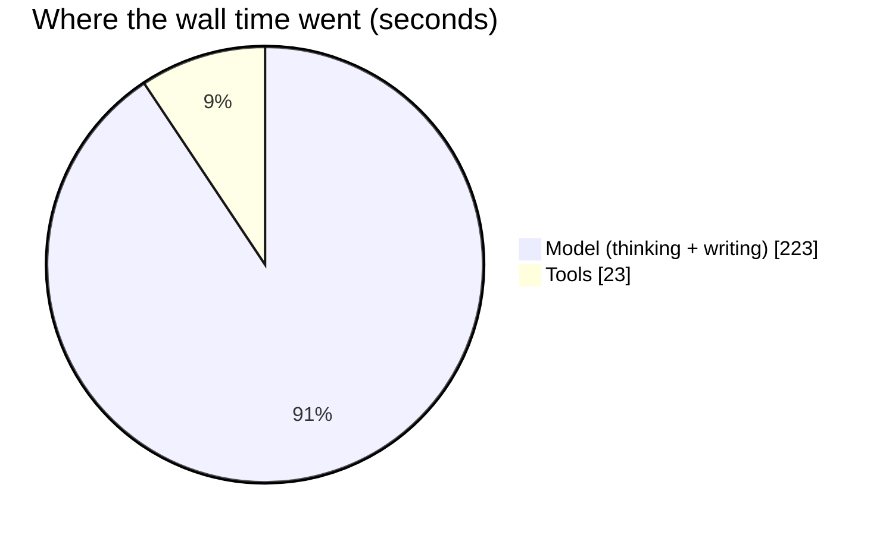

# intellectual-property/review-data-processing-agreement-template-against-eu-and-us-requirements · run9 (`hv-mixed200-lunahigh-flip-r9-20261118T030322Z`)

Result: **fail** 45/47 criteria · 4.1 min · 26 model calls · 29 tool calls (0 errors or timeouts) · ending `completed` · started 11-18 08:44:53 IST

## Overview

One box per stretch of steps that used the same kind of tool (blue: looking/searching/reading, purple: writing or editing files, yellow: a message with no tool call, red border: a tool error or timeout inside the box).

```mermaid
flowchart TD
    T(["Task prompt"])
    P0["<b>Step 1</b> · 0.1 min<br/>todo_write"]
    T --> P0
    class P0 look
    P1["<b>Step 2</b> · 0.0 min<br/>create_goal"]
    P0 --> P1
    class P1 look
    P2["<b>Steps 3-4</b> · 0.3 min<br/>bash x2<br/><i>pwd && printf '\n-- files --\n' && ls…, mkdir -p extracted && parse-doc docx …</i>"]
    P1 --> P2
    class P2 look
    P3["<b>Steps 5-9</b> · 0.2 min<br/>read x7<br/><i>stratosphere-negotiation-email-thread…, msa-summary-term-sheet.txt, data-flow-diagram.txt +2</i>"]
    P2 --> P3
    class P3 look
    P4["<b>Step 10</b> · 0.3 min<br/>bash<br/><i>python - #lt;#lt;'PY' import docx print('py…</i>"]
    P3 --> P4
    class P4 look
    P5["<b>Steps 11-12</b> · 0.3 min<br/>todo_write x2"]
    P4 --> P5
    class P5 look
    P6["<b>Steps 13-14</b> · 2.3 min<br/>bash x2<br/><i>cat #gt; build_memo.py #lt;#lt;'PY' from docx …, parse-doc docx output/compliance-gap-…</i>"]
    P5 --> P6
    class P6 look
    P7["<b>Step 15</b> · 0.1 min<br/>read x2<br/>grep<br/><i>final-memorandum.txt</i>"]
    P6 --> P7
    class P7 look
    P8["<b>Steps 16-18</b> · 0.3 min<br/>bash x3<br/><i>mkdir -p rendered && libreoffice --he…, pdftoppm -f 1 -l 1 -png -r 120 render…, ls -lh rendered | head</i>"]
    P7 --> P8
    class P8 look
    P9["<b>Step 19</b> · 0.0 min<br/>read_image<br/><i>page-01.png</i>"]
    P8 --> P9
    class P9 look
    P10["<b>Step 20</b> · 0.1 min<br/>bash<br/><i>pdftoppm -f 17 -l 17 -png -r 120 rend…</i>"]
    P9 --> P10
    class P10 look
    P11["<b>Step 21</b> · 0.0 min<br/>read_image<br/><i>last-17.png</i>"]
    P10 --> P11
    class P11 look
    P12["<b>Step 22</b> · 0.1 min<br/>bash<br/><i>ls -la output && file output/complian…</i>"]
    P11 --> P12
    class P12 look
    P13["<b>Step 23</b> · 0.0 min<br/>todo_write"]
    P12 --> P13
    class P13 look
    P14["<b>Step 24</b> · 0.0 min<br/>get_goal"]
    P13 --> P14
    class P14 look
    P15["<b>Step 25</b> · 0.0 min<br/>update_goal"]
    P14 --> P15
    class P15 look
    P16["<b>Step 26</b> · 0.1 min<br/>final message"]
    P15 --> P16
    class P16 ans
    R(["FAIL: 45/47 criteria"])
    P16 --> R
    class R fail
    classDef look fill:#e8f0fe,stroke:#4a6fa5,color:#111
    classDef write fill:#f3e8fd,stroke:#7b1fa2,color:#111
    classDef ans fill:#fff8e1,stroke:#b58900,color:#111
    classDef err fill:#e8f0fe,stroke:#c62828,stroke-width:3px,color:#111
    classDef pass fill:#e6f4ea,stroke:#2e7d32,color:#111
    classDef fail fill:#fce8e6,stroke:#c62828,color:#111
```





One row per model call:

| Step | Started (IST) | Model s | Tools s | Tool calls | Tools | Output chars |
|---|---|---|---|---|---|---|
| 1 | 08:44:53 | 4 | 0 | 1 | todo_write | 57 |
| 2 | 08:44:57 | 1 | 0 | 1 | create_goal | 385 |
| 3 | 08:44:59 | 2 | 1 | 1 | bash | 1,266 |
| 4 | 08:45:01 | 3 | 9 | 1 | bash | 1,957 |
| 5 | 08:45:14 | 2 | 0 | 3 | read x3 | 81,766 |
| 6 | 08:45:16 | 2 | 0 | 1 | read | 53,353 |
| 7 | 08:45:18 | 2 | 0 | 1 | read | 53,068 |
| 8 | 08:45:20 | 2 | 0 | 1 | read | 52,691 |
| 9 | 08:45:22 | 2 | 0 | 1 | read | 26,989 |
| 10 | 08:45:24 | 17 | 1 | 1 | bash | 18 |
| 11 | 08:45:42 | 3 | 0 | 1 | todo_write | 57 |
| 12 | 08:45:45 | 14 | 0 | 1 | todo_write | 57 |
| 13 | 08:45:59 | 129 | 1 | 1 | bash | 136 |
| 14 | 08:48:10 | 3 | 2 | 1 | bash | 507 |
| 15 | 08:48:15 | 3 | 1 | 3 | read x2, grep | 50,112 |
| 16 | 08:48:19 | 4 | 5 | 1 | bash | 1,345 |
| 17 | 08:48:28 | 3 | 1 | 1 | bash | 97 |
| 18 | 08:48:32 | 2 | 1 | 1 | bash | 175 |
| 19 | 08:48:35 | 2 | 0 | 1 | read_image | 322 |
| 20 | 08:48:37 | 4 | 1 | 1 | bash | 89 |
| 21 | 08:48:41 | 2 | 0 | 1 | read_image | 322 |
| 22 | 08:48:43 | 5 | 1 | 1 | bash | 426 |
| 23 | 08:48:49 | 3 | 0 | 1 | todo_write | 57 |
| 24 | 08:48:52 | 2 | 0 | 1 | get_goal | 385 |
| 25 | 08:48:54 | 2 | 0 | 1 | update_goal | 390 |
| 26 | 08:48:56 | 4 | 0 | 0 | (message only) | 0 |

## Task prompt

```text
Review the vendor DPA template against our playbook, commercial terms, data flow details, and negotiation emails; produce a gap memorandum with prioritized findings and redline recommendations. Output: `compliance-gap-memorandum.docx`.
```

## Rubric

| # | Criterion | Verdict |
|---|---|---|
| C-001 | Prioritized summary table at beginning of memo | pass |
| C-002 | ISSUE_001: Identifies missing HIPAA BAA integration | pass |
| C-003 | ISSUE_001: Notes missing HIPAA-specific definitions | pass |
| C-004 | ISSUE_001: Recommends integrating BAA or attaching as exhibit | pass |
| C-005 | ISSUE_001: References minimum necessary standard or workforce training | pass |
| C-006 | ISSUE_002: Identifies 48-hour vs. 24-hour breach notification discrepancy | pass |
| C-007 | ISSUE_002: Identifies missing HIPAA breach notification obligations | pass |
| C-008 | ISSUE_002: Recommends specific redline for breach notification timeline | pass |
| C-009 | ISSUE_003: Identifies liability cap gap (€500K vs. playbook minimum) | pass |
| C-010 | ISSUE_003: Quantifies liability gap with correct dollar figures | pass |
| C-011 | ISSUE_003: Identifies missing carve-outs for willful misconduct/gross negligence | pass |
| C-012 | ISSUE_003: Identifies blanket exclusion of consequential damages as problematic | pass |
| C-013 | ISSUE_003: References correct MSA fee structure | pass |
| C-014 | ISSUE_004: Identifies missing SCC Module 3 for processor-to-subprocessor transfers | pass |
| C-015 | ISSUE_004: Identifies Singapore remote access as an unaddressed transfer | pass |
| C-016 | ISSUE_004: Notes Larkfield not certified under EU-US Data Privacy Framework | pass |
| C-017 | ISSUE_004: Flags absence of Transfer Impact Assessment documentation | pass |
| C-018 | ISSUE_005: Identifies missing CCPA/CPRA Service Provider provisions | pass |
| C-019 | ISSUE_005: Specifies required CCPA/CPRA contractual terms | pass |
| C-020 | ISSUE_006: Identifies audit rights limited to Frankfurt only | pass |
| C-021 | ISSUE_006: Recommends extending audit rights to subprocessor locations | pass |
| C-022 | ISSUE_007: Identifies missing data return option at termination | pass |
| C-023 | ISSUE_007: Identifies HIPAA 6-year retention conflict with 90-day deletion | pass |
| C-024 | ISSUE_008: Identifies governing law mismatch for US data disputes | pass |
| C-025 | ISSUE_008: Recommends bifurcated governing law/dispute resolution | pass |
| C-026 | ISSUE_009: Recognizes Module 2 alone is insufficient for processor-to-subprocessor transfers | pass |
| C-027 | ISSUE_011: Identifies 2-year survival period as insufficient for HIPAA | pass |
| C-028 | ISSUE_012: Flags anonymization vs. pseudonymization regulatory risk | pass |
| C-029 | DISTRACTOR_003: Does not flag DIS arbitration for EU disputes as a gap | pass |
| C-030 | Each gap includes risk level classification | pass |
| C-031 | Each gap references the specific DPA section at issue | pass |
| C-032 | Each gap includes a specific recommended redline or amendment | pass |
| C-033 | Correctly identifies Pinnacle as HIPAA Covered Entity | pass |
| C-034 | Correctly identifies Stratosphere as Processor/Business Associate | pass |
| C-035 | References EU-US Data Privacy Framework in transfer analysis | pass |
| C-036 | Identifies EU-to-US (Larkfield/Northern Virginia) disaster recovery transfer scenario | pass |
| C-037 | Identifies Singapore remote access transfer scenario | pass |
| C-038 | Identifies Stratosphere processor-to-subprocessor transfer scenario | pass |
| C-039 | References 2.1 million US patients or 890,000 California residents | pass |
| C-040 | ISSUE_001 classified as Critical or High risk | pass |
| C-041 | ISSUE_003 classified as Critical or High risk | pass |
| C-042 | References negotiation context from email thread | pass |
| C-043 | Mentions subprocessor Larkfield Data Systems by name | **FAIL** |
| C-044 | Mentions subprocessor Orionis Analytics by name | **FAIL** |
| C-045 | ISSUE_006: Notes audit limited to once per year | pass |
| C-046 | ISSUE_004: Recommends specific transfer mechanisms for identified gaps | pass |
| C-047 | ISSUE_012: Recommends defining anonymization standard in DPA | pass |

Judge's reasoning:

**C-001 (pass):** Prioritized summary table at beginning of memo

```text
Near the beginning, the memo includes a “Prioritized Gap Register” table listing each identified gap, its P0/P1/P2 risk priority, a brief description, template anchor, and disposition. This satisfies the requirement for an early prioritized summary table.
```

**C-002 (pass):** ISSUE_001: Identifies missing HIPAA BAA integration

```text
The memorandum expressly identifies the absence of a HIPAA BAA as a P0 execution blocker, explains that Stratosphere processes US patients’ PHI as a Business Associate, and recommends adding an integrated or incorporated BAA with required HIPAA provisions and subcontractor flow-downs.
```

**C-003 (pass):** ISSUE_001: Notes missing HIPAA-specific definitions

```text
The memo expressly states in F1 that the DPA does not define HIPAA-specific terms, including PHI, ePHI, Covered Entity, Business Associate, BAA, Breach, and Unsecured PHI.
```

**C-004 (pass):** ISSUE_001: Recommends integrating BAA or attaching as exhibit

```text
The memo specifically recommends adding either an integrated BAA or a standalone BAA that is expressly incorporated and executed simultaneously, and suggests attaching it as an exhibit.
```

**C-005 (pass):** ISSUE_001: References minimum necessary standard or workforce training

```text
The memo expressly identifies both HIPAA obligations: it notes the absence of permitted-use/minimum-necessary terms and workforce training requirements, and recommends adding minimum-necessary restrictions and annual workforce training.
```

**C-006 (pass):** ISSUE_002: Identifies 48-hour vs. 24-hour breach notification discrepancy

```text
The memo expressly flags that Section 9's 48-hour breach-notification timeline conflicts with Pinnacle's 24-hour playbook requirement, including in the executive summary, gap register, and Finding F6.
```

**C-007 (pass):** ISSUE_002: Identifies missing HIPAA breach notification obligations

```text
The memo expressly identifies the absence of HITECH/HIPAA breach-notification requirements, including the missing “HIPAA notification cascade,” and recommends adding HIPAA-specific notice and cooperation obligations. This adequately flags HIPAA breach notification as a separate contractual gap.
```

**C-008 (pass):** ISSUE_002: Recommends specific redline for breach notification timeline

```text
The memo specifically recommends replacing the 48-hour confirmed-breach standard with written notice within 24 hours after discovery of an actual or reasonably suspected incident, and it also calls for HIPAA/HITECH breach-notification provisions and cooperation.
```

**C-009 (pass):** ISSUE_003: Identifies liability cap gap (€500K vs. playbook minimum)

```text
The memo expressly identifies the €500,000 aggregate liability cap as substantially below the playbook floor of at least 2x annual fees attributable to the affected processing. It calculates the relevant figures as $8.4M combined, $5.6M for US processing, and $2.8M for EU processing, and treats the gap as a P0 blocker.
```

**C-010 (pass):** ISSUE_003: Quantifies liability gap with correct dollar figures

```text
The memo states the playbook minimum as $8.4M combined and $2.8M for EU-specific processing, and contrasts those figures with the template’s €500,000 aggregate cap.
```

**C-011 (pass):** ISSUE_003: Identifies missing carve-outs for willful misconduct/gross negligence

```text
The memo expressly identifies that the DPA lacks uncapped carve-outs and recommends uncapped liability for willful misconduct and gross negligence, consistent with Pinnacle's playbook.
```

**C-012 (pass):** ISSUE_003: Identifies blanket exclusion of consequential damages as problematic

```text
The memo expressly flags Section 13.2’s blanket exclusion of indirect, consequential, and special damages as problematic and recommends that the exclusion not apply to data-protection claims involving carve-outs, including willful misconduct.
```

**C-013 (pass):** ISSUE_003: References correct MSA fee structure

```text
The liability discussion expressly references the MSA fee structure: $4.2M in total annual fees, consisting of $2.8M for US services and $1.4M for EU services, and uses those figures to calculate proposed liability caps.
```

**C-014 (pass):** ISSUE_004: Identifies missing SCC Module 3 for processor-to-subprocessor transfers

```text
The memo expressly states that the DPA includes only SCC Module 2 and that the Stratosphere-to-Larkfield US disaster-recovery transfer is a processor-to-subprocessor transfer requiring SCC Module 3. It flags this as a P0 blocker and recommends executing Module 3 before any transfer.
```

**C-015 (pass):** ISSUE_004: Identifies Singapore remote access as an unaddressed transfer

```text
The memo expressly flags regular remote access by Singapore-based support engineers to EU personal data as a third-country transfer that the DPA does not identify or address with an appropriate transfer mechanism or safeguards.
```

**C-016 (pass):** ISSUE_004: Notes Larkfield not certified under EU-US Data Privacy Framework

```text
The memorandum expressly states that Larkfield is not certified/participating under the EU-US Data Privacy Framework and therefore the DPF cannot be relied upon for the transfer to Larkfield.
```

**C-017 (pass):** ISSUE_004: Flags absence of Transfer Impact Assessment documentation

```text
The memorandum expressly flags the TIA gap multiple times, including stating that the DPA has no TIA or documented supplementary-measure framework for the EU-to-US disaster-recovery transfer and recommending completed TIAs for both the Larkfield and Singapore transfer scenarios.
```

**C-018 (pass):** ISSUE_005: Identifies missing CCPA/CPRA Service Provider provisions

```text
The memo expressly identifies the absence of CCPA/CPRA Service Provider provisions for approximately 890,000 California residents, including missing no-sale/no-share, purpose limitation, certification, monitoring, and consumer-rights terms.
```

**C-019 (pass):** ISSUE_005: Specifies required CCPA/CPRA contractual terms

```text
The memo specifies all three listed CCPA/CPRA Service Provider provisions: no sale or sharing, no combining Pinnacle data with other sources except as legally permitted, and an express certification that the processor understands and will comply with the restrictions.
```

**C-020 (pass):** ISSUE_006: Identifies audit rights limited to Frankfurt only

```text
The memo expressly identifies in F7 that Section 11.3 limits audits to Frankfurt and explains that this excludes relevant subprocessor and processing locations, including Northern Virginia (Larkfield), Orionis activities, Dublin, and Singapore. It recommends expanding audit rights to all vendor and subprocessor locations.
```

**C-021 (pass):** ISSUE_006: Recommends extending audit rights to subprocessor locations

```text
The memo expressly recommends expanding audit rights to all vendor and subprocessor processing locations, including Northern Virginia, Orionis, Larkfield, and Singapore operations. It also recommends equivalent audit rights for subprocessors or, at minimum, annual provision of current SOC 2 Type II/ISO reports.
```

**C-022 (pass):** ISSUE_007: Identifies missing data return option at termination

```text
The memo expressly identifies in F8 that Section 12 provides deletion only, lacks a complete machine-readable data return option, and omits 30 days of transition assistance. It recommends adding return at Pinnacle's election with at least 30 days of transition support.
```

**C-023 (pass):** ISSUE_007: Identifies HIPAA 6-year retention conflict with 90-day deletion

```text
The memorandum expressly identifies the conflict. In F8, it notes that Section 12.1 permits 90-day deletion while the DPA lacks reconciliation with HIPAA’s six-year documentation-retention requirement, and it recommends a six-year HIPAA retention carve-out with continuing protections. F15 further addresses survival for HIPAA-required records.
```

**C-024 (pass):** ISSUE_008: Identifies governing law mismatch for US data disputes

```text
The memo expressly flags in F9 that German law and Munich DIS arbitration apply to all DPA disputes, including US PHI and California data disputes, and contrasts this with the required Delaware law and Western District of Texas, Austin Division (or Travis County) forum for US data disputes.
```

**C-025 (pass):** ISSUE_008: Recommends bifurcated governing law/dispute resolution

```text
The memo expressly recommends bifurcating governing law and forum: Delaware law with Western District of Texas or Travis County courts for US-data disputes, and Netherlands or German law with EU arbitration for EU-data disputes.
```

**C-026 (pass):** ISSUE_009: Recognizes Module 2 alone is insufficient for processor-to-subprocessor transfers

```text
The memo expressly states that SCC Module 2 covers controller-to-processor transfers and is insufficient for Stratosphere’s processor-to-subprocessor transfer to Larkfield. It specifically requires separate execution of SCC Module 3 between Stratosphere as exporter/processor and Larkfield as importer/subprocessor before the transfer.
```

**C-027 (pass):** ISSUE_011: Identifies 2-year survival period as insufficient for HIPAA

```text
The memo expressly flags Section 16's two-year survival period as insufficient for HIPAA, citing the six-year documentation-retention requirement and recommending that BAA and PHI-related obligations survive as long as PHI or HIPAA-required records are retained, and at least through the six-year period.
```

**C-028 (pass):** ISSUE_012: Flags anonymization vs. pseudonymization regulatory risk

```text
The memo expressly flags the need to distinguish true anonymization from pseudonymization for Orionis’s analytics activities, states that pseudonymized data remains personal data under GDPR unless truly and irreversibly anonymized, and recommends adding definitions and keeping pre-anonymization processing within the DPA.
```

**C-029 (pass):** DISTRACTOR_003: Does not flag DIS arbitration for EU disputes as a gap

```text
The memo flags German law and Munich DIS arbitration only insofar as they apply to US-data disputes. It expressly permits DIS arbitration in an EU seat for EU-data disputes and does not treat DIS arbitration for EU matters as a material gap.
```

**C-030 (pass):** Each gap includes risk level classification

```text
All 15 identified gaps (F1–F15) are assigned explicit priority/risk classifications (P0 Blocker, P1 High, or P2 Medium-High), both in the prioritized gap register and the detailed findings. This exceeds the 75% threshold.
```

**C-031 (pass):** Each gap references the specific DPA section at issue

```text
All 15 detailed findings identify the relevant DPA section or provision in a dedicated “DPA location” field (for example, Section 9.1–9.7 for breach notice, Section 13.1–13.5 for liability, and Section 7.2 plus Annex A/B provisions for transfers). The prioritized gap register also provides section or annex anchors for every listed gap, well exceeding the 75% threshold.
```

**C-032 (pass):** Each gap includes a specific recommended redline or amendment

```text
All 15 identified gaps (F1–F15) include a specific “Redline / negotiation recommendation” describing concrete amendments, such as adding an incorporated BAA and CCPA addendum, executing SCC Module 3, changing breach notice to 24 hours, expanding audit scope, revising liability caps, and bifurcating governing law and forum. Most also include suggested contract language. This substantially exceeds the 75% threshold.
```

**C-033 (pass):** Correctly identifies Pinnacle as HIPAA Covered Entity

```text
The memorandum explicitly identifies Pinnacle Health Solutions, Inc. as a “US Covered Entity / Controller” and repeatedly treats Pinnacle as the HIPAA Covered Entity, with Stratosphere as its Business Associate.
```

**C-034 (pass):** Correctly identifies Stratosphere as Processor/Business Associate

```text
The memorandum expressly identifies Stratosphere as “Processor / Business Associate” in the parties table and repeatedly describes it as a GDPR Processor and HIPAA Business Associate, including in the HIPAA and SCC analyses.
```

**C-035 (pass):** References EU-US Data Privacy Framework in transfer analysis

```text
The memorandum expressly discusses the EU-US Data Privacy Framework in its international transfer analysis, noting that Larkfield is not DPF-certified and that the framework therefore cannot be relied upon for the EU-to-US disaster-recovery transfer.
```

**C-036 (pass):** Identifies EU-to-US (Larkfield/Northern Virginia) disaster recovery transfer scenario

```text
The memorandum explicitly identifies EU data replicated from Frankfurt to Larkfield in Northern Virginia for disaster recovery, including the associated processor-to-subprocessor transfer and SCC Module 3 issue.
```

**C-037 (pass):** Identifies Singapore remote access transfer scenario

```text
The memorandum expressly identifies regular remote access by Singapore-based support engineers to EU personal data as a third-country transfer scenario, including that the data may remain hosted in Frankfurt or Dublin.
```

**C-038 (pass):** Identifies Stratosphere processor-to-subprocessor transfer scenario

```text
The memo expressly identifies the Frankfurt-to-Northern Virginia transfer from Stratosphere as Processor to Larkfield as Subprocessor, explains that SCC Module 2 is insufficient, and requires separate SCC Module 3 coverage, a TIA, and supplementary measures.
```

**C-039 (pass):** References 2.1 million US patients or 890,000 California residents

```text
The memo references both qualifying figures in the required contexts: approximately 2.1 million US patients in the HIPAA/BAA analysis and approximately 890,000 California residents in the CCPA/CPRA analysis.
```

**C-040 (pass):** ISSUE_001 classified as Critical or High risk

```text
The missing HIPAA BAA is explicitly classified as a P0 execution blocker and “Material non-compliance / execution blocker,” which is equivalent to the highest-tier severity and satisfies the Critical/High requirement.
```

**C-041 (pass):** ISSUE_003 classified as Critical or High risk

```text
The liability cap gap is explicitly classified as P0 — BLOCKER in Finding F4 and described as a threshold commercial issue. P0/blocker is equivalent to the highest-tier severity, satisfying the Critical or High risk requirement.
```

**C-042 (pass):** References negotiation context from email thread

```text
The memo expressly references the April 16–18 email thread, noting that Stratosphere characterized the €500,000 cap as its “global standard,” that Pinnacle treated liability as a threshold issue and proposed an annual-fee-linked structure, and that Stratosphere agreed to discuss escalation. It also references the email positions on contractual DPO coordination.
```

**C-043 (fail):** Mentions subprocessor Larkfield Data Systems by name

```text
The memo repeatedly mentions “Larkfield,” but never identifies the subprocessor by its full name, “Larkfield Data Systems” or “Larkfield Data Systems LLC.”
```

**C-044 (fail):** Mentions subprocessor Orionis Analytics by name

```text
The memo repeatedly mentions “Orionis,” but never identifies the subprocessor by its required name, “Orionis Analytics” or “Orionis Analytics Ltd.”
```

**C-045 (pass):** ISSUE_006: Notes audit limited to once per year

```text
The memo expressly states in F7 that Section 11.2 permits only one audit per year with 30 days' notice, and it evaluates the limitation by recommending one planned annual audit plus for-cause audits without advance notice.
```

**C-046 (pass):** ISSUE_004: Recommends specific transfer mechanisms for identified gaps

```text
The memorandum recommends multiple specific transfer mechanisms: executing SCC Module 3 for the Stratosphere-to-Larkfield processor-to-subprocessor transfer, completing TIAs for the US disaster-recovery and Singapore access scenarios, and implementing supplementary measures for Singapore remote access such as masking, privileged-access approval, session logging, and prohibiting local storage/download. This exceeds the requirement of at least two mechanisms.
```

**C-047 (pass):** ISSUE_012: Recommends defining anonymization standard in DPA

```text
The memo expressly recommends distinguishing true anonymization from pseudonymization, adding definitions for Anonymized Data and Pseudonymized Data, and keeping pseudonymized/pre-anonymization processing within the DPA. It also applies this issue to Orionis Analytics’ anonymization activities.
```

## Delivered files (output/)

- `compliance-gap-memorandum.docx` (59,977 bytes)

## Trajectory

### Step 1: 1 tool call

_Started 11-18 08:44:53 IST · model 4 s · tools 0 s_

**Reasoning summary:**

```text
**Planning document review**

I need to perform a document review and create a docx file. First, I should inspect the files and think about what skills might be necessary for this task. I’ll need to list the workspace using a bash command, but I should avoid reading task.json. It seems I'll use a todo list for the multi-step process. I'll need to create a goal because the user’s request is complex, but without a skill catalog, it gets a bit tricky. Let's start with the todo list and get organized!
```

**Call `todo_write`** (0.0 s)

```json
{
 "todos": [
  {
   "content": "Inventory source documents and identify governing requirements",
   "status": "in_progress"
  },
  {
   "content": "Extract and compare DPA terms against playbook, commercial, flow, and emails",
   "status": "pending"
  },
  {
   "content": "Draft prioritized gap memorandum and redline recommendations",
   "status": "pending"
  },
  {
   "content": "Generate and validate compliance-gap-memorandum.docx",
   "status": "pending"
  }
 ]
}
```

Output (57 chars):

```text
Updated todo list: 3 pending, 1 in progress, 0 completed.
```

**Todo list now:**

- [~] Inventory source documents and identify governing requirements
- [ ] Extract and compare DPA terms against playbook, commercial, flow, and emails
- [ ] Draft prioritized gap memorandum and redline recommendations
- [ ] Generate and validate compliance-gap-memorandum.docx

### Step 2: 1 tool call

_Started 11-18 08:44:57 IST · model 1 s · tools 0 s_

**Call `create_goal`** (0.0 s)

```json
{
 "objective": "Review the vendor DPA template against the playbook, commercial terms, data flow details, and negotiation emails, then deliver a validated compliance-gap-memorandum.docx with prioritized findings and redline recommendations.",
 "max_goal_rounds": 3
}
```

Output (385 chars):

```text
{"goal":{"id":"goal-ad1ab609-c648-48c2-8c83-8c513d265326","revision":1,"objective":"Review the vendor DPA template against the playbook, commercial terms, data flow details, and negotiation emails, then deliver a validated compliance-gap-memorandum.docx with prioritized findings and redline recommendations.","phase":"active","roundsStarted":0,"maxGoalRounds":3},"activation":"armed"}
```

### Step 3: 1 tool call

_Started 11-18 08:44:59 IST · model 2 s · tools 1 s_

**Call `bash`** (0.7 s)

```json
{
 "command": "pwd && printf '\\n-- files --\\n' && ls -la && printf '\\n-- documents --\\n' && ls -la documents && printf '\\n-- output --\\n' && ls -la output",
 "description": "List workspace source and output files"
}
```

Output (1,266 chars):

```text
/home/agarwaldi/dsh-bench-harness/runs/hv-mixed200-lunahigh-flip-r9-20261118T030322Z/tasks/intellectual-property__review-data-processing-agreement-template-against-eu-and-us-requirements/workspace

-- files --
total 16
drwxr-xr-x 4 agarwaldi@microsoft.com users 4096 Nov 18 03:14 .
drwxr-xr-x 3 root                    root  4096 Nov 18 03:14 ..
dr-xr-xr-x 2 agarwaldi@microsoft.com users 4096 Nov  5 18:20 documents
drwxr-xr-x 2 agarwaldi@microsoft.com users 4096 Nov 18 03:14 output

-- documents --
total 264
dr-xr-xr-x  2 agarwaldi@microsoft.com users  4096 Nov  5 18:20 .
drwxr-xr-x  4 agarwaldi@microsoft.com users  4096 Nov 18 03:14 ..
-r--r--r-- 10 agarwaldi@microsoft.com users 54272 Nov  5 18:20 data-flow-diagram.docx
-r--r--r-- 10 agarwaldi@microsoft.com users 47124 Nov  5 18:20 msa-summary-term-sheet.docx
-r--r--r-- 10 agarwaldi@microsoft.com users 75843 Nov  5 18:20 pinnacle-us-dpa-playbook.docx
-r--r--r-- 10 agarwaldi@microsoft.com users 63464 Nov  5 18:20 stratosphere-dpa-template-v3-2.docx
-r--r--r-- 10 agarwaldi@microsoft.com users 10806 Nov  5 18:20 stratosphere-negotiation-email-thread.eml

-- output --
total 8
drwxr-xr-x 2 agarwaldi@microsoft.com users 4096 Nov 18 03:14 .
drwxr-xr-x 4 agarwaldi@microsoft.com users 4096 Nov 18 03:14 ..
```

### Step 4: 1 tool call

_Started 11-18 08:45:01 IST · model 3 s · tools 9 s_

**Call `bash`** (9.4 s)

```json
{
 "command": "mkdir -p extracted && parse-doc docx documents/data-flow-diagram.docx > extracted/data-flow-diagram.txt && parse-doc docx documents/msa-summary-term-sheet.docx > extracted/msa-summary-term-sheet.txt && parse-doc docx documents/pinnacle-us-dpa-playbook.docx > extracted/pinnacle-us-dpa-playbook.txt && parse-doc docx documents/stratosphere-dpa-template-v3-2.docx > extracted/stratosphere-dpa-template-v3-2.txt && cp documents/stratosphere-negotiation-email-thread.eml extracted/stratosphere-negotiation-email-thread.eml && printf 'extracted files:\\n' && ls -lh extracted",
 "description": "Convert source documents to readable text"
}
```

Output (1,957 chars):

```text
extracted files:
total 260K
-rw-r--r-- 1 agarwaldi@microsoft.com users  44K Nov 18 03:15 data-flow-diagram.txt
-rw-r--r-- 1 agarwaldi@microsoft.com users  22K Nov 18 03:15 msa-summary-term-sheet.txt
-rw-r--r-- 1 agarwaldi@microsoft.com users 101K Nov 18 03:15 pinnacle-us-dpa-playbook.txt
-rw-r--r-- 1 agarwaldi@microsoft.com users  75K Nov 18 03:15 stratosphere-dpa-template-v3-2.txt
-r--r--r-- 1 agarwaldi@microsoft.com users  11K Nov 18 03:15 stratosphere-negotiation-email-thread.eml
[stderr]
2026-11-18 03:15:06.195227040 [W:onnxruntime:Default, device_discovery.cc:95 GetPciBusId] Skipping pci_bus_id for PCI path at "/sys/devices/LNXSYSTM:00/LNXSYBUS:00/ACPI0004:00/VMBUS:00/5620e0c7-8062-4dce-aeb7-520c7ef76171" because filename "5620e0c7-8062-4dce-aeb7-520c7ef76171" did not match expected pattern of [0-9a-f]+:[0-9a-f]+:[0-9a-f]+[.][0-9a-f]+
2026-11-18 03:15:07.902317407 [W:onnxruntime:Default, device_discovery.cc:95 GetPciBusId] Skipping pci_bus_id for PCI path at "/sys/devices/LNXSYSTM:00/LNXSYBUS:00/ACPI0004:00/VMBUS:00/5620e0c7-8062-4dce-aeb7-520c7ef76171" because filename "5620e0c7-8062-4dce-aeb7-520c7ef76171" did not match expected pattern of [0-9a-f]+:[0-9a-f]+:[0-9a-f]+[.][0-9a-f]+
2026-11-18 03:15:11.267978064 [W:onnxruntime:Default, device_discovery.cc:95 GetPciBusId] Skipping pci_bus_id for PCI path at "/sys/devices/LNXSYSTM:00/LNXSYBUS:00/ACPI0004:00/VMBUS:00/5620e0c7-8062-4dce-aeb7-520c7ef76171" because filename "5620e0c7-8062-4dce-aeb7-5
… [456 more chars]
```

### Step 5: 3 tool calls

_Started 11-18 08:45:14 IST · model 2 s · tools 0 s_

**Call `read`** (0.0 s)

```json
{
 "file_path": "extracted/stratosphere-negotiation-email-thread.eml",
 "offset": 1,
 "limit": 1000
}
```

Output (12,129 chars):

```text
<path>/home/agarwaldi/dsh-bench-harness/runs/hv-mixed200-lunahigh-flip-r9-20261118T030322Z/tasks/intellectual-property__review-data-processing-agreement-template-against-eu-and-us-requirements/workspace/extracted/stratosphere-negotiation-email-thread.eml</path>
<type>file</type>
<content>
1: From: Margaret Yuen-Park <myuenpark@pinnaclehealth.example.com>
2: To: Dr. Florian Neumann <f.neumann@stratospherecloud.example.com>
3: Cc: Rachel Osterfeld <rosterfeld@alderton-shaw.example.com>
4: Date: Fri, 18 Apr 2025 11:02:00 -0000
5: Subject: Re: Re: Re: Stratosphere DPA Template v3.2 — For Your Review
6: Content-Type: text/plain; charset="utf-8"
7: Content-Transfer-Encoding: quoted-printable
8: MIME-Version: 1.0
9: 
10: Florian,
11: 
12: Thank you for your response and for looping in Dr. Beckert.
13: 
14: We can confirm the call for Wednesday, April 30, 2025, at 4:00 PM CEST / 9:00=
15:  AM CDT. Rachel Osterfeld from Alderton Shaw & Whitmore will attend on our si=
16: de.
17: 
18: On the liability cap =E2=80=94 I appreciate your willingness to take this up =
19: internally. I want to set expectations that our redline of Section 13 will pr=
20: opose a structure tied to the annual fees under the MSA rather than a flat ca=
21: p, together with the carve-outs for willful misconduct and gross negligence I=
22:  referenced previously. I want to be transparent that this is a threshold iss=
23: ue for us, and we will need to reach agreement on liability allocation before=
24:  we can fina
… [10,629 more chars]
```

**Call `read`** (0.1 s)

```json
{
 "file_path": "extracted/msa-summary-term-sheet.txt",
 "offset": 1,
 "limit": 1000
}
```

Output (23,046 chars):

```text
<path>/home/agarwaldi/dsh-bench-harness/runs/hv-mixed200-lunahigh-flip-r9-20261118T030322Z/tasks/intellectual-property__review-data-processing-agreement-template-against-eu-and-us-requirements/workspace/extracted/msa-summary-term-sheet.txt</path>
<type>file</type>
<content>
1: **[MASTER SERVICES AGREEMENT --- SUMMARY TERM SHEET]{.underline}**
2: 
3: **Summary of Key Commercial Terms**
4: 
5: MSA Effective Date: March 15, 2024
6: 
7: This Summary Term Sheet is for internal reference purposes only and does not amend or supersede the Master Services Agreement dated March 15, 2024 (the \"MSA\"), by and between Pinnacle Health Solutions, Inc. and Stratosphere Cloud Services GmbH. In the event of any conflict between the terms summarized herein and the terms of the executed MSA, the terms of the executed MSA shall control in all respects.
8: 
9: Prepared by the Office of General Counsel Pinnacle Health Solutions, Inc.
10: 
11: Last Updated: March 15, 2024
12: 
13: **[Section 1 --- Parties]{.underline}**
14: 
15: **Client:** Pinnacle Health Solutions, Inc., a Delaware corporation, with its principal offices located at 4200 Harborview Boulevard, Suite 1100, Austin, TX 78746 (\"Pinnacle\" or \"Client\").
16: 
17: **Service Provider:** Stratosphere Cloud Services GmbH, a German limited liability company (*Gesellschaft mit beschränkter Haftung*) registered at the Munich Local Court (*Amtsgericht München*) under Commercial Register (*Handelsregister*) number HRB 247891, with its register
… [21,546 more chars]
```

**Call `read`** (0.1 s)

```json
{
 "file_path": "extracted/data-flow-diagram.txt",
 "offset": 1,
 "limit": 1200
}
```

Output (46,591 chars):

```text
<path>/home/agarwaldi/dsh-bench-harness/runs/hv-mixed200-lunahigh-flip-r9-20261118T030322Z/tasks/intellectual-property__review-data-processing-agreement-template-against-eu-and-us-requirements/workspace/extracted/data-flow-diagram.txt</path>
<type>file</type>
<content>
1: **[DATA FLOW DIAGRAM AND PROCESSING DESCRIPTION]{.underline}**
2: 
3: **[Pinnacle Health Solutions, Inc. --- Stratosphere Cloud Services GmbH]{.underline}**
4: 
5: **[Data Processing Relationship]{.underline}**
6: 
7: **CONFIDENTIAL --- ATTORNEY-CLIENT PRIVILEGED / WORK PRODUCT**
8: 
9: This document is protected by the attorney-client privilege and the work product doctrine. Unauthorized disclosure, copying, or distribution is strictly prohibited. This document does not constitute legal advice to any third party.
10: 
11: **Prepared by:** Office of the General Counsel, Pinnacle Health Solutions, Inc., 4200 Harborview Boulevard, Suite 1100, Austin, TX 78746
12: 
13: **Prepared for:** Internal use and for review by outside counsel Alderton Shaw & Whitmore LLP (Rachel Osterfeld, Partner), 900 K Street NW, Suite 700, Washington, DC 20001
14: 
15: **Date:** April 2025
16: 
17: **Reference Documents:**
18: 
19: > •Master Services Agreement dated March 15, 2024 (\"MSA\")
20: >
21: > •Stratosphere DPA Template Version 3.2 dated January 10, 2025 (received April 14, 2025) (\"DPA Template\" or \"DPA\")
22: >
23: > •Pinnacle US DPA Playbook (last updated February 28, 2025) (\"Playbook\")
24: 
25: **Purpose:** This docu
… [45,091 more chars]
```

### Step 6: 1 tool call

_Started 11-18 08:45:16 IST · model 2 s · tools 0 s_

**Call `read`** (0.0 s)

```json
{
 "file_path": "extracted/pinnacle-us-dpa-playbook.txt",
 "offset": 1,
 "limit": 1400
}
```

Output (53,353 chars):

```text
<path>/home/agarwaldi/dsh-bench-harness/runs/hv-mixed200-lunahigh-flip-r9-20261118T030322Z/tasks/intellectual-property__review-data-processing-agreement-template-against-eu-and-us-requirements/workspace/extracted/pinnacle-us-dpa-playbook.txt</path>
<type>file</type>
<content>
1: **[DATA PROCESSING AGREEMENT NEGOTIATION PLAYBOOK]{.underline}**
2: 
3: **[US AND CROSS-BORDER REQUIREMENTS]{.underline}**
4: 
5: **Internal Use Only --- Attorney-Client Privileged and Confidential Work Product**
6: 
7: Prepared by: **Office of the General Counsel** **Pinnacle Health Solutions, Inc.** 4200 Harborview Boulevard, Suite 1100 Austin, TX 78746
8: 
9: Approved by: **Margaret Yuen-Park**, General Counsel
10: 
11: **Version 4.0**
12: 
13: Last Updated: **February 28, 2025**
14: 
15: **Distribution List:**
16: 
17:   -------------------------------------------------------------------------------------
18:   **Recipient**                                     **Title**
19:   ------------------------------------------------- -----------------------------------
20:   Legal Department (all attorneys and paralegals)   ---
21: 
22:   Dr. Anand Krishnamurthy                           Chief Privacy Officer
23: 
24:   Jennifer Castellano                               VP of Information Security
25: 
26:   David Liang                                       VP of Procurement
27:   -------------------------------------------------------------------------------------
28: 
29: **External Counsel Reference:** Th
… [51,853 more chars]
```

### Step 7: 1 tool call

_Started 11-18 08:45:18 IST · model 2 s · tools 0 s_

**Call `read`** (0.0 s)

```json
{
 "file_path": "extracted/pinnacle-us-dpa-playbook.txt",
 "offset": 429,
 "limit": 1400
}
```

Output (53,068 chars):

```text
<path>/home/agarwaldi/dsh-bench-harness/runs/hv-mixed200-lunahigh-flip-r9-20261118T030322Z/tasks/intellectual-property__review-data-processing-agreement-template-against-eu-and-us-requirements/workspace/extracted/pinnacle-us-dpa-playbook.txt</path>
<type>file</type>
<content>
429: > \(i\) Vendor grants Pinnacle **direct audit rights** over subprocessor facilities, with the same scope and frequency as Pinnacle\'s audit rights over vendor; or
430: >
431: > \(ii\) Vendor **contractually requires** each subprocessor to submit to audits by Pinnacle or Pinnacle\'s designated auditor, and provides Pinnacle with the contractual right to exercise such audits; or
432: >
433: > \(iii\) At minimum, vendor requires each subprocessor to **provide SOC 2 Type II reports** and/or **ISO 27001 certifications** covering the relevant data processing services, with copies provided to Pinnacle upon request no less frequently than annually.
434: 
435: **Nice-to-have:** Pinnacle prefers the right to conduct **two (2) audits per calendar year**: one planned audit and one for-cause audit. Planned audits should require **fifteen (15) days\' prior written notice** to the vendor. For-cause audits, triggered by a breach, suspected breach, or other compliance concern, should require **no advance notice** to the vendor.
436: 
437: **Fallback:** One (1) planned audit per calendar year with **thirty (30) days\' prior written notice** is acceptable, provided that the following conditions are met:
438: 
439: > \
… [51,568 more chars]
```

### Step 8: 1 tool call

_Started 11-18 08:45:20 IST · model 2 s · tools 0 s_

**Call `read`** (0.0 s)

```json
{
 "file_path": "extracted/stratosphere-dpa-template-v3-2.txt",
 "offset": 1,
 "limit": 1400
}
```

Output (52,691 chars):

```text
<path>/home/agarwaldi/dsh-bench-harness/runs/hv-mixed200-lunahigh-flip-r9-20261118T030322Z/tasks/intellectual-property__review-data-processing-agreement-template-against-eu-and-us-requirements/workspace/extracted/stratosphere-dpa-template-v3-2.txt</path>
<type>file</type>
<content>
1: **[DATA PROCESSING AGREEMENT]{.underline}**
2: 
3: **Version 3.2**
4: 
5: **January 10, 2025**
6: 
7: **STRATOSPHERE CLOUD SERVICES GmbH**
8: 
9: *Cloud Infrastructure · Managed Databases · Analytics*
10: 
11: This Data Processing Agreement (\"DPA\") forms part of and is subject to the terms of the Master Services Agreement (\"Agreement\" or \"MSA\") between the Processor and the Controller.
12: 
13: This DPA is designed to ensure compliance with Regulation (EU) 2016/679 of the European Parliament and of the Council of 27 April 2016 (the \"GDPR\") and applicable data protection laws governing the Processing of Personal Data in connection with the Services provided under the Agreement.
14: 
15: **Processor Registered Office:**
16: 
17: Stratosphere Cloud Services GmbH Hohenzollernstraße 88 80796 Munich, Germany
18: 
19: Handelsregister HRB 247891, Amtsgericht München (Munich Local Court)
20: 
21: **Prepared by:**
22: 
23: Legal Department, Stratosphere Cloud Services GmbH
24: 
25: **Contact:**
26: 
27: Dr. Florian Neumann Chief Legal Officer Stratosphere Cloud Services GmbH
28: 
29: Email: florian.neumann@stratospherecloud.example.com
30: 
31: Tel: +49 89 2155 4400
32: 
33: Right-click to update 
… [51,191 more chars]
```

### Step 9: 1 tool call

_Started 11-18 08:45:22 IST · model 2 s · tools 0 s_

**Call `read`** (0.0 s)

```json
{
 "file_path": "extracted/stratosphere-dpa-template-v3-2.txt",
 "offset": 317,
 "limit": 1400
}
```

Output (26,989 chars):

```text
<path>/home/agarwaldi/dsh-bench-harness/runs/hv-mixed200-lunahigh-flip-r9-20261118T030322Z/tasks/intellectual-property__review-data-processing-agreement-template-against-eu-and-us-requirements/workspace/extracted/stratosphere-dpa-template-v3-2.txt</path>
<type>file</type>
<content>
317: **17.3 Severability.** If any provision of this DPA is found by a court or other tribunal of competent jurisdiction to be invalid, illegal, or unenforceable, such provision shall be modified to the minimum extent necessary to make it valid, legal, and enforceable, and the remaining provisions of this DPA shall continue in full force and effect. If such modification is not possible, the invalid provision shall be severed and the remaining provisions shall be interpreted so as to give effect to the Parties\' original intent to the maximum extent possible.
318: 
319: **17.4 Waiver.** No failure or delay by either Party in exercising any right, power, or privilege under this DPA shall operate as a waiver thereof, nor shall any single or partial exercise of any right, power, or privilege preclude any other or further exercise thereof or the exercise of any other right, power, or privilege.
320: 
321: **17.5 Notices.** All notices, requests, demands, and other communications required or permitted under this DPA shall be in writing and shall be delivered by hand, by internationally recognized overnight courier service, or by email to the addresses specified in this DPA or such other addresses as a Pa
… [25,489 more chars]
```

### Step 10: 1 tool call

_Started 11-18 08:45:24 IST · model 17 s · tools 1 s_

**Call `bash`** (0.7 s)

```json
{
 "command": "python - <<'PY'\nimport docx\nprint('python-docx', docx.__version__)\nPY",
 "description": "Check DOCX generation library"
}
```

Output (18 chars):

```text
python-docx 1.2.0
```

### Step 11: 1 tool call

_Started 11-18 08:45:42 IST · model 3 s · tools 0 s_

**Call `todo_write`** (0.0 s)

```json
{
 "todos": [
  {
   "content": "Inventory source documents and identify governing requirements",
   "status": "completed"
  },
  {
   "content": "Extract and compare DPA terms against playbook, commercial, flow, and emails",
   "status": "in_progress"
  },
  {
   "content": "Draft prioritized gap memorandum and redline recommendations",
   "status": "pending"
  },
  {
   "content": "Generate and validate compliance-gap-memorandum.docx",
   "status": "pending"
  }
 ]
}
```

Output (57 chars):

```text
Updated todo list: 2 pending, 1 in progress, 1 completed.
```

**Todo list now:**

- [x] Inventory source documents and identify governing requirements
- [~] Extract and compare DPA terms against playbook, commercial, flow, and emails
- [ ] Draft prioritized gap memorandum and redline recommendations
- [ ] Generate and validate compliance-gap-memorandum.docx

### Step 12: 1 tool call

_Started 11-18 08:45:45 IST · model 14 s · tools 0 s_

**Reasoning summary:**

```text
**Preparing internal memo**

I need to compile facts carefully for an internal memo, considering a disclaimer since it shouldn't be taken as legal advice. The date might be important, possibly "May 2025," especially if we're referencing emails for targeted circulation. I want to frame it as "Prepared for internal review – May 2025" but not claim exact dates. I’ll focus on including sources and sections, ensuring we cite appropriately, using section numbers in tables, but avoiding solely legal citations.

**Creating the document outline**

I need to create a document that includes a title and a metadata table. I should include an executive summary recommending, "Do not execute EU processing until blockers are resolved." The overall status might be Red, indicating that it’s not execution-ready. 

I want a deal/processing profile with a prioritization legend (P0 for blocking issues, P1 high, and P2 medium). I'll also include a priority action plan table with fields like ID, priority, and others. I should incorporate detailed findings, strengths, a proposed redline package, negotiation posture, and approvals. Lastly, an appendix checklist will round it out, aiming to keep the document around 15 pages.

**Clarifying document details**

I’ll mention, "per playbook/flow materials," that a TIA is required. It's important to note that DPA’s Section 7.2 Module 2 isn't necessarily invalid for direct controller-to-processor arrangements, considering Stratosphere as a German processor to Larkfield’s subprocessor. The DPA specifies that transfers occur when processing involves transfers and data centers. 

I also need to address a mismatch regarding Dublin, where the DPA Annex B states Orionis, but the MSA/term sheet references Stratosphere. This could impact scope accuracy and subprocessor authorization. I recommend correcting this to clarify that Orionis is only for analytics. If Orionis runs a data center, we may need to update the MSA and conduct due diligence. Lastly, I should determine the liability amount in currency; the playbook indicates 2x fees due to affected processing, leading to $8.4M based on combined fees of $4.2M. The DPA uses €500k.

**Considering data retention**

I'm thinking about the DPA and how it includes a breach that lasts for two years. But wait, what if the incident is discovered later? That could lead to issues if the data is retained longer than expected. I need to make sure I understand how long data should be kept and what claims are applicable based on the statute. It seems crucial to have clarity on retention policies to avoid potential problems down the line.
```

**Call `todo_write`** (0.0 s)

```json
{
 "todos": [
  {
   "content": "Inventory source documents and identify governing requirements",
   "status": "completed"
  },
  {
   "content": "Extract and compare DPA terms against playbook, commercial, flow, and emails",
   "status": "completed"
  },
  {
   "content": "Draft prioritized gap memorandum and redline recommendations",
   "status": "in_progress"
  },
  {
   "content": "Generate and validate compliance-gap-memorandum.docx",
   "status": "pending"
  }
 ]
}
```

Output (57 chars):

```text
Updated todo list: 1 pending, 1 in progress, 2 completed.
```

**Todo list now:**

- [x] Inventory source documents and identify governing requirements
- [x] Extract and compare DPA terms against playbook, commercial, flow, and emails
- [~] Draft prioritized gap memorandum and redline recommendations
- [ ] Generate and validate compliance-gap-memorandum.docx

### Step 13: 1 tool call

_Started 11-18 08:45:59 IST · model 129 s · tools 1 s_

**Reasoning summary:**

```text
**Planning script for document generation**

I need a script that includes helper functions for various formatting elements like headings, bullets, tables, and shading. The output should be in docx format, and I want to make sure the page breaks are logical. It seems like writing directly in Python is better than using write for docx. I should also set margins, fonts, line spacing, and page numbering, but I'll keep it simple. I'll write this script under workspace/build_memo.py and run it as needed.

**Structuring document elements**

I’m planning to implement several features in the document. First, I need a dark blue title and a subtitle below it. A metadata table will be included as well, along with a red callout shaded box that says, "Recommendation: Do not execute." I might opt for a manual table of contents instead of automated one, and I'll outline the heading structure. Tables should have appropriate widths, and I want to add page breaks after the executive summary. I'll include 17 findings, possibly condensing to 13, and utilize redline language for recommendations.
```

**Call `bash`** (1.2 s)

```json
{
 "command": "cat > build_memo.py <<'PY'\nfrom docx import Document\nfrom docx.shared import Inches, Pt, RGBColor\nfrom docx.enum.text import WD_ALIGN_PARAGRAPH, WD_BREAK\nfrom docx.enum.table import WD_TABLE_ALIGNMENT, WD_CELL_VERTICAL_ALIGNMENT\nfrom docx.enum.section import WD_SECTION\nfrom docx.oxml import OxmlElement\nfrom docx.oxml.ns import qn\nfrom docx.enum.style import WD_STYLE_TYPE\nfrom docx.enum.text import WD_LINE_SPACING\n\nOUT = 'output/compliance-gap-memorandum.docx'\n\ndoc = Document()\nsec = doc.sections[0]\nsec.top_margin = Inches(0.65)\nsec.bottom_margin = Inches(0.65)\nsec.left_margin = Inches(0.7)\nsec.right_margin = Inches(0.7)\n\n# Palette\nNAVY = '17365D'\nBLUE = '2F75B5'\nLIGHT_BLUE = 'D9EAF7'\nPALE_BLUE = 'EEF5FB'\nRED = 'C00000'\nPALE_RED = 'FCE4D6'\nAMBER = 'BF9000'\nPALE_AMBER = 'FFF2CC'\nGREEN = '548235'\nPALE_GREEN = 'E2F0D9'\nGRAY = '666666'\nLIGHT_GRAY = 'F2F2F2'\nDARK = '222222'\n\n# Basic styles\nstyles = doc.styles\nstyles['Normal'].font.name = 'Aptos'\nstyles['Normal']._element.rPr.rFonts.set(qn('w:eastAsia'), 'Aptos')\nstyles['Normal'].font.size = Pt(9.4)\nstyles['Normal'].font.color.rgb = RGBColor.from_string(DARK)\nstyles['Normal'].paragra
… [58,443 more chars]
```

Output (136 chars):

```text
output/compliance-gap-memorandum.docx
-rw-r--r-- 1 agarwaldi@microsoft.com users 59K Nov 18 03:18 output/compliance-gap-memorandum.docx
```

### Step 14: 1 tool call

_Started 11-18 08:48:10 IST · model 3 s · tools 2 s_

**Reasoning summary:**

```text
**Validating document parsing**

I need to validate the docx parsing process. I think the first step is to parse the docx file into text. I'll use bash to run the parse-doc command and direct the output to extracted/final.txt. Once I have that, I'll read the contents to see if everything looks okay. It makes sense to check this carefully to ensure the output is correct!
```

**Call `bash`** (2.1 s)

```json
{
 "command": "parse-doc docx output/compliance-gap-memorandum.docx > extracted/final-memorandum.txt && wc -l extracted/final-memorandum.txt && ls -lh output/compliance-gap-memorandum.docx",
 "description": "Validate generated memorandum text extraction"
}
```

Output (507 chars):

```text
757 extracted/final-memorandum.txt
-rw-r--r-- 1 agarwaldi@microsoft.com users 59K Nov 18 03:18 output/compliance-gap-memorandum.docx
[stderr]
2026-11-18 03:18:14.967123860 [W:onnxruntime:Default, device_discovery.cc:95 GetPciBusId] Skipping pci_bus_id for PCI path at "/sys/devices/LNXSYSTM:00/LNXSYBUS:00/ACPI0004:00/VMBUS:00/5620e0c7-8062-4dce-aeb7-520c7ef76171" because filename "5620e0c7-8062-4dce-aeb7-520c7ef76171" did not match expected pattern of [0-9a-f]+:[0-9a-f]+:[0-9a-f]+[.][0-9a-f]+
```

### Step 15: 3 tool calls

_Started 11-18 08:48:15 IST · model 3 s · tools 1 s_

**Reasoning summary:**

```text
**Inspecting samples**

I'm considering inspecting the initial samples, maybe starting from line 1 and working my way through. It might be useful to grep for key terms to identify what I need to focus on. I’ll utilize read and grep for gathering the information I need. The goal here is clarity and efficiency, so I want to make sure I’m thorough in my inspection to capture everything that's relevant. Let's get started!
```

**Call `read`** (0.0 s)

```json
{
 "file_path": "extracted/final-memorandum.txt",
 "offset": 1,
 "limit": 180
}
```

Output (16,917 chars):

```text
<path>/home/agarwaldi/dsh-bench-harness/runs/hv-mixed200-lunahigh-flip-r9-20261118T030322Z/tasks/intellectual-property__review-data-processing-agreement-template-against-eu-and-us-requirements/workspace/extracted/final-memorandum.txt</path>
<type>file</type>
<content>
1: Stratosphere Cloud Services GmbH\
2: Data Processing Agreement Template v3.2
3: 
4: Review against Pinnacle playbook, MSA commercial terms, data-flow mapping, and negotiation correspondence
5: 
6: Prepared for: Margaret Yuen-Park, General Counsel\
7: With outside counsel reference: Rachel Osterfeld, Alderton Shaw & Whitmore LLP\
8: Prepared for negotiation circulation: May 2025
9: 
10:   ------------------------------------------------------------------------------------------------------------------------------------------------------------------------------------------------------------------------------------------------------------------------------------------------------------------------------------------------------------------
11:   **EXECUTIVE DISPOSITION --- NOT EXECUTION-READY.** The template is a GDPR-oriented baseline but does not yet satisfy Pinnacle's mandatory US healthcare/privacy requirements or the documented cross-border data-flow requirements. Do not execute the DPA or commence the EU service launch until the P0 blockers are cured and the agreed redline is approved.
12:   ---------------------------------------------------------------------------------------------------------------------
… [15,417 more chars]
```

**Call `grep`** (0.7 s)

```json
{
 "pattern": "HIPAA|Module 3|Singapore|CCPA|€500|2x|Dublin|Indemn|surviv",
 "path": "extracted/final-memorandum.txt",
 "include": "final-memorandum.txt"
}
```

Output (24,209 chars):

```text
Found 113 matches

extracted/final-memorandum.txt
Line 36: Bottom line. The DPA should be returned to Stratosphere as a comprehensive US/EU compliance redline. The most material defects are not drafting preferences: they are missing or mismatched regulatory and operational protections for PHI, California personal information, EU-to-US disaster recovery, Singapore remote support access, and financial risk allocation.
Line 40: - No HIPAA BAA is included or incorporated, despite Stratosphere and Larkfield processing US PHI. The template is expressly framed around GDPR and omits the mandatory BAA terms and subcontractor flow-down.
Line 42: - The EU disaster-recovery transfer from Stratosphere (Processor) to Larkfield (Subprocessor) is covered only by SCC Module 2. The documented flow requires SCC Module 3, a transfer impact assessment (TIA), and supplementary measures; Larkfield is not DPF-certified.
Line 44: - Regular Singapore-based remote access to EU data is not described or addressed. The DPA must either prohibit non-EEA access to EU personal data or document an appropriate Chapter V mechanism and supplementary measures.
Line 46: - The €500,000 aggregate cap and blanket consequential-damages exclusion are below the playbook floor and conflict with the commercial scale of the engagement. Pinnacle's opening position is 2x the applicable annual fees, \$8.4M on a combined basis, with specified uncapped carve-outs.
Line 48: - The template lacks CCPA/CPRA Service Provider restrict
… [22,709 more chars]
```

**Call `read`** (0.0 s)

```json
{
 "file_path": "extracted/final-memorandum.txt",
 "offset": 680,
 "limit": 100
}
```

Output (8,986 chars):

```text
<path>/home/agarwaldi/dsh-bench-harness/runs/hv-mixed200-lunahigh-flip-r9-20261118T030322Z/tasks/intellectual-property__review-data-processing-agreement-template-against-eu-and-us-requirements/workspace/extracted/final-memorandum.txt</path>
<type>file</type>
<content>
680:   **Stage**                    **Required action**                                                                                                                                                                                                        **Owner / approver**
681:   ---------------------------- -------------------------------------------------------------------------------------------------------------------------------------------------------------------------------------------------------------------------- ----------------------------------------
682:   Before redline circulation   Validate executed MSA and Statements of Work; confirm whether Dublin is Stratosphere-operated; identify final legal entities/signatories; prepare BAA, CCPA addendum, Module 3, Singapore option, and transfer schedule.   OGC + Privacy + Security + Procurement
683: 
684:   First vendor response        Hold P0 line on BAA, transfer coverage, liability floor, CCPA certification, and US forum. Offer practical DPO protocol and preserve existing security language.                                                           Margaret Yuen-Park / Rachel Osterfeld
685: 
686:   Due diligence package        Obtain Larkfield/Orionis
… [7,486 more chars]
```

### Step 16: 1 tool call

_Started 11-18 08:48:19 IST · model 4 s · tools 5 s_

**Call `bash`** (5.0 s)

```json
{
 "command": "mkdir -p rendered && libreoffice --headless --convert-to pdf --outdir rendered output/compliance-gap-memorandum.docx >/tmp/lo.txt 2>&1; rc=$?; cat /tmp/lo.txt; echo exit:$rc; if [ -f rendered/compliance-gap-memorandum.pdf ]; then pdfinfo rendered/compliance-gap-memorandum.pdf | sed -n '1,20p'; fi",
 "description": "Render DOCX to PDF and inspect pagination"
}
```

Output (1,345 chars):

```text
Warning: failed to launch javaldx - java may not function correctly
convert /home/agarwaldi/dsh-bench-harness/runs/hv-mixed200-lunahigh-flip-r9-20261118T030322Z/tasks/intellectual-property__review-data-processing-agreement-template-against-eu-and-us-requirements/workspace/output/compliance-gap-memorandum.docx as a Writer document -> /home/agarwaldi/dsh-bench-harness/runs/hv-mixed200-lunahigh-flip-r9-20261118T030322Z/tasks/intellectual-property__review-data-processing-agreement-template-against-eu-and-us-requirements/workspace/rendered/compliance-gap-memorandum.pdf using filter : writer_pdf_Export
exit:0
Title:           Compliance Gap Memorandum – Stratosphere DPA v3.2
Subject:         Pinnacle review of Stratosphere DPA against US/EU requirements
Keywords:        DPA, GDPR, HIPAA, CCPA/CPRA, SCC, compliance, gap, redline
Author:          Pinnacle Health Solutions, Inc. – Office of General Counsel
Creator:         Writer
Producer:        LibreOffice 25.2.3.2 (X86_64) / LibreOffice Community
CreationDate:    Wed Nov 18 03:18:27 2026 UTC
Custom Metadata: no
Metadata Stream: yes
Tagged:          yes
UserProperties:  no
Suspects:        no
Form:            none
JavaScript:      no
Pages:           17
Encrypted:       no
Page size:       612 x 792 pts (letter)
Page rot:        0
File size:       346763 bytes
Optimized:       no
```

### Step 17: 1 tool call

_Started 11-18 08:48:28 IST · model 3 s · tools 1 s_

**Reasoning summary:**

```text
**Considering image conversion**

I’m thinking about visually inspecting some pages by converting them into images. I might use a tool like pdftoppm to read images from specific pages, like page 1 or 17. It seems like a useful way to check the content visually. I’ll probably aim for an image output, ensuring I manage how it’s rendered rather than just displaying it directly. Let's see how it goes!
```

**Call `bash`** (0.7 s)

```json
{
 "command": "pdftoppm -f 1 -l 1 -png -r 120 rendered/compliance-gap-memorandum.pdf rendered/page >/tmp/pdftoppm.txt 2>&1; rc=$?; echo exit:$rc; ls -lh rendered/page-1.png",
 "description": "Create first-page preview for visual check"
}
```

Output (97 chars):

```text
exit:0
[stderr]
ls: cannot access 'rendered/page-1.png': No such file or directory
[exit code: 2]
```

### Step 18: 1 tool call

_Started 11-18 08:48:32 IST · model 2 s · tools 1 s_

**Call `bash`** (0.6 s)

```json
{
 "command": "ls -lh rendered | head",
 "description": "List rendered preview files"
}
```

Output (175 chars):

```text
total 544K
-rw-r--r-- 1 agarwaldi@microsoft.com users 339K Nov 18 03:18 compliance-gap-memorandum.pdf
-rw-r--r-- 1 agarwaldi@microsoft.com users 203K Nov 18 03:18 page-01.png
```

### Step 19: 1 tool call

_Started 11-18 08:48:35 IST · model 2 s · tools 0 s_

**Call `read_image`** (0.3 s)

```json
{
 "file_path": "rendered/page-01.png"
}
```

Output (322 chars):

```text
<path>/home/agarwaldi/dsh-bench-harness/runs/hv-mixed200-lunahigh-flip-r9-20261118T030322Z/tasks/intellectual-property__review-data-processing-agreement-template-against-eu-and-us-requirements/workspace/rendered/page-01.png</path>
<type>image</type>
<content>
image/png image, 1020x1320 px, 207127 bytes
</content>
[image]
```

### Step 20: 1 tool call

_Started 11-18 08:48:37 IST · model 4 s · tools 1 s_

**Reasoning summary:**

```text
**Checking for issues**

Alright, it looks good overall, but I want to inspect page 17 to make sure there aren't any issues. I need to ensure that nothing is broken on that page. Once I confirm everything looks fine, I'll render the last page. It's important to double-check for any details I might have missed before finalizing anything. Let’s keep it thorough!
```

**Call `bash`** (0.6 s)

```json
{
 "command": "pdftoppm -f 17 -l 17 -png -r 120 rendered/compliance-gap-memorandum.pdf rendered/last >/tmp/pdftoppm2.txt 2>&1; rc=$?; echo exit:$rc; ls -lh rendered/last-17.png",
 "description": "Create last-page preview for visual check"
}
```

Output (89 chars):

```text
exit:0
-rw-r--r-- 1 agarwaldi@microsoft.com users 238K Nov 18 03:18 rendered/last-17.png
```

### Step 21: 1 tool call

_Started 11-18 08:48:41 IST · model 2 s · tools 0 s_

**Call `read_image`** (0.1 s)

```json
{
 "file_path": "rendered/last-17.png"
}
```

Output (322 chars):

```text
<path>/home/agarwaldi/dsh-bench-harness/runs/hv-mixed200-lunahigh-flip-r9-20261118T030322Z/tasks/intellectual-property__review-data-processing-agreement-template-against-eu-and-us-requirements/workspace/rendered/last-17.png</path>
<type>image</type>
<content>
image/png image, 1020x1320 px, 243075 bytes
</content>
[image]
```

### Step 22: 1 tool call

_Started 11-18 08:48:43 IST · model 5 s · tools 1 s_

**Reasoning summary:**

```text
**Inspecting final updates**

I think everything looks good, but I should update the to-do list before finalizing. I need to check for a potential bug regarding the Executive Summary. It mentions that the "template lacks CCPA/CPRA," which seems correct. The MSA summaries are okay. I might need to remove the rendered/extracted/build script since only the final output should be delivered. I also need to confirm that the output directory only contains .docx files, which it should be. I'll check with `ls output`.
```

**Call `bash`** (0.7 s)

```json
{
 "command": "ls -la output && file output/compliance-gap-memorandum.docx && unzip -t output/compliance-gap-memorandum.docx >/tmp/unzip-test.txt 2>&1; rc=$?; echo unzip_exit:$rc; tail -n 2 /tmp/unzip-test.txt",
 "description": "Run final DOCX integrity checks"
}
```

Output (426 chars):

```text
total 68
drwxr-xr-x 2 agarwaldi@microsoft.com users  4096 Nov 18 03:18 .
drwxr-xr-x 6 agarwaldi@microsoft.com users  4096 Nov 18 03:18 ..
-rw-r--r-- 1 agarwaldi@microsoft.com users 59977 Nov 18 03:18 compliance-gap-memorandum.docx
output/compliance-gap-memorandum.docx: Microsoft Word 2007+
unzip_exit:0
    testing: docProps/thumbnail.jpeg   OK
No errors detected in compressed data of output/compliance-gap-memorandum.docx.
```

### Step 23: 1 tool call

_Started 11-18 08:48:49 IST · model 3 s · tools 0 s_

**Call `todo_write`** (0.0 s)

```json
{
 "todos": [
  {
   "content": "Inventory source documents and identify governing requirements",
   "status": "completed"
  },
  {
   "content": "Extract and compare DPA terms against playbook, commercial, flow, and emails",
   "status": "completed"
  },
  {
   "content": "Draft prioritized gap memorandum and redline recommendations",
   "status": "completed"
  },
  {
   "content": "Generate and validate compliance-gap-memorandum.docx",
   "status": "completed"
  }
 ]
}
```

Output (57 chars):

```text
Updated todo list: 0 pending, 0 in progress, 4 completed.
```

**Todo list now:**

- [x] Inventory source documents and identify governing requirements
- [x] Extract and compare DPA terms against playbook, commercial, flow, and emails
- [x] Draft prioritized gap memorandum and redline recommendations
- [x] Generate and validate compliance-gap-memorandum.docx

### Step 24: 1 tool call

_Started 11-18 08:48:52 IST · model 2 s · tools 0 s_

**Call `get_goal`** (0.0 s)

```json
{}
```

Output (385 chars):

```text
{"goal":{"id":"goal-ad1ab609-c648-48c2-8c83-8c513d265326","revision":1,"objective":"Review the vendor DPA template against the playbook, commercial terms, data flow details, and negotiation emails, then deliver a validated compliance-gap-memorandum.docx with prioritized findings and redline recommendations.","phase":"active","roundsStarted":0,"maxGoalRounds":3},"activation":"armed"}
```

### Step 25: 1 tool call

_Started 11-18 08:48:54 IST · model 2 s · tools 0 s_

**Call `update_goal`** (0.0 s)

```json
{
 "goal_id": "goal-ad1ab609-c648-48c2-8c83-8c513d265326",
 "revision": 1,
 "action": "complete"
}
```

Output (390 chars):

```text
{"goal":{"id":"goal-ad1ab609-c648-48c2-8c83-8c513d265326","revision":2,"objective":"Review the vendor DPA template against the playbook, commercial terms, data flow details, and negotiation emails, then deliver a validated compliance-gap-memorandum.docx with prioritized findings and redline recommendations.","phase":"complete","roundsStarted":0,"maxGoalRounds":3},"activation":"disarmed"}
```

### Step 26: 0 tool calls

_Started 11-18 08:48:56 IST · model 4 s · tools 0 s_

**Reasoning summary:**

```text
**Summarizing deliverables**

I need to finalize a mention of the deliverable path and validate the summary. It's important that I don't include anything unnecessary from scratch. I can note that I've created a 17-page document, prioritized 15 findings, and included redline recommendations. Keeping it concise and focused sounds good! That way, I present the information clearly without extra fluff.
```

**Text:**

```markdown
Created and validated the requested deliverable:

- [Download compliance-gap-memorandum.docx](sandbox:/home/agarwaldi/dsh-bench-harness/runs/hv-mixed200-lunahigh-flip-r9-20261118T030322Z/tasks/intellectual-property__review-data-processing-agreement-template-against-eu-and-us-requirements/workspace/output/compliance-gap-memorandum.docx)

The memorandum includes:

- Executive disposition that the DPA is not execution-ready
- P0/P1/P2 prioritized gap register
- Detailed analysis of HIPAA, CCPA/CPRA, GDPR, SCC, TIA, security, audit, liability, indemnity, deletion, governance, and survival gaps
- Data-flow inconsistencies, including Singapore remote access and the Dublin operator discrepancy
- Clause-specific redline recommendations and suggested drafting language
- Negotiation roadmap, escalation gates, source traceability, and closing checklist
- Final DOCX integrity and PDF-rendering validation
```

